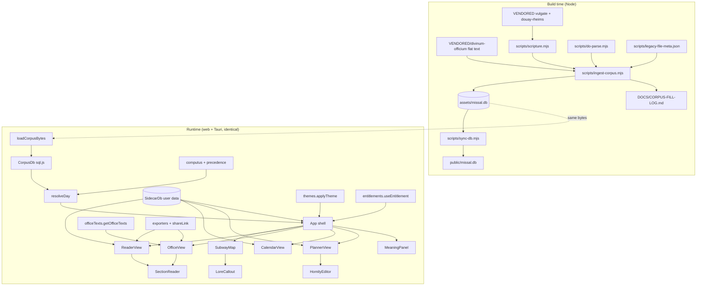

# SanctissiMissa — Authoritative Architecture

> **Current target specification for review: [SM-2026-10-24](#l-complete-multiplatform-target-snapshot--sm-2026-10-24).** Earlier snapshots below are historical. The new complete target registry, diagrams and task contracts are in section L; implementation remains on hold.

> **Current code snapshot — 2026-09-18.** Published on `master` at
> `047374b47124b57e3db2e0866bbfcc8607bb4170`, with the exact source tree of
> local merge `f65f848` (implementation `448a6ab`, upstream `3021d44`;
> package version `1.55.28490`). This snapshot and §7.8
> distinguish implemented behavior from retained target contracts. Historical
> “shipped”, “verified” and phase labels below are dated records, not evidence
> that all planned entities exist or that this revision passed device acceptance.
> This reconciliation documents existing code; it does not approve new features
> or record operator signoff under `CLAUDE.md`.

| Area | Present in the reviewed source | Remaining boundary |
|---|---|---|
| Shell and reading | React 18 / Vite 6 shell; Holy Mass map, Missal Reader, calendar, Office, Scripture, journal, homily planner, annotations, Settings and About. Mass/Office/Bible share `SectionReader`. | `SubwayMap` now has only Mass content; the former Missa/Scriptura/Horæ selector and alternate map routes were removed. |
| Corpus | `CorpusDb` runs sql.js against the same corpus bytes on every platform. Web fetches `/missal.db`; native `load_corpus` returns `tauri::ipc::Response` from `include_bytes!`. | Android Play Asset Delivery described in decision 18 is a target, not the active native loader. This checkout has no provisioned `assets/missal.db`. |
| User data | `src/core/accompaniment/store.ts` implements the separate SQLite sidecar. CKEditor-backed `AccompanimentEditor` uses `body_html`; journal and homily views are present. | Lore tables do not establish that Companion retrieval or memory distillation is integrated. |
| Companion | Shared `CompanionModelsProvider`, explicit preparation, native llama.cpp and browser WebLLM providers, actual progress, authored recovery messages; details in §7.8. | Real Qwen cold-load/reply on the Z Fold, Rust compilation and browser visual acceptance were not completed in this checkout. |
| Guidance | Persistent orientation offer, six authored steps, real DOM highlighting and user-triggered activation; ready Companion receives visible-control context and can explain/highlight. | Generated explanations are requested with “Ask Companion to explain”; the tour does not automatically generate narration for every step. |
| Diagnostics | App-global console/error/fetch/IPC recorder; Settings opens a floating/dockable viewer with filters, pause, copy and JSONL export. | Native library stderr is not captured. Fetch events end at response headers; download byte progress is recorded separately. |
| Library and commerce | Catalogue/provisioning data and LS/RevenueCat contracts are tracked. | No runtime Bookstore/Chant/Reference rail routes or RevenueCat SDK integration in the current shell; server provisioning is not app delivery. |
| Release | Existing version stamp retained from upstream; release scripts remain the release path. | This source merge creates no APK/AppImage or deployment. LFS payload retrieval failed during checkout; source verification does not qualify historical release binaries. |

> **Current Library/Bookstore/Chant/Reference contract — 2026-09-13 (LS-1).**
> The inherited document mixes shipped behavior with pending designs. The audit
> confirmed Haydock commentary and shared reader foundations; it did **not** find
> a working Bookstore/download/entitlement flow or the four requested sidebar
> destinations. Do not read historical architecture prose as proof of delivery.
>
> The adopted [Library and study architecture](ARCHITECTURE/library-study-20260913.md),
> [bookstore service contract](ARCHITECTURE/bookstore-service-20260913.md), and
> [chant/reference contract](ARCHITECTURE/chant-reference-20260913.md) now govern
> this feature wave. [CHECKLIST stanza LS](../CHECKLIST.md#stanza-ls--library-bookstore-chant-and-mass-reference)
> contains the complete GLM execution contract; all 21 tasks begin pending.
> Five exported Stitch screens are frozen under `LIBS/UI/STITCH/sanctissimissa-library-20260913/`.
> The preliminary catalogue has 61 works, eight prayer/collection proposals and
> seven bundle proposals, all candidates pending exact-edition rights review.
>
> LS supersedes conflicting BQ/BU.2 instructions: Haydock and personal study tools
> stay free; paid editions use stable edition entitlements and a single RevenueCat
> controller; permanent ownership survives subscription expiry; missing merchant
> configuration denies new paid access. The launch package is signed JSON; the
> old mandatory corpus SQLite split is not an LS prerequisite. The rest of this
> master remains an inherited contract/audit trail, not a newly reverified release.

> **About media montage & derivative-attribution contract — 2026-09-15 (AM-1).**
> Co-active with LS-1; touches only the About surface and `content/` enumeration.
> The adopted [About media architecture](ARCHITECTURE/about-media-20260915.md) governs
> this wave: build-time enumeration of backstory media in `content/`
> (`ABOUT_MEDIA`, zero-code-change drop-in), `planMediaMounts` regular spacing with
> right-first alternating floats and text reflow, an `AboutLightbox` overlay
> (hover-lift inline; click/tap opens; zoom/pan, arrows, Esc), and the
> derivative-corpus attribution rewording (AboutView metadata line, Kiss
> acknowledgement, license paragraph). Stitch screen
> `dd4c40efd3ee4d2ab5079ceea8fbdc09` is frozen under
> `LIBS/UI/STITCH/sanctissimissa-about-20260915/`.
> [CHECKLIST stanza AM](../CHECKLIST.md#stanza-am--about-media-montage--derivative-attribution)
> carries the execution contract.

**Status:** current master contract, with inherited release history · **Supersedes:** `DOCS/ARCHITECTURE/StAndroidsMissal-v1.md` (retained as the v0.1 historical record) · **Identifier:** `mba.robin.sanctissimissa` · **Version string:** one string across `package.json` / `src-tauri/tauri.conf.json` / `src-tauri/Cargo.toml`

## 1. Overview

**Fork boundary:** SanctissiMissa is the active, distinct application established
by `009aedd8` on 2026-09-04; StAndroidsMissal is frozen. The active slug is
`sanctissimissa`. Earlier product names, release filenames and observations below
are historical provenance; inherited functional contracts continue where the
current contract retains them. The
[FI identity contract](ARCHITECTURE/sanctissimissa-v1.40.21223-fork-identity-20260913.md)
defines the fork identity and migration behavior.

SanctissiMissa renders the Traditional Latin Mass and Divine Office as a navigable subway map. The liturgical corpus is László Kiss' Divinum Officium flat-text tree, **provisioned locally under `VENDORED/`** and re-realized at ingest time as a graph + vector SQLite database (`assets/missal.db`) consumed identically on web and native (Tauri 2). The original fork checkpoint excluded large corpus and release outputs from Git; current release policy restores root `dist/` with Forgejo LFS for binaries while corpus inputs remain locally provisioned. The inherited v0.2 wave added, on top of the shipped v0.1 surfaces: corpus sovereignty (Phase 0, shipped), reader/navigation fixes (A, shipped), the full Ordinary + Divine Office texts (B), subway-map lore callouts (C), a sync-ready user-data sidecar with homily-planner/journal (D), a 6-family × light/dark theme system (E), print/export/share (F), and a modular RevenueCat-authoritative entitlement layer (G).

Requirements source: the operator plan `~/.windsurf/plans/missal-vendor-reader-planner-d2d153.md` (phases quoted per-task in `CHECKLIST.md`).

## 2. Source documents

- `README.md` — product intent, platforms.
- `~/.windsurf/plans/missal-vendor-reader-planner-d2d153.md` — the v0.2 requirements plan (Phases 0, A–G).
- `DOCS/ARCHITECTURE/StAndroidsMissal-v1.md` — frozen v0.1 entity table and inherited decisions 1–7; current identity is defined above.
- `DOCS/CORPUS-SCHEMA.md` — DO flat-text format, directive grammar, gap-fill policy, `missal.db` schema.
- `DOCS/CORPUS-FILL-LOG.md` — regenerated fill audit (2,595 fills at last ingest).
- `LOGS/pr2-6jul2026.md` — session transcript in which Phase 0/A/B1 landed.
- `VENDORED/*/PROVENANCE.md` — upstream pins for divinum-officium, vulgate-clementina, douay-rheims.

## 3. UI Design Reference

**Phase 0.5 (Stitch elucidation) — documented skip.** This is a brownfield product whose design system is the shipped application itself (parchment skeuomorphic base, rail nav, seasonal accent theming, SVG subway idiom). The operator supplied the new surfaces' design intent directly and in detail in the plan file (hover lore callouts C3, calendar indicators D2, theme-painting D4, split-pane editor D6, six named theme families E2) — treated as the operator carve-out design source. New v0.2 surfaces extend existing screens rather than introduce novel journeys. If any C/D/E surface proves visually ambiguous during CODE, iterate back to a Stitch pass under `LIBS/UI/STITCH/` before improvising.

## 4. Architectural decisions

Decisions 1–7 are inherited verbatim from v0.1 (`StAndroidsMissal-v1.md § Decisions`) and remain binding: (1) one query layer everywhere — the collinear rule; (2) directives become edges; (3) commune gap-fill non-inverted; (4) deterministic offline embeddings, model-agnostic table; (5) Latin normative; (6) no placeholder data; (7) one version string.

8. **Corpus sovereignty (shipped, Phase 0).** The entire divinum-officium repo is snapshot into `VENDORED/divinum-officium/` (no `.git`, no upstream tracking); scripture fallbacks in `VENDORED/vulgate-clementina/` + `VENDORED/douay-rheims/`. No build path references outside the repo. Alternative rejected: submodule / external HelloWord db (upstream mercy, offline break).
9. **Generation never breaks (shipped, V0.7).** Broken directives resolve through a fixed chain — same section elsewhere → `vide` Commune → vendored scripture by parsed citation → marked placeholder — every fill logged to `DOCS/CORPUS-FILL-LOG.md`, `meta.filled` on the node.
10. **Two-plane memory.** `missal.db` is canonical, read-only, regenerated only by ingest. All user data lives in a **separate sidecar SQLite** (`SidecarDb`) whose every row carries `id` (uuid) / `device_id` / `updated_at` / `deleted_at` (tombstone) so multi-device + parish-group sync can be layered on without schema change. The two planes never mix; the sidecar never stores corpus text, only `nodeKey`/liturgical-key anchors.
11. **Liturgical-key anchoring for recyclable content.** Homilies anchor to the *liturgical* key (`weekKey` or `Sancti/MM-DD` feast key), not the civil date, with optional per-year overlay rows (`year` column; `year IS NULL` = the base homily). Content recycles annually by construction.
12. **One shared bilingual renderer.** `SectionReader` (extracted from `ReaderView`) renders `ReaderEntry[]` for both Mass and Office modes — annotations, selection menu, and exegesis machinery are written once.
13. **Semantic theme tokens.** All component CSS consumes semantic tokens (`--surface`, `--surface-2`, `--ink`, `--ink-soft`, `--accent`, `--pane-latin-bg`, `--pane-english-bg`, `--rail-bg`, `--card-border`); a theme is a `data-theme` (family) + `data-mode` (light|dark) pair on `<html>`; the seasonal liturgical accent (`data-color`) stays orthogonal. The optional Frosted glass checkbox adds independent `data-glass` material to every palette (GL contract); Slate/Minimal replace the old glass family labels and migrate existing preferences. Eight families × two modes = sixteen cells as pure token blocks — every family declares its core palette in BOTH modes (`html[data-theme='X']` light, `html[data-theme='X'][data-mode='dark']` dark), with mode-level element tokens shared in one dark block; the full contract and matrix live in `DOCS/THEMES.md` and are enforced by `tests/themes.test.ts` (`sanctissimissa` is the Sanctissimissa-template-derived card family, §7.7; `retro-terminal` replaced `neo-brutalist`, legacy id migrates via `LEGACY_FAMILY_ALIASES`).
14. **Lore is hand-authored data, not fetched.** Station/line lore ships as a typed constant module (`stationLore.ts`); no network, no LLM in this phase (decision 6 applies — no fabricated liturgical claims at runtime).
15. **Entitlements: RevenueCat authoritative, gates are data.** The client asks only RevenueCat (key via `VITE_REVENUECAT_API_KEY`, never hardcoded); BTCPay/WooCommerce sync *into* RevenueCat via a server-side bridge specified in `DOCS/ENTITLEMENT-SYNC.md` (interface spec; separate deployable, not this repo's code). `FEATURE_GATES` maps feature → required entitlement or `null` (ungated); v0.2 ships all-`null` (G3) so deciding tiers later edits one map.
16. **Deep links are URL params, parsed once at boot.** `?view=&date=&section=&quote=` — `parseDeepLink` feeds initial App state; share payloads embed the same URL.
17. **The map is ever-present (shipped 2026-07-11, Phase M).** HelloWord's defining affordance — a persistent subway strip at the top of the app so the user always knows *where in the Mass they are* — is a first-class shell element (`MapStrip`), not a view. One `MASS_ORDO` model, two projections: the full vertical map (the `map` view) and the compact horizontal strip (every other view; suppressed where a view already displays its own map — the full-map view, and the office view while its side loop is visible ≥981px). Position tracking is HelloWord's mechanism (IntersectionObserver over the reader's `data-section` anchors, asymmetric reading band, programmatic-scroll guard, index-based past/active/future); theming is ours (`--line-catechumens`/`--line-faithful`/`--line-office` segments, propers as interchange rings in the day's `--accent`). The Office receives the same treatment (novel — HelloWord had none): the eight-hour cursus as the strip in the office view. Hover/focus on any station or hour opens `MapFlyout`: dual-language incipit of the day's real text (English-missing explicitly flagged), a hand-authored one-breath description (`STATION_INFO`/`HOUR_INFO`), and a planned-media slot (inventory: `DOCS/MEDIA-PLAN.md`; flagged until the asset ships — decision 6 applies). Ferial Mass delegation is data-layer policy: `massTextsForDay` says the week's Sunday Mass ("de Dominica praecedenti") when a Tempora feria file carries no Mass sections, rows keeping their true sourcePath.

18. **Corpus delivery is platform-tiered — Android fast-follows (operator, 2026-07-14).** The interpretive layer grew `missal.db` to ~193 MB, at/over Play's AAB base-module download ceiling. Resolution: **desktop** keeps `include_bytes!` (no store limits); **web/PWA** keeps lazy `fetch('/missal.db')`; **Android (Play)** stops embedding — the corpus ships as a Play Asset Delivery asset pack `corpus_pack` with `deliveryType fastFollow` (install completes immediately; the pack streams automatically right after). Android `load_corpus` resolves through a chain: (1) `AssetPackManager.getPackLocation('corpus_pack')` file path once delivered; (2) while fast-follow is still downloading, the existing corpus-loading splash shows pack download progress (AssetPackStateUpdateListener events bridged to the frontend); (3) sideload/F-Droid builds (no Play services) keep today's `include_bytes!` path via a build flag (`SAM_EMBED_CORPUS=1`, the non-Play default — mirrors B-8's build-time-exclusion pattern). One `CorpusPackPlugin` (Kotlin) owns all Play-side pack logic; the Rust `load_corpus` command gains a cfg-gated Android branch that reads the resolved path. The collinear rule is untouched — sql.js still consumes identical bytes everywhere; only byte *transport* differs per platform, exactly as `loadCorpus.ts` already isolates. Decision 19 further shrinks the base pack: the interpretive layer leaves `missal.db` entirely.

19. **Module system — modular by design, premium-gated with a free sample (operator, 2026-07-14).** The app is a host shell + **module registry**. A `Module` = `{ id, kind: 'content' | 'feature', title, railIcon?, entitlement: string | null, delivery: 'builtin' | 'asset-pack' | 'download', version }`. **Content modules** are additional SQLite databases in the *same* graph schema, attached into query scope via `CorpusDb.attachModule(id, bytes)` — the commentary sources leave the base `missal.db` (splitting it back to ~140 MB) and become the first modules: **complete Haydock ships FREE as the sample module** (the canonical DR companion — the free app remains a whole commentary Bible; amendable by operator), Catena Aurea + the 13-source PD roadmap gate on the **`study_library`** entitlement. Future content modules: Gregorian chant notation, Liber Usualis ↔ Mass alignment, per-source patristics/doctors. **Feature modules** are lazily-loaded route components registered into `NAV` — the rail has room for their icons. Roadmap (recorded, not this wave): Publishing Desk (article authoring — journaling's rich-text + the vector reference store behind a writing surface), Latin lessons/translator, choir photo/video post-production, altar-server training. Gating stays pure data (B-1/B-4): `MODULE_GATES: Record<ModuleId, string | null>` reads RC only; free-sample = `null` gate (content-level trial, no expiry — consistent with the trial-is-a-client-side-cap doctrine, no time bombs). Delivery per platform: Play = on-demand asset packs (base corpus stays fast-follow per decision 18); web/desktop/sideload = CC12-stamped versioned downloads from sanctissimissa.robin.mba, cached (web IndexedDB/OPFS; desktop app-data). Charging is for the *integration* (verse-keyed alignment, graph + vector surfacing, offline packaging), never for the public-domain texts themselves — Priority Zero optics are load-bearing. **Portability mandate (operator, 2026-07-14):** this module system is the evolution/practice run for the same capability at the core of **EnZIME** and similar hosts — the registry, gating map, attach mechanism, and delivery plumbing must be host-agnostic (no missal-specific imports in the module core; the host supplies the registry contents), so the whole layer lifts into sibling products unchanged.

20. **Interpretive nuclei are a lossless ordering grammar for vector abundance, never a separate result list or a manual-tag prerequisite (operator, 2026-07-14).** Every user-facing free-text similarity operation first retains its complete requested candidate horizon (`candidateK`, default 64), makes each hit atomic with `bestClause`, and obtains the nearest nucleus clauses through `CorpusDb.interpretiveNucleiForText`. Each candidate is assigned to its most-affine nucleus and receives `contextScore = 0.7 * queryScore + 0.3 * nucleusAffinity`; key-ascending ties are stable. The UI shows at most five context-ordered nucleus groups with at most three representative hits each, then an expandable **Further associations** tail containing every remaining candidate in descending `contextScore`. The completeness invariant is binding: every raw candidate appears exactly once in either a representative slot or the tail; nucleation reorders and explains but never filters. If no nucleus exists, the same complete set falls back to existing concept grouping. Haydock's whole-commentary embeddings provide the first coarse nucleus shortlist; `bestClause` makes each nucleus an atomic, quotable unit carrying `COMMENTS_ON` verse anchors and inherited `INSTANCE_OF` concepts. Manual theme tags remain optional curation/override; no meaning, connection, theme-surfacing, grouping, or long-tail path waits for manual classification. The API operates over the active corpus/module query scope so decision 19's free Haydock module preserves the substrate after the commentary split.

21. **Catholic lore is multi-source and edition-rights-specific; authority is a visible facet, not a relevance multiplier (operator, 2026-07-14).** Nucleus-capable modules may declare `authorityKind: 'scriptural-commentary' | 'catechesis' | 'magisterium' | 'patristics' | 'scholastic-theology' | 'spiritual-classic' | 'encyclopedic'`. Semantic context orders results; the UI displays and filters authority/source chips but never collapses ecclesial authority into a scalar score. Every source ships an exact-edition `NucleusSourceManifest` recording work/edition/translation dates, languages, translator/editor, publication place, rights basis, provenance URL, and checksum. Immediate public-domain seed candidates are the 1833 Donovan *Roman Catechism* scan, Baltimore Catechism Nos. 1–4, pre-1931 U.S. editions of the *Catholic Encyclopedia* and English Dominican *Summa*, and nineteenth-century ANF/NPNF translations. Denzinger's 1911 Latin edition and historical papal/council act editions enter only after jurisdiction/edition review. Modern Vatican portal texts and translations remain link-only unless separately licensed: ancient authorship or magisterial status does not make a modern edition or translation reusable. Historical bulls, conciliar decrees, `Acta Sanctae Sedis`, and early `Acta Apostolicae Sedis` are first-class roadmap material through qualifying old editions or newly prepared transcriptions of source-language text, with modern translations never silently substituted.

22. **Org namespace & the common-storage plane (operator, 2026-09-09).** `.env` names the app's namespace (`VITE_APP_NAMESPACE`, default the identifier `mba.robin.sanctissimissa`) and sets the storage-scope toggle (`VITE_STORAGE_SCOPE`: `common` = org-shared `mba.robin`, `app` = app-private). LLM models (§7.6 Companion) and corpus/module caches (decision 19) store under the resolved root so sibling apps download them ONCE org-wide instead of per app. Capability caps the toggle: web (origin-scoped) and mobile (sandboxed) always degrade to app-private; the desktop shell resolves `<parent(app_data_dir)>/<root>`. **The choice is frozen at build time** — vite `define` bakes the `.env` pair into the bundle (`__SAM_BUILD_STORAGE__`); there is no runtime discretion to flip scope. The toggle exists for namespaces that cannot or will not share (joint production keys). Contract + resolution table: `DOCS/STORAGE-NAMESPACE.md`; org-wide convention: `~/Admin-Manual/DOCS/TOOLING_CONVENTIONS/org-namespace-storage.md` (this contract governs SanctissiMissa; the frozen predecessor keeps its historical identity). Sidecar persistence honors it via the `scopeDir` IPC param with legacy-sidecar fallback; `src/core/storage/root.ts` is the single resolver. LLM weights under this plane are **content-addressed** — store layout `models/sha256/<sha256-of-gguf>/<file>` keyed by the artifact's SHA256 — so every `mba.robin.*` sibling app (`enzime`, `natally`, `kintsugi`, `helloword`, …) converges on the same bytes and a model downloads once org-wide, never per app; the model registry never keys storage by per-app path. The Android cross-app sharing mechanism (public media dir vs `android:sharedUserId` vs signature-permission provider) is the one open decision in this plane — the Android engine task is gated on it (workflow `DOCS/WORKFLOWS/workflow_LS-companion-20260916.md`, risks row 1). **Resolved 2026-09-17 by decision 23 / guide §14.2: SAF user-selected library + optional installed library-provider app + `BlobStoreManager` for immutable blobs; never `sharedUserId`, unrestricted storage permissions, raw `/sdcard`, or assumed access to another app's sandbox.**
23. **Companion engine plane re-baseline — the org-wide chatbot guide governs (operator, 2026-09-17).** `DOCS/CHATBOT_SPECS/Edge_Mobile_Web_LLM_Runners_and_Tauri_2_Strategy_Natally_2026-09-17.md` is the standard organization-wide chatbot guide and the sole authority for the Companion runner layer. The module is the **stable, model-neutral contract** (runner ABI + capability broker + model manager + knowledge services + control plane); engines are **replaceable providers selected from observed capabilities** — never a particular llama.cpp fork, model family, or browser package (guide §11). This supersedes the 2026-09-16 engine roster in §7.6 (TurboQuant-on-every-platform, WebGPU-WGSL-first): TurboQuant is a **KV-cache-compression capability negotiated per runner**, not the application ABI and not a near-term deliverable. The dependable baseline (guide §10 Phase 1) is a **native llama.cpp/`atomic-llama-cpp-turboquant` provider** behind the Tauri 2 Rust command/event bridge on desktop and Android — installed builds must **not require WebGPU** (the Linux AppImage's WebKitGTK webview has none) — plus a **WebLLM worker provider** for browser/PWA and a **CPU/WASM fallback** (`turboquant-wasm`, relaxed-SIMD floor) for low-end or unsupported devices. Models are chosen by a **model picker** (operator directive 2026-09-17: no preview/mock/placeholder engine surface) fed by the Atomic Chat catalogs fused with live `probe()` truth: an automatic qualified default for ordinary users ("no questions about CUDA or VRAM") plus manual selection with a download manager over the decision-22 content-addressed store completed per guide §13–15 (locks, leases, resolve-existing-first, resumable verified downloads, typed access locators). SanctissiMissa acceptance for any engine/model promotion is **retrieval quality and citation fidelity** on the liturgical corpus, not parameter count (guide §7: a specialized 4B–9B may beat a generic 27B for UX). Full contract: §7.8. CHECKLIST Stanza CP is re-derived 1:1 from §7.8; no engine code is written against this decision until the CP tasks carrying it are green.

## 5. Component diagram



## 6. Data flow (critical paths)

**Day resolution (unchanged, shipped):** ISO date → `computus.getWeekKey/getSeason` → `Tempora/<weekKey>` + `Sancti/MM-DD*` nodes → `precedence.resolveWinner` → `DayInfo` (cached per date, never pre-generated).

**Full-Mass reader (shipped, B1; amended M):** `massTextsForDay(db, day)` (propers via `CorpusDb.getMassTexts` with non-inverted commune fill, ferial→Sunday delegation) + `CorpusDb.getOrdoTexts()` (Ordinary) interleaved by `READER_ORDER` into `ReaderEntry[]`, seasonal chant-switch sections filtered by `stationActive`; station click → `App.onStation` → `focus {section, nonce}` → `ReaderView` scrolls its own container deterministically to the `data-section` anchor (`ORDO_STATION_SECTION` maps ordinary station ids → Ordo sections).

**Map-strip position sync (shipped, M):** reader `IntersectionObserver` (band `-20% 0px -65% 0px`, root = the scrolling `.content`, mute-guard around programmatic scrolls) → `onVisibleSection(anchor)` → `stationForAnchor` → `App.activeStation` → `MapStrip` past/active/future by index; strip/office-hour clicks flow the reverse way. Search-hit open (`onOpenKey`) navigates to the hit's source day: Sancti → month-day, Tempora → `dateForWeekKey` inversion, Horas → office view at the named hour.

**Office assembly (B2):** `getOfficeTexts(db, day, hourId)` picks the day's `Horas/` file (`Horas/<winner.key>` else `Horas/<temporaPath>`), pulls its real stored sections via `CorpusDb.getFileSections` (commune fallback via `communeOf`), and orders/filters them through `HOUR_SECTION_PATTERNS[hourId]` (regex slot plans over the ingested DO section names — `Ant Laudes`, `Capitulum Nona`, `Lectio1..9`, …) → `ReaderEntry[]` → `SectionReader`. v0.2 renders every real section the corpus carries per hour; full DO-engine hour construction (psalm schema per weekday/rank) is backlog (§10).

**Sidecar write path (D):** UI mutation → `SidecarDb` upsert (uuid, `device_id`, `updated_at=now ISO`, tombstone delete) → debounced `persist()` (web: IndexedDB blob `sidecar.db`; Tauri: `save_sidecar` command → app-data file).

**Share/deep link (F3):** selection → `buildShareUrl({view,date,section,quote})` → recipient loads app → `parseDeepLink(location.search)` → initial `view/date/focus` state + quote highlight.

## 7. Data model

**`assets/missal.db`** (canonical, read-only — full schema in `DOCS/CORPUS-SCHEMA.md`): `nodes(id, kind∈{file,section}, key, title, category, rank_class, rank_num, color, meta)` · `edges(src, dst, rel∈{HAS_SECTION,CROSS_REF,INCLUDES,EXPANDS}, meta)` · `text_blocks(node_id, section, latin, english)` · `embeddings(node_id, dim, vec int8[128])` · FTS5 `search(key, section, content)`.

**Sidecar `sidecar.db`** (user plane, `SIDECAR_SCHEMA_SQL`, all timestamps ISO-8601 UTC text):

```sql
CREATE TABLE IF NOT EXISTS annotations (
  id TEXT PRIMARY KEY, device_id TEXT NOT NULL, updated_at TEXT NOT NULL, deleted_at TEXT,
  node_key TEXT NOT NULL, quote TEXT NOT NULL, note TEXT, color TEXT NOT NULL DEFAULT 'gold',
  created_at TEXT NOT NULL);
CREATE TABLE IF NOT EXISTS homilies (
  id TEXT PRIMARY KEY, device_id TEXT NOT NULL, updated_at TEXT NOT NULL, deleted_at TEXT,
  liturgical_key TEXT NOT NULL, year INTEGER,           -- NULL = base (recyclable) homily
  title TEXT NOT NULL DEFAULT '', body_md TEXT NOT NULL DEFAULT '',
  status TEXT NOT NULL DEFAULT 'unstarted',             -- unstarted|in-progress|complete
  color TEXT, theme_span_id TEXT);
CREATE TABLE IF NOT EXISTS journal_entries (
  id TEXT PRIMARY KEY, device_id TEXT NOT NULL, updated_at TEXT NOT NULL, deleted_at TEXT,
  liturgical_key TEXT NOT NULL, date TEXT NOT NULL, title TEXT NOT NULL DEFAULT '',
  body_md TEXT NOT NULL DEFAULT '', anchors TEXT NOT NULL DEFAULT '[]');  -- JSON array of nodeKey/verse-ref strings
CREATE TABLE IF NOT EXISTS theme_spans (
  id TEXT PRIMARY KEY, device_id TEXT NOT NULL, updated_at TEXT NOT NULL, deleted_at TEXT,
  label TEXT NOT NULL, color TEXT NOT NULL, start_date TEXT NOT NULL, end_date TEXT NOT NULL,
  cadence TEXT NOT NULL DEFAULT 'weekly');               -- daily|weekly
CREATE TABLE IF NOT EXISTS settings (
  key TEXT PRIMARY KEY, device_id TEXT NOT NULL, updated_at TEXT NOT NULL, value TEXT NOT NULL);
```

Settings keys used: `mode` (`priest`|`laity`), `theme.family`, `theme.mode`, `massForm` (`lecta`|`cantata`|`sollemnis`), `roleLens` (`celebrant`|`diaconus`|`subdiaconus`|`ministri`|`laity`|`none`), `rubrics.visible` (`1`|`0`), `type.face`, `type.size`.

## 7.5 Office-generation plane (v0.3 — the product core; supersedes decision 7's interim scope)

**Mandate (operator, 2026-07-06):** the app generates the **complete Divine Office** — all eight hours, any date — exactly as Divinum Officium's engine reckons it. HelloWord was the Mass-only proof of concept; this product completes it. Nothing office-generation-related is "out of scope"; the interim `HOUR_SECTION_PATTERNS` assembly (P-B rows above) remains only as the already-specified fallback layer under the engine.

**Ingest v3 adds these tables to `missal.db`** (formats verified against the vendored tree 2026-07-06; a live normalization demo produced 257 psalm-schema rows, 24 nocturn versicles, 3,427 skeleton lines across 411 sections, 22 seasonal rows):

```sql
CREATE TABLE office_psalm_schema (   -- from Psalterium/Psalmi/Psalmi {major,matutinum,minor}.txt
  day_key TEXT NOT NULL,             -- 'Day0'(Sun)..'Day6'(Sat)
  hour TEXT NOT NULL,                -- 'Matutinum','Laudes1','Laudes2','Prima','Tertia','Sexta','Nona','Vespera','Completorium'
  nocturn INTEGER,                   -- Matins 1..3, else NULL
  slot_ord INTEGER NOT NULL,
  antiphon_la TEXT, antiphon_en TEXT,
  psalm_ref TEXT NOT NULL,           -- '92', '9(2-11)', '118(33-48)'
  festal_bracket INTEGER NOT NULL DEFAULT 0);  -- bracketed = displaced on feasts
CREATE TABLE office_nocturn_versicle (day_key TEXT, nocturn INTEGER, versicle_la TEXT, response_la TEXT, versicle_en TEXT, response_en TEXT);
CREATE TABLE office_skeleton (       -- from Psalterium/Special/{Matutinum,Major,Minor,Prima} Special.txt + Preces.txt
  hour_file TEXT NOT NULL, section TEXT NOT NULL, ord INTEGER NOT NULL,
  line TEXT NOT NULL,                -- verbatim: text, or @/&/$ directive, or (condition)
  is_directive INTEGER NOT NULL, is_condition INTEGER NOT NULL);
CREATE TABLE office_seasonal (kind TEXT NOT NULL, key TEXT NOT NULL, body_la TEXT, body_en TEXT);
  -- kind ∈ invitatory (SOURCE: 'Matutinum Special.txt' [Invit*] sections — NOT Major Special), marian_ant (Mariaant.txt), doxology (Doxologies.txt), benediction (Benedictions.txt)
CREATE TABLE role_rubrics (          -- DO-provided granularity ONLY (operator 2026-07-06): parsed from missa Ordo.txt '!' rubric prose
  section_key TEXT NOT NULL,         -- e.g. 'Ordo/Missae#Incensatio'
  form TEXT NOT NULL,                -- 'lecta' | 'sollemnis' | 'both'  (Cantata = derived display: sollemnis minus sacred-minister rows)
  role TEXT NOT NULL,                -- 'celebrant'|'diaconus'|'subdiaconus'|'ministri'|'all'
  ord INTEGER NOT NULL, latin TEXT, english TEXT,
  source_line TEXT NOT NULL);        -- provenance: 'Ordo.txt:62'
```

**Runtime engine:** `OfficeEngine` (`src/core/office/engine.ts`) — `buildHour(db: CorpusDb, day: DayInfo, hourId: string, opts: OfficeOpts): ReaderEntry[]`. Algorithm: (1) select the hour's skeleton sections; (2) evaluate `(condition)` lines against `{season, rank, weekday, rubricSet: '1960'}` (grammar: `sed rubrica …`, `si …`, day/season names — the vendored `(sed rubrica praedicatorum/cisterciensis/monastica)` branches are skipped: we fix rubricSet 1960/Romana); (3) resolve `@file:section[:xform]` / `&macro` / `$prayer` directives at generation time against the graph (same resolver contract as ingest, now runtime — `INCLUDES`/`EXPANDS` edges make targets queryable); (4) psalmody from `office_psalm_schema[day_key]` with festal displacement (feast propers/commune override bracketed slots; I-class = proper psalms where the Sancti file carries them); (5) seasonal layer: invitatory, hymn doxology, Paschal alleluia appendage, Marian antiphon at Compline (`office_seasonal`); (6) precedence/commemoration from the existing `resolveWinner` + occurring Sancti (commemoration = the commemorated office's antiphon+versicle+oratio after the day's collect; this rule also resolves the Octava-placeholder cluster in `DOCS/MISSING-REFERENCES.md` §1); (7) missing-text resolution per routes S→A→C below. Mass side reuses steps 2–3 to build the `role_rubrics`-aware rubric layer.

**Missing-primary-material resolution (operator policy, final priority):**
- **Route S (primary preferred):** scriptural text (explicit `!` citation or derivable — psalm number, lesson incipit) with one language held → counterpart **looked up** from Clementine Vulgate (la) / Douay-Rheims (en), both vendored, public domain.
- **Route A:** non-scriptural text present elsewhere in the DO tree → substitute; missing counterpart language → in-style ecclesiastical cross-translation (metre/constructions matched).
- **Route C:** Ordinary/euchology absent from DO → in-style our-licensed generation; neither language → two-step (our interpretation, then our translation of our interpretation). Licensing impediments anywhere also route here.
- All supplied text: `meta.translationSupplied`/`meta.filled`, rendered via tokens `--supplied-ink`/`--supplied-bg` (lighter ink, tinted bg, all 12 themes), provenance on hover, every fill in the fill log. Register: `DOCS/MISSING-REFERENCES.md` (166 distinct directives; 13,596 Latin-only + 263 English-only sections). Target after routes run: **0 shipped `textus deest`** (gauntlet O-16).

**Presentation tray** (`src/ui/TrayPanel.tsx`, slide-out on all views): theme family + light/dark (relocates ThemePicker), Mass-form toggle (lecta / cantata-derived / sollemnis), role lens (DO-provided roles only), rubrics on/off master toggle, typeface selection (bundled-local families: serif liturgical default + sans + dyslexia-friendly; no remote fonts) and font-size control — all persisted in sidecar `settings` (keys above), applied via `data-*` attrs/CSS vars. Gauntlet §Y binds.

## 7.6 Bible + Accompaniment plane (v0.4 — scripture, one-object sidecar, companion, parish edition)

**Mandate (operator, 2026-07-12):** promote the vendored Bibles to a first-class **Bible plane** — full reading experience, annotating journal, bible-study program with in-parish support materials, Chat-with-Bible, daily reading programming, Android home-screen widgetry — and unify all user-authored material into **one object**.

**Unification decision (supersedes the §7 `homilies`/`journal_entries`/`theme_spans` three-table split):** journaling, the priest's homily-management system, bible-study support materials, and parish newsletters/admin distribution materials (institutional edition) are **one object type** — the rich-text **Accompaniment** — differentially exposed. An accompaniment is optionally anchored to deep-linkable content (verse, section, day) and surfaced by *occurrence selectors*: fixed dates, moveable feasts (temporal week-keys), immovable feasts (MM-DD), seasons, free-form themes (the priest dreams up a theme and applies it arbitrarily; Commune classes and the concept taxonomy are autocomplete *suggestions*, never the domain), and non-liturgical recurrences (every-Wednesday class, First Fridays). Highlights/margin notes are lightweight accompaniments (the §7 `annotations` shape migrates in, old localStorage key preserved read-only). Provenance (`authored`/`generated`/`vendored`) is a field, not a filter on what may exist; generated parish materials are curated-and-reviewed before shipping, attributed as AI-assisted — live generation happens only in chat, where its nature is self-evident.

**Ingest Pass 4 — Bible corpus (`scripts/ingest-bible.mjs`, wired into `ingest-corpus.mjs`):** the two vendored Bibles land in the *existing* graph tables — nodes `book:Gen` / `chapter:Gen/1` / `verse:Gen/1/1` (kinds `book|chapter|verse`), `text_blocks` latin=Clementine Vulgate (`vul.tsv`) / english=Douay-Rheims (`EntireBible-DR.json`), edges `HAS_CHAPTER`/`HAS_VERSE`, verse FTS rows, verse-level embeddings (~35k × 128 int8). A 73-book mapping table (`BOOK_MAP`: DR JSON keys ↔ vul.tsv names/abbrevs ↔ canonical key) is the shared vocabulary. Liturgical sections gain **`CITES` edges** to verse ranges (from the existing citation parse), meta `{quality: 'exact'|'adapted'}`. **Normalization boundary:** displayed liturgical text stays verbatim — liturgical quotations are adapted (spliced verses, alleluias, Old-Latin psalter readings) and the prayed text is normative (Decision 5); but gap-filled scripture (`meta.filled`) becomes a verse *reference* instead of copied text — verbatim by construction, deduplicating storage and making every fill verse-traceable. New `missal.db` tables: `reading_plans(id, title, kind)` + `plan_day(plan_id, ord, verse_refs)` for daily reading programming (liturgical-year-aligned + canonical whole-Bible plans).

**Sidecar v2 (`SIDECAR_SCHEMA_SQL_V2`, SQLite via the already-loaded sql.js — the collinear rule extended to user data; platforms differ only in byte persistence: web OPFS/IndexedDB, Tauri app-data file, mirroring `loadCorpus.ts`):**

```sql
CREATE TABLE IF NOT EXISTS accompaniments (
  id TEXT PRIMARY KEY, device_id TEXT NOT NULL, updated_at TEXT NOT NULL, deleted_at TEXT,
  title TEXT NOT NULL DEFAULT '', body_pm TEXT NOT NULL DEFAULT '',   -- legacy ProseMirror JSON (read-only since the 2026-09 CKEditor swap)
  body_html TEXT NOT NULL DEFAULT '',                                 -- rendered snapshot (share/print/export)
  anchors TEXT NOT NULL DEFAULT '[]',                                 -- JSON array of node keys ('verse:Gen/1/1','section:…') or []
  exposure TEXT NOT NULL,                    -- 'journal'|'homily'|'study'|'newsletter'
  provenance TEXT NOT NULL DEFAULT 'authored',  -- 'authored'|'generated'|'vendored'
  quote TEXT, color TEXT,                    -- lightweight highlight fields (annotation migration)
  created_at TEXT NOT NULL);
CREATE TABLE IF NOT EXISTS occurrences (     -- occurrence selectors, N per accompaniment
  id TEXT PRIMARY KEY, accompaniment_id TEXT NOT NULL, kind TEXT NOT NULL,
  -- kind ∈ date(iso) | temporal(weekKey) | sancti(mmdd) | season(name) | theme(free-form tag) | recurrence(rule)
  value TEXT NOT NULL);
CREATE TABLE IF NOT EXISTS lore (            -- CompanionMemory layer 1: SOUL.md-style, user-visible AND user-editable
  id TEXT PRIMARY KEY, device_id TEXT NOT NULL, updated_at TEXT NOT NULL,
  kind TEXT NOT NULL,                        -- 'journey'|'parish'|'persona'
  body_md TEXT NOT NULL DEFAULT '');
CREATE TABLE IF NOT EXISTS sidecar_embeddings (  -- CompanionMemory layer 2: embedText (Decision 4, model-agnostic)
  ref_id TEXT PRIMARY KEY, dim INTEGER NOT NULL, vec BLOB NOT NULL);
CREATE TABLE IF NOT EXISTS parish_profile (  -- institutional edition: header space / masthead
  key TEXT PRIMARY KEY, value TEXT NOT NULL);  -- name, logo(dataURI), letterhead, colors, address
CREATE TABLE IF NOT EXISTS reading_progress (plan_id TEXT NOT NULL, ord INTEGER NOT NULL, completed_at TEXT NOT NULL);
-- settings table carried over from §7 unchanged
```

**Resolution:** `accompanimentsForDay(db, sidecar, iso)` projects every selector kind onto a concrete date via the existing computus (`resolveDay`, `dateForWeekKey`) and recurrence evaluation; `forAnchor(nodeKey)` and theme/tag facets serve anchored and longitudinal queries.

**Deep links (address layer for shares, widgets, chat):** hash routes `#/verse/Gen/1/1` · `#/section/<path>#<name>` · `#/day/YYYY-MM-DD` · `#/acc/<id>` layered onto the existing history-based back-nav; the deployed web app (sanctissimissa.robin.mba) is the public resolver for shared links (`navigator.share`/copy: rendered snapshot + deep link to the primary source).

**Exposure surfaces:** `BibleView` (rail "Sacred Scripture": book/chapter navigation, bilingual verse reader on ReaderView patterns, selection → MeaningPanel unchanged, "appears in the liturgy" via CITES) · `JournalView` (date timeline) · `HomilyPlanner` (selector-projected planning calendar; "this Sunday's drafts") · `StudyBuilder` (class centroid: recurrence group + passage anchors + session materials; print stylesheet for handouts) · `NewsletterDesk` (**institutional entitlement only**: `anchors: []` + calendar selectors; outputs from `body_html` — print, email-ready HTML export, share link; `parish_profile` masthead). One rich-text editor for all: `AccompanimentEditor` (CKEditor 5, GPL build, via `src/ui/richtext/RichTextEditor.tsx`; **`body_html` is the source of truth**, `body_pm` is a legacy read-only column — every TipTap-era row already carried the HTML snapshot, so no migration).

**Companion (journey companion with lore memory; one engine contract across the app, own rail icon):** `IInferenceEngine` — `probe/init/generate/batchScore/kvStats/reset/close`; handles stay opaque (no GPUBuffer, native pointer or raw K/V tensor crosses the interface; KV cache is owned by the worker/GPU engine or native session — never shipped through postMessage or per-token IPC) — implemented by the reusable **`reusable-chatbot/`** module (Liturgibot is a consumer, not the owner; operator decision 2026-09-07, re-baselined 2026-09-16 — **that engine roster is superseded 2026-09-17 by decision 23 / §7.8 (org-wide chatbot guide): capability-negotiated replaceable providers, native llama.cpp + WebLLM + WASM as the Phase-1 baseline, TurboQuant demoted to a per-runner KV capability, model picker added**). Engines per §7.8.2. KV policy turbo3/turbo3 preferred (turbo4 fallback, turbo2 constrained); weight quant (Q4_K_M / TQ4_1S / Q6_K / Q8_0 / TQ3_1S) independent of KV format. Models are **selected** from the Atomic Chat catalogs (`rebots-online/atomic-chat-conf` recommended/staff-picks + `models/inference-profiles.json`; `rebots-online/atomic-chat-model-catalog`) fused with live `probe()` capability truth — never hardcoded — and their weights download **once** into the decision-22 org-common content-addressed store. **ChatView presentation (operator directive 2026-09-16):** the default surface is an **intercom-style badge ("porthole")** — persistent, low-chrome, animated in the kintsugi/natally house style with occasional idle gestures (signing with a cross, waving; `prefers-reduced-motion` reduces to static states) — expanding to a chat panel that is **fully dockable and resizeable** (dock left/right, floating, inline, fullscreen; mobile sheet). `HostedEngine` (metered proxy) remains a later tier. Read access to the full sidecar and corpus. Serves the end user (navigating, discussing a theme, evaluating over time how a theme has figured in their life as journaled) and the priest (examples/inspirations while writing, over his own past homilies + journal + commentary + the feast's liturgy). `CompanionMemory`: lore documents (distillation loop on idle/save, size-capped to E2B context, user-editable) + vector recall over `sidecar_embeddings` fused with theme/date facets. Context per turn: persona + lore + retrieved memories + current position + CITES links; replies cite deep links; saved insights become accompaniments (`provenance='generated'`).

**Entitlement vocabulary (I-3; RC per BILLING_CONVENTIONS B-1..B-6, one controller `has(entitlementId)`):** `companion_ondevice` (unlimited on-device) · `companion_hosted` (metered hosted, RC consumable/credits) · `institutional` (parish edition: NewsletterDesk + ParishProfile). Free trial = client-side cap on companion feature activation, no entitlement.

**Commentary reference layer:** Haydock (public-domain DR commentary) vendored at `VENDORED/haydock/` per the vendoring regime (provenance lock before assimilation), ingested as verse-keyed commentary blocks, rendered read-only in BibleView, insertable as `vendored` material in StudyBuilder.

**Android widget:** Kotlin `AppWidgetProvider` in `src-tauri/gen/android` — today's feast + daily reading refs, deep-link intent (hash route); data JSON maintained by the app + daily refresh. Web = PWA shortcuts; desktop skipped in v1.

## 7.7 Presentation & meaning plane (v0.5 — sanctissima theme, interleaved bilingual, similarity UX, Scripture Atlas, interpretive layer, journal sidecar workspace)

**Mandate (operator, 2026-07-14):** five coupled presentation/meaning upgrades — an alternate theme derived from `DOCS/Sanctissimissa-Template.html`; a mobile-usable interleaved bilingual layout with dual-language selection; vector similarity made *useful* (clause atomicity, relative-distance glyph, imagery grouping); meaning-first Scripture navigation (imagery/scenarios, Gospel parallels, differential sizing); and the Journal/Homily Management workspace per `DOCS/standroids-journal-sidecar-standalone.html` + the 2026-07-14 PRD (`DOCS/StAndroidsMissal-Additional-PRD-pieces_copilot_message_export_july_14_2026_1_50am.md`). Architected for parallel coder dispatch: one shared-file owner per wave (open question 8 amended below).

**Sanctissimissa theme family (extends decision 13):** `ThemeFamily` gains `'sanctissimissa'`. Background tokens retain the parchment framework (operator: keep the framework's background colouring); content surfaces render as **elevated white cards** (`--card`, `--card-shadow`, 12px radii), accordion section heads on the existing fold/unfold affordance, propers sections carry a gold left border + warm tint. New **liturgical text-role tokens consumed by every family**: `--rubric` (rubric red), `--dialogue-p` (priest/versicle voice), `--dialogue-s` (server/response voice). Line-prefix detection (`dialogueClass`, `src/core/text/dialogue.ts`) is rendering-level only — stored corpus text is never modified: `V.`/`℣.`/leading `P.` → dialogue-p; `R.`/`℟.`/leading `S.` → dialogue-s. Selectable alternate: `DEFAULT_FAMILY` stays `'skeuomorphic'`; both families ship light + dark. Fonts stay bundled-local (the template's Crimson-Pro feel = local serif stack bias, no remote fonts). The template's translation-popup idiom is already served by the shipped word-callout/echo grammar — not duplicated.

**Interleaved bilingual mode:** below 1100px (and later by user preference `reader.layout`), the two-pane grid is replaced by a single interleaved column rendered by the shared renderer `BilingualText` (`src/ui/BilingualText.tsx`, extracted from ReaderView's internal TextBlock; adopted by ReaderView, OfficeView-via-SectionReader when P-B lands, and BibleView at verse granularity): per aligned line *i* — Latin first (**bold**, `--ink`), its English beneath (indented 1.1em, italic, `--ink-faint`), then a gap before the next pair; NULL English → Latin-only row. The existing `selectionchange` single-line echo extends to the **full line-range** of the live selection, lighting every counterpart row (`.xlate-echo`) in both directions — the cursor effectively selects both languages simultaneously. CSS block `.bilingual-interleaved`.

**Similarity UX (MeaningPanel):** each similar-hit gains (a) **clause focus** — `bestClause(text, query)` (`src/core/vector/clause.ts`) splits on `.:;·` boundaries (min 25 chars/clause), embeds clauses via the existing `embedText`, cosine-argmax; the winning clause renders emphasized with the remainder collapsed behind "more" — hits become quotable at semantic-clause granularity; (b) **`SimilarityGlyph`** (`src/ui/SimilarityGlyph.tsx`) — an icon-sized radial SVG: query at center, this hit's dot at radius ∝ (1−score), siblings ghosted, so relative relatedness is visible at a glance; the raw score demotes to a tooltip; (c) **imagery grouping** — `IMAGERY_CONCEPTS` (~15 imagery/metaphor/typology concepts with seed phrases: Light & Darkness, Shepherd & Flock, Vine & Vineyard, Water & Baptism, Bread from Heaven, Lamb & Sacrifice, King & Kingdom, Bridegroom & Bride, Desert & Exile, Mountain of God, Temple & Dwelling, Harvest & Vintage, The Way, Rock & Foundation, Fire & Spirit) merged into `concepts.ts` and ingested exactly like the existing taxonomy, so `INSTANCE_OF` grouping spans OT/Psalms/NT through the verse nodes; (d) **lossless nucleus ordering** — every `groupedSimilarToText` UI consumer moves to `nucleatedSimilarToText`: context-matching nucleus groups and atomic representatives first, the complete non-representative remainder under **Further associations**. Every card retains query score, nucleus affinity, source/authority chip, and why-bridge; nuclei are automatic, and manual theme tags are optional curation only.

**Scripture Atlas (BibleView navigation modes):** `AtlasMode = 'canonical' | 'imagery' | 'parallels'` — meaning-first navigation is additive; canonical grids remain. *Imagery mode:* imagery concepts as a differential-size label field (font-size ∝ √(linked verse count); liturgical prominence via CITES counts) grouped under hand-authored `SCENARIO_CLUSTERS` (Creation & Fall, Exodus & Desert, Kingdom & Exile, Wisdom & Psalter, Incarnation, Public Ministry, Passion, Resurrection & Church); tapping a label lists its verse ranges grouped OT/Psalms/NT. *Parallels mode:* `PERICOPES` (`src/core/ontology/parallels.ts`, curated ~60-pericope spine × Mt/Mc/Lc/Jo columns, cross-checked against the vendored Catena Aurea) as aligned rows, font weight ∝ CITES count, click-through `#/verse/…`; chapter-level embedding cosine supplies "complementarities" between untabled stretches.

**Interpretive layer (generalizes the §7.6 Haydock row):** any cleared source vendored under `VENDORED/<source>/` (clone-at-home; `PROVENANCE.md` + `NucleusSourceManifest` lock **before** assimilation — INC-15; additive, nothing deleted) ingests into the existing graph tables with source/authority metadata, embeddings, and FTS. Verse commentary uses `kind='commentary'`, key `commentary:<source>/<Book>/<ch>/<verse>`, and `COMMENTS_ON`; catechetical, magisterial, patristic, scholastic, spiritual, and encyclopedic atomic units keep source-native keys and connect by explicit `CITES`/`INSTANCE_OF` evidence rather than fabricated verse alignment. Query surfaces: `CorpusDb.commentaryFor(book, ch, verse?)` for direct attribution, `CorpusDb.interpretiveNucleiForText(text, opts?)` for atomic multi-source nuclei, and `CorpusDb.nucleatedSimilarToText(text, opts?)` for the complete ordered similarity set. This wave's active nucleus provider is Haydock: whole records coarse-rank by committed embeddings, `bestClause` reranks the shortlist, and verse/concept evidence attaches without re-ingest or manual tags. **This wave ships Haydock 1883** (fulfils the §7.6 row) **and Catena Aurea** (Newman tr. 1841–45); the remaining sources in `DOCS/ScripturalReferences-PublicDomain.md`, plus decision 21's catechetical/magisterial roster, are roadmap modules over the same source-manifest and nucleus contracts. BibleView renders direct commentary read-only; MeaningPanel and ConnectionsPanel consume the lossless nucleated result set.

**Journal sidecar workspace (UI elaboration of §7.6 B-C/B-D per the prototype + PRD):** reader context menus (ReaderView, BibleView, OfficeView once SectionReader lands) gain **"✎ Add to Journal/Homily notes"** and **"🖍 Highlight both panes"**. Capture opens `JournalSidecar` (`src/ui/JournalSidecar.tsx`, right split pane on the MeaningPanel pattern): source block (bilingual quote via `alignSelection` + anchor nodeKey/verse ref + capture timestamp), embedded `AccompanimentEditor`, `ConnectionsPanel` (corpus vector hits via `nucleatedSimilarToText` over note+quote, the user's own past accompaniments via runtime `embedText` against `sidecar_embeddings`, and direct commentary blocks; every card carries a why-bridge line + evidence chips + add-as-source/dismiss — routes, not bare similarity scores), a destinations row mapping to `exposure` + `OccurrenceSelector` (keep as journal | promote to homily seed | attach to theme/series | schedule for a liturgical occasion), and toast feedback. Dual-pane highlight = lightweight accompaniment (quote + quoteAlt) rendered through the existing `mark.ann` pipeline in **both** panes. Priest/laity vocabulary from settings `mode`. Voice dictation and attachments: schema-ready (`attachments` JSON per PRD), out of scope this wave.

## 7.8 Companion engine plane — target contract and current implementation (2026-09-18)

**Reading rule.** The organization-wide guide remains the design direction.
The implementation columns and §7.8.7 are the current source snapshot. A target
ABI method, provider, storage policy or qualification described by the guide
must not be reported as implemented merely because it is specified here.

**Authority and supersession (operator, 2026-09-17).** This section re-baselines the Companion runner layer 1:1 from `DOCS/CHATBOT_SPECS/Edge_Mobile_Web_LLM_Runners_and_Tauri_2_Strategy_Natally_2026-09-17.md` (the standard organization-wide chatbot guide; its §1–11 research is dated 2026-09-13 and its §12–22 Natally continuation supplies the shared-storage/runner-decision patterns — both govern direction, neither replaces this product contract). It **supersedes the 2026-09-16 engine roster inside the §7.6 Companion paragraph** ("TurboQuant on every viable execution platform", WebGPU-WGSL-first, CP.3-era engine order) and the §9.4 `InferenceBackend` row's provider list; everything else in §7.6 (ChatView presentation, CompanionMemory, entitlements, one-object sidecar) stands unchanged. Operator directive recorded with this re-baseline: **the Companion ships no preview/mock/placeholder engine surface to users** — the mock `MockEngine` remains a test fixture behind the same interface only; every user-facing engine surface is a real provider or an honest "unsupported/needs setup" state.

### 7.8.1 Layer contract (guide §5 — the module is the contract)

| Layer | Shared contract | SanctissiMissa realization |
|---|---|---|
| Experience | ChatView badge/panel (§7.6, CP.5 — landed), transcripts, citations, model picker surface | existing `src/ui/ChatView.tsx` + `ModelPicker` (§7.8.5) |
| Orchestration | messages, retrieval, prompt policy, cancellation — no runner-specific imports | `ChatController` currently probes/initializes providers, keeps in-memory turn history and streams generation; optional system context carries orientation. Retrieval is not wired into this path. |
| Capability broker | probe memory, acceleration, context ceiling, model formats, tool constraints | `capability-broker.ts`; native build/CPU report and browser adapter/memory heuristics. No smoke generation or measured memory qualification occurs during the probe. |
| Runner ABI | target `load, warmup, generate-stream, embed, tokenize, cancel, unload, health, estimateMemory` | Implemented `IInferenceEngine` is `probe/init/generate/batchScore/kvStats/reset/close`; extended methods remain targets. Native cancellation/tokenization also have IPC commands. |
| Model manager | signed manifest, resumable chunks, hashes, variants, storage policy, license acceptance | `DesktopModelLibrary`, `WebModelLibrary`, `DownloadManager` implement lookup/write/verification/locking. Signed manifests, resume, leases and license acceptance are not implemented. |
| Knowledge services | corpus retrieval, embeddings, graph memory, citations, context packing | Corpus graph/vector queries and sidecar lore storage exist outside the current chat path. No `CompanionMemory` implementation or retrieval/citation injection in `ChatController`. |
| Control plane | entitlements, model catalog, optional hosted fallback | Vendored native catalog and executable WebLLM manifest are connected. RevenueCat gates and hosted inference remain target integrations. |

### 7.8.2 Runner provider roster and phases (guide §4, §10)

The correction this roster embodies: **stop treating a particular fork, model family, or browser package as the module.** TurboQuant is a KV-cache-compression capability negotiated per runner — compressing the growing cache, never the weights — and is developed as Phase 2, not Phase 1.

| Provider | Current executable surface | Target role / phase |
|---|---|---|
| **Native llama.cpp** | `NativeRunnerProvider` → official Tauri invoke/Channel → `src-tauri/src/inference.rs`, using `llama-cpp-2` 0.1.156. Enabled only with `native-inference`, 64-bit, non-Windows. Model object persists; generation creates its context per call and uses greedy sampling. | Phase 1 installed-build baseline. Windows and 32-bit Android are compiled as unsupported stubs, even on a Windows-native host under the current cfg. No atomic-TurboQuant fork or GPU backend selection is wired here. |
| **WebLLM** | `WebLlmRunnerProvider` calls `CreateMLCEngine` in the page, using the installed package's compiled-model manifest and cache. | Phase 1 browser baseline. Worker hosting and self-hosted model/runtime assets remain targets; the current code does not construct a worker. |
| **CPU/WASM fallback (`turboquant-wasm`)** | Dependency/vendored material only; no connected fallback provider. | Phase 1 target, currently unimplemented. A browser without WebGPU cannot generate through the current app. |
| TurboQuant KV compression | wherever fused kernels are validated (native first) | Phase 2 context advantage; capability flag, not a UX mode |
| Bonsai 27B 1-bit/ternary | qualified flagships/laptops only | Phase 3 optional high-density tier; promotion only where it beats baseline end-to-end (guide §9 matrix) |
| LiteRT-LM | cross-platform CPU/GPU/NPU challenger | Phase 4 strategic second engine, qualification-gated |
| llama.cpp WebGPU (LlamaWeb) | browsers | Phase 5 consolidation candidate — the superseded 2026-09-16 "WebGPU TurboQuant WGSL engine extraction" idea lives on here, as a *later* phase, not the near-term deliverable |
| `HostedEngine` (metered proxy) | entitlement `companion_hosted` | later tier, unchanged from §7.6 |

**Qualification target:** a provider must pass smoke generation and device memory,
latency and cancellation checks before being called qualified. Current probes do
not perform this acceptance. The native probe reports a fixed 3 GiB budget and
8,192-token ceiling; these are configured ceilings, not Z Fold measurements.

### 7.8.3 Model tiers and acceptance (guide §7, §8)

| Tier | Target | Strategy |
|---|---|---|
| Native preferred default | Compatible installed runtime | **Qwen 3.5 2B**, from `config/companion-defaults.json`, takes precedence when the catalog/budget filter accepts it. LFM is excluded from automatic fallback selection. This is configured preference, not device qualification. |
| Browser default | WebGPU browser | First budget-compatible executable entry from WebLLM's size-ordered manifest. It is not represented as Qwen 3.5 2B unless that exact executable entry exists. |
| Quality | 12–16 GB devices | **4B–9B** specialist — beats a generic 27B for this UX (guide §7 SanctissiMissa row) |
| High-density experimental | qualified flagships | Bonsai 27B 1-bit — conditional on Phase-3 qualification |

**Acceptance for any model/engine promotion is retrieval quality and citation fidelity on the liturgical corpus** (feast/propers questions answered from the corpus with correct deep links), plus cold-load, first-token latency, sustained decode, peak memory with UI + index active, and cancellation — not parameter count or generic benchmarks (guide §9 harness, adapted).

### 7.8.4 Model manager — retained target contract (partially implemented)

Decision 22's content-addressed layout (`models/sha256/<digest>/…` under the
resolved storage root) is implemented. The following completion requirements
remain the target contract; §7.8.7 records what exists and its limits:

- **Build-config parity:** one generated artifact (`scripts/generate-storage-config.mjs` → `config/asset-storage.generated.json`: `{schema, scope}`) consumed by BOTH Vite and Rust (`src-tauri/src/storage_config.rs`, `include_str!` + `cargo:rerun-if-changed`); generated under the release lock; build fails on generation/parity failure. `src/core/storage/root.ts` remains the frontend resolver, now reading the generated config.
- **Content identity:** SHA-256 + exact byte count; immutable object paths; a small transactional **catalogue/alias index** maps logical model IDs/revisions → digests (multiple aliases may resolve to the same bytes); runtime qualification (backend, context limit, chat template, hardware evidence) is recorded separately from file presence.
- **Resolve-existing-first:** lookup checks the shared library, then authorized legacy/private caches, before any network acquisition; missing-permission is a distinct result from missing-bytes; after a denied/expired grant the UI offers "Use existing library"/"Allow access", never a silent second multi-GB download.
- **Concurrency:** digest-keyed **cross-process lock** (OS file lock on desktop — a JS mutex cannot serialize unrelated native processes), re-lookup inside the lock, single writer, resumable HTTP-Range downloads with ETag/revision validation, hash of the persisted **full** content before commit, atomic verified publication with `.complete` marker; interrupted/corrupt artifacts never resolve.
- **Typed access locators + leases:** native path / descriptor+offset / document URI / browser handle — never a forced path string from web content; readers hold leases for the engine's lifetime; app removal releases claims, never shared bytes.
- **Platform roots (guide §14):** Linux AppImage/deb `~/.local/share/<scope>` (XDG); Windows Profile-root shared library (MSI + MSIX editions converge outside virtualized AppData — see guide §19.3, applies when the Windows native host lands); browser/PWA OPFS/Cache Storage under the origin with persistence requested and quota checked; **Android (resolves the decision-22 open question):** SAF user-selected library (persistable URI grant per app) + optional installed library-provider app owning catalogue/download transactions + `BlobStoreManager` for immutable blobs with exact shared `BlobHandle` identity; a content URI is opened via `ContentResolver` with seekability qualified — never converted to a filesystem path; materializing an unseekable provider is recorded as a second disk copy, honestly.

### 7.8.5 Model registry and the model picker (operator directive 2026-09-17)

The native catalog comes from the vendored Atomic Chat catalogue/recommendations
under `reusable-chatbot/model-registry/data/`, with provenance recorded alongside
them. `buildCompanionCatalog` adds the explicitly configured Qwen 3.5 2B preference,
ranks/deduplicates entries, and filters by the capability report. Browser choices
come from WebLLM's actual `prebuiltAppConfig.model_list`, not native GGUF files.
Selection persists in localStorage, separately from sidecar settings. Ranking and
budget estimates do not prove architecture support, download size or successful
inference on a particular phone.

The model picker and ChatView show the selected/recommended name, approximate
size, “Companion choices” and “Prepare Companion”. Preparation starts explicitly;
an already verified selected native model is initialized automatically. Settings
and chat share one provider. Downloading/verifying/file-present and engine-ready
are distinct states. No resume, usage accounting or claim/delete control is exposed
by the current picker. Browser “About … MB” currently derives from manifest VRAM
requirements, not an exact transfer size. Errors use authored guidance; raw
details go to Diagnostics. The old mock remains an unconnected test helper.

### 7.8.6 Current entity table (source snapshot)

| Entity | Contract |
|---|---|
| `CapabilityReport` (`reusable-chatbot/core/capability-broker.ts`) | `{ runtime: 'tauri'\|'web'\|'android', memoryBudgetBytes, accelerations: string[], contextCeiling, weightFormats, kvFormats, threads, notes }` — probed per platform (Rust probe native; JS probe web), cached per session, re-probed on demand |
| `NativeRunnerProvider` / `WebLlmRunnerProvider` | `reusable-chatbot/engines/native/index.ts` / `engines/webllm/index.ts`; native commands in `src-tauri/src/inference.rs`. Two connected providers; no `WasmRunnerProvider` implementation. |
| `AssetStorageConfig` | generated `config/asset-storage.generated.json` `{schema, scope}`; one artifact feeds Vite + Rust; fails closed |
| `ModelLibrary` / `DesktopModelLibrary` / `WebModelLibrary` | Interface in `src/core/model-store/types.ts`; classes in `store.ts`. `lock`, `lookup`, `beginWrite`, `remove`, `onProgress`; writes expose `write/finish/abort`. No `library.ts`, lease or `release` API exists. |
| `ModelCatalogEntry` / `RankedModel` / `buildCompanionCatalog` | Types/ranking in `reusable-chatbot/model-registry/`; host integration in `src/core/chat/models.ts`. Native preference is explicit config; browser uses its own executable manifest. |
| `CompanionModelsProvider` / `ModelPicker` | `src/ui/ModelPicker.tsx`; one app-global selection/download owner; localStorage `chat.modelId` and `sam.model.alias.assets` (URL → verified `{sha256, bytes, fileName}`). |
| `DownloadManager` | `src/core/model-store/download-manager.ts`; `acquire` returns `{asset, promise, abort}`. Progress phases: `looking-up`, `downloading`, `verifying`, `ready`, `needs-grant`, `failed`; retries restart transfer. |
| `ChatController` / `ChatView` | Controller in `reusable-chatbot/core/chat-controller.ts`; UI in `src/ui/ChatView.tsx`. Engine init precedes send; technical exceptions are logged, never yielded as assistant tokens. History is in-memory and clears when engine closes. |
| `DiagnosticStore` / `installDiagnosticCapture` / `DiagnosticsWindow` | `src/core/diagnostics/store.ts`, `capture.ts`, `src/ui/DiagnosticsWindow.tsx`. Capture starts before React; viewer is mounted outside `App` under the shared model provider. |
| `GUIDE_STEPS` / `OrientationGuide` | `src/core/orientation/guide.ts`, `src/ui/OrientationGuide.tsx`. Six registered targets; saved `{completed, step}` under localStorage `sanctissimissa.orientation.v1`; no arbitrary model-provided selector or JavaScript execution. |
| `HostedOpenRouterProvider` | `reusable-chatbot/engines/hosted-openrouter/index.ts` — OpenAI-compatible SSE streaming provider over `https://openrouter.ai/api/v1`; **automatic debug default engine on every platform** (amendment §E, pending signoff): tried first by ChatView, local providers retained and picker-selectable; key by pointer (`VITE_OPENROUTER_API_KEY`), `debugEvent('hosted-openrouter', …)` diagnostics, never the key |
| `resolveHostedEngine` / `hostedProvider` config | `src/core/chat/resolve.ts` + `config/companion-defaults.json` — `(key, onProgress?) => Promise<Resolution>`; config block `{ kind: 'openrouter', baseUrl, model: 'openrouter/free', fallbackModel: null, modelLabel: 'OpenRouter Free' }`; feedback `hostedKeyMissing` / `hostedNetwork` / `hostedLimited` in `src/core/chat/feedback.ts` |
| `occupiedRects` / `resolveGuidePlacement` / `ORIENTATION_GAP` | `src/core/orientation/layout.ts` — workspace-aware placement for both orientation cards (amendment §D, pending signoff): live `.chat-panel`/`.rail`/`.masthead` rects; saved-position validity check; top-right → bottom-right → top-left → bottom-left anchor scan 16 px in / 64 px header zone; `'compact'` fallback presentation |
| `RunnerPhases` | Phase 0 contract freeze → 1 dependable baseline (CP.2→CP.4, CP.7, CP.9) → 2 TurboQuant KV → 3 Bonsai → 4 LiteRT-LM → 5 llama.cpp-WebGPU consolidation (guide §10; Phases 2–5 expand to self-contained tasks when reached) |

The historical Stanza CP derivation remains recorded in `CHECKLIST.md`. This
source reconciliation does not mark its acceptance items complete or re-derive
tasks without the amendment signoff required by `CLAUDE.md`.

### 7.8.7 Implemented lifecycle and evidence boundaries

`main.tsx` installs diagnostic capture, then renders `CompanionModelsProvider`
around `App` and `DiagnosticsWindow`. `App` owns the workspaces, ChatView and
orientation. The official Tauri API is chosen using `__TAURI_INTERNALS__`;
there is no dependency on a non-existent `window.invoke` function.

Model preparation follows this sequence:

1. Probe the runtime; load its actual catalogue. Restore a supported explicit
   `chat.modelId` or select the configured native preference/browser candidate.
2. Native installed identities are looked up in the content-addressed store.
   File states are `idle/downloading/verifying/downloaded/failed/unsupported`.
   Catalogue checking/error are separate picker state. Browser `downloaded`
   currently means preparation was requested: WebLLM performs acquisition at init.
3. “Prepare” starts acquisition for the selected entry. Native byte streaming
   records a stable operation identity, accepts exact source length for estimated
   catalogue sizes, writes 4 MiB chunks, verifies/publishes the returned digest
   and byte count, and remembers that identity. There is a 60-second transfer
   stall deadline. The downloader requests `Range: bytes=0-`; it does **not**
   resume partial data or validate ETag/revision continuity. Cancellation removes
   staging through the now-registered `model_remove_staging` command.
4. File readiness triggers provider resolution and `ChatController.useEngine`.
   Native loading runs via `spawn_blocking`; its Channel reports `file.check`,
   `backend.init`, `model.load`, `session.create`, `session.ready`, plus actual
   llama.cpp progress fractions. WebLLM forwards its original init reports and
   checks membership in `prebuiltAppConfig.model_list`; the nonexistent
   `hasModelInModelList` API is no longer called.
5. ChatView owns `idle/starting/ready/failed`. Only successful init enables
   sending. Slow startup is acknowledged at 30 seconds; two minutes without
   numeric progress triggers recovery. Stale completion cannot set a newer
   selection ready. Cancel currently cancels UI adoption of pending init and
   closes it after it settles; it does not interrupt llama.cpp model loading.
6. Generation uses real provider tokens, separate authored recovery notices,
   and editable retained drafts. Orientation supplies actual registered visible
   controls as system context. No corpus retrieval, deep-link citation checking,
   persistent transcript or lore distillation is connected to this generation path.

**Storage limits:** native scope is an app-data sibling on desktop and app-private
on mobile. The Rust store uses exclusive-create lock files with a TTL, not a
kernel-held lock/lease protocol. Unknown-digest downloads use a URL-derived lock
key. Native lookup reads/hashes the file, but only compares the hash for files
at most 64 MiB; large-file integrity is currently trusted from commit metadata.
That is not continuous large-file corruption detection. Native and OPFS libraries
exist, but WebLLM's compiled assets use WebLLM's own cache. Android SAF/provider/
BlobStore grants and Windows shared Profile-root storage are not implemented.

**Diagnostics limits:** 4,000 in-memory events retain receipt sequence, ISO time,
elapsed time, source, level, operation and correlation ID. Errors include stack
and cause. Typed binary views are summarized by byte length; plain arrays over
256 entries by length. Fetch capture observes request and response headers, not
full body completion; native load callbacks and the model downloader add their
own events. No stdout/stderr adapter, file-backed log, automatic upload or
diagnostic interpretation is present. Pop-out depends on `window.open` support;
the floating viewer remains the fallback.

**Orientation limits:** completion is written only by Finish after the last step;
Later is session-local. Generated explanations are optional and wait for real
engine readiness. The Companion can append `[[guide:<id>]]` to highlight a
registered visible target; “Show me” calls that element's click handler. The
Companion target is currently the panel element, not a separate actionable
control; highlighting it works but clicking it does not perform setup. Automatic
chatbot narration and final phone layout/interaction qualification remain pending.

**Verification at this source revision:** `npx tsc -b --pretty false` passed;
61 focused Node tests passed across browser/native provider interfaces, model
store transfer integrity, picker/ChatView wiring, navigation, diagnostics and
orientation state. Corpus-dependent suite execution is blocked by the absent
`assets/missal.db`. No Rust toolchain/device/browser acceptance run establishes
that this revision loads Qwen or generates a reply on the Z Fold. CodeGraph
0.9.4 indexed 187 files / 2,710 nodes / 6,070 edges. `codegraph sync` then
reported “Already up to date”, and `codegraph status` confirmed that state.
This verifies source structure, not runtime behavior. Its local database is
ignored by Git and does not update `asrock`.

## 8. Entity Table

Historical status: **S** = recorded as implemented at the row's original checkpoint;
**P-<phase>** = planned target location. These inherited phase labels do not mean
the present checkout was release-tested. The current snapshot at the top and
§7.8 take precedence where implementations or names have changed. Corpus assets
must be provisioned separately; an `S` corpus row does not mean this checkout
contains its bytes.

### Corpus pipeline (build time)

| Entity | Type | File:line | St | Role | Key signatures / fields |
|---|---|---|---|---|---|
| `ingest-corpus` | Node script | `scripts/ingest-corpus.mjs:1` | S | VENDORED flat-text → `assets/missal.db`; regenerates fill log | `node --experimental-strip-types scripts/ingest-corpus.mjs [outDb]` |
| `parseDOFile` | function | `scripts/do-parse.mjs` | S | DO `.txt` → ordered `[Section]` map (qualifier → `meta.qualifier`) | exported by `do-parse.mjs` |
| `parseRank` / `ruleVide` | functions | `scripts/do-parse.mjs` | S | `[Rank]` `name;;class;;num` parse; `vide C-ref` extraction | — |
| `CorpusTree` / `loadPrayers` / `resolveContent` | class/fns | `scripts/do-parse.mjs` | S | vendored-tree file access; `&`/`$` prayer expansion; `@include` + xform resolution | — |
| `FillLog` / `firstCitation` | class/fn | `scripts/do-parse.mjs` | S | fill audit rows → `DOCS/CORPUS-FILL-LOG.md`; `!Ps 27:8-9` citation parse | — |
| `Scripture` | class | `scripts/scripture.mjs` | S | citation → verse text from vendored Vulgate (la) / Douay-Rheims (en) | — |
| `sync-db` | Node script | `scripts/sync-db.mjs:1` | S | `assets/missal.db` → `public/missal.db` (pre-dev/pre-build) | — |
| `legacy-file-meta.json` | data | `scripts/legacy-file-meta.json` | S | rank/color per file key salvaged from legacy HelloWord db, consumed by ingest | `{ "<path>": {color, rankClass, rankNum, title} }` |
| `missal.db` | SQLite | `assets/missal.db` | S | canonical read-only corpus (nodes/edges/text_blocks/embeddings/search) | schema §7 |
| `embedText` / `EMBED_DIM` / `cosine` | fn/const/fn | `src/core/vector/embed.ts:1` | S | 128-d hashed-trigram int8 embedding; cosine over Int8Array | `embedText(text): Int8Array`, `EMBED_DIM = 128` |

### Core model + calendar (runtime)

| Entity | Type | File:line | St | Role | Key signatures / fields |
|---|---|---|---|---|---|
| `computus` | module | `src/core/calendar/computus.ts:1` | S | Butcher's Easter, DO week keys, season/color (feast-title fallback knows martyr/blood/cross/apostle→red, cathedra/Marian/angel→white), UTC-safe | `getEaster(year)`, `parseISODate(iso)`, `getWeekKey(date)`, `getSeason(weekKey)`, `seasonColor(weekKey, feast?)`, `dateForWeekKey(weekKey, nearISO)` |
| `resolveWinner` / `DayFileMeta` | fn/type | `src/core/calendar/precedence.ts:1` | S | 1962 precedence incl. privileged Lenten ferias | `resolveWinner(dow, season, tempora, sancti[])` |
| `Station` | interface | `src/core/model/massOrdo.ts:1` | S | subway station | `{ id, latin, english, kind: 'ordinary'\|'proper'\|'conditional'\|'switch', line, sectionKey?, branch?, activeIn?, note? }` |
| `MASS_ORDO` / `trunkOf` / `branchOf` / `stationActive` | const/fns | `src/core/model/massOrdo.ts:55` | S | all stations; line/branch selectors; seasonal activity | — |
| `stripStations` / `stationForAnchor` | fns | `src/core/model/massOrdo.ts:171` | S | map-strip station sequence (skeleton trunks + season's chant switches after the Epistle); inverse reader-anchor → station id for scroll-spy | `stripStations(season): Station[]`, `stationForAnchor(anchor): string \| null` |
| `StationInfo` / `PlannedMedia` / `STATION_INFO` / `HOUR_INFO` | types/consts | `src/core/model/stationLore.ts:1` | S | one-breath "what this is" + planned media asset per station / hour, feeding `MapFlyout`; inventory `DOCS/MEDIA-PLAN.md` (39 assets); C1's four-field `STATION_LORE` will join this file | `StationInfo { about, media: PlannedMedia { id, kind: 'video'\|'photo', caption } }` |
| `MASS_SECTION_ORDER` | const | `src/core/model/massOrdo.ts:39` | S | canonical proper-section order | `readonly string[]` |
| `ORDO_STATION_SECTION` | const | `src/core/model/massOrdo.ts:99` | S | ordinary station id → `Ordo/Missae` section | `Record<string, string>` |
| `READER_ORDER` | const | `src/core/model/massOrdo.ts:121` | S | Ordinary ⋈ propers interleave for the full-Mass reader | `{ kind: 'ordo'\|'proper'; section: string; title?: string }[]` |
| `Hour` / `OFFICE_CURSUS` | interface/const | `src/core/model/officeCursus.ts:8` | S | eight hours, rubrical skeleton | `Hour { id, latin, english, clock, parts[] }`; ids `matutinum, laudes, prima, tertia, sexta, nona, vesperae, completorium` |
| `Lore` | interface | `src/core/model/stationLore.ts:1` | P-C | one lore record | `{ what: string; origins: string; evolution: string; novusOrdo: string }` |
| `STATION_LORE` | const | `src/core/model/stationLore.ts` | P-C | lore per `Station.id` — **every** id in `MASS_ORDO` | `Record<string, Lore>` |
| `LINE_LORE` | const | `src/core/model/stationLore.ts` | P-C | lore per track/route element | `Record<LineLoreId, Lore>`; `type LineLoreId = 'line-catechumens'\|'line-faithful'\|'connector'\|'ember-loop'\|'chant-graduale'\|'chant-alleluia'\|'chant-tractus'\|'chant-graduale-p'\|'super-populum-spur'` |

### Data layer (runtime)

| Entity | Type | File:line | St | Role | Key signatures / fields |
|---|---|---|---|---|---|
| `GraphNode` / `SectionText` / `SimilarHit` / `ConcordanceHit` / `CrossRef` / `DayInfo` | types | `src/core/data/types.ts:1` | S | shared data shapes | `SectionText { nodeKey, section, latin, english, sourcePath, fromCommune }` |
| `ReaderEntry` | interface | `src/core/data/types.ts` | P-B | renderable reader row (moves out of ReaderView.tsx) | `extends SectionText { ordinary: boolean; displayTitle: string; anchor: string }` |
| `CorpusDb` | class | `src/core/data/corpusDb.ts:34` | S | single sql.js query layer (web = native) | `static open(bytes)`, `getFileNode`, `getSanctiForDate`, `asDayMeta`, `communeOf`, `getMassTexts(path)`, `getOrdoTexts()`, `crossRefs`, `similarToText`, `concordance` |
| `CorpusDb.getFileSections` / `CorpusDb.hasFile` | methods | `src/core/data/corpusDb.ts` | P-B | public ordered section access (meta sections excluded) / file existence | `getFileSections(path: string): SectionText[]`, `hasFile(path: string): boolean` |
| `loadCorpusBytes` / `isTauri` | fns | `src/core/data/loadCorpus.ts:13` | S | the only platform-divergent data code | web `fetch('/missal.db')`; Tauri `invoke('load_corpus')` |
| `appNamespace` / `configuredScope` / `storageRootName` / `orgNamespace` | fns | `src/core/storage/root.ts:1` | S | org namespace + storage-scope resolution (decision 22): `.env` toggle common (`mba.robin`, org-shared LLM/corpus caches) vs app (`<namespace>`); desktop passes the root to the sidecar commands as `scopeDir` | `appNamespace(): string`, `configuredScope(): 'common' \| 'app'`, `storageRootName(): string`, `orgNamespace(app?): string` |
| `resolveDay` | fn | `src/core/data/liturgicalDay.ts:15` | S | date → `DayInfo`, memoized | `resolveDay(db, iso)` |
| `massTextsForDay` | fn | `src/core/data/liturgicalDay.ts:56` | S | day's Mass propers with ferial delegation ("de Dominica praecedenti" when the feria file has no Mass sections); rows keep real sourcePath | `massTextsForDay(db, day): { texts: SectionText[]; sourcePath: string }` |
| `Incipit` / `firstWords` / `stationIncipits` | type/fns | `src/core/data/stationIncipits.ts:1` | S | first words of the day's actual texts per station, dual-language (Latin normative, English nullable) — the live layer of the flyouts | `stationIncipits(db, day): Map<string, Incipit { la, en }>` |
| `OfficeSlot` / `HOUR_SECTION_PATTERNS` | type/const | `src/core/data/officeTexts.ts` | P-B | per-hour ordered regex slot plans over ingested DO section names | `OfficeSlot { pattern: RegExp; title?: string }`; `Record<string, OfficeSlot[]>` keyed by the eight `Hour.id`s |
| `getOfficeTexts` | fn | `src/core/data/officeTexts.ts:1` | P-B | assemble one hour's bilingual texts for a day (own sections first, commune fallback, dedup by anchor) | `getOfficeTexts(db: CorpusDb, day: DayInfo, hourId: string): ReaderEntry[]` |
| `OFFICE_SCHEMA_SQL` | const | `scripts/ingest-office.mjs:26` | S | office-plane DDL applied into `missal.db` at ingest (office_psalm_schema, office_nocturn_versicle, office_skeleton, kalendar, kalendar_transfer). *Deviation from the §7.5 draft:* skeletons ingest from `horas/Ordinarium/<Hour>.txt` (DO's actual hour scripts) rather than the Special files, and the §7.5 `office_seasonal` set (invitatories, Marian antiphons, doxologies, benedictions) is served by the ordinary section tables (`Psalterium/Special/*`, `Psalterium/Mariaant`, …) — no separate table | string |
| `ingestOfficePlane` | fn | `scripts/ingest-office.mjs` | S | ingest v3 stage: Psalmi {major,matutinum,minor} → psalm schema (La+En merged), Ordinarium skeletons, Kalendaria chain (1570→1960) + Transfer tables. `role_rubrics` (OA.4) and the full S/A/C route sweep (OA.5) remain open | invoked from `ingest-corpus.mjs` |
| `OfficeEngine` / `buildHour` / `OfficeOpts` | class/fn/type | `src/core/office/engine.ts` | S | §7.5 runtime hour construction: skeleton walk → conditional eval (full day context) → macro/psalm expansion → psalmody with feast-antiphon override → lessons/responsories/Te Deum → capitulum-hymn-versicle chains → canticles → oratio + commemorations → seasonal Marian antiphon | `buildHour(db, day, hourId, opts): OfficeEntry[]`; `OfficeOpts { rubricSet: '1960' }` (massForm/roleLens land with `role_rubrics`) |
| `vero` / `processConditionalLines` / `applyConditionals` | fns | `src/core/liturgy/conditionals.ts` | S | faithful port of DO SetupString conditional semantics (stopwords/scopes/subjects); two-phase: ingest resolves version facts, runtime the rest. Supersedes the drafted `evalCondition` | `vero(cond, ctx): boolean\|null`, `applyConditionals(text, ctx): string` |
| `resolveDirectiveRuntime` | fn | `src/core/office/resolve.ts:1` | P-O | runtime `@`/`&`/`$` resolver against the graph (same contract as ingest resolver) + S/A/C supplied-text lookup | `(db, directive, ctx) => SectionText \| null` |
| `MassForm` / `RoleLens` | types | `src/core/office/types.ts:1` | P-O | `'lecta'\|'cantata'\|'sollemnis'`; `'celebrant'\|'diaconus'\|'subdiaconus'\|'ministri'\|'laity'\|'none'` | — |
| `TrayPanel` | comp | `src/ui/TrayPanel.tsx:1` | P-O | slide-out tray: theme, mode, mass form, role lens, rubrics on/off, typeface, font size — persisted to sidecar settings | props `{ sidecar: SidecarDb \| null }` |
| `--supplied-ink` / `--supplied-bg` | CSS tokens | `src/styles.css` | P-O | supplied-content rendering (lighter ink, tinted bg) in all 12 themes | — |
| `SIDECAR_SCHEMA_SQL` | const | `src/core/data/sidecarDb.ts` | P-D | DDL §7 verbatim | string |
| `SidecarDb` | class | `src/core/data/sidecarDb.ts:1` | P-D | user-data plane (sql.js; IndexedDB blob on web, file via Tauri cmds) | `static open(): Promise<SidecarDb>`, `persist()`, `listAnnotations(nodeKey?)`, `addAnnotation(a)`, `removeAnnotation(id)`, `listHomilies(liturgicalKey?, year?)`, `upsertHomily(h)`, `listJournalEntries(liturgicalKey?)`, `upsertJournalEntry(e)`, `listThemeSpans()`, `upsertThemeSpan(t)`, `deleteRow(table, id)` (tombstone), `getSetting(key)`, `setSetting(key, value)` |
| `migrateLocalStorageAnnotations` | fn | `src/core/data/sidecarDb.ts` | P-D | one-shot import of v0.1 localStorage annotations | `(sdb: SidecarDb) => number` (rows migrated; idempotent via settings flag `migrated.localStorage`) |
| `Homily` / `JournalEntry` / `ThemeSpan` / `UserMode` | types | `src/core/data/types.ts` | P-D | sidecar row shapes (camelCase mirrors of §7 columns) | `UserMode = 'priest' \| 'laity'` |
| `annotations store (legacy)` | module | `src/core/annotations/store.ts:1` | S | v0.1 localStorage store — kept until D-migration, then delegates to SidecarDb | `Annotation { id, nodeKey, quote, note, color, createdAt }`, `addAnnotation`, `removeAnnotation`, `annotationsFor` |

### Feature modules

| Entity | Type | File:line | St | Role | Key signatures / fields |
|---|---|---|---|---|---|
| `ThemeFamily` / `ThemeMode` | types | `src/core/theme/themes.ts:1` | P-E | `'slate'\|'minimal'\|'skeuomorphic'\|'retro-futurist'\|'brutalist'\|'retro-terminal'\|'sanctissimissa'\|'hello-word-glow'` (§7.7, DOCS/THEMES.md); `'light'\|'dark'`; `LEGACY_FAMILY_ALIASES`/`normalizeFamily` migrate renamed ids | — |
| `THEME_FAMILIES` / `DEFAULT_FAMILY` | consts | `src/core/theme/themes.ts` | P-E | picker metadata; default `'skeuomorphic'` | `{ id: ThemeFamily; label: string }[]` |
| `applyTheme` / `systemMode` | fns | `src/core/theme/themes.ts` | P-E / GL.1 | sets `data-theme` + `data-mode` + independent `data-glass` on `<html>`; `prefers-color-scheme` probe | `applyTheme(family: ThemeFamily, mode: ThemeMode, glass?: boolean): void`, `systemMode(): ThemeMode` |
| `ThemeModePreference` / `ThemePreference` / `ThemeSettingsStore` / `normalizeThemePreference` / `readThemePreference` / `writeThemePreference` | types/fns | `src/core/theme/themes.ts:17` | GL.1 | Validated appearance preferences, legacy migration, shared sidecar/local cache persistence | Exact fields/signatures in [optional-glass entity table](ARCHITECTURE/sanctissimissa-v1.39.15371-optional-glass-20260913.md) |
| Optional glass CSS / Glass surface set / Checkbox CSS / App theme restoration | rules/effect | `src/styles.css:953`, `src/App.tsx:85` | GL.1 / GL.2 | Palette-independent frosted surfaces; native labelled checkbox; restore at startup; opaque accessibility/print fallback | [Contract and design](ARCHITECTURE/sanctissimissa-v1.39.15371-optional-glass-20260913.md) |
| `ExportOpts` / `exportHtml` / `exportMarkdown` / `exportJson` / `downloadFile` | type/fns | `src/core/export/exporters.ts:1` | P-F | serialize current day/hour entries ± annotations | `exportHtml(day: DayInfo, entries: ReaderEntry[], opts: ExportOpts): string` (same shape for Md/Json); `ExportOpts { includeAnnotations: boolean; annotations: Annotation[] }`; `downloadFile(name, mime, content)` |
| `SharePayload` / `buildShareUrl` / `parseDeepLink` | type/fns | `src/core/share/shareLink.ts:1` | P-F | deep-linkable share payload | `SharePayload { view: string; date: string; section?: string; quote?: string }`; `parseDeepLink(search: string): SharePayload \| null` |
| `FeatureId` / `FEATURE_GATES` | type/const | `src/core/entitlements/index.ts:1` | P-G | gate map is data; all `null` (ungated) in v0.2 | `FeatureId = 'homily-planner'\|'journal'\|'themes-premium'\|'export'\|'share'\|'office'`; `Record<FeatureId, string \| null>` |
| `initEntitlements` / `hasEntitlement` / `useEntitlement` / `entitlementsReady` / `EntitlementGate` | fns/hook/comp | `src/core/entitlements/index.ts` | P-G | RevenueCat-authoritative check; graceful gate UI | `initEntitlements(apiKey: string \| null): Promise<void>`, `hasEntitlement(f: FeatureId): boolean`, `useEntitlement(f: FeatureId): boolean`, `entitlementsReady(): boolean`, `<EntitlementGate feature fallback?>{children}</EntitlementGate>` |
| `VITE_REVENUECAT_API_KEY` | env var | `.env` (gitignored) | P-G | RC public key; absent ⇒ everything ungated | — |
| `DOCS/ENTITLEMENT-SYNC.md` | spec doc | `DOCS/ENTITLEMENT-SYNC.md` | P-G | BTCPay/WooCommerce → RevenueCat server bridge interface spec | webhook intake, HMAC, idempotent grant — spec only, separate deployable |

### UI surfaces

| Entity | Type | File:line | St | Role | Key signatures / fields |
|---|---|---|---|---|---|
| `App` / `View` / `NAV` | comp/type/const | `src/App.tsx:22` | S | shell, rail nav, day chip, `MapStrip` under the masthead, `.split`/`.single` layout, focus routing, source-day search-hit navigation; also owns the **splash** (the `!db` loading branch doubles as it per the app-chrome SOP): rose, title, and a `.splash-meta` line reading `v{versionInfo.version} · © 2026 Robin L. M. Cheung, MBA` | `View = 'map'\|'reader'\|'annotations'\|'calendar'\|'office'\|'bible'\|'journal'\|'homily'\|'settings'\|'about'`; state `focus { section, nonce }`, `activeStation: string \| null`, `officeHour: string` |
| `MapStrip` | comp | `src/ui/MapStrip.tsx:1` | S | ever-present compact subway strip (decision 17): Mass line / Office cursus, index-based journey states, container-only auto-centering, hover flyouts | props `{ db, day, view, activeStation, officeHour, onStation, onHour }` |
| `MapFlyout` / `FlyoutData` | comp/type | `src/ui/MapFlyout.tsx:1` | S | hover/focus flyout shared by strip + full map: dual-language incipit, about, flagged planned-media slot | props `FlyoutData { title, subtitle, incipit, about, media, x, y }` |
| `SubwayMap` / `StationDot` | comps | `src/ui/SubwayMap.tsx:28` | S | SVG Mass map; hover flyouts via `data-sid` event delegation (M); P-C adds lore callout triggers | props `{ db, day, onStation }` |
| `LoreCallout` | comp | `src/ui/LoreCallout.tsx:1` | P-C | rich positioned popover, keyboard/touch accessible, scrollable | props `{ title: string; subtitle?: string; lore: Lore; x: number; y: number; onClose: () => void }` |
| `ReaderView` | comp | `src/ui/ReaderView.tsx:53` | ✅ | Mass-proper concerns ONLY: `READER_ORDER` assembly, seasonal chant filter (`stationActive`), Mass-specials filter, focus scrolling, scroll-spy for the map strip, export bar. Rendering and interaction delegate to `SectionReader`; re-exports `SelectionAction` for compatibility. | props `{ db, day, focusSection, focusNonce, onAction, sidecar?, onCapture?, onVisibleSection? }` |
| `SectionReader` / `SelectionAction` / `ReaderSection` / `MenuContext` | comp/types | `src/ui/SectionReader.tsx:1` | ✅ | **THE** bilingual reading surface, mounted by ReaderView, OfficeView and BibleView. Owns column/interleaved rendering, the line echo, the phrase echo (`alignPhrase`), the word flyout (`placeFloatingCallout`/`reconcileCallout`), the selection context menu with ESC + outside-click dismissal, right-click-on-hovered-word (`wordAtPoint`), Copy, dual-language Highlight, and annotations. A view that re-implements any of it is a defect. | props `{ db; sections: ReaderSection[]; sidecar?; onAction?; onCapture?; menuExtras?; collapsible?; className?; baseClass?; rootData?; toolbar?; rootRef?; openAnchor?; openNonce? }`; `ReaderSection { anchor; nodeKey; quoteKeys?; title; meta?; latin; english; sectionClass?; beforeText?; afterText?; headingOnly? }`; `SelectionAction { kind: 'meaning'\|'similar'\|'crossrefs'; term: string; nodeKey: string \| null }`; `MenuContext { term; nodeKey; line: number \| null; close() }` |
| `MeaningPanel` | comp | `src/ui/MeaningPanel.tsx:26` | S | concordance + vector exegesis grouped by concept; human references (`humanRef`: section — feast title · readable source) with click-through in-context open; LLM slot labelled | props `{ db, action, onClose, onOpenKey }` |
| `CalendarView` | comp | `src/ui/CalendarView.tsx:1` | S | perpetual month grid; P-D adds indicator dots (`.cal-dot`), status chips (`.cal-status--*`), theme-span bars (`.cal-themespan`) | props `{ db, selected, onPick }` → P-D adds `sidecar: SidecarDb \| null`, `onOpenPlanner?: (iso: string) => void` |
| `OfficeView` | comp | `src/ui/OfficeView.tsx:22` | ✅ | loop line + `buildHour` entries mapped to `ReaderSection[]` (rubric entries → `headingOnly`) and rendered by `SectionReader` with `baseClass="reader office-reader"`. The private `OfficeText` renderer and its duplicate `bangLineClass` are gone; the Breviary gets the echo, flyout and context menu as a consequence (BUGS #2, #10). | props `{ db, day, hour, onHour, sidecar?, onAction?, onCapture? }` |
| `PlannerView` | comp | `src/ui/PlannerView.tsx:1` | P-D | homily-planner (priest) / journal (laity) mini-app: month grid + theme painting + status colors; opens `HomilyEditor` overlay | props `{ db, sidecar, mode: UserMode, initialDate?: string }` |
| `HomilyEditor` | comp | `src/ui/HomilyEditor.tsx:1` | P-D | split-pane editor: day/season/readings header, markdown body, anchored passages, base-vs-year toggle | props `{ db, sidecar, mode: UserMode, day: DayInfo, onClose: () => void }` |
| `ThemePicker` | comp | `src/ui/ThemePicker.tsx:1` | P-E / GL.1 | Settings Appearance family × mode picker and independent Frosted glass checkbox; shared persistence helpers | props `{ sidecar: ThemeSettingsStore \| null }` |
| `styles.css` tokens | CSS | `src/styles.css` | S/P-E | semantic tokens (§4 d.13); `html[data-theme='…'][data-mode='…']` blocks; `@media print` (P-F) | `--surface --surface-2 --ink --ink-soft --accent --pane-latin-bg --pane-english-bg --rail-bg --card-border` |

### Native, tests, CI

| Entity | Type | File:line | St | Role | Key signatures / fields |
|---|---|---|---|---|---|
| `load_corpus` | Tauri cmd | `src-tauri/src/lib.rs` | S | embedded corpus bytes on desktop and Android | `#[tauri::command] fn load_corpus() -> tauri::ipc::Response` |
| `load_sidecar` / `save_sidecar` | Tauri cmds | `src-tauri/src/lib.rs` | S | sidecar file under the resolved storage root (decision 22 `scopeDir` param; desktop joins org-common `mba.robin` as app-dir sibling, mobile stays sandboxed); load falls back to the legacy pre-namespace path | `load_sidecar(scope_dir?) -> Option<Vec<u8>>`, `save_sidecar(bytes: Vec<u8>, scope_dir?) -> Result<(), String>` |
| tests | node:test | `tests/{computus,embed,massOrdo,ingest,normalize,conceptSearch,office,mapStrip}.test.ts` | S | 44 passing (2026-07-11); P-phases add `tests/officeTexts.test.ts`, `tests/sidecarDb.test.ts`, `tests/shareLink.test.ts` | `npm test` |
| CI | workflow | `.github/workflows/build-all-platforms.yml` | S | web/NSIS/deb+AppImage/APK | — |
| `.gitattributes` | config | `.gitattributes:1` | S | `VENDORED/** -diff -merge linguist-vendored`; `missal.db binary` | — |

### Bible + Accompaniment plane (v0.4, §7.6 — status P-S)

Supersessions within the entity table: `PlannerView`/`HomilyEditor` (P-D) are **absorbed** into the exposure surfaces below (`HomilyPlanner` is PlannerView's evolution; `AccompanimentEditor` replaces HomilyEditor's markdown body with rich text); §7 sidecar tables `homilies`/`journal_entries`/`theme_spans` are superseded by `accompaniments`+`occurrences` (§7.6 DDL; `annotations` migrates in); `FeatureId`/`FEATURE_GATES` (P-G) gains gates rather than a parallel controller; `shareLink.ts` (P-F) gains routes rather than a parallel deep-link module.

| Entity | Type | File:line | St | Role | Key signatures / fields |
|---|---|---|---|---|---|
| `ingest-bible` | Node script | `scripts/ingest-bible.mjs:1` | P-S | Pass 4: Bibles → book/chapter/verse nodes, text_blocks, HAS_CHAPTER/HAS_VERSE + CITES edges, verse FTS + embeddings, reading plans; fills become verse refs | invoked from `ingest-corpus.mjs`; §7.6 |
| `BOOK_MAP` | const | `scripts/ingest-bible.mjs` | P-S | 73-book canonical mapping | `{ key, drName, vulName, abbrev, chapters }[]` |
| `reading_plans` / `plan_day` | tables | `assets/missal.db` | P-S | daily reading programming (liturgical-year + whole-Bible) | `plan_day(plan_id, ord, verse_refs JSON)` |
| `CorpusDb.getBooks` / `getChapter` / `getVerseRange` / `citationsOf` | methods | `src/core/data/corpusDb.ts` | P-S | Bible plane query surface | `getBooks(): {key,title,chapters}[]`, `getChapter(book, ch): SectionText[]`, `getVerseRange(ref): SectionText[]`, `citationsOf(nodeKey): CrossRef[]` |
| `SIDECAR_SCHEMA_SQL_V2` / `SidecarDb` (v2) | const/class | `src/core/accompaniment/store.ts:1` | P-S | sidecar SQLite v2 (§7.6 DDL) — accompaniments, occurrences, lore, sidecar_embeddings, parish_profile, reading_progress; annotation migration on first open | `SidecarDb.open(bytes|null)`, `list(exposure, filter?)`, `save(acc)`, `remove(id)`, `export(): Uint8Array` |
| `Accompaniment` / `OccurrenceSelector` / `Exposure` | types | `src/core/accompaniment/types.ts:1` | P-S | the one object, four exposures (§7.6) | per §7.6 DDL; `Exposure = 'journal'\|'homily'\|'study'\|'newsletter'` |
| `accompanimentsForDay` / `forAnchor` / `matchesSelector` | fns | `src/core/accompaniment/resolve.ts:1` | P-S | selector → concrete dates via computus; anchored + longitudinal queries | `accompanimentsForDay(db, sidecar, iso): Accompaniment[]` |
| `AccompanimentEditor` | comp | `src/ui/AccompanimentEditor.tsx:1` | P-S | one rich-text editor for all exposures (CKEditor 5 GPL; `body_html` source of truth, `body_pm` legacy; token-mapped theme in `src/ui/richtext/richtext-theme.css`) | props `{ sidecar, acc: Accompaniment \| null, day?: DayInfo, onClose }` |
| `BibleView` | comp | `src/ui/BibleView.tsx:30` | ✅ | book/chapter navigation + atlas modes; the chapter renders as ONE line-parallel `ReaderSection` (verse *n* = line *n*-1) through `SectionReader`, so every alignment works on scripture as on the Mass. Verse-anchored annotations survive via `quoteKeys`; "Copy verse link" is a `menuExtras` item. Its duplicate Menu/echo/callout copy is deleted. | props `{ db, focusRef, focusNonce, onAction, sidecar?, onCapture?, onOpenKey }` |
| `JournalView` / `HomilyPlanner` / `StudyBuilder` / `NewsletterDesk` | comps | `src/ui/{JournalView,HomilyPlanner,StudyBuilder,NewsletterDesk}.tsx:1` | P-S | exposure surfaces (§7.6); NewsletterDesk institutional-gated, parish_profile masthead | each `{ db, sidecar, day? }`; NewsletterDesk behind `EntitlementGate feature='newsletter-desk'` |
| `FeatureId` additions | type | `src/core/entitlements/index.ts` | P-S | extends P-G gate map | adds `'companion'\|'companion-hosted'\|'newsletter-desk'`; RC entitlement ids `companion_ondevice`, `companion_hosted`, `institutional` |
| `SharePayload` routes | type | `src/core/share/shareLink.ts` | P-S | extends P-F deep links | adds `#/verse/<book>/<ch>/<v>`, `#/acc/<id>`, `#/day/<iso>` |
| `reusable-chatbot` core — `IInferenceEngine` / `ChatController` / `turboquant-policy` | interface/classes | `reusable-chatbot/core/{engine-types,chat-controller,turboquant-policy}.ts:1` | P-S | swappable TurboQuant inference on every viable platform (WebGPU TQ-KV / WASM-SIMD fallback / native `atomic-llama-cpp-turboquant` / Android NDK); models from the Atomic Chat catalogs fused with `probe()` truth; KV owned by the engine — no tensors across postMessage, no per-token IPC | `IInferenceEngine { probe(): Promise<EngineCapabilities>; init(config): Promise<SessionId>; generate(session, req, signal?): AsyncIterable<TokenEvent>; batchScore(session, req): Promise<Float32Array>; kvStats(session); reset(session); close(session) }` |
| `CompanionMemory` | class | `src/core/companion/memory.ts:1` | P-S | lore docs + distillation loop + vector recall over sidecar_embeddings (§7.6) | `assemble(ctx): string`, `distill(newItems): Promise<void>`, `recall(query, k): MemoryHit[]` |
| `ChatView` (badge-porthole default) | comp | `src/ui/ChatView.tsx:1` | P-S | intercom-style animated badge (kintsugi/natally style; occasional cross-sign/wave idles) expanding to fully dockable/resizeable chat — dock-left/right, floating, inline, fullscreen, mobile sheet; save-insight → accompaniment(`generated`) | props `{ db, sidecar, day, position }` |
| `MissalWidgetProvider` | Kotlin class | `src-tauri/gen/android/app/src/main/java/mba/robin/sanctissimissa/widget/MissalWidgetProvider.kt:1` | P-S | home-screen widget: today's feast + readings, deep-link intent | AppWidgetProvider; data JSON in app files, daily refresh |
| `VENDORED/haydock/` | vendored corpus | `VENDORED/haydock/PROVENANCE.md` | P-S | public-domain DR commentary, verse-keyed; read-only layer in BibleView; `vendored` material in StudyBuilder | vendoring regime: provenance lock before assimilation |
| tests | node:test | `tests/{bible,accompaniment}.test.ts` | P-S | ingest counts (73 books, canon verse counts, Gen 1:1 exact, CITES spots); selector resolution incl. moveable feasts across year boundaries; migration | `npm test` |

### Presentation & meaning plane (v0.5, §7.7 — status P-T)

| Entity | Type | File:line | St | Role | Key signatures / fields |
|---|---|---|---|---|---|
| `dialogueClass` | fn | `src/core/text/dialogue.ts:1` | P-T | line-prefix → liturgical text-role class (render-level only; corpus text untouched) | `dialogueClass(line: string): 'dialogue-p' \| 'dialogue-s' \| null` (`V.`/`℣.`/`P.` → p; `R.`/`℟.`/`S.` → s) |
| `--card` / `--card-shadow` / `--rubric` / `--dialogue-p` / `--dialogue-s` | CSS tokens | `src/styles.css` | P-T | card-surface + text-role tokens, defined in every family block | — |
| `sanctissimissa` theme blocks | CSS | `src/styles.css` | P-T | `html[data-theme='sanctissimissa'][data-mode='light'\|'dark']` token blocks per §7.7 | — |
| `BilingualText` | comp | `src/ui/BilingualText.tsx:1` | P-T | shared bilingual renderer (extracted from ReaderView TextBlock): columns \| interleaved; text-role classes; echo/quote marks | props `{ latin: string \| null; english: string \| null; quotes?: string[]; echoLine?: number; layout: 'columns' \| 'interleaved' }` |
| `useNarrow` | hook | `src/ui/BilingualText.tsx` | P-T | matchMedia width probe driving the interleave switch | `useNarrow(px?: number): boolean` (default 1100) |
| `.bilingual-interleaved` | CSS | `src/styles.css` | P-T | interleaved pair styling: `.il-la` bold `--ink`; `.il-en` indent 1.1em italic `--ink-faint`; pair gap | — |
| `Clause` / `splitClauses` / `bestClause` | type/fns | `src/core/vector/clause.ts:1` | P-T | clause segmentation + best-clause-vs-query via `embedText` cosine | `Clause { text; start; end }`, `splitClauses(text: string): Clause[]`, `bestClause(text: string, query: string): (Clause & { score: number }) \| null` |
| `SimilarityGlyph` | comp | `src/ui/SimilarityGlyph.tsx:1` | P-T | icon-sized radial SVG: query center, hit dot radius ∝ (1−score), siblings ghosted; score → tooltip | props `{ score: number; siblings: number[]; size?: number }` |
| `IMAGERY_CONCEPTS` | const | `src/core/ontology/concepts.ts` | P-T | ~15 imagery/metaphor/typology concepts (§7.7 list) merged into the exported taxonomy | same shape as existing `CONCEPTS` entries |
| `Pericope` / `PERICOPES` / `SCENARIO_CLUSTERS` | type/consts | `src/core/ontology/parallels.ts:1` | P-T | curated Gospel-parallel spine + scenario clusters | `Pericope { id: string; title: string; cluster: string; refs: { Matt?: string; Marc?: string; Luc?: string; Joann?: string } }` (keys = BOOK_MAP canonical Gospel keys) |
| `App.railOverride` / `railCollapsed` / `toggleRail` | state | `src/App.tsx:47` | ✅ | one-breakpoint shell: the rail collapses to icons at the same width the bilingual reader collapses (1100). `railOverride` is the user's explicit hold-open/hold-collapsed and wins over the viewport until toggled again; `data-rail` on `.app` drives the CSS so the override can win against a media query | `railOverride: 'open' \| 'icons' \| null` |
| `App.dayFlyout` | state | `src/App.tsx:56` | ✅ | in icon mode the day chip becomes a calendar button whose picker flies out over the main area (`.day-flyout`), because a date input and a feast name cannot render in 64px (BUGS #3) | `boolean` |
| `AboutProse` / `inline` | comp/fn | `src/ui/AboutView.tsx:13` | ✅ | About prose splits on BLANK lines, not every newline (which emitted an empty `<p>` per blank line); bullet runs become real lists with one nesting level; `**bold**` renders | `AboutProse({ text: string })` |
| `content/origin-story.md` | tracked content | `content/origin-story.md` | ✅ | the operator's own account, imported verbatim at build time via `?raw`. There is deliberately NO fallback string: a missing file fails the build, because a placeholder here would publish fabricated biography. Replaces the invented "St. Android of the Circuits" origin | consumed by `ABOUT_CONTENT.origin` |
| `DOCS/CHANGELOG.md` / `readChangeNotes` | build input | `DOCS/CHANGELOG.md`, `scripts/collect-artifacts.mjs` | ✅ | change notes are a build INPUT: the `## v<version>` section is parsed into `change_notes {source, present, heading, highlights[], markdown}`, embedded in the JSON manifest and as `<change_notes>` in the XML, and written out as `RELEASE_NOTES-v<version>.md`. A missing section yields empty notes that say so — it does NOT fall back to boilerplate, which is how every release since v0.5 silently reprinted the same hardcoded paragraph | manifest schema stays `mba.robin.release-manifest.v1`: the field is additive, so existing CC8 consumers keep working |
| `windows-msi` / `windows-msix` stages | release stages | `scripts/release-state.mjs:186` | ✅ | the installers are part of `build:release` rather than produced out of band; skipped with a clear log on non-Windows hosts because WiX and winapp do not cross-build (BUGS #7) | `STAGE_ORDER` = test · web · linux · windows · windows-msi · windows-msix · android-debug · android-release · symbols · collect |
| MSIX package identity | build contract | `scripts/stamp-version.mjs`, `Package.appxmanifest` | ✅ | `Identity/@Version` = `MAJOR.MINOR.0.0`. Appx parts must be ≤ 65535 and the Store requires revision 0, but display BUILD is `epoch-minutes % 100000` — so ~a third of builds would mint a package Windows rejects outright. MINOR is the monotonic per-release quantity, exactly as for Play's `versionCode` | stamped by `npm run stamp`; nothing stamped it before, so it sat at 1.24.37311.0 |
| `AtlasMode` / `ScriptureAtlas` | type/comp | `src/ui/ScriptureAtlas.tsx:1` | P-T | imagery + parallels navigation modes hosted by BibleView's mode switch | `AtlasMode = 'canonical' \| 'imagery' \| 'parallels'`; props `{ db: CorpusDb; mode: AtlasMode; onOpenKey: (k: string) => void }` |
| `CorpusDb.commentaryFor` / `conceptVerseCounts` / `chapterCiteCounts` | methods | `src/core/data/corpusDb.ts` | P-T | interpretive-layer + atlas query surface | `commentaryFor(book: string, ch: number, verse?: number): SectionText[]`, `conceptVerseCounts(): { conceptId: string; label: string; count: number }[]`, `chapterCiteCounts(book: string): Map<number, number>` |
| `NucleusAuthorityKind` / `NucleusSourceManifest` | type/interface | `src/core/data/types.ts` | P-T | source role + exact-edition provenance; authority is displayed/faceted, never added to relevance score | `NucleusAuthorityKind = 'scriptural-commentary' \| 'catechesis' \| 'magisterium' \| 'patristics' \| 'scholastic-theology' \| 'spiritual-classic' \| 'encyclopedic'`; `NucleusSourceManifest { id: string; label: string; authorityKind: NucleusAuthorityKind; workDate: string; editionDate: string; translationDate: string \| null; languages: string[]; translator: string \| null; publicationPlace: string; rightsBasis: string; provenanceUrl: string; sha256: string; moduleId: string }` |
| `InterpretiveNucleus` / `CorpusDb.interpretiveNucleiForText` | interface/method | `src/core/data/types.ts`; `src/core/data/corpusDb.ts` | P-T | atomic source nuclei that organize similarity candidates; Haydock is the first active provider; manual tags optional | `InterpretiveNucleus { key: string; title: string; clause: string; queryScore: number; anchors: string[]; concepts: { conceptId: string; label: string }[]; source: string; authorityKind: NucleusAuthorityKind }`; `interpretiveNucleiForText(text: string, opts?: { k?: number; sources?: string[] }): InterpretiveNucleus[]` (default `k=5`; source record shortlist ≥ `k*4` → `bestClause`; descending queryScore then key) |
| `NucleatedSimilarityHit` / `NucleatedSimilarityGroup` / `NucleatedSimilaritySet` | interfaces | `src/core/data/types.ts` | P-T | lossless atomic presentation model over the requested raw candidate horizon | `NucleatedSimilarityHit { hit: SimilarHit; clause: string; nucleusKey: string \| null; nucleusAffinity: number; contextScore: number }`; `NucleatedSimilarityGroup { nucleus: InterpretiveNucleus \| null; label: string; representatives: NucleatedSimilarityHit[] }`; `NucleatedSimilaritySet { candidateCount: number; groups: NucleatedSimilarityGroup[]; tail: NucleatedSimilarityHit[] }` |
| `CorpusDb.nucleatedSimilarToText` | method | `src/core/data/corpusDb.ts` | P-T | context-first nucleus groups plus complete inspirational tail; never discards a raw candidate | `nucleatedSimilarToText(text: string, opts?: { candidateK?: number; nucleusK?: number; excludeKey?: string }): NucleatedSimilaritySet` (defaults 64/5; `contextScore=.7*queryScore+.3*nucleusAffinity`; ≤5 groups × ≤3 representatives; every raw candidate occurs exactly once in groups or tail; stable key ties; concept-group fallback when nuclei empty) |
| `ingest-commentary` / `COMMENTARY_SOURCES` | script/const | `scripts/ingest-commentary.mjs:1` | P-T | `VENDORED/<source>/` → `commentary:` nodes + `COMMENTS_ON` edges + embeddings + FTS (§7.7) | invoked from `ingest-corpus.mjs`; `COMMENTARY_SOURCES: { id, dir, label, parse }[]` |
| `VENDORED/catena-aurea/` | vendored corpus | `VENDORED/catena-aurea/PROVENANCE.md` | P-T | Catena Aurea (Newman tr., PD), verse-keyed patristic chains; parallels cross-check source | vendoring regime: provenance lock before assimilation |
| `JournalSidecar` | comp | `src/ui/JournalSidecar.tsx:1` | P-T | capture workspace pane (§7.7): source block, `AccompanimentEditor` embed, connections, destinations, toast | props `{ db: CorpusDb; sidecar: SidecarDb; capture: { quote: string; quoteAlt?: string; anchor: string \| null }; day: DayInfo \| null; onClose: () => void; onOpenKey: (k: string) => void }` |
| `ConnectionsPanel` | comp | `src/ui/JournalSidecar.tsx` | P-T | why-bridge + evidence-chip connection cards over corpus vectors + own accompaniments + commentary | props `{ db; sidecar; text: string; anchor: string \| null; onAddSource: (k: string) => void; onOpenKey }` |
| `AccompanimentEditor.themeSuggestions` | prop | `src/ui/AccompanimentEditor.tsx` | P-T | non-blocking automatic concept suggestions derived from Haydock nuclei; clicking persists a manual override/tag, ignoring them does not disable nucleus surfacing | `themeSuggestions?: { value: string; label: string; evidence: string }[]` |
| tests | node:test | `tests/{clause,parallels,interpretiveNuclei}.test.ts` | P-T | clause argmax determinism; pericope integrity; Haydock nucleus source/filter, clause atomicity, stable rank, verse/concept evidence | `npm test` |

### Stanza B-U repair follow-ups (2026-07-18, status P-U)

Closes the documented residual work after Stanza R: the BA.2 `[/]` remainder, BB.3 `[/]` remainder, BM.3 DR-gap finding, OB.4 `[/]` golden battery, and A4/W3 Playwright gates. **Single-re-ingest contract:** BM.3F completes the vendored Douay-Rheims source and validates via output-path dry-run (commits NO `assets/missal.db`); BA.2R performs the one and only `assets/missal.db` regeneration of Stanza B-U, covering both the DR gap and BA.2's two ingest-side changes (fill-as-verse-reference + REVERSE-fill). BB.3R and OB.4 are pure frontend / test-only and dispatch in parallel with either ingest task.

| Entity | Type | File:line | St | Role | Key signatures / fields |
|---|---|---|---|---|---|
| `VENDORED/douay-rheims/` (complete) | vendored corpus | `VENDORED/douay-rheims/PROVENANCE.md` | P-U | BM.3F: gap-completed Douay-Rheims JSON (Num 36, Jos 23–24, Judg 18–21, Ruth 3–4, Judith 12–16, Esth 11+, Eccli 49–51, …) so the 865 Haydock records BA.1 stranded as ingest skips resolve `COMMENTS_ON` verse anchors | vendoring regime: provenance lock before assimilation (INC-15); local modification log records the gap-fill source(s); the prior xxruyle/Bible-DouayRheims snapshot retained as base |
| `linkOrphanCitationFills` | fn | `scripts/ingest-corpus.mjs` (post-Bible-plane pass, before `VACUUM`) | P-U | BA.2R (a): for every section whose `!Citation` directive was gap-filled by `fillOrphanCitations`, emit `CITES` edges from the section to each verse node in the parsed citation range (meta `{ citation, quality: 'fill' }`), deduped against BA.1's existing CITES edges; the in-text verse copy stays (Decision 5 — displayed text normative); section node `meta.filledKind='verse-ref'`, `meta.verseRefs: string[]`; the corresponding FillLog row's `preview` becomes the cited verse node keys and `resolution` becomes `'verse-ref'` | `(db, pendingFillCites: { srcSectionKey: string; citation: string; verseRefs: string[] }[], verseNodeId: Map<string, number>): { citesEdges: number; deduped: number }` |
| `reverseFillFromCites` | fn | `scripts/ingest-bible.mjs` (after the existing CITES pass, before `COMMIT`) | P-U | BA.2R (b): for every `CITES` edge with `meta.quality='exact'` whose target verse node has `text_blocks.latin IS NULL` (vul.tsv lacks Tob/Judith/Sap/Eccli/Bar), copy the citing section's `latin` into the verse's `latin`, mark the verse node `meta.filled=true` + `meta.filledFrom='liturgy:<path>#<section>'`; tallied per-book | `(db): { reverseFilled: number; perBook: Record<string, number> }` |
| `JournalView.focusAccId` / `onFocusConsumed` | prop additions | `src/ui/JournalView.tsx` | P-U | BB.3R: deep-link focus hook — when `focusAccId` matches an entry id, clear filters, open `AccompanimentEditor` inline (`editingId=focusAccId`), `scrollIntoView` the card (`id="acc-card-<id>"`); `onFocusConsumed` lets App clear its pending state | `focusAccId?: string \| null`; `onFocusConsumed?: () => void` |
| `App.pendingAccId` | state | `src/App.tsx` | P-U | BB.3R: holds the `#/acc/<id>` accompaniment id from the boot deep-link effect until `SidecarDb.open()` resolves; passed to `JournalView` as `focusAccId`; cleared via `onFocusConsumed`; hash is replaced off `location` so refresh does not re-trigger | `useState<string \| null>(null)` |
| `OfficeEngine.appendPaschalAlleluia` | private method | `src/core/office/engine.ts` | P-U | OB.4E (a): during Paschaltide (`weekKey` starts with `'Pasc'`) append `, allelúja.` (single form post-octave, `/^Pasc[1-9]/`) or `, * allelúja, allelúja.` (double form in Easter octave proper, `/^Pasc0/`) to antiphon text and to the opener `&Alleluia` macro expansion — porting DO `LanguageTextTools.pm::ensure_single_alleluia` / `ensure_double_alleluia` (`VENDORED/.../LanguageTextTools.pm:78-110`); no-op when text already ends with `alleluia` (case-insensitive, trailing-punct-trimmed) or outside Paschaltide. Applied to psalmody antiphons in `psalmEntries` before the `Ant. ` prefix, to gospel-canticle antiphons in `canticum`, and to the opener in `expandBlock` | `(text: string \| null, lang: 'la' \| 'en'): string \| null` |
| `OfficeEngine.easterOctaveGradual` | private method | `src/core/office/engine.ts` | P-U | OB.4E (b): during the Easter octave (`/^Pasc0/.test(weekKey)`) emit the `Hæc dies * quam fecit Dóminus` gradual-antiphon entry after psalmody and before the Capitulum block; source chain `Horas/Tempora/Pasc0-<n>:[Ant 43\|Ant 41]` → `Psalterium/Special/Major Special:Hæc dies` → synthesized from `[Versum 2]`; entry title matches `/Hæc dies\|Haec dies/` so OB.4 O-11 can find it; returns `[]` outside the octave; emit once per Lauds/Vespers | `(): OfficeEntry[]` |
| `OfficeEngine.ferialPreces` | private method | `src/core/office/engine.ts` | P-U | OB.4E (c): for Advent/Septuagesima/Lent ferias (`season ∈ {Advent, Pre-Lent, Lent}` AND `dow !== 0` AND `rank < 2`) emit the ferial Preces entry — `Psalterium/Special/Preces:Preces feriales Laudes \| Vespera \| Prima \| minora` per hour; wired to the `#Preces Feriales` skeleton heading (`horas/Ordinarium/Laudes.txt:35`) which today falls through `expandBlock` unreached; returns `[]` on feasts/Sundays/outside penitential seasons; no invented text | `(): OfficeEntry[]` |

## 9. Open questions resolved

1. **Where does Office text assembly live?** In the data layer (`officeTexts.ts`), not in `OfficeView` — keeps the collinear rule (decision 1) and testability (`tests/officeTexts.test.ts` runs headless).
2. **Reuse ReaderView for the Office or extract?** Extract `SectionReader`; `ReaderView` and `OfficeView` become thin entry-assemblers (decision 12). Duplicating the annotation/menu machinery was the rejected alternative.
3. **Sidecar persistence on web?** Single-blob IndexedDB write of the exported sql.js image, debounced — simplest crash-safe option without adding a dependency; OPFS rejected (Safari friction), localStorage rejected (size).
4. **Homily yearly recycling model?** Base row (`year IS NULL`) + per-year overlay rows sharing `liturgical_key` (decision 11), not copy-on-write duplicates.
5. **Do lore callouts gate on entitlements?** No — lore is core content; `FEATURE_GATES` covers planner/journal/themes-premium/export/share/office and ships all-`null` anyway (G3).
6. **Theme count.** Plan says "6 families × light/dark" and also "twelve themes" — resolved as 6 × 2 = 12 (family list in `ThemeFamily`). *Amended 2026-07-14 (§7.7):* + `sanctissimissa` ⇒ 7 × 2 = 14; the v0.5 wave shipped token blocks for `skeuomorphic` + `sanctissimissa` only. *Superseded by §10/BX.3:* all retained families become token-complete and `hello-word-glow` becomes the eighth family (8 × 2 = 16 family/mode pairs).
7. **SUPERSEDED (operator, 2026-07-06) — full office engine is IN SCOPE.** The original v0.2 carve-out ("pattern-based assembly; engine is backlog") was rejected: generating the complete Divine Office **is the product**. §7.5 is the binding contract; `HOUR_SECTION_PATTERNS` assembly survives only as the engine's proper-section selection layer, never as the shipped depth. The "no invented content" rationale was a category error — the engine deterministically *reckons* offices; implementing that reckoning (schema + population + directive interpretation) is the spec.
8. **Shared-file ownership under parallel dispatch.** Exactly one CHECKLIST task owns each shared shell file (`src/App.tsx` → APP.1; `src/styles.css` → E2; `src/ui/SectionReader.tsx` created by B3.1 with APP.2 as its same-worktree follow-up) so the whole wave dispatches concurrently without merge collisions (I-22 axis 1). *Amended 2026-07-14 for the v0.5 wave:* `src/styles.css` → **BJ.2** (token refactor + `sanctissimissa` blocks + every §7.7 CSS block — interleave, glyph, atlas, workspace); `src/App.tsx` → **BO.3** (integration: ThemePicker mount, `View` additions, `#/acc/` route); `src/ui/ReaderView.tsx` → **BK.1** (BilingualText extraction) with BO.1 (ctx-menu capture) as its same-worktree follow-up; `src/ui/BibleView.tsx` → **BN.1** (atlas modes + commentary layer) with BO.1's Bible half as follow-up.
9. **Gospel-parallels data source (operator, 2026-07-14).** Vendor the public-domain interpretive sources of `DOCS/ScripturalReferences-PublicDomain.md` (this wave: Haydock + Catena Aurea) rather than embedding-only derivation or a third-party synopsis dataset; the curated `PERICOPES` spine is cross-checked against the vendored Catena during ingest, embeddings supply complementarities only.

## 10. Out of scope (v0.2)

- Fine-tuned ecclesiastical-Latin LLM behind the Meaning panel (labelled slot stays).
- Real sentence-transformer embeddings (schema is ready; not swapped).
- Actual multi-device/parish sync transport (sidecar schema is sync-*ready*; no server ships). Design: `DOCS/PEER-SIDECAR-SYNC.md` (DHT-primary; billing identity only).
- Entitlement tier decisions and any paid gating (map ships all-`null`); the BTCPay/Woo bridge *implementation* (spec doc only).
- Full corpus browser / cross-corpus navigation beyond same-day sections (v0.1 Phase-5 backlog item).
- External-manual role lenses (M-C, detailed server choreography, laity postures from a St. Stephen's-type ceremonies manual) — release ships the DO-provided role granularity (§7.5 `role_rubrics`); manual vendoring + transcription is next-major (operator, 2026-07-06).
- Signed Android store builds (tracked in CHECKLIST v0.1 Phase 5 / signing SOP).

---

**Attestation (2026-07-06, second re-attestation).** Amended per operator direction: §7.5 office-generation plane added (full DO-engine-equivalent construction IN scope — decision 7 superseded), `role_rubrics` at DO-provided granularity, S/A/C missing-material resolution routes (scripture-first primary), presentation tray, supplied-content tokens; §10 office carve-out removed. Status header's "v0.2" now denotes this complete contract including the office plane (labelled P-O in the entity table).

**Attestation (2026-07-12, third re-attestation).** Amended per operator direction (this session): §7.6 Bible + Accompaniment plane added (v0.4, labelled P-S in the entity table) — vendored Bibles promoted to first-class graph citizens (book/chapter/verse nodes, CITES edges, fill-normalization boundary), the one-object/four-exposures Accompaniment unification (superseding §7's `homilies`/`journal_entries`/`theme_spans` split and absorbing P-D `PlannerView`/`HomilyEditor`), sidecar-as-SQLite v2 with lore + vector memory, journey-companion CompanionEngine with SOUL.md-style CompanionMemory, entitlement vocabulary (`companion_ondevice`/`companion_hosted`/`institutional`), free-form theme selectors, ParishProfile header space, Haydock commentary vendoring, deep-link address layer, Android widget.

## 9. v2.17 correction wave and shared Companion evolution (2026-07-14)

The annotated requirements sources are
`DOCS/StAndroidsMissal Three Fixes 2026-7-14 at 8.34.40 PM.pdf` and
`DOCS/ThreeFixes-to-Text-Selection-Vector-search-resullts-14jul2026-20h50.png`.
The immediate v2.17 wave corrects bilingual selection and result rendering. It
does not wait for the later Latin-analysis, entitlement, Companion, voice, or
media-generation modules.

### 9.1 Immediate entity table (binding for CHECKLIST stanza B-S)

| Entity | Type | File:line | Role | Key signatures / fields |
|---|---|---|---|---|
| `PhraseSelectionInput` / `PhraseAlignment` / `alignPhrase` | types/fn | `src/core/text/align.ts:14` | corpus-attested live range alignment: use the exact source language, paired-line index and character endpoints (not a first text match), derive counterpart token anchors through `wordEcho`, and map partial boundary tokens by normalized grapheme proportion; deterministic positional fallback stays inside the paired line | `PhraseSelectionInput { srcLang, idx, start, end }`; `PhraseAlignment { srcLang, idx, srcLine, srcStart, srcEnd, dstLine, dstStart, dstEnd, countsMatch, method: 'attested-anchors'\|'positional-fallback' }`; `alignPhrase(db, block, selection:PhraseSelectionInput): PhraseAlignment \| null` |
| `SelectionEcho` | type | `src/ui/BilingualText.tsx:79` | visual counterpart phrase range; native DOM selection remains on the dragged side because browsers expose one selection, while the counterpart is marked in real time | `{ lang: 'latin'\|'english'; line: number; start: number; end: number }` |
| `TextLines.selectionEcho` / `BilingualText.selectionEcho` | props | `src/ui/BilingualText.tsx:87` | renders only the aligned counterpart phrase as `mark.selection-echo`; line-level `.xlate-echo` remains the fallback/context band | optional `selectionEcho?: SelectionEcho` |
| `ReaderView.livePhraseEcho` | state/effect | `src/ui/ReaderView.tsx:75` | on every `selectionchange`, identify language/line/text, call `alignPhrase`, and update the other pane without opening the context menu; collapsed/empty selections clear it | `SelectionEcho \| null` |
| `BibleView.livePhraseEcho` | state/effect | `src/ui/BibleView.tsx` | **BS.1R2 (mandatory).** The §9.1 echo contract binds *every* bilingual reader surface. BibleView renders the paired Latin/English verse through the same `TextLines`/`BilingualText` components (BK.2 verse-pair granularity), so on every non-collapsed in-verse `selectionchange` it computes the exact `PhraseSelectionInput` from the DOM `Range` endpoints, calls `alignPhrase`, and sets the result's destination range (`dstStart`/`dstEnd`, consumed — never discarded) as a `SelectionEcho`; the whole-verse `echoVerse` hover band and the exact native source `Selection` stay independent; clears on collapse / cross-verse / outside-root / missing translation; no second DOM `Selection` | `SelectionEcho \| null`; both bilingual render panes (Latin column, English column, interleaved `BilingualText`) receive `selectionEcho={livePhraseEcho ?? undefined}` |
| `BilingualResultText` / `buildBilingualResult` | type/fn | `src/core/text/bilingualResult.ts:1` | selects the query-matching primary language, closest clause, exact query spans, and same-line counterpart for concordance/vector/nucleated results | `BilingualResultText { primary, primaryLang, companion, companionLang, matchSpans }`; `buildBilingualResult(block, query): BilingualResultText` |
| `ResultSnippet` | comp | `src/ui/ResultSnippet.tsx:1` | one safe React result renderer shared by concordance, vector, nuclei, and long tail; no `dangerouslySetInnerHTML` | props `{ result: BilingualResultText }`; matched phrase renders `<mark className="result-query"><strong><em>…</em></strong></mark>`; companion renders `.result-companion` |
| `ConcordanceHit.latin` / `.english` | fields | `src/core/data/types.ts` + `src/core/data/corpusDb.ts:754` | hydrate both stored languages for each literal hit so reciprocal companion rendering never re-queries in UI | `latin: string \| null; english: string \| null` |

Binding behavior: selecting Latin or English highlights the corresponding phrase
on the other side as the pointer moves; result cards emphasize the matching
phrase with bold italic marker treatment; every result shows the other language
immediately beneath, indented, lighter and italic. Missing translations degrade
to primary-only. Context-first nuclei remain first and every remaining result
stays in the accessible long tail.

**Operator clarification (2026-07-14, supersedes BO.1's persistent-highlight
menu wording and BS.1's text-only lookup).** Reciprocal highlighting is always
the default during native cursor drag. Every `selectionchange` while extending,
contracting, or reversing the range updates the other language. The native side
keeps its exact character endpoints; the visual counterpart never expands to a
whole line. A boundary cut through a word maps to a proportional normalized
grapheme boundary inside the attested destination token. Repeated source text is
resolved by the explicit line/range, not `indexOf(term)`. Browsers still expose
only one native selection, so the counterpart remains `mark.selection-echo`.
The `Highlight both panes` context-menu action is removed from both ReaderView
and BibleView; live selection is transient and does not silently persist a
sidecar annotation. `Add to Journal/Homily notes` remains available.

### 9.2 Ecclesiastical Latin analysis (staged, nonblocking)

`LatinAnalysisEngine` consumes a selected Latin phrase and returns
`LatinAnalysis { tokens: MorphologicalToken[]; syntax; idiom; style; ecclesiasticalUsage; sources[] }`.
Each `MorphologicalToken` names surface form, lemma, morphemes, part of speech,
case/number/gender or person/number/tense/mood/voice, syntactic role, confidence,
and source provenance. Example invariants: *quæsumus* is first-person plural
present active indicative; *Domine* is vocative singular. Automatic analysis is
never required to read, select, search, annotate, journal, or export. Exact
public-domain editions/datasets must pass the `NucleusSourceManifest` rights and
provenance audit before ingestion.

### 9.3 Entitlement boundary (staged, B-1 through B-8)

Core reader, search, annotation, rich editing, journaling, homily planning, and
all locally authored content remain functional. The gate is the rich editor's
outbound boundary: `EditorOutboundAction = 'copy'|'paste'|'export'|'print'|'share'`.
Every gate calls the single `EntitlementController.has(entitlementId)` surface;
no screen reads a processor or receipt.

Haydock is permanently included and therefore has no gate. Each other reference
module has one stable entitlement `reference_<moduleId>`. A subscription product
and a lifetime/non-consumable product both grant that same entitlement. The
all-library products grant `study_library_all`. A three-day introductory trial
is a RevenueCat/store offering granting `study_library_all`; no client clock or
manual approval controls expiry. Play builds expose Play Billing only; direct
processor adapters remain build-time absent from Play and sync server-side to RC
elsewhere. `EntitlementSyncBridge` remains production-grade per B-6.

### 9.4 Actively managed rich user lore and the shared Companion contract

Kintsugi contributes inference routing/runtime delivery; SanctissiMissa contributes
domain-aware Companion + Accompaniment integration; EnZIME contributes canonical
memory provenance, capability truth, inspectable recall and the **proffered
prosthetic polymath**. Haydock nucleation supplies the ordering invariant:
context-matching signal first, exploratory associations after it, lossless tail.

| Entity | Contract |
|---|---|
| `CompanionSession` / `CompanionTurn` | one canonical conversation/turn shared by full chat, quick question, text, speech and avatar; every event has `turnId`, sequence and timestamp |
| `InferenceBackend` / `InferenceSession` / `InferenceRouter` / `SelectionReport` | capability-probed replaceable adapters per **§7.8.2 (decision 23)**: native llama.cpp/`atomic-llama-cpp-turboquant` (desktop + Android — installed builds never require WebGPU), WebLLM worker (browser/PWA), `turboquant-wasm` CPU/WASM fallback, hosted OpenAI-compatible services (later tier), and honest offline fallback; provider claims follow a real `probe()` + smoke generation; wllama dropped (operator decision 2026-09-07); TurboQuant = per-runner KV capability (Phase 2), Bonsai/LiteRT-LM staged tiers |
| `ConversationService` / `ContextAssembler` | persistence, streaming, cancellation, citations/tools; assembles current selection/position, corpus evidence and lore without exposing provider details |
| `MemoryItem` / `MemorySource` / `MemoryRevision` / `MemoryEdge` | canonical, source-linked, revisioned user lore with explicit entity/topic/causal/contradiction/supersession relationships |
| `MemoryWorkbench` | inspect, edit, pin/promote, demote, merge, supersede, forget, export and rebuild; forgetting removes the item from retrieval immediately |
| `LoreRecallBundle` / `LoreUsageTrace` | every turn runs top five vector recall and top five explicit graph/ontology recall in parallel; duplicates merge but retain both reasons; IDs, scores, paths, dates and provenance enter context; model may use none/some/all; actual use/citation is recorded |
| `AssociativePolicy` / `AssociationSet` / `ProfferedInsight` | focused/balanced/divergent control; sourced/inferred/speculative labels; absurd/distant analogues may yield evidence, analogy, metaphor, transferable mechanism, experiment or delightful trinket, but never masquerade as evidence |
| `LoreExchangeEnvelope` / `CrossProjectLoreBridge` | previewed, provenance-preserving export/import of user-approved lore among SanctissiMissa, Kintsugi and EnZIME; never silent shared-database mutation |
| `CompanionView` | left-rail main-screen Companion workspace: rich conversation, lore self-management, provenance/why-surfaced, associative controls and saved Accompaniments |
| `QuickQuestionLauncher` / `QuickQuestionPanel` / `OpenInCompanion` | fixed bottom-right quick-question entry; expands over any screen and promotes the exact same `CompanionSession` to the full view |

Journaling uses lore to surface resonances, tensions and unfinished threads for
inspiration. Homily work uses the same lore goal-directedly for themes,
scriptural/liturgical connections, examples and prior lines without displacing
authorship. EnZIME additionally invites labelled speculative parallels and
radical applications. Suggestions can always be ignored; no core workflow waits
for Companion output.

### 9.5 Concurrent voice/avatar transport (staged, optional)

`CompanionMediaRouter` fans mixed text/speech input into the one turn and fans
text, citations, audio and avatar events out concurrently. `DuplexVoiceSession`
is the automatic two-way path: microphone/VAD → streaming ASR → shared
`CompanionTurn` → streamed response → TTS → speaker/avatar. `EchoControl`,
`TurnDetector` and `BargeInController` provide return-audio suppression,
automatic boundaries, and cancellation of active generation/TTS.

The reference transport is Hugging Face `speech-to-speech`: modular threaded
VAD→STT→LLM→TTS and OpenAI-Realtime-compatible `/v1/realtime`. Current documented
TTS labels are Qwen3-TTS and optional Kokoro-82M. Provider/model identifiers are
configuration. Text remains fully functional without microphone, avatar,
network, quota, or any hosted service.

### 9.6 Atomic rubric-clip generation (staged, optional)

`RubricClipPipeline` ingests operator-owned reference video, segments stable
actions, extracts start/mid/end stills, maps them to rubric/concept nodes, emits
one-motion 3–5 second prompt briefs, calls a configured image-to-video provider,
rejects identity/vesture/object/posture/camera drift, and persists both approved
and rejected attempts. `RubricClipProvenance` stores source timecode/still,
prompt, seed/settings, model/Space revision, duration, approval status and human
recorded alternative. Original footage is authoritative; generated clips are
supplemental projections. The configured candidate is the operator's Wan2.2 14B
Hugging Face Space. Manual review is accommodated but automated rubric checks
must make the pipeline function without it.

### 9.7 Release-state executable correction (BT.2R)

`scripts/release-state.mjs` is a plain Node ESM executable because
`scripts/build-release.sh` invokes it as `node scripts/release-state.mjs`.
Therefore it contains no TypeScript-only syntax. `ReleaseState` is expressed as
JSDoc and the production functions are exported behind an `isMain` CLI guard so
tests import the exact implementation. `expandHomePath(value, home)` replaces
the nonexistent Node API `path.expanduser`; it handles `~` and `~/...`
deterministically and rejects unsupported `~user` syntax. `--help` is a true
nonmutating path. Tests spawn the real CLI in a hermetic fixture and must never
reimplement lock logic. §9.9 (BT.2R2) is the mandatory strict acceptance gate
that extends this contract: the BT.2R test must pass a forced strict `tsc`,
exercise `main` by import and by real-CLI spawn on every path (no literal
stand-ins), prove one stub stamp across two real calls, keep corrupt/mismatched
locks byte-identical, and gitignore `release.lock`.

### 9.8 BibleView reciprocal range echo (BS.1R2 — mandatory correction)

The §9.1 echo contract is binding for **every** bilingual reader surface, not only `ReaderView`. `BibleView` renders the paired Latin/English verse through the same `TextLines` / `BilingualText` components (BK.2 verse-pair granularity, `bible-verse` + `il-pair` data attributes), so it carries the same live reciprocal phrase echo. A first pass shipped `BibleView` selection handling that calls `alignPhrase` but discards the returned `dstStart` / `dstEnd` and instead sets only the whole-verse `echoVerse`, producing a whole-verse `.xlate-echo` band in place of the aligned phrase — a BS.1 / BS.1R reciprocity regression on the Bible surface (confirmed by fresh independent verification 2026-07-14: ReaderView exact reciprocal character-range echo passes; BibleView does not).

**Normative state.** `BibleView` declares `livePhraseEcho: SelectionEcho | null`. On every `selectionchange` whose native `Range` is non-collapsed and contained in one verse line of one language, it derives the exact `PhraseSelectionInput { srcLang, idx, start, end }` from the DOM `Range` character endpoints against that verse's source line, calls `alignPhrase(db, { latin, english }, selection)`, and converts the result's destination range — `{ lang: opposite(result.srcLang); line: dstIdx; start: result.dstStart; end: result.dstEnd }` — into the `SelectionEcho`. `dstStart` / `dstEnd` are consumed; they are never discarded and never replaced by the whole destination verse. When `alignPhrase` returns `null`, `livePhraseEcho` is `null`.

**Independence and clearing.** The whole-verse `echoVerse` (the `.xlate-echo` hover / active band) and the exact native source `Selection` are independent of `livePhraseEcho`; the live selection must never be routed through `echoVerse`, and a reciprocal range that degenerates to the full destination line is permitted only when the source range is the full source line. `livePhraseEcho` clears on selection collapse, a range crossing a verse / line boundary or language, an anchor leaving the reader root, or a missing counterpart translation. No second native DOM `Selection` is created.

**Threading.** `selectionEcho={livePhraseEcho ?? undefined}` is passed to every bilingual render call site — the Latin column `TextLines`, the English column `TextLines`, and the interleaved `BilingualText` — so the counterpart phrase renders as `mark.selection-echo` in whichever layout is active. Coverage is exhaustive over the drag lifecycle: forward, reverse, expanding, contracting, partial-word boundary cuts, repeated source phrases, and both language directions; the `.selection-echo` style is the one already defined by BS.1.

**Duplicate interface.** `src/core/text/align.ts` keeps exactly one `interface PhraseAlignment` (the §9.1 normative declaration); the redundant duplicate declaration is removed. No signature changes.

**Verification is fully automated and idempotent (no manual dependency).** A focused source-contract test, `tests/bibleEchoContract.test.ts`, reads `src/core/text/align.ts` and `src/ui/BibleView.tsx` as text and **fails** if any of these regress: more than one `interface PhraseAlignment` (or `interface PhraseSelectionInput`) survives; `BibleView` does not import `SelectionEcho`; `livePhraseEcho` is not `SelectionEcho | null`; the `alignPhrase(...)` result's `.dstStart` / `.dstEnd` are not referenced (discarded); the reciprocal destination range is routed only through `echoVerse`; or `selectionEcho={livePhraseEcho` is absent from any bilingual render pane (Latin column, English column, interleaved). The same test also exercises `alignPhrase` behaviorally with a stub `EchoDb` for Latin→English and English→Latin over forward / reverse endpoints, repeated source phrases, one-character and partial-word boundary expansion and contraction, and asserts every returned `dstStart` / `dstEnd` lies inside `dstLine` and round-trips to the reported destination substring, with a full source line mapping to the full destination line but a sub-phrase never returning the whole line. BS.1 and BS.1R cannot be marked ✅ (and BS.1R's existing `[X]` cannot advance to ✅) until BS.1R2 is `[X]` / ✅ and every Verify / Accept command exits 0. The fresh-verifier browser protocol of §10.4 remains optional confirmation, not an Accept gate.

### 9.9 Release-state strict real-CLI acceptance (BT.2R2)

The §9.7 BT.2R contract (plain-ESM executable, JSDoc `ReleaseState`,
`expandHomePath`, nonmutating `--help`, real-CLI-spawned tests) is necessary but
not sufficient. Fresh Phase verification (2026-07-15) shows the shipped BT.2R
test fails a forced strict `tsc` with **76 errors**, `main` is exported but
**never called** on any path, the Fresh/Stage test cases are **literal
stand-ins** that reimplement lock/stage behaviour instead of importing or
spawning production code, **no test proves** two real CLI invocations consume
one stamp and run each stage exactly once, and `release.lock` is **not
gitignored** (the tool writes a tracked file). BT.2R2 is the mandatory
acceptance gate: BT.2 (`[X]`) and BT.2R (`[X]`) cannot receive ✅ until it lands.

**Declaration strategy — exact typed exports for the actual production module.**
`scripts/release-state.d.mts` is the exact, hand-authored TypeScript declaration
companion to `scripts/release-state.mjs`: TypeScript resolves the `.mjs`
import's types from this sibling `.d.mts` (same-basename declaration pairing,
resolvable under **both** the project's `moduleResolution: bundler` — the project
`tsc -b` / `npm run build` gate — and the forced `nodenext` strict gate; one symbol
set, one resolution story). Every public symbol carries **strict, explicit (non-inferred)
types** — no `any`, no implicit returns: the `ReleaseState` lock shape
`{ version: string; sourceHead: string; startedAt: string; completedStages: string[] }`,
`expandHomePath(value: string, home?: string): string`, `runReleaseStage(...)`
with explicit param/return types, the lock read/validate/write functions,
archive/restart, the unified `interface ReleaseDeps` (covers the stamp AND every stage; see below), and
`main(argv: readonly string[], deps?: ReleaseDeps): Promise<number>`. The `.mjs`
remains plain Node ESM (no TypeScript-only syntax) and is the single behaviour
source.

**Hermetic unified command runner — covers the stamp AND every stage.** `main`
never invokes the version stamp or any release stage directly. Every external
command — the one version **stamp** (`'stamp'`, the `npm run stamp` equivalent)
and every named release **stage** (`'test'`, `'web'`, `'linux'`, `'windows'`,
`'android-debug'`, `'android-release'`, `'symbols'`, `'collect'`) — is funneled
through a single injected/env-selected runner `runCommand(name)`. `main` resolves
it as `deps?.runCommand` when injected, otherwise from the environment (an
env-selected selector whose default maps the name to the real `build-release.sh`
command — `'stamp'` to the stamp recipe, a stage name to `runReleaseStage`).
Because the stamp and every stage share this one surface, a fresh `main` invoked
with an injected stub `runCommand` executes **no** real `npm run stamp` and **no**
real platform build/collect — the hermetic invariant is total, not partial. The
whole CLI surface — fresh, interrupted, resumed, mismatched, corrupt, `--restart`,
completed/archive, and `--help`/`-h` (nonmutating) — is reachable through this one
runner. The `isMain` guard keeps import side-effect-free.

**Deterministic fixture protocol.** Tests never touch the working tree. A fixture
directory owns its own `release.lock`, outbox, and a `run-command.log`. The
spawned CLI is pointed at it through two stable env selectors read from
`deps.env` / `process.env`: `RELEASE_STATE_FIXTURE=<dir>` (lock, outbox, and log
paths all live under it) and `RELEASE_STATE_RUNNER=stub` (selects the hermetic
in-process stub; the real `build-release.sh` default otherwise). The stub runner
appends each `runCommand(name)` invocation to `<fixtureDir>/run-command.log`, so
after a spawn the test reads one deterministic ordered log — no wall-clock, and
no real subprocess beyond `node scripts/release-state.mjs`. The import-and-call
mode observes the same calls directly through the injected `deps.runCommand` spy.

**Two exercising modes, no literal stand-ins.** The test never reimplements
lock/stage logic: (1) it **imports and calls the production `main`** directly
with an injected stub `runCommand` spy for unit cases over every branch (fresh,
interrupted, resumed, mismatched, corrupt, `--restart`, completed/archive,
`--help`); (2) it **spawns the real CLI** (`node scripts/release-state.mjs`)
against a hermetic fixture with `RELEASE_STATE_RUNNER=stub` and
`RELEASE_STATE_FIXTURE=<dir>` for the same paths.

**Two-call invocation semantics (concrete).** One assertion spawns **two** real
CLI invocations against one shared fixture: call 1 runs fresh — one `'stamp'`
plus the leading stages, then is interrupted before completion by a stub that
exits non-zero on a chosen stage; call 2 resumes the same lock — no `'stamp'`,
the remaining stages. The test reads `<fixtureDir>/run-command.log` after both
spawns and asserts the concatenated log lists the token `'stamp'` exactly once
and each stage name exactly once, in canonical stage order: one stub stamp across
two real calls and every stage run exactly once (resume one-stamp/two-call
idempotency). No real platform build, no real `npm run stamp`, no real collect.

**Byte-identical nonmutation on failure.** A corrupt or version-mismatched lock
causes fail-closed behaviour and leaves the lock file byte-identical — never
overwritten, never moved. A test records the fixture lock bytes, runs the failing
path, and asserts they are unchanged.

**`release.lock` is gitignored.** `.gitignore` carries `release.lock`; the resume
lock is never tracked. `git check-ignore release.lock` exits 0.

**Verification is automated, manual-free, and idempotent, including a forced
strict `tsc`.** Every Verify/Accept clause is a repeatable shell command
depending on no human step, and the suite includes a forced strict type-check of
the test and declaration tree (compiling `tests/releaseState.test.ts` through
`scripts/release-state.d.mts` under `strict`) that exits 0 with zero errors — the
gate the 76 strict-`tsc` errors close on. No platform build and no real stamp run.

| Entity | Type | File:line | Role | Key signatures / fields |
|---|---|---|---|---|
| `scripts/release-state.d.mts` | TS declaration | `scripts/release-state.d.mts:1` | exact, hand-authored typed companion to the `.mjs` production module; strict non-inferred declarations resolved under **both** `bundler` (project `tsc -b`) and `nodenext` (forced strict gate) | declares `ReleaseState`, `expandHomePath`, `runReleaseStage`, lock read/validate/write, archive/restart, `ReleaseDeps`, `runCommand`, `main` |
| `ReleaseDeps` | interface | `scripts/release-state.d.mts` | **unified** hermetic command runner covering the one **stamp** AND every named stage, injected into `main` | `{ runCommand?: (name: string) => Promise<number \| void>; env?: Record<string, string \| undefined>; cwd?: string; fixtureDir?: string }` |
| `main` | fn | `scripts/release-state.mjs` | single entry over every path; `isMain` guard; imported-and-called by tests AND spawned as the real CLI; every external command (stamp + stages) funnels through `ReleaseDeps.runCommand` or its env-selected default | `main(argv: readonly string[], deps?: ReleaseDeps): Promise<number>` |
| fixture selectors | env contract | `scripts/release-state.mjs` + `tests/releaseState.test.ts` | deterministic, working-tree-free hermetic harness | `RELEASE_STATE_FIXTURE=<dir>` (lock/outbox/log root), `RELEASE_STATE_RUNNER=stub` (in-process stub logging each `runCommand` to `<fixtureDir>/run-command.log`); default = real `build-release.sh` |
| `release.lock` ignore | config | `.gitignore` | the resume lock is never tracked | `git check-ignore release.lock` exits 0 |

BT.2 and BT.2R remain non-✅ until BT.2R2 is `[X]`/✅ and every Verify/Accept
command exits 0.

### 9.10 Release-state controlled interrupt/resume (BT.2R3 — mandatory correction)

The §9.9 BT.2R2 contract (declaration-typed surface, hermetic unified runner,
real-CLI-spawned tests, byte-identical nonmutation, gitignored lock) is
necessary but not sufficient. Fresh Phase verification (2026-07-15) shows the
shipped BT.2R2 stub `runCommand` returns `0` unconditionally in the
`RELEASE_STATE_RUNNER=stub` + `RELEASE_STATE_FIXTURE` branch — there is no
mechanism by which a stage can fail under the stub, so no interruption can be
produced. The committed "two-call interrupt/resume" test spawns exactly one
successful CLI invocation (`code === 0`), sets an `INTERRUPT_AT` environment
variable that no production code reads, and records its own admission in
comments ("The stub mode doesn't actually interrupt"; "we simulate this by…"):
there is no second spawn, no nonzero exit, and no production-written partial
lock. The resume idempotency §9.9 claims to prove is therefore unproven — no
test demonstrates that a real production-written partial `release.lock` survives
a real nonzero interruption and is resumed without re-stamping. BT.2R3 is the
mandatory correction: it adds a deterministic, production-owned
controlled-interrupt protocol to the stub runner and a committed two-real-spawn
test that proves one stamp and every stage exactly once across two actual CLI
processes. BT.2 (`[X]`), BT.2R (`[X]`), and BT.2R2 (`[X]`) cannot receive ✅
until BT.2R3 is `[X]`/✅.

**Scope — strictly hermetic; normal production unchanged.** The interrupt
protocol is honoured exclusively inside the existing `isStub && fixtureDir`
branch of `runCommand` (`scripts/release-state.mjs:208`). It is selected by one
new environment selector read from `deps.env` / `process.env`:
`RELEASE_STATE_INTERRUPT_AT=<canonical-stage>`. The selector is ignored entirely
unless `RELEASE_STATE_RUNNER=stub` and a valid `RELEASE_STATE_FIXTURE=<dir>` are
both set; with neither (the real `build-release.sh` default) the selector has no
effect and normal production release behaviour is byte-identical to before. If
the selector is set inside stub+fixture mode but its value is not one of the
eight canonical `STAGE_ORDER` members, production fails closed before any command
runs.

**One-shot receipt state.** A fourth artifact joins the fixture directory:
alongside `release.lock` and `run-command.log`, production owns
`interrupt-receipt.json` (`INTERRUPT_RECEIPT_FILENAME`). The receipt is the
single source of truth that the configured target has already been
interrupted-and-logged; it is written by production, never by the test. Its
shape is the strict interface
`InterruptReceipt { target: string; consumed: true; writtenAt: string }`, where
`target` is the canonical stage equal to the `RELEASE_STATE_INTERRUPT_AT` value,
`consumed` is the literal `true` marker, and `writtenAt` is the ISO 8601
timestamp production stamped at write time.

**Deterministic interrupt semantics (first reach of the target).** Inside the
stub branch, when `name === RELEASE_STATE_INTERRUPT_AT` and no valid receipt
exists (`readInterruptReceipt(fixtureDir)` returns `null`), production (i)
appends `${name}\n` to the shared `run-command.log` — the command genuinely
executed, (ii) atomically writes `interrupt-receipt.json` via
`writeInterruptReceipt(name, fixtureDir)` (temp-file + `renameSync`, mirroring
`writeLock` at `:141`), and (iii) returns the named nonzero constant
`INTERRUPT_EXIT_CODE` (`70`). `runReleaseStage` (`:298`) observes the nonzero
return and throws before `markStageComplete` (`:152`) runs, so the target is NOT
appended to `release.lock.completedStages`; `main`'s rejection propagates to the
`isMain` `.catch` handler (`:514`) and the process exits nonzero. End state of
call 1: process exit nonzero; `release.lock.completedStages` contains exactly
the stages that completed before the target; `run-command.log` ends with the
target line; `interrupt-receipt.json` exists and is valid.

**Deterministic resume semantics (second reach of the target).** Call 2 is
spawned against the SAME fixture with the SAME env (`RELEASE_STATE_RUNNER=stub`,
`RELEASE_STATE_FIXTURE`, `RELEASE_STATE_INTERRUPT_AT`) and the UNTOUCHED
production-written lock and receipt; it does not stamp (the lock validates and
resumes). Because the target was the stage at which call 1 was interrupted, it
is the first member of `pendingStages`, so it is the first `runCommand`
invocation of call 2. When `name === RELEASE_STATE_INTERRUPT_AT` and a valid
receipt exists with `receipt.target === RELEASE_STATE_INTERRUPT_AT`, production
recognises the consumed receipt, returns `0` for that already-logged target
WITHOUT appending to `run-command.log` a second time, and `runReleaseStage`
marks the target complete and `main` continues the later stages. The receipt is
one-shot and target-specific: it is consumed exactly once and only matches its
own target.

**Combined invariant across exactly two spawned CLI processes.** After call 1
(nonzero exit) and call 2 (zero exit) against one shared fixture — with no
manual lock creation/editing, no log reset, no second fixture, and no test-only
reimplementation — the single shared `run-command.log` reads exactly `stamp`,
then every canonical stage in `STAGE_ORDER` order: `stamp` once and each
canonical stage exactly once total, and the archived lock records all eight
stages complete.

**Explicit failure semantics (fail closed, no lock mutation).** A corrupt
receipt (file present but invalid JSON, or structurally not `InterruptReceipt`)
or a mismatched receipt (`receipt.target !== RELEASE_STATE_INTERRUPT_AT`) causes
production to return the named nonzero `RECEIPT_MISMATCH_EXIT_CODE` (`71`) at the
moment the target is first reached in the run; because the target is the first
pending stage on a proper resume, `markStageComplete` has not yet run, so
`release.lock` is left byte-identical and `interrupt-receipt.json` is left
byte-identical. An invalid `RELEASE_STATE_INTERRUPT_AT` value (not a canonical
stage) fails closed with the same `RECEIPT_MISMATCH_EXIT_CODE` on the first
`runCommand` invocation, before any stamp or stage. The existing
corrupt/version/`sourceHead` lock byte-identical failure paths (§9.9) and the
nonmutating `--help`/`-h` path remain binding and unchanged.

**Declaration surface — strict typed additions.** `scripts/release-state.d.mts`
preserves every existing declaration and gains strict, explicit (non-inferred)
declarations for the new entities: the `InterruptReceipt` interface, the
`INTERRUPT_RECEIPT_FILENAME` / `INTERRUPT_EXIT_CODE` / `RECEIPT_MISMATCH_EXIT_CODE`
constants, the `getReceiptPath` / `readInterruptReceipt` / `writeInterruptReceipt`
function signatures, and documentation of the `RELEASE_STATE_INTERRUPT_AT` env
selector on `ReleaseDeps.env`. The `.mjs` remains plain Node ESM and the single
behaviour source. The forced strict `tsc` gate (§9.9) compiles the updated
declaration tree and `tests/releaseState.test.ts` to zero errors.

**Committed test — exactly two real spawns, no stand-ins.** The shipped fake
"two-call interrupt/resume" test (which spawns once, asserts `code === 0`, and
describes resume in comments) is deleted. Its replacement spawns two real
`node scripts/release-state.mjs` processes against one shared fixture: call 1
sets `RELEASE_STATE_RUNNER=stub`, `RELEASE_STATE_FIXTURE`, and
`RELEASE_STATE_INTERRUPT_AT=linux` and asserts a nonzero process exit plus a
production-written partial lock whose `completedStages` ends before `linux` and a
production-written `interrupt-receipt.json`; call 2 uses the same
env/fixture/lock/receipt and asserts a zero exit. After both spawns, the test
asserts receipt continuity (the same file, unchanged by call 2) and that the
single shared `run-command.log` is exactly
`['stamp','test','web','linux','windows','android-debug','android-release','symbols','collect']`
— `stamp` once, every canonical stage exactly once, in order. Two further
real-spawn tests assert the corrupt-receipt and mismatched-receipt fail-closed
paths leave `release.lock` byte-identical. No preseeded/manual lock mutation, no
log reset, no second fixture, no literal stand-in, no custom test-only
reimplementation.

| Entity | Type | File:line | Role | Key signatures / fields |
|---|---|---|---|---|
| `RELEASE_STATE_INTERRUPT_AT` | env selector | `scripts/release-state.mjs` (`runCommand` stub branch, `:208`) | selects the canonical target stage at which the hermetic stub interrupts; honoured ONLY when `RELEASE_STATE_RUNNER=stub` + `RELEASE_STATE_FIXTURE` are set; ignored in real `build-release.sh` mode | read from `deps.env` / `process.env`; value must be a member of `STAGE_ORDER`; default unset |
| `InterruptReceipt` | interface | `scripts/release-state.d.mts` (new) + `scripts/release-state.mjs` (JSDoc `@typedef`) | the one-shot consumed-receipt shape written by production | `{ target: string; consumed: true; writtenAt: string }` |
| `INTERRUPT_RECEIPT_FILENAME` | const | `scripts/release-state.mjs` (new, near `STAGE_ORDER` `:186`) + `.d.mts` | the receipt filename inside the fixture dir | `'interrupt-receipt.json'` |
| `INTERRUPT_EXIT_CODE` | const | `scripts/release-state.mjs` (new) + `.d.mts` | named nonzero code returned on first reach of the target (controlled interrupt) | `70` |
| `RECEIPT_MISMATCH_EXIT_CODE` | const | `scripts/release-state.mjs` (new) + `.d.mts` | named nonzero code for corrupt/mismatched receipt or invalid target (fail closed) | `71` |
| `getReceiptPath` | fn | `scripts/release-state.mjs` (new) + `.d.mts` | resolves the receipt path inside the fixture | `(fixtureDir: string): string` |
| `readInterruptReceipt` | fn | `scripts/release-state.mjs` (new) + `.d.mts` | reads + validates the receipt; `null` if absent; throws on corrupt | `(fixtureDir: string): InterruptReceipt \| null` |
| `writeInterruptReceipt` | fn | `scripts/release-state.mjs` (new) + `.d.mts` | atomically writes the consumed receipt (temp + `renameSync`) | `(target: string, fixtureDir: string): void` |
| `runCommand` (stub branch) | fn | `scripts/release-state.mjs:196` (stub branch `:208–215` extended) | gains the controlled-interrupt protocol inside `isStub && fixtureDir`; real-`execSync` and injected-`deps.runCommand` branches unchanged | `runCommand(name: string, deps?: ReleaseDeps, root?: string): Promise<number>` (signature unchanged) |
| two-spawn test | test | `tests/releaseState.test.ts` (replaces `:676–714`) | proves one stamp + each stage once across two real CLI spawns; corrupt + mismatched receipt fail-closed | `describe('BT.2R3 controlled interrupt/resume (two real CLI spawns)')`; its `'two real CLI spawns prove controlled interrupt then resume (one stamp, each stage once)'`, `'corrupt interrupt receipt fails closed without mutating the lock'`, `'mismatched interrupt receipt fails closed without mutating the lock'` |

BT.2, BT.2R, and BT.2R2 remain non-✅ until BT.2R3 is `[X]`/✅, every
Verify/Accept command exits 0, and a fresh independent (GLM-5.2) replay of the
exact gates semantically confirms production is the sole behaviour source.

**Attestation (2026-07-14, fourth re-attestation).** Amended per operator direction (this session): §7.7 presentation & meaning plane added (v0.5, labelled P-T in the entity table) — `sanctissimissa` theme family (7th family; decision 13 + open question 6 amended; text-role tokens `--rubric`/`--dialogue-p`/`--dialogue-s` with render-level `dialogueClass`), interleaved bilingual mode (`BilingualText` extraction, selection-range echo), similarity UX (clause focus `bestClause`, `SimilarityGlyph`, `IMAGERY_CONCEPTS`), Scripture Atlas (imagery/scenario + Gospel-parallels navigation, `PERICOPES` spine), generalized interpretive layer (`ingest-commentary.mjs`, `COMMENTS_ON` edges; Haydock + Catena Aurea this wave, 13-source PD roadmap), and the journal sidecar workspace (`JournalSidecar`/`ConnectionsPanel`, capture + highlight-both-panes context actions, destinations → exposure/selectors). Open question 8 amended with v0.5 shared-file ownership; open question 9 added (parallels data source).

**Historical attestation, superseded as a current-status claim on 2026-09-18.**
Earlier revisions described this document as a complete, stub-free production
snapshot. The current audit finds pending providers, storage contracts and
knowledge/commerce integrations. Historical CodeGraph verification and planned
entity rows remain provenance; they do not attest the present release. Current
source and verification boundaries are recorded at the top and in §7.8.7.

## 10. Bible-reader workspace and navigation correction wave (2026-07-14)

The annotated source is
`DOCS/BibleReaderProblems-Overlap-ResizableBar-14jul2026-22h22.png`.
This wave follows BS.1–BS.3. It corrects interaction geometry and navigation,
then makes the already-exposed theme registry visually truthful. CodeGraph does
not index CSS; the targeted `src/styles.css` selector read used for this design
pass is the recorded I-1 escalation gap, not a survey-style source read.

### 10.1 Product-design pass

**Subject and single job.** The surface is a contemplative bilingual Catholic
Bible reader. Its job is to keep the verse under study visible while related
language, Scripture, commentary, journal, and homily tools remain reachable.

**Layout.** Desktop uses a quiet three-part reading desk. The inspector width is
a user preference; the divider is a real keyboard/pointer control. Narrow
screens keep one reading column and present the inspector as a dismissible
overlay without making any reading action unavailable.

```text
┌──────────── rail ────────────┬──────────── reading desk ─────────────┬╫┬──── inspector ────┐
│ Scripture                    │ Latin                  English         │╫│ Similar passages   │
│ Journal                      │          ┌ callout above/below ┐       │╫│ ▾ Matthew           │
│ Homily Writer                │ verse    └─────────────────────┘       │╫│   ▾ chapter 5       │
│                              │                                        │╫│      verse 13       │
│ Settings · Help/About        │                                        │╫│ ▸ John              │
│ date / feast                 │                                        │╫│ ▸ Further material  │
└──────────────────────────────┴────────────────────────────────────────┴╫┴─────────────────────┘
```

The callout measures its rendered box and the active word/line anchor. It chooses
above or below with a 12px exclusion gap, clamps horizontally and vertically,
and never covers the anchor rectangle. Book/chapter/verse grouping is a view over
the complete result set: theme-first remains the default and every tail result
remains available in both views.

**Theme design.** Every registered family must define the full semantic token
contract; a selector name alone is not a theme. `skeuomorphic` uses layered
weft/warp gradients, a lightly piped edge, and a shallow inward tension shadow
on bilingual cards—recognizably tented fabric without photographic texture.
`hello-word-glow` is the deliberately modern family: Midnight Nave `#07111f`,
Chapel Blue `#0b1f3a`, Luminous Cyan `#63e6ff`, Marian Violet `#8b7cff`, Warm
Ivory `#f3ebd8`, and Rubric Coral `#ff6b72`. Its single signature is a slow,
soft subway-line/card-edge luminance pulse; `prefers-reduced-motion: reduce`
removes it. Existing text roles keep the app's serif reading voice and utility
sans is confined to controls/metadata.

**Navigation.** Journal and Homily Writer are distinct full workspaces over the
same `SidecarDb`; there is no duplicated store. Theme controls move into a full
Settings workspace. Help/About becomes a routed, full-size reading section with
room for an operator-authored origin story, purpose, acknowledgements, corpus,
privacy, version, and links; the old 440px modal is removed.

### 10.2 Binding entity table (CHECKLIST stanza B-X)

| Entity | Type | File:line | Role | Key signatures / fields |
|---|---|---|---|---|
| `FloatingCalloutPlacement` / `placeFloatingCallout` | type/fn | `src/core/ui/calloutPlacement.ts:1` | choose an above/below, viewport-clamped box that excludes the active word/line rectangle | `{ left:number; top:number; side:'above'\|'below' }`; `placeFloatingCallout(anchor:DOMRectLike, box:Size, viewport:Size, gap?:number): FloatingCalloutPlacement` |
| `placementsEqual` / `reconcileCallout` | fn | `src/core/ui/calloutPlacement.ts` | **BX.1R.** pure idempotent placement reconciler that terminates the live callout measurement effect | `placementsEqual(a, b): boolean` over `left`\|`top`\|`side`; `reconcileCallout<C extends { anchor:DOMRectLike; placement?:FloatingCalloutPlacement }>(prev:C, anchor:DOMRectLike, placement:FloatingCalloutPlacement): C` — returns the exact `prev` reference when placement and anchor are unchanged, else `{ ...prev, anchor, placement }` |
| `BibleWordCallout` | comp | `src/ui/BibleView.tsx:81` | measure `.xlate-callout`, anchor it to the word/verse line, and recompute on activation/resize without obscuring the referenced line; **BX.1R:** placement update is reference-idempotent and the anchor is re-measured live | state `{ anchor:DOMRectLike; echo:WordEchoResult; placement?:FloatingCalloutPlacement }`; `calloutElRef` on `.xlate-callout`, `anchorElRef` on the active source element; one `useLayoutEffect` keyed on the **stable echo identity `callout?.echo`** (NOT `[callout]`) that re-measures the box and a fresh `anchorElRef.current.getBoundingClientRect()` and writes `setCallout(prev => prev ? reconcileCallout(prev, anchor, placement) : null)`; one resize listener keyed on `callout?.echo` doing the same fresh re-measure and `setCallout(null)` when the source element is gone |
| `InspectorWidth` / `clampInspectorWidth` | type/fn | `src/core/ui/inspectorLayout.ts:1` | finite persisted desktop panel width | `type InspectorWidth = number`; `clampInspectorWidth(value, viewportWidth): number` with 280px minimum and `min(720px, 60vw)` maximum |
| `ResizableInspectorLayout` | comp | `src/ui/ResizableInspectorLayout.tsx:1` | single/split workspace with pointer + keyboard separator and sidecar-backed `layout.inspectorWidth` preference | props `{ main:ReactNode; inspector:ReactNode|null; settings:SettingsStore|null }`; separator has `role="separator"`, `aria-orientation="vertical"`, Arrow/Home/End handling |
| `ThemeTokenContract` | contract | `src/core/theme/themes.ts:7` + `src/styles.css` | every `ThemeFamily` supplies surface, ink, card, border, rail, pane, shadow and text-role tokens plus an intentional component idiom | add `'hello-word-glow'`; retain all existing stable IDs |
| `SettingsView` | comp | `src/ui/SettingsView.tsx:1` | six-tab workspace (Appearance, Missal, Account, Library, Journal, Sync) in which **every tab presents real, wired controls or real state — a static descriptive-text tab is a defect** (operator 2026-09-16: placeholder Settings tabs are a release blocker; check before every train): Missal = `mass.form` (lecta/cantata/sollemnis) + `mass.roleLens` controls (the same keys `TrayPanel` consumes); Journal = `mode` (priest/laity — consumed by `JournalView`) + editor defaults; Sync = working sidecar snapshot export/import; Account = live gate/entitlement state with a restore affordance that is honest about billing configuration; Library = real attached-source/module state until the LS library surface lands | props `{ sidecar:SettingsStore|null }` |
| `ResultGroupingMode` / `organizeResultsByCanon` | type/fn | `src/core/text/resultHierarchy.ts:1` | lossless alternative ordering for Bible results | `'themes'\|'biblical-order'`; returns ordered `CanonicalBookGroup[]` with chapter/verse children and one non-Bible group |
| `ResultGroupingToolbar` / `CanonicalResultTree` | comps | `src/ui/MeaningPanel.tsx:169` | switch theme-first vs foldable Book→chapter→verse navigation without deleting nuclei or tail items | props receive the one `NucleatedSimilaritySet`; `<details>` groups retain stable hit keys |
| `View` / `PRIMARY_NAV` / `UTILITY_NAV` | type/constants | `src/App.tsx:24` | distinct `journal`, `homily`, `settings`, and `about` routes; utility destinations stay near the date card | `View` adds `'homily'\|'settings'\|'about'`; remove `journalTab` and `aboutOpen` |
| `AboutContent` / `ABOUT_CONTENT` | interface/data | `src/content/about.ts:1` | operator-editable origin-story and product-information source without layout code changes | `{ originStory:string[]; purpose:string[]; acknowledgements:string[]; privacy:string[] }` plus existing version/link data in view |
| `AboutView` | comp | `src/ui/AboutView.tsx:1` | full-size Help/About reading workspace, responsive and scrollable | props `{ versionInfo; links; content:AboutContent }` |

### 10.3 Ordering and ownership

BX.1, BX.2, and BX.3 are independent worktree cohorts. BX.4 begins only after
BS.3 lands because it reorganizes the shared bilingual result renderer. BX.2
owns the first `src/App.tsx` layout edit; BX.5 begins after BX.2 and BX.3, then
becomes the serialized final `src/App.tsx` navigation owner because Settings
owns `ThemePicker`. CSS merges keep one labelled block per task.

### 10.4 Fresh-verifier browser protocol (not a CHECKLIST Accept clause)

A fresh GLM-5.2 seat exercises the production web/native surface at desktop and
narrow widths. It proves: callout never intersects the referenced line at top,
middle, or bottom of viewport; separator pointer drag and keyboard arrows persist
after reload; all eight theme families visibly differ; skeuomorphic cards show
tented fabric edges; `hello-word-glow` glows softly and stops under reduced
motion; theme/canonical result views contain identical hit IDs; Book and chapter
folds navigate; Journal and Homily Writer open distinct workspaces with the same
typographic system; Settings owns themes; Help/About is a full routed section
with long origin-story text and no modal size ceiling.

### 10.5 BibleView callout placement termination (BX.1R — mandatory correction)

Fresh independent GLM-5.2 verification at `54385c12` (2026-07-15) confirmed BX.1's
automated gates green (focused 13/13, full 250/250, `tsc`, web build) but found a
semantic runtime defect in the live word callout. `BibleWordCallout`'s measurement
`useLayoutEffect` depended on `[callout]` and unconditionally ran
`setCallout(prev => prev ? { ...prev, placement } : null)`; the spread always
allocates a new object, so the dependency changed on every render and the first
active callout looped until React threw "Maximum update depth exceeded". The
resize path also reused the hover-time `anchor` rectangle instead of re-measuring
the verse element after reflow. The pure `placeFloatingCallout`, the 8px viewport
inset, the above/below choice, the non-intersection guarantee and the side-aware
caret all passed and are unchanged by BX.1R.

**Normative state.** `BibleWordCallout` holds `callout: { anchor: DOMRectLike;
echo: WordEchoResult; placement?: FloatingCalloutPlacement } | null`. The
measurement `useLayoutEffect` is keyed on the **stable echo identity**
`callout?.echo` — never on the whole `callout` object. Because a placement-only
update spreads `prev` and preserves the `echo` reference, `callout?.echo` is
unchanged across such an update, so the effect runs once per active word and
terminates. The updater is `setCallout(prev => prev ? reconcileCallout(prev,
anchor, placement) : null)`, where `reconcileCallout` returns the exact `prev`
reference whenever the freshly measured `placement` (`left` / `top` / `side`) and
the freshly measured `anchor` are equal to the stored values; otherwise it returns
a new object. The measurement effect and a resize listener (both keyed on
`callout?.echo`) re-measure the anchor live from `anchorElRef.current` (the active
word/verse source element) via `getBoundingClientRect()`; if that element is
`null`/detached they call `setCallout(null)` and clear the callout safely. No path
reads a stored hover-time anchor rectangle for placement.

**Verification is fully automated and idempotent (no manual dependency).** A
focused regression gate, `tests/calloutTermination.test.ts`, proves: (1)
behaviorally, `reconcileCallout` returns the identical reference for unchanged
inputs and a distinct reference when either the anchor or the placement changes,
and `placementsEqual` is reflexive, symmetric, and field-discriminating; (2) as a
source contract over `src/ui/BibleView.tsx`, the measurement effect's dependency is
the echo identity and NOT `[callout]`, the updater references `reconcileCallout`
(the unconditional `{ ...prev, placement }` spread fails), the resize path measures
`anchorElRef.current` live, and a detached source clears the callout; (3) a
termination harness shows the updater reaches a fixed point in a single state
mutation. The gate FAILS against the pre-BX.1R source and PASSES after. BX.1 cannot
be marked ✅ until BX.1R is `[X]`/✅ and every Verify/Accept command exits 0. The
§10.4 fresh-verifier browser protocol remains optional confirmation, not an Accept
gate.
— Authored and attested by Claude Fable 5 (`claude-fable-5`, Claude Code session, operator-directed architect pass) · 2026-07-14
— Authored and attested by GLM-5.2 (`zai-coding-plan/glm-5.2`, opencode architect/plan seat, base `7595f625`, branch `architect/bx1r-1.17-20260715`) · 2026-07-15


---

## 10.1 v1.26 bug-wave amendments (2026-08-02)

Recorded here because each supersedes something stated earlier in this file.

**One reader, actually built (decision 12, now shipped).** Decision 12 called for
a single shared bilingual renderer and decision 410 rejected duplicating the
annotation/menu machinery. Neither held in the code: `ReaderView` owned the
interaction layer, `BibleView` carried a divergent copy, and `OfficeView` had a
private `OfficeText` with no interaction layer at all. `SectionReader` now
exists and all three views mount it. §9.8's BS.1R2 contract, previously written
against `BibleView.livePhraseEcho`, binds `SectionReader` — the single owner —
and the source-contract tests were retargeted accordingly.

**The phrase echo now fires in two-column mode.** `lineInfoAt` required
`data-lang`, which only the interleaved renderer stamps, so the exact-range echo
could never fire in columns. `langOf` falls back to the `.latin`/`.english` pane
wrapper.

**Scripture granularity.** A chapter is one line-parallel section (verse *n* =
line *n*-1) rather than per-verse blocks. The previous aggregation had already
removed the `data-verse`/`data-nodekey` elements that BibleView's own callout
and echo depended on, so those features were dead in scripture; alignment over
the joined text restores them and matches how the Mass works.

**One breakpoint, superseding the frozen three.** The frozen Stitch design
system (`LIBS/UI/STITCH/.../design-md.md` §4.1) specifies 640 / 860 / 1100, with
the rail collapsing at 860 and the reader at 1100. The operator superseded this
on 2026-08-02: the rail collapses at the same width the reader does, so the
shell changes register once. The stray 860/980/981 media queries converge onto
1100, and collapse is driven by `data-rail` so the hold-open can win.

**Subway map relevance (BUGS #9) — unresolved by design, not by oversight.** The
map must project the *active reader's* structure: parts of the Mass in the
missal, Books→Chapters in scripture, the hour's actual shape in the Office. All
three frozen Stitch map screens are Mass-only, and §7's screen table itself says
"SVG map of the Mass", so the design system has no coverage for the non-Mass
vocabularies. This needs design before code; it is not implemented in v1.26.

**Installers are pipeline artifacts.** See the `windows-msi` / `windows-msix`
rows above. The MSI and MSIX were never built by `build:release`; the `windows`
stage builds `--no-bundle`. Acceptance for these artifacts is installation —
install, launch, confirm the splash version and that the corpus loads, then
uninstall — never a successful build.


**Release-manifest change notes (2026-08-02).** `RELEASE_NOTES-v<version>.md`
was previously a hardcoded string describing "the v0.5 browser-verified wave",
reprinted verbatim by every subsequent release. It is now generated from
`DOCS/CHANGELOG.md`, and the same content reaches the JSON and XML manifests as
`change_notes` so the CC8 landing-page autopopulator can render per-release
highlights without a second source of truth. Top-level bullets under a version
heading become `highlights[]`; the whole section becomes `markdown`. The schema
identifier is unchanged because the field is purely additive.

---

## 11. UI-correctness & navigation architecture amendments (2026-08-14)

Operator-directed architect pass following a differential-diagnosis session
(evidence cited inline; all probes read-only). Binding for CHECKLIST stanza V.
**Δ** amends an existing row; **＋** is new. Status **✅** = landed and verified
2026-08-14; **P-V** = planned, target location normative. Per operator
instruction this pass is diagnosis + architecture only — no code beyond the two
✅ items that landed during the diagnosis session itself.

### 11.1 Diagnosis of record

**B1 — Office Lauds diverges from Divinum Officium (core correctness).**
Differential test, same day/feast/rubric on both engines (*In Vigilia
Assumptionis B.M.V. ~ II. classis*, Rubrics 1960, *Comm. S. Eusebii* ad Laudes
on both): reference Laudes = `{50, 142, 84, cant., 147}`, antiphons *Cor
contrítum / Propter nomen tuum / Deus tu convérsus / …*; ours = `{98, 142, 84,
215, 147}`, antiphons *Exaltáte / Éripe me / Benedixísti / …*. A read-only probe
of `office_psalm_schema` **exonerates the data**: `Day5/Laudes2` is row-for-row
the reference output and `Day5/Laudes1` is row-for-row ours. Root cause:
`OfficeEngine.psalmody`'s schema-hour selection (`engine.ts:374-381`) has **no
vigil rule** — a vigil is a penitential day whose Lauds take the ferial psalter
(`Laudes2`, Ps 50 Miserere) even in Time after Pentecost. Secondary defect in
the same block: the `isFeria` expression is precedence-broken
(`!winner || test(...) === false && rank <= 1.2` groups wrongly) and consumed as
`isFeria !== false`. Fix: `DayInfo.vigil` (decision 26) consulted by a rewritten
explicit predicate; fidelity locked by `scripts/diff-office.mjs` (decision 24).

**B2 — Subway stops don't jump to their own text.**
`ORDO_STATION_SECTION` (`massOrdo.ts:104-120`) maps station *pairs* to one
shared Ordo section (`iudica`+`confiteor`→`Incipit`, `kyrie`+`gloria`→`Kyrie`,
`lavabo`+`orate-fratres`→`Offertorium`, `praefatio`+`sanctus`→`Præfatio`,
`pater-noster`+`agnus-dei`→`Preparatio Communionis`,
`ite`+`ultimum-evangelium`→`Conclusio`), and `ReaderView` scrolls to the
section top only — clicking Confiteor lands on Iudica me. Every paired station
shares the defect. Fix: line-addressable station anchors (decision 25).

**B3 — Verse numbering.** ✅ psalm verses render as `<sup class="vnum">`
with the chapter shown once (`renderLine`'s `^(\d+):(\d+)\s` rule; verified on
Ps 98: heading "Psalmus 98" once, verses superscripted, no `NN:` repetition).
Remaining: Bible chapters join verses position-implied with no inline number
(`BibleView.tsx:172`) — prefix the join so the same rule fires — and sub-verse
letters (`142:11b`, `(12a)`) bypass the rule (regex demands whitespace after
the verse digit) — extend the pattern to `(\d+):(\d+)([a-z]?)`, dropping the
letter from display.

**B4 — Highlight marked every identical word.** ✅ landed: annotations anchor
by exact `{lang,line,start,end}` ranges (source + aligned counterpart) captured
at menu-open; content-string matching is demoted to sidecar-highlight +
rangeless-legacy fallback. Playwright proof: the word "Amen" occurs 15× in the
section text → exactly **1** `mark.ann`.

**B5 — No easy way to edit or remove highlights.** The store exposes
`addAnnotation`/`removeAnnotation` but no update; removal is reachable only via
the per-section `.ann-list`. Fix: `updateAnnotation` + inline mark popover +
the ＋ `AnnotationIndex` surface.

**B6 — Rail "pin" does the opposite of pinning.** `railPinned` renders 📌 only
when already pinned and clicking it **collapses**; the only path *to* pinned is
collapse-then-re-expand. Fix: pin (hold-open) and collapse become two distinct
controls.

### 11.2 Binding entity table (CHECKLIST stanza V)

| Entity | Type | File:line | St | Role | Key signatures / fields |
|---|---|---|---|---|---|
| ＋ `AnnotationRange` | interface | `src/core/annotations/store.ts:13` | ✅ | exact-passage anchor `{lang,line,start,end}`; same coordinate space as `SelectionEcho` | `{ lang: 'latin'\|'english'; line: number; start: number; end: number }` |
| Δ `Annotation` | interface | `src/core/annotations/store.ts:22` | ✅ | gains `range?: AnnotationRange` + `rangeAlt?: AnnotationRange`; `quote`/`quoteAlt` retained for the index and legacy fallback | `interface Annotation` |
| ＋ `updateAnnotation` | fn | `src/core/annotations/store.ts:77` | ✅ | edit note/color of an existing annotation — patches in place, anchor/quote/createdAt untouched | `(id: string, patch: Partial<Pick<Annotation,'note'\|'color'>>) => void` |
| Δ `renderLine` | fn | `src/ui/BilingualText.tsx:73` | ✅ / P-V | per-line renderer: dialogue-voice span; **verse-number superscript rule** (`vnum` at `:89` — P-V extends to sub-verse letters); exact-range `marks`; legacy content-quote fallback; `shift` keeps annotation ranges aligned through prefix strips | `(line, quotes, lineKey, ranges?) => (string\|ReactElement)[]` |
| Δ `TextLines` / `BilingualText` | comps | `src/ui/BilingualText.tsx:155` | ✅ | accept `lang` + `marks` (exact-range annotation anchors, filtered per language/line) | `marks?: AnnotationRange[]` (`:172`, `:239`) |
| Δ `lineInfoAt` | fn | `src/ui/SectionReader.tsx:171` | ✅ | node → `{nodeKey, line, lang, char-offset}` resolver, extracted to module scope so the live echo and range capture share coordinates | `(root, node) => { nodeKey; idx; lang; start } \| null` |
| Δ `SectionReader.resolveSelectionRange` | fn | `src/ui/SectionReader.tsx:471` | ✅ | resolves the live selection to `{src, alt?}` exact ranges at menu-open (via `alignPhrase`); word-under-cursor and cross-line selections return null → legacy fallback | `() => { src: AnnotationRange; alt?: AnnotationRange } \| null` |
| ＋ `SectionReader` mark popover | UI | `src/ui/SectionReader.tsx` | P-V | tapping an existing `mark.ann` opens edit-note / change-color / remove (B5 inline layer) | handler on `mark.ann` |
| Δ `BibleView` chapter join | builder | `src/ui/BibleView.tsx:172` | ✅ | prefix `{chapter}:{n} ` per verse line so the `vnum` rule superscripts Bible verses (B3 remainder) | `sections` builder |
| Δ `DayInfo` | interface | `src/core/data/types.ts` | P-V | gains `vigil: boolean` — the single penitential source of truth the office engine consults (decision 26) | `interface DayInfo` |
| Δ `resolveDay` | fn | `src/core/data/liturgicalDay.ts` | P-V | populates `vigil` from the winner's rank/title | `(db, iso) => DayInfo` |
| Δ `OfficeEngine.psalmody` | method | `src/core/office/engine.ts:346` | P-V | schema-hour selection gains the vigil rule: `Laudes2 when (vigil \|\| penitential)`, else `Laudes1`; `isFeria` rewritten as an explicit precedence-safe predicate (B1) | `private () => OfficeEntry[]` |
| ＋ `scripts/diff-office.mjs` | Node script | `scripts/diff-office.mjs:1` | P-V | office-fidelity harness: generates an hour via our engine, diffs psalmody/antiphons against a divinumofficium dump for any date/hour; wired into `npm test` (decision 24) | `(date, hour) => DiffReport` |
| Δ `ORDO_STATION_SECTION` | const | `src/core/model/massOrdo.ts:104` | P-V | upgraded `Record<stationId, { section: string; line?: number }>` — paired stations get their own line anchor within the shared section (B2) | as stated |
| Δ `ReaderView` focus effect | effect | `src/ui/ReaderView.tsx:110` | P-V | scrolls to the station's anchor **and line** (deterministic `scrollTo`); totality test-enforced | effect on `focusSection` |
| Δ `stationForAnchor` | fn | `src/core/model/massOrdo.ts:193` | P-V | inverse anchor→station extended for line anchors | `(anchor) => string \| null` |
| ＋ `ScriptureMap` | comp | `src/ui/ScriptureMap.tsx:1` | ✅ | per-Book persistent chapter-stack map (decision 23): one chapter per box, alternating `--surface`/`--shade` boxes, per-chapter verse dropdown (jump-to-verse), superscript verse numbers; each box mounts `SectionReader` so all reading interactions carry through | `(props: { db; book; onOpenKey }) => JSX` |
| ＋ `OfficeHourMap` | comp | `src/ui/OfficeHourMap.tsx:1` | ✅ | part-stations within an hour (from `buildHour` entries) as a vertical station line in `office-rail`; click scrolls the office reader to the entry's anchor (decision 23) | `(props: { entries: OfficeEntry[]; onJump }) => JSX` |
| ＋ `AnnotationIndex` | comp | `src/ui/AnnotationIndex.tsx:1` | ✅ | rail 🔖 surface (operator directive 2026-08-16): `allAnnotations()` newest-first grouped by `nodeKey` (title via `＋CorpusDb.getNode`), inline note edit (`updateAnnotation`), 4-color cycle, confirm-remove, jump-to (`onOpenKey`); honest-absence empty state. Playwright-proven: both kinds listed, edit/color/remove persist, jump opens the reader with the `ANNOTATIONS` appendix heading | `(props: { db; onOpenKey }) => JSX` |
| ＋ `ConceptSearch` | comp | `src/ui/ConceptSearch.tsx:1` | P-V | universal fuzzy search omnibox (🔍 rail + ⌘K): description → closest concepts (`conceptsForText`/`sectionsByConcept`/`groupedConcordance`) + vector neighbours (`groupedSimilarToText`); concept-grouped results on the `MeaningPanel` pattern | `(props: { db; onOpenKey }) => JSX` |
| Δ `View` / `NAV` | type/const | `src/App.tsx:28` / `:31` | ✅ (annotations) / P-V (search) | rail gained `annotations` (🔖, after Missal Reader; strip suppressed on that view); the search entry remains P-V | `type View` |
| Δ rail pin/collapse | controls | `src/App.tsx:56-59` | P-V | pin (📌 toggles hold-open ↔ follow-viewport) and collapse (☰) become distinct controls; pin never collapses (B6) | state `railOverride` |

### 11.3 Architectural decisions

22. **Exact-range annotation anchoring (landed).** Highlights anchor by
    `{lang,line,start,end}`, never by content string; the live drag-echo and
    saved highlights share one coordinate space (`AnnotationRange` ≡
    `SelectionEcho`'s shape). Content-string matching survives only as the
    sidecar-highlight and rangeless-legacy fallback.

23. **Linear maps are DOM, not SVG — resolving §10.1's BUGS #9 open item.**
    The Mass map is topological SVG; Scripture chapters and Office parts are
    *ordered content*, so their maps are an alternating-box chapter stack
    (`ScriptureMap`) and a vertical station list (`OfficeHourMap`). One visual
    language — station-on-a-line — two render modes. The map projects the
    active reader's structure: Mass parts in the missal, Books→Chapters in
    scripture, the hour's actual shape in the Office.

24. **Office fidelity gate.** `scripts/diff-office.mjs` is a first-class
    regression harness: office generation must match Divinum Officium
    psalmody/antiphons for any date/hour; drift fails the build. This
    codifies the operator's "run generations on both" differential check that
    diagnosed B1.

25. **Station anchors are line-addressable.** Station→anchor carries
    `{section, line?}`; every `MASS_ORDO` station must resolve to a rendered
    anchor (test-enforced totality) and scroll to its own line within a shared
    section.

26. **Vigil days are penitential for the office.** `DayInfo.vigil` is the
    single source of truth; the engine's schema-hour predicate consults it —
    no season-list sniffing in the engine.

### 11.4 Content Provenance Ledger additions (INC-19)

| Surface | class | note |
|---|---|---|
| `ScriptureMap` text/numbers | `computed-fact` | real `db.getChapter` rows; verse numbers from line index |
| `OfficeHourMap` labels/incipits | `computed-fact` | real `buildHour` entries |
| `AnnotationIndex` quotes/notes | `authored-static` | user-authored |
| `AnnotationIndex` empty state | `authored-static` | honest absence, never sample prose |
| `ConceptSearch` results | `computed-fact` | graph/vector-derived; concept labels `authored-static` (curated) |
| rail labels (B6) | `authored-static` | static UI strings |

No surface carries generation-claiming copy; the forbidden INC-19 pattern is
absent by construction.

### 11.5 Supersessions

- §10.1 **"Subway map relevance (BUGS #9) — unresolved by design… needs design
  before code"** is **resolved** by decision 23 and the ＋ `ScriptureMap` /
  ＋ `OfficeHourMap` rows: the non-Mass map vocabularies are now designed and
  specified.
- § Data-layer row **`annotations store (legacy)`** is amended: the store is
  the active annotation plane (now range-anchored) until the accompaniment
  migration; it is not pending deletion, and `allAnnotations()` gains its
  first consumer in ＋ `AnnotationIndex`.

**Attestation (2026-08-14, fifth re-attestation).** Amended per operator
direction (architect pass, diagnosis + architecture only): §11 diagnosis of
record added with differential evidence (B1–B6); stanza-V entity rows added
(✅ items verified against the working tree 2026-08-14; P-V rows normative
targets); decisions 22–26 added; §10.1's BUGS #9 open item resolved by
decision 23; INC-19 ledger extended. No code beyond the two ✅ items landed
during the diagnosis session (B4 exact-range highlighting; B3a psalm verse
numbering), each verified end-to-end in the running app. Rubric re-formation
(`DOCS/TEST_RUBRIC.md`: office-fidelity D24 differential, station-anchor D25
totality, exact-range D22) is the next architect action before any stanza-V
CODE, per the architect→rubric→code rule.

---

## 11.6 Reader-unification landing and operator refinements (2026-08-16)

§11.2's reserved P-V reader rows landed 2026-08-16, then were refined by
operator direction the same day. Amendments binding on the entity table:

| Entity | Amendment (2026-08-16) | St |
|---|---|---|
| Δ `renderLine` | signature gains `opts?: { noVerseNum?: boolean }` — in the interleaved layout the pair shows the verse number ONCE (Latin, normative): the English half consumes its `{chapter}:{verse} ` prefix for annotation-coordinate parity but renders no `<sup>` | ✅ |
| Δ `TextLines` / `BilingualText` | line-parity zebra: every rendered line/pair carries `v-even`/`v-odd` by line index — interleaved PAIRS alternate dark/light (`--zebra-line`); column VERSES alternate across both language panes; the echo highlight always overrides the zebra | ✅ |
| Δ `BibleView` | the book view mounts `ScriptureMap` as the view ROOT (header rides the reader toolbar); the single-chapter reader keeps the prefixed join + parity container (chapter→chapter flips the shade) | ✅ |
| Δ `ScriptureMap` | landed shape: `props { db, book, psalms?, sidecar?, onAction, onCapture?, toolbar? }` — one `SectionReader` for the whole book, each chapter a `chapter-lite`/`chapter-shade` section, per-chapter verse `<select>` jumping to the verse line (verified: lands 149px in the band) | ✅ |
| Δ `OfficeHourMap` | **supersedes the §11.2 row's "vertical station line in office-rail"** — the module now exports `officePartsOf(entries): OfficePart[]` (the shared part derivation); the parts render as the MapStrip's office variant. The operator ruling: the office view must not show two identical maps — the strip is the hour's PARTS; the eight hours live in the rail's loop line alone | ✅ |
| Δ `MapStrip` | three view-true variants (decision 23): Mass stations (default) · office hour-PARTS (`officePartsOf(buildHour(db, day, officeHour))`, active part tracks the reading band, click scrolls) · scripture BOOKS across with a per-book chapter dropdown (`onBibleRef("Book/ch")` → App → `BibleView.focusRef`). Props gain `{ bibleBook?, onBibleRef?, activeOfficePart?, onOfficePart? }` | ✅ |
| Δ `OfficeView` | props gain `focusPart?: { anchor; nonce }` (strip part-jump → deterministic container scroll) and `onActivePart?: (anchor \| null) => void` (scroll-spy, IntersectionObserver band identical to the Mass reader's); the rail keeps the hour loop + hour-meta only | ✅ |
| Δ `SectionReader` | ＋ `snapSelectionToWords(sel)` (module scope, with a re-entrancy guard ref): every drag-selection edge expands to the nearest whole-word boundary within its text node (`NON_WORD = /[^\p{L}\p{M}'’]/u`) — the caret proceeds word-at-a-time, per operator directive. Verified live: a mid-word letter of *principio* selects the whole word | ✅ |
| Δ `.atlas-mode-switch` | themed segmented control (vellum pill, italic serif, accent underline on the active segment; all three modes — Canonical/Imagery/Parallels — visible), replacing browser-default buttons | ✅ |

Rubric rows for this wave: `DOCS/TEST_RUBRIC.md` § V-R (D22, D24, D25,
V-R1..V-R5), landed 2026-08-16 before the code, per the
architect→rubric→code rule.

**Attestation (2026-08-16, sixth re-attestation).** The rows above were
verified against the working tree via codegraph and against the running
dev application on 2026-08-16 (probes: 62 verse superscripts in Gen 1 with
the chapter in the title; 40-box Exodus stack alternating
`chapter-lite`/`chapter-shade`; verse-dropdown jump landing at 149px in
the reading band on the exact verse; the scripture strip listing 73 books
with a working chapter dropdown; 19 office part-stations with Oratio
click→active; one `sup.vnum` per interleaved pair (Latin); mid-word
selection snapping to the whole word; the mode switch rendering as the
themed pill). `npm test` 283/283 and `tsc -b` clean at commit `99669a55`.
CHECKLIST stanza V-R records the same ✅ items with this evidence. Rows
still marked P-V in §11.2 remain unlanded targets and are not claimed.
— Attested by Claude (claude-fable-5, Claude Code session), 2026-08-16.

### 11.7 Share-passage landing (2026-08-16, operator directive)

A shared passage opens a **standalone landing page**, not the raw app: the
excerpt as a souvenir plaque (large stylized serif, engraved panel), the
translation beneath, a small-caps attribution, a lead-in inviting the reader
in, the CTA that opens the app at the shared position, and the store badges.

| Entity | Type | File:line | St | Role | Key signatures / fields |
|---|---|---|---|---|---|
| ＋ `SharePayload` / `encodeShare` / `decodeShare` / `shareLandingHash` | type/fns | `src/core/share/shareLink.ts` | ✅ | `#/s/<base64url(JSON)>` codec; `dest` is the app hash the CTA opens | `{ quote; quoteAlt?; title?; source?; dest }` |
| Δ `parseHashRoute` | fn | `src/core/share/shareLink.ts` | ✅ | gains the `#/s/…` branch → `DeepLink { view: 'share', share }` | — |
| ＋ `ShareLanding` | comp | `src/ui/ShareLanding.tsx:1` | ✅ | the plaque page (renders INSTEAD of the shell; no corpus needed); CTA routes to `dest` and reboots the app on the deep link | props `{ payload: SharePayload; onOpenApp: () => void }` |
| ＋ `STORE_LINKS` | const | `src/ui/ShareLanding.tsx` | ✅ | Play/Microsoft listing URLs — **null until the listings exist (TC14)**; badges then render inert with an honest tooltip, never a fabricated link | `{ play: string \| null; microsoft: string \| null }` |
| Δ `SectionReader` selection menu | UI | `src/ui/SectionReader.tsx` | ✅ | gains "⛓ Share passage" — copies the LANDING url (quote + aligned alt + section title/source + current position as `dest`) | — |

Provenance (INC-19): plaque text + attribution = `computed-fact`; the
lead-in, CTA label, badges, and footer = `authored-static`. No
generation-claiming copy. Rubric rows `DOCS/TEST_RUBRIC.md` § V-S.

**Verified 2026-08-16** (dev app, Playwright): fresh load of a `#/s/…` URL
renders the landing (plaque "In principio creavit Deus caelum et terram." +
English + attribution; shell suppressed); the CTA opens the app at
`#/verse/Gen/1/1` with Genesis 1 and the shared verse rendered; badges render
inert (pending). `tsc -b` clean, 283/283 at the commit landing this section.
The "Share passage" menu item uses the same verified codec + landing.

---

## 12. Bilingual rubric preservation in narrow readers (v1.38.03717)

**Incident UUID:** `urn:uuid:6a39f30e-ee25-46b2-9afa-a621ea6dc87c`

**Incident record:**
`DOCS/standroidsmissal-v1.38.03717-bilingual-rubric-loss-incident.md`

**Historical pre-fork repository identity (v1.38 incident):** Forgejo authority
`https://forgejo.robin.mba/rcheung/StAndroidsMissal.git`; GitHub code mirror
`https://github.com/rebots-online/StAndroidsMissal` (repository name includes
the plural possessive stem `StAndroids`; do not substitute
`rebots-online/StAndroidMissal`). These identify the frozen predecessor and
incident evidence, not the active SanctissiMissa remotes.

### 12.1 Diagnosis of record

`BilingualText`'s interleaved path classified every leading-`!` display line
as a control, scripture reference, or rubric. When both sides were classified,
the English branch returned `null` solely because `laKind` was truthy. It did
not compare content and therefore treated translated rubrics as duplicates.
The corpus was exonerated: the paired English Ordo rubric exists and the column
layout renders it. The defect is presentation-only and activates at the
`useNarrow(1100)` interleaved breakpoint.

### 12.2 Binding invariant and entities

**Invariant BR-1 — distinct paired display lines survive.** A leading `!` is
markup, not evidence of semantic duplication. Specials controls remain
suppressed. A paired English scripture reference or rubric renders whenever
its normalized visible body differs from the Latin body. Only byte-semantic
duplicates after Unicode normalization, trim, whitespace collapse, and
case-folding may render once. Missing English remains honestly absent.

| Entity | Type | File | St | Role | Key signature |
|---|---|---|---|---|---|
| ＋ `BangLineKind` | type | `src/core/liturgy/massSpecials.ts` | ✅ | shared display classification for leading-`!` lines | `'suppress' \| 'verse-ref' \| 'rubric-text'` |
| ＋ `classifyBangLine` | fn | `src/core/liturgy/massSpecials.ts` | ✅ | classifies controls/references/rubrics without conflating translation identity | `(line: string) => BangLineKind \| null` |
| ＋ `shouldRenderPairedBangLine` | fn | `src/core/liturgy/massSpecials.ts` | ✅ | preserves a distinct translated bang-line and deduplicates only equal visible bodies | `(line: string, counterpart?: string) => boolean` |
| Δ `BilingualText` interleaved branch | UI | `src/ui/BilingualText.tsx` | ✅ / M-S8 | renders Latin first and the distinct English rubric/reference directly beneath it | `shouldRenderPairedBangLine(en, la)` |
| ＋ bilingual-rubric regression | test | `tests/bilingualRubrics.test.ts` | ✅ | proves translated rubrics survive, identical references deduplicate, and controls never leak | Node test |

### 12.3 Decision 27 — semantic deduplication, never marker deduplication

Formatting/control syntax determines presentation class only. Deduplication
requires equality of normalized visible content; the existence of matching
markup on two language planes is never sufficient. This applies to rubrics and
scripture citations and is deliberately implemented as a pure tested policy,
not an inline JSX shortcut.

### 12.4 Verification gate

`DOCS/TEST_RUBRIC.md` row `M-S8` is binding. Unit tests must cover the two
reported Ordo rubrics, identical and distinct citation pairs, control-line
suppression, and the actual renderer's use of the policy. A working narrow
artifact must show each Latin rubric followed by its English translation with
no raw `!*`/`!&` controls. Architecture and rubric are amended before code;
the working-artifact observation remains an explicit release gate.

**Implementation verification (2026-09-01).** Focused regression 5/5; strict
TypeScript project build clean; all tests not requiring LFS corpus bytes
246/246 with 3 declared skips; production `vite build` passed. The full corpus
suite cannot execute from the GitHub mirror while Forgejo is offline because
`assets/missal.db` is intentionally a Git LFS pointer there; its failures are
uniform `file is not a database`, not assertions in this change. M-S8 remains
pending direct observation on a working artifact containing the real corpus.


## Shared release parity amendment (2026-09-13)

The current entity table and release flow for `ReleaseState`, `getSourceHead`,
`stageRunsOnHost`, `PENDING_RELEASE_EXIT_CODE`, `main`, `runCommand`,
`runReleaseStage`, release entry scripts, Windows cross/native packaging,
Windows package identity, Android release/linker/symbol packaging, required
artifact matrix and release regressions are in
[the release parity contract](ARCHITECTURE/sanctissimissa-v1.39.15371-release-parity-20260913.md).
It supersedes the earlier successful-skip behavior of windows-msi/windows-msix.
Linux AppImage/deb, Windows cross EXE/NSIS and native EXE/MSI/MSIX, Android
APK/AAB/symbol ZIP, and web/PWA share one complete release stamp. Missing
hosts remain pending; BP.1 Play delivery and native installation/Store
verification remain explicit release obligations.

### Automatic Surge web publication (operator request 2026-09-18; pending amendment signoff)

Every successful web build in the release train publishes the generated PWA to
`https://sanctissimissa.surge.sh`. Add `web-deploy` immediately after `web` in
`scripts/release-state.mjs` and its declaration/acceptance contracts. Both native
Linux and Windows may execute this stage; a shared release state records success
once. It runs before platform packaging, so a pending Windows installer does not
prevent web publication. `collect` requires this stage along with the other
required stages. Existing release states from an earlier source continue to use
the existing source-mismatch protection, not an implicit migration.

`scripts/deploy-web.mjs`, exposed as `npm run deploy:web`, publishes only the
completed `dist` web output to the fixed domain using a pinned Surge CLI dependency.
It requires `dist/index.html`, prepares the SPA fallback `dist/200.html`, and
invokes the CLI with explicit project/domain arguments and inherited terminal
output. Credentials come from the host's Surge login or environment, never
committed files, browser configuration or diagnostic output. Missing credentials,
missing build output and publication failures return nonzero; the release stage
remains incomplete and can be retried without stamping again. `build:web` builds
then deploys; `build:vite` remains build-only because native packaging uses it.
Deployment does not perform a second build or version stamp.

For this requested release, the operator authorizes exactly one minor increment
from the current source version, performed by the existing fresh-release stamp.
Do not pre-stamp this source edit and then stamp again when starting the release.
Resume and deployment retries retain the same complete version across web and
native artifacts. If the host has an older release state, explicitly starting the
new release preserves that state using the existing restart/archive behavior.

Acceptance: hermetic release tests prove web build precedes publication, failed
publication remains retryable, resumed publication causes no second stamp, and
successful publication is skipped on later resumes. A real release additionally
verifies the deployed web version at the target domain. Documentation or a mocked
CLI result alone is not evidence of a live deployment.


## RevenueCat commerce product wave amendment (2026-09-17)

**Operator instruction (2026-09-17):** create the complete commerce catalog in
RevenueCat — every catalogue item, not a pilot subset. This executes the
operator-provisioning step named in
`DOCS/ARCHITECTURE/bookstore-service-20260913.md` §11 and CHECKLIST BI.4 via
the RevenueCat plugin/MCP and dashboard.

**Authoritative machine-readable table:**
`content/library/commerce.seed.json` (committed; generated from
`content/library/catalogue.seed.json`). It is the single source for product
IDs, entitlement lookup keys, prices, offering/package composition, and the
post-creation RevenueCat internal IDs (`rcProductId`, `rcEntitlementId`),
which are recorded back into it after creation. Conventions:

- **Edition IDs / slugs:** `kebab(title-up-to-first-comma)-en`; on collision
  the full title slug, then a `-cNNN` suffix; ASCII NFKD, en/em-dash → hyphen.
  Collections use their existing kebab id as the edition id.
- **Entitlement lookup keys** follow bookstore contract §2 exactly:
  `reference_<editionId>` per paid edition/collection; `study_library_all`
  global; `companion_ondevice` per §7.6. 70 entitlements total.
- **Product IDs** (mba.robin namespace): `mba.robin.sanctissimissa.iap.book.<editionId>`,
  `…iap.bundle.<bundleId>`, `…iap.companion_ondevice`,
  `…sub.study_library_all_monthly|_annual`, `…consumable.roche_credits_500|_1100`.
  80 products total.
- **Free policy unchanged:** Haydock (C002) is permanently free — no product,
  no entitlement, never charged even inside a bundle; personal study tools and
  lore stay free; a Companion purchase is optional and never gates a core
  workflow (§9.4). 60 of 61 works are paid candidates at USD 2.99; collections
  1.99; bundles 9.99; all-library subscription 2.99/mo or 14.99/yr; Companion
  one-time unlock 9.99 (non-consumable, grants `companion_ondevice`).
- **$ROCHE credits (new):** a RevenueCat **virtual currency** (`ROCHE`, created
  2026-09-17) — balances are held and reported natively by RevenueCat. Sold
  only through consumable credit-pack products that grant the currency
  (500 credits = 4.99 USD; 1,100 credits = 9.99 USD). Redemption parity
  100 ROCHE ≈ 1 USD: works 300, collections 200, bundles 1000 ROCHE.
  Companion and library subscriptions are cash-only. Spending credits on
  editions (and the resulting entitlement grants) is future app-side work via
  the SDK spend + `DOCS/ENTITLEMENT-SYNC.md` bridge pattern.
- **Offerings:** `companion_unlock` (lifetime package) and `bookstore` (all
  product packages). The existing `default` offering is untouched. Each new
  offering carries one dashboard graphical paywall ("Companion Unlock",
  "Bookstore") with honest copy per LS.06 — real prices and terms, no invented
  discounts, no fake ownership; the Bookstore paywall states cash or $ROCHE
  credits.

**Sales gate unchanged:** products existing in RevenueCat does not put any
text on sale. Editions remain `candidate` pending exact-edition rights review;
nothing is delivered until the bookstore service publishes signed packages for
`ready` editions (BS-S flow). Google Play product creation in Play Console,
Play app linkage, and sandbox purchase verification are explicit pending
operator obligations (BI.4a); web checkout wiring remains LS.08/LS.09.

### Companion startup and recovery correction — operator directive 2026-09-18

The Companion guides a nontechnical, often elderly reader through preparation.
All builds, including development builds, render only authored product messages;
exceptions, identifiers, provider diagnostics and stack traces stay in developer
logs. Model names and approximate download sizes belong in optional choices;
quantization, licences and runtime details do not belong in the setup flow.

`src/core/chat/runtime.ts` resolves the installed Tauri bridge through the official
API; installed apps do not silently select a browser engine. Browser choices come
from the actual WebLLM manifest. `src/core/chat/feedback.ts` owns the closed set of
setup/recovery messages. `ModelPicker` owns checking, idle, downloading, verifying,
downloaded, failed and unsupported states. Downloaded describes stored bytes only.
`ChatView` owns idle, starting, ready and failed engine states. Ready requires successful
engine initialization for the selected model. Selection changes unload the previous
engine and prepare the selected one; stale completion cannot replace a newer choice.

First open offers “Prepare Companion”, explains the one-time download and its
approximate size, and offers “Return to Missal”. Preparation reports connecting,
received-byte progress, checking downloaded files and starting. Progress is tied to
the operation's stable identity, not a digest that changes during ingestion. A slow
operation remains visible and cancellable; a stalled transfer ends in recovery.
Failures explain that preparation could not finish, preserve typed questions and
provide “Try again”, model choices and “Return to Missal”. Sending requires ready;
starting or unavailable states leave the draft editable. Technical errors are not
assistant messages. A failed/empty/partial reply has a separate recovery notice.

Native downloads use exact server lengths for catalogue-only size estimates, retain
known-digest integrity checks, publish the returned digest/size, and persist that
identity per URL before reporting downloaded. Native model-store commands use Tauri
camelCase arguments and the same configured scope on begin/write/finish/lookup.
Native generation uses the official Channel.onmessage API and throws failures to the
controller rather than yielding exception strings as tokens. Browser initialization
checks prebuiltAppConfig.model_list, and relays actual initialization progress.

Acceptance requirements (not all completed): tests exercise real SDK surface shapes, unknown-digest multi-chunk
acquisition, rounded catalogue sizes, HTTP failures, denied grants, cancellation,
selected-model replacement and sanitized feedback. Browser visual checks cover
first use, progress, failure, retry, large text and mobile controls. Native-device
model load and reply remain a separately reported qualification; fixture execution
alone does not prove that an APK works on the operator's phone.

### Live diagnostics window — operator directive 2026-09-18

A quiet “Diagnostics” button at the bottom of Settings opens an app-global,
nonmodal, draggable/resizable windowlet, retained across workspace navigation.
Dock/undock, pause display (capture continues), follow latest, text/source/severity
filters, clear, copy and JSONL download are real actions. Closing affects visibility
only. The same local in-memory recorder runs from startup in development and release;
normal screens continue to show authored guidance. A standalone pop-out is attempted
only on an explicit click, falling back to the floating window if unsupported.

`src/core/diagnostics/store.ts` owns ordered immutable event snapshots: sequence,
ISO timestamp, elapsed monotonic milliseconds, source, level, operation, correlation
ID and JSON-serialized raw details/errors (including stack/cause). Retain the most
recent 4,000 events; report how many were dropped. `capture.ts` records console,
uncaught errors, unhandled rejections, resource failures, fetch request/headers/
failure and native invoke request/result/failure. Native calls include precise
command names and elapsed times. Binary arrays are represented by exact byte counts;
no automatic upload occurs. Model pipeline events record selected IDs, provider
resolution, download byte counts, verification identity, native load stages/progress
and WebLLM's original progress report. No diagnostic interpretation replaces the
recorded payload. Sequence is receipt order across layers; native-origin time is
retained separately. Diagnostic recording must not throw into application work.

`DiagnosticsWindow.tsx` renders text with React escaping, debounces redraws to 100ms,
and stays independently usable while models prepare. A paused/filtered view is
labelled; export offers the complete retained buffer, not only displayed rows.
The native progress channel reports the loader's actual callback fraction. Missing
instrumentation is not inferred as success; a start without a matching end remains
visible as pending evidence. Native library stderr needs its own capture adapter;
command/progress events are explicitly labelled as such.

### Holy Mass navigation correction — operator directive 2026-09-18

The Holy Mass home screen is exclusively the Mass map. Remove its Missa / Scriptura /
Horæ mode switcher. The left rail owns workspace navigation: Holy Mass always selects
the Mass map; Sacred Scripture and Divine Office keep their independent workspaces.
Remove the unused alternative routes and their local state from SubwayMap entirely. Preserve the expand
full-detail control. Test Scripture → Holy Mass and Divine Office → Holy Mass.

### Preferred model and persistent orientation — operator directive 2026-09-18

`config/companion-defaults.json` chooses `unsloth/Qwen3.5-2B-GGUF`, displayed as
“Qwen 3.5 2B”, as the native default when supported. LFM is manual-only for automatic
selection. An explicit user selection persists and takes precedence. Browser choices
must remain executable browser artifacts; do not relabel an unrelated browser model
as Qwen 3.5 2B. Selected/recommended names and the change control are visible before
preparation. `CompanionModelsProvider` shares the same selection/download state across
Settings and Companion. No large first-run download starts without Prepare.

`{completed, step}` persists at localStorage key `sanctissimissa.orientation.v1`. While the configuration
`offerOrientationUntilCompleted` is true, each new app launch offers or resumes the
orientation until Finish is selected after the final step. “Later” suppresses only this
session. Settings can restart it. Steps use actual `data-guide` elements: Holy Mass,
Missal Reader, Sacred Scripture, Divine Office, Settings and Companion. The nonmodal
guide highlights the real element, follows layout/scroll changes, and “Show me” clicks
that exact visible element. The guide remains functional before the language model is
ready; explanations generated by the Companion require the real initialized engine.

The chatbot receives a DOM snapshot of the allowlisted visible controls and current
orientation step as context. It can propose `[[guide:<id>]]` to highlight a registered
control; invalid or missing targets are recorded, not executed. User-selected “Show me”
activates the highlighted control through its normal click handler. No arbitrary JS,
CSS selectors, destructive actions, purchase or export/import operations are exposed.
Tour instruction text is authored UI; it is not displayed as a generated chatbot reply.
The user can ask questions in Companion, request explanations, and continue the tour;
model failures leave the working on-screen guide and pending completion state intact.

## Orientation geometry, feedback plane, and universal default model amendment (2026-09-18)

Operator directives (verbatim, this date): "move the 'Orientation walk-through'
notification at the bottom left somewhere else--and make sure it is moveable by
dragging: it is obscuring the text box to type in"; "In the linux, it defauted
to full-screen, also, obscuring all of the Mass; ... the main USP of the main
feature cannot be completely obscurfed by a supporting function"; "progress
animation/spinners with percentages are critically important ... even feedback
of a button 3D 'pressing,' clicking, changing colour on press"; "The universal
default model should be the qwen3.5:2b and no heavier without their expressly
choosing it."

**A. Orientation walk-through card geometry.** The guide card (`.orientation-guide`)
and the offer card (`.orientation-offer`) are small floating assistant surfaces
and are never full-bleed on any platform: hard caps `max-width: min(340px,
calc(100vw - 32px))` and `max-height: 40dvh`. Default anchor for both is the
TOP-RIGHT of the viewport, below the app header — never over the chat composer
and never obscuring the Mass view by default. The guide card is draggable by
pointer: the card's heading is the grab handle (`cursor: grab`); the dragged
position persists under localStorage `sanctissimissa.orientation.pos.v1` as
`{left, top}` and is clamped inside the viewport on drag and on window resize.
Step semantics (`Show me`, `Ask Companion to explain`, `Back`, `Next`,
`Finish orientation`, `Continue later`) are unchanged.

**B. Feedback plane (global).** Every button shows hover, pressed
(`:active` — a visible translate/brightness change), and disabled states
globally; any asynchronous wait longer than ~300 ms presents a busy indicator.
Model download and model preparation keep their percentage `<progress>` rows;
generation shows a live "Generating … Ns" elapsed indicator with the streamed
partial reply visible as tokens arrive and a cancel affordance while a
generation is in flight; failures surface as inline recovery messages, never
silently. A supporting surface may delay, but never destroy, the user's view
of the Mass (the product's USP).

**C. Universal default model.** `unsloth/Qwen3.5-2B-GGUF` ("Qwen 3.5 2B") is
the universal first-run default on every platform (desktop native, WebLLM,
Android). Automatic resolution NEVER selects a heavier model: if the preferred
2B entry is unavailable, resolution returns no automatic default and the picker
presents the explicit choice; heavier models enter use only by express user
selection. The automatic-qualified-default fallback that ranked any
non-manual-only model is removed.

## Whole-card orientation interaction, workspace-aware placement, and hosted OpenRouter debug default (2026-09-18)

**Status: drafted — pending operator signoff (amendment-sequence gate, CLAUDE.md).**
No CHECKLIST stanza derives from this section and no code is written under it
until the operator signs off and `DOCS/ARCHITECTURE-SIGNOFF.md` records the entry.

Operator directives (verbatim, this session):

- "the method of dragging by clicking on the title with no indication to, is so
  extremely unintuitive it would be a turnoff and frfustration either mke it
  draggble anywhere you click on it or add window dressing like MS Windows. But
  better to jsut allow dragging by clicking anywhere on the box"
- "i closed it. you cannot coninue testing on the webapp until you fix the
  atomic.bot chatbot on webapp"
- "easier, replace the webapp/pwa and FOR NOW default for all platforms, to
  openrouter/free as per api key in admin-manual we are losing too much time to
  the chatbot problems and making no progress; so fowr now, make the default to
  use hosted openrouter/free. But leave everything in place to fix--openrouter
  is for debug only because it is not scalable"

Supporting operator requirements from the same date (placement/interaction
contract): a useful initial position is provided automatically; position
derives from actual available workspace and occupied panels, not a fixed
browser corner; when space is insufficient an explicitly designed compact
presentation is used instead of covering essential controls; a
keyboard-accessible placement/reset alternative exists; saved geometry is
validated on initial display, reopening, viewport resize and panel-layout
changes; the guide stays compact; all tour flows are preserved.

### D. Orientation card interaction and workspace-aware placement (supersedes the drag/anchor mechanics of §A; §A's size caps and step semantics stand)

The offer card (`.orientation-offer`) and the guide card
(`.orientation-guide`) are pointer-draggable **by pressing anywhere on the
card** — not only the heading. Drag engages when the pointer travels more than
4 px from pointer-down; a press released under the threshold is an ordinary
click and buttons/links on the card keep working (no `preventDefault` on
pointer-down unless drag engages). While dragging, the card takes pointer
capture, gains the `dragging` class, suppresses text selection
(`user-select: none`) and clamps through the existing `clampGuidePos`; release
persists through the existing `saveGuidePos`
(`sanctissimissa.orientation.pos.v1`). The whole card shows `cursor: grab`
(`grabbing` while dragging) and `touch-action: none`. The card header carries
a visible grip glyph `⠿` and the hint "Drag to move", so the affordance is
discoverable even though the whole card is the handle. Recorded tradeoff
(operator-selected): drags starting on body text move the card rather than
select text; card prose is short and selection elsewhere is unaffected.

Keyboard placement and reset: both cards are focusable (`tabIndex={0}`); with
focus, ArrowLeft/Right/Up/Down nudge the card 16 px, Shift+Arrow nudges 96 px,
Home resets the card to the resolved default placement, and every nudge/reset
persists via `saveGuidePos`. A visible "Reset position" button in the actions
row performs the same reset for pointer users.

Workspace-aware placement — new module `src/core/orientation/layout.ts`:

- `export const ORIENTATION_GAP = 8;`
- `export interface OccupiedRect { left: number; top: number; width: number; height: number }`
- `export function occupiedRects(root: Document): OccupiedRect[]` — live
  `getBoundingClientRect()` of `.chat-panel` (the docked/floating Companion,
  only when present with non-zero area), `.rail` (collapsed or full), and
  `.masthead` (the app header zone). `.mapstrip` is inside the flow below the
  masthead and is not treated as occupied.
- `export function resolveGuidePlacement(viewport: { w: number; h: number }, occupied: OccupiedRect[], card: { w: number; h: number }, saved: { left: number; top: number } | null): { left: number; top: number } | 'compact'`
  — (1) if `saved` is finite, fully inside the viewport with an 8 px inset, and
  the card at `saved` intersects no occupied rect (grown by
  `ORIENTATION_GAP`), return `saved`; (2) otherwise scan anchor candidates in
  priority order — top-right, bottom-right, top-left, bottom-left — each
  placed 16 px from its viewport edges with top anchors starting below a
  64 px header zone, and return the first candidate whose card rectangle fits
  the viewport and avoids every occupied rect; (3) if no candidate fits,
  return `'compact'`. Integer coordinates.

Compact presentation: when `resolveGuidePlacement` returns `'compact'`, the
card renders with class `orientation-compact` — padding 10 px,
`max-width: min(300px, calc(100vw - 24px))`, `max-height: 32dvh`, the step
body collapsed behind a `<details><summary>Details</summary></details>`
disclosure, actions row preserved (wrapping) — docked at the top of the
largest free horizontal band. The card never expands to solve overlap
(§A caps stand: 340 px / 40 dvh non-compact).

Validation triggers — placement is recomputed on: card mount, every `step`
change, the `START_GUIDE` and `OPEN_COMPANION` window events, window
`resize`, and a `ResizeObserver` attached to `document.documentElement`
(panel dock/undock/resize changes the root box). A recomputation that yields
a position different from the saved one both applies it and persists it
through `saveGuidePos` — stale, off-screen or obstructive positions
self-heal on initial display, reopening, resize and panel-layout changes.
The initial mount no longer applies saved coordinates unclamped: mount runs
`resolveGuidePlacement` first.

Unchanged: step semantics (`Show me`, `Ask Companion to explain`, `Back`,
`Next`, `Finish orientation`, `Continue later`, Settings restart via
`START_GUIDE`), completion key `sanctissimissa.orientation.v1`, offer gating
`offerOrientationUntilCompleted && !saved.completed`, `.orientation-target`
highlighting, hard size caps, and the never-full-bleed/never-over-the-USP
rules of §A.

### E. Hosted OpenRouter debug default — all platforms, temporary (supersedes the automatic on-device default; local stack retained)

The Companion's **automatic default engine on every platform (web/PWA,
desktop, Android) is a hosted OpenRouter free-tier provider**, effective
immediately for the debug period. The local engine stack — native llama.cpp
(`NativeRunnerProvider`) and browser WebLLM (`WebLlmRunnerProvider`) — is
**retained in full** and remains selectable in the picker; nothing is deleted.
This supersedes the same-day instruction "Do not … introduce a hosted
fallback" (recorded verbatim above in this session's history) and re-scopes
§C: §C's heavier-never-automatic rule continues to bind **local** model
selection; the automatic **engine** default is hosted until the operator
reverts this. No entitlement is created or gated: this is not the §7.6 metered
`HostedEngine`/`companion_hosted` product tier and must not be represented as
scalable.

Entities:

- **`reusable-chatbot/engines/hosted-openrouter/index.ts`** —
  `export class HostedOpenRouterProvider implements IInferenceEngine`.
  Constructor `(apiKey: string, model: string, fallbackModel: string | null, onProgress?: (fraction: number, text: string) => void, log?: (operation: string, detail: unknown) => void)`.
  `probe()` returns a `CapabilityReport`-shaped report with
  `runtime: 'web'`, `accelerations: ['hosted-openrouter']`,
  `contextCeiling: 32768`, `memoryBudgetBytes: Number.MAX_SAFE_INTEGER`,
  `notes: 'debug hosted default — not scalable'`. `init(config)` validates the
  key and model are non-empty (no network call; failures surface on first
  generation). `generate(session, req, signal?)` POSTs
  `<baseUrl>/chat/completions` with headers
  `{ Authorization: 'Bearer <key>', 'Content-Type': 'application/json', 'HTTP-Referer': <appUrl>, 'X-Title': <appTitle> }`
  — `<appTitle>`/`<appUrl>` are **build-time `.env` identity**
  (`VITE_APP_NAME` / `VITE_APP_URL`, supplied by the host at construction;
  the provider never bakes in one app's name or domain — the codebase
  dual-builds sanctissimissa and helloword, so everything app-specific is
  `.env`-configured at build time) — and body `{ model, messages, stream: true, max_tokens: req.maxTokens ?? 4096, temperature: 0.7 }`,
  parses SSE `data:` lines and yields real provider token deltas; HTTP errors
  throw with the status; an HTTP 404 for `model` retries exactly once with an
  explicitly configured `fallbackModel` when set and different (capability,
  not configuration — see the config clause); `AbortSignal` cancellation
  stops the stream. `close()` is a no-op; `batchScore` throws unsupported.
- **`resolveHostedEngine`** in `src/core/chat/resolve.ts` —
  `(key: string | undefined, onProgress?) => Promise<Resolution>`: key absent
  → `{ kind: 'unsupported', reason: companionFeedback.hostedKeyMissing }`;
  otherwise `{ kind: 'ready', engine: new HostedOpenRouterProvider(...), config, label: '<modelLabel> · hosted (free)' }`.
- **ChatView prepare order** (`src/ui/ChatView.tsx`): with no explicit local
  selection, `resolveHostedEngine` is tried **first** on every platform and a
  ready result is adopted (`controller.useEngine`); hosted failure falls
  through to the existing native/web resolution. An explicit picker selection
  of a local entry forces that local engine for the session; a picker
  selection of the hosted entry forces hosted. The engine chip reads `HOSTED`
  while the hosted engine is active.
- **`config/companion-defaults.json`** gains exactly:
  `"hostedProvider": { "kind": "openrouter", "baseUrl": "https://openrouter.ai/api/v1", "model": "openrouter/free", "modelLabel": "OpenRouter Free" }`
  (model id verified live on the public OpenRouter catalog 2026-09-18).
  **Fallback is a capability, not a configuration** (operator, 2026-09-18:
  "only specify openrouter/free for hosted openrouter"; "do not use
  fallbacks that can fail more than the default" — the shipped config sets
  no `fallbackModel`; `z-ai/glm-5.2:free` was removed from it because it can
  fail more than the openrouter/free primary. The provider keeps the
  mechanism: a 404 retries exactly once with an explicitly configured
  `fallbackModel`, never with a heavier-flakiness default).
- **Picker** (`src/ui/ModelPicker.tsx`): the first choice is the hosted entry
  — id `hosted:openrouter`, display name `<modelLabel> · hosted (free)`, no
  download state, instantly preparable. Local entries (including the Qwen 3.5
  2B native preference and their honest "Not available on this device"
  markings) are unchanged below it.
- **Authored feedback** (`src/core/chat/feedback.ts`) gains:
  `hostedKeyMissing: 'The hosted Companion is not configured on this build. On-device choices remain below; you can keep using the Missal.'`
  and
  `hostedNetwork: 'The Companion could not reach the hosted service. Check the connection and try again — the Missal keeps working.'`.
  Hosted generation reuses the §B elapsed indicator, streamed partial reply
  and Stop affordance; no engine is reported working until an actual reply is
  observed.
- **Secrets by pointer** (`scripts/provision-secrets.mjs`): a new
  MATERIALIZATIONS entry `OPENROUTER_API_KEY` dereferences the canonical
  cleartext (Admin-Manual `CREDENTIALS/api-tokens.md` § OpenRouter, var
  `OPENROUTER_API_KEY`) into the gitignored `.env.local` as
  `VITE_OPENROUTER_API_KEY=<value>` (preserving unrelated lines; absent
  pointer warns, dangling pointer fails, per the existing regime). The web
  build reads `import.meta.env.VITE_OPENROUTER_API_KEY`. Cleartext never
  enters the repo, transcripts, or command echoes.
- **Diagnostics**: `debugEvent('hosted-openrouter', operation, detail)`
  for `init`, `stream.start`, `stream.end`, `fallback`, `error` — never the
  key or Authorization header.
- **CSP**: no change — `connect-src` has allowed `https:` since `2c1d163f`.
- **Exposure record (binding honesty):** the key ships inside the public web
  bundle on surge.sh and inside desktop/Android builds; any user can extract
  it. This is accepted **only** for the debug period ("openrouter is for
  debug only because it is not scalable"); the key must be rotated before any
  non-debug exposure, and the scalable design remains the §7.6 metered proxy
  behind the `companion_hosted` entitlement — explicitly NOT implemented here.

### F. Version uniqueness (binding record; no new mechanism)

`v1.58.28951` was stamped at `3bbd4960`; code commits `1ca2ba86`, `5b487d11`,
`e9a9283c` (OG.1–OG.5) and `c3cc281d` landed afterwards without an increment,
so changed source carries the same displayed version as the shipped v1.58
build — the duplicate-version defect (Admin-Manual NO-DUPLICATE-VERSIONS;
v1.58 fixed-in-place incident, same day). Binding: the next build's
fresh-release stamp performs exactly one minor increment (→ `1.59.<epoch
minutes % 100000>`) through `scripts/stamp-version.mjs` + the release driver;
no pre-stamp of source edits; resume and deploy retries keep the one version;
no artifact is ever overwritten with different bytes under a version another
build already used; and release verification must confirm the running app's
displayed version, the produced artifacts, and the canonical version files
(`package.json` / `src-tauri/tauri.conf.json` / `src-tauri/Cargo.toml`) all
agree on that new version.

## Companion DOM read/write and functional lore on the 32k budget (2026-09-19)

**Status: drafted — PENDING OPERATOR SIGNOFF (amendment-sequence gate, CLAUDE.md).**
No CHECKLIST execution and no code lands under this section until the operator
signs off and `DOCS/ARCHITECTURE-SIGNOFF.md` records the entry.

Operator directives (verbatim, this session): "It must not be 768: read/write
DOM is stipuolted by spec. That is wholly vasdylu recklessl4y insufficient";
"16384 to 32768"; "it was stipulated by spec at 32k"; "and r/w DOM access and
funcional lore"; "ARCHITECTURE.md -> CHECLIST. then hold for sinoff".

The 32768-token reply/context ceiling (executed this session) exists to serve
two spec'd Companion capabilities this amendment now completes on the hosted
path (local engines inherit the same contracts):

### H.1 Companion DOM read/write (guide command plane)

The Companion manipulates the real UI only through the same handlers a user's
own clicks drive — never synthetic routing, never arbitrary JS/CSS selectors
(existing security clause stands). Command grammar, appended by the model at
the END of a reply, parsed by `stripGuideCommands`/`applyGuideCommand`:

- `[[guide:<id>]]` — highlight a registered visible target (existing).
- `[[open:<view>]]` — navigate to a rail view; `<view>` ∈ the `View` union
  (`map|reader|annotations|calendar|office|bible|journal|homily|settings|about`);
  executed by clicking the corresponding rail button's handler.
- `[[focus:<section>]]` — scroll the active reader to a real rendered
  `data-section` anchor via the existing `focus {section, nonce}` routing.
- `[[date:<iso>]]` — set the liturgical date through the existing date
  control's set path (valid ISO only; invalid recorded, not executed).
- `[[homily-draft:<litKey>]]` — open the homily draft for that liturgical
  key in `AccompanimentEditor` with the reply's text staged as an
  insertable, provenance-marked (`generated`) block; the insert happens only
  on the user's explicit **Insert** action — the Companion never silently
  mutates a user's authored draft (§7.6 curation rule).
- `[[annotate:<nodeKey>]]` — create an annotation (quote = the reply's cited
  phrase or the current selection; note = the reply's explanation excerpt)
  through the existing range-anchored annotation plane, only when
  `<nodeKey>` matches a live rendered anchor; otherwise recorded, not
  executed.
- `[[concordance:<term>]]` — run the existing concordance/nucleated search
  for `<term>` and open the results in `MeaningPanel`.
- `[[journal:<term>]]` — same search, routed into `JournalSidecar` as a
  capture-ready source list (the existing capture machinery).
- `[[show-path:<a>> <b>> <c>]]` — the didactic path walkthrough (§H.4): a
  `>`-separated ordered step list, each step a registered guide target id,
  `view:<View>`, or `section:<anchor>`; the tour engine walks the user
  through the path one haloed step at a time.

Every write-command resolves against the live DOM/allowlist at execution
time; unknown ids, invalid dates, absent anchors and non-visible targets are
recorded in Diagnostics (`companion` source, `command.rejected`) and never
executed. `guideContext()`'s system block is extended to document the
available commands AND to carry the live context the model needs to use them
sensibly: current view, current date, active reading focus section, the
registered visible controls (existing list), and — when relevant — the open
homily draft's liturgical key/title and the current text selection/section
(so homily inserts and annotations target what the user is actually
looking at). **Visibility awareness (operator, 2026-09-19): "it must be
aware of what is visible"** — the context additionally carries a compact
`visible` snapshot assembled from the same allowlisted sources: rail
collapsed/full, companion panel state + dock mode, orientation card
state, tour/spotlight state, the scrolled-into-view reading section, and
which of the registered controls are currently on-screen (bounding-rect
intersection). Still an allowlisted structured report — never an arbitrary
DOM dump, and never page text.

New entities: `COMPANION_ACT = 'sanctissimissa:companion-act'` window event
(custom detail `{ kind: 'open'|'focus'|'date'; value: string }`); exported
`parseCompanionCommand(text): { kind; value } | null` and an extended
`applyGuideCommand(text): boolean` in `src/core/orientation/guide.ts`; the
App-side listener routes `COMPANION_ACT` through the existing nav/focus/date
handlers in `src/App.tsx`. ChatView strips the command suffix from the
rendered reply exactly as it does `[[guide:…]]` today.

### H.2 Functional lore (CompanionMemory on the chat path)

`src/core/companion/memory.ts` — class `CompanionMemory` (the §7.6 row made
real): `assemble(ctx: { view; date; focus }): string` builds the lore
system-context block from the sidecar `lore` table (`kind ∈ journey|parish|
persona`, user-visible AND user-editable elsewhere); `recall(query: string,
k = 5): MemoryHit[]` cosine recall over `sidecar_embeddings` using the
deterministic `embedText` (decision 4); `distill(turn: { question; answer }):
Promise<void>` appends a size-capped lore row (`kind 'journey'`, provenance
marked) after a debounced idle (2 min after the panel closes; capped at 64
distilled rows, oldest pruned; never during an active generation).

`ChatController`/`ChatView` integration (hosted path first, same assembly for
local engines): per turn the system context is persona + `guideContext()`
(DOM state + command grammar) + `CompanionMemory.assemble` + top-5 `recall`
hits for the user's question; the reply's `[[…]]` command suffix is parsed
and executed per H.1; a `Save insight` action on an assistant reply writes an
accompaniment (`provenance: 'generated'`, anchored to the current day/section)
through the existing accompaniment store — no new persistence surface (sidecar
`lore` + `sidecar_embeddings` + `accompaniments` already exist in schema).

Entity rows added to §7.8.6 by this amendment: `COMPANION_ACT` /
`parseCompanionCommand` / extended `applyGuideCommand` (`guide.ts`);
`CompanionMemory` (`src/core/companion/memory.ts`); ChatView `Save insight`
action. CHECKLIST stanza CL.1–CL.4 derives 1:1.

### H.3 Tour spotlight — dim the background, halo the point (operator, 2026-09-19)

"The guided tour at the beginning must be able to dim background and 'halo'
the oint eto be emphasized." While a tour step holds a highlighted target,
a `tour-spotlight` overlay renders: a full-viewport translucent veil (max 50%
dim — the Mass stays visible through it, honoring the never-obscured USP
rule) with a transparent cutout hugging the `.orientation-target`'s live
bounding rect (grown by 8 px), a soft `--gold` halo ring on the cutout edge,
and the veil fully pointer-transparent so the target remains directly
clickable ("Show me" keeps working through it). The cutout rect recomputes
on window resize, scroll and panel-layout announcements (the §D triggers);
`prefers-reduced-motion` removes the halo's gentle pulse (static ring). The
veil is `aria-hidden` and never holds focus — the guide card remains the
tour's control surface. Entities: the spotlight element + rect tracking in
`src/ui/OrientationGuide.tsx`; `.tour-spotlight` / `.tour-spotlight-cutout`
/ `.tour-spotlight-halo` rules in `src/styles.css`. CHECKLIST task OG.9
derives 1:1.

### H.4 Didactic path walkthroughs — the active ribbon (operator, 2026-09-19)

"to show how to navigate paths the user askd about, ike the coloured ribbon
bookmarks, sbut more actively didactic." When the user asks HOW to get
somewhere or HOW a flow works, the Companion answers with a `[[show-path:…]]`
command (§H.1 grammar) whose step list is walked by the tour engine:

- The reply's narration is split per step (the `COMPANION_ACT` detail carries
  `{ steps: [{ target, narration }] }`); `OrientationGuide` enters path mode:
  for each step in order it highlights the step's target with the §H.3
  spotlight (dim veil + halo), renders the step's narration in the guide
  card, and offers `Next` / `Back` / `Show me` (executes the step's own
  click/navigate action) / `End walkthrough`. A thin progress ribbon on the
  card (step markers like bookmarks, `--gold` for visited, `--accent` for the
  current step) makes the trail persistent through the walk.
- Step targets resolve through the same allowlist as every other command:
  registered guide ids, `view:<View>`, `section:<anchor>`; a step whose
  target is not live-rendered is skipped with a diagnostics record, never
  faked. The walk is user-paced and dismissible at every step; the veil and
  card obey the §D caps (never full-screen, Mass visible through the veil).
- Entities: path-mode state + ribbon in `src/ui/OrientationGuide.tsx`
  (`pathSteps`, `pathIndex`, `.tour-ribbon` markers), the `show-path` branch
  of `parseCompanionCommand`/`applyGuideCommand` (§H.1 file), and the
  narration-passing detail shape of `COMPANION_ACT`. CHECKLIST task OG.10
  derives 1:1.

### H.5 Mascot presence cadence — the subtle "I'm here" idle (operator, 2026-09-19)

"Have the intercom-stye mascot do the same animated but subtle 'i'm here'
once in a while to emphwsize the USP DOM-aware chatbot." The intercom badge's
existing gesture engine (`src/core/chat/gestures.ts`: jittered scheduler,
alternating cross-sign / wave, `prefers-reduced-motion` → static states) is
re-tuned from its frequent 12–20 s cadence to a deliberate **presence
cadence**: a subtle "I'm here" gesture once in a while — jittered 45–120 s
between gestures, each ≤ 1.2 s (a gentle scale-and-bob of the porthole plus
the existing gesture glyph), never while a generation streams, and only
while the badge is mounted (panel closed — the badge unmounts when open, by
design). The idle is an attention whisper, not a demand: no sound, no
overlay, nothing that touches the Mass view. Entity: the cadence constants
in `gestures.ts` (`PRESENCE_MIN_MS = 45_000`, `PRESENCE_MAX_MS = 120_000`)
replacing the current band; CHECKLIST task OG.11 derives 1:1.

### H.6 Reply formatting plane — bold, centred headings, tables (operator, 2026-09-19)

"responses need to at least format better" / "bold, centre, tables". Assistant
replies render through a **safe markdown renderer** — `src/ui/ChatMarkdown.tsx`
(block parse: `#`–`###` headings, `-`/`*` lists, `>` quotes, `---` rules,
GFM pipe tables, paragraphs; inline: `**bold**`, `*italic*`, `` `code` ``) —
emitting React elements only, never `dangerouslySetInnerHTML`, never raw
model HTML (the ResultSnippet security precedent). Presentation: section
headings render **centred** in the app's liturgical serif (the house voice);
bold/italic carry emphasis; tables render as bordered parchment tables
(`--card` surface, `--card-border` rules, `--gold` header rule), horizontally
scrollable when narrow; lists indent with proper markers. The renderer is
streaming-safe (idempotent parse of the accumulated text; partial syntax at
the tail renders literally until completed). ChatView renders assistant turns
through `ChatMarkdown`; authored UI strings and user turns remain plain.
CHECKLIST task CL.6 derives 1:1.

**H.3 amendment (operator, 2026-09-19): "highlight on DOM, mke button wave/tilt
and colour contrast it, etc."** — the attention language is two-sided. Besides
the veil+halo, the highlighted target ITSELF reacts: an interactive
`.orientation-target` gains (a) a gentle **wave/tilt** — rotate ±2.5° with a
1 px bob, 0.9 s, two iterations, `prefers-reduced-motion` → no transform
(colour only); and (b) a **high-contrast flip** — its surface elevates to
`--card`, a 2 px `--gold` border, ink darkened — unmistakable against the
dimmed surroundings. The same treatment (shared classes
`.orientation-target`, `.orientation-showing`) drives tour steps, Show me
pulses, and §H.4 show-path steps: one attention grammar everywhere the
Companion points. OG.9's contract extends to these rules.

### H.7 Preloaded prompt guides (operator, 2026-09-19)

"preloaded prompt guides, like 'How to Pray the Breviary' etc" — a fresh
Companion conversation offers curated starter questions as tappable chips,
so a newcomer sees immediately what the DOM-aware Companion can teach.
Authored-static content (INC-19: authored UI strings, never generated):
`src/content/companionPrompts.ts` exports `COMPANION_PROMPTS: { label:
string; prompt: string }[]` — the initial closed set, exact strings:
"How do I pray the Breviary?" / "How do I follow along at my first
Traditional Latin Mass?" / "Walk me through the parts of the Mass" / "What
is the difference between the Missal and the Liber Usualis?" / "How does
the Church's liturgical year work?" / "Explain today's feast and its
propers" (label authored; the sent prompt may append the app's current
date). ChatView renders the chip rail only while the conversation has no
turns; tapping fills the composer and sends. CHECKLIST task CL.7 derives
1:1.

## J. Bookstore in the left sidebar — Google Stitch screen binding (2026-10-05)

**Status: proposed amendment; awaiting operator signoff under CLAUDE.md.**
This section changes the Library entry point requested by the operator. It does
not approve the separate pending orientation amendment above. After explicit
signoff, record the architecture digest and this section's execution scope in
`DOCS/ARCHITECTURE-SIGNOFF.md` before deriving checklist tasks or changing code.

Operator request: "can you move the library to the left sidebar and rename it
bookstore and ensure it uses the Google stitch bookstore screen".

### J.1 Finished navigation and screen

The primary left navigation contains **Bookstore**, directly after Sacred
Scripture and before My Journal. Its view key is `bookstore`, its icon is `📚`,
its accessible name and collapsed-rail tooltip are `Bookstore`, and its guide
target is `nav-bookstore`. It participates in the existing active-state,
keyboard activation, responsive rail and browser/Android back-navigation flow.
Activating it displays `BookstoreView` in the main content area. The top-level
entry being moved is not also rendered as a Library button in the masthead or
a right-hand panel. The screen title is `Bookstore`.

The visual source is **SanctissiMissa Bookstore Screen**, Stitch project
`7192660594233084032`, screen `eeb7643f00314991ab7a325c9daa2216`:
https://stitch.withgoogle.com/projects/7192660594233084032 .
The existing frozen source is
`LIBS/UI/STITCH/sanctissimissa-library-20260913/bookstore.html`.
On 2026-10-05 its live Google HTML export matched the manifest's original
SHA-256 `dc5176385d927332e014e6bc4782aa34891113c5e9a64d74e0a6b0b5788245e9`;
the frozen adapted export matched
`fc877246d6cf20a1c64ebd6e351af48400b2a213c0f2daa1c8b833e57af64ebe`.

Use that export's editorial masthead, public-domain banner, search/filter
toolbar, category chips, catalogue cards and book-detail drawer. Preserve the
addressable elements below and the LS contract's mechanical React adaptation,
semantic theme tokens and 1100px responsive behavior. The app's existing rail
and Mass strip supply shared chrome; do not mount the export's duplicate
`#app-rail`, mobile header or specimen Mass journey strip. The editorial
headline remains "A Catholic library, ready for study."; it describes the
catalogue and is not a second navigation entry named Library.

### J.2 Entity and source bindings

| Exact entity | Target and anchor | Finished contract / exported binding |
|---|---|---|
| `View` | `src/App.tsx:42` | Add literal `bookstore` to the existing view union. |
| `NAV` | `src/App.tsx:44` | Insert `{id:'bookstore',ico:'📚',label:'Bookstore'}` after `bible`; explicit array order, no fractional ordering. |
| `RAIL_VIEWS` | `src/App.tsx:71` | Continue deriving from `NAV` and `UTIL_NAV`, so the existing allowlisted Companion open action reaches the same destination. |
| `App` | `src/App.tsx:510` and `src/App.tsx:613` | Shared rail buttons expose `title={n.label}` and `aria-current='page'` for the active destination; the main-content switch mounts `BookstoreView` for `bookstore`, using the existing LS shared-controller contract. |
| `BookstoreView` | `src/ui/library/BookstoreView.tsx:1` | Use `LibraryViewProps` from the LS entity table. Root `.library-surface`; bind the frozen `.editorial-masthead`, `.public-domain-banner`, `#catalogue-search`, `#author-filter`, `#state-filter`, `#offline-toggle`, `#category-filter`, `#results-count-text`, `#reset-filters`, `#catalogue-grid`, `#empty-state`, `#book-detail`, `#drawer-close`, `#edition-provenance`, `#purchase-options` and `#primary-action-btn` to LS catalogue, selection and access state. |
| Library surface stylesheet | `src/ui/library/library.css:1` | Scope the exported layout/styles under `.library-surface`; retain drawer geometry, card layout, theme compatibility and responsive reflow. |

`DOCS/ARCHITECTURE/library-study-20260913.md` remains the exact source of the
`LibraryViewProps`, catalogue, controller, reader and navigation contracts.
Its separate My Library collection semantics remain intact; this amendment
names the requested catalogue entry **Bookstore**, without renaming storage
entities or removing acquired books or personal study records. Its existing
sample-data prohibition applies: real catalogue counts and availability,
no specimen prices or ownership presented as live purchases. Purchase and
download behavior remains governed by the existing LS/service contracts.

### J.3 Baseline and verification boundary

The inspected local baseline is `f4feb4bb`. CodeGraph's current `App` source
contains neither a Library entry nor a mounted Bookstore screen; therefore
this is a screen-integration requirement, not evidence of a completed rename.
Preserve that distinction when deriving the execution recipe from LS.

The post-signoff rubric must verify one left-rail Bookstore entry, its exact
label and active state, activation of the exported bookstore surface, catalogue
filter/reset behavior, detail-drawer open/close and Escape handling, and back
navigation to the preceding view. Rendered verification compares the running
screen with the frozen source at desktop and narrow widths, including collapsed
rail discoverability and no horizontal overflow. Tests or presence of the
export alone do not establish visual integration. This amendment records no
implementation, build, deployment or runtime acceptance.

## K. Android 16 KB page compatibility and coherent platform rebuild (2026-10-19)

### K.1 Authority, evidence and scope

This is the complete amendment for the operator's 2026-10-19 request to fix
the Google Play 16 KB warning and rebuild all platforms. The operator explicitly authorized execution on 2026-10-20 with "Dont be a blocker. Build all" and corrected the scope to exclude debug APKs.
After this correction is recorded, checklist derivation and execution proceed without another approval pause. Implementation does not edit architecture. This section
supersedes conflicting Android verification details in the shared release
parity amendment; every other product contract remains in force.

The baseline is `a09069620b0a178cec1a4671d7ea8f4e2f07f5ec`, version
`1.66.30030`, from `https://github.com/rebots-online/sanctissimissa`. The
2026-10-19 checkout initially contained StAndroidsMissal `dcfca61b`, 164
commits behind that published fork, with different package identity. That
original branch remains intact; the amendment uses the published fork on
`codex/android-16kb-rebuild` at `msi4090:/opt/devProjects/sanctissimissa`.
The four pre-existing untracked tool directories are preserved.

Verified CodeGraph was synchronized before mapping. Its unsupported shell,
TOML and Markdown coverage required named reads of `scripts/build-release.sh`,
`scripts/package-android-symbols.sh`, `src-tauri/.cargo/config.toml`,
`BUILD_INSTRUCTIONS.md` and the shared release parity architecture. Kotlin
and JavaScript were read through CodeGraph. The current fork already declares
both Android linker page flags, AGP 8.11.0, target SDK 36 and useful-symbol
checks. The symbols script checks unstripped application LOAD segments;
collection currently checks signatures/version, without enforcing packaged
ELF/RELRO/ZIP/bundle alignment. The screenshots identify a rejected production
release, but do not identify its version, package name or offending library.
No rejected binary has been inspected: the exact historical cause is unproven.

The normative technical reference is Android Developers,
https://developer.android.com/guide/practices/page-sizes . ELF LOAD alignment,
RELRO layout, APK ZIP alignment and AAB page-alignment configuration are
separate requirements. Source flags or a successful build cannot certify them.

### K.2 Finished entities and bindings

Line anchors below name current definitions or insertion points; existing
signatures remain unchanged except for the explicitly added report fields.

| Exact entity | Target and anchor | Finished contract |
|---|---|---|
| Android crate link contract | `src-tauri/build.rs:1`, existing `main()` | When `CARGO_CFG_TARGET_OS` equals `android`, emit `cargo:rustc-link-arg=-Wl,-z,max-page-size=16384` and `cargo:rustc-link-arg=-Wl,-z,common-page-size=16384`, then run the existing `tauri_build::build()`. Other target OS values emit neither argument. Retain the existing four-target flags in `src-tauri/.cargo/config.toml`; crate-level link arguments reinforce the contract when caller rustflags replace Cargo configuration. |
| Android toolchain binding | `scripts/release-state.mjs:441`, `runCommand`; `src-tauri/gen/android/app/build.gradle.kts:29`, `android` | The production Android recipe retains installed NDK `27.0.12077973`: default `NDK_HOME` to its SDK directory and set Gradle `ndkVersion` to that exact version. An explicit `NDK_HOME` must resolve to the same revision or fail before Android compilation. Keep SDK 36 and AGP 8.11.0. Set `packaging.jniLibs.useLegacyPackaging = false`. Preserve release signing, FULL symbols and all four ABIs. No package identity migration. |
| `inspect_elf` | `scripts/verify-android-page-sizes.py:1`, new exported Python function | `(data: bytes, label: str) -> dict`. Standard-library parser of ELF32/ELF64 little-endian headers/program headers; validate all bounds before reading. Require ET_DYN, at least one PT_LOAD, power-of-two `p_align >= 16384`, congruent file offset/virtual address modulo alignment, `p_filesz <= p_memsz`, and segment data inside the input. Every PT_GNU_RELRO must end on a 16384-byte boundary. Require a GNU build-id note; return class, machine, buildId, LOAD records and RELRO records. Unsupported, truncated or malformed inputs fail with the archive/member label. |
| `verify_archive` | `scripts/verify-android-page-sizes.py:1`, new exported Python function | `(path: pathlib.Path, kind: str) -> dict`, kind exactly `apk`, `aab` or `symbols`. Use `zipfile` in memory per member, without extracting files. Reject duplicate member names, encrypted members, corrupt CRC, missing expected libraries or ABI/machine disagreement. APK native members are `lib/<abi>/*.so`; AAB native members are `<module>/lib/<abi>/*.so`; symbols are `<abi>/libsanctissimissa_lib.so`. Inspect every native member, including dependencies and additional AAB modules. Require the application library for exactly arm64-v8a, armeabi-v7a, x86 and x86_64; machine/class pairs are 183/64, 40/32, 3/32 and 62/64. Additional known-ABI dependency libraries are allowed and inspected. Return archive SHA-256 and per-member SHA-256 plus ELF results. |
| `main` of Android compatibility verifier | `scripts/verify-android-page-sizes.py:1`, new CLI | Required arguments `--apk PATH --aab PATH --symbols PATH --report PATH`. Resolve version/source from `version.json` and `sanctissimissa-release-state.json`; require non-pending stamp and matching Git HEAD. Compare application build IDs across APK, AAB and symbols for every ABI. For the release APK run SDK `zipalign -c -P 16 4 <apk>` from installed build-tools 36.1.0 and require success. Run `bundletool dump config --bundle=<aab>` and require its native-library alignment value exactly `PAGE_ALIGNMENT_16K`, rejecting a missing or contradictory value. Missing executable or nonzero exit fails closed. Raise `ValueError` for invalid inputs; the CLI catches validation/tool errors, prints a labelled diagnostic and exits 1 without writing a success report. Exit 0 prints the report path. Output labels identify the archive/member/check. |
| `AndroidPageSizeReport` | `dist/rubric-runs/sanctissimissa-v<version>-android-16kb.json`, new JSON report | `{schema:'mba.robin.android-page-size.v1',version,sourceHead,pageSize:16384,verified:true,archives:{apk,aab,symbols},zipalign:{tool,passed:true},bundletool:{alignment:'PAGE_ALIGNMENT_16K'}}`. Archive records contain file path, sha256 and native-member results. Write only after every check passes. Preserve a differing predecessor report in a slug/version/timestamp-named outbox file before replacement. An old report is never proof of the current binaries. |
| Android verification release binding | `scripts/release-state.mjs:551`, existing `symbols` stage | After the existing `npm run package:android-symbols` succeeds, invoke Python verifier with the current stamped release APK/AAB/symbol paths and report path. Mark `symbols` complete only after both commands succeed. Keep stage order, host ownership, declarations, one-stamp resumption and pending-host exit 2. Failure remains resumable at `symbols`, with no restamp. |
| Packaged Android collection gate | `scripts/collect-artifacts.mjs:306`, existing verification block | Whenever any Android artifact is selected, require the complete current APK/AAB/symbol trio and successful current verifier invocation, even in partial mode. Invoke the same verifier against the selected source paths before durable artifact copies; parse its written JSON report with the existing guarded `readJson`. Recalculate selected source SHA-256 values and compare with the returned report. Validate report version/source/schema and all required fields. A failing Android verification is a hard error, never a missing-platform row or a skipped warning. |
| Android manifest compatibility fields | `scripts/collect-artifacts.mjs:458`, existing `manifest.verification` | Add `android_16kb_verified:boolean` and `android_16kb_report:{filename,sha256}|null`. True requires successful current verification of the selected trio and the copied artifact hashes matching that report. Without Android artifacts in partial collection use false/null. Include equivalent XML fields. Keep `android_play_delivery` and Store acceptance independent. |
| Android verifier regressions | `tests/android_page_sizes_test.py:1`, new unittest module | Exercise production parser and archive functions using deterministic standard-library ELF/ZIP fixtures. Cover valid ELF32/64, 4 KB LOAD, 4 KB RELRO end, missing LOAD/build-id, truncated/out-of-range headers/segments, ABI-machine mismatch, duplicate/missing archive members, bad dependency in a non-base AAB module, CRC failure and differing application build IDs. Tests isolate verifier logic; fixtures never satisfy production acceptance. |
| Release verification integration regressions | `tests/releaseState.test.ts:1` and `tests/collectArtifacts.test.ts:1` | Extend the existing release-state suite and create the new collector suite to prove failed Android compatibility cannot complete `symbols`, partial mode cannot turn incompatible Android files into success, missing report/trio fails, report hash/source/version mismatch fails, and absent Android yields false/null. Preserve existing host-selection/resume tests. |
| Build recipe and rubric | `BUILD_INSTRUCTIONS.md:183`, `DOCS/BUILD.md:1`, `DOCS/TEST_RUBRIC.md:155` | After signoff, document pinned NDK, verifier command and report semantics; reform RP-V3 around final packaged bytes. Add the K.4 runtime protocol with screencast/timecodes as operator verification, never an idempotent checklist Accept. |
| Release notes | `scripts/release-state.mjs:463`, existing stamp branch; `DOCS/CHANGELOG.md:1` | After the single stamp and before its scoped commit, prepend `## v<readVersion(root)> — Android 16 KB compatibility` with bullets `Enforce 16 KB native-library linking for Android.` and `Validate packaged APK/AAB native alignment and matching debug symbols before collection.` Include `DOCS/CHANGELOG.md` in that stamp commit. Preserve prior sections; if the exact version heading exists require the same entry rather than duplicate it. Release notes describe changes; actual build results remain separate evidence. |

### K.3 Release flow and artifact accounting

1. Record the 2026-10-20 explicit operator execution directive and corrected architecture SHA-256 in
   `DOCS/ARCHITECTURE-SIGNOFF.md`. Only then derive self-contained checklist
   tasks and matching rubric rows. Freeze this architecture during coding.
2. Implement K.2, run `python3 -m unittest discover -s tests -p
   'android_page_sizes_test.py'`, the release-state and new collector suites and
   their strict declaration check, then full project tests and TypeScript.
   These are implementation evidence; they do not certify an unbuilt AAB.
3. Use the current fork identity `mba.robin.sanctissimissa`, product
   `SanctissiMissa`, slug `sanctissimissa`, and shared production signing
   provenance. Verify the Play application's package identity matches before
   any store submission; the screenshots alone do not authorize a rename.
4. Run the sanctioned fresh `npm run build:release` once from the reconciled
   checkout. Preserve the intervening `1.67.74251` release state (no completed stages observed) through the sanctioned `--restart` path. The fresh stamp increments MINOR once from 67 to 68, computes BUILD normally, commits the exact stamped inputs, and freezes one source/input
   identity for all hosts. Never independently stamp a leaf platform build.
   If current published version advances before execution, integrate it and
   take its next MINOR instead; do not overwrite another release's version.
5. Produce web/PWA ZIP; Linux deb and AppImage; Windows cross standalone EXE
   and NSIS; native Windows standalone EXE, MSI and MSIX; Android production APK, production AAB and four-ABI native-symbol ZIP.
   This is the release-only project matrix. No debug APK is built, collected or required; preserve the existing removal of `android-debug` from `STAGE_ORDER`. Root `dist/` remains tracked; Vite
   owns `dist-web/`. Every output and receipt is slug/version named.
6. Linux completes its supported work without falsely completing native
   Windows stages. Use the existing frozen-state Windows continuation on an
   actually reached Windows host; discover through configured host inventory
   and verify OS/identity on connection. Preserve explicit pending entries and
   exit 2 when no suitable host can be reached. Retain all available outputs
   with partial collection; strict collection requires the entire matrix.
7. Apply the existing web-deploy stage to the already authorized Surge target
   and verify served version/assets. Preserve prior deployments. Do not infer
   web deployment from local output or command configuration.
8. Publish reviewed source/metadata through the configured SanctissiMissa
   GitHub remote while the central Forgejo outage notice applies. Do not
   contact Forgejo or activate GitHub LFS. Retain binary objects and tracked
   pointers locally for the existing Forgejo LFS destination; report their
   unpublished durability explicitly. Never advance a complete-release
   pointer while any artifact/runtime/Store obligation is unverified.

### K.4 Direct acceptance and runtime boundary

Static artifact acceptance requires current release APK/AAB verification,
all packaged native libraries passing LOAD/RELRO checks, release application
build IDs matching symbols for all four ABIs, successful APK ZIP verification,
AAB `PAGE_ALIGNMENT_16K`, matching embedded versions/package, production
certificate continuity, and independently recalculated final artifact hashes.
Fresh verification reads the actual final `dist/` files and report; passing
source greps, synthetic fixtures or a build log is insufficient.

Operator verification protocol: use an Android 15+ arm64 device/emulator whose
`adb shell getconf PAGE_SIZE` returns `16384`; install the current signed
release APK and APKs generated from the same AAB with bundletool, launch with
page-size compatibility mode disabled, exercise Mass/Office reading and
Companion opening, and inspect native-loader/crash output. Retain screencast,
timecode table, version, device identity, package and artifact hashes. Repeat
upgrade/launch on a 4096-byte device. Record unavailable environments as
unverified, not passing. Device/install steps are not CHECKLIST Accept clauses.

Google Play upload/review/production acceptance requires a separate observed
Console result for this exact version; rebuilding alone cannot clear the
production warning. The existing BP.1 corpus delivery obligation and Windows
Store installation/identity gates remain explicit and distinct. This amendment
contains a complete implementation contract but records no code, new stamp,
artifact, device verification, deployment or store acceptance.

<!-- SM-2026-10-24:START -->
## L. Complete multiplatform target snapshot — SM-2026-10-24

**Status: complete planning specification for review; implementation and release execution are not authorized by this document.** Namespace **mba.robin.sanctissimissa**. This amendment supersedes conflicting target behavior in earlier sections while preserving their historical evidence. The signoff ledger is unchanged.

This is an architecture syntax tree and exhaustive export of the verified CodeGraph symbol inventory, not a compiler-generated AST of every unindexed file. The full PUML and MMD contain identical node IDs and edges. Current symbols and proposed target entities are distinguished; neither proves runtime acceptance.

[Complete PlantUML tree](ARCHITECTURE/sanctissimissa-SM-2026-10-24.puml) · [Complete Mermaid tree](ARCHITECTURE/sanctissimissa-SM-2026-10-24.mmd) · [Derived task recipe](../CHECKLIST.md)

### L.1 Decisions and scope

**AD-SM-SCOPE** — Closed four-platform release scope with preserved liturgical core and adopted library/commerce work. Alternative considered: Execute every historical staged aspiration. Rationale: A finite finished product can be specified and tested without silently promoting optional experiments.

**AD-SM-IDENTITY** — mba.robin.sanctissimissa with Firebase verified identity and stable RC account mapping. Alternative considered: Reuse old StAndroids identity or client-granted purchases. Rationale: The current explicit namespace and cross-device ownership must agree across manifests and services.

**AD-SM-DATA** — Read-only shared corpus plus transactional account-scoped user records and explicit conflicts. Alternative considered: Whole database overwrite or timestamp-only merge. Rationale: Preserves private work under crashes, corruption, account changes and concurrent offline edits.

**AD-SM-UI** — Existing frozen screens adapted by content-pane width and native interaction semantics. Alternative considered: Unreviewed new visual system per platform. Rationale: Retains product authority while specifying mobile, foldable and desktop behavior explicitly.

**AD-SM-COMMERCE** — RC Play plus RC Web Billing with signed service-derived access. Alternative considered: One-off processor checks in UI. Rationale: One entitlement authority, actual offers and correct restore/refund/permanent ownership.

**AD-SM-PARALLEL** — Exclusive-file work units with copied interfaces and separate composition verification. Alternative considered: Overlapping tasks that depend on reading predecessor tasks. Rationale: Any unit is authorable out of order; verification cannot pretend missing components are present.

**AD-SM-RELEASE** — One frozen release state with final-byte/device/store evidence separated. Alternative considered: Treat build success or HelloWord approval as app acceptance. Rationale: Avoids mixed artifacts and false Store readiness.

#### Contract: scope

Closed release scope SM-2026-10-24: (1) 1962 Mass map and reader; (2) all eight Divine Office hours; (3) Vulgate/Douay Scripture and atlas; (4) civil-date calendar with liturgical resolution; (5) bilingual selection, annotations and source-linked interpretation; (6) one accompaniment store for journal, homily, study and newsletter exposures; (7) Library and Bookstore with exact-edition rights; (8) shared book reader/bookmarks/private recordings; (9) Gregorian Chant planning and Mass Reference; (10) hosted and capability-qualified local Companion, user lore and citations; (11) six-tab Settings, orientation and About; (12) Firebase email/password identity and per-account text-data synchronization; (13) RevenueCat-authoritative purchases, restoration and signed offline access; (14) export/import, printing, deep links and account deletion; (15) accessible adaptive UI on Android/Windows/Linux/web; (16) diagnostics, coherent release artifacts and store-submission evidence.
Closed exclusions from this release: Apple platforms; parish organization/multi-user publishing; a separate StudyBuilder or NewsletterDesk screen; Android home-screen widget; automatic calendar support for unspecified dioceses; speech/avatar/video generation; a new Latin morphology engine; fine-tuning; experimental 27B/TurboQuant/LiteRT promotions; arbitrary plug-ins; public sharing of private notes; semantic indexing of paid books; audio-blob cloud synchronization. Existing study/newsletter exposure values remain usable in the common editor. These exclusions supersede historical staged aspirations only for this release and require operator review with this amendment. No excluded item becomes a task by implication.
All current product behavior survives unless an explicit replacement below names it. Existing deterministic liturgical engines, verse text, theme IDs, exact range anchors, citations and user-authored origin story are preserved. Source-generated prose must never replace a missing canonical prayer or rights evidence.

#### Contract: baseline

Evidence baseline: branch codex/android-16kb-rebuild, source b24e2957ad2aea6006db953af3f053545e463561, version 1.68.75828. CodeGraph verified 233 files/3067 nodes/9041 edges, SQLite quick_check=ok. Counts include tests, vendored code and generated artifacts; they are not production feature counts. The previous September snapshot is historical. Current sidecar is src/core/accompaniment/store.ts, Office engine is src/core/office/engine.ts, and shared reader is src/ui/SectionReader.tsx. Native invoke_handler exposes 17 commands: load_corpus, load_sidecar, save_sidecar; model_lookup, model_begin, model_chunk, model_finish, model_remove, model_remove_staging, model_lock, model_unlock; inference_probe, inference_load, inference_generate, inference_cancel, inference_unload, inference_tokenize. Companion native/web/hosted resolution and memory are connected. Firebase/RevenueCat runtime integrations and Library/Bookstore/Chant/Reference navigation remain target entities. The observed release-state file has no completed stages; this is not evidence that earlier builds never succeeded.
Static findings: F01 JournalView export/print raw title/body HTML; F02 non-atomic sidecar writes and catch-all absence handling; F03 unconstrained supplied native scope paths and path-bearing unlock token; F04 model_lookup ignores a digest mismatch above 64 MiB despite computing the hash; F05 MeaningPanel render-time SQL and repeated interpretation computation; F06 localStorage annotation corruption/deletion/migration and missing sync contract; F07 current native inference cfg excludes Windows and 32-bit targets; F08 GPL CKEditor configuration requires a resolved distribution basis; F09 broad https: CSP and frontend hosted-provider secret configuration require bounded production transport; F10 checklist duplication, stale paths and dependent task specifications. These are static observations, not runtime exploit or latency measurements.
Parser gaps were handled through bounded named reads of CLAUDE.md, Markdown architecture/checklist/design manifests, package.json/Cargo.toml/tauri.conf.json/version.json/release-state metadata, CSS and the named native Windows PowerShell recipe. No source survey replaced CodeGraph. No source compilation, device trial, deployment, store action or dependency vulnerability audit occurred in this evaluation.

#### Contract: design

Design authority is the committed frozen Stitch complement already used by existing project contracts, plus the current shared-reader implementation. Baseline project 9785949261255837034: reader b9046b18ac234c4bb13b39930a089790, map 896da9b82b284b6eb988412d66735472, Office 34764b4247314881b042c33339434c54, Scripture f1723dc7ae2c40428f1e321479386d6e, Settings f45c4218fcb2460cb1411af17fb71a2c, Journal 08ac96967fe7447aa8467787f8be1478, Homily d392e5256b0c4236aac2eeb38918d019 and 2ad9ed4deea5476b8754803fc18acc7c, Calendar 3817b7f8531a44f190f9fb7bd6ac6e3e. Library project 7192660594233084032 under LIBS/UI/STITCH/sanctissimissa-library-20260913/: bookstore eeb7643f00314991ab7a325c9daa2216, library 83d9c89c5d0f42d29707648c9a4b1acd, reader 0918fcd8e0174446b17b14df6611830b, chant a8f2b5d39410445b91178636a97824a2, mass-reference f6cc5e4c8df3462f96aa7806aa60624a. About project 14487439725465174200 screen dd4c40efd3ee4d2ab5079ceea8fbdc09. Prototype prices/ownership/progress and illustrative media are never production data.
Preserve parchment/ink typography, semantic colors, the single app rail, and existing screen selectors. CSS is local and token-driven; no runtime CDN. New controls stay inside existing Settings/Bookstore/reader panels. No new top-level design is implied. The verified frozen exports are desktop specimens; their existence does not prove phone/foldable optimization or rendered acceptance. The platform adaptations below are explicit review points in this amendment, not a claim of a separately approved mobile mockup.
Viewport contract uses CSS pixels and the actual available content pane after rail/inspector/hinge exclusion. Shell rail: below 640 viewport width closed drawer opened by named Menu button; 640..1099 compact 64px rail; >=1100 full 232px rail, user may collapse to64. Bilingual layout uses content pane >=760 for two columns, otherwise interleaved Latin then English for each semantic block. Inspector may dock only with main pane >=480 plus separator8 plus inspector>=280; otherwise modal sheet max90dvh with heading/Close/Escape/focus return. Width clamp 280..min(720,viewport*0.6), persisted per layout class. Fold segments never place reading text or controls under a hinge. Resize preserves document/block/range and editor draft.
Android: edge-to-edge safe-area padding; visualViewport keyboard insets; touch targets min48x48; no hover-only actions; Back dismisses top overlay then navigates history; second Back at root follows platform exit behavior; stop recording/generation safely on interruption. Desktop: min800x600 initial1320x860, keyboard traversal, resize separators Arrow/Home/End, Ctrl/Cmd+F focuses current search, Escape closes top overlay. Web retains browser Back and URL history, no forced close. Reduced motion suppresses decorative glow/mascot motion; zoom200% and text scaling do not hide actions. Focus-visible, semantic landmarks, named icon buttons, non-color-only states, sufficient contrast and screen-reader reading order are acceptance requirements.
UI adaptation concern for operator review: no new mobile-specific frozen screenshots were found. This amendment uses the existing cleared visual set and explicitly enumerated adaptive behavior; it does not retroactively assert new mobile-screen approval. The prior UI question is a review concern, not a reason to leave the planning artifacts unwritten.

#### Contract: foundation

Shared release boundary types owned by SM01 are exported from src/core/contracts/release.ts. Domain-specific types are exported from their exact entity-table file; consumers use type-only imports, never duplicate divergent definitions. Primitive aliases: AccountId, DeviceId, RecordId, OperationId, EditionId are strings; Revision is a positive safe integer; IsoInstant is ISO8601 UTC with milliseconds; CivilDate is YYYY-MM-DD validated by round-trip at UTC noon; Sha256 is 64 lowercase hex. UUID fields use crypto.randomUUID, never Math.random. JSON parsing is guarded; reject invalid discriminator, unknown schemaVersion, duplicate IDs, non-finite/unsafe numbers and oversized payloads at each boundary. Do not log rejected private payloads.
Platform = 'android'|'windows'|'linux'|'web'; Distribution = 'play'|'direct'|'microsoft-store'|'web'; LayoutClass = 'compact'|'medium'|'expanded'; Language = 'la'|'en'; UserMode='priest'|'laity'; View='map'|'reader'|'annotations'|'calendar'|'office'|'bible'|'journal'|'homily'|'library'|'bookstore'|'book-reader'|'chant'|'mass-reference'|'settings'|'about'. These are closed sets for this revision.
AppError={code:ErrorCode,message:string,retryable:boolean,requestId?:string}; ErrorCode='INVALID_INPUT'|'NOT_FOUND'|'UNAVAILABLE'|'OFFLINE'|'UNAUTHENTICATED'|'FORBIDDEN'|'CORRUPT'|'QUOTA'|'CONFLICT'|'CANCELLED'|'UNSUPPORTED'|'REAUTH_REQUIRED'|'INTERNAL'. Result<T>={ok:true,value:T}|{ok:false,error:AppError}. Public controller methods reject with AppError only after normalization; AbortSignal cancellation maps CANCELLED. Controller subscriptions return unsubscribe and never synchronously mutate a React render. A service has one app-session owner and an explicit dispose().
Ports are structural interfaces injected through constructor parameters; implementation modules must not import a sibling concrete implementation. Type-only imports may resolve when the complete tree is assembled. Tests inject controlled boundary objects into the actual production class; they never replace production algorithms or create a shipping mock mode. Existing method signatures in the observed-symbol register remain compatible unless an explicit target entity replacement says otherwise.
Dependency pins for this amendment: retain locked React18/Vite6/Tauri2/TypeScript/sql.js/DOMPurify/CKEditor/llama versions unless a named unit changes one. Add firebase13.1.0, firebase-admin14.5.0, @revenuecat/purchases-js1.73.1, jose6.2.13; Android com.revenuecat.purchases:purchases10.15.1 (no purchases-ui required). Server Node24 LTS. Pin exact versions and lockfiles, do not resolve 'latest' during release. Android transitive Billing must satisfy supported version>=8, verified from resolved dependencies/final manifest. These versions were checked against official release/install docs and package registries on2026-10-24; updates require an explicit compatibility amendment.
Test-only dependency pins: vitest3.2.4 (supports Vite6), jsdom26.1.0, @testing-library/react16.3.3, @testing-library/user-event14.6.8, @testing-library/jest-dom7.0.1. Use Node24. UI behavioral tests run Vitest/jsdom; node --experimental-strip-types cannot execute TSX and must not be used for those tests.
Editor public build bindings additionally VITE_CKEDITOR_LICENSE_BASIS=gpl|commercial|unresolved and VITE_CKEDITOR_LICENSE_KEY. ReleaseConfig includes editorLicense:{basis,key}; missing basis normalizes unresolved, never licensed. SM02 owns parsing; SM74 owns preset consumption. All native StorageScope references use app|org-models, with own legacy identifier accepted only by explicitly described migration adapter.
ArtifactKind closed='web-zip'|'linux-appimage'|'linux-deb'|'linux-rpm'|'windows-cross-exe'|'windows-nsis'|'windows-native-exe'|'windows-msi'|'windows-msix'|'android-apk'|'android-aab'|'android-symbols'; SignatureStatus='verified'|'invalid'|'unsigned'|'unverified'. Platform capability support is explicit: Android organization-shared model directory is unsupported in this release; Android build requires StorageScope app. Desktop org-models may share only immutable verified model bytes under the configured organization root. No sidecar/account data crosses applications.
SourceProvenance={sourceId:string,sourceUrl:string,revision:string,sha256:Sha256,license:string,reviewedAt:IsoInstant|null}; SyncCursor={accountId:AccountId,cursor:string}; SyncConflict={id:string,kind:UserRecordKind,recordId:RecordId,local:UserEnvelope<unknown>,remote:UserEnvelope<unknown>,createdAt:IsoInstant,resolvedAt:IsoInstant|null}; NativeStorageError uses AppError serialized fields; AccountIdentity={uid:string,email:string|null,emailVerified:boolean}; VerifiedIdentity={accountId:AccountId,uid:string,emailVerified:boolean,authTime:number}; DeletionState='accepted'|'revoking'|'purging'|'deleting-auth'|'complete'; ReportReason='inaccurate'|'harmful'|'privacy'|'other'; ContextAssembly={messages:ChatMsg[],budget:ContextBudget,citations:string[]}; CorpusAssetState='pending'|'downloading'|'verifying'|'ready'|'error'; StoreEvidence={id:string,result:'pass'|'fail'|'unverified',observedAt:IsoInstant|null,sourceHead:string|null,artifactSha256:Sha256|null,evidencePath:string|null,reviewer:string|null}.
CheckoutSession={id:string,accountId:AccountId,offerId:string,nonceHash:Sha256,createdAt:number,expiresAt:number,consumedAt:number|null,status:'pending'|'verified'|'expired'}; provider truth alone changes pending→verified; consuming return nonce never grants access. Crypto nonces32 random bytes, only hash persisted,10minute expiration; public return does not reveal account/offer data without authenticated ownership.
Constructor/default composition order is identity,repository,platform,api,entitlements,purchases,library,media,installer,recording,query,companion,sync. Factories receive only already-created ready members and may not request later members; cycles are rejected. All port/type declarations in schemas.ports are normative structural types, not additional services. ContextBudget also includes estimated:boolean when conservative tokenizer fallback is used.
Method-bearing interfaces in the copied ports schema specify the complete cross-unit public surface. Implementations keep their canonical entity-table name/file; constructors inject the dependencies named in their unit behavior. Tests may construct those dependencies structurally without sibling concrete modules. Unlisted private helper names are implementation-local, must not become cross-unit interfaces or new product behavior. UI exports with retained props preserve the full owned-file declaration; new components have the exact props listed in their entity rows.
In Rust signatures, AppError is an import alias of storage::NativeStorageError; it serializes the exact shared AppError wire fields. BlobMetadata is a Rust serde struct with the corresponding camelCase TypeScript fields. No second error vocabulary is introduced.

#### Contract: corpus

Canonical corpus is read-only assets/missal.db, regenerated from committed/provisioned VENDORED source manifests with exact hashes and provenance. User content never enters the corpus. All platforms query the same sql.js schema; Rust only transports verified bytes. Keep nodes, edges, text_blocks, embeddings and FTS tables, existing source IDs, 128-dimensional deterministic int8 hashed-trigram embeddings and stable node keys. getWeekKey/getSeason/resolveWinner and OfficeEngine stay deterministic and UTC-safe. Mass prayer selection uses existing conditions/massSpecials; shared massSectionOrder expands L1,L2,... numerically rather than lexicographically. Latin is normative; bilingual output preserves rubrics/dialogue/source text without duplicate semantic rubric markers.
Closed Mass station IDs: asperges,iudica,confiteor,introitus,kyrie,gloria,oratio,lectio-l1,graduale-l1,oratio-l1,lectio,graduale,alleluia,tractus,graduale-p,evangelium,credo,offertorium,lavabo,orate-fratres,secreta,praefatio,sanctus,canon,pater-noster,agnus-dei,communio,postcommunio,super-populum,ite,ultimum-evangelium. Closed hours: matutinum,laudes,prima,tertia,sexta,nona,vesperae,completorium. Feast/commune precedence never overwrites an existing proper with a fallback. Missing canonical text is a visible source error with source locator, never LLM completion. Calendar supports existing source-supported years; out-of-range inputs receive INVALID_INPUT, not fabricated feasts.
CorpusManifest={schemaVersion:1,revision:string,sha256:Sha256,bytes:number,sourceHashes:Record<string,Sha256>}. CorpusLoadState='idle'|'loading'|'verifying'|'ready'|'error'. CorpusLoader.load(signal,onProgress):Promise<Uint8Array>, progress={received,total|null,phase}. Browser cache names include verified revision/hash; stage and verify new bytes before active swap; retain prior verified corpus if update fails. Android Play uses a fast-follow 'core_text' asset pack containing the same corpus and manifest, with explicit pending/download/error/retry UI before first read. Direct APK and desktop bundle the same corpus. Hosted model weights are never included in the base AAB. No assumed Play delivery success from a build flag.
QueryRequest={requestId:string,corpusRevision:string,kind:'fts'|'similar'|'concepts'|'nuclei',text:string,limit:number,sourceIds:string[]}; QueryResponse={requestId,corpusRevision,items:unknown[],elapsedMs:number}. QueryPort.query(request,signal):Promise<QueryResponse>; adapter preserves existing typed result semantics. CorpusQueryCache key is full normalized request+revision; bounded128 entries/32MiB, LRU, invalidate on corpus change. Expensive selection interpretation runs after180ms debounce outside React render; stale request results are discarded. Keep candidate64/nucleus5 and complete tail results; memoization may not truncate or silently alter ranking. Batch anchor/concept SQL and restrict source sets before materializing vectors. Worker-based interpretation owns its DB instance and returns bounded structured-clone messages; cancellation is cooperative between batches. No synchronous second interpretation in child rendering.

#### Contract: storage

Sidecar is per application and account: anonymous local partition plus separate Firebase UID-derived opaque account partition. Native user data remains app-private; org-level model cache is a different explicitly allowed scope. StorageScope closed='app'|'org-models'; native app scope derives from Tauri app_data_dir; org-models derives from a compile-time organization identifier, never arbitrary caller text. Existing sibling-store discovery is read-only explicit migration, never a runtime path override.
UserEnvelope<T>={schemaVersion:1,id:RecordId,accountId:AccountId|null,deviceId:DeviceId,createdAt:IsoInstant,updatedAt:IsoInstant,revision:number,deletedAt:IsoInstant|null,payload:T}. UserRecordKind='accompaniment'|'annotation'|'bookmark'|'progress'|'chant-plan'|'practice'|'lore'|'setting'|'recording-metadata'. Private audio bytes remain local. SQL additions: user_records(kind TEXT,id TEXT,account_id TEXT,payload_json TEXT,revision INTEGER,server_revision INTEGER NOT NULL DEFAULT 0,created_at TEXT,updated_at TEXT,deleted_at TEXT,PRIMARY KEY(kind,id)); sync_outbox(op_id TEXT PRIMARY KEY,kind TEXT,record_id TEXT,base_revision INTEGER,envelope_json TEXT,in_flight INTEGER NOT NULL DEFAULT 0,created_at TEXT); sync_cursor(account_id TEXT PRIMARY KEY,cursor TEXT); sync_conflicts(id TEXT PRIMARY KEY,kind TEXT,record_id TEXT,local_json TEXT,remote_json TEXT,created_at TEXT,resolved_at TEXT). Schema migration uses PRAGMA user_version, one transaction, integrity_check='ok', required columns and value validation. Version numbers are monotonically assigned in migration array; never infer shape from table count.
UserRepository={list(kind):Promise<UserEnvelope<unknown>[]>,get(kind,id):Promise<UserEnvelope<unknown>|null>,put(kind,envelope,expectedRevision):Promise<void>,remove(kind,id,expectedRevision):Promise<void>,transaction(work):Promise<void>}. Put/removal and outbox append commit together; delete creates tombstone. UI reports saved only after durable commit. Serialize full SQL snapshot persistence; revisions prevent an older export overwriting a newer one. Native atomic writer writes an app-owned .pending file in destination directory, flushes+fsyncs, replaces atomically with platform helper, then syncs directory where supported; pending file is a production recovery artifact, not agent scratch. Retain one validated prior snapshot. Load only NOT_FOUND as absent; permission/I/O/corruption are errors with retry/export recovery. No new empty DB overwrites unreadable data.
Import accepts only versioned signed/hashed export envelope or validated legacy SQLite; bound file256MiB, quick_check, schema version, row payload sizes, referential links, and account binding. Validate in isolated memory before transaction; preserve current state on every failure. Existing localStorage annotation key migrates once: guarded parse and field validation, deterministic UUID mapping by legacy ID, retain original until readback proves all rows committed, record migration receipt. Corrupt originals are preserved as recovery data; never treat as empty and overwrite.
Settings contains explicit allowlisted keys only: theme family/mode/glass, layout inspector widths by class, reader bilingual preference/font scale, mass.form lecta|cantata|sollemnis, mass.rubrics 0|1, mass.roleLens celebrans|diaconus|subdiaconus|ministri|laity|off, mode priest|laity, companion selectedModelId/provider/consent, sync.enabled and orientation dismissal. Device geometry, secrets and diagnostic buffers never sync.
UserRepository does not require callers to open raw SQL. The transaction callback receives another UserRepository bound to the same transaction; nested transactions use the same unit of work and never independently persist. Native revision is a monotonic partition snapshot generation, separate from record revision. write_sidecar_atomic validates generation before replacement. For web, IDB snapshot value includes generation and transactionally rejects stale generations.
Legacy Mass preferences: when mass.form is absent, mass.solemn=1 migrates to sollemnis; otherwise choose lecta. Persist mass.form as the authority thereafter and update the legacy mass.solemn mirror to1 only for sollemnis,0 otherwise. ReaderView derives solemn from mass.form rather than a separate boolean preference. Preserve mass.rubrics and every existing roleLens value; missing/invalid roleLens defaults off. Migration is transactional and runs once by schema version. Settings and TrayPanel expose the same closed values; do not substitute priest/servers/faithful as storage values.
SM35 owns the existing src/ui/TrayPanel.tsx exports MassForm and RoleLens and their consumer controls. Existing defaults/storage strings are preserved as explicitly migrated above.
Local mutation revision and acknowledged server_revision are distinct. expectedRevision checks the local revision; baseRevision sent to the server comes from server_revision, initially0. pendingOperations atomically marks selected rows in_flight=1 and returns their immutable bytes, at most the earliest operation per record ordered by SQLite rowid. Once sent, opId/body/baseRevision never change; retries resend identically. Further local edits enqueue a new op and preserve the newest local envelope. An unsent pending op for that record may be coalesced only before in_flight becomes1. On acknowledgement, delete only the matching op, advance server_revision, and rebase the next unsent op to that returned revision; do not overwrite a newer local payload/revision. Imported/applied remote records update server_revision and local revision only when no local pending edit conflicts. Account partition and all acknowledgements are checked inside the same transaction. Conflict resolution creates a new opId after accepting the new base; an already-issued opId is never reused for different content.

#### Contract: identity

IdentityController lives at src/core/entitlements/identity.ts and owns Firebase email/password authentication on every platform. It exports IdentityState={status:'anonymous'|'loading'|'authenticated'|'error',account:{uid:string,email:string|null,emailVerified:boolean}|null,error:AppError|null}, snapshot(),subscribe(listener),signUp(email,password),signIn(email,password),sendPasswordReset(email),sendVerification(),reauthenticate(password),signOut(),token(forceRefresh?:boolean):Promise<string|null>,dispose(). SDK handles password/reset/verification; no project-owned magic links or stored passwords. Use Firebase Auth persistence supported by the current WebView/browser; init failure is visible, not anonymous success. Google/social OAuth is outside this closed sign-in set.
Sign-in does not upload anonymous notes automatically. Settings offers an explicit 'Move this device’s local notes to this account' action with record count; export remains available. After consent merge by record UUID, never silently overwrite same-ID divergent records. Signing out flushes pending local writes, cancels network jobs and clears in-memory credentials/paid-content handles; anonymous partition reopens. Other account data stays encrypted/app-protected at rest according to native platform storage, not exposed in anonymous views. Never claim end-to-end encryption: this release uses transport TLS, provider storage controls and device sandboxing.
Firebase public client configuration is build environment data: VITE_FIREBASE_API_KEY, VITE_FIREBASE_AUTH_DOMAIN, VITE_FIREBASE_PROJECT_ID, VITE_FIREBASE_APP_ID. Server uses SM_FIREBASE_PROJECT_ID plus GOOGLE_APPLICATION_CREDENTIALS via protected runtime environment. Admin verifyIdToken(token,true) checks correct project/issuer/audience, expiry and revocation. Never accept a client-supplied uid/accountId or an arbitrary OIDC token in place of the Firebase token. Server derives AccountId='sm_'+base64url(SHA256(projectId+'\0'+uid)); mapping remains stable across devices and all purchase channels. Return mapping from authenticated GET /v1/identity. RevenueCat app-user ID is this AccountId; do not use email or device ID.
Account deletion requires recent Firebase auth_time<=300seconds. POST /v1/account/deletion with idempotency UUID returns202 {requestId,status:'accepted'} after a durable job; repeat same account/request is same result. Mark account deleting immediately; reject new sync/purchase/hosted requests; revoke Firebase refresh tokens; delete personal sync records/media pointers/lore/diagnostic reports, disassociate processor mapping according to provider retention obligations, then delete Firebase user. Keep only minimal legally required transaction/security records under a documented retention schedule, not note content. Reconciliation jobs never resurrect deleted account data. GET /delete-account on the public web origin offers the same authenticated flow and support path; in-app Settings links subscription cancellation separately and explains account deletion does not itself cancel store billing. Deletion progress/retry is explicit; completion is not claimed on a failed provider deletion.

#### Contract: sync

SyncEngine constructor({repository,transport,identity,clock,random}) exposes snapshot(),subscribe(),start(),stop(),syncNow():Promise<void>,resolveConflict(id,choice:'local'|'remote'|'keep-both'):Promise<void>. SyncState closed='off'|'signed-out'|'idle'|'syncing'|'offline'|'conflict'|'error'; pendingCount,lastSuccessAt,error visible in Settings. Start only with explicit sync.enabled=true and authenticated account. Local edits remain usable offline.
Wire: SyncOperation={opId:OperationId,kind:UserRecordKind,recordId:RecordId,baseRevision:number,envelope:UserEnvelope<unknown>}; SyncPush={schemaVersion:1,deviceId:DeviceId,operations:SyncOperation[]}; SyncPushResult={accepted:{opId,revision:number}[],conflicts:{opId,remote:UserEnvelope<unknown>}[]}; SyncPage={schemaVersion:1,cursor:string,hasMore:boolean,records:UserEnvelope<unknown>[]}. POST /v1/sync/push <=100 operations and512KiB. GET /v1/sync/pull?cursor=<opaque>&limit=100. Auth account comes from token. Server uses Firestore Admin transactions: accounts/{accountId}/records/{kind}_{id}, /operations/{opId}, /changes/{zeroPaddedSequence}, /meta/state. Client Firestore security rules deny all direct reads/writes; service alone accesses it. Each transaction verifies baseRevision and assigns strictly increasing per-account revision/sequence atomically with op dedupe and change record. Duplicate op with different payload returns409. Row<=64KiB; text HTML<=48KiB per record; recording bytes forbidden. Large accompaniment records use chunked attachment representation only if explicitly added in a later revision; current UI reports limit before save, never truncates.
Conflict retains local pending envelope and server version; neither silently wins. 'local' retries with current remote revision; 'remote' adopts remote then removes local op; 'keep-both' creates fresh UUID for local and adopts remote. Deletion-vs-edit conflict is visible. Applying a page+cursor is one local transaction; acknowledge outbox only after matching op response. Pull after push. Backoff 1,2,4,8,16,32,60 seconds with bounded jitter, reset on success; online/resume triggers one coalesced run, AbortSignal stops old-account jobs. Cursor expiration returns409 CURSOR_EXPIRED with a full paged snapshot protocol that preserves unsent local edits. Tombstones retained90days; client missing this horizon performs full reconciliation, never resurrects deleted rows by timestamp. Integration tests use two independent repositories and the actual reconciliation functions, including restart and account switch.
Cursor wire encoding is base64url(UTF8 canonical JSON) + '.' + base64url(HMAC-SHA256(secret,encodedPayload)); payload={schemaVersion:1,accountId:string,mode:'changes'|'snapshot',sequence:number,upperSequence:number|null,lastRecordKey:string|null,issuedAt:number}. Verify constant-time signature/account/schema/safe integers before querying. changes sequence is last applied per-account sequence; zeroPaddedSequence is decimal left-padded to20 digits. A first pull with null cursor uses snapshot mode at a fixed upperSequence copied from meta/state; order records lexicographically by kind+'_'+id, pages<=100, lastRecordKey exclusive. Server retains a stable snapshot view for this cursor by reading latest change<=upperSequence for each record; snapshot cursor expires after1hour. After last page return changes cursor at upperSequence and hasMore=false; client immediately pulls newer changes. CURSOR_EXPIRED returns409 and resets to null without deleting local work.
When a full snapshot completes, atomically tombstone locally synced records absent from the complete server set only if they have no pending local operation. A missing server record with a pending edit/baseRevision>0 is an explicit deletion-vs-edit conflict; never recreate it automatically. Server rejects update baseRevision>0 for a compacted/missing record with a synthetic deleted remote envelope, preserving original id/kind and null payload. A deliberate Keep both creates a new UUID/baseRevision0. Compaction preserves state needed by unexpired snapshot cursors and retains deletion markers/change history90days; it records minValidSequence. Each changes record stores kind,id,envelope,sequence,committedAt; each op record stores bodyHash,result,createdAt. meta/state contains nextSequence,minValidSequence; allocation and all record/op/change writes share one Firestore transaction. Full reconciliation tracks seen IDs in a transaction-owned local set until the final page, never deleting absent records after an intermediate page.
Change-history compaction always retains the latest committed version of each live record even if older than90days, plus versions required by any unexpired1hour snapshot. Old intermediate changes may be removed only after preserving that baseline and advancing minValidSequence. Account deletion overrides retention and purges all personal versions.

#### Contract: reader

SectionReader remains the only bilingual content/selection/annotation renderer for Mass, Office, Bible, books and reference articles. ReaderSection source contracts and public props are retained unless extended with optional documentContext/StudyTools props. documentContext={documentId:string,revision:number,kind:'mass'|'office'|'bible'|'edition'|'reference'}. ReadingAnchor={documentId,revision,blockId,language:'la'|'en',line:number,start:number,end:number,quote:string,prefix:string,suffix:string}; line/start/end are zero-based UTF16 offsets in the raw displayed language text. Bounds must be finite integers, end>=start, and quote must match selected range. Cross-language echo never substitutes source range with a translated offset. Split-block relocation considers explicit ordered successors and accepts exactly one quote/context match; zero or multiple matches remain 'unresolved'.
Selection actions closed: highlight, comment, bookmark, record, copy, cite, meaning, journal, homily, study, newsletter. A missing permission or unavailable capability produces a named unavailable state, never a fake success. Clipboard/export use user gesture; private notes are not encoded into public URLs. Share URLs preserve existing #/verse, #/section, #/day and #/acc local reference semantics; add #/library/<encodedEditionId>/<encodedBlockId> and #/reference/<encodedArticleId>. Decode failures produce an invalid-link surface within the shell; unknown private record IDs disclose no content.
ExportDocument={title:string,bodyHtml:string,sourceCitations:{label:string,url:string|null}[],createdAt:IsoInstant}; buildSafeExport(document):string escapes title and applies the shared sanitizer to HTML. Allowed tags p,br,strong,em,u,s,code,pre,blockquote,ul,ol,li,h1,h2,h3,table,thead,tbody,tr,th,td,a,span,mark,img; allowed links https/http/mailto and internal hash routes; disallow scripts, event handlers, style, iframe, SVG, object, javascript/file links. Images limited to validated data:image/png|jpeg|webp with per-image5MiB and total20MiB; no remote tracking pixels in notes. Print in a sandboxed same-app frame with no scripts; never write untrusted HTML into a same-origin window. Export does not require paid access to personal content. Imported HTML uses the same sanitizer before storage and rendering.

#### Contract: library

Retain the exact EditionRecord/RightsEvidence/EditionContent/EditionBundle/CatalogueSeed/ReadingAnchor schemas from the adopted library annex embedded below, except UserRecord storage is normalized through UserRepository rather than a single library.state.v1 JSON blob. Publication closed='candidate'|'reviewed'|'ready'|'withdrawn'; AssetKind='text'|'score'|'audio'|'cover'. Edition IDs ASCII kebab-case, revisions positive safe integer. Candidate C001..C061, eight collections and seven bundles remain research inventory, never ready offers by default. Free Haydock and personal tools stay free. Publication requires exact edition/translator/source hashes, named rights reviewer and territories for every distributed asset. Review cannot be manufactured by code or inferred from work age. Ready-bundle membership is an explicit ordered list; owned/free items are not sold again.
EditionContent is plain UTF8 JSON schema1, stable committed block IDs, optional Latin/English without fake translation, explicit redirects arrays and exact source locators. validateEditionContent(input):EditionContent rejects malformed JSON/schema/duplicates/unknown redirect targets. editionSections(content):ReaderSection[] uses shared reader semantics. resolveReadingAnchor(anchor,old,new):{state:'exact'|'relocated'|'unresolved',anchor:ReadingAnchor}.
LibraryStore constructor(repository:UserRepository), getRecord<T>(kind,id):Promise<T|null>,listRecords<T>(kind):Promise<T[]>,putRecord(kind,id,value):Promise<void>,removeRecord(kind,id):Promise<void>. This explicit asynchronous replacement supersedes the annex's synchronous convenience getters. LibraryMediaStore put(blob):Promise<{blobId,bytes,mimeType}>,get(blobId):Promise<Blob|null>,remove(blobId):Promise<void>; app/account-private IDB or native blob command, not org model cache. Quota checked before recording/install and user work never removed by downloaded-book removal.
EditionInstaller({api,packageStore,licenseVerifier}) exposes install(editionId,signal,onProgress),load(editionId),remove(editionId). Verify pinned-key signed manifest, exact length/hash/schema/territory/minimumReaderVersion, stage bytes and commit active revision atomically; failed update retains prior verified revision. No unsigned fallback. LibraryPackageStore is separate from personal media and model stores. Free included editions read without auth; paid download/access requires verified access snapshot/license. Removing an edition only removes package bytes, never annotations/progress/recordings.
RecordingController states idle/requesting/recording/saving/error, methods start(anchor),stop():Promise<RecordingRecord>,cancel(),subscribe(). User gesture requests microphone; choose first supported audio/webm;codecs=opus, audio/webm, audio/mp4. Stop on background/interruption, release every track on every path; cap30minutes/100MiB; preserve completed chunks on save failure for retry in session. RecordingRecord extends UserEnvelope payload with anchor,blobId,mimeType,bytes,durationMs,title,visibility:'private'. Never auto-upload or continue hidden capture.

#### Contract: commerce

EntitlementController is the sole gate reader: snapshot(),has(entitlementId):boolean,accessFor(editionId):{state:'free'|'owned'|'subscription'|'locked'|'unavailable',expiresAt:IsoInstant|null},refresh():Promise<void>,subscribe(). RevenueCat verified customer state is authority, service signs derived offline licenses, clients never self-grant. Stable entitlement IDs are reference_<editionId>, study_library_all, companion_ondevice, companion_hosted; preserve unrelated pre-existing product IDs only through explicit catalog mapping. Permanent ownership survives another entitlement's expiry; refunds revoke only affected coverage. Missing merchant config denies new paid access while free reading/personal export continue.
PurchaseController.offers(editionId):Promise<PurchaseOffer[]>,purchase(offerId):Promise<void>,restore():Promise<void>,subscribe(). PurchaseOffer={id,editionId,title,priceText,currency,kind:'lifetime'|'subscription',terms,channel:'play'|'rc-web'}; values originate in configured SDK products. State='idle'|'loading-offers'|'purchasing'|'pending'|'restoring'|'cancelled'|'error'; pending purchases do not unlock; cancellation is not error alarm. Require identified verified Firebase account before purchase; configure RC with server-mapped AccountId, reset on account switch, never silently transfer ownership. Play uses RC Android SDK through CommercePlugin; web/direct/Linux/Windows use RC Web Billing and its secure browser checkout. The Play flavor contains no external-purchase CTA; direct/sideload policy is independent. Windows non-game external billing follows actual submission policy and declared channel.
CommercePlugin Kotlin methods configure({accountId,apiKey}),offers({offeringId}),purchase({packageId}),restore({}) return normalized JSON, errors and cancellation; Rust commerce.rs registers Android plugin and exposes commands commerce_configure,commerce_offers,commerce_purchase,commerce_restore. Web/direct desktop checkout uses hosted RevenueCat purchase links in the browser with server-issued local correlation state and HTTPS return page, then polling authenticated reconciliation; never accept a query-string 'success' as entitlement. No direct Stripe/BTCPay bridge is added: RC Web Billing with Stripe gateway is the selected processor route.
BookstoreApi token provider is IdentityController.token; authenticated /v1/identity,/entitlements,/reconcile,/license,/packages/:editionId/:revision/manifest,/content use the adopted signed schema. RC Web SDK and native SDK customer updates trigger reconciliation; UI reads only EntitlementController. OfflineLicense grants include accountId, environment, access kind and expiry. Subscription lease expires at min(provider expiry,issuedAt+72hours); permanent license has no subscription expiry but refreshes online at least daily and honors known revocation immediately. Reject clock rollback beyond5minutes relative to persisted maximum trusted server time; require online renewal rather than silently extending. Account switch invalidates all in-memory licenses.
Checkout details: CatalogProduct additionally has purchaseLinkUrl:string|null, an exact merchant-provisioned HTTPS RevenueCat purchase-link URL. Server binds AccountId as the URL-encoded final path segment and validates configured host; client cannot supply target URL, price or account. Correlation state is one-use in our service; the external provider URL is not asserted to be intrinsically one-use. Web adapter uses RC SDK for identified offerings/customer state and navigates to the hosted purchase link for checkout, so the app does not embed Stripe fields/scripts or weaken its CSP. Return status always reconciles provider truth.
Checkout URL is exactly the configured https://pay.rev.cat/<merchant-token> base plus /encodeURIComponent(AccountId); this is the identified-customer path documented by RevenueCat. Do not invent an app_user_id purchase-query parameter or assume an arbitrary state parameter is echoed back. Only merchant-configured product/offering links are used; no caller URL override. Correlation nonce remains in the originating app session/sessionStorage; the public return page ignores app_user_id and all identity/success query parameters and refreshes only the authenticated user's entitlements. Native origin polls its own session and resumes reconciliation on foreground even if the return browser is not signed in. Nonce is consumed by the authenticated originating session after a verified result; no echoed provider nonce is required. POST /v1/checkout/session accepts {offerId:string}, returns {sessionId:string,nonce:string,url:string,expiresAt:number}; GET /v1/checkout/status?sessionId=<id> returns {status:'pending'|'verified'|'expired',snapshot:AccessSnapshot|null}, requires owner Bearer and X-Checkout-Nonce. Non-owner receives404. Verified means provider grants cover the requested catalog entitlement, not that a browser visited the return page. At10minutes expire pending session; authenticated reconciliation remains available independently. Poll every2seconds for120seconds then show pending and retry on foreground. No account/nonce/URL is logged. Evidence: https://www.revenuecat.com/docs/web/web-billing/web-purchase-links .

#### Contract: server

services/bookstore is Node24 ESM using node:http, node:crypto, node:sqlite, native fetch, firebase-admin14.5.0 and jose6.2.13. Retain the adopted bookstore service wire schemas, routes, Ed25519 canonicalization, append-only entitlement evidence and package path containment in the embedded normative annex, with Firebase identity replacing OIDC issuer/audience/JWKS configuration. EntitlementSyncBridge.reconcile(accountId) fetches provider truth, serializes per account and atomically replaces sorted grants; no promotional grants for normal RC purchases. Webhook raw bytes max1MiB, Content-Type JSON, X-RevenueCat-Webhook-Signature t=<delivery-seconds>,v1=<HMAC-SHA256(timestamp+'.'+rawBytes)>; constant-time compare, exactly one t/v1, <=300seconds skew. Require HMAC enabled in RC configuration; optional configured Authorization header is an additional check, not substitute. Deduplicate event ID/body hash; persist job before200; retries preserve body ID but get fresh signature timestamp. App/environment filters explicit; account must already exist; never trust event payload to grant access. Same-account sandbox and production transactions are separated in our verified grant computation.
PackageManifest schema1 contains editionId,revision,contentFormat:'sanctissimissa-edition-json-v1',anchorScheme,bytes,sha256,mediaType:'application/json',rights,minimumReaderVersion. SignedEnvelope<T>={schemaVersion:1,type:'manifest'|'license',kid,payload,signature}; Ed25519 signature over canonical JSON of all fields except signature. Canonical JSON allows only null,bool,validUnicode strings,safe integers,arrays,plain objects sorted by UTF16 key; no floats/undefined/lone surrogates. Client pins verification key IDs in build config; no trust-on-first-use downloaded key. Server package files immutable edition/revision, reject symlinks/traversal, verify hashes before delivery, support valid single byte ranges and HEAD. Publication CLI requires named rights attestation and no-overwrite locking.
Service additions /v1/sync/push,/pull,/account/deletion,/companion/generate,/companion/reports use the same Firebase identity. Companion generate checks companion_hosted entitlement and per-account limits before OpenRouter; provider key never enters Vite bundle. SSE events type token|done|error with requestId, incremental text, max one terminal event; cancel disconnect aborts upstream. Max input32KiB/output4096tokens/request, one active request/account, 30requests/hour, no raw prompts/responses in logs. Reports are user-triggered selected messages/reason with explicit consent and retention30days, encrypted provider storage, authenticated support access; no automatic conversation upload.
Public health and readiness disclose no secrets; port43817 loopback behind TLS reverse proxy. Exact CORS origin allowlist, request/body/rate limits, request IDs, structured redacted logs, protected env/SQLite/package dirs, non-root systemd service, graceful shutdown and persisted reconciliation retry. Metrics contain counts/durations/error codes only. Backup/restore validates SQLite integrity and package signatures in isolated restore destination before swap. Provisioning inputs—Firebase project, RC products/IDs, key material, domains and Store identities—are real environment bindings, not invented constants. Missing production bindings fail readiness and release configuration gates.
VerifiedSource.state is closed active|expired|refunded|revoked|billing-grace|pending|unknown; map provider state explicitly. Normalized unknown/pending never grant; raw provider status is diagnostic and does not override authoritative gives_access. billing-grace grants only when RC verified entitlement remains active with its supplied expiry. Signed service timestamps verifiedAt/issuedAt/expiresAt use Unix milliseconds (number); UI converts to ISO strings at its API adapter. Sync/editor timestamps stay ISO strings. Do not compare mixed units.
Exact additional SQLite tables: deletion_jobs(account_id TEXT PRIMARY KEY REFERENCES accounts(id),request_id TEXT NOT NULL UNIQUE,stage TEXT NOT NULL,attempts INTEGER NOT NULL DEFAULT 0,next_attempt_at INTEGER NOT NULL,last_error_code TEXT,requested_at INTEGER NOT NULL,completed_at INTEGER); checkout_sessions(id TEXT PRIMARY KEY,account_id TEXT NOT NULL REFERENCES accounts(id),offer_id TEXT NOT NULL,nonce_hash TEXT NOT NULL UNIQUE,created_at INTEGER NOT NULL,expires_at INTEGER NOT NULL,consumed_at INTEGER,status TEXT NOT NULL); account lifecycle column TEXT NOT NULL DEFAULT 'active' CHECK in active|deleting|deleted. Migration adds columns only when absent inside transaction, never repeats ALTER blindly. Reports use server-only Firestore reports/{reportId} with accountId,selectedText,reason,note,createdAt,expiresAt and no access from client rules; provider encryption-at-rest applies, not end-to-end encryption. Deletion purges this account's reports and sync collections before deleting auth.
ApiErrorBody={error:{code:ServiceErrorCode,message:string,requestId:string}}. ServiceErrorCode closed='BAD_REQUEST'|'INVALID_TOKEN'|'INVALID_SIGNATURE'|'NOT_ENTITLED'|'FORBIDDEN'|'NOT_AVAILABLE_IN_DEPLOYMENT'|'NOT_FOUND'|'UNKNOWN_PACKAGE'|'METHOD_NOT_ALLOWED'|'PAYLOAD_TOO_LARGE'|'UNSUPPORTED_MEDIA_TYPE'|'INVALID_RANGE'|'RATE_LIMITED'|'INTERNAL_ERROR'|'CONFIG_INCOMPLETE'|'UPSTREAM_UNAVAILABLE'|'CORRUPT_PACKAGE'|'EVENT_CONFLICT'|'CURSOR_EXPIRED'|'REAUTH_REQUIRED'. HTTP mapping400,401,401,403,403,403,404,404,405,413,415,416,429,500,503,503,503,409,409,401 respectively. Client maps401→UNAUTHENTICATED except REAUTH_REQUIRED;403→FORBIDDEN;409→CONFLICT;413→QUOTA;503→UNAVAILABLE; all unrecognized→INTERNAL with sanitized text. Error responses never contain provider bodies or private paths.
Exact server configuration mapping (all names are case-sensitive): SM_HOST→host default127.0.0.1; SM_PORT→port default43817 integer1..65535; SM_PUBLIC_ORIGIN→publicOrigin; SM_ALLOWED_ORIGINS→allowedOrigins comma-separated origins; SM_DEPLOYMENT_TERRITORIES→deploymentTerritories comma-separated uppercase ISO3166 alpha2; SM_FIREBASE_PROJECT_ID→firebaseProjectId; GOOGLE_APPLICATION_CREDENTIALS→credentialsFile; SM_RC_PROJECT_ID→rcProjectId; SM_RC_SECRET_API_KEY→rcSecretApiKey; SM_RC_ENVIRONMENT→rcEnvironment production|sandbox defaultproduction; SM_RC_APP_IDS→rcAppIds comma-separated nonempty IDs; SM_RC_WEBHOOK_HMAC_SECRET→rcWebhookHmacSecret; SM_RC_WEBHOOK_AUTHORIZATION→rcWebhookAuthorization optional; SM_SIGNING_KEY_ID→signingKeyId; SM_SIGNING_PRIVATE_KEY_FILE→signingPrivateKeyFile; SM_SIGNING_PUBLIC_KEYS_FILE→signingPublicKeysFile; SM_CATALOG_FILE→catalogFile; SM_PACKAGE_ROOT→packageRoot; SM_DATABASE_FILE→databaseFile; SM_SYNC_CURSOR_SECRET→syncCursorSecret; SM_HOSTED_ENABLED→hostedEnabled literal0|1 default0; SM_OPENROUTER_API_KEY→openRouterApiKey; SM_HOSTED_MODEL_ID→hostedModelId; SM_TRANSACTION_RETENTION_STATEMENT→transactionRetentionStatement. Remove obsolete SM_OIDC_* configuration. Every field except host/port/environment/hosted flag, optional webhook Authorization and disabled-hosted key/model is required for service readiness. Empty required values remain null with sorted missing names in configErrors; malformed supplied values add sorted INVALID:<name> entries. loadConfig always returns a diagnostic BookstoreConfig; readiness/app routes fail503 whenever configErrors is nonempty. Never log values.
Configuration validation: origins are exact URL origins, HTTPS in production except explicitly loopback local development; strip no arbitrary paths into valid origins. No wildcards. All file paths absolute; private key/service credentials regular files owned by service account with0600 permissions; Ed25519 PEM private key, JSON public key map keyed by signingKeyId, matching public/private pair. Signing key ID is ASCII alnum._- length1..64. Decode SM_SYNC_CURSOR_SECRET as base64url with at least32 bytes; webhook HMAC secret is provider-issued UTF8 bytes. Catalog validates complete schema and only HTTPS pay.rev.cat purchase-link origin. List values trim whitespace, reject duplicates/empty elements. Territory list must be nonempty. hostedEnabled requires model/key together; credentials are never client configuration. Retention statement is operator/legal-approved text, no invented retention period for financial records.
RevenueCat v2 adapter algorithm: fixed HTTPS origin https://api.revenuecat.com; Bearer rcSecretApiKey. For encoded project/customer IDs GET /v2/projects/{project}/customers/{account}/active_entitlements, /purchases?environment={production|sandbox}, and /subscriptions?environment={production|sandbox}; add limit=100. Follow next_page, resolving relative paths against that fixed origin; require identical origin/project/customer, preserve configured environment on purchase/subscription pages, reject cycles and more than100 pages. Each request timeout10seconds. All three first pages404 means empty customer; mixed404/success is inconsistent and retryable.401/403/423/429/5xx, malformed JSON/schema or pagination failure preserve the last verified snapshot and fail reconciliation. Read active entitlement_id/expires_at; purchase id/product_id/status/store/environment/entitlements.items[].id; subscription id/product_id/status/store/environment/gives_access/current_period_ends_at/entitlements.items[].id. Only catalog-mapped products participate. A permanent product must have purchase status owned; subscriptions require gives_access and a future verified finite expiry. For each matching entitlement, use its active-entitlement expires_at when finite/future; otherwise use the subscription current_period_ends_at when finite/future. A grace period can therefore remain active after the regular billing period ended; a null subscription expiry never means permanent ownership. Effective coverage is active-entitlement intersection with a valid configured-environment source; permanent coverage wins for that lookup key, otherwise the latest valid subscription expiry wins. The active-entitlements endpoint has no environment selector, so source intersection is mandatory. Never convert a subscription to permanent access.
VerifiedSource retains rawProviderState:string (max64 characters) alongside the normalized closed state. For purchases only owned→active and known refunded/revoked map identically; every other purchase state denies. Subscription raw states are trialing,active,expired,in_grace_period,in_billing_retry,paused,unknown,incomplete, with future strings retained diagnostically. As RevenueCat specifies, validated boolean gives_access is the subscription access authority, intersected with matching active entitlement, environment and finite expiry. When that intersection grants, normalize in_grace_period→billing-grace and every other raw status→active; when it does not grant, expired→expired, incomplete→pending, others→unknown. Never treat raw status unknown as evidence of either a grant or revocation by itself. Evidence: https://www.revenuecat.com/docs/api-v2/subscription-data-model . Reconciliation success schedules next check after3600000ms; transient failure retries after min(30000*2^min(attempts,7),3600000)ms. Worker selects at most20 due account targets ordered by next_attempt_at/account ID, serializes per account and persists attempt count. Explicit user refresh bypasses ordinary60second freshness while still coalescing simultaneous requests. Webhook app IDs/environment filters precede scheduling; event fields alone never grant access.

Accounts table additionally stores firebase_uid TEXT UNIQUE nullable for imported legacy rows, lifecycle TEXT NOT NULL DEFAULT 'active' CHECK(lifecycle IN ('active','deleting','deleted')), and last_error_code TEXT. ensureAccount binds the verified Firebase UID transactionally and rejects any conflicting existing binding. Deletion workers require this verified mapping; they cannot reverse an AccountId hash into a UID or guess one. Newly authenticated accounts always have firebase_uid. SQL schema below is the canonical fresh-install end state; migrations inspect existing columns before adding them. Runtime policy fields in server contract correspond to explicit columns/tables, never an implicit extra store.

#### Contract: companion

Retain IInferenceEngine exactly: probe,init,generate AsyncIterable<TokenEvent>,batchScore,kvStats,reset,close; optional warmup/cancel/health/estimateMemory/embed/tokenize only advertised when truly implemented. Backend capabilities are observations from executable provider. Native llama on supported64bit platforms, WebLLM in a worker on verified WebGPU browsers, hosted OpenRouter through authenticated service; unavailable32bit/native features report unsupported and keep all non-AI reading usable. Windows native support is qualified on real Windows; do not claim it from Linux Cargo check. No production mock provider or bundled API key. Hosted debug default is superseded in production by explicit provider consent; persisted choice restored only if eligible/capable. Default local model class2B, larger model only explicit selection after estimated download/memory display. Catalog specifies immutable URL, exact SHA256, size, license/source and compatible runtime; missing trusted hash means not offered as production install.
ModelLibrary retains lookup/beginWrite/remove/lock semantics and structured states; every chunk offset/length checked, writes serialized, total exact, hash verified all sizes, complete marker written last after fsync. Native locks are opaque UUID lease records in Rust, never caller paths; ownership enforced for chunk/finish/unlock; heartbeat10seconds, stale lease only reclaimed after process-owner verification or60second heartbeat expiry with no in-flight write. Downloads use Range/ETag validator, resume only same object, restart cleanly on changed validator, bounded retries/cancellation/quota. Committed active model survives failed update; unload/release leases before deletion.
CompanionMemory retains lore plus bounded recall/distillation, row limit400, blocks4000chars, answer600chars and retrieval64 candidates. ContextBudget uses actual tokenizer where supported: reserve output2048 and safety256, persona/lore/visible context/citations/user prompt/history in that order; prune oldest history then least relevant memory, never truncate quoted source mid-codepoint or silently claim model-advertised context as allocation. Present source links only for retrieved real node IDs, reject fabricated citations. Generated suggestions are labeled and user saves explicitly. DOM actions remain allowlisted guide/open/focus/date commands with validation, never arbitrary JS/HTML or destructive/account/purchase actions.
ChatView has idle/preparing/ready/generating/cancelling/error/unavailable states, elapsed generation seconds, streamed text, usable cancel/retry, no badge overlapping composer, reduced-motion behavior. 'Report response' is available within chat, opens consent/reason confirmation in existing panel and submits via authenticated report endpoint; offline report queues only with user consent. Orientation keeps six authored steps, target visibility validation, focus/spotlight, non-overlap and persisted dismissal. No fabricated generated explanation while a provider is unavailable.
Native model lease protocol: model_lock(app,key,scope,ttl_ms,session_id?) returns opaque session UUID; omit session_id to acquire, pass the matching existing UUID to renew every10seconds. Server clamps ttl_ms to60000; renewal validates same key/scope and ownership. All mutation commands take session_id; model_begin returns that same session after validating expected digest/bytes. model_chunk offsets must equal current staged length, max4MiB; begin/chunk/finish reject a different lease. Finish returns {sha256,bytes,locator}, where locator is an opaque active-model handle registered by the backend; inference_load resolves this handle internally. No arbitrary filesystem path is accepted from JavaScript. Scope app|org-models only; Android rejects org-models. cancel closes writes before unlock; stale reclaim requires expired heartbeat and no active write. Existing production caller argument names are retained except explicit scope_dir→scope, expected_sha256 becomes mandatory, and added session_id. No additional IPC method name is left for the implementer to invent.

#### Contract: chant

ChantPlan uses the adopted chant/reference schema: id/revision/date/profile/source, ordered slots, ordinaryChoices, assignments, rehearsalOrder, directorNotes, sources. profile='roman-1962-general'|'manual'; unknown local calendar demands manual sourced plan, never automatic diocesan claims. resolveChantPlan(db,iso,options,catalogue,coverage) reuses massSectionOrder/massReaderOrder and massOrdinaryEligibility; applies Gloria/Credo/Alleluia/Tract/seasonal/dismissal rules from the same Mass resolver. Slots keep stable station/node anchors and source locators. Copying a plan preserves provenance but creates a new ID/date revision. Rehearsal order is a separate explicit array; no fractional index.
Eight starter chant references remain reference-only until each score/audio right is cleared. Never invent notation or audio. RecordingController is shared. Run-sheet export chooses 'director' (assignments/private rehearsal notes) or 'congregation' (public text/cues only); user previews before print/export. Mass Reference has31 station articles plus6 introduction articles, source/review state per block, Latin/English plain text rendered by SectionReader. Current-rite comparison is link-only and cannot change1962 calendar. Article publishing requires actual citations and editorial review; draft states remain visibly draft.

#### Contract: release

Identity fixed: product SanctissiMissa, slug sanctissimissa, Tauri/Android mba.robin.sanctissimissa. Microsoft Store Identity Name/Publisher/PFN are exact Partner Center values supplied via SAM_MS_STORE_IDENTITY_NAME/SAM_MS_STORE_PUBLISHER; they are not guessed from the Android namespace. Distinguish namespace, upload key, Play App Signing certificate and Store identity. HelloWord production approval is operator-provided context for signing lineage, not proof of this app's submission.
One canonical version.json; MAJOR manual, MINOR increments once per fresh sanctioned release invocation including failures, BUILD generated by existing scheme. Resume reuses frozen stamp/source/input hashes and never increments. Android versionCode=MAJOR*100000+MINOR, enforce MINOR<100000 and store monotonicity; Windows current MSI=MAJOR.MINOR.0 and MSIX=MAJOR.MINOR.0.0 require MAJOR1..255/MINOR0..255. Fail before stamping if next MINOR exceeds Windows limit; require operator MAJOR change, never silently wrap or truncate. Full product version remains visible; package formats use their specified normalized version.
Closed artifact matrix: web/PWA ZIP; Linux x86_64 AppImage,deb,rpm; Windows x86_64 cross standalone EXE and NSIS EXE, native Windows standalone EXE/MSI/MSIX; Android signed production APK,AAB and native-symbol ZIP for arm64-v8a,armeabi-v7a,x86,x86_64. No debug APK. Local inference capability may differ by ABI; UI must report it. Build Android on Linux, Store packaging/signature/runtime on actual Windows. Canonical release driver remains sole stamp/collect owner; all outputs freeze sourceHead, version, lockfiles, corpus hash and config hash. Source drift aborts resume. Partial platform success is retained with pending rows, never complete release.
Android compile/target36,min24, existing NDK27.0.12077973 and AGP8.11.0 retained until a named compatibility update. Link16KiB LOAD/max/common pages; inspect every final ELF in APK/AAB including dependencies and asset modules, ELF classes/machines, PT_LOAD alignment and GNU build IDs; matching symbols; zipalign -c -P16 4, bundletool PAGE_ALIGNMENT_16K. Retain K's validator contract. AAB core_text delivery is separately checked by manifest/module bytes. Shared production keystore used only through protected existing binding; never print credentials.
Windows installer behavior preserves user sidecar on upgrade/uninstall unless user explicitly chooses deletion; WebView2 bootstrap/offline prerequisite behavior documented. MSIX fourth component0, architecture x64, publisher exact, capabilities minimal, signatures and final installed version verified on real Windows11. Store receipt has artifact SHA256/source/identity/cert/tested OS, not a generic 'storeReady:true'.
ReleaseManifest={schemaVersion:1,version,sourceHead,inputs:Record<string,Sha256>,artifacts:{platform,kind,architecture,path,bytes,sha256,embeddedVersion,namespace,signatureStatus}[],checks:{id,result:'pass'|'fail'|'unverified',evidencePath:string|null}[]}. Collector rehashes final bytes and detects stale/mixed-version outputs. Signing, runtime and store review are distinct checks. No production cutover or store submission is executed by planning. Future CI encodes proven manual recipe on self-hosted runners only; cargo jobs install build-essential before cargo. Forgejo remains unavailable until operator restores it; no Forgejo access or GitHub LFS activation as a planning side effect.

#### Contract: verification

Four task states only: [ ] not started, [/] in progress, [X] implemented, ✅ verified by the specified repeatable command with observed semantic acceptance. This planning pass creates [ ] tasks only. Earlier completion marks are historical evidence, never copied as current acceptance. Each unit has exclusive writable files, named read-only inputs, exact public entities, closed requirements, executable verification and acceptance. No task edits CHECKLIST.md or another unit's files; integrator updates markers. No commit/push/build/deploy is hidden in Accept.
Independence means each implementation can be authored from its own task in any order using frozen interfaces. No sibling task may be read for missing facts. Source imports may await assembly; deterministic unit tests use injected structural ports, never shipping fallbacks. Whole-app/native composition verification necessarily needs the assembled implementation; it is an integration gate, not a claim that absent modules can be executed. Its task can be authored independently but cannot receive ✅ until the assembled gate runs. A missing contract is an architecture defect, not permission to improvise.
Unit acceptance is idempotent: replay does not publish, charge, modify user data, install on a device, increment a release or change external accounts. Test data stays in memory or a named repository-owned test fixture area with deterministic cleanup; no /tmp coordination artifacts. Tests target behavior: data preservation, ordering, signature failures, cross-account isolation and cancellation, not only grep mirrors. Existing node test runner uses --experimental-strip-types; new tests import actual modules and control only boundary ports.
Operator protocols are separate: Android4K/16K phone/tablet/foldable, native Windows11, Linux supported WebKitGTK, browser/PWA, keyboard/screen reader/zoom/theme matrix, offline/restart/upgrade, two-device sync/conflicts, sandbox purchase/restore/refund, microphone/lifecycle, and exact Store submissions. Evidence includes timestamp, host/device identity, artifact SHA256, sourceHead, steps, expected/observed result and logs/video paths with secrets/private content redacted. No protocol is marked passed by this document.
Performance targets for later measurement: input feedback<=100ms; warm local reader navigation p95<=150ms; interpretation p95<=500ms after debounce on declared reference hardware/corpus; zero main-thread task>100ms from interpretation; core readable within5seconds after verified local corpus availability; local save acknowledgement<=500ms for64KiB record; model load/generation reported with actual memory/thermal/latency and no universal speed claim. Device-specific evidence is required before advertising these targets as achieved.

#### Contract: transitions

Closed state machines: Corpus idle→loading→verifying→ready; failure from loading/verifying→error; retry error→loading; cancellation→idle with prior verified cache retained. Purchase idle→loading-offers→idle, idle→purchasing→pending|cancelled|error|idle; completion reaches idle only after reconciliation; restore idle→restoring→idle|error. Sync off/signed-out→idle only after authenticated opt-in; idle→syncing→idle|offline|conflict|error; stop→off, logout→signed-out. Recording idle→requesting→recording→saving→idle; permission/capture/save failure→error; cancel stops every track then idle. Chat idle→preparing→ready→generating→cancelling→ready; load/generate failures→error, unsupported capability→unavailable; no generating→ready before terminal/cancel acknowledgement. Edition install idle→downloading→verifying→committing→ready; any precommit failure leaves prior active revision unchanged. Account deletion accepted→revoking→purging→deleting-auth→complete; retry stays on failed durable stage; no complete until all required personal-data deletion operations acknowledge.
Missing optional configuration is a visible feature-unavailable state. Invalid required production configuration fails readiness/release preflight. A stored purchase/corpus/model/download state is never trusted without its validating evidence. Every asynchronous transition carries account/request/revision identity and ignores stale completions.

#### Contract: ordering

Registry precedence: this SM-2026-10-24 amendment and its exact copied schemas control the target; earlier prose is retained as historical provenance and unchanged functionality references. No old task is executable merely because it has a checkbox. Every new task cites this revision and its architecture SHA256, includes copied domain contracts and exact file/API ownership, and starts [ ]. Proposed target files use insertion line1; existing anchors use the inspected source line. Source observed AST nodes are evidence, not extra authorized work units. No automated review, code generator or timestamp constitutes operator signoff.
Current instruction requests the complete planning pair and a hold before implementation. Both documents are prepared for review together following the review correction; DOCS/ARCHITECTURE-SIGNOFF.md remains untouched. This explicitly does not claim compliance with the older CLAUDE.md amend-then-sign-then-derive order. The operator must reconcile/approve this planning-sequence exception and the exact architecture digest before any coder execution. Existing release gates remain enforced and may refuse an unsigned planning pair. Do not bypass them.
Task statuses belong to the active SM inventory only. Historical checklist content is retained under a closed history section, excluded from dispatch and coverage totals. A no-op implementation unit still needs its semantic gate before ✅; source presence alone is not completion. Contract conflicts are returned as an exact file/entity/requirement contradiction, not resolved with an improvised replacement.

#### Contract: sources

Current primary references checked2026-10-24: Android API36 submission requirement https://developer.android.com/google/play/requirements/target-sdk ; Android16KB final-binary guidance https://developer.android.com/guide/practices/page-sizes ; Billing deprecation https://developer.android.com/google/play/billing/deprecation-faq ; PAD2.3.0 https://developer.android.com/guide/playcore/asset-delivery/integrate-java ; Play account deletion https://support.google.com/googleplay/android-developer/answer/13327111 ; AI response reporting https://support.google.com/googleplay/android-developer/answer/13985936 ; Tauri Microsoft Store packaging https://v2.tauri.app/distribute/microsoft-store/ ; Windows package identity https://learn.microsoft.com/en-us/windows/apps/desktop/modernize/package-identity-overview ; RC webhook HMAC https://www.revenuecat.com/docs/integrations/webhooks ; RC Android10.15.1 https://www.revenuecat.com/docs/getting-started/installation/android ; RC Web https://www.revenuecat.com/docs/web/web-billing/web-sdk ; Firebase13.1.0 https://firebase.google.com/support/release-notes/js ; Firebase auth revocation https://firebase.google.com/docs/auth/admin/manage-sessions ; CKEditor licensing https://ckeditor.com/docs/ckeditor5/latest/getting-started/licensing/license-and-legal.html . Dependency exact versions additionally checked via registry.npmjs.org. Local mx documentation inventory was empty, so primary online references supplied current requirements. Store policies are rechecked at actual submission; this snapshot records the checked baseline and preserves evidence requirements.

#### Contract: chantAlgorithm

## Shared reader and calendar algorithm

1. In `massSectionOrder`, collect numeric suffixes matching `^(Lectio|Graduale|Oratio)L([1-9][0-9]*)$`; sort integers ascending. Replace the existing contiguous L1 triple by each observed group's `LectioLn`, `GradualeLn`, `OratioLn` in that order, retaining only keys actually present. Leave every other `MASS_SECTION_ORDER` entry in place. No lexical L10-before-L2 sort, invented missing lessons, or fractional positions. `massReaderOrder` performs the identical triple replacement in `READER_ORDER`, with `{kind:'proper',section}` rows.
2. `CorpusDb.getMassTexts` must call `massSectionOrder` on the union of own and commune section keys before its existing selection loop. Preserve `ownText ?? communeText`, empty-own suppression, bilingual values, `fromCommune`, `nodeKey`, and actual `sourcePath`. Merely changing reader order cannot recover lessons already discarded by this query.
3. Extract ReaderView's entry builder into `buildMassReaderEntries`, retaining its `massTextsForDay`, Ordo/prayer retrieval, `massSpecialsContextFromDay(day,{solemn})`, `applyMassSpecialsBilingual`, `chantRenders`, ordinary flags, and display titles. Use `massReaderOrder(propers.keys())`. Keep only entries with some nonblank text after filtering. ReaderView imports this function and type; replace only the private type and useMemo body, preserving existing rendering and dependencies.
4. For the Sunday sprinkling entry, select `Vidi aquam` first in Paschaltide and `Asperges me` otherwise. If the chosen section is missing, omit it; do not substitute the other season's prayer. Apply bilingual special filtering consistently. Preserve the stable reader anchor `prayers:Asperges me` and the selected source's real section/nodeKey; title Vidi aquam accurately. The plan retains this entry only when `sprinkling='principal-sunday'`. This option is an explicit service fact, not inferred from time or parish.
5. Extend `stationForAnchor` with `LectioLn→lectio-l1`, `GradualeLn→graduale-l1`, `OratioLn→oratio-l1`; retain the existing 31 map IDs. Combined Ordo mappings are: `Incipit→iudica,confiteor`; `Kyrie→kyrie,gloria`; `Credo→credo`; `Offertorium→lavabo,orate-fratres`; `Præfatio→praefatio,sanctus`; `Canon→canon`; `Preparatio Communionis→pater-noster,agnus-dei`; `Conclusio→ite,ultimum-evangelium`. Prayer mapping is `prayers:Asperges me→asperges`.
6. `resolveChantPlan` calls `resolveDay(db,iso)`, then the shared builder, then `buildChantPlan`; no independent computus or transfer table. `buildChantPlan` uses supplied `manualEntries` exclusively for `profile='manual'`, requires a nonempty manual source HTTPS URL/locator, calendar label and manualCelebration, and records that celebration title. Manual entries bypass general-calendar seasonal/ordinary omission decisions; retain their authored order and text without inferred local rules, with plan coverage partial and issue `manual-source`. General mode requires calendarLabel exactly `General Roman Calendar (1962)`, rejects nonempty manualEntries/manualSource/manualCelebration, and sets celebration to `day.feastName ?? day.winner?.title ?? day.temporaPath`. Validate canonical real Gregorian `YYYY-MM-DD` without timezone conversion; invalid dates throw before resolver invocation.

The existing `SectionText` fields are `nodeKey,section,latin,english,sourcePath,fromCommune`; `DayInfo` fields include `date,weekday,weekKey,season,color,temporaPath,winner,feastName,rank,commemorations`. `massTextsForDay` may return the preceding Sunday's text for an uncovered feria: preserve that row's sourcePath and add issue `fallback-source:<path>` when it differs from `winner?.key ?? temporaPath`; never relabel it as the feria's own chant.

## Planner behavior

Emit one slot per retained reader entry in exactly its existing order. Slot ID is `slot:<anchor>`; retain complete bilingual source text, including embedded Alleluia/Sequence, instead of adding a duplicate guessed chant. Use the mapping above for combined ordinary entries and `stationForAnchor(entry.section)` for proper entries; anchors remain unique even in manually ordered repeated sections. For `GradualeP`, retain the shared builder's result: `chantRenders` has a deliberate non-Paschal fallback that `stationActive` alone would incorrectly remove. For other seasonal stations in general mode, honor `stationActive` plus actual entry presence. Map non-Paschal `GradualeP` to `alleluia`; in Paschaltide map it to `graduale-p`. Embedded Alleluia within Graduale stays one slot, with `alleluia` additionally included only through existing `stationAnchorFor`/text gating. Do not synthesize Sequentia, offertory, lessons, or Last Gospel entries absent from the shared reader.

Use `massOrdinaryEligibility(massSpecialsContextFromDay(day,{solemn}))` to remove Gloria/Credo station choices when existing reader hooks omit them; this function returns the negations of the existing private omission functions and becomes the hooks' common source. It does not certify all local celebration rules. Ordinary choices are valid only for active station IDs and a catalogue edition explicitly naming that station. Reject unknown, duplicated-per-station, or incompatible choices with an Error; never silently select a default. Initial suggestions are Kyrie XVI, Sanctus XVIII and Agnus XVIII; choosing pieces from different numbered Masses is supported, with no invented obligatory pairing.

Attach each validated ordinary choice to the slot containing its station ID; slot `choices` retains input order and `editionIds` merges choice IDs with matched coverage IDs without duplicates. For sprinkling, use the selected entry's actual section to choose gb-497-1961 or gb-958-1961, never both. If principal-sunday sprinkling was requested but no prayer entry exists, add issue `missing-sprinkling-text`. Unknown source sections retain a slot with stationIds empty and issue `unmapped-section:<section>`.

`lessonGroup` is numeric Ln or null. Roles: schola for proper Introitus/Graduale/GradualeP/Tractus/Alleluia/Offertorium/Communio and GradualeLn; clergy for Oratio/Secreta/Postcommunio/Super populum, their numbered forms, Lectio/LectioLn/Evangelium and OratioLn; mixed for combined ordinary/prayer blocks and unknown manual sections. Clergy includes the celebrant, deacon or subdeacon as the service requires. The reserved congregation value is not inferred automatically. Do not confuse a reader's text block with who audibly sings each sentence.

Coverage matches exact profile, actual sourcePath and section; compare the normalized Latin text's beginning with `textIncipit` (NFD, remove combining marks, lowercase, collapse whitespace/punctuation). Do not match by title, feast name, fuzzy text, or incipit alone. Matching metadata yields `reference-only`; `ready` additionally requires status verified and a redistributable score/GABC asset with localPath, SHA-256, license evidence and matching edition. Missing media is `text-only`; unmatched/invalid claims add stable issues. Default plan coverage remains `partial`; use `verified` only when every retained slot's source/placement has a verified coverage record and no issues. Eight seed records cannot yield annual coverage. `sourcePaths` is a first-occurrence ordered unique array. Reject duplicate slot anchors in input; do not overwrite silently.

`saveChantPlan` calls `putRecord('chant-plan',record.id,record)` once; `savePracticeState` uses `practice`. Validate record ID, ISO timestamps, nonempty deviceId, and updatedAt>=createdAt; plan revision is a positive integer and copiedFrom is null or a different nonempty ID with positive revision. Practice saves additionally require nonempty edition/phrase IDs, finite start>=0/end>start/rate in [0.5,2], and an HTTPS asset URL or `recording:<id>` whose ID appears in recordingIds. A rejected persist remains a rejected save; caller must not display saved. Keep local sidecar behavior; no independent cloud synchronization promise. Export all declared public type names and functions; no wildcard barrel creation.

Plans start revision1, copiedFrom null, directorNotes empty, rehearsalOrder equal to slot IDs. Create one assignment for each slot/station subrow, or one null-station assignment for an unmapped slot; ID `<slotId>@<stationId-or-unmapped>`, label empty. Defaults: schola for asperges/introitus/graduale/graduale-l1/alleluia/tractus/graduale-p/offertorium/communio; all for kyrie/gloria/credo/sanctus/agnus-dei; deacon for evangelium/ite and subdeacon for lectio/lectio-l1 when solemn, celebrant for those when not solemn; celebrant for iudica/confiteor/oratio/oratio-l1/lavabo/orate-fratres/secreta/praefatio/canon/pater-noster/postcommunio/super-populum/ultimum-evangelium. Manual entries start unassigned. These are editable rehearsal assignments, not a claim that every sentence in a combined block is sung by one person. Users may assign congregation, cantor, servers, or a named label to any subrow; validate every assignment ID and prohibit duplicate/foreign slot IDs. Rehearsal order must be a permutation of current slot IDs, independent of immutable liturgical slot order.

Editing a saved plan creates an unsaved working copy with revision=last saved revision+1; repeated local keystrokes do not increment again. Save confirms only after persistence. `copyChantPlan` deep-copies arrays, requires a different meta.id, sets revision1 and copiedFrom `{id:plan.id,revision:plan.revision}`, and never changes the source plan; it carries notes/assignments/rehearsal order and explicitly remains on the same date until regenerated. Loading filters deletedAt records. `exportChantPlanJson` serializes schema `{schemaVersion:1,plan}` with two-space indentation; false replaces directorNotes with empty string, true includes them. UI passes true only from an explicit `Export director rehearsal JSON` action; ordinary exports/print default to congregation privacy. No advertised PDF/score download is generated from JSON.

## Seed catalogue and rights

Create exactly these eight metadata records, IDs fixed below. Each starts with one `score` asset pointing to the same source URL, `rights='reference-only'`, localPath/sha256/licenseUrl null, attribution `GregoBase; source edition: Graduale Romanum 1961`, editionNote `Graduale Romanum 1961; external reference only`, phraseIds `["whole"]`. No modern audio download, resale claim, or unverified GABC attachment. Seed edition IDs are stable independently of future assets.

| Edition ID | Title | Category / station IDs | Verified source |
|---|---|---|---|
| `gb-545-1961` | Kyrie XVI | ordinary / kyrie | https://gregobase.selapa.net/chant.php?id=545 |
| `gb-298-1961` | Sanctus XVIII | ordinary / sanctus | https://gregobase.selapa.net/chant.php?id=298 |
| `gb-2412-1961` | Agnus Dei XVIII | ordinary / agnus-dei | https://gregobase.selapa.net/chant.php?id=2412 |
| `gb-497-1961` | Asperges me | sprinkling / asperges | https://gregobase.selapa.net/chant.php?id=497 |
| `gb-958-1961` | Vidi aquam | sprinkling / asperges | https://gregobase.selapa.net/chant.php?id=958 |
| `gb-132-1961` | Ad te levavi | proper / introitus | https://gregobase.selapa.net/chant.php?id=132 |
| `gb-962-1961` | Ad te Domine | proper / offertorium | https://gregobase.selapa.net/chant.php?id=962 |
| `gb-1036-1961` | Dominus dabit | proper / communio | https://gregobase.selapa.net/chant.php?id=1036 |

Seed coverage exactly three reference-only rows: IDs `advent1-introitus`, `advent1-offertorium`, `advent1-communio`; sourcePath `Tempora/Adv1-0`; sections `Introitus`,`Offertorium`,`Communio`; respective editions 132,962,1036; incipits `Ad te levavi`,`Ad te Domine`,`Dominus dabit`. A mismatch against local corpus must leave them unselected; authoring metadata is not text verification. Ordinary choices and sprinkling selection use explicit station compatibility, not these proper coverage rows.

GregoBase dedicates its transcriptions under [CC0](https://gregobase.selapa.net/?page_id=2); a site's transcription policy does not establish rights in every source scan, translation or recording. GABC has separate [score-copyright and gabc-copyright headers](https://gregorio-project.github.io/gabc/index.html). Pin the 1961 version, particularly Vidi aquam's Gloria Patri; later source versions differ. Validate every downloaded asset against its own evidence before changing rights/status. [CMAA resources](https://musicasacra.com/resource-lists/) support a future corpus programme; public downloadable audio alone is not permission for product redistribution.

## Practice backend

`PracticeAudioPort` is `Pick<HTMLAudioElement,'currentTime'|'duration'|'playbackRate'|'paused'|'addEventListener'|'removeEventListener'> & { preservesPitch?: boolean }`. `configurePractice(audio: PracticeAudioPort, state: PracticeState): { status: 'ready'|'duration-unavailable'|'unsupported-pitch-preservation'; startSeconds: number; endSeconds: number; rate: number }` requires finite rate in [0.5,2], finite start>=0, end>start; throws otherwise. If duration is nonfinite or <=0 return duration-unavailable with input bounds and audio.playbackRate, without mutation. Clamp endpoints to duration, reject a collapsed interval. When preservesPitch exists, set it true and set requested rate; otherwise set rate 1 and report unsupported-pitch-preservation for any non-1 request (ready for rate1). Never autoplay, change audio src, or seek merely while configuring.

`attachPracticeLoop(audio: PracticeAudioPort, state: PracticeState): () => void` validates configuration, listens to `timeupdate`, and when loop is true, duration valid, not paused and currentTime>=effective end, seeks to effective start. Clamp original state bounds against the current duration inside the handler, so metadata arriving after installation works; skip nonfinite/collapsed intervals without throwing in the event callback. No timer, recorder, network fetch or repeated listener installation in render. Disposer removes the identical handler and is safe to call twice. Source replacement requires disposing the old listener. Shared recording UI passes a resolved URL to the audio element; state stores its stable asset URL or shared recording identity, never a transient blob URL. Reject blob URLs in saved PracticeState. A–B looping and speed are learning aids, not a substituted singer during worship.

## Mass Reference content contract

Exactly 37 articles: one for every existing station ID and six introductions. For station articles use IDs `mass-<stationId>`, titles from this ordered list: asperges / Sprinkling before Mass; iudica / Prayers at the Foot of the Altar; confiteor / Confession of Sin; introitus / Introit; kyrie / Kyrie; gloria / Gloria; oratio / Collect; lectio-l1 / Additional Lessons; graduale-l1 / Chants between Lessons; oratio-l1 / Additional Collects; lectio / Epistle; graduale / Gradual; alleluia / Alleluia; tractus / Tract; graduale-p / Paschal Alleluias; evangelium / Gospel; credo / Creed; offertorium / Offertory Antiphon; lavabo / Lavabo; orate-fratres / Orate Fratres; secreta / Secret; praefatio / Preface; sanctus / Sanctus; canon / Roman Canon; pater-noster / Lord's Prayer; agnus-dei / Agnus Dei; communio / Communion Antiphon; postcommunio / Postcommunion; super-populum / Prayer over the People; ite / Dismissal; ultimum-evangelium / Last Gospel.

Intro IDs/titles: `mass-overview` / Following the Mass; `mass-1962-profile` / The 1962 Roman Missal; `mass-ordinary-propers` / Ordinary and Propers; `mass-participation` / Roles, Responses and Posture; `mass-calendar` / Calendar and Seasonal Changes; `mass-sources` / Reading Sources and Local Directions. stationId is null for intros. Every article has the three stable blocks meaning, participation, context; author 90–180 original English words across those blocks, with source URL and section/page locator on each block, no fabricated quotation. Status starts draft; related IDs must resolve. Explain chant's position and who sings/hears it, define unfamiliar terms, distinguish low/sung/solemn practice and authorized local directions without declaring one congregational posture universal. Bookmarks and notes use stable block anchors, not translated text offsets.

Authoring authority: [1960 Rubrics in AAS 52](https://www.vatican.va/archive/aas/documents/AAS-52-1960-ocr.pdf), especially 467–470 (extra lessons, chants, sequences), 475–477 (Creed; Easter Vigil offertory), 507–510 (dismissal and Last Gospel); [1958 instruction in AAS 50](https://www.vatican.va/archive/aas/documents/AAS-50-1958-ocr.pdf) for sung/solemn participation and sacred music; and the source texts in existing Ordo data for order/text, never unsupported modern paraphrase presented as a rubric. [Catechism 1345–1355](https://www.vatican.va/content/catechism/en/part_two/section_two/chapter_one/article_3/iv_the_liturgical_celebration_of_the_eucharist.html) supports theological overview, not distinct 1962 ceremonial details. The [current GIRM](https://www.vatican.va/roman_curia/congregations/ccdds/documents/rc_con_ccdds_doc_20030317_ordinamento-messale_en.html) is an explicitly separate comparison, never the 1962 placement authority. Keep linked copyrighted sources as links and original paraphrase, not copied full text.

Required exact correction in both existing `ite` note/about: “In the 1962 rubrics, Ite, missa est is the usual dismissal. Benedicamus Domino is used when a procession follows; Requiem Masses conclude Requiescant in pace. The Easter octave adds the prescribed double Alleluia.” Cite AAS52 rubric507 in code comments and mass-ite context. Omission of Gloria does not determine dismissal. Reference must also explain sequence before the last Alleluia or after the Tract in this profile (470), extra lesson alternatives per 467–468, and no offertory antiphon / Last Gospel in Easter Vigil per 477/510. Do not create an automated exception engine from these prose records.

`validateChantContent` checks unique IDs; exact 31-station coverage plus six intro IDs; exact three unique blocks; nonempty prose and source locators; resolvable links/edition IDs; valid HTTPS URLs; valid asset hashes when local; supported rights states; valid phrase IDs; coverage source fields. It returns deterministic sorted error strings, never network requests. `findReferenceArticles` normalizes case/diacritics and searches title plus block prose; empty query returns all in document order, unknown query returns []. Malformed externally read JSON must be caught before validation; do not silently promote draft to reviewed.


### L.2 Exact wire schemas and structural ports

The schema blocks are normative. Unchanged existing source types remain registered in L.6; proposed types are declared here and in the target entity registry. Same-named wire types in client/service must remain structurally equivalent.

#### Schema: library

```typescript
type Publication = 'candidate' | 'reviewed' | 'ready' | 'withdrawn';
type AssetKind = 'text' | 'score' | 'audio' | 'cover';
interface RightsEvidence {
  assetId: string; kind: AssetKind; sourceUrl: string; sourceEdition: string;
  translator: string | null; publicationYear: number | null;
  basis: string; territories: string[]; commercial: boolean;
  redistribution: boolean; attribution: string; reviewedBy: string | null;
  reviewedAt: string | null; sha256: string;
}
interface EditionRecord {
  id: string; workId: string; title: string; author: string; category: string;
  revision: number; publication: Publication; languages: string[];
  rights: RightsEvidence[]; territories: string[]; free: boolean;
  entitlementId: string | null; previewBlockIds: string[];
  packagePath: string | null; packageSha256: string | null;
}
interface EditionBlock {
  id: string; sectionId: string; sectionTitle: string; sourceLocator: string;
  latin: string | null; english: string | null;
}
interface EditionContent {
  schemaVersion: 1; editionId: string; revision: number;
  blocks: EditionBlock[]; sourceUrls: string[];
  redirects: Record<string, string[]>;
}
interface EditionBundle {
  id: string; revision: number; title: string; editionIds: string[];
  publication: Publication; territories: string[];
}
interface ReadingAnchor {
  documentId: string; revision: number; blockId: string;
  language: 'la' | 'en'; line: number; start: number; end: number;
  quote: string; prefix: string; suffix: string;
}
type RecordKind = 'bookmark' | 'progress' | 'recording-metadata' | 'chant-plan' | 'practice';
type UserRecord = UserEnvelope<unknown>;
type BookmarkRecord = UserEnvelope<{ anchor: ReadingAnchor; label: string }>;
type ProgressRecord = UserEnvelope<{ documentId: string; anchor: ReadingAnchor }>;
type RecordingRecord = UserEnvelope<{ anchor: ReadingAnchor; blobId: string; mimeType: string; bytes: number; durationMs: number; title: string; visibility: 'private' }>;
type LibraryDestination =
  | {view:'library'|'bookstore'}
  | {view:'chant';planId?:string}
  | {view:'mass-reference';articleId?:string;blockId?:string}
  | {view:'book-reader'; editionId:string; blockId?:string};

interface CatalogueWork {id:string;catalogueId:string;title:string;author:string;category:string;sourceNotes:string;sourceUrls:string[];evidence:string;publication:'candidate';editionId:null;price:null;productId:null}
interface CatalogueCollection {id:string;title:string;description:string;publication:'candidate'}
interface CatalogueBundle {id:string;title:string;workIds:string[];description:string;publication:'candidate'}
interface CatalogueSeed {schemaVersion:1;reviewedAt:string;works:CatalogueWork[];collections:CatalogueCollection[];bundles:CatalogueBundle[]}

```

#### Schema: server

```typescript
type BookstoreCatalog={schemaVersion:1;editions:CatalogEdition[];services:CatalogService[];products:CatalogProduct[];globalLibraryEntitlement:{lookupKey:'study_library_all';rcEntitlementId:string}|null};
type CatalogEdition={editionId:string;title:string;entitlementId:string|null;rcEntitlementId:string|null;access:'free'|'paid';publication:'candidate'|'reviewed'|'ready'|'withdrawn';territories:string[];revisions:number[]};
type CatalogService={serviceId:string;entitlementId:string;rcEntitlementId:string};
type CatalogProduct={rcProductId:string;purchaseLinkUrl:string|null;kind:'permanent'|'subscription';entitlementIds:string[]};
type VerifiedSource={sourceId:string;productId:string;kind:'permanent'|'subscription';store:string;environment:'production'|'sandbox';state:'active'|'expired'|'refunded'|'revoked'|'billing-grace'|'pending'|'unknown';rawProviderState:string;givesAccess:boolean;expiresAt:number|null;entitlementIds:string[]};
type EditionContent={schemaVersion:1;editionId:string;revision:number;blocks:{id:string;sectionId:string;sectionTitle:string;sourceLocator:string;latin:string|null;english:string|null}[];sourceUrls:string[];redirects:Record<string,string[]>};
type RightsEvidence={assetId:string;kind:'text'|'score'|'audio'|'cover';sourceUrl:string;sourceEdition:string;translator:string|null;publicationYear:number|null;basis:string;territories:string[];commercial:boolean;redistribution:boolean;attribution:string;reviewedBy:string|null;reviewedAt:string|null;sha256:string};
type EditionReview={schemaVersion:1;reviewId:string;editionId:string;revision:number;minimumReaderVersion:string;rights:RightsEvidence[];sourceFiles:{assetId:string;path:string}[]};
type PublishEditionArgs={editionId:string;revision:number;inputPath:string;reviewPath:string};
type AccessSnapshot={schemaVersion:1;rcAppUserId:string;environment:'production'|'sandbox';revision:number;verifiedAt:number;grants:{lookupKey:string;rcEntitlementId:string;kind:'permanent'|'subscription';expiresAt:number|null}[]};
type PackageManifest={schemaVersion:1;editionId:string;revision:number;contentFormat:'sanctissimissa-edition-json-v1';anchorScheme:'book:<editionId>#<blockId>';bytes:number;sha256:string;mediaType:'application/json';rights:{reviewId:string;sourceUrls:string[];territories:string[];commercialUse:true;assets:RightsEvidence[]};minimumReaderVersion:string};
type OfflineLicense={schemaVersion:1;rcAppUserId:string;environment:'production'|'sandbox';revision:number;issuedAt:number;grants:{lookupKey:string;rcEntitlementId:string;kind:'permanent'|'subscription';expiresAt:number|null}[]};
type SignedEnvelope<T>={schemaVersion:1;type:'manifest'|'license';kid:string;payload:T;signature:string};
```

```sql
CREATE TABLE IF NOT EXISTS accounts(id TEXT PRIMARY KEY, firebase_uid TEXT UNIQUE, lifecycle TEXT NOT NULL DEFAULT 'active' CHECK(lifecycle IN ('active','deleting','deleted')), created_at INTEGER NOT NULL, next_reconcile_at INTEGER NOT NULL, retries INTEGER NOT NULL DEFAULT 0, last_error_code TEXT);
CREATE TABLE IF NOT EXISTS events(id TEXT PRIMARY KEY, body_sha256 TEXT NOT NULL, received_at INTEGER NOT NULL);
CREATE TABLE IF NOT EXISTS event_targets(event_id TEXT NOT NULL REFERENCES events(id), account_id TEXT NOT NULL REFERENCES accounts(id), done INTEGER NOT NULL DEFAULT 0, PRIMARY KEY(event_id,account_id));
CREATE TABLE IF NOT EXISTS sources(account_id TEXT NOT NULL REFERENCES accounts(id), source_id TEXT NOT NULL, product_id TEXT NOT NULL, body_json TEXT NOT NULL, observed_at INTEGER NOT NULL, PRIMARY KEY(account_id,source_id));
CREATE TABLE IF NOT EXISTS snapshots(account_id TEXT PRIMARY KEY REFERENCES accounts(id), revision INTEGER NOT NULL, verified_at INTEGER NOT NULL, body_json TEXT NOT NULL);
CREATE TABLE IF NOT EXISTS snapshot_history(account_id TEXT NOT NULL REFERENCES accounts(id), revision INTEGER NOT NULL, verified_at INTEGER NOT NULL, body_json TEXT NOT NULL, PRIMARY KEY(account_id,revision));
CREATE TABLE IF NOT EXISTS deletion_jobs(account_id TEXT PRIMARY KEY REFERENCES accounts(id), request_id TEXT NOT NULL UNIQUE, stage TEXT NOT NULL CHECK(stage IN ('accepted','revoking','purging','deleting-auth','complete')), attempts INTEGER NOT NULL DEFAULT 0, next_attempt_at INTEGER NOT NULL, last_error_code TEXT, requested_at INTEGER NOT NULL, completed_at INTEGER);
CREATE TABLE IF NOT EXISTS checkout_sessions(id TEXT PRIMARY KEY, account_id TEXT NOT NULL REFERENCES accounts(id), offer_id TEXT NOT NULL, nonce_hash TEXT NOT NULL UNIQUE, created_at INTEGER NOT NULL, expires_at INTEGER NOT NULL, consumed_at INTEGER, status TEXT NOT NULL CHECK(status IN ('pending','verified','expired')));
CREATE INDEX IF NOT EXISTS accounts_reconcile_due ON accounts(lifecycle,next_reconcile_at,id);
CREATE INDEX IF NOT EXISTS deletion_due ON deletion_jobs(stage,next_attempt_at,account_id);
CREATE INDEX IF NOT EXISTS checkout_account ON checkout_sessions(account_id,expires_at);

```

#### Schema: chant

```typescript
type RecordMeta = { id: string; deviceId: string; createdAt: string; updatedAt: string; deletedAt: string | null };
type ChantAsset = { kind: 'gabc' | 'score' | 'audio'; url: string; localPath: string | null; sha256: string | null; rights: 'reference-only' | 'redistributable'; licenseUrl: string | null; attribution: string; editionNote: string };
type ChantEdition = { id: string; title: string; category: 'ordinary' | 'proper' | 'sprinkling'; stationIds: string[]; language: 'la'; editionYear: 1961; sourceUrl: string; assets: ChantAsset[]; phraseIds: string[] };
type ChantCoverage = { id: string; profile: 'roman-1962-general'; sourcePath: string; section: string; editionId: string; textIncipit: string; status: 'reference-only' | 'verified' };
type ChantAssignment = { id: string; slotId: string; stationId: string | null; performer: 'celebrant' | 'deacon' | 'subdeacon' | 'schola' | 'cantor' | 'congregation' | 'servers' | 'all' | 'unassigned'; label: string };
type ReferenceArticle = { id: string; title: string; profile: 'roman-1962-general'; revision: number; stationId: string | null; blocks: { id: 'meaning' | 'participation' | 'context'; text: string; sources: { url: string; locator: string }[] }[]; relatedArticleIds: string[]; status: 'draft' | 'reviewed' };
type ChantSlot = { id: string; anchor: string; nodeKey: string; sourcePath: string; section: string; title: string; stationIds: string[]; latin: string | null; english: string | null; role: 'schola' | 'clergy' | 'congregation' | 'mixed'; lessonGroup: number | null; editionIds: string[]; choices: { stationId: string; editionId: string }[]; status: 'text-only' | 'reference-only' | 'ready' };
type ChantPlanOptions = { meta: RecordMeta; profile: 'roman-1962-general' | 'manual'; calendarLabel: string; solemn: boolean; sprinkling: 'principal-sunday' | 'none'; ordinaryChoices: { stationId: string; editionId: string }[]; manualSource: { url: string; locator: string } | null; manualCelebration: string | null; manualEntries: MassReaderEntry[]; notes: string };
type ChantPlan = RecordMeta & { profile: 'roman-1962-general' | 'manual'; calendarLabel: string; date: string; celebration: string; sourcePaths: string[]; slots: ChantSlot[]; ordinaryChoices: { stationId: string; editionId: string }[]; manualSource: { url: string; locator: string } | null; notes: string; directorNotes: string; assignments: ChantAssignment[]; rehearsalOrder: string[]; revision: number; copiedFrom: { id: string; revision: number } | null; coverage: 'partial' | 'verified'; issues: string[] };
type PracticeState = RecordMeta & { editionId: string; phraseId: string; audioUrl: string; startSeconds: number; endSeconds: number; rate: number; loop: boolean; recordingIds: string[] };
type ChantRepository = Pick<LibraryStore, 'getRecord' | 'listRecords' | 'putRecord' | 'removeRecord'>;

type MassReaderEntry = SectionText & { ordinary:boolean; displayTitle:string; anchor:string };
type PracticeAudioPort = Pick<HTMLAudioElement,'currentTime'|'duration'|'playbackRate'|'paused'|'addEventListener'|'removeEventListener'> & {preservesPitch?:boolean};
```

#### Schema: ports

```typescript
type SqlDatabase = {run(sql:string,params?:unknown[]):unknown;exec(sql:string):{columns:string[];values:unknown[][]}[];export():Uint8Array};
type UserMigration = {version:number;apply(db:SqlDatabase):void};
type QueryWorkerDeps = {db:CorpusDb;request:QueryRequest;isCancelled:()=>boolean};
type AnnotationMigrationDeps = {storage:Pick<Storage,'getItem'|'setItem'>;repository:UserRepository;clock:()=>IsoInstant;deviceId:DeviceId};
type BlobMetadata = {blobId:string;bytes:number;mimeType:string;sha256:Sha256};
type PreflightResult = {ok:boolean;errors:AppError[];version:string;sourceHead:string};
type CorpusAssetStatus = {state:CorpusAssetState;received:number;total:number|null;error:AppError|null};
type ContextInput = {persona:string;lore:string[];visible:string;citations:{id:string;text:string}[];prompt:string;history:{id:string;message:ChatMsg}[];memories:{id:string;text:string;score:number;authored:boolean}[];tokenize:((text:string)=>Promise<number[]>)|null;limit:number};
type AppServices = {identity:IdentityController;repository:UserRepository;sync:SyncEngine;api:BookstoreApi;entitlements:EntitlementController;purchases:PurchaseController;library:LibraryStore;media:LibraryMediaStore;installer:EditionInstaller;recording:RecordingController;query:CorpusQueryService;companion:ChatController;platform:PlatformActions;dispose():Promise<void>};
type ServiceKey = Exclude<keyof AppServices,'dispose'>;
type AppServiceFactories = {[K in ServiceKey]:(config:ReleaseConfig,ready:Partial<AppServices>)=>Promise<AppServices[K]>};
type AppServicePorts = {factories:AppServiceFactories};
type PlatformActionDeps = {platform:Platform;nativePort:{invoke<T>(command:string,args:Record<string,unknown>):Promise<T>};browserPort:{openExternal(url:string):Promise<void>;shareText(text:string,url?:string):Promise<void>;saveFile(name:string,mime:string,bytes:Uint8Array):Promise<void>;print(html:string):Promise<void>;onBack(handler:()=>boolean):()=>void;onVisibility(handler:(visible:boolean)=>void):()=>void}};
type FirebaseAdminAuthPort = {verifyIdToken(token:string,checkRevoked:true):Promise<{uid:string;aud:string;iss:string;exp:number;auth_time:number;email_verified?:boolean}>;revokeRefreshTokens(uid:string):Promise<void>;deleteUser(uid:string):Promise<void>};
type PublicationDeps = {config:BookstoreConfig;packages:PackageStore;readFile(path:string):Promise<Uint8Array>;clock:()=>number;sign(payload:PackageManifest):SignedEnvelope<PackageManifest>};
type BookstoreServices = {identity:(bearer:string)=>Promise<VerifiedIdentity>;repository:BookstoreRepository;bridge:EntitlementSyncBridge;access:AccessService;packages:PackageStore;sync:SyncService;deletion:AccountDeletionService;companion:CompanionGateway;reports:CompanionReportService};
type ActivationPorts = {checkDatabase():Promise<boolean>;checkFirebase():Promise<boolean>;checkRevenueCat():Promise<boolean>;checkSigningKey():Promise<boolean>;checkPackageRoot():Promise<boolean>};
type UiTestPorts = AppServices & {calls:ReadonlyArray<{operation:string;args:unknown[]}>;flush():Promise<void>};

// Exact shared signatures; implementation and canonical definition stay with the named entity owner.
type ErrorCode='INVALID_INPUT'|'NOT_FOUND'|'UNAVAILABLE'|'OFFLINE'|'UNAUTHENTICATED'|'FORBIDDEN'|'CORRUPT'|'QUOTA'|'CONFLICT'|'CANCELLED'|'UNSUPPORTED'|'REAUTH_REQUIRED'|'INTERNAL';
type AppError={code:ErrorCode;message:string;retryable:boolean;requestId?:string};
type Result<T>={ok:true;value:T}|{ok:false;error:AppError};
type UserEnvelope<T>={schemaVersion:1;id:RecordId;accountId:AccountId|null;deviceId:DeviceId;createdAt:IsoInstant;updatedAt:IsoInstant;revision:number;deletedAt:IsoInstant|null;payload:T};
type UserRecordKind='accompaniment'|'annotation'|'bookmark'|'progress'|'chant-plan'|'practice'|'lore'|'setting'|'recording-metadata';
type SyncOperation={opId:OperationId;kind:UserRecordKind;recordId:RecordId;baseRevision:number;envelope:UserEnvelope<unknown>};
type SyncPush={schemaVersion:1;deviceId:DeviceId;operations:SyncOperation[]};
type SyncPushResult={accepted:{opId:OperationId;revision:number}[];conflicts:{opId:OperationId;remote:UserEnvelope<unknown>}[]};
type SyncPage={schemaVersion:1;cursor:string;hasMore:boolean;records:UserEnvelope<unknown>[]};
type SyncState='off'|'signed-out'|'idle'|'syncing'|'offline'|'conflict'|'error';
type SyncCursor={accountId:AccountId;cursor:string};
type SyncConflict={id:string;kind:UserRecordKind;recordId:RecordId;local:UserEnvelope<unknown>;remote:UserEnvelope<unknown>;createdAt:IsoInstant;resolvedAt:IsoInstant|null};
type ServiceErrorCode='BAD_REQUEST'|'INVALID_TOKEN'|'INVALID_SIGNATURE'|'NOT_ENTITLED'|'FORBIDDEN'|'NOT_AVAILABLE_IN_DEPLOYMENT'|'NOT_FOUND'|'UNKNOWN_PACKAGE'|'METHOD_NOT_ALLOWED'|'PAYLOAD_TOO_LARGE'|'UNSUPPORTED_MEDIA_TYPE'|'INVALID_RANGE'|'RATE_LIMITED'|'INTERNAL_ERROR'|'CONFIG_INCOMPLETE'|'UPSTREAM_UNAVAILABLE'|'CORRUPT_PACKAGE'|'EVENT_CONFLICT'|'CURSOR_EXPIRED'|'REAUTH_REQUIRED';
type ApiErrorBody={error:{code:ServiceErrorCode;message:string;requestId:string}};
type ReleaseManifest={schemaVersion:1;version:string;sourceHead:string;inputs:Record<string,Sha256>;artifacts:{platform:Platform;kind:ArtifactKind;architecture:'universal'|'x86_64'|'android-four-abi';path:string;bytes:number;sha256:Sha256;embeddedVersion:string;namespace:string;signatureStatus:SignatureStatus}[];checks:{id:string;result:'pass'|'fail'|'unverified';evidencePath:string|null}[]};
type SignatureStatus='verified'|'invalid'|'unsigned'|'unverified';
type ViewportMetrics={width:number;height:number;visualHeight:number;safe:{top:number;right:number;bottom:number;left:number};hinge:{left:number;top:number;width:number;height:number}|null;inspectorOpen:boolean;preferredInspectorWidth:number};
type PlatformLayout={layoutClass:LayoutClass;rail:'drawer'|'compact'|'full';railWidth:number;contentWidth:number;bilingual:'columns'|'interleaved';inspector:'hidden'|'docked'|'sheet';inspectorWidth:number;bottomInset:number};
type QueryRequest={requestId:string;corpusRevision:string;kind:'fts'|'similar'|'concepts'|'nuclei';text:string;limit:number;sourceIds:string[]};
type QueryResponse={requestId:string;corpusRevision:string;items:unknown[];elapsedMs:number};
interface QueryPort {query(request:QueryRequest,signal:AbortSignal):Promise<QueryResponse>}
type MeaningQueryState={status:'idle'|'loading'|'ready'|'empty'|'error';requestId:string|null;result:QueryResponse|null;error:AppError|null};
type CorpusManifest={schemaVersion:1;revision:string;sha256:Sha256;bytes:number;sourceHashes:Record<string,Sha256>};
type SourceProvenance={sourceId:string;sourceUrl:string;revision:string;sha256:Sha256;license:string;reviewedAt:IsoInstant|null};
type AccountIdentity={uid:string;email:string|null;emailVerified:boolean};
type IdentityState={status:'anonymous'|'loading'|'authenticated'|'error';account:AccountIdentity|null;error:AppError|null};
type VerifiedIdentity={accountId:AccountId;uid:string;emailVerified:boolean;authTime:number};
type DeletionState='accepted'|'revoking'|'purging'|'deleting-auth'|'complete';
type ReportReason='inaccurate'|'harmful'|'privacy'|'other';
type ContextBudget={limit:number;outputReserve:2048;safetyReserve:256;used:number;prunedMessageIds:string[];estimated:boolean};
type ContextAssembly={messages:ChatMsg[];budget:ContextBudget;citations:string[]};
type CorpusAssetState='pending'|'downloading'|'verifying'|'ready'|'error';
type ExportDocument={title:string;bodyHtml:string;sourceCitations:{label:string;url:string|null}[];createdAt:IsoInstant};
type AccessTokenProvider=(forceRefresh?:boolean)=>Promise<string|null>;
type PurchaseOffer={id:string;editionId:string;title:string;priceText:string;currency:string;kind:'lifetime'|'subscription';terms:string;channel:'play'|'rc-web'};
type PurchaseState='idle'|'loading-offers'|'purchasing'|'pending'|'restoring'|'cancelled'|'error';
interface PurchaseAdapter {configure(accountId:AccountId):Promise<void>;offers(editionId:EditionId):Promise<PurchaseOffer[]>;purchase(offerId:string):Promise<{state:'completed'|'pending'|'cancelled'}>;restore():Promise<void>;dispose():void}
type CheckoutSession={id:string;accountId:AccountId;offerId:string;nonceHash:Sha256;createdAt:number;expiresAt:number;consumedAt:number|null;status:'pending'|'verified'|'expired'};
type StoreEvidence={id:string;result:'pass'|'fail'|'unverified';observedAt:IsoInstant|null;sourceHead:string|null;artifactSha256:Sha256|null;evidencePath:string|null;reviewer:string|null};
type LicenseConfig={basis:'gpl'|'commercial'|'unresolved';key:string|null};
type BuildStorage={appId:'mba.robin.sanctissimissa';scope:StorageScope;orgId:'mba.robin'};
type RichTextPreset='main'|'compact';
interface WriteSession {write(offset:number,chunk:Uint8Array):Promise<void>;finish():Promise<{sha256:string;bytes:number}>;abort():Promise<void>}
interface ModelLibrary {lock<T>(key:string,run:()=>Promise<T>):Promise<T>;lookup(asset:ModelAsset):Promise<LookupResult>;beginWrite(asset:WriteAsset):Promise<WriteSession>;remove(sha256:string):Promise<void>;onProgress(cb:(sha256:string,received:number,total:number)=>void):void}
type BookstoreConfig={host:string;port:number;publicOrigin:string|null;allowedOrigins:string[];deploymentTerritories:string[];firebaseProjectId:string|null;credentialsFile:string|null;rcProjectId:string|null;rcSecretApiKey:string|null;rcEnvironment:'production'|'sandbox';rcAppIds:string[];rcWebhookHmacSecret:string|null;rcWebhookAuthorization:string|null;signingKeyId:string|null;signingPrivateKeyFile:string|null;signingPublicKeysFile:string|null;catalogFile:string|null;packageRoot:string|null;databaseFile:string|null;syncCursorSecret:string|null;hostedEnabled:boolean;openRouterApiKey:string|null;hostedModelId:string|null;transactionRetentionStatement:string|null;configErrors:string[]};
interface LibraryViewProps {db:CorpusDb;sidecar:SidecarDb;store:LibraryStore;media:LibraryMediaStore;installer:EditionInstaller;entitlements:EntitlementController;purchases:PurchaseController;recording:RecordingController;onNavigate:(destination:LibraryDestination)=>void;editionId?:string;blockId?:string}
type ReleaseConfig={platform:Platform;distribution:Distribution;apiOrigin:string|null;firebase:{apiKey:string;authDomain:string;projectId:string;appId:string}|null;rcWebPublicKey:string|null;rcPlayPublicKey:string|null;manifestPublicKeys:Record<string,string>;hostedEnabled:boolean;editorLicense:LicenseConfig};
interface PlatformActions {openExternal(url:string):Promise<void>;shareText(text:string,url?:string):Promise<void>;saveFile(name:string,mime:string,bytes:Uint8Array):Promise<void>;print(html:string):Promise<void>;onBack(handler:()=>boolean):()=>void;onVisibility(handler:(visible:boolean)=>void):()=>void}

// Cross-unit public service surfaces and preserved model contracts.
type View='map'|'reader'|'annotations'|'calendar'|'office'|'bible'|'journal'|'homily'|'library'|'bookstore'|'book-reader'|'chant'|'mass-reference'|'settings'|'about';
type ArtifactKind='web-zip'|'linux-appimage'|'linux-deb'|'linux-rpm'|'windows-cross-exe'|'windows-nsis'|'windows-native-exe'|'windows-msi'|'windows-msix'|'android-apk'|'android-aab'|'android-symbols';
interface UserRepository {list(kind:UserRecordKind):Promise<UserEnvelope<unknown>[]>;get(kind:UserRecordKind,id:RecordId):Promise<UserEnvelope<unknown>|null>;put(kind:UserRecordKind,envelope:UserEnvelope<unknown>,expectedRevision:number):Promise<void>;remove(kind:UserRecordKind,id:RecordId,expectedRevision:number):Promise<void>;transaction<T>(work:(tx:UserRepository)=>Promise<T>):Promise<T>;pendingOperations(limit:number):Promise<SyncOperation[]>;acknowledgeOperations(accepted:SyncPushResult['accepted']):Promise<void>;applySyncPage(page:SyncPage):Promise<void>;saveConflict(conflict:SyncConflict):Promise<void>;conflicts():Promise<SyncConflict[]>;resolveConflict(id:string,choice:'local'|'remote'|'keep-both'):Promise<void>;cursor():Promise<string|null>;subscribe(listener:()=>void):()=>void;dispose():Promise<void>}
interface IdentityController {snapshot():IdentityState;subscribe(listener:()=>void):()=>void;signUp(email:string,password:string):Promise<void>;signIn(email:string,password:string):Promise<void>;sendPasswordReset(email:string):Promise<void>;sendVerification():Promise<void>;reauthenticate(password:string):Promise<void>;signOut():Promise<void>;token(forceRefresh?:boolean):Promise<string|null>;dispose():void}
interface FirebaseAuthPort {initialize():Promise<void>;subscribeAuth(listener:(account:AccountIdentity|null)=>void,onError:(error:AppError)=>void):()=>void;createUser(email:string,password:string):Promise<AccountIdentity>;signIn(email:string,password:string):Promise<AccountIdentity>;signOut():Promise<void>;getIdToken(force:boolean):Promise<string|null>;sendVerification():Promise<void>;sendPasswordReset(email:string):Promise<void>;reauthenticate(password:string):Promise<void>;dispose():void}
interface SyncEngine {snapshot():{state:SyncState;pendingCount:number;lastSuccessAt:IsoInstant|null;error:AppError|null};subscribe(listener:()=>void):()=>void;start():void;stop():void;syncNow():Promise<void>;resolveConflict(id:string,choice:'local'|'remote'|'keep-both'):Promise<void>;dispose():void}
interface SyncTransport {push(batch:SyncPush,signal:AbortSignal):Promise<SyncPushResult>;pull(cursor:string|null,limit:number,signal:AbortSignal):Promise<SyncPage>}
interface CorpusQueryService extends QueryPort {dispose():void}
interface CorpusQueryCache {get(request:QueryRequest):QueryResponse|null;set(request:QueryRequest,response:QueryResponse):void;invalidate(revision:string):void;clear():void}
interface PlatformLifecycle {subscribe(listener:(state:'foreground'|'background')=>void):()=>void;dispose():void}
interface LibraryStore {getRecord<T extends UserRecord>(kind:RecordKind,id:string):Promise<T|null>;listRecords<T extends UserRecord>(kind:RecordKind):Promise<T[]>;putRecord<T extends UserRecord>(kind:RecordKind,record:T):Promise<void>;removeRecord(kind:RecordKind,id:string):Promise<void>;subscribe(listener:()=>void):()=>void;dispose():void}
interface LibraryMediaStore {put(bytes:Uint8Array,mimeType:string):Promise<BlobMetadata>;read(blobId:string):Promise<{metadata:BlobMetadata;bytes:Uint8Array}>;remove(blobId:string):Promise<void>;dispose():void}
interface LibraryPackageStore {stage(id:EditionId,revision:number,bytes:Uint8Array):Promise<void>;commit(id:EditionId,revision:number):Promise<void>;readActive(id:EditionId):Promise<{revision:number;bytes:Uint8Array}|null>;remove(id:EditionId):Promise<void>;discardStage(id:EditionId,revision:number):Promise<void>}
interface EditionInstaller {install(editionId:EditionId,signal:AbortSignal,onProgress:(received:number,total:number)=>void):Promise<EditionContent>;load(editionId:EditionId):Promise<EditionContent|null>;remove(editionId:EditionId):Promise<void>}
interface RecordingController {snapshot():{state:'idle'|'requesting'|'recording'|'saving'|'error';elapsedMs:number;error:AppError|null};start(anchor:ReadingAnchor):Promise<void>;stop():Promise<RecordingRecord>;cancel():Promise<void>;subscribe(listener:()=>void):()=>void;dispose():Promise<void>}
interface RecordingMediaAdapter {start(onData:(bytes:Uint8Array)=>void,onError:(error:AppError)=>void):Promise<{mimeType:string;stop():Promise<void>;cancel():Promise<void>}>}
interface BookstoreApi {identity(signal?:AbortSignal):Promise<VerifiedIdentity>;entitlements(signal?:AbortSignal):Promise<AccessSnapshot>;reconcile(signal?:AbortSignal):Promise<AccessSnapshot>;license(signal?:AbortSignal):Promise<SignedEnvelope<OfflineLicense>>;manifest(editionId:EditionId,revision:number,signal?:AbortSignal):Promise<SignedEnvelope<PackageManifest>>;content(editionId:EditionId,revision:number,signal?:AbortSignal):Promise<Uint8Array>;requestDeletion(requestId:string):Promise<{requestId:string;status:DeletionState}>;deletionStatus():Promise<{requestId:string;status:DeletionState;error:AppError|null}|null>;checkout(offerId:string):Promise<{sessionId:string;nonce:string;url:string;expiresAt:number}>;checkoutStatus(sessionId:string,nonce:string):Promise<{status:'pending'|'verified'|'expired';snapshot:AccessSnapshot|null}>}
interface EntitlementController {snapshot():AccessSnapshot|null;has(entitlementId:string):boolean;accessFor(editionId:EditionId):{state:'free'|'owned'|'subscription'|'locked'|'unavailable';expiresAt:IsoInstant|null};refresh():Promise<void>;subscribe(listener:()=>void):()=>void;dispose():void}
interface PurchaseController {snapshot():{state:PurchaseState;error:AppError|null};offers(editionId:EditionId):Promise<PurchaseOffer[]>;purchase(offerId:string):Promise<void>;restore():Promise<void>;subscribe(listener:()=>void):()=>void;dispose():void}
interface AccountDeletionService {request(identity:VerifiedIdentity,requestId:string):Promise<{requestId:string;status:DeletionState}>;tick():Promise<void>;status(identity:VerifiedIdentity):Promise<{requestId:string;status:DeletionState;error:AppError|null}|null>}
interface RevenueCatClient {customer(accountId:AccountId,signal?:AbortSignal):Promise<{active:{entitlementId:string;expiresAt:number|null}[];sources:VerifiedSource[]}>}
interface EntitlementSyncBridge {reconcile(accountId:AccountId,force?:boolean):Promise<AccessSnapshot>;tick():Promise<void>;dispose():Promise<void>}
interface BookstoreRepository {transaction<T>(work:()=>T):T;account(id:AccountId):{id:AccountId;uid:string;lifecycle:'active'|'deleting'|'deleted'}|null;ensureAccount(identity:VerifiedIdentity):void;enqueueEvent(eventId:string,bodyHash:Sha256,targets:AccountId[],now:number):'accepted'|'duplicate';dueAccounts(now:number,limit:number):AccountId[];scheduleRetry(accountId:AccountId,nextAttemptAt:number,errorCode:string|null):void;snapshot(accountId:AccountId):AccessSnapshot|null;replaceSnapshot(accountId:AccountId,sources:VerifiedSource[],snapshot:AccessSnapshot):AccessSnapshot;requestDeletion(accountId:AccountId,requestId:string,now:number):{requestId:string;status:DeletionState};deletionStatus(accountId:AccountId):{requestId:string;status:DeletionState;attempts:number;nextAttemptAt:number;errorCode:string|null}|null;dueDeletions(now:number,limit:number):AccountId[];advanceDeletion(accountId:AccountId,status:DeletionState,now:number):void;retryDeletion(accountId:AccountId,nextAttemptAt:number,errorCode:string):void;createCheckout(session:CheckoutSession):void;checkout(id:string):CheckoutSession|null;updateCheckout(id:string,status:CheckoutSession['status'],consumedAt:number|null):void;close():void}
interface AccessService {snapshot(identity:VerifiedIdentity):Promise<AccessSnapshot>;license(identity:VerifiedIdentity):Promise<SignedEnvelope<OfflineLicense>>;authorizeEdition(identity:VerifiedIdentity,editionId:EditionId,revision:number):Promise<void>}
interface PackageStore {manifest(editionId:EditionId,revision:number):Promise<SignedEnvelope<PackageManifest>>;read(editionId:EditionId,revision:number,range:{start:number;end:number}|null):Promise<Uint8Array>;publish(manifest:SignedEnvelope<PackageManifest>,bytes:Uint8Array):Promise<void>}
interface SyncService {push(identity:VerifiedIdentity,batch:SyncPush):Promise<SyncPushResult>;pull(identity:VerifiedIdentity,cursor:string|null,limit:number):Promise<SyncPage>;purge(accountId:AccountId):Promise<void>}
interface FirestoreSyncRepository {push(accountId:AccountId,batch:SyncPush):Promise<SyncPushResult>;pull(accountId:AccountId,cursor:string|null,limit:number):Promise<SyncPage>;purge(accountId:AccountId):Promise<void>;compact(accountId:AccountId,now:number):Promise<void>}
interface CompanionGateway {generate(identity:VerifiedIdentity,request:{requestId:string;messages:ChatMsg[];maxTokens:number},signal:AbortSignal):AsyncIterable<{type:'token';requestId:string;text:string}|{type:'done';requestId:string}|{type:'error';requestId:string;error:AppError}>}
interface CompanionReportService {submit(identity:VerifiedIdentity,report:{reportId:string;selectedText:string;reason:ReportReason;note:string;consent:true}):Promise<{reportId:string;status:'accepted'}>;purge(accountId:AccountId):Promise<void>}
type ReleaseState={version:string;sourceHead:string;startedAt:IsoInstant;completedStages:('stamp'|'test'|'web'|'linux'|'windows'|'android-release'|'symbols'|'windows-native'|'collect')[];inputHashes:Record<string,Sha256>};
type StoreListing={schemaVersion:1;productName:'SanctissiMissa';namespace:'mba.robin.sanctissimissa';shortDescription:string;fullDescription:string;privacyUrl:string|null;deleteAccountUrl:string|null;supportUrl:string|null;category:string;contentRatingInputs:Record<string,string|number|boolean>;screenshots:{platform:Platform;layoutClass:LayoutClass;path:string;sha256:Sha256|null;sourceHead:string|null}[];storeIdentity:{playPackage:'mba.robin.sanctissimissa';microsoftName:string|null;microsoftPublisher:string|null};evidence:StoreEvidence[]};
type DataInventory={schemaVersion:1;entries:{kind:'accountId'|'email'|'notes'|'purchaseMetadata'|'hostedPrompts'|'reports'|'diagnostics'|'audioLocal';purpose:string;collected:boolean;sharedProviders:string[];encryptedInTransit:boolean;retention:string;deletion:string}[]};
interface ModelAsset {sha256:Sha256;bytes:number;estimatedBytes?:false;fileName:string}
interface WriteAsset {sha256:Sha256;bytes:number;fileName:string;stagingKey?:string}
type LookupResult={kind:'ready';locator:string;asset?:ModelAsset}|{kind:'missing'}|{kind:'needs-grant';reason:string}|{kind:'unavailable';reason:string}|{kind:'corrupt';reason:string};
type RoleLens='celebrans'|'diaconus'|'subdiaconus'|'ministri'|'laity'|'off';
type MassForm='lecta'|'sollemnis'|'cantata';

```

### L.3 Complete work-unit ownership inventory

Every row is a closed architectural workflow and the source of exactly one checklist task. Contracts and schemas are copied into that task; no sibling-task reading is required.

| Unit | Finished responsibility | Exclusive writable files | Authorized decision |
|---|---|---|---|
| SM01 | Freeze shared types and validators | src/core/contracts/release.ts; tests/releaseContracts.test.ts | AD-SM-01 |
| SM02 | Bind dependencies, build inputs and safe configuration | package.json; package-lock.json; src/core/config/releaseConfig.ts; .env.example; tests/releaseConfig.test.ts | AD-SM-02 |
| SM03 | Define adaptive layout policy | src/core/ui/platformLayout.ts; tests/platformLayout.test.ts | AD-SM-03 |
| SM04 | Apply global responsive and accessible presentation | src/styles.css; src/ui/platform.css; tests/platformStyles.ui.test.tsx | AD-SM-04 |
| SM05 | Own shell navigation and service composition | src/App.tsx; src/main.tsx; tests/appComposition.ui.test.tsx | AD-SM-05 |
| SM06 | Provide platform actions and lifecycle | src/core/platform/actions.ts; tests/platformActions.test.ts | AD-SM-06 |
| SM07 | Implement query scheduling and bounded cache | src/core/data/queryService.ts; src/core/data/queryWorker.ts; tests/queryService.test.ts | AD-SM-07 |
| SM08 | Optimize corpus interpretation without changing results | src/core/data/corpusDb.ts; tests/corpusQueryParity.test.ts | AD-SM-08 |
| SM09 | Connect MeaningPanel to asynchronous queries | src/ui/MeaningPanel.tsx; tests/meaningPanel.ui.test.tsx | AD-SM-09 |
| SM10 | Preserve deterministic liturgical and Office behavior | tests/liturgicalRelease.test.ts; tests/officeRelease.test.ts | AD-SM-10 |
| SM11 | Harden corpus ingestion and provenance | scripts/ingest-corpus.mjs; scripts/ingest-office.mjs; scripts/ingest-bible.mjs; scripts/ingest-commentary.mjs; scripts/corpus-manifest.mjs; tests/corpusManifest.test.ts | AD-SM-11 |
| SM12 | Load and update verified corpus bytes | src/core/data/loadCorpus.ts; src/core/data/corpusLoader.ts; tests/corpusLoader.test.ts | AD-SM-12 |
| SM13 | Create transactional user repository and migrations | src/core/storage/userRepository.ts; src/core/storage/migrations.ts; tests/userRepository.test.ts | AD-SM-13 |
| SM14 | Adapt existing sidecar and legacy annotation storage | src/core/accompaniment/store.ts; src/core/annotations/store.ts; tests/sidecarMigration.test.ts | AD-SM-14 |
| SM15 | Implement native atomic storage and private blobs | src-tauri/src/storage.rs; src-tauri/src/platform.rs | AD-SM-15 |
| SM16 | Own native command registration and permissions | src-tauri/src/lib.rs; src-tauri/capabilities/default.json; src-tauri/permissions/storage.toml; tests/nativeBoundary.test.ts | AD-SM-16 |
| SM17 | Harden native model-store integrity and leases | src-tauri/src/model_store.rs | AD-SM-17 |
| SM18 | Harden model library and downloader adapters | src/core/model-store/store.ts; src/core/model-store/download-manager.ts; src/core/model-store/types.ts; tests/modelStoreRelease.test.ts | AD-SM-18 |
| SM19 | Implement Firebase identity controller | src/core/entitlements/identity.ts; tests/identityController.test.ts | AD-SM-19 |
| SM20 | Implement synchronization transport and engine | src/core/sync/transport.ts; src/core/sync/engine.ts; tests/syncEngine.test.ts | AD-SM-20 |
| SM21 | Implement safe import, export and printing | src/core/export/exportFormats.ts; src/core/export/safeExport.ts; src/core/ui/sanitizeHtml.ts; src/ui/JournalView.tsx; tests/safeExport.ui.test.tsx | AD-SM-21 |
| SM22 | Own shared reader and bilingual annotation integration | src/ui/SectionReader.tsx; src/ui/BilingualText.tsx; tests/readerRelease.ui.test.tsx | AD-SM-22 |
| SM23 | Preserve reader assemblers and document-specific navigation | src/ui/ReaderView.tsx; src/ui/OfficeView.tsx; src/ui/BibleView.tsx; src/ui/MapStrip.tsx; tests/readerAssembly.ui.test.tsx | AD-SM-23 |
| SM24 | Wire common editor, journal and homily exposures | src/ui/AccompanimentEditor.tsx; src/ui/JournalSidecar.tsx; src/ui/HomilyPlanner.tsx; src/ui/AnnotationIndex.tsx; tests/accompanimentRelease.ui.test.tsx | AD-SM-24 |
| SM25 | Implement library domain and catalogue validation | src/core/library/types.ts; src/core/library/catalogue.ts; src/core/library/content.ts; tests/libraryDomain.test.ts | AD-SM-25 |
| SM26 | Implement library records and private media | src/core/library/store.ts; src/core/library/media.ts; tests/libraryStorage.test.ts | AD-SM-26 |
| SM27 | Implement signed package verification and installation | src/core/library/download.ts; src/core/library/packageStore.ts; src/core/library/signatures.ts; tests/editionInstaller.test.ts | AD-SM-27 |
| SM28 | Implement recording controller | src/core/library/recording.ts; src/ui/library/RecordingPanel.tsx; tests/recordingController.ui.test.tsx | AD-SM-28 |
| SM29 | Integrate shared study toolbar | src/ui/library/StudyTools.tsx; src/ui/library/viewTypes.ts; tests/studyTools.ui.test.tsx | AD-SM-29 |
| SM30 | Wire frozen Library and Bookstore screens | src/ui/library/LibraryView.tsx; src/ui/library/BookstoreView.tsx; src/ui/library/library.css; tests/libraryViews.ui.test.tsx | AD-SM-30 |
| SM31 | Wire frozen book reader | src/ui/library/LibraryReader.tsx; tests/libraryReader.ui.test.tsx | AD-SM-31 |
| SM32 | Implement authenticated API and single entitlement authority | src/core/entitlements/api.ts; src/core/entitlements/index.ts; tests/entitlementController.test.ts | AD-SM-32 |
| SM33 | Implement purchase orchestration and Web adapter | src/core/entitlements/purchases.ts; src/core/entitlements/web.ts; src/core/entitlements/play.ts; tests/purchaseController.test.ts | AD-SM-33 |
| SM34 | Implement Android RevenueCat bridge | src-tauri/src/commerce.rs; src-tauri/gen/android/app/src/main/java/mba/robin/sanctissimissa/CommercePlugin.kt; src-tauri/permissions/commerce.toml | AD-SM-34 |
| SM35 | Wire Settings identity, sync and deletion controls | src/ui/SettingsView.tsx; src/ui/settings/AccountPanel.tsx; src/ui/settings/SyncPanel.tsx; tests/settingsRelease.ui.test.tsx; src/ui/TrayPanel.tsx | AD-SM-35 |
| SM36 | Implement server schemas, configuration and durable repository | services/bookstore/package.json; services/bookstore/package-lock.json; services/bookstore/tsconfig.json; services/bookstore/src/types.ts; services/bookstore/src/config.ts; services/bookstore/src/schema.sql; services/bookstore/src/repository.ts; services/bookstore/test/repository.test.ts | AD-SM-36 |
| SM37 | Verify Firebase identity and implement account deletion | services/bookstore/src/identity.ts; services/bookstore/src/deletion.ts; services/bookstore/test/identity.test.ts; services/bookstore/test/deletion.test.ts | AD-SM-37 |
| SM38 | Implement RevenueCat reconciliation and webhook intake | services/bookstore/src/revenuecat.ts; services/bookstore/src/bridge.ts; services/bookstore/src/webhook.ts; services/bookstore/test/revenuecat.test.ts; services/bookstore/test/webhook.test.ts | AD-SM-38 |
| SM39 | Implement package signing, access and content delivery | services/bookstore/src/signing.ts; services/bookstore/src/access.ts; services/bookstore/src/packages.ts; services/bookstore/src/versions.ts; services/bookstore/test/packages.test.ts | AD-SM-39 |
| SM40 | Implement exact-edition publication pipeline | services/bookstore/src/publish.ts; services/bookstore/src/catalog.ts; content/library/editions.json; content/library/bundles.json; tests/libraryPublication.test.ts | AD-SM-40 |
| SM41 | Implement Firestore sync backend and rules | services/bookstore/src/sync.ts; services/bookstore/src/firestore.ts; services/bookstore/firestore.rules; services/bookstore/firestore.indexes.json; services/bookstore/test/sync.test.ts | AD-SM-41 |
| SM42 | Implement hosted Companion gateway and reporting | services/bookstore/src/companion.ts; services/bookstore/src/reports.ts; services/bookstore/test/companion.test.ts | AD-SM-42 |
| SM43 | Compose service routes, secure operations and activation checks | services/bookstore/src/server.ts; services/bookstore/src/main.ts; services/bookstore/src/errors.ts; services/bookstore/src/activate.ts; services/bookstore/systemd/sanctissimissa-bookstore.service; services/bookstore/README.md; services/bookstore/.env.example; services/bookstore/test/server.test.ts | AD-SM-43 |
| SM44 | Implement public account deletion and checkout-return pages | src/web/AccountDeletionPage.tsx; src/web/CheckoutReturnPage.tsx; tests/accountPages.ui.test.tsx | AD-SM-44 |
| SM45 | Implement chant and reference domain | src/core/chant/types.ts; src/core/chant/plan.ts; src/core/chant/reference.ts; tests/chantDomain.test.ts; src/core/model/massOrdo.ts; src/core/liturgy/massSpecials.ts; src/core/model/stationLore.ts; src/core/data/massReaderEntries.ts; src/core/chant/practice.ts | AD-SM-45 |
| SM46 | Wire frozen Chant and Mass Reference screens | src/ui/library/ChantView.tsx; src/ui/library/MassReferenceView.tsx; tests/chantViews.ui.test.tsx | AD-SM-46 |
| SM47 | Bind chant/reference editorial data and provenance | content/chant/catalogue.json; content/chant/reference.json; content/chant/sources.json; tests/chantContent.test.ts; content/chant/coverage.json | AD-SM-47 |
| SM48 | Qualify native inference and lifecycle | src-tauri/src/inference.rs; src-tauri/Cargo.toml; src-tauri/Cargo.lock | AD-SM-48 |
| SM49 | Update inference adapters and provider selection | reusable-chatbot/engines/native/index.ts; reusable-chatbot/engines/webllm/index.ts; reusable-chatbot/engines/hosted-openrouter/index.ts; src/core/chat/resolve.ts; src/core/chat/models.ts; tests/providerRelease.test.ts | AD-SM-49 |
| SM50 | Freeze trusted model registry and picker states | reusable-chatbot/model-registry/catalog.ts; reusable-chatbot/model-registry/rank.ts; src/ui/ModelPicker.tsx; tests/modelPickerRelease.ui.test.tsx | AD-SM-50 |
| SM51 | Implement bounded Companion context and memory behavior | src/core/companion/memory.ts; src/core/companion/contextBudget.ts; tests/companionMemoryRelease.test.ts | AD-SM-51 |
| SM52 | Wire Companion panel, reports and diagnostics-safe events | src/ui/ChatView.tsx; src/ui/ChatBadge.tsx; src/core/chat/feedback.ts; tests/chatRelease.ui.test.tsx | AD-SM-52 |
| SM53 | Preserve safe orientation and guided actions | src/core/orientation/guide.ts; src/core/orientation/layout.ts; src/ui/OrientationGuide.tsx; tests/orientationRelease.ui.test.tsx | AD-SM-53 |
| SM54 | Configure deterministic React behavior tests | vitest.config.ts; tests/ui/setup.ts; tests/ui/ports.ts | AD-SM-54 |
| SM55 | Define exact common UI copy and accessibility states | src/content/uiMessages.ts; tests/uiMessages.test.ts | AD-SM-55 |
| SM56 | Redact and bound diagnostics | src/core/diagnostics/store.ts; src/core/diagnostics/capture.ts; src/ui/DiagnosticsWindow.tsx; tests/diagnosticsRelease.ui.test.tsx | AD-SM-56 |
| SM57 | Reconcile About, privacy, provenance and licensing | src/content/about.ts; src/ui/AboutView.tsx; DOCS/PRIVACY.md; DOCS/THIRD-PARTY-NOTICES.md; DOCS/CONTENT-PROVENANCE.md; tests/legalContent.ui.test.tsx | AD-SM-57 |
| SM58 | Configure Android production packaging and permissions | src-tauri/gen/android/app/build.gradle.kts; src-tauri/gen/android/build.gradle.kts; src-tauri/gen/android/settings.gradle.kts; src-tauri/gen/android/app/src/main/AndroidManifest.xml; src-tauri/gen/android/app/src/main/java/mba/robin/sanctissimissa/MainActivity.kt; src-tauri/gen/android/core_text/build.gradle.kts; tests/androidReleaseConfig.test.ts | AD-SM-58 |
| SM59 | Implement Android corpus asset-delivery adapter | src-tauri/src/corpus_assets.rs; src-tauri/gen/android/app/src/main/java/mba/robin/sanctissimissa/CorpusAssetsPlugin.kt; src-tauri/permissions/corpus-assets.toml | AD-SM-59 |
| SM60 | Configure Tauri security and platform bundle metadata | src-tauri/tauri.conf.json; src-tauri/build.rs; src-tauri/.cargo/config.toml; vite.config.ts; tests/tauriReleaseConfig.test.ts | AD-SM-60 |
| SM61 | Make PWA cache updates data-safe | src/pwa/pwaUpdate.ts; src/pwa/pwaUpdatePlan.ts; public/sw.js; public/manifest.webmanifest; tests/pwaRelease.test.ts | AD-SM-61 |
| SM62 | Unify release state, stamping and preflight | scripts/release-state.mjs; scripts/release-state.d.mts; scripts/stamp-version.mjs; scripts/pre-build-gate.mjs; tests/releaseState.test.ts; tests/releasePreflight.test.ts | AD-SM-62 |
| SM63 | Collect and verify final artifacts | scripts/collect-artifacts.mjs; scripts/release-manifest.mjs; tests/collectArtifacts.test.ts | AD-SM-63 |
| SM64 | Verify final Android 16 KB binaries and symbols | scripts/verify-android-page-sizes.py; tests/android_page_sizes_test.py | AD-SM-64 |
| SM65 | Normalize native Windows release and Store packaging | scripts/sanctissimissa-v1.40.21223-windows-native-20260913.ps1; scripts/windows-package-contract.mjs; tests/windowsPackageContract.test.ts | AD-SM-65 |
| SM66 | Complete Linux packaging contract | scripts/linux-package-contract.mjs; tests/linuxPackageContract.test.ts | AD-SM-66 |
| SM67 | Bind web deployment artifacts and privacy routes | scripts/deploy-web.mjs; scripts/web-release-contract.mjs; tests/webReleaseContract.test.ts | AD-SM-67 |
| SM68 | Define store listing and submission evidence | DOCS/STORE-READINESS.md; content/store/listing.json; content/store/data-inventory.json; tests/storeReadiness.test.ts | AD-SM-68 |
| SM69 | Validate production trust boundaries | scripts/verify-release-security.mjs; tests/releaseSecurity.test.ts | AD-SM-69 |
| SM70 | Define integrated regression acceptance | tests/releaseIntegration.test.ts; tests/releaseIntegration.ui.test.tsx; tests/syncCommerceIntegration.test.ts | AD-SM-70 |
| SM71 | Write exact operator protocols and release runbook | DOCS/TEST_RUBRIC.md; DOCS/BUILD.md; BUILD_INSTRUCTIONS.md; DOCS/RELEASE-EVIDENCE.md | AD-SM-71 |
| SM72 | Enforce architecture/checklist/diagram consistency | scripts/verify-spec-contract.mjs; tests/specContract.test.ts | AD-SM-72 |
| SM73 | Constrain shared model storage configuration | src/core/storage/root.ts; scripts/generate-storage-config.mjs; tests/storageScopeRelease.test.ts | AD-SM-73 |
| SM74 | Bind editor licensing and safe configuration | src/ui/richtext/presets.ts; src/ui/richtext/RichTextEditor.tsx; tests/editorRelease.ui.test.tsx | AD-SM-74 |

### L.4 Target entity register

Line1 on a proposed file is an insertion anchor, not a claim that a source file exists. Existing anchors identify the inspected baseline; later code edits may move them. Exact fields/signatures are reproduced below; unit contracts supply behavioral invariants. Canonical definition files govern type ownership; copied schemas are interface contracts, not permission to duplicate definitions.

| AST ID | Exact entity | Target file:line | State | Signature / fields | Owner / authority |
|---|---|---|---|---|---|
| E_0001 | Platform | src/core/contracts/release.ts:1 | proposed declaration or artifact; insertion anchor | 'android'&#124;'windows'&#124;'linux'&#124;'web' | SM01 / AD-SM-01 |
| E_0002 | Distribution | src/core/contracts/release.ts:1 | proposed declaration or artifact; insertion anchor | 'play'&#124;'direct'&#124;'microsoft-store'&#124;'web' | SM01 / AD-SM-01 |
| E_0003 | LayoutClass | src/core/contracts/release.ts:1 | proposed declaration or artifact; insertion anchor | 'compact'&#124;'medium'&#124;'expanded' | SM01 / AD-SM-01 |
| E_0004 | Language | src/core/contracts/release.ts:1 | proposed declaration or artifact; insertion anchor | 'la'&#124;'en' | SM01 / AD-SM-01 |
| E_0005 | UserMode | src/core/contracts/release.ts:1 | proposed declaration or artifact; insertion anchor | 'priest'&#124;'laity' | SM01 / AD-SM-01 |
| E_0006 | View | src/core/contracts/release.ts:1 | proposed declaration or artifact; insertion anchor | type View='map'&#124;'reader'&#124;'annotations'&#124;'calendar'&#124;'office'&#124;'bible'&#124;'journal'&#124;'homily'&#124;'library'&#124;'bookstore'&#124;'book-reader'&#124;'chant'&#124;'mass-reference'&#124;'settings'&#124;'about'; | SM01 / AD-SM-01 |
| E_0007 | AccountId | src/core/contracts/release.ts:1 | proposed declaration or artifact; insertion anchor | string; server-derived sm_ account digest | SM01 / AD-SM-01 |
| E_0008 | DeviceId | src/core/contracts/release.ts:1 | proposed declaration or artifact; insertion anchor | UUID string | SM01 / AD-SM-01 |
| E_0009 | RecordId | src/core/contracts/release.ts:1 | proposed declaration or artifact; insertion anchor | UUID string | SM01 / AD-SM-01 |
| E_0010 | OperationId | src/core/contracts/release.ts:1 | proposed declaration or artifact; insertion anchor | UUID string | SM01 / AD-SM-01 |
| E_0011 | EditionId | src/core/contracts/release.ts:1 | proposed declaration or artifact; insertion anchor | ASCII kebab-case string | SM01 / AD-SM-01 |
| E_0012 | Revision | src/core/contracts/release.ts:1 | proposed declaration or artifact; insertion anchor | positive safe integer | SM01 / AD-SM-01 |
| E_0013 | IsoInstant | src/core/contracts/release.ts:1 | proposed declaration or artifact; insertion anchor | ISO8601 UTC milliseconds string | SM01 / AD-SM-01 |
| E_0014 | CivilDate | src/core/contracts/release.ts:1 | proposed declaration or artifact; insertion anchor | validated YYYY-MM-DD | SM01 / AD-SM-01 |
| E_0015 | Sha256 | src/core/contracts/release.ts:1 | proposed declaration or artifact; insertion anchor | 64 lowercase hex | SM01 / AD-SM-01 |
| E_0016 | ErrorCode | src/core/contracts/release.ts:1 | proposed declaration or artifact; insertion anchor | type ErrorCode='INVALID_INPUT'&#124;'NOT_FOUND'&#124;'UNAVAILABLE'&#124;'OFFLINE'&#124;'UNAUTHENTICATED'&#124;'FORBIDDEN'&#124;'CORRUPT'&#124;'QUOTA'&#124;'CONFLICT'&#124;'CANCELLED'&#124;'UNSUPPORTED'&#124;'REAUTH_REQUIRED'&#124;'INTERNAL'; | SM01 / AD-SM-01 |
| E_0017 | AppError | src/core/contracts/release.ts:1 | proposed declaration or artifact; insertion anchor | type AppError={code:ErrorCode;message:string;retryable:boolean;requestId?:string}; | SM01 / AD-SM-01 |
| E_0018 | Result | src/core/contracts/release.ts:1 | proposed declaration or artifact; insertion anchor | type Result<T>={ok:true;value:T}&#124;{ok:false;error:AppError}; | SM01 / AD-SM-01 |
| E_0019 | UserEnvelope | src/core/contracts/release.ts:1 | proposed declaration or artifact; insertion anchor | type UserEnvelope<T>={schemaVersion:1;id:RecordId;accountId:AccountId&#124;null;deviceId:DeviceId;createdAt:IsoInstant;updatedAt:IsoInstant;revision:number;deletedAt:IsoInstant&#124;null;payload:T}; | SM01 / AD-SM-01 |
| E_0020 | UserRecordKind | src/core/contracts/release.ts:1 | proposed declaration or artifact; insertion anchor | type UserRecordKind='accompaniment'&#124;'annotation'&#124;'bookmark'&#124;'progress'&#124;'chant-plan'&#124;'practice'&#124;'lore'&#124;'setting'&#124;'recording-metadata'; | SM01 / AD-SM-01 |
| E_0021 | ReadingAnchor | src/core/contracts/release.ts:1 | proposed declaration or artifact; insertion anchor | interface ReadingAnchor { documentId: string; revision: number; blockId: string; language: 'la' &#124; 'en'; line: number; start: number; end: number; quote: string; prefix: string; suffix: string; } | SM01 / AD-SM-01 |
| E_0022 | SyncOperation | src/core/contracts/release.ts:1 | proposed declaration or artifact; insertion anchor | type SyncOperation={opId:OperationId;kind:UserRecordKind;recordId:RecordId;baseRevision:number;envelope:UserEnvelope<unknown>}; | SM01 / AD-SM-01 |
| E_0023 | SyncPush | src/core/contracts/release.ts:1 | proposed declaration or artifact; insertion anchor | type SyncPush={schemaVersion:1;deviceId:DeviceId;operations:SyncOperation[]}; | SM01 / AD-SM-01 |
| E_0024 | SyncPushResult | src/core/contracts/release.ts:1 | proposed declaration or artifact; insertion anchor | type SyncPushResult={accepted:{opId:OperationId;revision:number}[];conflicts:{opId:OperationId;remote:UserEnvelope<unknown>}[]}; | SM01 / AD-SM-01 |
| E_0025 | SyncPage | src/core/contracts/release.ts:1 | proposed declaration or artifact; insertion anchor | type SyncPage={schemaVersion:1;cursor:string;hasMore:boolean;records:UserEnvelope<unknown>[]}; | SM01 / AD-SM-01 |
| E_0026 | ReleaseManifest | src/core/contracts/release.ts:1 | proposed declaration or artifact; insertion anchor | type ReleaseManifest={schemaVersion:1;version:string;sourceHead:string;inputs:Record<string,Sha256>;artifacts:{platform:Platform;kind:ArtifactKind;architecture:'universal'&#124;'x86_64'&#124;'android-four-abi';path:string;bytes:number;sha256:Sha256;embeddedVersion:string;namespace:string;signatureStatus:SignatureStatus}[];checks:{id:string;result:'pass'&#124;'fail'&#124;'unverified';evidencePath:string&#124;null}[]}; | SM01 / AD-SM-01 |
| E_0027 | validateReleaseInput | src/core/contracts/release.ts:1 | proposed declaration or artifact; insertion anchor | (kind: 'user-envelope'&#124;'reading-anchor'&#124;'sync-push'&#124;'sync-page'&#124;'release-manifest', value: unknown): Result<unknown> | SM01 / AD-SM-01 |
| E_0028 | ArtifactKind | src/core/contracts/release.ts:1 | proposed declaration or artifact; insertion anchor | type ArtifactKind='web-zip'&#124;'linux-appimage'&#124;'linux-deb'&#124;'linux-rpm'&#124;'windows-cross-exe'&#124;'windows-nsis'&#124;'windows-native-exe'&#124;'windows-msi'&#124;'windows-msix'&#124;'android-apk'&#124;'android-aab'&#124;'android-symbols'; | SM01 / AD-SM-01 |
| E_0029 | SignatureStatus | src/core/contracts/release.ts:1 | proposed declaration or artifact; insertion anchor | type SignatureStatus='verified'&#124;'invalid'&#124;'unsigned'&#124;'unverified'; | SM01 / AD-SM-01 |
| E_0030 | ServiceErrorCode | src/core/contracts/release.ts:1 | proposed declaration or artifact; insertion anchor | type ServiceErrorCode='BAD_REQUEST'&#124;'INVALID_TOKEN'&#124;'INVALID_SIGNATURE'&#124;'NOT_ENTITLED'&#124;'FORBIDDEN'&#124;'NOT_AVAILABLE_IN_DEPLOYMENT'&#124;'NOT_FOUND'&#124;'UNKNOWN_PACKAGE'&#124;'METHOD_NOT_ALLOWED'&#124;'PAYLOAD_TOO_LARGE'&#124;'UNSUPPORTED_MEDIA_TYPE'&#124;'INVALID_RANGE'&#124;'RATE_LIMITED'&#124;'INTERNAL_ERROR'&#124;'CONFIG_INCOMPLETE'&#124;'UPSTREAM_UNAVAILABLE'&#124;'CORRUPT_PACKAGE'&#124;'EVENT_CONFLICT'&#124;'CURSOR_EXPIRED'&#124;'REAUTH_REQUIRED'; | SM01 / AD-SM-01 |
| E_0031 | ReleaseConfig | src/core/config/releaseConfig.ts:1 | proposed declaration or artifact; insertion anchor | type ReleaseConfig={platform:Platform;distribution:Distribution;apiOrigin:string&#124;null;firebase:{apiKey:string;authDomain:string;projectId:string;appId:string}&#124;null;rcWebPublicKey:string&#124;null;rcPlayPublicKey:string&#124;null;manifestPublicKeys:Record<string,string>;hostedEnabled:boolean;editorLicense:LicenseConfig}; | SM02 / AD-SM-02 |
| E_0032 | readReleaseConfig | src/core/config/releaseConfig.ts:1 | proposed declaration or artifact; insertion anchor | (env: Record<string,string&#124;undefined>): ReleaseConfig | SM02 / AD-SM-02 |
| E_0033 | validateReleaseConfig | src/core/config/releaseConfig.ts:1 | proposed declaration or artifact; insertion anchor | (config: ReleaseConfig, production: boolean): Result<ReleaseConfig> | SM02 / AD-SM-02 |
| E_0034 | PlatformLayout | src/core/ui/platformLayout.ts:1 | proposed declaration or artifact; insertion anchor | type PlatformLayout={layoutClass:LayoutClass;rail:'drawer'&#124;'compact'&#124;'full';railWidth:number;contentWidth:number;bilingual:'columns'&#124;'interleaved';inspector:'hidden'&#124;'docked'&#124;'sheet';inspectorWidth:number;bottomInset:number}; | SM03 / AD-SM-03 |
| E_0035 | computePlatformLayout | src/core/ui/platformLayout.ts:1 | proposed declaration or artifact; insertion anchor | (metrics: ViewportMetrics): PlatformLayout | SM03 / AD-SM-03 |
| E_0036 | clampInsets | src/core/ui/platformLayout.ts:1 | proposed declaration or artifact; insertion anchor | (insets: {top:number;right:number;bottom:number;left:number}, width:number, height:number): {top:number;right:number;bottom:number;left:number} | SM03 / AD-SM-03 |
| E_0037 | ViewportMetrics | src/core/ui/platformLayout.ts:1 | proposed declaration or artifact; insertion anchor | type ViewportMetrics={width:number;height:number;visualHeight:number;safe:{top:number;right:number;bottom:number;left:number};hinge:{left:number;top:number;width:number;height:number}&#124;null;inspectorOpen:boolean;preferredInspectorWidth:number}; | SM03 / AD-SM-03 |
| E_0038 | PlatformStyleContract | src/ui/platform.css:1 | proposed declaration or artifact; insertion anchor | Declarative artifact or preserved owned implementation; exact unit behavior: Make src/styles.css the sole shared CSS owner. Preserve all eight theme families and sixteen palettes, existing selectors and source text roles. Import src/ui/platform.css once; scope adaptive shell/rail/sheet/keyboard/safe-area/focus/48px-target rules there. CSS custom properties --safe-top/right/bottom/left,--keyboard-inset,--rail-width,--inspector-width are supplied by shell. No unowned component stylesheet edits. Keep DOM order Latin then English even in two columns. Native and web layouts share CSS but respect browser default text scaling. Inspector dialog content scrolls without scrolling body behind modal; z-index order rail10,callout20,inspector30,chat40,orientation50 with top-modal focus manager ensuring only top active. UI tests render actual React components with Testing Library/user-event in jsdom; inject boundary ports only. Assert visible behavior/focus/state, not source-string matching. | SM04 / AD-SM-04 |
| E_0039 | App | src/App.tsx:123 | observed symbol; target changes specified | () | SM05 / AD-SM-05 |
| E_0040 | View | src/App.tsx:42 | observed symbol; target changes specified | type View='map'&#124;'reader'&#124;'annotations'&#124;'calendar'&#124;'office'&#124;'bible'&#124;'journal'&#124;'homily'&#124;'library'&#124;'bookstore'&#124;'book-reader'&#124;'chant'&#124;'mass-reference'&#124;'settings'&#124;'about'; | SM05 / AD-SM-05 |
| E_0041 | PRIMARY_NAV | src/App.tsx:1 | proposed declaration or artifact; insertion anchor | const PRIMARY_NAV:readonly View[]=['map','reader','office','calendar','bible','library','bookstore','chant','mass-reference','annotations','journal','homily']; | SM05 / AD-SM-05 |
| E_0042 | UTILITY_NAV | src/App.tsx:1 | proposed declaration or artifact; insertion anchor | const UTILITY_NAV:readonly View[]=['settings','about']; | SM05 / AD-SM-05 |
| E_0043 | AppServices | src/App.tsx:1 | proposed declaration or artifact; insertion anchor | type AppServices = {identity:IdentityController;repository:UserRepository;sync:SyncEngine;api:BookstoreApi;entitlements:EntitlementController;purchases:PurchaseController;library:LibraryStore;media:LibraryMediaStore;installer:EditionInstaller;recording:RecordingController;query:CorpusQueryService;companion:ChatController;platform:PlatformActions;dispose():Promise<void>}; | SM05 / AD-SM-05 |
| E_0044 | createAppServices | src/App.tsx:1 | proposed declaration or artifact; insertion anchor | (config: ReleaseConfig, ports: AppServicePorts): Promise<AppServices>; AppServices contains identity,repository,sync,api,entitlements,purchases,library,media,installer,recording,query,companion,platform and dispose():Promise<void> | SM05 / AD-SM-05 |
| E_0045 | ServiceKey | src/App.tsx:1 | proposed declaration or artifact; insertion anchor | type ServiceKey = Exclude<keyof AppServices,'dispose'>; | SM05 / AD-SM-05 |
| E_0046 | AppServiceFactories | src/App.tsx:1 | proposed declaration or artifact; insertion anchor | type AppServiceFactories = {[K in ServiceKey]:(config:ReleaseConfig,ready:Partial<AppServices>)=>Promise<AppServices[K]>}; | SM05 / AD-SM-05 |
| E_0047 | AppServicePorts | src/App.tsx:1 | proposed declaration or artifact; insertion anchor | type AppServicePorts = {factories:AppServiceFactories}; | SM05 / AD-SM-05 |
| E_0048 | PlatformActions | src/core/platform/actions.ts:1 | proposed declaration or artifact; insertion anchor | interface PlatformActions {openExternal(url:string):Promise<void>;shareText(text:string,url?:string):Promise<void>;saveFile(name:string,mime:string,bytes:Uint8Array):Promise<void>;print(html:string):Promise<void>;onBack(handler:()=>boolean):()=>void;onVisibility(handler:(visible:boolean)=>void):()=>void} | SM06 / AD-SM-06 |
| E_0049 | createPlatformActions | src/core/platform/actions.ts:1 | proposed declaration or artifact; insertion anchor | ({platform,nativePort,browserPort}: PlatformActionDeps): PlatformActions | SM06 / AD-SM-06 |
| E_0050 | PlatformLifecycle | src/core/platform/actions.ts:1 | proposed declaration or artifact; insertion anchor | interface PlatformLifecycle {subscribe(listener:(state:'foreground'&#124;'background')=>void):()=>void;dispose():void} | SM06 / AD-SM-06 |
| E_0051 | PlatformActionDeps | src/core/platform/actions.ts:1 | proposed declaration or artifact; insertion anchor | type PlatformActionDeps = {platform:Platform;nativePort:{invoke<T>(command:string,args:Record<string,unknown>):Promise<T>};browserPort:{openExternal(url:string):Promise<void>;shareText(text:string,url?:string):Promise<void>;saveFile(name:string,mime:string,bytes:Uint8Array):Promise<void>;print(html:string):Promise<void>;onBack(handler:()=>boolean):()=>void;onVisibility(handler:(visible:boolean)=>void):()=>void}}; | SM06 / AD-SM-06 |
| E_0052 | CorpusQueryService | src/core/data/queryService.ts:1 | proposed declaration or artifact; insertion anchor | interface CorpusQueryService extends QueryPort {dispose():void} | SM07 / AD-SM-07 |
| E_0053 | CorpusQueryCache | src/core/data/queryService.ts:1 | proposed declaration or artifact; insertion anchor | interface CorpusQueryCache {get(request:QueryRequest):QueryResponse&#124;null;set(request:QueryRequest,response:QueryResponse):void;invalidate(revision:string):void;clear():void} | SM07 / AD-SM-07 |
| E_0054 | QueryPort | src/core/data/queryService.ts:1 | proposed declaration or artifact; insertion anchor | interface QueryPort {query(request:QueryRequest,signal:AbortSignal):Promise<QueryResponse>} | SM07 / AD-SM-07 |
| E_0055 | handleQuery | src/core/data/queryWorker.ts:1 | proposed declaration or artifact; insertion anchor | ({db,request,isCancelled}: QueryWorkerDeps): Promise<QueryResponse> | SM07 / AD-SM-07 |
| E_0056 | QueryRequest | src/core/data/queryService.ts:1 | proposed declaration or artifact; insertion anchor | type QueryRequest={requestId:string;corpusRevision:string;kind:'fts'&#124;'similar'&#124;'concepts'&#124;'nuclei';text:string;limit:number;sourceIds:string[]}; | SM07 / AD-SM-07 |
| E_0057 | QueryResponse | src/core/data/queryService.ts:1 | proposed declaration or artifact; insertion anchor | type QueryResponse={requestId:string;corpusRevision:string;items:unknown[];elapsedMs:number}; | SM07 / AD-SM-07 |
| E_0058 | QueryWorkerDeps | src/core/data/queryService.ts:1 | proposed declaration or artifact; insertion anchor | type QueryWorkerDeps = {db:CorpusDb;request:QueryRequest;isCancelled:()=>boolean}; | SM07 / AD-SM-07 |
| E_0059 | CorpusDb | src/core/data/corpusDb.ts:56 | observed symbol; target changes specified | CorpusDb public signatures in observed register. Filter commentary source IDs in SQL before vector materialization; build bounded per-revision vector index once, not every render. Fetch candidate anchor/concept rows in batched parameterized SQL and preserve deterministic score/id tie ordering. Reuse computed nucleus grouping for parent and child views. Add optional cancellation checks between batches through an optional final options argument only, backward-compatible. Keep complete tail hits and metadata exclusions; do not alter128dim hash embedding, candidate64/nucleus5 defaults or canonical corpus content. getMassTexts calls massSectionOrder(presentSectionKeys) from src/core/model/massOrdo.ts before selection, preserving ownText ?? communeText and empty-own suppression; otherwise numbered lessons remain lost before UI sees them. | SM08 / AD-SM-08 |
| E_0060 | interpretiveNucleiForText | src/core/data/corpusDb.ts:471 | observed symbol; target changes specified | ( text: string, opts: { k?: number; sources?: string[] } = {}, ): InterpretiveNucleus[] | SM08 / AD-SM-08 |
| E_0061 | nucleatedSimilarToText | src/core/data/corpusDb.ts:549 | observed symbol; target changes specified | ( text: string, opts: { candidateK?: number; nucleusK?: number; excludeKey?: string } = {}, ): NucleatedSimilaritySet | SM08 / AD-SM-08 |
| E_0062 | groupedConcordance | src/core/data/corpusDb.ts:921 | observed symbol; target changes specified | (term: string, k = 30): GroupedHit<ConcordanceHit>[] | SM08 / AD-SM-08 |
| E_0063 | conceptsForText | src/core/data/corpusDb.ts:829 | observed symbol; target changes specified | (text: string, k = 5): ConceptHit[] | SM08 / AD-SM-08 |
| E_0064 | MeaningPanel | src/ui/MeaningPanel.tsx:579 | observed symbol; target changes specified | ({ db, action, onClose, onOpenKey }: Props) | SM09 / AD-SM-09 |
| E_0065 | NucleatedResults | src/ui/MeaningPanel.tsx:302 | observed symbol; target changes specified | ({ db, term, excludeKey, onOpenKey, }: { db: CorpusDb; term: string; excludeKey?: string; onOpenKey: (k: string) => void; }) | SM09 / AD-SM-09 |
| E_0066 | MeaningQueryState | src/ui/MeaningPanel.tsx:1 | proposed declaration or artifact; insertion anchor | type MeaningQueryState={status:'idle'&#124;'loading'&#124;'ready'&#124;'empty'&#124;'error';requestId:string&#124;null;result:QueryResponse&#124;null;error:AppError&#124;null}; | SM09 / AD-SM-09 |
| E_0067 | LiturgicalReleaseContract | tests/liturgicalRelease.test.ts:1 | proposed declaration or artifact; insertion anchor | Declarative artifact or preserved owned implementation; exact unit behavior: Author regression fixtures against existing public computus/precedence/massSpecials/OfficeEngine interfaces listed in the observed register. Use miniature in-memory CorpusDb-compatible source adapter, not production corpus replacement. Cover leap dates, Easter boundaries, privileged ferias, feast/commune non-overwrite, Gloria/Credo omissions, Ember lesson numerical order, all eight hours, source directive recursion/cycle errors, Latin/English rubric preservation and missing-source error. Preserve existing source engine files; failed behavior returns to its exact owner through a contract amendment rather than silent broad edits. | SM10 / AD-SM-10 |
| E_0068 | OfficeReleaseContract | tests/officeRelease.test.ts:1 | proposed declaration or artifact; insertion anchor | Declarative artifact or preserved owned implementation; exact unit behavior: Author regression fixtures against existing public computus/precedence/massSpecials/OfficeEngine interfaces listed in the observed register. Use miniature in-memory CorpusDb-compatible source adapter, not production corpus replacement. Cover leap dates, Easter boundaries, privileged ferias, feast/commune non-overwrite, Gloria/Credo omissions, Ember lesson numerical order, all eight hours, source directive recursion/cycle errors, Latin/English rubric preservation and missing-source error. Preserve existing source engine files; failed behavior returns to its exact owner through a contract amendment rather than silent broad edits. | SM10 / AD-SM-10 |
| E_0069 | buildCorpusManifest | scripts/corpus-manifest.mjs:1 | proposed declaration or artifact; insertion anchor | (bytes: Uint8Array, sources: SourceProvenance[], revision:string): CorpusManifest | SM11 / AD-SM-11 |
| E_0070 | validateCorpusManifest | scripts/corpus-manifest.mjs:1 | proposed declaration or artifact; insertion anchor | (value:unknown): CorpusManifest | SM11 / AD-SM-11 |
| E_0071 | CorpusManifest | scripts/corpus-manifest.mjs:1 | proposed declaration or artifact; insertion anchor | type CorpusManifest={schemaVersion:1;revision:string;sha256:Sha256;bytes:number;sourceHashes:Record<string,Sha256>}; | SM11 / AD-SM-11 |
| E_0072 | SourceProvenance | scripts/corpus-manifest.mjs:1 | proposed declaration or artifact; insertion anchor | type SourceProvenance={sourceId:string;sourceUrl:string;revision:string;sha256:Sha256;license:string;reviewedAt:IsoInstant&#124;null}; | SM11 / AD-SM-11 |
| E_0073 | loadCorpus | src/core/data/loadCorpus.ts:1 | proposed declaration or artifact; insertion anchor | loadCorpus external signature compatible, delegate to CorpusLoader({transport,cache,manifest,hash}). Transport methods fetchManifest(signal),readBytes(signal,onProgress); cache stage/readActive/commit/removeStage. Verify exact sha/length/schema before opening sql.js. Browser uses revisioned IDB corpus cache, native invokes corpus_status/corpus_read; Android Play status reflects real PAD progress. A failed update retains old corpus and reports new failure; first-install failure presents Retry/source diagnostic, not empty map. No paid API/auth required for core text. | SM12 / AD-SM-12 |
| E_0074 | CorpusLoader | src/core/data/corpusLoader.ts:1 | proposed declaration or artifact; insertion anchor | CorpusLoader({transport,cache,manifest,hash}). Transport methods fetchManifest(signal),readBytes(signal,onProgress); cache stage/readActive/commit/removeStage. Verify exact sha/length/schema before opening sql.js. Browser uses revisioned IDB corpus cache, native invokes corpus_status/corpus_read; Android Play status reflects real PAD progress. A failed update retains old corpus and reports new failure; first-install failure presents Retry/source diagnostic, not empty map. No paid API/auth required for core text. | SM12 / AD-SM-12 |
| E_0075 | CorpusLoadState | src/core/data/corpusLoader.ts:1 | proposed declaration or artifact; insertion anchor | 'idle'&#124;'loading'&#124;'verifying'&#124;'ready'&#124;'error' | SM12 / AD-SM-12 |
| E_0076 | UserRepository | src/core/storage/userRepository.ts:1 | proposed declaration or artifact; insertion anchor | interface UserRepository {list(kind:UserRecordKind):Promise<UserEnvelope<unknown>[]>;get(kind:UserRecordKind,id:RecordId):Promise<UserEnvelope<unknown>&#124;null>;put(kind:UserRecordKind,envelope:UserEnvelope<unknown>,expectedRevision:number):Promise<void>;remove(kind:UserRecordKind,id:RecordId,expectedRevision:number):Promise<void>;transaction<T>(work:(tx:UserRepository)=>Promise<T>):Promise<T>;pendingOperations(limit:number):Promise<SyncOperation[]>;acknowledgeOperations(accepted:SyncPushResult['accepted']):Promise<void>;applySyncPage(page:SyncPage):Promise<void>;saveConflict(conflict:SyncConflict):Promise<void>;conflicts():Promise<SyncConflict[]>;resolveConflict(id:string,choice:'local'&#124;'remote'&#124;'keep-both'):Promise<void>;cursor():Promise<string&#124;null>;subscribe(listener:()=>void):()=>void;dispose():Promise<void>} | SM13 / AD-SM-13 |
| E_0077 | SqlUserRepository | src/core/storage/userRepository.ts:1 | proposed declaration or artifact; insertion anchor | SqlUserRepository constructor({db,partition,deviceId,clock,persist}) implements copied UserRepository. Use parameterized SQL and one transaction per record/outbox change. expectedRevision mismatch returns CONFLICT with original bytes unchanged. Increment local revision only after commit; publish subscribers after persistence acknowledgement. Implement exact listed tables and indexes(account_id,kind,deleted_at),(created_at) for outbox; migration array version1 installs normalized records alongside existing accompaniment tables, version2 imports known rows without deleting legacy. Persist serialized snapshot through injected atomic writer; queue commits in order. Expose pendingOperations,acknowledgeOperations,applySyncPage,saveConflict as methods with the wire shapes in copied sync contract. | SM13 / AD-SM-13 |
| E_0078 | USER_MIGRATIONS | src/core/storage/migrations.ts:1 | proposed declaration or artifact; insertion anchor | Declarative artifact or preserved owned implementation; exact unit behavior: SqlUserRepository constructor({db,partition,deviceId,clock,persist}) implements copied UserRepository. Use parameterized SQL and one transaction per record/outbox change. expectedRevision mismatch returns CONFLICT with original bytes unchanged. Increment local revision only after commit; publish subscribers after persistence acknowledgement. Implement exact listed tables and indexes(account_id,kind,deleted_at),(created_at) for outbox; migration array version1 installs normalized records alongside existing accompaniment tables, version2 imports known rows without deleting legacy. Persist serialized snapshot through injected atomic writer; queue commits in order. Expose pendingOperations,acknowledgeOperations,applySyncPage,saveConflict as methods with the wire shapes in copied sync contract. | SM13 / AD-SM-13 |
| E_0079 | migrateUserSchema | src/core/storage/migrations.ts:1 | proposed declaration or artifact; insertion anchor | (db: SqlDatabase, migrations: readonly UserMigration[]): Promise<void> | SM13 / AD-SM-13 |
| E_0080 | SyncCursor | src/core/storage/userRepository.ts:1 | proposed declaration or artifact; insertion anchor | type SyncCursor={accountId:AccountId;cursor:string}; | SM13 / AD-SM-13 |
| E_0081 | SyncConflict | src/core/storage/userRepository.ts:1 | proposed declaration or artifact; insertion anchor | type SyncConflict={id:string;kind:UserRecordKind;recordId:RecordId;local:UserEnvelope<unknown>;remote:UserEnvelope<unknown>;createdAt:IsoInstant;resolvedAt:IsoInstant&#124;null}; | SM13 / AD-SM-13 |
| E_0082 | SqlDatabase | src/core/storage/userRepository.ts:1 | proposed declaration or artifact; insertion anchor | type SqlDatabase = {run(sql:string,params?:unknown[]):unknown;exec(sql:string):{columns:string[];values:unknown[][]}[];export():Uint8Array}; | SM13 / AD-SM-13 |
| E_0083 | UserMigration | src/core/storage/userRepository.ts:1 | proposed declaration or artifact; insertion anchor | type UserMigration = {version:number;apply(db:SqlDatabase):void}; | SM13 / AD-SM-13 |
| E_0084 | SidecarDb | src/core/accompaniment/store.ts:184 | observed symbol; target changes specified | SidecarDb public methods and Accompaniment semantics. Delegate durable export to atomic serialized writer; report storage unavailable instead of silently succeeding. Implement import validation/rollback and recovery export. Add UserRepository-backed annotation adapter while retaining existing exported call signatures through an explicit initialized repository reference; reads before initialization expose loading/unavailable, not successful empty history. Migrate localStorage keys sanctissimissa.annotations.v1 then standroidsmissal legacy only if current absent; receipt includes key/hash/count and stable old-ID→UUID mapping. Never delete originals before commit/readback. Route all annotation changes through repository tombstones/outbox. | SM14 / AD-SM-14 |
| E_0085 | migrateLegacyAnnotations | src/core/annotations/store.ts:1 | proposed declaration or artifact; insertion anchor | ({storage,repository,clock,deviceId}: AnnotationMigrationDeps): Promise<{migrated:number;receiptHash:Sha256}> | SM14 / AD-SM-14 |
| E_0086 | AnnotationRepositoryAdapter | src/core/annotations/store.ts:1 | proposed declaration or artifact; insertion anchor | Declarative artifact or preserved owned implementation; exact unit behavior: Preserve all existing SidecarDb public methods and Accompaniment semantics. Delegate durable export to atomic serialized writer; report storage unavailable instead of silently succeeding. Implement import validation/rollback and recovery export. Add UserRepository-backed annotation adapter while retaining existing exported call signatures through an explicit initialized repository reference; reads before initialization expose loading/unavailable, not successful empty history. Migrate localStorage keys sanctissimissa.annotations.v1 then standroidsmissal legacy only if current absent; receipt includes key/hash/count and stable old-ID→UUID mapping. Never delete originals before commit/readback. Route all annotation changes through repository tombstones/outbox. | SM14 / AD-SM-14 |
| E_0087 | AnnotationMigrationDeps | src/core/accompaniment/store.ts:1 | proposed declaration or artifact; insertion anchor | type AnnotationMigrationDeps = {storage:Pick<Storage,'getItem'&#124;'setItem'>;repository:UserRepository;clock:()=>IsoInstant;deviceId:DeviceId}; | SM14 / AD-SM-14 |
| E_0088 | StorageScope | src-tauri/src/storage.rs:1 | proposed declaration or artifact; insertion anchor | type StorageScope='app'&#124;'org-models'; Rust enum StorageScope { App, OrgModels }, serde names app/org-models. | SM15 / AD-SM-15 |
| E_0089 | read_sidecar | src-tauri/src/storage.rs:1 | proposed declaration or artifact; insertion anchor | (app:AppHandle,partition:String)->Result<Option<Vec<u8>>,NativeStorageError> | SM15 / AD-SM-15 |
| E_0090 | write_sidecar_atomic | src-tauri/src/storage.rs:1 | proposed declaration or artifact; insertion anchor | (app:AppHandle,partition:String,revision:u64,bytes:Vec<u8>)->Result<(),NativeStorageError> | SM15 / AD-SM-15 |
| E_0091 | blob_put | src-tauri/src/storage.rs:1 | proposed declaration or artifact; insertion anchor | (app:AppHandle,partition:String,blob_id:String,bytes:Vec<u8>)->Result<BlobMetadata,AppError> | SM15 / AD-SM-15 |
| E_0092 | blob_read | src-tauri/src/storage.rs:1 | proposed declaration or artifact; insertion anchor | (app:AppHandle,partition:String,blob_id:String)->Result<tauri::ipc::Response,AppError> | SM15 / AD-SM-15 |
| E_0093 | blob_remove | src-tauri/src/storage.rs:1 | proposed declaration or artifact; insertion anchor | (app:AppHandle,partition:String,blob_id:String)->Result<(),AppError> | SM15 / AD-SM-15 |
| E_0094 | platform_open_external | src-tauri/src/platform.rs:1 | proposed declaration or artifact; insertion anchor | (app:AppHandle,url:String)->Result<(),AppError> | SM15 / AD-SM-15 |
| E_0095 | platform_share | src-tauri/src/platform.rs:1 | proposed declaration or artifact; insertion anchor | (app:AppHandle,text:String,url:Option<String>)->Result<(),AppError> | SM15 / AD-SM-15 |
| E_0096 | platform_save_file | src-tauri/src/platform.rs:1 | proposed declaration or artifact; insertion anchor | (app:AppHandle,name:String,mime:String,bytes:Vec<u8>)->Result<(),AppError> | SM15 / AD-SM-15 |
| E_0097 | platform_print | src-tauri/src/platform.rs:1 | proposed declaration or artifact; insertion anchor | (app:AppHandle,html:String)->Result<(),AppError> | SM15 / AD-SM-15 |
| E_0098 | NativeStorageError | src-tauri/src/storage.rs:1 | proposed declaration or artifact; insertion anchor | Rust serializable struct NativeStorageError { code:String, message:String, retryable:bool, request_id:Option<String> }, serde camelCase; code restricted to ErrorCode; wire-equivalent to AppError. No private path in message. | SM15 / AD-SM-15 |
| E_0099 | BlobMetadata | src-tauri/src/storage.rs:1 | proposed declaration or artifact; insertion anchor | type BlobMetadata = {blobId:string;bytes:number;mimeType:string;sha256:Sha256}; | SM15 / AD-SM-15 |
| E_0376 | resolve_scope | src-tauri/src/storage.rs:1 | proposed declaration or artifact; insertion anchor | (app:&AppHandle,scope:StorageScope)->Result<PathBuf,NativeStorageError>; derives only app-private or configured org model root. | SM15 / AD-SM-15 |
| E_0100 | run | src-tauri/src/lib.rs:73 | observed symbol; target changes specified | () | SM16 / AD-SM-16 |
| E_0101 | load_sidecar | src-tauri/src/lib.rs:43 | observed symbol; target changes specified | (app:AppHandle,partition:Option<String>,scope_dir:Option<String>)->Result<Option<Vec<u8>>,NativeStorageError>; missing partition means anonymous; legacy scope_dir accepted only app identifier. | SM16 / AD-SM-16 |
| E_0102 | save_sidecar | src-tauri/src/lib.rs:59 | observed symbol; target changes specified | (app:AppHandle,bytes:Vec<u8>,partition:Option<String>,revision:Option<u64>,scope_dir:Option<String>)->Result<(),NativeStorageError>; new caller supplies revision, legacy anonymous adapter allocates serialized next generation. | SM16 / AD-SM-16 |
| E_0103 | NativeCommandContract | tests/nativeBoundary.test.ts:1 | proposed declaration or artifact; insertion anchor | Declarative artifact or preserved owned implementation; exact unit behavior: Retain17 existing commands and delegate load/save sidecar to storage.rs. Add module storage,platform,commerce,corpus_assets. Register corpus_status/corpus_read; blob_put/blob_read/blob_remove; platform_open_external/platform_share/platform_save_file/platform_print; commerce_configure/commerce_offers/commerce_purchase/commerce_restore. Preserve inference channel streaming. Native commands validate all caller fields before delegation and translate errors to stable AppError shape. Legacy scope_dir recognizes only own identifier or configured organization model scope; reject all other values. Capabilities grant only this app's main window and explicit commands, no wildcard remote origins/fs/shell privileges. Configure mobile plugins only under Android cfg; desktop returns unsupported for Play SDK. | SM16 / AD-SM-16 |
| E_0104 | model_lookup | src-tauri/src/model_store.rs:63 | observed symbol; target changes specified | (app:AppHandle,sha256:String,bytes:u64,file_name:String,scope:StorageScope)->Result<serde_json::Value,NativeStorageError> | SM17 / AD-SM-17 |
| E_0105 | model_begin | src-tauri/src/model_store.rs:99 | observed symbol; target changes specified | (app:AppHandle,key:String,file_name:String,scope:StorageScope,session_id:String,expected_bytes:u64,expected_sha256:String)->Result<String,NativeStorageError> | SM17 / AD-SM-17 |
| E_0106 | model_chunk | src-tauri/src/model_store.rs:116 | observed symbol; target changes specified | (app:AppHandle,key:String,offset:u64,bytes:Vec<u8>,scope:StorageScope,session_id:String)->Result<(),NativeStorageError> | SM17 / AD-SM-17 |
| E_0107 | model_finish | src-tauri/src/model_store.rs:138 | observed symbol; target changes specified | (app:AppHandle,key:String,expected_bytes:u64,expected_sha256:String,scope:StorageScope,session_id:String)->Result<serde_json::Value,NativeStorageError> | SM17 / AD-SM-17 |
| E_0108 | model_remove | src-tauri/src/model_store.rs:198 | observed symbol; target changes specified | (app:AppHandle,sha256:String,scope:StorageScope,session_id:String)->Result<(),NativeStorageError> | SM17 / AD-SM-17 |
| E_0109 | model_remove_staging | src-tauri/src/model_store.rs:206 | observed symbol; target changes specified | (app:AppHandle,key:String,scope:StorageScope,session_id:String)->Result<(),NativeStorageError> | SM17 / AD-SM-17 |
| E_0110 | model_lock | src-tauri/src/model_store.rs:213 | observed symbol; target changes specified | (app:AppHandle,key:String,scope:StorageScope,ttl_ms:u64,session_id:Option<String>)->Result<String,NativeStorageError> | SM17 / AD-SM-17 |
| E_0111 | model_unlock | src-tauri/src/model_store.rs:245 | observed symbol; target changes specified | (app:AppHandle,token:String)->Result<(),NativeStorageError> | SM17 / AD-SM-17 |
| E_0112 | ModelLibrary | src/core/model-store/types.ts:46 | observed symbol; target changes specified | interface ModelLibrary {lock<T>(key:string,run:()=>Promise<T>):Promise<T>;lookup(asset:ModelAsset):Promise<LookupResult>;beginWrite(asset:WriteAsset):Promise<WriteSession>;remove(sha256:string):Promise<void>;onProgress(cb:(sha256:string,received:number,total:number)=>void):void} | SM18 / AD-SM-18 |
| E_0113 | WriteSession | src/core/model-store/types.ts:24 | observed symbol; target changes specified | interface WriteSession {write(offset:number,chunk:Uint8Array):Promise<void>;finish():Promise<{sha256:string;bytes:number}>;abort():Promise<void>} | SM18 / AD-SM-18 |
| E_0114 | DownloadManager | src/core/model-store/download-manager.ts:41 | observed symbol; target changes specified | Declarative artifact or preserved owned implementation; exact unit behavior: Retain current lookup/write/download public behavior while adding opaque lease session and heartbeat cancellation. ModelAsset production sha256 is required, exact bytes mandatory; estimated metadata is display-only and cannot become trusted digest by TOFU. Enforce Range/Content-Range start/end/total, strong ETag/If-Range consistency on resumes; changed representation resets staging. Keep4MiB write chunks but bound queue to two chunks; reject excess bytes before write. Cancel flush ownership, stop timers/listeners, preserve only valid resumable staged metadata. No digest fallback from untrusted alias. Browser OPFS/IDB path has same hash/atomic-active invariants. Preserve the exported DesktopModelLibrary and WebModelLibrary names. DesktopModelLibrary maps the unchanged ModelLibrary interface to the exact new lease IPC; heartbeat uses model_lock renewal and clears on finish/abort/unlock. | SM18 / AD-SM-18 |
| E_0115 | DesktopModelLibrary | src/core/model-store/store.ts:46 | observed symbol; target changes specified | Preserve exported class DesktopModelLibrary implements ModelLibrary; retain constructor transport/storage-root injection; new lease IPC is private adapter detail. | SM18 / AD-SM-18 |
| E_0369 | ModelAsset | src/core/model-store/types.ts:8 | observed symbol; target changes specified | interface ModelAsset {sha256:Sha256;bytes:number;estimatedBytes?:false;fileName:string} | SM18 / AD-SM-18 |
| E_0370 | WriteAsset | src/core/model-store/types.ts:30 | observed symbol; target changes specified | interface WriteAsset {sha256:Sha256;bytes:number;fileName:string;stagingKey?:string} | SM18 / AD-SM-18 |
| E_0371 | LookupResult | src/core/model-store/types.ts:39 | observed symbol; target changes specified | type LookupResult={kind:'ready';locator:string;asset?:ModelAsset}&#124;{kind:'missing'}&#124;{kind:'needs-grant';reason:string}&#124;{kind:'unavailable';reason:string}&#124;{kind:'corrupt';reason:string}; | SM18 / AD-SM-18 |
| E_0372 | WebModelLibrary | src/core/model-store/store.ts:235 | observed symbol; target changes specified | Preserve exported WebModelLibrary implements ModelLibrary and constructor; same trusted-digest/length and atomic-active guarantees as DesktopModelLibrary, using existing OPFS/IDB transport. | SM18 / AD-SM-18 |
| E_0116 | IdentityController | src/core/entitlements/identity.ts:1 | proposed declaration or artifact; insertion anchor | interface IdentityController {snapshot():IdentityState;subscribe(listener:()=>void):()=>void;signUp(email:string,password:string):Promise<void>;signIn(email:string,password:string):Promise<void>;sendPasswordReset(email:string):Promise<void>;sendVerification():Promise<void>;reauthenticate(password:string):Promise<void>;signOut():Promise<void>;token(forceRefresh?:boolean):Promise<string&#124;null>;dispose():void} | SM19 / AD-SM-19 |
| E_0117 | IdentityState | src/core/entitlements/identity.ts:1 | proposed declaration or artifact; insertion anchor | type IdentityState={status:'anonymous'&#124;'loading'&#124;'authenticated'&#124;'error';account:AccountIdentity&#124;null;error:AppError&#124;null}; | SM19 / AD-SM-19 |
| E_0118 | FirebaseAuthPort | src/core/entitlements/identity.ts:1 | proposed declaration or artifact; insertion anchor | interface FirebaseAuthPort {initialize():Promise<void>;subscribeAuth(listener:(account:AccountIdentity&#124;null)=>void,onError:(error:AppError)=>void):()=>void;createUser(email:string,password:string):Promise<AccountIdentity>;signIn(email:string,password:string):Promise<AccountIdentity>;signOut():Promise<void>;getIdToken(force:boolean):Promise<string&#124;null>;sendVerification():Promise<void>;sendPasswordReset(email:string):Promise<void>;reauthenticate(password:string):Promise<void>;dispose():void} | SM19 / AD-SM-19 |
| E_0119 | AccountIdentity | src/core/entitlements/identity.ts:1 | proposed declaration or artifact; insertion anchor | type AccountIdentity={uid:string;email:string&#124;null;emailVerified:boolean}; | SM19 / AD-SM-19 |
| E_0120 | SyncTransport | src/core/sync/transport.ts:1 | proposed declaration or artifact; insertion anchor | interface SyncTransport {push(batch:SyncPush,signal:AbortSignal):Promise<SyncPushResult>;pull(cursor:string&#124;null,limit:number,signal:AbortSignal):Promise<SyncPage>} | SM20 / AD-SM-20 |
| E_0121 | SyncEngine | src/core/sync/engine.ts:1 | proposed declaration or artifact; insertion anchor | interface SyncEngine {snapshot():{state:SyncState;pendingCount:number;lastSuccessAt:IsoInstant&#124;null;error:AppError&#124;null};subscribe(listener:()=>void):()=>void;start():void;stop():void;syncNow():Promise<void>;resolveConflict(id:string,choice:'local'&#124;'remote'&#124;'keep-both'):Promise<void>;dispose():void} | SM20 / AD-SM-20 |
| E_0122 | SyncState | src/core/sync/engine.ts:1 | proposed declaration or artifact; insertion anchor | type SyncState='off'&#124;'signed-out'&#124;'idle'&#124;'syncing'&#124;'offline'&#124;'conflict'&#124;'error'; | SM20 / AD-SM-20 |
| E_0123 | SyncPushResult | src/core/sync/transport.ts:1 | proposed declaration or artifact; insertion anchor | type SyncPushResult={accepted:{opId:OperationId;revision:number}[];conflicts:{opId:OperationId;remote:UserEnvelope<unknown>}[]}; | SM20 / AD-SM-20 |
| E_0124 | SyncPage | src/core/sync/transport.ts:1 | proposed declaration or artifact; insertion anchor | type SyncPage={schemaVersion:1;cursor:string;hasMore:boolean;records:UserEnvelope<unknown>[]}; | SM20 / AD-SM-20 |
| E_0125 | ExportDocument | src/core/export/safeExport.ts:1 | proposed declaration or artifact; insertion anchor | type ExportDocument={title:string;bodyHtml:string;sourceCitations:{label:string;url:string&#124;null}[];createdAt:IsoInstant}; | SM21 / AD-SM-21 |
| E_0126 | buildSafeExport | src/core/export/safeExport.ts:1 | proposed declaration or artifact; insertion anchor | (document:ExportDocument):string | SM21 / AD-SM-21 |
| E_0127 | sanitizeHtml | src/core/ui/sanitizeHtml.ts:23 | observed symbol; target changes specified | (dirty: string): string | SM21 / AD-SM-21 |
| E_0128 | JournalView | src/ui/JournalView.tsx:46 | observed symbol; target changes specified | ({ db, sidecar, day, onOpenKey, focusAccId, onFocusConsumed }: Props) | SM21 / AD-SM-21 |
| E_0129 | SectionReader | src/ui/SectionReader.tsx:307 | observed symbol; target changes specified | ({ db, sections, sidecar, onAction, onCapture, menuExtras, collapsible = true, className, baseClass = 'content reader', rootData, toolbar, rootRef, openAnchor, openNonce, }: Props) | SM22 / AD-SM-22 |
| E_0130 | ReaderSection | src/ui/SectionReader.tsx:106 | observed symbol; target changes specified | ReaderSection source contracts and public props are retained unless extended with optional documentContext/StudyTools props. documentContext={documentId:string,revision:number,kind:'mass'&#124;'office'&#124;'bible'&#124;'edition'&#124;'reference'}. ReadingAnchor={documentId,revision,blockId,language:'la'&#124;'en',line:number,start:number,end:number,quote:string,prefix:string,suffix:string}; line/start/end are zero-based UTF16 offsets in the raw displayed language text. Bounds must be finite integers, end>=start, and quote must match selected range. Cross-language echo never substitutes source range with a translated offset. Split-block relocation considers explicit ordered successors and accepts exactly one quote/context match; zero or multiple matches remain 'unresolved'. | SM22 / AD-SM-22 |
| E_0131 | BilingualText | src/ui/BilingualText.tsx:247 | observed symbol; target changes specified | ({ latin, english, quotes, echoLine, echoTo, layout, selectionEcho, marks, notes, }: { latin: string &#124; null; english: string &#124; null; quotes?: string[]; echoLine?: number; /** End of the echoed line range (inclusive); defaults to &#96;echoLine&#96;. */ echoTo?: number; layout: 'columns' &#124; 'interleaved'; selectionEcho?: SelectionEcho; /** Exact-range annotation marks, rendered in whichever language/line they fall on. */ marks?: AnnotationRange[]; /** Margin-note callouts, rendered in flow just below their line. */ notes?: NoteCallout[]; }) | SM22 / AD-SM-22 |
| E_0132 | SelectionAction | src/ui/SectionReader.tsx:99 | observed symbol; target changes specified | Declarative artifact or preserved owned implementation; exact unit behavior: Preserve existing shared-reader API, add optional documentContext and studyTools ports only. Render one source block with content-width layout; preserve language labels, rubric/dialogue semantics, aligned range echo and existing selection callbacks. Add bookmark/record actions through injected StudyTools controllers, no storage SDK calls in component. Reading position is documentId/blockId/offset, restored after font/width/layout changes. Empty Latin on monolingual book does not render fake column. Selection validation uses raw text and UTF16; keep unresolved annotations visible with original quote and manual relocation action. Keyboard actions/focus and touch long-press route same semantic commands. UI tests render actual React components with Testing Library/user-event in jsdom; inject boundary ports only. Assert visible behavior/focus/state, not source-string matching. | SM22 / AD-SM-22 |
| E_0133 | ReaderView | src/ui/ReaderView.tsx:53 | observed symbol; target changes specified | ({ db, day, focusSection, focusNonce, onAction, sidecar, onCapture, onVisibleSection, }: Props) | SM23 / AD-SM-23 |
| E_0134 | OfficeView | src/ui/OfficeView.tsx:34 | observed symbol; target changes specified | ({ db, day, hour, onHour, sidecar, onAction, onCapture, focusPart, onActivePart }: Props) | SM23 / AD-SM-23 |
| E_0135 | BibleView | src/ui/BibleView.tsx:31 | observed symbol; target changes specified | ({ db, focusRef, focusNonce, onAction, sidecar, onCapture, onOpenKey }: Props) | SM23 / AD-SM-23 |
| E_0136 | MapStrip | src/ui/MapStrip.tsx:51 | observed symbol; target changes specified | ({ db, day, view, activeStation, officeHour, onStation, bibleBook, onBibleRef, activeOfficePart, onOfficePart }: Props) | SM23 / AD-SM-23 |
| E_0137 | AccompanimentEditor | src/ui/AccompanimentEditor.tsx:76 | observed symbol; target changes specified | ({ sidecar, acc, day, capture, themeSuggestions = [], onSaved, onReady, onClose, }: Props) | SM24 / AD-SM-24 |
| E_0138 | JournalSidecar | src/ui/JournalSidecar.tsx:376 | observed symbol; target changes specified | ({ db, sidecar, capture, day, companionSearch = null, onClose, onOpenKey, }: { db: CorpusDb; sidecar: SidecarDb; capture: { quote: string; quoteAlt?: string &#124; null; anchor: string &#124; null }; day: DayInfo &#124; null; /** CL.5 — seed the companion source list (the overlay path passes this). */ companionSearch?: { term: string; reply: string } &#124; null; onClose: () => void; onOpenKey: (k: string) => void; }) | SM24 / AD-SM-24 |
| E_0139 | HomilyPlanner | src/ui/HomilyPlanner.tsx:86 | observed symbol; target changes specified | ({ db, sidecar, day }: Props) | SM24 / AD-SM-24 |
| E_0140 | AnnotationIndex | src/ui/AnnotationIndex.tsx:42 | observed symbol; target changes specified | ({ db, onOpenKey }: Props) | SM24 / AD-SM-24 |
| E_0141 | EditionRecord | src/core/library/types.ts:1 | proposed declaration or artifact; insertion anchor | interface EditionRecord { id: string; workId: string; title: string; author: string; category: string; revision: number; publication: Publication; languages: string[]; rights: RightsEvidence[]; territories: string[]; free: boolean; entitlementId: string &#124; null; previewBlockIds: string[]; packagePath: string &#124; null; packageSha256: string &#124; null; } | SM25 / AD-SM-25 |
| E_0142 | RightsEvidence | src/core/library/types.ts:1 | proposed declaration or artifact; insertion anchor | type RightsEvidence={assetId:string;kind:'text'&#124;'score'&#124;'audio'&#124;'cover';sourceUrl:string;sourceEdition:string;translator:string&#124;null;publicationYear:number&#124;null;basis:string;territories:string[];commercial:boolean;redistribution:boolean;attribution:string;reviewedBy:string&#124;null;reviewedAt:string&#124;null;sha256:string}; | SM25 / AD-SM-25 |
| E_0143 | EditionContent | src/core/library/types.ts:1 | proposed declaration or artifact; insertion anchor | type EditionContent={schemaVersion:1;editionId:string;revision:number;blocks:{id:string;sectionId:string;sectionTitle:string;sourceLocator:string;latin:string&#124;null;english:string&#124;null}[];sourceUrls:string[];redirects:Record<string,string[]>}; | SM25 / AD-SM-25 |
| E_0144 | EditionBlock | src/core/library/types.ts:1 | proposed declaration or artifact; insertion anchor | interface EditionBlock { id: string; sectionId: string; sectionTitle: string; sourceLocator: string; latin: string &#124; null; english: string &#124; null; } | SM25 / AD-SM-25 |
| E_0145 | EditionBundle | src/core/library/types.ts:1 | proposed declaration or artifact; insertion anchor | interface EditionBundle { id: string; revision: number; title: string; editionIds: string[]; publication: Publication; territories: string[]; } | SM25 / AD-SM-25 |
| E_0146 | CatalogueSeed | src/core/library/types.ts:1 | proposed declaration or artifact; insertion anchor | interface CatalogueSeed {schemaVersion:1;reviewedAt:string;works:CatalogueWork[];collections:CatalogueCollection[];bundles:CatalogueBundle[]} | SM25 / AD-SM-25 |
| E_0147 | CatalogueWork | src/core/library/types.ts:1 | proposed declaration or artifact; insertion anchor | interface CatalogueWork {id:string;catalogueId:string;title:string;author:string;category:string;sourceNotes:string;sourceUrls:string[];evidence:string;publication:'candidate';editionId:null;price:null;productId:null} | SM25 / AD-SM-25 |
| E_0148 | CatalogueCollection | src/core/library/types.ts:1 | proposed declaration or artifact; insertion anchor | interface CatalogueCollection {id:string;title:string;description:string;publication:'candidate'} | SM25 / AD-SM-25 |
| E_0149 | CatalogueBundle | src/core/library/types.ts:1 | proposed declaration or artifact; insertion anchor | interface CatalogueBundle {id:string;title:string;workIds:string[];description:string;publication:'candidate'} | SM25 / AD-SM-25 |
| E_0150 | LibraryDestination | src/core/library/types.ts:1 | proposed declaration or artifact; insertion anchor | type LibraryDestination = &#124; {view:'library'&#124;'bookstore'} &#124; {view:'chant';planId?:string} &#124; {view:'mass-reference';articleId?:string;blockId?:string} &#124; {view:'book-reader'; editionId:string; blockId?:string}; | SM25 / AD-SM-25 |
| E_0151 | validateCatalogue | src/core/library/catalogue.ts:1 | proposed declaration or artifact; insertion anchor | (input:unknown):CatalogueSeed | SM25 / AD-SM-25 |
| E_0152 | filterCatalogue | src/core/library/catalogue.ts:1 | proposed declaration or artifact; insertion anchor | (works:CatalogueWork[],filter:{query:string;author:string&#124;null;category:string&#124;null}):CatalogueWork[] | SM25 / AD-SM-25 |
| E_0153 | canPublishEdition | src/core/library/catalogue.ts:1 | proposed declaration or artifact; insertion anchor | (edition:EditionRecord,territory:string):boolean | SM25 / AD-SM-25 |
| E_0154 | validateEditionContent | src/core/library/content.ts:1 | proposed declaration or artifact; insertion anchor | (input:unknown):EditionContent | SM25 / AD-SM-25 |
| E_0155 | editionSections | src/core/library/content.ts:1 | proposed declaration or artifact; insertion anchor | (content:EditionContent):ReaderSection[] | SM25 / AD-SM-25 |
| E_0156 | resolveReadingAnchor | src/core/library/content.ts:1 | proposed declaration or artifact; insertion anchor | (anchor:ReadingAnchor,oldContent:EditionContent,newContent:EditionContent):{state:'exact'&#124;'relocated'&#124;'unresolved';anchor:ReadingAnchor} | SM25 / AD-SM-25 |
| E_0157 | Publication | src/core/library/types.ts:1 | proposed declaration or artifact; insertion anchor | type Publication = 'candidate' &#124; 'reviewed' &#124; 'ready' &#124; 'withdrawn'; | SM25 / AD-SM-25 |
| E_0158 | AssetKind | src/core/library/types.ts:1 | proposed declaration or artifact; insertion anchor | type AssetKind = 'text' &#124; 'score' &#124; 'audio' &#124; 'cover'; | SM25 / AD-SM-25 |
| E_0159 | RecordKind | src/core/library/types.ts:1 | proposed declaration or artifact; insertion anchor | type RecordKind = 'bookmark' &#124; 'progress' &#124; 'recording-metadata' &#124; 'chant-plan' &#124; 'practice'; | SM25 / AD-SM-25 |
| E_0160 | LibraryStore | src/core/library/store.ts:1 | proposed declaration or artifact; insertion anchor | interface LibraryStore {getRecord<T extends UserRecord>(kind:RecordKind,id:string):Promise<T&#124;null>;listRecords<T extends UserRecord>(kind:RecordKind):Promise<T[]>;putRecord<T extends UserRecord>(kind:RecordKind,record:T):Promise<void>;removeRecord(kind:RecordKind,id:string):Promise<void>;subscribe(listener:()=>void):()=>void;dispose():void} | SM26 / AD-SM-26 |
| E_0161 | LibraryMediaStore | src/core/library/media.ts:1 | proposed declaration or artifact; insertion anchor | interface LibraryMediaStore {put(bytes:Uint8Array,mimeType:string):Promise<BlobMetadata>;read(blobId:string):Promise<{metadata:BlobMetadata;bytes:Uint8Array}>;remove(blobId:string):Promise<void>;dispose():void} | SM26 / AD-SM-26 |
| E_0162 | RecordingRecord | src/core/library/store.ts:1 | proposed declaration or artifact; insertion anchor | type RecordingRecord = UserEnvelope<{ anchor: ReadingAnchor; blobId: string; mimeType: string; bytes: number; durationMs: number; title: string; visibility: 'private' }>; | SM26 / AD-SM-26 |
| E_0163 | BookmarkRecord | src/core/library/store.ts:1 | proposed declaration or artifact; insertion anchor | type BookmarkRecord = UserEnvelope<{ anchor: ReadingAnchor; label: string }>; | SM26 / AD-SM-26 |
| E_0164 | ProgressRecord | src/core/library/store.ts:1 | proposed declaration or artifact; insertion anchor | type ProgressRecord = UserEnvelope<{ documentId: string; anchor: ReadingAnchor }>; | SM26 / AD-SM-26 |
| E_0165 | UserRecord | src/core/library/store.ts:1 | proposed declaration or artifact; insertion anchor | type UserRecord = UserEnvelope<unknown>; | SM26 / AD-SM-26 |
| E_0166 | EditionInstaller | src/core/library/download.ts:1 | proposed declaration or artifact; insertion anchor | interface EditionInstaller {install(editionId:EditionId,signal:AbortSignal,onProgress:(received:number,total:number)=>void):Promise<EditionContent>;load(editionId:EditionId):Promise<EditionContent&#124;null>;remove(editionId:EditionId):Promise<void>} | SM27 / AD-SM-27 |
| E_0167 | LibraryPackageStore | src/core/library/packageStore.ts:1 | proposed declaration or artifact; insertion anchor | interface LibraryPackageStore {stage(id:EditionId,revision:number,bytes:Uint8Array):Promise<void>;commit(id:EditionId,revision:number):Promise<void>;readActive(id:EditionId):Promise<{revision:number;bytes:Uint8Array}&#124;null>;remove(id:EditionId):Promise<void>;discardStage(id:EditionId,revision:number):Promise<void>} | SM27 / AD-SM-27 |
| E_0168 | verifySignedEnvelope | src/core/library/signatures.ts:1 | proposed declaration or artifact; insertion anchor | <T>(envelope:unknown,type:'manifest'&#124;'license',keys:Record<string,string>):Promise<SignedEnvelope<T>> | SM27 / AD-SM-27 |
| E_0169 | canonicalJson | src/core/library/signatures.ts:1 | proposed declaration or artifact; insertion anchor | (value:unknown):string; reject unsupported JSON values, sort object keys by UTF16, encode UTF8 for signing | SM27 / AD-SM-27 |
| E_0170 | RecordingController | src/core/library/recording.ts:1 | proposed declaration or artifact; insertion anchor | interface RecordingController {snapshot():{state:'idle'&#124;'requesting'&#124;'recording'&#124;'saving'&#124;'error';elapsedMs:number;error:AppError&#124;null};start(anchor:ReadingAnchor):Promise<void>;stop():Promise<RecordingRecord>;cancel():Promise<void>;subscribe(listener:()=>void):()=>void;dispose():Promise<void>} | SM28 / AD-SM-28 |
| E_0171 | RecordingMediaAdapter | src/core/library/recording.ts:1 | proposed declaration or artifact; insertion anchor | interface RecordingMediaAdapter {start(onData:(bytes:Uint8Array)=>void,onError:(error:AppError)=>void):Promise<{mimeType:string;stop():Promise<void>;cancel():Promise<void>}>} | SM28 / AD-SM-28 |
| E_0172 | RecordingPanel | src/ui/library/RecordingPanel.tsx:1 | proposed declaration or artifact; insertion anchor | RecordingPanel binds record/stop/play/download/delete, keyboard names and elapsed time; no autoplay. Native microphone permission routed through Android WebView permission bridge with exact origin/user action. Permission denied/unsupported state explains available non-audio tools. UI tests render actual React components with Testing Library/user-event in jsdom; inject boundary ports only. Assert visible behavior/focus/state, not source-string matching. | SM28 / AD-SM-28 |
| E_0173 | StudyTools | src/ui/library/StudyTools.tsx:1 | proposed declaration or artifact; insertion anchor | StudyTools props {store,media,controller:RecordingController,anchor:ReadingAnchor,onNote:(anchor)=>void,onExport:()=>Promise<void>}. Render bookmark/note/record/export actions with shared selection semantics. Without selection use current block and zero offsets/empty quote; never fabricate quotation. Personal tools stay free, locked paid text does not gate export of own notes. UI tests render actual React components with Testing Library/user-event in jsdom; inject boundary ports only. Assert visible behavior/focus/state, not source-string matching. | SM29 / AD-SM-29 |
| E_0174 | LibraryViewProps | src/ui/library/viewTypes.ts:1 | proposed declaration or artifact; insertion anchor | interface LibraryViewProps {db:CorpusDb;sidecar:SidecarDb;store:LibraryStore;media:LibraryMediaStore;installer:EditionInstaller;entitlements:EntitlementController;purchases:PurchaseController;recording:RecordingController;onNavigate:(destination:LibraryDestination)=>void;editionId?:string;blockId?:string} | SM29 / AD-SM-29 |
| E_0175 | LibraryView | src/ui/library/LibraryView.tsx:1 | proposed declaration or artifact; insertion anchor | function LibraryView(props:LibraryViewProps):React.JSX.Element; | SM30 / AD-SM-30 |
| E_0176 | BookstoreView | src/ui/library/BookstoreView.tsx:1 | proposed declaration or artifact; insertion anchor | function BookstoreView(props:LibraryViewProps):React.JSX.Element; | SM30 / AD-SM-30 |
| E_0177 | LibraryReader | src/ui/library/LibraryReader.tsx:1 | proposed declaration or artifact; insertion anchor | function LibraryReader(props:LibraryViewProps):React.JSX.Element; | SM31 / AD-SM-31 |
| E_0178 | BookstoreApi | src/core/entitlements/api.ts:1 | proposed declaration or artifact; insertion anchor | interface BookstoreApi {identity(signal?:AbortSignal):Promise<VerifiedIdentity>;entitlements(signal?:AbortSignal):Promise<AccessSnapshot>;reconcile(signal?:AbortSignal):Promise<AccessSnapshot>;license(signal?:AbortSignal):Promise<SignedEnvelope<OfflineLicense>>;manifest(editionId:EditionId,revision:number,signal?:AbortSignal):Promise<SignedEnvelope<PackageManifest>>;content(editionId:EditionId,revision:number,signal?:AbortSignal):Promise<Uint8Array>;requestDeletion(requestId:string):Promise<{requestId:string;status:DeletionState}>;deletionStatus():Promise<{requestId:string;status:DeletionState;error:AppError&#124;null}&#124;null>;checkout(offerId:string):Promise<{sessionId:string;nonce:string;url:string;expiresAt:number}>;checkoutStatus(sessionId:string,nonce:string):Promise<{status:'pending'&#124;'verified'&#124;'expired';snapshot:AccessSnapshot&#124;null}>} | SM32 / AD-SM-32 |
| E_0179 | AccessTokenProvider | src/core/entitlements/api.ts:1 | proposed declaration or artifact; insertion anchor | type AccessTokenProvider=(forceRefresh?:boolean)=>Promise<string&#124;null>; | SM32 / AD-SM-32 |
| E_0180 | EntitlementController | src/core/entitlements/index.ts:1 | proposed declaration or artifact; insertion anchor | interface EntitlementController {snapshot():AccessSnapshot&#124;null;has(entitlementId:string):boolean;accessFor(editionId:EditionId):{state:'free'&#124;'owned'&#124;'subscription'&#124;'locked'&#124;'unavailable';expiresAt:IsoInstant&#124;null};refresh():Promise<void>;subscribe(listener:()=>void):()=>void;dispose():void} | SM32 / AD-SM-32 |
| E_0181 | useEntitlement | src/core/entitlements/index.ts:1 | proposed declaration or artifact; insertion anchor | useEntitlement subscribes through React useSyncExternalStore with stable snapshot references. On logout/account mismatch clear current projection and close managed content; keep anonymous free access. | SM32 / AD-SM-32 |
| E_0182 | PurchaseController | src/core/entitlements/purchases.ts:1 | proposed declaration or artifact; insertion anchor | interface PurchaseController {snapshot():{state:PurchaseState;error:AppError&#124;null};offers(editionId:EditionId):Promise<PurchaseOffer[]>;purchase(offerId:string):Promise<void>;restore():Promise<void>;subscribe(listener:()=>void):()=>void;dispose():void} | SM33 / AD-SM-33 |
| E_0183 | PurchaseOffer | src/core/entitlements/purchases.ts:1 | proposed declaration or artifact; insertion anchor | type PurchaseOffer={id:string;editionId:string;title:string;priceText:string;currency:string;kind:'lifetime'&#124;'subscription';terms:string;channel:'play'&#124;'rc-web'}; | SM33 / AD-SM-33 |
| E_0184 | WebPurchaseAdapter | src/core/entitlements/web.ts:1 | proposed declaration or artifact; insertion anchor | class WebPurchaseAdapter implements PurchaseAdapter; constructor(deps:{sdk:unknown;api:BookstoreApi;platform:PlatformActions;token:AccessTokenProvider;clock:()=>number}); sdk is narrowed to the pinned SDK offerings/customer interface at the adapter boundary. | SM33 / AD-SM-33 |
| E_0185 | PlayPurchaseAdapter | src/core/entitlements/play.ts:1 | proposed declaration or artifact; insertion anchor | class PlayPurchaseAdapter implements PurchaseAdapter; constructor(deps:{invoke:<T>(command:string,args:Record<string,unknown>)=>Promise<T>;publicKey:string}); configure/offers/purchase/restore map only the four named commerce commands. | SM33 / AD-SM-33 |
| E_0186 | PurchaseAdapter | src/core/entitlements/purchases.ts:1 | proposed declaration or artifact; insertion anchor | interface PurchaseAdapter {configure(accountId:AccountId):Promise<void>;offers(editionId:EditionId):Promise<PurchaseOffer[]>;purchase(offerId:string):Promise<{state:'completed'&#124;'pending'&#124;'cancelled'}>;restore():Promise<void>;dispose():void} | SM33 / AD-SM-33 |
| E_0187 | PurchaseState | src/core/entitlements/purchases.ts:1 | proposed declaration or artifact; insertion anchor | type PurchaseState='idle'&#124;'loading-offers'&#124;'purchasing'&#124;'pending'&#124;'restoring'&#124;'cancelled'&#124;'error'; | SM33 / AD-SM-33 |
| E_0188 | CommercePlugin | src-tauri/gen/android/app/src/main/java/mba/robin/sanctissimissa/CommercePlugin.kt:1 | proposed declaration or artifact; insertion anchor | @TauriPlugin class CommercePlugin:Plugin; @Command configure(Invoke),offers(Invoke),purchase(Invoke),restore(Invoke); JSON fields/results exactly as PurchaseAdapter and commerce_*; activity lifecycle owns SDK callbacks. | SM34 / AD-SM-34 |
| E_0189 | commerce_configure | src-tauri/src/commerce.rs:1 | proposed declaration or artifact; insertion anchor | (app:AppHandle,account_id:String,api_key:String)->Result<serde_json::Value,AppError> | SM34 / AD-SM-34 |
| E_0190 | commerce_offers | src-tauri/src/commerce.rs:1 | proposed declaration or artifact; insertion anchor | (app:AppHandle,offering_id:String)->Result<serde_json::Value,AppError> | SM34 / AD-SM-34 |
| E_0191 | commerce_purchase | src-tauri/src/commerce.rs:1 | proposed declaration or artifact; insertion anchor | (app:AppHandle,package_id:String)->Result<serde_json::Value,AppError> | SM34 / AD-SM-34 |
| E_0192 | commerce_restore | src-tauri/src/commerce.rs:1 | proposed declaration or artifact; insertion anchor | (app:AppHandle)->Result<serde_json::Value,AppError> | SM34 / AD-SM-34 |
| E_0193 | SettingsView | src/ui/SettingsView.tsx:57 | observed symbol; target changes specified | ({ sidecar = null, corpus = null, onOpenJournal, }: { sidecar?: SidecarDb &#124; null; corpus?: CorpusDb &#124; null; onOpenJournal?: () => void; }) | SM35 / AD-SM-35 |
| E_0194 | AccountPanel | src/ui/settings/AccountPanel.tsx:1 | proposed declaration or artifact; insertion anchor | function AccountPanel(props:{identity:IdentityController;api:BookstoreApi;entitlements:EntitlementController;purchases:PurchaseController}):React.JSX.Element; | SM35 / AD-SM-35 |
| E_0195 | SyncPanel | src/ui/settings/SyncPanel.tsx:1 | proposed declaration or artifact; insertion anchor | function SyncPanel(props:{identity:IdentityController;sync:SyncEngine;repository:UserRepository}):React.JSX.Element; | SM35 / AD-SM-35 |
| E_0373 | RoleLens | src/ui/TrayPanel.tsx:16 | observed symbol; target changes specified | type RoleLens='celebrans'&#124;'diaconus'&#124;'subdiaconus'&#124;'ministri'&#124;'laity'&#124;'off'; | SM35 / AD-SM-35 |
| E_0374 | MassForm | src/ui/TrayPanel.tsx:15 | observed symbol; target changes specified | type MassForm='lecta'&#124;'sollemnis'&#124;'cantata'; | SM35 / AD-SM-35 |
| E_0375 | TrayPanel | src/ui/TrayPanel.tsx:50 | observed symbol; target changes specified | Preserve existing TrayPanel props and exports; display/persist exact MassForm and RoleLens values, mass.form authoritative with legacy mass.solemn mirror as specified. | SM35 / AD-SM-35 |
| E_0196 | BookstoreConfig | services/bookstore/src/config.ts:1 | proposed declaration or artifact; insertion anchor | type BookstoreConfig={host:string;port:number;publicOrigin:string&#124;null;allowedOrigins:string[];deploymentTerritories:string[];firebaseProjectId:string&#124;null;credentialsFile:string&#124;null;rcProjectId:string&#124;null;rcSecretApiKey:string&#124;null;rcEnvironment:'production'&#124;'sandbox';rcAppIds:string[];rcWebhookHmacSecret:string&#124;null;rcWebhookAuthorization:string&#124;null;signingKeyId:string&#124;null;signingPrivateKeyFile:string&#124;null;signingPublicKeysFile:string&#124;null;catalogFile:string&#124;null;packageRoot:string&#124;null;databaseFile:string&#124;null;syncCursorSecret:string&#124;null;hostedEnabled:boolean;openRouterApiKey:string&#124;null;hostedModelId:string&#124;null;transactionRetentionStatement:string&#124;null;configErrors:string[]}; | SM36 / AD-SM-36 |
| E_0197 | loadConfig | services/bookstore/src/config.ts:1 | proposed declaration or artifact; insertion anchor | (env:Record<string,string&#124;undefined>):BookstoreConfig | SM36 / AD-SM-36 |
| E_0198 | BookstoreRepository | services/bookstore/src/repository.ts:1 | proposed declaration or artifact; insertion anchor | interface BookstoreRepository {transaction<T>(work:()=>T):T;account(id:AccountId):{id:AccountId;uid:string;lifecycle:'active'&#124;'deleting'&#124;'deleted'}&#124;null;ensureAccount(identity:VerifiedIdentity):void;enqueueEvent(eventId:string,bodyHash:Sha256,targets:AccountId[],now:number):'accepted'&#124;'duplicate';dueAccounts(now:number,limit:number):AccountId[];scheduleRetry(accountId:AccountId,nextAttemptAt:number,errorCode:string&#124;null):void;snapshot(accountId:AccountId):AccessSnapshot&#124;null;replaceSnapshot(accountId:AccountId,sources:VerifiedSource[],snapshot:AccessSnapshot):AccessSnapshot;requestDeletion(accountId:AccountId,requestId:string,now:number):{requestId:string;status:DeletionState};deletionStatus(accountId:AccountId):{requestId:string;status:DeletionState;attempts:number;nextAttemptAt:number;errorCode:string&#124;null}&#124;null;dueDeletions(now:number,limit:number):AccountId[];advanceDeletion(accountId:AccountId,status:DeletionState,now:number):void;retryDeletion(accountId:AccountId,nextAttemptAt:number,errorCode:string):void;createCheckout(session:CheckoutSession):void;checkout(id:string):CheckoutSession&#124;null;updateCheckout(id:string,status:CheckoutSession['status'],consumedAt:number&#124;null):void;close():void} | SM36 / AD-SM-36 |
| E_0199 | AccessSnapshot | services/bookstore/src/types.ts:1 | proposed declaration or artifact; insertion anchor | type AccessSnapshot={schemaVersion:1;rcAppUserId:string;environment:'production'&#124;'sandbox';revision:number;verifiedAt:number;grants:{lookupKey:string;rcEntitlementId:string;kind:'permanent'&#124;'subscription';expiresAt:number&#124;null}[]}; | SM36 / AD-SM-36 |
| E_0200 | VerifiedSource | services/bookstore/src/types.ts:1 | proposed declaration or artifact; insertion anchor | type VerifiedSource={sourceId:string;productId:string;kind:'permanent'&#124;'subscription';store:string;environment:'production'&#124;'sandbox';state:'active'&#124;'expired'&#124;'refunded'&#124;'revoked'&#124;'billing-grace'&#124;'pending'&#124;'unknown';rawProviderState:string;givesAccess:boolean;expiresAt:number&#124;null;entitlementIds:string[]}; | SM36 / AD-SM-36 |
| E_0201 | PackageManifest | services/bookstore/src/types.ts:1 | proposed declaration or artifact; insertion anchor | type PackageManifest={schemaVersion:1;editionId:string;revision:number;contentFormat:'sanctissimissa-edition-json-v1';anchorScheme:'book:<editionId>#<blockId>';bytes:number;sha256:string;mediaType:'application/json';rights:{reviewId:string;sourceUrls:string[];territories:string[];commercialUse:true;assets:RightsEvidence[]};minimumReaderVersion:string}; | SM36 / AD-SM-36 |
| E_0202 | OfflineLicense | services/bookstore/src/types.ts:1 | proposed declaration or artifact; insertion anchor | type OfflineLicense={schemaVersion:1;rcAppUserId:string;environment:'production'&#124;'sandbox';revision:number;issuedAt:number;grants:{lookupKey:string;rcEntitlementId:string;kind:'permanent'&#124;'subscription';expiresAt:number&#124;null}[]}; | SM36 / AD-SM-36 |
| E_0203 | SignedEnvelope | services/bookstore/src/types.ts:1 | proposed declaration or artifact; insertion anchor | type SignedEnvelope<T>={schemaVersion:1;type:'manifest'&#124;'license';kid:string;payload:T;signature:string}; | SM36 / AD-SM-36 |
| E_0204 | CatalogEdition | services/bookstore/src/types.ts:1 | proposed declaration or artifact; insertion anchor | type CatalogEdition={editionId:string;title:string;entitlementId:string&#124;null;rcEntitlementId:string&#124;null;access:'free'&#124;'paid';publication:'candidate'&#124;'reviewed'&#124;'ready'&#124;'withdrawn';territories:string[];revisions:number[]}; | SM36 / AD-SM-36 |
| E_0205 | CatalogService | services/bookstore/src/types.ts:1 | proposed declaration or artifact; insertion anchor | type CatalogService={serviceId:string;entitlementId:string;rcEntitlementId:string}; | SM36 / AD-SM-36 |
| E_0206 | CatalogProduct | services/bookstore/src/types.ts:1 | proposed declaration or artifact; insertion anchor | type CatalogProduct={rcProductId:string;purchaseLinkUrl:string&#124;null;kind:'permanent'&#124;'subscription';entitlementIds:string[]}; | SM36 / AD-SM-36 |
| E_0207 | EditionReview | services/bookstore/src/types.ts:1 | proposed declaration or artifact; insertion anchor | type EditionReview={schemaVersion:1;reviewId:string;editionId:string;revision:number;minimumReaderVersion:string;rights:RightsEvidence[];sourceFiles:{assetId:string;path:string}[]}; | SM36 / AD-SM-36 |
| E_0208 | PublishEditionArgs | services/bookstore/src/types.ts:1 | proposed declaration or artifact; insertion anchor | type PublishEditionArgs={editionId:string;revision:number;inputPath:string;reviewPath:string}; | SM36 / AD-SM-36 |
| E_0209 | verifyIdentity | services/bookstore/src/identity.ts:1 | proposed declaration or artifact; insertion anchor | (rawBearer:string,adminAuth:FirebaseAdminAuthPort,config:BookstoreConfig):Promise<VerifiedIdentity> | SM37 / AD-SM-37 |
| E_0210 | deriveAccountId | services/bookstore/src/identity.ts:1 | proposed declaration or artifact; insertion anchor | (projectId:string,uid:string):AccountId | SM37 / AD-SM-37 |
| E_0211 | AccountDeletionService | services/bookstore/src/deletion.ts:1 | proposed declaration or artifact; insertion anchor | interface AccountDeletionService {request(identity:VerifiedIdentity,requestId:string):Promise<{requestId:string;status:DeletionState}>;tick():Promise<void>;status(identity:VerifiedIdentity):Promise<{requestId:string;status:DeletionState;error:AppError&#124;null}&#124;null>} | SM37 / AD-SM-37 |
| E_0212 | VerifiedIdentity | services/bookstore/src/identity.ts:1 | proposed declaration or artifact; insertion anchor | type VerifiedIdentity={accountId:AccountId;uid:string;emailVerified:boolean;authTime:number}; | SM37 / AD-SM-37 |
| E_0213 | DeletionState | services/bookstore/src/deletion.ts:1 | proposed declaration or artifact; insertion anchor | type DeletionState='accepted'&#124;'revoking'&#124;'purging'&#124;'deleting-auth'&#124;'complete'; | SM37 / AD-SM-37 |
| E_0214 | FirebaseAdminAuthPort | services/bookstore/src/identity.ts:1 | proposed declaration or artifact; insertion anchor | type FirebaseAdminAuthPort = {verifyIdToken(token:string,checkRevoked:true):Promise<{uid:string;aud:string;iss:string;exp:number;auth_time:number;email_verified?:boolean}>;revokeRefreshTokens(uid:string):Promise<void>;deleteUser(uid:string):Promise<void>}; | SM37 / AD-SM-37 |
| E_0215 | RevenueCatClient | services/bookstore/src/revenuecat.ts:1 | proposed declaration or artifact; insertion anchor | interface RevenueCatClient {customer(accountId:AccountId,signal?:AbortSignal):Promise<{active:{entitlementId:string;expiresAt:number&#124;null}[];sources:VerifiedSource[]}>} | SM38 / AD-SM-38 |
| E_0216 | EntitlementSyncBridge | services/bookstore/src/bridge.ts:1 | proposed declaration or artifact; insertion anchor | interface EntitlementSyncBridge {reconcile(accountId:AccountId,force?:boolean):Promise<AccessSnapshot>;tick():Promise<void>;dispose():Promise<void>} | SM38 / AD-SM-38 |
| E_0217 | verifyRevenueCatWebhook | services/bookstore/src/webhook.ts:1 | proposed declaration or artifact; insertion anchor | (raw:Uint8Array,header:string&#124;undefined,secret:string,now:number):void | SM38 / AD-SM-38 |
| E_0218 | parseRevenueCatWebhook | services/bookstore/src/webhook.ts:1 | proposed declaration or artifact; insertion anchor | (raw:Uint8Array,config:BookstoreConfig):{eventId:string;targets:string[];ignored:boolean} | SM38 / AD-SM-38 |
| E_0219 | canonicalJson | services/bookstore/src/signing.ts:1 | proposed declaration or artifact; insertion anchor | (value:unknown):string; reject unsupported JSON values, sort object keys by UTF16, encode UTF8 for signing | SM39 / AD-SM-39 |
| E_0220 | signEnvelope | services/bookstore/src/signing.ts:1 | proposed declaration or artifact; insertion anchor | <T>(type:'manifest'&#124;'license',payload:T,kid:string,key:KeyObject):SignedEnvelope<T> | SM39 / AD-SM-39 |
| E_0221 | verifyEnvelope | services/bookstore/src/signing.ts:1 | proposed declaration or artifact; insertion anchor | <T>(envelope:unknown,type:'manifest'&#124;'license',keyring:Record<string,KeyObject>):SignedEnvelope<T> | SM39 / AD-SM-39 |
| E_0222 | AccessService | services/bookstore/src/access.ts:1 | proposed declaration or artifact; insertion anchor | interface AccessService {snapshot(identity:VerifiedIdentity):Promise<AccessSnapshot>;license(identity:VerifiedIdentity):Promise<SignedEnvelope<OfflineLicense>>;authorizeEdition(identity:VerifiedIdentity,editionId:EditionId,revision:number):Promise<void>} | SM39 / AD-SM-39 |
| E_0223 | PackageStore | services/bookstore/src/packages.ts:1 | proposed declaration or artifact; insertion anchor | interface PackageStore {manifest(editionId:EditionId,revision:number):Promise<SignedEnvelope<PackageManifest>>;read(editionId:EditionId,revision:number,range:{start:number;end:number}&#124;null):Promise<Uint8Array>;publish(manifest:SignedEnvelope<PackageManifest>,bytes:Uint8Array):Promise<void>} | SM39 / AD-SM-39 |
| E_0224 | compareProductVersions | services/bookstore/src/versions.ts:1 | proposed declaration or artifact; insertion anchor | (left:string,right:string):-1&#124;0&#124;1; only three nonnegative safe integer components | SM39 / AD-SM-39 |
| E_0225 | publishEdition | services/bookstore/src/publish.ts:1 | proposed declaration or artifact; insertion anchor | (args:PublishEditionArgs,deps:PublicationDeps):Promise<SignedEnvelope<PackageManifest>> | SM40 / AD-SM-40 |
| E_0226 | BookstoreCatalog | services/bookstore/src/catalog.ts:1 | proposed declaration or artifact; insertion anchor | type BookstoreCatalog={schemaVersion:1;editions:CatalogEdition[];services:CatalogService[];products:CatalogProduct[];globalLibraryEntitlement:{lookupKey:'study_library_all';rcEntitlementId:string}&#124;null}; | SM40 / AD-SM-40 |
| E_0227 | validatePublication | services/bookstore/src/catalog.ts:1 | proposed declaration or artifact; insertion anchor | (catalog:BookstoreCatalog,review:EditionReview,content:EditionContent,territories:string[]):void | SM40 / AD-SM-40 |
| E_0228 | PublicationDeps | services/bookstore/src/publish.ts:1 | proposed declaration or artifact; insertion anchor | type PublicationDeps = {config:BookstoreConfig;packages:PackageStore;readFile(path:string):Promise<Uint8Array>;clock:()=>number;sign(payload:PackageManifest):SignedEnvelope<PackageManifest>}; | SM40 / AD-SM-40 |
| E_0229 | SyncService | services/bookstore/src/sync.ts:1 | proposed declaration or artifact; insertion anchor | interface SyncService {push(identity:VerifiedIdentity,batch:SyncPush):Promise<SyncPushResult>;pull(identity:VerifiedIdentity,cursor:string&#124;null,limit:number):Promise<SyncPage>;purge(accountId:AccountId):Promise<void>} | SM41 / AD-SM-41 |
| E_0230 | FirestoreSyncRepository | services/bookstore/src/firestore.ts:1 | proposed declaration or artifact; insertion anchor | interface FirestoreSyncRepository {push(accountId:AccountId,batch:SyncPush):Promise<SyncPushResult>;pull(accountId:AccountId,cursor:string&#124;null,limit:number):Promise<SyncPage>;purge(accountId:AccountId):Promise<void>;compact(accountId:AccountId,now:number):Promise<void>} | SM41 / AD-SM-41 |
| E_0231 | CompanionGateway | services/bookstore/src/companion.ts:1 | proposed declaration or artifact; insertion anchor | interface CompanionGateway {generate(identity:VerifiedIdentity,request:{requestId:string;messages:ChatMsg[];maxTokens:number},signal:AbortSignal):AsyncIterable<{type:'token';requestId:string;text:string}&#124;{type:'done';requestId:string}&#124;{type:'error';requestId:string;error:AppError}>} | SM42 / AD-SM-42 |
| E_0232 | CompanionReportService | services/bookstore/src/reports.ts:1 | proposed declaration or artifact; insertion anchor | interface CompanionReportService {submit(identity:VerifiedIdentity,report:{reportId:string;selectedText:string;reason:ReportReason;note:string;consent:true}):Promise<{reportId:string;status:'accepted'}>;purge(accountId:AccountId):Promise<void>} | SM42 / AD-SM-42 |
| E_0233 | ReportReason | services/bookstore/src/reports.ts:1 | proposed declaration or artifact; insertion anchor | type ReportReason='inaccurate'&#124;'harmful'&#124;'privacy'&#124;'other'; | SM42 / AD-SM-42 |
| E_0234 | createServer | services/bookstore/src/server.ts:1 | proposed declaration or artifact; insertion anchor | (config:BookstoreConfig,services:BookstoreServices):import('node:http').Server | SM43 / AD-SM-43 |
| E_0235 | main | services/bookstore/src/main.ts:1 | proposed declaration or artifact; insertion anchor | async function main():Promise<void>; loadConfig, construct real service ports once, bind HTTP, start persisted retry workers, install SIGINT/SIGTERM graceful close; no startup migration outside repository transaction. | SM43 / AD-SM-43 |
| E_0236 | ApiErrorBody | services/bookstore/src/errors.ts:1 | proposed declaration or artifact; insertion anchor | type ApiErrorBody={error:{code:ServiceErrorCode;message:string;requestId:string}}; | SM43 / AD-SM-43 |
| E_0237 | activateCheck | services/bookstore/src/activate.ts:1 | proposed declaration or artifact; insertion anchor | (config:BookstoreConfig,ports:ActivationPorts):Promise<{ready:boolean;checks:{name:string;ok:boolean}[]}> | SM43 / AD-SM-43 |
| E_0238 | CheckoutSession | services/bookstore/src/server.ts:1 | proposed declaration or artifact; insertion anchor | type CheckoutSession={id:string;accountId:AccountId;offerId:string;nonceHash:Sha256;createdAt:number;expiresAt:number;consumedAt:number&#124;null;status:'pending'&#124;'verified'&#124;'expired'}; | SM43 / AD-SM-43 |
| E_0239 | BookstoreServices | services/bookstore/src/server.ts:1 | proposed declaration or artifact; insertion anchor | type BookstoreServices = {identity:(bearer:string)=>Promise<VerifiedIdentity>;repository:BookstoreRepository;bridge:EntitlementSyncBridge;access:AccessService;packages:PackageStore;sync:SyncService;deletion:AccountDeletionService;companion:CompanionGateway;reports:CompanionReportService}; | SM43 / AD-SM-43 |
| E_0240 | ActivationPorts | services/bookstore/src/server.ts:1 | proposed declaration or artifact; insertion anchor | type ActivationPorts = {checkDatabase():Promise<boolean>;checkFirebase():Promise<boolean>;checkRevenueCat():Promise<boolean>;checkSigningKey():Promise<boolean>;checkPackageRoot():Promise<boolean>}; | SM43 / AD-SM-43 |
| E_0241 | AccountDeletionPage | src/web/AccountDeletionPage.tsx:1 | proposed declaration or artifact; insertion anchor | function AccountDeletionPage(props:{identity:IdentityController;api:BookstoreApi}):React.JSX.Element; | SM44 / AD-SM-44 |
| E_0242 | CheckoutReturnPage | src/web/CheckoutReturnPage.tsx:1 | proposed declaration or artifact; insertion anchor | function CheckoutReturnPage(props:{identity:IdentityController;entitlements:EntitlementController}):React.JSX.Element; | SM44 / AD-SM-44 |
| E_0243 | ChantPlan | src/core/chant/types.ts:1 | proposed declaration or artifact; insertion anchor | type ChantPlan = RecordMeta & { profile: 'roman-1962-general' &#124; 'manual'; calendarLabel: string; date: string; celebration: string; sourcePaths: string[]; slots: ChantSlot[]; ordinaryChoices: { stationId: string; editionId: string }[]; manualSource: { url: string; locator: string } &#124; null; notes: string; directorNotes: string; assignments: ChantAssignment[]; rehearsalOrder: string[]; revision: number; copiedFrom: { id: string; revision: number } &#124; null; coverage: 'partial' &#124; 'verified'; issues: string[] }; | SM45 / AD-SM-45 |
| E_0244 | ChantSlot | src/core/chant/types.ts:1 | proposed declaration or artifact; insertion anchor | type ChantSlot = { id: string; anchor: string; nodeKey: string; sourcePath: string; section: string; title: string; stationIds: string[]; latin: string &#124; null; english: string &#124; null; role: 'schola' &#124; 'clergy' &#124; 'congregation' &#124; 'mixed'; lessonGroup: number &#124; null; editionIds: string[]; choices: { stationId: string; editionId: string }[]; status: 'text-only' &#124; 'reference-only' &#124; 'ready' }; | SM45 / AD-SM-45 |
| E_0245 | ChantProfile | src/core/chant/types.ts:1 | proposed declaration or artifact; insertion anchor | Declarative artifact or preserved owned implementation; exact unit behavior: Use exact embedded chant schema and retained station IDs. Plan derives from current liturgical resolver and explicit profile; numeric lessons and conditional omissions shared with Mass assemblers via module. Preserve source locators in every slot. ReferenceArticle uses the copied exact schema: blocks meaning/participation/context contain plain text and sources; revision is positive integer. referenceSections maps block.text to English raw text with Latin null and stable article/block IDs; validate31station+6intro coverage without fabricating prose. Export run-sheet pure data selector director&#124;congregation; private notes omitted from congregation. No fractional order or inference of unsupported local calendar. Exact shared reader extraction, numerical lesson ordering, source/incipit matching, role mapping, ordinary eligibility, eight seeds, three coverage rows, playback and dismissal correction are in the copied chantAlgorithm contract. Use buildChantPlan and resolveChantPlan, not a second deriveChantPlan API. Keep functions at adopted paths; no massReaderOrder.ts module is created. | SM45 / AD-SM-45 |
| E_0246 | ReferenceArticle | src/core/chant/types.ts:1 | proposed declaration or artifact; insertion anchor | type ReferenceArticle = { id: string; title: string; profile: 'roman-1962-general'; revision: number; stationId: string &#124; null; blocks: { id: 'meaning' &#124; 'participation' &#124; 'context'; text: string; sources: { url: string; locator: string }[] }[]; relatedArticleIds: string[]; status: 'draft' &#124; 'reviewed' }; | SM45 / AD-SM-45 |
| E_0247 | massSectionOrder | src/core/model/massOrdo.ts:1 | proposed declaration or artifact; insertion anchor | (present:Iterable<string>):string[] | SM45 / AD-SM-45 |
| E_0248 | massReaderOrder | src/core/model/massOrdo.ts:1 | proposed declaration or artifact; insertion anchor | (present:Iterable<string>):typeof READER_ORDER | SM45 / AD-SM-45 |
| E_0249 | massOrdinaryEligibility | src/core/liturgy/massSpecials.ts:1 | proposed declaration or artifact; insertion anchor | (ctx:MassSpecialsContext):{gloria:boolean;credo:boolean} | SM45 / AD-SM-45 |
| E_0250 | referenceSections | src/core/chant/reference.ts:1 | proposed declaration or artifact; insertion anchor | (article:ReferenceArticle):ReaderSection[] | SM45 / AD-SM-45 |
| E_0251 | RecordMeta | src/core/chant/types.ts:1 | proposed declaration or artifact; insertion anchor | type RecordMeta = { id: string; deviceId: string; createdAt: string; updatedAt: string; deletedAt: string &#124; null }; | SM45 / AD-SM-45 |
| E_0252 | ChantAsset | src/core/chant/types.ts:1 | proposed declaration or artifact; insertion anchor | type ChantAsset = { kind: 'gabc' &#124; 'score' &#124; 'audio'; url: string; localPath: string &#124; null; sha256: string &#124; null; rights: 'reference-only' &#124; 'redistributable'; licenseUrl: string &#124; null; attribution: string; editionNote: string }; | SM45 / AD-SM-45 |
| E_0253 | ChantEdition | src/core/chant/types.ts:1 | proposed declaration or artifact; insertion anchor | type ChantEdition = { id: string; title: string; category: 'ordinary' &#124; 'proper' &#124; 'sprinkling'; stationIds: string[]; language: 'la'; editionYear: 1961; sourceUrl: string; assets: ChantAsset[]; phraseIds: string[] }; | SM45 / AD-SM-45 |
| E_0254 | ChantCoverage | src/core/chant/types.ts:1 | proposed declaration or artifact; insertion anchor | type ChantCoverage = { id: string; profile: 'roman-1962-general'; sourcePath: string; section: string; editionId: string; textIncipit: string; status: 'reference-only' &#124; 'verified' }; | SM45 / AD-SM-45 |
| E_0255 | ChantAssignment | src/core/chant/types.ts:1 | proposed declaration or artifact; insertion anchor | type ChantAssignment = { id: string; slotId: string; stationId: string &#124; null; performer: 'celebrant' &#124; 'deacon' &#124; 'subdeacon' &#124; 'schola' &#124; 'cantor' &#124; 'congregation' &#124; 'servers' &#124; 'all' &#124; 'unassigned'; label: string }; | SM45 / AD-SM-45 |
| E_0256 | ChantPlanOptions | src/core/chant/types.ts:1 | proposed declaration or artifact; insertion anchor | type ChantPlanOptions = { meta: RecordMeta; profile: 'roman-1962-general' &#124; 'manual'; calendarLabel: string; solemn: boolean; sprinkling: 'principal-sunday' &#124; 'none'; ordinaryChoices: { stationId: string; editionId: string }[]; manualSource: { url: string; locator: string } &#124; null; manualCelebration: string &#124; null; manualEntries: MassReaderEntry[]; notes: string }; | SM45 / AD-SM-45 |
| E_0257 | PracticeState | src/core/chant/types.ts:1 | proposed declaration or artifact; insertion anchor | type PracticeState = RecordMeta & { editionId: string; phraseId: string; audioUrl: string; startSeconds: number; endSeconds: number; rate: number; loop: boolean; recordingIds: string[] }; | SM45 / AD-SM-45 |
| E_0258 | ChantRepository | src/core/chant/types.ts:1 | proposed declaration or artifact; insertion anchor | type ChantRepository = Pick<LibraryStore, 'getRecord' &#124; 'listRecords' &#124; 'putRecord' &#124; 'removeRecord'>; | SM45 / AD-SM-45 |
| E_0259 | stationForAnchor | src/core/model/massOrdo.ts:284 | observed symbol; target changes specified | (anchor: string): string &#124; null | SM45 / AD-SM-45 |
| E_0260 | MassReaderEntry | src/core/data/massReaderEntries.ts:1 | proposed declaration or artifact; insertion anchor | type MassReaderEntry = SectionText & { ordinary:boolean; displayTitle:string; anchor:string }; | SM45 / AD-SM-45 |
| E_0261 | buildMassReaderEntries | src/core/data/massReaderEntries.ts:1 | proposed declaration or artifact; insertion anchor | (db:CorpusDb,day:DayInfo,opts:{solemn:boolean}):MassReaderEntry[] | SM45 / AD-SM-45 |
| E_0262 | buildChantPlan | src/core/chant/plan.ts:1 | proposed declaration or artifact; insertion anchor | (day:DayInfo,entries:MassReaderEntry[],options:ChantPlanOptions,catalogue:ChantEdition[],coverage:ChantCoverage[]):ChantPlan | SM45 / AD-SM-45 |
| E_0263 | resolveChantPlan | src/core/chant/plan.ts:1 | proposed declaration or artifact; insertion anchor | (db:CorpusDb,iso:string,options:ChantPlanOptions,catalogue:ChantEdition[],coverage:ChantCoverage[]):ChantPlan | SM45 / AD-SM-45 |
| E_0264 | saveChantPlan | src/core/chant/plan.ts:1 | proposed declaration or artifact; insertion anchor | (repo:ChantRepository,record:ChantPlan):Promise<void> | SM45 / AD-SM-45 |
| E_0265 | savePracticeState | src/core/chant/plan.ts:1 | proposed declaration or artifact; insertion anchor | (repo:ChantRepository,record:PracticeState):Promise<void> | SM45 / AD-SM-45 |
| E_0266 | copyChantPlan | src/core/chant/plan.ts:1 | proposed declaration or artifact; insertion anchor | (plan:ChantPlan,meta:RecordMeta):ChantPlan | SM45 / AD-SM-45 |
| E_0267 | exportChantPlanJson | src/core/chant/plan.ts:1 | proposed declaration or artifact; insertion anchor | (plan:ChantPlan,includeDirectorNotes:boolean):string | SM45 / AD-SM-45 |
| E_0268 | PracticeAudioPort | src/core/chant/practice.ts:1 | proposed declaration or artifact; insertion anchor | type PracticeAudioPort = Pick<HTMLAudioElement,'currentTime'&#124;'duration'&#124;'playbackRate'&#124;'paused'&#124;'addEventListener'&#124;'removeEventListener'> & {preservesPitch?:boolean}; | SM45 / AD-SM-45 |
| E_0269 | configurePractice | src/core/chant/practice.ts:1 | proposed declaration or artifact; insertion anchor | (audio:PracticeAudioPort,state:PracticeState):{status:'ready'&#124;'duration-unavailable'&#124;'unsupported-pitch-preservation';startSeconds:number;endSeconds:number;rate:number} | SM45 / AD-SM-45 |
| E_0270 | attachPracticeLoop | src/core/chant/practice.ts:1 | proposed declaration or artifact; insertion anchor | (audio:PracticeAudioPort,state:PracticeState):()=>void | SM45 / AD-SM-45 |
| E_0271 | validateChantContent | src/core/chant/reference.ts:1 | proposed declaration or artifact; insertion anchor | (catalogue:ChantEdition[],coverage:ChantCoverage[],articles:ReferenceArticle[]):string[] | SM45 / AD-SM-45 |
| E_0272 | findReferenceArticles | src/core/chant/reference.ts:1 | proposed declaration or artifact; insertion anchor | (articles:ReferenceArticle[],query:string):ReferenceArticle[] | SM45 / AD-SM-45 |
| E_0273 | ChantView | src/ui/library/ChantView.tsx:1 | proposed declaration or artifact; insertion anchor | Declarative artifact or preserved owned implementation; exact unit behavior: Adapt frozen chant/reference HTML with selectors chant-profile,chant-plan-slots,.slot-card,ordinary-selector,rehearsal-panel,chant-learning,mass-reference-search,mass-order,reference-article,rite-profile,reference-sources. Use actual plans and rights-cleared content only, shared RecordingPanel and SectionReader. Reference-only score/audio disabled with source explanation. Director assignments/notes separate from quiet during-Mass view; print preview explicitly selects congregation/director. Current-rite comparison links don't mutate calendar profile. No duplicate rail. UI tests render actual React components with Testing Library/user-event in jsdom; inject boundary ports only. Assert visible behavior/focus/state, not source-string matching. | SM46 / AD-SM-46 |
| E_0274 | MassReferenceView | src/ui/library/MassReferenceView.tsx:1 | proposed declaration or artifact; insertion anchor | Declarative artifact or preserved owned implementation; exact unit behavior: Adapt frozen chant/reference HTML with selectors chant-profile,chant-plan-slots,.slot-card,ordinary-selector,rehearsal-panel,chant-learning,mass-reference-search,mass-order,reference-article,rite-profile,reference-sources. Use actual plans and rights-cleared content only, shared RecordingPanel and SectionReader. Reference-only score/audio disabled with source explanation. Director assignments/notes separate from quiet during-Mass view; print preview explicitly selects congregation/director. Current-rite comparison links don't mutate calendar profile. No duplicate rail. UI tests render actual React components with Testing Library/user-event in jsdom; inject boundary ports only. Assert visible behavior/focus/state, not source-string matching. | SM46 / AD-SM-46 |
| E_0275 | ChantCatalog | content/chant/catalogue.json:1 | proposed declaration or artifact; insertion anchor | Declarative artifact or preserved owned implementation; exact unit behavior: Create/normalize the eight starter reference entries and37article slots from the already adopted chant/reference annex and committed sources; preserve exact citations and draft/reviewed state. No unsourced authored theology or invented audio/score metadata. Reference article blocks require source URL,title,locator,language,source hash where local,reviewer/reviewedAt for reviewed. Draft slots contain available sourced material and an explicit editorial state, never fabricated 'complete' content. Complete-release editorial protocol requires all37reviewed; its absence remains an external evidence row and cannot be solved by marking tests green. The task is deterministic data/schema authoring, not editorial approval. | SM47 / AD-SM-47 |
| E_0276 | ReferenceArticleCollection | content/chant/reference.json:1 | proposed declaration or artifact; insertion anchor | Declarative artifact or preserved owned implementation; exact unit behavior: Create/normalize the eight starter reference entries and37article slots from the already adopted chant/reference annex and committed sources; preserve exact citations and draft/reviewed state. No unsourced authored theology or invented audio/score metadata. Reference article blocks require source URL,title,locator,language,source hash where local,reviewer/reviewedAt for reviewed. Draft slots contain available sourced material and an explicit editorial state, never fabricated 'complete' content. Complete-release editorial protocol requires all37reviewed; its absence remains an external evidence row and cannot be solved by marking tests green. The task is deterministic data/schema authoring, not editorial approval. | SM47 / AD-SM-47 |
| E_0277 | ChantSourceLedger | content/chant/sources.json:1 | proposed declaration or artifact; insertion anchor | Declarative artifact or preserved owned implementation; exact unit behavior: Create/normalize the eight starter reference entries and37article slots from the already adopted chant/reference annex and committed sources; preserve exact citations and draft/reviewed state. No unsourced authored theology or invented audio/score metadata. Reference article blocks require source URL,title,locator,language,source hash where local,reviewer/reviewedAt for reviewed. Draft slots contain available sourced material and an explicit editorial state, never fabricated 'complete' content. Complete-release editorial protocol requires all37reviewed; its absence remains an external evidence row and cannot be solved by marking tests green. The task is deterministic data/schema authoring, not editorial approval. | SM47 / AD-SM-47 |
| E_0278 | chantCoverage | content/chant/coverage.json:1 | proposed declaration or artifact; insertion anchor | Declarative artifact or preserved owned implementation; exact unit behavior: Create/normalize the eight starter reference entries and37article slots from the already adopted chant/reference annex and committed sources; preserve exact citations and draft/reviewed state. No unsourced authored theology or invented audio/score metadata. Reference article blocks require source URL,title,locator,language,source hash where local,reviewer/reviewedAt for reviewed. Draft slots contain available sourced material and an explicit editorial state, never fabricated 'complete' content. Complete-release editorial protocol requires all37reviewed; its absence remains an external evidence row and cannot be solved by marking tests green. The task is deterministic data/schema authoring, not editorial approval. | SM47 / AD-SM-47 |
| E_0279 | inference_probe | src-tauri/src/inference.rs:125 | observed symbol; target changes specified | () -> serde_json::Value | SM48 / AD-SM-48 |
| E_0280 | inference_load | src-tauri/src/inference.rs:151 | observed symbol; target changes specified | (path: String, context_tokens: Option<u32>, on_progress: tauri::ipc::Channel<String>) -> Result<String, String> | SM48 / AD-SM-48 |
| E_0281 | inference_generate | src-tauri/src/inference.rs:221 | observed symbol; target changes specified | ( session_id: String, messages: Vec<(String, String)>, max_tokens: Option<u32>, on_token: tauri::ipc::Channel<String>, ) -> Result<(), String> | SM48 / AD-SM-48 |
| E_0282 | inference_cancel | src-tauri/src/inference.rs:329 | observed symbol; target changes specified | (session_id: String) -> Result<(), String> | SM48 / AD-SM-48 |
| E_0283 | inference_unload | src-tauri/src/inference.rs:339 | observed symbol; target changes specified | (session_id: String) -> Result<(), String> | SM48 / AD-SM-48 |
| E_0284 | inference_tokenize | src-tauri/src/inference.rs:356 | observed symbol; target changes specified | (session_id: String, text: String) -> Result<Vec<i32>, String> | SM48 / AD-SM-48 |
| E_0285 | NativeRunnerProvider | reusable-chatbot/engines/native/index.ts:53 | observed symbol; target changes specified | Preserve exported NativeRunnerProvider class and all IInferenceEngine methods; constructor takes existing invoke transport. Opaque model locator goes to inference_load.path; no filesystem path authority crosses IPC. | SM49 / AD-SM-49 |
| E_0286 | WebLlmRunnerProvider | reusable-chatbot/engines/webllm/index.ts:87 | observed symbol; target changes specified | Preserve exported WebLlmRunnerProvider class and all IInferenceEngine methods; retain owned worker transport constructor and real capability probe. | SM49 / AD-SM-49 |
| E_0287 | HostedOpenRouterProvider | reusable-chatbot/engines/hosted-openrouter/index.ts:23 | observed symbol; target changes specified | Preserve exported HostedOpenRouterProvider class implementing IInferenceEngine; constructor(config:{gatewayOrigin:string;tokenProvider:AccessTokenProvider;fetch:typeof fetch}); no provider API-key constructor in production. | SM49 / AD-SM-49 |
| E_0288 | resolveNativeEngine | src/core/chat/resolve.ts:40 | observed symbol; target changes specified | ( invoke: TauriInvoke, report: CapabilityReport, locate: (id: string) => Promise<string &#124; null>, candidates: { id: string; displayName: string }[], selected: string &#124; null = selectedModelId(), onProgress?: (fraction: number, text: string) => void, ): Promise<Resolution> | SM49 / AD-SM-49 |
| E_0289 | resolveWebEngine | src/core/chat/resolve.ts:92 | observed symbol; target changes specified | ( report: CapabilityReport, selected: string &#124; null = selectedModelId(), onProgress?: (fraction: number, text: string) => void, ): Promise<Resolution> | SM49 / AD-SM-49 |
| E_0290 | resolveHostedEngine | src/core/chat/resolve.ts:145 | observed symbol; target changes specified | (config:{gatewayOrigin:string;tokenProvider:AccessTokenProvider;fetch:typeof fetch},onProgress?:(fraction:number,text:string)=>void):Promise<Resolution>; explicit user consent and entitlement required before call. | SM49 / AD-SM-49 |
| E_0291 | ModelCatalogEntry | reusable-chatbot/model-registry/catalog.ts:24 | observed symbol; target changes specified | Declarative artifact or preserved owned implementation; exact unit behavior: Preserve existing exact model IDs and ranking inputs; production offerings require immutable artifact URL, trusted published hash/size/license, compatible provider and explicit resource estimate. Do not fabricate hashes or mark unqualified models available. 2B-class default, heavier opt-in; unsupported device/source or missing hash produces unavailable with reason. Picker shows looking-up/downloading/verifying/ready/error/cancelled and real progress, no percentage when total unknown. Cancel/removal respects active leases and personal storage independence. Rank deterministic by compatibility then explicit default/class then stable ID, no inferred context from embedding dimension. UI tests render actual React components with Testing Library/user-event in jsdom; inject boundary ports only. Assert visible behavior/focus/state, not source-string matching. | SM50 / AD-SM-50 |
| E_0292 | rankModels | reusable-chatbot/model-registry/rank.ts:22 | observed symbol; target changes specified | (entries: ModelCatalogEntry[], report: CapabilityReport): RankedModel[] | SM50 / AD-SM-50 |
| E_0293 | ModelPicker | src/ui/ModelPicker.tsx:170 | observed symbol; target changes specified | ({ hook, compact = false, disabled = false }: ModelPickerProps) | SM50 / AD-SM-50 |
| E_0294 | CompanionMemory | src/core/companion/memory.ts:43 | observed symbol; target changes specified | CompanionMemory retains lore plus bounded recall/distillation, row limit400, blocks4000chars, answer600chars and retrieval64 candidates. ContextBudget uses actual tokenizer where supported: reserve output2048 and safety256, persona/lore/visible context/citations/user prompt/history in that order; prune oldest history then least relevant memory, never truncate quoted source mid-codepoint or silently claim model-advertised context as allocation. Present source links only for retrieved real node IDs, reject fabricated citations. Generated suggestions are labeled and user saves explicitly. DOM actions remain allowlisted guide/open/focus/date commands with validation, never arbitrary JS/HTML or destructive/account/purchase actions. | SM51 / AD-SM-51 |
| E_0295 | ContextBudget | src/core/companion/contextBudget.ts:1 | proposed declaration or artifact; insertion anchor | type ContextBudget={limit:number;outputReserve:2048;safetyReserve:256;used:number;prunedMessageIds:string[];estimated:boolean}; | SM51 / AD-SM-51 |
| E_0296 | assembleCompanionContext | src/core/companion/contextBudget.ts:1 | proposed declaration or artifact; insertion anchor | (input:ContextInput):Promise<ContextAssembly>; exact budgeting and pruning in companion contract | SM51 / AD-SM-51 |
| E_0297 | ContextAssembly | src/core/companion/contextBudget.ts:1 | proposed declaration or artifact; insertion anchor | type ContextAssembly={messages:ChatMsg[];budget:ContextBudget;citations:string[]}; | SM51 / AD-SM-51 |
| E_0298 | ContextInput | src/core/companion/memory.ts:1 | proposed declaration or artifact; insertion anchor | type ContextInput = {persona:string;lore:string[];visible:string;citations:{id:string;text:string}[];prompt:string;history:{id:string;message:ChatMsg}[];memories:{id:string;text:string;score:number;authored:boolean}[];tokenize:((text:string)=>Promise<number[]>)&#124;null;limit:number}; | SM51 / AD-SM-51 |
| E_0299 | ChatView | src/ui/ChatView.tsx:174 | observed symbol; target changes specified | ({ sidecar = null }: { sidecar?: SidecarStore &#124; null }) | SM52 / AD-SM-52 |
| E_0300 | ChatBadge | src/ui/ChatBadge.tsx:22 | observed symbol; target changes specified | ({ open, onToggle }: Props) | SM52 / AD-SM-52 |
| E_0301 | companionFeedback | src/core/chat/feedback.ts:2 | observed symbol; target changes specified | Preserve the complete existing companionFeedback object in this owned file; keep every existing key/value except the explicit changes in this unit. It is not a truncated replacement literal. | SM52 / AD-SM-52 |
| E_0302 | parseCompanionCommand | src/core/orientation/guide.ts:167 | observed symbol; target changes specified | (text: string): CompanionAct &#124; null | SM53 / AD-SM-53 |
| E_0303 | OrientationGuide | src/ui/OrientationGuide.tsx:46 | observed symbol; target changes specified | () | SM53 / AD-SM-53 |
| E_0304 | resolveGuidePlacement | src/core/orientation/layout.ts:102 | observed symbol; target changes specified | ( viewport: { w: number; h: number }, occupied: OccupiedRect[], card: CardSize, saved: Point &#124; null, ): { left: number; top: number } &#124; 'compact' | SM53 / AD-SM-53 |
| E_0305 | ReleaseUiTestConfig | vitest.config.ts:1 | proposed declaration or artifact; insertion anchor | Declarative artifact or preserved owned implementation; exact unit behavior: vitest.config.ts imports defineConfig from vitest/config, includes tests/**/*.ui.test.tsx only, environment jsdom, setupFiles tests/ui/setup.ts, restoreMocks/clearMocks true, fake timers only per explicit test, globals false, ESBuild jsx automatic. Setup imports @testing-library/jest-dom/vitest, performs cleanup afterEach and resets fake-indexeddb between cases; provides deterministic ResizeObserver/visualViewport/clipboard/media boundary objects with opt-in events, never replaces production components/controllers. createUiTestPorts returns typed structural service ports with call records and controlled promises; no production export/import of test ports. Avoid global fetch success defaults so an unexpected network call fails. | SM54 / AD-SM-54 |
| E_0306 | createUiTestPorts | tests/ui/ports.ts:1 | proposed declaration or artifact; insertion anchor | (overrides:Partial<UiTestPorts>={}):UiTestPorts; defaults fail unexpected network calls | SM54 / AD-SM-54 |
| E_0307 | UiTestPorts | vitest.config.ts:1 | proposed declaration or artifact; insertion anchor | type UiTestPorts = AppServices & {calls:ReadonlyArray<{operation:string;args:unknown[]}>;flush():Promise<void>}; | SM54 / AD-SM-54 |
| E_0308 | UI_MESSAGES | src/content/uiMessages.ts:1 | proposed declaration or artifact; insertion anchor | UI_MESSAGES map with exact strings: loading='Loading…';saving='Saving…';saved='Saved';retry='Retry';cancel='Cancel';close='Close';offline='You are offline. Your saved text and notes remain available.';unavailable='This feature is unavailable on this device.';corrupt='The saved data could not be verified. Your existing copy has been preserved.';quota='There is not enough storage. Free space and try again.';conflict='Both versions were kept. Choose which version to use.';signin='Sign in';signup='Create account';reset='Reset password';verifyEmail='Verify email';signout='Sign out';restore='Restore purchases';pendingPurchase='Your purchase is pending confirmation.';notForSale='Not available for purchase';owned='Owned';subscription='Included with your subscription';deleteAccount='Delete my account';deletionAccepted='Your account deletion request was accepted.';syncOff='Sync is off';syncNow='Sync now';reportResponse='Report response';reportConsent='Send this selected response and my report for review';unsupportedCorpus='This text source is unavailable.';invalidLink='This link is invalid or unavailable.';checkingPurchase='Checking purchase';keepBoth='Keep both';localVersion='Use local version';remoteVersion='Use server version'. UiMessageKey=keyof typeof UI_MESSAGES; messageForError maps every ErrorCode exhaustively, falling back only INTERNAL to 'Something went wrong. Please try again.' Components keep existing liturgical/editorial text; no invented translation. Stateful controls use live regions without repeated per-token announcements. | SM55 / AD-SM-55 |
| E_0309 | UiMessageKey | src/content/uiMessages.ts:1 | proposed declaration or artifact; insertion anchor | keyof typeof UI_MESSAGES | SM55 / AD-SM-55 |
| E_0310 | messageForError | src/content/uiMessages.ts:1 | proposed declaration or artifact; insertion anchor | (error:AppError):string | SM55 / AD-SM-55 |
| E_0311 | DiagnosticStore | src/core/diagnostics/store.ts:33 | observed symbol; target changes specified | Declarative artifact or preserved owned implementation; exact unit behavior: Preserve existing diagnostic API but redact Authorization,cookies,api_key,password,token,private query/body fields before insertion. Store max2000events/2MiB with eviction, serialized primitive metadata only; circular structures safe. HTTP events include origin+route template/status/duration, never prompt/note/email/full query. IPC diagnostics command name/timing/result code, never byte arrays/model paths/user content. Explicit pause/clear/copy/export with redaction applied again on export; account switch clears volatile buffer. Native stderr capture remains opt-in filtered and never claims full coverage when unavailable. Errors log bounded cause code; no raw Error objects with request headers. Render actual UI where present using Vitest/jsdom and Testing Library; pure helper cases run in the same suite. | SM56 / AD-SM-56 |
| E_0312 | redactDiagnostic | src/core/diagnostics/capture.ts:1 | proposed declaration or artifact; insertion anchor | (input:unknown):unknown; recursive size-bounded redaction without private payload serialization | SM56 / AD-SM-56 |
| E_0313 | DiagnosticsWindow | src/ui/DiagnosticsWindow.tsx:9 | observed symbol; target changes specified | () | SM56 / AD-SM-56 |
| E_0314 | ABOUT_CONTENT | src/content/about.ts:16 | observed symbol; target changes specified | Preserve the complete existing ABOUT_CONTENT object in this owned file; keep every existing key/value except the explicit changes in this unit. It is not a truncated replacement literal. | SM57 / AD-SM-57 |
| E_0315 | AboutView | src/ui/AboutView.tsx:232 | observed symbol; target changes specified | () | SM57 / AD-SM-57 |
| E_0316 | ReleasePrivacyContract | DOCS/PRIVACY.md:1 | proposed declaration or artifact; insertion anchor | Declarative artifact or preserved owned implementation; exact unit behavior: Preserve operator-authored originStory and real media attribution; no replacement biography or synthetic portrait labeled operator. Privacy describes offline core, explicit cloud sync, hosted prompt transfer, private recordings local-only, report consent/retention, account deletion vs billing, provider access and absence of end-to-end encryption. Notices enumerate actual dependency/source licenses and exact edition provenance. CKEditor uses GPL setting today; completed release requires either documented GPL-compliant product distribution authorization or a valid commercial agreement/configuration. This unit must not invent license proof, change product licensing, replace editor, purchase license or mark release cleared. Store evidence record licenseBasis='unresolved' with named evidence requirement until operator supplies it; core implementation may proceed, release gate stays closed. Link public privacy/deletion routes using configured production origin, not fake URL. Render actual UI where present using Vitest/jsdom and Testing Library; pure helper cases run in the same suite. | SM57 / AD-SM-57 |
| E_0317 | ThirdPartyLicenseLedger | DOCS/THIRD-PARTY-NOTICES.md:1 | proposed declaration or artifact; insertion anchor | Declarative artifact or preserved owned implementation; exact unit behavior: Preserve operator-authored originStory and real media attribution; no replacement biography or synthetic portrait labeled operator. Privacy describes offline core, explicit cloud sync, hosted prompt transfer, private recordings local-only, report consent/retention, account deletion vs billing, provider access and absence of end-to-end encryption. Notices enumerate actual dependency/source licenses and exact edition provenance. CKEditor uses GPL setting today; completed release requires either documented GPL-compliant product distribution authorization or a valid commercial agreement/configuration. This unit must not invent license proof, change product licensing, replace editor, purchase license or mark release cleared. Store evidence record licenseBasis='unresolved' with named evidence requirement until operator supplies it; core implementation may proceed, release gate stays closed. Link public privacy/deletion routes using configured production origin, not fake URL. Render actual UI where present using Vitest/jsdom and Testing Library; pure helper cases run in the same suite. | SM57 / AD-SM-57 |
| E_0318 | AndroidReleaseContract | src-tauri/gen/android/app/build.gradle.kts:1 | proposed declaration or artifact; insertion anchor | Declarative artifact or preserved owned implementation; exact unit behavior: Retain namespace/applicationId mba.robin.sanctissimissa, SDK36/min24, signing provenance and fourABI outputs. Set NDK27.0.12077973, useLegacyPackaging=false,FULL symbols, release debuggable false; preserve signing through protected existing keystore properties. Add exact RC purchases10.15.1 dependency and core_text com.android.asset-pack module, delivery fast-follow only Play distribution; direct APK embeds corpus. Add RECORD_AUDIO only for user-triggered recording; no background microphone/location/storage-wide permissions. Activity launchMode singleTop, safe edge-to-edge insets, keyboard resize and configuration-change policy preserving Tauri lifecycle. Do not replace Tauri WebChromeClient wholesale; microphone request bridge must delegate existing permission handling and grant only matching app origin after runtime permission/user gesture, otherwise deny. Play App Links only for verified configured domain; no invented host. Add com.google.android.play:asset-delivery:2.3.0 and asset-delivery-ktx:2.3.0. Scope copied corpus assets to core_text/src/main/assets and configure deterministic copy from verified assets inputs without changing source bytes. For Play and direct Android set model storage scope app; organization-shared scope fails Android preflight. | SM58 / AD-SM-58 |
| E_0319 | CoreTextAssetPack | src-tauri/gen/android/core_text/build.gradle.kts:1 | proposed declaration or artifact; insertion anchor | Declarative artifact or preserved owned implementation; exact unit behavior: Retain namespace/applicationId mba.robin.sanctissimissa, SDK36/min24, signing provenance and fourABI outputs. Set NDK27.0.12077973, useLegacyPackaging=false,FULL symbols, release debuggable false; preserve signing through protected existing keystore properties. Add exact RC purchases10.15.1 dependency and core_text com.android.asset-pack module, delivery fast-follow only Play distribution; direct APK embeds corpus. Add RECORD_AUDIO only for user-triggered recording; no background microphone/location/storage-wide permissions. Activity launchMode singleTop, safe edge-to-edge insets, keyboard resize and configuration-change policy preserving Tauri lifecycle. Do not replace Tauri WebChromeClient wholesale; microphone request bridge must delegate existing permission handling and grant only matching app origin after runtime permission/user gesture, otherwise deny. Play App Links only for verified configured domain; no invented host. Add com.google.android.play:asset-delivery:2.3.0 and asset-delivery-ktx:2.3.0. Scope copied corpus assets to core_text/src/main/assets and configure deterministic copy from verified assets inputs without changing source bytes. For Play and direct Android set model storage scope app; organization-shared scope fails Android preflight. | SM58 / AD-SM-58 |
| E_0320 | MainActivity | src-tauri/gen/android/app/src/main/java/mba/robin/sanctissimissa/MainActivity.kt:6 | observed symbol; target changes specified | Declarative artifact or preserved owned implementation; exact unit behavior: Retain namespace/applicationId mba.robin.sanctissimissa, SDK36/min24, signing provenance and fourABI outputs. Set NDK27.0.12077973, useLegacyPackaging=false,FULL symbols, release debuggable false; preserve signing through protected existing keystore properties. Add exact RC purchases10.15.1 dependency and core_text com.android.asset-pack module, delivery fast-follow only Play distribution; direct APK embeds corpus. Add RECORD_AUDIO only for user-triggered recording; no background microphone/location/storage-wide permissions. Activity launchMode singleTop, safe edge-to-edge insets, keyboard resize and configuration-change policy preserving Tauri lifecycle. Do not replace Tauri WebChromeClient wholesale; microphone request bridge must delegate existing permission handling and grant only matching app origin after runtime permission/user gesture, otherwise deny. Play App Links only for verified configured domain; no invented host. Add com.google.android.play:asset-delivery:2.3.0 and asset-delivery-ktx:2.3.0. Scope copied corpus assets to core_text/src/main/assets and configure deterministic copy from verified assets inputs without changing source bytes. For Play and direct Android set model storage scope app; organization-shared scope fails Android preflight. | SM58 / AD-SM-58 |
| E_0321 | CorpusAssetsPlugin | src-tauri/gen/android/app/src/main/java/mba/robin/sanctissimissa/CorpusAssetsPlugin.kt:1 | proposed declaration or artifact; insertion anchor | Declarative artifact or preserved owned implementation; exact unit behavior: Native API corpus_status()->{state:'pending'&#124;'downloading'&#124;'verifying'&#124;'ready'&#124;'error',received:number,total:number&#124;null,error:AppError&#124;null}; corpus_read()->binary response verified bytes. Android plugin wraps AssetPackManager for pack core_text, handles pending/download/transferring/completed/failure/cancel with listener lifecycle; requests cellular consent only via platform dialog after user choice. Resolve only returned pack asset path, validate corpus-manifest length/hash, never treat merely installed pack as verified. Desktop/direct path reads bundled manifest/corpus. Bound per-read memory to corpus size and avoid Array.from IPC duplication. Plugin reports retryable download failure and retains cached verified prior bytes. Exact Google Play asset-delivery dependency2.3.0 is pinned by Android config owner; availability/build compatibility must be proven by compile gate before release. | SM59 / AD-SM-59 |
| E_0322 | corpus_status | src-tauri/src/corpus_assets.rs:1 | proposed declaration or artifact; insertion anchor | (app:AppHandle)->Result<CorpusAssetStatus,AppError> | SM59 / AD-SM-59 |
| E_0323 | corpus_read | src-tauri/src/corpus_assets.rs:1 | proposed declaration or artifact; insertion anchor | (app:AppHandle)->Result<tauri::ipc::Response,AppError> | SM59 / AD-SM-59 |
| E_0324 | CorpusAssetState | src-tauri/src/corpus_assets.rs:1 | proposed declaration or artifact; insertion anchor | type CorpusAssetState='pending'&#124;'downloading'&#124;'verifying'&#124;'ready'&#124;'error'; | SM59 / AD-SM-59 |
| E_0325 | CorpusAssetStatus | src-tauri/src/corpus_assets.rs:1 | proposed declaration or artifact; insertion anchor | type CorpusAssetStatus = {state:CorpusAssetState;received:number;total:number&#124;null;error:AppError&#124;null}; | SM59 / AD-SM-59 |
| E_0326 | TauriReleaseConfiguration | src-tauri/tauri.conf.json:1 | proposed declaration or artifact; insertion anchor | Declarative artifact or preserved owned implementation; exact unit behavior: Retain Tauri2 identity/window dimensions and dist-web separation; add rpm bundle target, no runtime remote scripts. Configure exact connect-src from approved production API/Firebase/RC/model artifact origins with generated deployment config, not generic https:. Production service-origin list is required input validated by releaseConfig; dev loopback only in dev configuration. script-src self wasm-unsafe-eval where sql.js/WebLLM requires, style local inline allowance documented, img self/data/blob only, object-src none, base-uri self, frame-ancestors none where supported. Avoid weakening CSP to make hosted checkout work; system browser handles native checkout. Vite dev port43816 strictPort true. build.rs emits16KiB flags only Android; preserve existing four-target cargo linker configs. No automatic application auto-update before signed update protocol is specified; PWA behavior separately defined. | SM60 / AD-SM-60 |
| E_0327 | AndroidLinkContract | src-tauri/build.rs:1 | proposed declaration or artifact; insertion anchor | Declarative artifact or preserved owned implementation; exact unit behavior: Retain Tauri2 identity/window dimensions and dist-web separation; add rpm bundle target, no runtime remote scripts. Configure exact connect-src from approved production API/Firebase/RC/model artifact origins with generated deployment config, not generic https:. Production service-origin list is required input validated by releaseConfig; dev loopback only in dev configuration. script-src self wasm-unsafe-eval where sql.js/WebLLM requires, style local inline allowance documented, img self/data/blob only, object-src none, base-uri self, frame-ancestors none where supported. Avoid weakening CSP to make hosted checkout work; system browser handles native checkout. Vite dev port43816 strictPort true. build.rs emits16KiB flags only Android; preserve existing four-target cargo linker configs. No automatic application auto-update before signed update protocol is specified; PWA behavior separately defined. | SM60 / AD-SM-60 |
| E_0328 | ViteReleaseConfiguration | vite.config.ts:1 | proposed declaration or artifact; insertion anchor | Declarative artifact or preserved owned implementation; exact unit behavior: Retain Tauri2 identity/window dimensions and dist-web separation; add rpm bundle target, no runtime remote scripts. Configure exact connect-src from approved production API/Firebase/RC/model artifact origins with generated deployment config, not generic https:. Production service-origin list is required input validated by releaseConfig; dev loopback only in dev configuration. script-src self wasm-unsafe-eval where sql.js/WebLLM requires, style local inline allowance documented, img self/data/blob only, object-src none, base-uri self, frame-ancestors none where supported. Avoid weakening CSP to make hosted checkout work; system browser handles native checkout. Vite dev port43816 strictPort true. build.rs emits16KiB flags only Android; preserve existing four-target cargo linker configs. No automatic application auto-update before signed update protocol is specified; PWA behavior separately defined. | SM60 / AD-SM-60 |
| E_0329 | ServiceWorkerCacheContract | public/sw.js:1 | proposed declaration or artifact; insertion anchor | Declarative artifact or preserved owned implementation; exact unit behavior: Preserve current automatic update contract but defer activation while unsaved editor/recording/purchase/generation state is active; show actual pending update and activate after durable save/idle, restoring route/document position. Cache versioned shell and verified corpus separately; never cache authenticated API/private exports/checkout responses with service worker. Manifest identity/name/icons/theme/start URL correct SanctissiMissa, no stale StAndroids label except migration provenance. Failed install leaves previous worker/cache active; missing chunk on update recovers once, no reload loop. If source uses another existing SW filename, this amendment selects public/sw.js as single owned canonical output and Vite owner emits/registers that path; no parallel workers. | SM61 / AD-SM-61 |
| E_0330 | isChunkLoadFailure | src/pwa/pwaUpdatePlan.ts:20 | observed symbol; target changes specified | (message?: string): boolean | SM61 / AD-SM-61 |
| E_0331 | initSelfApplyingUpdates | src/pwa/pwaUpdate.ts:53 | observed symbol; target changes specified | (): void | SM61 / AD-SM-61 |
| E_0332 | applyPendingUpdate | src/pwa/pwaUpdate.ts:48 | observed symbol; target changes specified | (): void | SM61 / AD-SM-61 |
| E_0333 | STAGE_ORDER | scripts/release-state.mjs:260 | observed symbol; target changes specified | const STAGE_ORDER=['stamp','test','web','linux','windows','android-release','symbols','windows-native','collect'] as const; web-deploy is a separately authorized action, never an automatic stage. | SM62 / AD-SM-62 |
| E_0334 | runCommand | scripts/release-state.mjs:370 | observed symbol; target changes specified | (name, deps, root) | SM62 / AD-SM-62 |
| E_0335 | ReleaseState | scripts/release-state.d.mts:11 | observed symbol; target changes specified | type ReleaseState={version:string;sourceHead:string;startedAt:IsoInstant;completedStages:('stamp'&#124;'test'&#124;'web'&#124;'linux'&#124;'windows'&#124;'android-release'&#124;'symbols'&#124;'windows-native'&#124;'collect')[];inputHashes:Record<string,Sha256>}; | SM62 / AD-SM-62 |
| E_0336 | preBuildGate | scripts/pre-build-gate.mjs:1 | proposed declaration or artifact; insertion anchor | (root:string,options:{production:boolean;distribution:Distribution}):Promise<PreflightResult> | SM62 / AD-SM-62 |
| E_0337 | stampVersion | scripts/stamp-version.mjs:1 | proposed declaration or artifact; insertion anchor | (root:string,options:{resume:boolean}):Promise<{version:string;sourceHead:string}>; retain existing CLI entry | SM62 / AD-SM-62 |
| E_0338 | PreflightResult | scripts/release-state.mjs:1 | proposed declaration or artifact; insertion anchor | type PreflightResult = {ok:boolean;errors:AppError[];version:string;sourceHead:string}; | SM62 / AD-SM-62 |
| E_0339 | collectArtifacts | scripts/collect-artifacts.mjs:1 | proposed declaration or artifact; insertion anchor | async function collectArtifacts(root:string,expected:{version:string;sourceHead:string}):Promise<ReleaseManifest>; existing CLI wraps this pure orchestration entry with explicit artifact reads. | SM63 / AD-SM-63 |
| E_0340 | ReleaseManifest | scripts/release-manifest.mjs:1 | proposed declaration or artifact; insertion anchor | type ReleaseManifest={schemaVersion:1;version:string;sourceHead:string;inputs:Record<string,Sha256>;artifacts:{platform:Platform;kind:ArtifactKind;architecture:'universal'&#124;'x86_64'&#124;'android-four-abi';path:string;bytes:number;sha256:Sha256;embeddedVersion:string;namespace:string;signatureStatus:SignatureStatus}[];checks:{id:string;result:'pass'&#124;'fail'&#124;'unverified';evidencePath:string&#124;null}[]}; | SM63 / AD-SM-63 |
| E_0341 | validateReleaseManifest | scripts/release-manifest.mjs:1 | proposed declaration or artifact; insertion anchor | (value:unknown,expected:{version:string;sourceHead:string}):ReleaseManifest | SM63 / AD-SM-63 |
| E_0342 | inspect_elf | scripts/verify-android-page-sizes.py:1 | proposed declaration or artifact; insertion anchor | (data:bytes,label:str)->dict | SM64 / AD-SM-64 |
| E_0343 | verify_archive | scripts/verify-android-page-sizes.py:1 | proposed declaration or artifact; insertion anchor | (path:pathlib.Path,kind:str)->dict; kind apk&#124;aab&#124;symbols | SM64 / AD-SM-64 |
| E_0344 | AndroidPageSizeReport | scripts/verify-android-page-sizes.py:1 | proposed declaration or artifact; insertion anchor | Declarative artifact or preserved owned implementation; exact unit behavior: Implement K.2 exact standard-library ELF/ZIP parser and CLI --apk,--aab,--symbols,--report copied into task from architecture. Validate ELF32/64 little endian,ET_DYN,allbounds,PT_LOAD p_align>=16384/poweroftwo/offset-vaddr congruence/filesz<=memsz,RELRO ends aligned16384,GNU build IDs; all dependencies in all AAB modules, duplicate ZIP members and CRC. FourABI classes/machines exact, app build IDs match APK/AAB/symbols. Invoke SDK36.1.0 zipalign -c -P 16 4 and bundletool dump config require PAGE_ALIGNMENT_16K. CLI produces report only after real final bytes pass, never fixture report as release evidence. Tests deterministic generated ELF/ZIP in repository-owned fixture directory; cleanup exact owned paths. | SM64 / AD-SM-64 |
| E_0345 | WindowsPackageContract | scripts/windows-package-contract.mjs:1 | proposed declaration or artifact; insertion anchor | Declarative artifact or preserved owned implementation; exact unit behavior: Retain existing historical script filename as entrypoint, do not rename into duplicate recipe. Require actualWindows OS, frozen source/config/corpus hashes, MSVCx64,production certificates and exact PartnerCenter identity env. Keep MSI MAJOR.MINOR.0/MSIX MAJOR.MINOR.0.0 and integerlimits; no BUILD truncation masquerading as full app version. Package WebView2 prerequisite policy, install/update/uninstall preserves sidecar; package capabilities minimal, native EXE architecture and signature verified. Emit native package receipt with hash/source/OS/cert subject/thumbprint (public cert data only), Store identity and runtime verification false until executed. Pure package-contract helper validates metadata with fixture archives; never builds from Linux and labels Store runtime true. | SM65 / AD-SM-65 |
| E_0346 | NativeWindowsRelease | scripts/sanctissimissa-v1.40.21223-windows-native-20260913.ps1:1 | proposed declaration or artifact; insertion anchor | Declarative artifact or preserved owned implementation; exact unit behavior: Retain existing historical script filename as entrypoint, do not rename into duplicate recipe. Require actualWindows OS, frozen source/config/corpus hashes, MSVCx64,production certificates and exact PartnerCenter identity env. Keep MSI MAJOR.MINOR.0/MSIX MAJOR.MINOR.0.0 and integerlimits; no BUILD truncation masquerading as full app version. Package WebView2 prerequisite policy, install/update/uninstall preserves sidecar; package capabilities minimal, native EXE architecture and signature verified. Emit native package receipt with hash/source/OS/cert subject/thumbprint (public cert data only), Store identity and runtime verification false until executed. Pure package-contract helper validates metadata with fixture archives; never builds from Linux and labels Store runtime true. | SM65 / AD-SM-65 |
| E_0347 | LinuxPackageContract | scripts/linux-package-contract.mjs:1 | proposed declaration or artifact; insertion anchor | Declarative artifact or preserved owned implementation; exact unit behavior: Define explicit x86_64AppImage/deb/rpm metadata from same canonical stamp. Export validateLinuxPackage({kind,metadata,expected}):Result<void>; deb Package sanctissimissa, desktop Exec sanctissimissa,Icon sanctissimissa,Categories Education; rpm same product/arch/license basis; AppImage embeds same desktop/icon/version. Required WebKitGTK4.1/GTK dependency declarations match Tauri2 backend and supported distro profile; no guessed universal distro support. Preserve sidecar during upgrade/uninstall. Release driver invokes existing tauri build targets after preflight and collector validates actual formats/metadata, not this pure helper alone. | SM66 / AD-SM-66 |
| E_0377 | validateLinuxPackage | scripts/linux-package-contract.mjs:1 | proposed declaration or artifact; insertion anchor | (input:{kind:'appimage'&#124;'deb'&#124;'rpm';metadata:Record<string,string&#124;number>;expected:{version:string;namespace:string;architecture:'x86_64'}}):Result<void> | SM66 / AD-SM-66 |
| E_0348 | WebReleaseContract | scripts/web-release-contract.mjs:1 | proposed declaration or artifact; insertion anchor | Declarative artifact or preserved owned implementation; exact unit behavior: Retain authorized deployment target from existing environment, no new domain invented. Web artifact includes manifest,serviceworker,version metadata,verified corpus manifest,public /delete-account route and checkout return route served by SPA fallback. Build strips all private environment values and includes only allowlisted public config. deployWeb accepts current frozen artifact manifest, verifies source/version/hash before publication, preserves rollback reference; actual publication occurs only release execution, never test. Postdeploy served-version/hash and HTTPS/header observations are explicit runtime receipts, not source build assertions. | SM67 / AD-SM-67 |
| E_0349 | deployWeb | scripts/deploy-web.mjs:1 | proposed declaration or artifact; insertion anchor | deployWeb accepts current frozen artifact manifest, verifies source/version/hash before publication, preserves rollback reference; actual publication occurs only release execution, never test. Postdeploy served-version/hash and HTTPS/header observations are explicit runtime receipts, not source build assertions. | SM67 / AD-SM-67 |
| E_0350 | StoreListing | content/store/listing.json:1 | proposed declaration or artifact; insertion anchor | type StoreListing={schemaVersion:1;productName:'SanctissiMissa';namespace:'mba.robin.sanctissimissa';shortDescription:string;fullDescription:string;privacyUrl:string&#124;null;deleteAccountUrl:string&#124;null;supportUrl:string&#124;null;category:string;contentRatingInputs:Record<string,string&#124;number&#124;boolean>;screenshots:{platform:Platform;layoutClass:LayoutClass;path:string;sha256:Sha256&#124;null;sourceHead:string&#124;null}[];storeIdentity:{playPackage:'mba.robin.sanctissimissa';microsoftName:string&#124;null;microsoftPublisher:string&#124;null};evidence:StoreEvidence[]}; | SM68 / AD-SM-68 |
| E_0351 | DataInventory | content/store/data-inventory.json:1 | proposed declaration or artifact; insertion anchor | type DataInventory={schemaVersion:1;entries:{kind:'accountId'&#124;'email'&#124;'notes'&#124;'purchaseMetadata'&#124;'hostedPrompts'&#124;'reports'&#124;'diagnostics'&#124;'audioLocal';purpose:string;collected:boolean;sharedProviders:string[];encryptedInTransit:boolean;retention:string;deletion:string}[]}; | SM68 / AD-SM-68 |
| E_0352 | StoreReadinessContract | DOCS/STORE-READINESS.md:1 | proposed declaration or artifact; insertion anchor | Declarative artifact or preserved owned implementation; exact unit behavior: StoreListing schema1 productName/namespace/shortDescription/fullDescription/privacyUrl/deleteAccountUrl/supportUrl/category/contentRatingInputs/screenshots[]/storeIdentity/evidence[]; descriptions state actual1962Mass/Office/Scripture/offline/study capabilities, no guaranteed AI correctness or fabricated approvals. DataInventory entries kind accountId&#124;email&#124;notes&#124;purchaseMetadata&#124;hostedPrompts&#124;reports&#124;diagnostics&#124;audioLocal, purpose, collected bool, sharedProviders[],encryptedInTransit bool,retention,deletion; derives copied architecture behavior and actual SDK configuration. Required Play evidence target36,Billing>=8,16KB,signing lineage,DataSafety,content rating,accountdeletion URL,AIinappreporting,rights,prelaunch report,device screenshots and exact submittedversion. Microsoft identity/cert/MSIX fourth0,privacy,commerce disclosure,accessibility and native install/update receipts. Never populate actual Console approval or legally reviewed statements without evidence. Test validator rejects missing/contradictory evidence; initial statuses unverified, no fake pass. | SM68 / AD-SM-68 |
| E_0353 | StoreEvidence | DOCS/STORE-READINESS.md:1 | proposed declaration or artifact; insertion anchor | type StoreEvidence={id:string;result:'pass'&#124;'fail'&#124;'unverified';observedAt:IsoInstant&#124;null;sourceHead:string&#124;null;artifactSha256:Sha256&#124;null;evidencePath:string&#124;null;reviewer:string&#124;null}; | SM68 / AD-SM-68 |
| E_0354 | verifyReleaseSecurity | scripts/verify-release-security.mjs:1 | proposed declaration or artifact; insertion anchor | (inputs:{webRoot:string;metadataPath:string}):Promise<{passed:boolean;findings:{path:string;kind:string}[]}> | SM69 / AD-SM-69 |
| E_0355 | ReleaseIntegrationContract | tests/releaseIntegration.test.ts:1 | proposed declaration or artifact; insertion anchor | Declarative artifact or preserved owned implementation; exact unit behavior: Exercise assembled real modules with boundary-only in-memory adapters: bootstrap/free offline reading,legacy migration,note save/restart/import corruption,shared anchor navigation,2clientsyncconflict,accountswitch,verified purchase→signed package→offline read→subscription expiry/refund,permanent ownership survives,reportconsent,cancelmodel/chat and failedreleaseevidence. UI suite mounts real shell/components with controlled ports, no mocked screen components. No network/billing/device install or synthetic success report. This is an assembly gate: can be authored in any order, receives ✅ only after actual full composition exists and passes. | SM70 / AD-SM-70 |
| E_0356 | SyncCommerceIntegrationContract | tests/syncCommerceIntegration.test.ts:1 | proposed declaration or artifact; insertion anchor | Declarative artifact or preserved owned implementation; exact unit behavior: Exercise assembled real modules with boundary-only in-memory adapters: bootstrap/free offline reading,legacy migration,note save/restart/import corruption,shared anchor navigation,2clientsyncconflict,accountswitch,verified purchase→signed package→offline read→subscription expiry/refund,permanent ownership survives,reportconsent,cancelmodel/chat and failedreleaseevidence. UI suite mounts real shell/components with controlled ports, no mocked screen components. No network/billing/device install or synthetic success report. This is an assembly gate: can be authored in any order, receives ✅ only after actual full composition exists and passes. | SM70 / AD-SM-70 |
| E_0357 | OperatorVerificationProtocol | DOCS/TEST_RUBRIC.md:1 | proposed declaration or artifact; insertion anchor | Declarative artifact or preserved owned implementation; exact unit behavior: Document exact platform matrix and sequential operator procedures with preconditions/artifact hashes/devicehost identity/steps/expectedresults/evidence slots. Include fresh install+upgrade/data retention; Android4K/16K page checks,AAB-generated APKs,PAD first-download/offline,phone/tablet/fold/keyboard/back/audio; nativeWindows11MSIXinstall/update/identity andlocalinference; Linux3formats; browserPWAoffline/update; theme16cells/zoom200%/keyboard/screenreader; Firebase2devicesyncconflict/delete; RC sandbox buyrestorependingrefund;production purchase onlyexplicitoperatoraction;privacy/delete/report URLs;licensing/contenteditorial approvals;storeConsole submissionreview. File contains empty/unverified evidence rows, never today's fabricated observations. Build recipe uses canonical release driver and preserved single stamp across hosts; failed/pending rows stay visible. No commands automatically executed by writing docs. | SM71 / AD-SM-71 |
| E_0358 | ReleaseEvidenceLedger | DOCS/RELEASE-EVIDENCE.md:1 | proposed declaration or artifact; insertion anchor | Declarative artifact or preserved owned implementation; exact unit behavior: Document exact platform matrix and sequential operator procedures with preconditions/artifact hashes/devicehost identity/steps/expectedresults/evidence slots. Include fresh install+upgrade/data retention; Android4K/16K page checks,AAB-generated APKs,PAD first-download/offline,phone/tablet/fold/keyboard/back/audio; nativeWindows11MSIXinstall/update/identity andlocalinference; Linux3formats; browserPWAoffline/update; theme16cells/zoom200%/keyboard/screenreader; Firebase2devicesyncconflict/delete; RC sandbox buyrestorependingrefund;production purchase onlyexplicitoperatoraction;privacy/delete/report URLs;licensing/contenteditorial approvals;storeConsole submissionreview. File contains empty/unverified evidence rows, never today's fabricated observations. Build recipe uses canonical release driver and preserved single stamp across hosts; failed/pending rows stay visible. No commands automatically executed by writing docs. | SM71 / AD-SM-71 |
| E_0359 | ArchitectureContractModel | scripts/verify-spec-contract.mjs:1 | proposed declaration or artifact; insertion anchor | Declarative artifact or preserved owned implementation; exact unit behavior: Parse the SM-2026-10-24 machine-readable contract block in architecture and derived task section in checklist. Check unique unitIDs,exclusive fileownership,registered targetentities,known contractkeys,matching architecture digest reference,closedfourstates,required task fields,known diagramnodeIDs and relation parity PUML/MMD. Reject placeholders in effective target section except explicitly labeled external evidence statuses; no invented existing-source line for proposed file. Verify observed AST coverage manifest counts/hashes, current-source snapshot drift reported distinctly from target-completion. Signoff validation reads real ledger and never creates signature; unapproved spec may validate structural completeness but exits distinct code2 for execution authorization. CLI flags --architecture,--checklist,--rubric; no filesystem mutation except explicit --report path under DOCS/verification. Tests fixtures are inline strings, no real spec edits. | SM72 / AD-SM-72 |
| E_0360 | verifySpecContract | scripts/verify-spec-contract.mjs:1 | proposed declaration or artifact; insertion anchor | (architecture:string,checklist:string,rubric?:string):{structuralErrors:string[];authorized:boolean} | SM72 / AD-SM-72 |
| E_0361 | BuildStorage | src/core/storage/root.ts:16 | observed symbol; target changes specified | type BuildStorage={appId:'mba.robin.sanctissimissa';scope:StorageScope;orgId:'mba.robin'}; | SM73 / AD-SM-73 |
| E_0362 | StorageScope | src/core/storage/root.ts:13 | observed symbol; target changes specified | type StorageScope='app'&#124;'org-models'; Rust enum StorageScope { App, OrgModels }, serde names app/org-models. | SM73 / AD-SM-73 |
| E_0363 | resolveStorage | src/core/storage/root.ts:35 | observed symbol; target changes specified | (build: BuildStorage = BUILD): { namespace: string; scope: StorageScope; org: string; root: string; } | SM73 / AD-SM-73 |
| E_0364 | generateStorageConfig | scripts/generate-storage-config.mjs:1 | proposed declaration or artifact; insertion anchor | (env:Record<string,string&#124;undefined>):BuildStorage | SM73 / AD-SM-73 |
| E_0365 | RichTextPreset | src/ui/richtext/presets.ts:46 | observed symbol; target changes specified | type RichTextPreset='main'&#124;'compact'; | SM74 / AD-SM-74 |
| E_0366 | buildConfig | src/ui/richtext/presets.ts:94 | observed symbol; target changes specified | function buildConfig(preset:RichTextPreset,placeholder?:string,license?:LicenseConfig):EditorConfig; legacy omitted license reads validated build binding; unresolved production fails preflight. | SM74 / AD-SM-74 |
| E_0367 | RichTextEditor | src/ui/richtext/RichTextEditor.tsx:32 | observed symbol; target changes specified | ({ preset = 'main', data, placeholder, onChange, onReady, className, }: Props) | SM74 / AD-SM-74 |
| E_0368 | LicenseConfig | src/ui/richtext/presets.ts:1 | proposed declaration or artifact; insertion anchor | type LicenseConfig={basis:'gpl'&#124;'commercial'&#124;'unresolved';key:string&#124;null}; | SM74 / AD-SM-74 |

### L.5 Equivalent target relationship diagrams

The readable overviews below show work-unit interactions. The standalone files additionally enumerate every owned file, target entity, contract and observed graph node; they are deliberately larger and intended for a diagram viewer with sufficient node limits.

```mermaid
flowchart LR
  TARGET["Finished-product target; approval pending"]
  U_SM01["SM01 Freeze shared types and validators"]
  U_SM02["SM02 Bind dependencies, build inputs and safe configuration"]
  U_SM03["SM03 Define adaptive layout policy"]
  U_SM04["SM04 Apply global responsive and accessible presentation"]
  U_SM05["SM05 Own shell navigation and service composition"]
  U_SM06["SM06 Provide platform actions and lifecycle"]
  U_SM07["SM07 Implement query scheduling and bounded cache"]
  U_SM08["SM08 Optimize corpus interpretation without changing results"]
  U_SM09["SM09 Connect MeaningPanel to asynchronous queries"]
  U_SM10["SM10 Preserve deterministic liturgical and Office behavior"]
  U_SM11["SM11 Harden corpus ingestion and provenance"]
  U_SM12["SM12 Load and update verified corpus bytes"]
  U_SM13["SM13 Create transactional user repository and migrations"]
  U_SM14["SM14 Adapt existing sidecar and legacy annotation storage"]
  U_SM15["SM15 Implement native atomic storage and private blobs"]
  U_SM16["SM16 Own native command registration and permissions"]
  U_SM17["SM17 Harden native model-store integrity and leases"]
  U_SM18["SM18 Harden model library and downloader adapters"]
  U_SM19["SM19 Implement Firebase identity controller"]
  U_SM20["SM20 Implement synchronization transport and engine"]
  U_SM21["SM21 Implement safe import, export and printing"]
  U_SM22["SM22 Own shared reader and bilingual annotation integration"]
  U_SM23["SM23 Preserve reader assemblers and document-specific navigation"]
  U_SM24["SM24 Wire common editor, journal and homily exposures"]
  U_SM25["SM25 Implement library domain and catalogue validation"]
  U_SM26["SM26 Implement library records and private media"]
  U_SM27["SM27 Implement signed package verification and installation"]
  U_SM28["SM28 Implement recording controller"]
  U_SM29["SM29 Integrate shared study toolbar"]
  U_SM30["SM30 Wire frozen Library and Bookstore screens"]
  U_SM31["SM31 Wire frozen book reader"]
  U_SM32["SM32 Implement authenticated API and single entitlement authority"]
  U_SM33["SM33 Implement purchase orchestration and Web adapter"]
  U_SM34["SM34 Implement Android RevenueCat bridge"]
  U_SM35["SM35 Wire Settings identity, sync and deletion controls"]
  U_SM36["SM36 Implement server schemas, configuration and durable repository"]
  U_SM37["SM37 Verify Firebase identity and implement account deletion"]
  U_SM38["SM38 Implement RevenueCat reconciliation and webhook intake"]
  U_SM39["SM39 Implement package signing, access and content delivery"]
  U_SM40["SM40 Implement exact-edition publication pipeline"]
  U_SM41["SM41 Implement Firestore sync backend and rules"]
  U_SM42["SM42 Implement hosted Companion gateway and reporting"]
  U_SM43["SM43 Compose service routes, secure operations and activation checks"]
  U_SM44["SM44 Implement public account deletion and checkout-return pages"]
  U_SM45["SM45 Implement chant and reference domain"]
  U_SM46["SM46 Wire frozen Chant and Mass Reference screens"]
  U_SM47["SM47 Bind chant/reference editorial data and provenance"]
  U_SM48["SM48 Qualify native inference and lifecycle"]
  U_SM49["SM49 Update inference adapters and provider selection"]
  U_SM50["SM50 Freeze trusted model registry and picker states"]
  U_SM51["SM51 Implement bounded Companion context and memory behavior"]
  U_SM52["SM52 Wire Companion panel, reports and diagnostics-safe events"]
  U_SM53["SM53 Preserve safe orientation and guided actions"]
  U_SM54["SM54 Configure deterministic React behavior tests"]
  U_SM55["SM55 Define exact common UI copy and accessibility states"]
  U_SM56["SM56 Redact and bound diagnostics"]
  U_SM57["SM57 Reconcile About, privacy, provenance and licensing"]
  U_SM58["SM58 Configure Android production packaging and permissions"]
  U_SM59["SM59 Implement Android corpus asset-delivery adapter"]
  U_SM60["SM60 Configure Tauri security and platform bundle metadata"]
  U_SM61["SM61 Make PWA cache updates data-safe"]
  U_SM62["SM62 Unify release state, stamping and preflight"]
  U_SM63["SM63 Collect and verify final artifacts"]
  U_SM64["SM64 Verify final Android 16 KB binaries and symbols"]
  U_SM65["SM65 Normalize native Windows release and Store packaging"]
  U_SM66["SM66 Complete Linux packaging contract"]
  U_SM67["SM67 Bind web deployment artifacts and privacy routes"]
  U_SM68["SM68 Define store listing and submission evidence"]
  U_SM69["SM69 Validate production trust boundaries"]
  U_SM70["SM70 Define integrated regression acceptance"]
  U_SM71["SM71 Write exact operator protocols and release runbook"]
  U_SM72["SM72 Enforce architecture/checklist/diagram consistency"]
  U_SM73["SM73 Constrain shared model storage configuration"]
  U_SM74["SM74 Bind editor licensing and safe configuration"]
  U_SM05 -->|computes layout| U_SM03
  U_SM05 -->|platform actions| U_SM06
  U_SM05 -->|loads corpus| U_SM12
  U_SM05 -->|owns user repository| U_SM13
  U_SM05 -->|owns identity| U_SM19
  U_SM05 -->|owns sync| U_SM20
  U_SM05 -->|owns entitlement authority| U_SM32
  U_SM05 -->|owns purchases| U_SM33
  U_SM05 -->|shared reader| U_SM22
  U_SM05 -->|library routes| U_SM30
  U_SM05 -->|book reader| U_SM31
  U_SM05 -->|settings| U_SM35
  U_SM05 -->|chant reference| U_SM46
  U_SM05 -->|companion| U_SM52
  U_SM09 -->|async interpretation| U_SM07
  U_SM07 -->|queries corpus| U_SM08
  U_SM12 -->|native corpus bytes| U_SM59
  U_SM13 -->|atomic persistence| U_SM15
  U_SM14 -->|migration and records| U_SM13
  U_SM20 -->|outbox and cursor| U_SM13
  U_SM20 -->|authenticated sync| U_SM41
  U_SM19 -->|Firebase verified identity| U_SM37
  U_SM32 -->|verified entitlements| U_SM38
  U_SM32 -->|signed offline access| U_SM39
  U_SM33 -->|Play billing| U_SM34
  U_SM33 -->|hosted checkout reconciliation| U_SM43
  U_SM27 -->|signed package bytes| U_SM39
  U_SM26 -->|personal records| U_SM13
  U_SM26 -->|private blobs| U_SM15
  U_SM28 -->|recording persistence| U_SM26
  U_SM29 -->|shared recording| U_SM28
  U_SM31 -->|same selection renderer| U_SM22
  U_SM46 -->|same liturgical ordering| U_SM45
  U_SM48 -->|verified model lease| U_SM17
  U_SM49 -->|native inference| U_SM48
  U_SM49 -->|hosted inference| U_SM42
  U_SM52 -->|provider interface| U_SM49
  U_SM52 -->|bounded memory| U_SM51
  U_SM52 -->|allowlisted guidance| U_SM53
  U_SM56 -->|redacted diagnostics| U_SM05
  U_SM62 -->|artifact collection| U_SM63
  U_SM63 -->|Android binary verification| U_SM64
  U_SM63 -->|Windows receipt| U_SM65
  U_SM63 -->|Linux metadata| U_SM66
  U_SM63 -->|web identity| U_SM67
  U_SM68 -->|exact artifact evidence| U_SM63
  U_SM71 -->|store runtime protocols| U_SM68
  U_SM72 -->|contract closure| U_SM01
  U_SM70 -->|assembled behavior| U_SM05
```

```plantuml
@startuml SanctissiMissa_Overview
left to right direction
rectangle "Finished-product target; approval pending" as TARGET
rectangle "SM01 Freeze shared types and validators" as U_SM01
rectangle "SM02 Bind dependencies, build inputs and safe configuration" as U_SM02
rectangle "SM03 Define adaptive layout policy" as U_SM03
rectangle "SM04 Apply global responsive and accessible presentation" as U_SM04
rectangle "SM05 Own shell navigation and service composition" as U_SM05
rectangle "SM06 Provide platform actions and lifecycle" as U_SM06
rectangle "SM07 Implement query scheduling and bounded cache" as U_SM07
rectangle "SM08 Optimize corpus interpretation without changing results" as U_SM08
rectangle "SM09 Connect MeaningPanel to asynchronous queries" as U_SM09
rectangle "SM10 Preserve deterministic liturgical and Office behavior" as U_SM10
rectangle "SM11 Harden corpus ingestion and provenance" as U_SM11
rectangle "SM12 Load and update verified corpus bytes" as U_SM12
rectangle "SM13 Create transactional user repository and migrations" as U_SM13
rectangle "SM14 Adapt existing sidecar and legacy annotation storage" as U_SM14
rectangle "SM15 Implement native atomic storage and private blobs" as U_SM15
rectangle "SM16 Own native command registration and permissions" as U_SM16
rectangle "SM17 Harden native model-store integrity and leases" as U_SM17
rectangle "SM18 Harden model library and downloader adapters" as U_SM18
rectangle "SM19 Implement Firebase identity controller" as U_SM19
rectangle "SM20 Implement synchronization transport and engine" as U_SM20
rectangle "SM21 Implement safe import, export and printing" as U_SM21
rectangle "SM22 Own shared reader and bilingual annotation integration" as U_SM22
rectangle "SM23 Preserve reader assemblers and document-specific navigation" as U_SM23
rectangle "SM24 Wire common editor, journal and homily exposures" as U_SM24
rectangle "SM25 Implement library domain and catalogue validation" as U_SM25
rectangle "SM26 Implement library records and private media" as U_SM26
rectangle "SM27 Implement signed package verification and installation" as U_SM27
rectangle "SM28 Implement recording controller" as U_SM28
rectangle "SM29 Integrate shared study toolbar" as U_SM29
rectangle "SM30 Wire frozen Library and Bookstore screens" as U_SM30
rectangle "SM31 Wire frozen book reader" as U_SM31
rectangle "SM32 Implement authenticated API and single entitlement authority" as U_SM32
rectangle "SM33 Implement purchase orchestration and Web adapter" as U_SM33
rectangle "SM34 Implement Android RevenueCat bridge" as U_SM34
rectangle "SM35 Wire Settings identity, sync and deletion controls" as U_SM35
rectangle "SM36 Implement server schemas, configuration and durable repository" as U_SM36
rectangle "SM37 Verify Firebase identity and implement account deletion" as U_SM37
rectangle "SM38 Implement RevenueCat reconciliation and webhook intake" as U_SM38
rectangle "SM39 Implement package signing, access and content delivery" as U_SM39
rectangle "SM40 Implement exact-edition publication pipeline" as U_SM40
rectangle "SM41 Implement Firestore sync backend and rules" as U_SM41
rectangle "SM42 Implement hosted Companion gateway and reporting" as U_SM42
rectangle "SM43 Compose service routes, secure operations and activation checks" as U_SM43
rectangle "SM44 Implement public account deletion and checkout-return pages" as U_SM44
rectangle "SM45 Implement chant and reference domain" as U_SM45
rectangle "SM46 Wire frozen Chant and Mass Reference screens" as U_SM46
rectangle "SM47 Bind chant/reference editorial data and provenance" as U_SM47
rectangle "SM48 Qualify native inference and lifecycle" as U_SM48
rectangle "SM49 Update inference adapters and provider selection" as U_SM49
rectangle "SM50 Freeze trusted model registry and picker states" as U_SM50
rectangle "SM51 Implement bounded Companion context and memory behavior" as U_SM51
rectangle "SM52 Wire Companion panel, reports and diagnostics-safe events" as U_SM52
rectangle "SM53 Preserve safe orientation and guided actions" as U_SM53
rectangle "SM54 Configure deterministic React behavior tests" as U_SM54
rectangle "SM55 Define exact common UI copy and accessibility states" as U_SM55
rectangle "SM56 Redact and bound diagnostics" as U_SM56
rectangle "SM57 Reconcile About, privacy, provenance and licensing" as U_SM57
rectangle "SM58 Configure Android production packaging and permissions" as U_SM58
rectangle "SM59 Implement Android corpus asset-delivery adapter" as U_SM59
rectangle "SM60 Configure Tauri security and platform bundle metadata" as U_SM60
rectangle "SM61 Make PWA cache updates data-safe" as U_SM61
rectangle "SM62 Unify release state, stamping and preflight" as U_SM62
rectangle "SM63 Collect and verify final artifacts" as U_SM63
rectangle "SM64 Verify final Android 16 KB binaries and symbols" as U_SM64
rectangle "SM65 Normalize native Windows release and Store packaging" as U_SM65
rectangle "SM66 Complete Linux packaging contract" as U_SM66
rectangle "SM67 Bind web deployment artifacts and privacy routes" as U_SM67
rectangle "SM68 Define store listing and submission evidence" as U_SM68
rectangle "SM69 Validate production trust boundaries" as U_SM69
rectangle "SM70 Define integrated regression acceptance" as U_SM70
rectangle "SM71 Write exact operator protocols and release runbook" as U_SM71
rectangle "SM72 Enforce architecture/checklist/diagram consistency" as U_SM72
rectangle "SM73 Constrain shared model storage configuration" as U_SM73
rectangle "SM74 Bind editor licensing and safe configuration" as U_SM74
U_SM05 --> U_SM03 : computes layout
U_SM05 --> U_SM06 : platform actions
U_SM05 --> U_SM12 : loads corpus
U_SM05 --> U_SM13 : owns user repository
U_SM05 --> U_SM19 : owns identity
U_SM05 --> U_SM20 : owns sync
U_SM05 --> U_SM32 : owns entitlement authority
U_SM05 --> U_SM33 : owns purchases
U_SM05 --> U_SM22 : shared reader
U_SM05 --> U_SM30 : library routes
U_SM05 --> U_SM31 : book reader
U_SM05 --> U_SM35 : settings
U_SM05 --> U_SM46 : chant reference
U_SM05 --> U_SM52 : companion
U_SM09 --> U_SM07 : async interpretation
U_SM07 --> U_SM08 : queries corpus
U_SM12 --> U_SM59 : native corpus bytes
U_SM13 --> U_SM15 : atomic persistence
U_SM14 --> U_SM13 : migration and records
U_SM20 --> U_SM13 : outbox and cursor
U_SM20 --> U_SM41 : authenticated sync
U_SM19 --> U_SM37 : Firebase verified identity
U_SM32 --> U_SM38 : verified entitlements
U_SM32 --> U_SM39 : signed offline access
U_SM33 --> U_SM34 : Play billing
U_SM33 --> U_SM43 : hosted checkout reconciliation
U_SM27 --> U_SM39 : signed package bytes
U_SM26 --> U_SM13 : personal records
U_SM26 --> U_SM15 : private blobs
U_SM28 --> U_SM26 : recording persistence
U_SM29 --> U_SM28 : shared recording
U_SM31 --> U_SM22 : same selection renderer
U_SM46 --> U_SM45 : same liturgical ordering
U_SM48 --> U_SM17 : verified model lease
U_SM49 --> U_SM48 : native inference
U_SM49 --> U_SM42 : hosted inference
U_SM52 --> U_SM49 : provider interface
U_SM52 --> U_SM51 : bounded memory
U_SM52 --> U_SM53 : allowlisted guidance
U_SM56 --> U_SM05 : redacted diagnostics
U_SM62 --> U_SM63 : artifact collection
U_SM63 --> U_SM64 : Android binary verification
U_SM63 --> U_SM65 : Windows receipt
U_SM63 --> U_SM66 : Linux metadata
U_SM63 --> U_SM67 : web identity
U_SM68 --> U_SM63 : exact artifact evidence
U_SM71 --> U_SM68 : store runtime protocols
U_SM72 --> U_SM01 : contract closure
U_SM70 --> U_SM05 : assembled behavior
@enduml
```





### L.6 Observed structural inventory

Coverage: 233 indexed files; 3067 indexed nodes; graph reported9041 edges. This appendix exports all nodes and derived lexical containment; it does not pretend to export every call/import edge. Generated/vendor/test nodes are retained and classified by path, not mislabeled as production features. CodeGraph may abbreviate constant signatures; no abbreviated source snippet is a replacement for the exact target contracts.

<details>
<summary>Complete observed symbol register</summary>

| Graph ID | Kind | Qualified name | Source file:line | Indexed signature | Exported |
|---|---|---|---|---|---|
| import:6cec8aaf95e6584ec7308c87d20a5cdc | import | react | LIBS/UI/STITCH/baseline-ui-library/standroidsmissal-v1.26.60862-stitch-thinkspace-navigator.tsx:1 | import { useRef, useState, useEffect, useCallback } from "react"; | false |
| file:LIBS/UI/STITCH/baseline-ui-library/standroidsmissal-v1.26.60862-stitch-thinkspace-navigator.tsx | file | LIBS/UI/STITCH/baseline-ui-library/standroidsmissal-v1.26.60862-stitch-thinkspace-navigator.tsx | LIBS/UI/STITCH/baseline-ui-library/standroidsmissal-v1.26.60862-stitch-thinkspace-navigator.tsx:1 | (structural node; fields represented by indexed children or retained source type) | false |
| constant:7de8188ddfafd6bf1319e23dc7304dc5 | constant | ONTO | LIBS/UI/STITCH/baseline-ui-library/standroidsmissal-v1.26.60862-stitch-thinkspace-navigator.tsx:10 | = {<br>  entity: { c: "#7ee8fa", label: "Entity" }, process: { c: "#b388ff", label: "Process" },<br>  abstra... | false |
| constant:16170b2570ad47aa7c9e034ef1f28947 | constant | REL | LIBS/UI/STITCH/baseline-ui-library/standroidsmissal-v1.26.60862-stitch-thinkspace-navigator.tsx:15 | = {<br>  is_a: { c: "#7ee8fa", label: "is-a" }, part_of: { c: "#7cffc4", label: "part-of" },<br>  causes: { ... | false |
| constant:ab6f3ae6595771099b5e1d7f9edfb2d7 | constant | SEED | LIBS/UI/STITCH/baseline-ui-library/standroidsmissal-v1.26.60862-stitch-thinkspace-navigator.tsx:19 | = {<br>  nodes: [<br>    { id: "entropy", title: "Entropy", onto: "abstract" },<br>    { id: "thermo", title: "... | false |
| function:d28d328b75b830131971a7f895ed3cb4 | function | sub | LIBS/UI/STITCH/baseline-ui-library/standroidsmissal-v1.26.60862-stitch-thinkspace-navigator.tsx:46 | (a, b) | false |
| function:6c374bd76e2ed868869dec87eccd9404 | function | add | LIBS/UI/STITCH/baseline-ui-library/standroidsmissal-v1.26.60862-stitch-thinkspace-navigator.tsx:47 | (a, b) | false |
| function:ccbcc53f3b3a23d06a52f064e4a89917 | function | scale | LIBS/UI/STITCH/baseline-ui-library/standroidsmissal-v1.26.60862-stitch-thinkspace-navigator.tsx:48 | (a, s) | false |
| function:1dbfda4a2d6e84d9b5cd8203a382c851 | function | len | LIBS/UI/STITCH/baseline-ui-library/standroidsmissal-v1.26.60862-stitch-thinkspace-navigator.tsx:49 | (a) | false |
| function:04c98ca50035b4be6e573287a3d606f8 | function | dist | LIBS/UI/STITCH/baseline-ui-library/standroidsmissal-v1.26.60862-stitch-thinkspace-navigator.tsx:50 | (a, b) | false |
| function:7d3f14e0fdd49931be24f82c5abe864a | function | segDist | LIBS/UI/STITCH/baseline-ui-library/standroidsmissal-v1.26.60862-stitch-thinkspace-navigator.tsx:51 | (px, py, x1, y1, x2, y2) | false |
| function:776a7544b0aab775dab17425c79e2e45 | function | inferEdges | LIBS/UI/STITCH/baseline-ui-library/standroidsmissal-v1.26.60862-stitch-thinkspace-navigator.tsx:52 | (id, g) | false |
| function:d4aaa84aa06012dc77022262eedb74ee | function | parseMd | LIBS/UI/STITCH/baseline-ui-library/standroidsmissal-v1.26.60862-stitch-thinkspace-navigator.tsx:55 | (name, text) | false |
| function:3fba8070f2d7f8d2eb9e2ae6a02cf3ee | function | embed | LIBS/UI/STITCH/baseline-ui-library/standroidsmissal-v1.26.60862-stitch-thinkspace-navigator.tsx:68 | (text, endpoint, model) | false |
| function:4b843dc0ef262c734b5eedac90ea188a | function | cosine | LIBS/UI/STITCH/baseline-ui-library/standroidsmissal-v1.26.60862-stitch-thinkspace-navigator.tsx:79 | (a, b) | false |
| function:4443e7b68cc6abccdf102927ce7dba38 | function | hashStr | LIBS/UI/STITCH/baseline-ui-library/standroidsmissal-v1.26.60862-stitch-thinkspace-navigator.tsx:80 | (s) | false |
| function:e1337e1f2a1837b5444e9dca11e7cb3d | function | projectTo3D | LIBS/UI/STITCH/baseline-ui-library/standroidsmissal-v1.26.60862-stitch-thinkspace-navigator.tsx:83 | (vecs) | false |
| function:681c9d9211e3b250383cbb3eaea3822c | function | ThinkSpace | LIBS/UI/STITCH/baseline-ui-library/standroidsmissal-v1.26.60862-stitch-thinkspace-navigator.tsx:89 | () | true |
| function:836975c83bb7315a8749e20c1546dbff | function | Slider | LIBS/UI/STITCH/baseline-ui-library/standroidsmissal-v1.26.60862-stitch-thinkspace-navigator.tsx:824 | ({ label, min, max, step, val, on, fmt }) | false |
| constant:a846ea885be0936e562e3f37d402be1a | constant | btn | LIBS/UI/STITCH/baseline-ui-library/standroidsmissal-v1.26.60862-stitch-thinkspace-navigator.tsx:833 | = { background: "rgba(126,232,250,0.08)", color: "#9ad8ff", border: "1px solid #1f2a55", borderRadius:... | false |
| file:VENDORED/catena-aurea/catena-aurea-project/analyze_graph.py | file | VENDORED/catena-aurea/catena-aurea-project/analyze_graph.py | VENDORED/catena-aurea/catena-aurea-project/analyze_graph.py:1 | (structural node; fields represented by indexed children or retained source type) | false |
| import:4782e735cb5b69f3f1f380c674a4c525 | import | json | VENDORED/catena-aurea/catena-aurea-project/analyze_graph.py:6 | import json | false |
| import:e2726b757f51d33eb6ca5c15bc7a7aef | import | collections | VENDORED/catena-aurea/catena-aurea-project/analyze_graph.py:7 | from collections import Counter, defaultdict | false |
| function:783bc826fe89c09ddb195cc5b5010c82 | function | analyze_graph | VENDORED/catena-aurea/catena-aurea-project/analyze_graph.py:9 | () | false |
| file:VENDORED/catena-aurea/catena-aurea-project/catena_scraper.py | file | VENDORED/catena-aurea/catena-aurea-project/catena_scraper.py | VENDORED/catena-aurea/catena-aurea-project/catena_scraper.py:1 | (structural node; fields represented by indexed children or retained source type) | false |
| import:b8499a8a21ca442043677b13d315d96d | import | requests | VENDORED/catena-aurea/catena-aurea-project/catena_scraper.py:8 | import requests | false |
| import:31c9b92f6c2f5df039da1935788e23e7 | import | bs4 | VENDORED/catena-aurea/catena-aurea-project/catena_scraper.py:9 | from bs4 import BeautifulSoup | false |
| import:e8a7fc55739e5e7e9db902d5da2db82a | import | re | VENDORED/catena-aurea/catena-aurea-project/catena_scraper.py:10 | import re | false |
| import:8aa2c1cb893e45e0497124ce69a9a2db | import | json | VENDORED/catena-aurea/catena-aurea-project/catena_scraper.py:11 | import json | false |
| import:fa03332c3539d7406c703ab5f6a5f19a | import | os | VENDORED/catena-aurea/catena-aurea-project/catena_scraper.py:12 | import os | false |
| import:1c22662424f0df16a0a22163a40b1023 | import | urllib.parse | VENDORED/catena-aurea/catena-aurea-project/catena_scraper.py:13 | from urllib.parse import urljoin, urlparse | false |
| import:ff55c7c56f2e779e713bdbdf8cf7bb36 | import | time | VENDORED/catena-aurea/catena-aurea-project/catena_scraper.py:14 | import time | false |
| import:aea07fa312a72a83a77d6c022ae05b5b | import | html2text | VENDORED/catena-aurea/catena-aurea-project/catena_scraper.py:15 | import html2text | false |
| import:995d7782eac093b07e40932141c81dc3 | import | typing | VENDORED/catena-aurea/catena-aurea-project/catena_scraper.py:16 | from typing import Dict, List, Set, Tuple | false |
| class:397b951322dabe8aed51e43340fa5ed0 | class | CatenaAureaScraper | VENDORED/catena-aurea/catena-aurea-project/catena_scraper.py:18 | (structural node; fields represented by indexed children or retained source type) | false |
| method:ca560a8409ef705144d7d3b8dbaaf20a | method | CatenaAureaScraper::__init__ | VENDORED/catena-aurea/catena-aurea-project/catena_scraper.py:19 | (self, base_url="https://www.ecatholic2000.com/catena/") | false |
| method:ba2e9bc08fce6684eb31a259e24bb35b | method | CatenaAureaScraper::get_chapter_urls | VENDORED/catena-aurea/catena-aurea-project/catena_scraper.py:33 | (self) -> Dict[str, List[str]] | false |
| method:8f8dc06f7c206bfdd3269e11e39d1df1 | method | CatenaAureaScraper::_extract_chapter_number | VENDORED/catena-aurea/catena-aurea-project/catena_scraper.py:71 | (self, url: str) -> int | false |
| method:c7ec8d730d1a5eb7e8f720f3c8f16de1 | method | CatenaAureaScraper::download_chapter | VENDORED/catena-aurea/catena-aurea-project/catena_scraper.py:76 | (self, url: str) -> Tuple[str, str] | false |
| method:569bf6035be39b66de813a020fec48b1 | method | CatenaAureaScraper::_clean_markdown | VENDORED/catena-aurea/catena-aurea-project/catena_scraper.py:105 | (self, content: str) -> str | false |
| method:c0a026a69591be6f9f55ac895a112a11 | method | CatenaAureaScraper::extract_entities_and_relationships | VENDORED/catena-aurea/catena-aurea-project/catena_scraper.py:117 | (self, markdown_content: str, chapter_info: Dict) -> None | false |
| method:a6c1ebab2a3062640e448cdf60cc16f6 | method | CatenaAureaScraper::_extract_verses_and_sources | VENDORED/catena-aurea/catena-aurea-project/catena_scraper.py:152 | (self, content: str, chapter_id: str, gospel: str, chapter_num: int) | false |
| method:7fa9786a64e73de71e352c0a668e42cf | method | CatenaAureaScraper::_is_patristic_source | VENDORED/catena-aurea/catena-aurea-project/catena_scraper.py:236 | (self, line: str) -> bool | false |
| method:f1063b3a1afea1752cd0b5a99bf72918 | method | CatenaAureaScraper::_extract_source_name | VENDORED/catena-aurea/catena-aurea-project/catena_scraper.py:248 | (self, line: str) -> str | false |
| method:06ce81248a57e19a1058adc59a153161 | method | CatenaAureaScraper::_extract_narrative | VENDORED/catena-aurea/catena-aurea-project/catena_scraper.py:256 | (self, line: str, source_name: str) -> str | false |
| method:f31c774f8cce113610b0f4cdebd612d0 | method | CatenaAureaScraper::process_all_chapters | VENDORED/catena-aurea/catena-aurea-project/catena_scraper.py:263 | (self, chapter_urls: Dict[str, List[str]]) -> None | false |
| method:72e02af3d886d18ae89c0157e7ac9622 | method | CatenaAureaScraper::generate_obsidian_json | VENDORED/catena-aurea/catena-aurea-project/catena_scraper.py:301 | (self) -> Dict | false |
| method:ea0ca5850c05d34418b84534e1df770d | method | CatenaAureaScraper::_extract_verses_and_sources | VENDORED/catena-aurea/catena-aurea-project/catena_scraper.py:317 | (self, content: str, chapter_id: str, gospel: str, chapter_num: int) | false |
| function:3031c875efdbf496d51acc4bda50b467 | function | main | VENDORED/catena-aurea/catena-aurea-project/catena_scraper.py:416 | () | false |
| file:VENDORED/catena-aurea/catena-aurea-project/test_chapter.py | file | VENDORED/catena-aurea/catena-aurea-project/test_chapter.py | VENDORED/catena-aurea/catena-aurea-project/test_chapter.py:1 | (structural node; fields represented by indexed children or retained source type) | false |
| import:61e283b58268e2f65dbc28ae21e32303 | import | requests | VENDORED/catena-aurea/catena-aurea-project/test_chapter.py:6 | import requests | false |
| import:a125ef69dbd149e05bf413dc7563cde5 | import | bs4 | VENDORED/catena-aurea/catena-aurea-project/test_chapter.py:7 | from bs4 import BeautifulSoup | false |
| function:3c67e99acb0db8905a993079085b0f36 | function | test_chapter_structure | VENDORED/catena-aurea/catena-aurea-project/test_chapter.py:9 | () | false |
| file:VENDORED/catena-aurea/catena-aurea-project/test_full_processing.py | file | VENDORED/catena-aurea/catena-aurea-project/test_full_processing.py | VENDORED/catena-aurea/catena-aurea-project/test_full_processing.py:1 | (structural node; fields represented by indexed children or retained source type) | false |
| import:6324485a8d342f7ba61de1c4d3d172b9 | import | json | VENDORED/catena-aurea/catena-aurea-project/test_full_processing.py:6 | import json | false |
| import:a59e4ba0ce4936cc668b16e165326ea6 | import | catena_scraper | VENDORED/catena-aurea/catena-aurea-project/test_full_processing.py:7 | from catena_scraper import CatenaAureaScraper | false |
| function:e5b865a57f430050145c6229e3178639 | function | test_processing | VENDORED/catena-aurea/catena-aurea-project/test_full_processing.py:9 | () | false |
| file:VENDORED/catena-aurea/catena-aurea/catena-aurea-project/analyze_graph.py | file | VENDORED/catena-aurea/catena-aurea/catena-aurea-project/analyze_graph.py | VENDORED/catena-aurea/catena-aurea/catena-aurea-project/analyze_graph.py:1 | (structural node; fields represented by indexed children or retained source type) | false |
| import:4f90532693e5513f5dc01066eaad026b | import | json | VENDORED/catena-aurea/catena-aurea/catena-aurea-project/analyze_graph.py:6 | import json | false |
| import:ba253675c2bb570b8d0aa70feb05e426 | import | collections | VENDORED/catena-aurea/catena-aurea/catena-aurea-project/analyze_graph.py:7 | from collections import Counter, defaultdict | false |
| function:5c8b2a6fc7e6b931818c3b44811076a8 | function | analyze_graph | VENDORED/catena-aurea/catena-aurea/catena-aurea-project/analyze_graph.py:9 | () | false |
| file:VENDORED/catena-aurea/catena-aurea/catena-aurea-project/catena_scraper.py | file | VENDORED/catena-aurea/catena-aurea/catena-aurea-project/catena_scraper.py | VENDORED/catena-aurea/catena-aurea/catena-aurea-project/catena_scraper.py:1 | (structural node; fields represented by indexed children or retained source type) | false |
| import:bf0c5db725b2638b17674c6e08ccb922 | import | requests | VENDORED/catena-aurea/catena-aurea/catena-aurea-project/catena_scraper.py:8 | import requests | false |
| import:0dc3ef59d9a258f2c86ee0f3933209c4 | import | bs4 | VENDORED/catena-aurea/catena-aurea/catena-aurea-project/catena_scraper.py:9 | from bs4 import BeautifulSoup | false |
| import:bd1dd0a3ef5b041641f4036de7cd0060 | import | re | VENDORED/catena-aurea/catena-aurea/catena-aurea-project/catena_scraper.py:10 | import re | false |
| import:cb63bb57cc4df48771e3f1e5630fcb7a | import | json | VENDORED/catena-aurea/catena-aurea/catena-aurea-project/catena_scraper.py:11 | import json | false |
| import:b649f6d4b01e71e65260af777a7536eb | import | os | VENDORED/catena-aurea/catena-aurea/catena-aurea-project/catena_scraper.py:12 | import os | false |
| import:ba72c9db0f555adb6fab6263988c0211 | import | urllib.parse | VENDORED/catena-aurea/catena-aurea/catena-aurea-project/catena_scraper.py:13 | from urllib.parse import urljoin, urlparse | false |
| import:ae50d9430aa30d4e3a46be32aba4b78c | import | time | VENDORED/catena-aurea/catena-aurea/catena-aurea-project/catena_scraper.py:14 | import time | false |
| import:48fe869284ffbe1710fb0b2593f70c9b | import | html2text | VENDORED/catena-aurea/catena-aurea/catena-aurea-project/catena_scraper.py:15 | import html2text | false |
| import:25a0378f075eefbbd1e147bb6c09ea5e | import | typing | VENDORED/catena-aurea/catena-aurea/catena-aurea-project/catena_scraper.py:16 | from typing import Dict, List, Set, Tuple | false |
| class:0e0c06507941b1f87e6c54aab1a2d9f0 | class | CatenaAureaScraper | VENDORED/catena-aurea/catena-aurea/catena-aurea-project/catena_scraper.py:18 | (structural node; fields represented by indexed children or retained source type) | false |
| method:717a84ba2b191a74ce5dac87be409ae0 | method | CatenaAureaScraper::__init__ | VENDORED/catena-aurea/catena-aurea/catena-aurea-project/catena_scraper.py:19 | (self, base_url="https://www.ecatholic2000.com/catena/") | false |
| method:d7767eddc5677bec10258e34a2d0d89b | method | CatenaAureaScraper::get_chapter_urls | VENDORED/catena-aurea/catena-aurea/catena-aurea-project/catena_scraper.py:33 | (self) -> Dict[str, List[str]] | false |
| method:0b5b9b2cf9ff1bf9196f11537c760bc9 | method | CatenaAureaScraper::_extract_chapter_number | VENDORED/catena-aurea/catena-aurea/catena-aurea-project/catena_scraper.py:71 | (self, url: str) -> int | false |
| method:745a512ff196d78acabeeb66e08d967f | method | CatenaAureaScraper::download_chapter | VENDORED/catena-aurea/catena-aurea/catena-aurea-project/catena_scraper.py:76 | (self, url: str) -> Tuple[str, str] | false |
| method:174a798a351b09f5e7851815ae126314 | method | CatenaAureaScraper::_clean_markdown | VENDORED/catena-aurea/catena-aurea/catena-aurea-project/catena_scraper.py:105 | (self, content: str) -> str | false |
| method:392a3ea571341902db51bd411b628bd8 | method | CatenaAureaScraper::extract_entities_and_relationships | VENDORED/catena-aurea/catena-aurea/catena-aurea-project/catena_scraper.py:117 | (self, markdown_content: str, chapter_info: Dict) -> None | false |
| method:beb5903b667ce9d584931b1f25f326f6 | method | CatenaAureaScraper::_extract_verses_and_sources | VENDORED/catena-aurea/catena-aurea/catena-aurea-project/catena_scraper.py:152 | (self, content: str, chapter_id: str, gospel: str, chapter_num: int) | false |
| method:dde91cf7f38f4d246bc8405668e07ad5 | method | CatenaAureaScraper::_is_patristic_source | VENDORED/catena-aurea/catena-aurea/catena-aurea-project/catena_scraper.py:236 | (self, line: str) -> bool | false |
| method:98deb79a172fdafabe59e47d8cd953fe | method | CatenaAureaScraper::_extract_source_name | VENDORED/catena-aurea/catena-aurea/catena-aurea-project/catena_scraper.py:248 | (self, line: str) -> str | false |
| method:014027c6b6649c6eef2db70843d66ddb | method | CatenaAureaScraper::_extract_narrative | VENDORED/catena-aurea/catena-aurea/catena-aurea-project/catena_scraper.py:256 | (self, line: str, source_name: str) -> str | false |
| method:5105adc15342ab519863bd5de0e26f70 | method | CatenaAureaScraper::process_all_chapters | VENDORED/catena-aurea/catena-aurea/catena-aurea-project/catena_scraper.py:263 | (self, chapter_urls: Dict[str, List[str]]) -> None | false |
| method:75a8696ccfc22b6fd167bb30f84225a4 | method | CatenaAureaScraper::generate_obsidian_json | VENDORED/catena-aurea/catena-aurea/catena-aurea-project/catena_scraper.py:301 | (self) -> Dict | false |
| method:6ab6571ddbbf2cc90b6e0aa7df9668fe | method | CatenaAureaScraper::_extract_verses_and_sources | VENDORED/catena-aurea/catena-aurea/catena-aurea-project/catena_scraper.py:317 | (self, content: str, chapter_id: str, gospel: str, chapter_num: int) | false |
| function:ba5af9549f3668987118e1eee48ae4ad | function | main | VENDORED/catena-aurea/catena-aurea/catena-aurea-project/catena_scraper.py:416 | () | false |
| file:VENDORED/catena-aurea/catena-aurea/catena-aurea-project/test_chapter.py | file | VENDORED/catena-aurea/catena-aurea/catena-aurea-project/test_chapter.py | VENDORED/catena-aurea/catena-aurea/catena-aurea-project/test_chapter.py:1 | (structural node; fields represented by indexed children or retained source type) | false |
| import:f9681e7d239d8a5af819e16fd2d2f456 | import | requests | VENDORED/catena-aurea/catena-aurea/catena-aurea-project/test_chapter.py:6 | import requests | false |
| import:11168ff2ed355a3e0aab1698e40b7889 | import | bs4 | VENDORED/catena-aurea/catena-aurea/catena-aurea-project/test_chapter.py:7 | from bs4 import BeautifulSoup | false |
| function:8daea04cb3a56978ecf124ee52224298 | function | test_chapter_structure | VENDORED/catena-aurea/catena-aurea/catena-aurea-project/test_chapter.py:9 | () | false |
| file:VENDORED/catena-aurea/catena-aurea/catena-aurea-project/test_full_processing.py | file | VENDORED/catena-aurea/catena-aurea/catena-aurea-project/test_full_processing.py | VENDORED/catena-aurea/catena-aurea/catena-aurea-project/test_full_processing.py:1 | (structural node; fields represented by indexed children or retained source type) | false |
| import:d74ef6a7cc1a187da388dc97acd6cda6 | import | json | VENDORED/catena-aurea/catena-aurea/catena-aurea-project/test_full_processing.py:6 | import json | false |
| import:336170c908d44036530a9eb6a1f42452 | import | catena_scraper | VENDORED/catena-aurea/catena-aurea/catena-aurea-project/test_full_processing.py:7 | from catena_scraper import CatenaAureaScraper | false |
| function:ff608926ae04282536a448465af6275a | function | test_processing | VENDORED/catena-aurea/catena-aurea/catena-aurea-project/test_full_processing.py:9 | () | false |
| file:VENDORED/turboquant-wasm/reference/engine-worker.ts | file | VENDORED/turboquant-wasm/reference/engine-worker.ts | VENDORED/turboquant-wasm/reference/engine-worker.ts:1 | (structural node; fields represented by indexed children or retained source type) | false |
| import:7fda6e0a60b73794a3cc7fe09a3067eb | import | ./model-loader.js | VENDORED/turboquant-wasm/reference/engine-worker.ts:11 | import { fetchGGUF, parseGGUF, uploadTensorsToGPU, benchmarkTensorUpload, wipeModels } from "./model-loader.js"; | false |
| import:6f45c51981e9768fbd87af1435cfcee5 | import | ./engine.js | VENDORED/turboquant-wasm/reference/engine-worker.ts:12 | import { InferenceEngine } from "./engine.js"; | false |
| import:47d3aa1ecf54064d27aaf722dd35274c | import | ./grammar.js | VENDORED/turboquant-wasm/reference/engine-worker.ts:13 | import { GrammarState, S_FREE, S_IN_THINK } from "./grammar.js"; | false |
| variable:6f96ffc814185cbd77ff485327d2ef06 | variable | engine | VENDORED/turboquant-wasm/reference/engine-worker.ts:15 | = null | false |
| variable:3ff3f2e319fceeedc4fe90043cf3e173 | variable | aborted | VENDORED/turboquant-wasm/reference/engine-worker.ts:16 | = false | false |
| variable:0d35ba72d71a580bd0161404c3ba8b5b | variable | grammarTransitions | VENDORED/turboquant-wasm/reference/engine-worker.ts:18 | = null | false |
| variable:c8d3d306fe1eccab205e8332a880b3ac | variable | grammarVocabSize | VENDORED/turboquant-wasm/reference/engine-worker.ts:19 | = 0 | false |
| function:d9108205671bc1476dc268974330d8a7 | function | post | VENDORED/turboquant-wasm/reference/engine-worker.ts:21 | (msg: any, transfer?: Transferable[]) | false |
| function:9ca7fb1546204041ae2079bd18a39184 | function | status | VENDORED/turboquant-wasm/reference/engine-worker.ts:25 | (text: string) | false |
| variable:b65247ab86fc45fd319d98cfdbe65217 | variable | workQueue | VENDORED/turboquant-wasm/reference/engine-worker.ts:36 | = Promise.resolve() | false |
| function:1c781c7c6d2209e3045a0bd90a107855 | function | enqueue | VENDORED/turboquant-wasm/reference/engine-worker.ts:37 | (fn: () => Promise<void>): Promise<void> | false |
| interface:5b4c7b5ea9884b279791eb57ca2d4adc | interface | ExtraBranchInit | VENDORED/turboquant-wasm/reference/engine-worker.ts:45 | (structural node; fields represented by indexed children or retained source type) | false |
| function:74ca28b75df994b457523c338470a7d7 | function | init | VENDORED/turboquant-wasm/reference/engine-worker.ts:52 | (<br>  ggufUrl: string,<br>  systemTokenIds: number[],<br>  enableProfile: boolean,<br>  cacheBlob: ArrayBuffer &#124; null,<br>  benchUpload = false,<br>  extraBranches: ExtraBranchInit[] = [],<br>) | false |
| function:2ef394ea39408704a86d4406d23bd842 | function | prefill | VENDORED/turboquant-wasm/reference/engine-worker.ts:291 | (tokenIds: number[]) | false |
| function:6912b52f68d11aee4959ff908abdd0e2 | function | decode | VENDORED/turboquant-wasm/reference/engine-worker.ts:301 | (tokenId: number) | false |
| function:cb0966869cdbd12cf15d1f9bcc4571e1 | function | decodeBatch | VENDORED/turboquant-wasm/reference/engine-worker.ts:322 | (tokenIds: number[]) | false |
| function:85f047be9a16d6b930dc547411be37c8 | function | rollbackKV | VENDORED/turboquant-wasm/reference/engine-worker.ts:332 | (targetPosition: number) | false |
| function:4807aa8169bea2db6aa92c27adb813e1 | function | mountBranchAndPrefill | VENDORED/turboquant-wasm/reference/engine-worker.ts:356 | (branch: string, userTurnTokens: number[]) | false |
| function:f65d8a77046e481c660a04497fcd6269 | function | stream | VENDORED/turboquant-wasm/reference/engine-worker.ts:370 | (tokenId: number, maxTokens: number, eosIds: number[]) | false |
| function:546bde468154b973265d3265e4a82be3 | function | initGrammar | VENDORED/turboquant-wasm/reference/engine-worker.ts:396 | (masks: Uint32Array, transitions: Uint8Array, vocabSize: number, maskCount: number) | false |
| function:e07f40684eec01ccb882ee5b5ad345b9 | function | streamConstrained | VENDORED/turboquant-wasm/reference/engine-worker.ts:418 | (initialTokenId: number, maxTokens: number, eosIds: number[], startState: number = S_FREE) | false |
| function:a2b4e07741fcfe7ad172bb3ffd75b9eb | function | dumpCache | VENDORED/turboquant-wasm/reference/engine-worker.ts:487 | (systemTokenIds: number[]) | false |
| function:3e9da590d8763b864cc6e969804dfc97 | function | wipe | VENDORED/turboquant-wasm/reference/engine-worker.ts:502 | () | false |
| function:0d82a4bf4674a74d6000913d33776646 | function | conformanceBatchedMatmul | VENDORED/turboquant-wasm/reference/engine-worker.ts:519 | (weightName: string, batchSize: number) | false |
| function:19130d94b6bc319df4c97e29d81d059a | function | benchmarkBatchedMatmul | VENDORED/turboquant-wasm/reference/engine-worker.ts:529 | (weightName: string, batchSize: number, iters: number) | false |
| function:b359f17f6666f3b0a07d1fec0e46c3c8 | function | decodeBatchGenuine | VENDORED/turboquant-wasm/reference/engine-worker.ts:539 | (tokenIds: number[]) | false |
| function:d763b4f36fcb61ea49fe339f748ea6fd | function | conformanceForward | VENDORED/turboquant-wasm/reference/engine-worker.ts:549 | (tokenIds: number[]) | false |
| file:VENDORED/turboquant-wasm/reference/engine.ts | file | VENDORED/turboquant-wasm/reference/engine.ts | VENDORED/turboquant-wasm/reference/engine.ts:1 | (structural node; fields represented by indexed children or retained source type) | false |
| import:6b16635ad6599c79fe8b36a3e780e61f | import | ./shaders/rms-norm.wgsl?raw | VENDORED/turboquant-wasm/reference/engine.ts:8 | import rmsNormSrc from "./shaders/rms-norm.wgsl?raw"; | false |
| import:6be12d6ece4c21caee223cdd60f1cebe | import | ./shaders/gelu.wgsl?raw | VENDORED/turboquant-wasm/reference/engine.ts:9 | import geluSrc from "./shaders/gelu.wgsl?raw"; | false |
| import:0bbce114684088209833e2729b0a000a | import | ./shaders/rope.wgsl?raw | VENDORED/turboquant-wasm/reference/engine.ts:10 | import ropeSrc from "./shaders/rope.wgsl?raw"; | false |
| import:17bd920f271bc0a33ddfd94b1a37942a | import | ./shaders/softcap.wgsl?raw | VENDORED/turboquant-wasm/reference/engine.ts:11 | import softcapSrc from "./shaders/softcap.wgsl?raw"; | false |
| import:908daa8f3c4cf4e033b697aa495e2dd5 | import | ./shaders/residual-add.wgsl?raw | VENDORED/turboquant-wasm/reference/engine.ts:12 | import residualAddSrc from "./shaders/residual-add.wgsl?raw"; | false |
| import:fefe5562a874a4fc138bc7e173b232ef | import | ./shaders/residual-add-inplace.wgsl?raw | VENDORED/turboquant-wasm/reference/engine.ts:13 | import residualAddInplaceSrc from "./shaders/residual-add-inplace.wgsl?raw"; | false |
| import:822b1ec276ed4f079a87752b73c1dfaa | import | ./shaders/residual-add-scale-inplace.wgsl?raw | VENDORED/turboquant-wasm/reference/engine.ts:14 | import residualAddScaleInplaceSrc from "./shaders/residual-add-scale-inplace.wgsl?raw"; | false |
| import:ceda4cbb668b3dcdb8413b064bf6dc53 | import | ./shaders/matmul-q4k.wgsl?raw | VENDORED/turboquant-wasm/reference/engine.ts:15 | import matmulQ4kSrc from "./shaders/matmul-q4k.wgsl?raw"; | false |
| import:f51d4a8ec3bc461f576a2ce86e014a8c | import | ./shaders/matmul-q4k-gelu.wgsl?raw | VENDORED/turboquant-wasm/reference/engine.ts:16 | import matmulQ4kGeluSrc from "./shaders/matmul-q4k-gelu.wgsl?raw"; | false |
| import:06d62916502a6c1bf9438cc849f8f9b9 | import | ./shaders/matmul-q4k-batched.wgsl?raw | VENDORED/turboquant-wasm/reference/engine.ts:17 | import matmulQ4kBatchedSrc from "./shaders/matmul-q4k-batched.wgsl?raw"; | false |
| import:298258f59ab259248e5607eb18686004 | import | ./shaders/matmul-q4k-batched-fixed.wgsl?raw | VENDORED/turboquant-wasm/reference/engine.ts:18 | import matmulQ4kBatchedFixedSrc from "./shaders/matmul-q4k-batched-fixed.wgsl?raw"; | false |
| import:821fc57fe37bae2d9ab1a5822fd2749f | import | ./shaders/matmul-q4k-batched-gelu.wgsl?raw | VENDORED/turboquant-wasm/reference/engine.ts:19 | import matmulQ4kBatchedGeluSrc from "./shaders/matmul-q4k-batched-gelu.wgsl?raw"; | false |
| import:28b43eceac435ef9845f3ad6ad3a886d | import | ./shaders/tq-encode.wgsl?raw | VENDORED/turboquant-wasm/reference/engine.ts:20 | import tqEncodeSrc from "./shaders/tq-encode.wgsl?raw"; | false |
| import:3b27dc59a4527a1273bd21b9c0ced2d0 | import | ./shaders/tq-attention.wgsl?raw | VENDORED/turboquant-wasm/reference/engine.ts:21 | import tqAttentionSrc from "./shaders/tq-attention.wgsl?raw"; | false |
| import:f3b6b79ef8f968c66a01cfbb456cfec1 | import | ./shaders/tq-weighted-sum-p1.wgsl?raw | VENDORED/turboquant-wasm/reference/engine.ts:22 | import tqWeightedSumP1Src from "./shaders/tq-weighted-sum-p1.wgsl?raw"; | false |
| import:4ab29c5d8e161b83da09a9a41c982650 | import | ./shaders/tq-weighted-sum-p2.wgsl?raw | VENDORED/turboquant-wasm/reference/engine.ts:23 | import tqWeightedSumP2Src from "./shaders/tq-weighted-sum-p2.wgsl?raw"; | false |
| import:2a61f2d20293dba04450659898798222 | import | ./shaders/tq-rotate.wgsl?raw | VENDORED/turboquant-wasm/reference/engine.ts:24 | import tqRotateSrc from "./shaders/tq-rotate.wgsl?raw"; | false |
| import:1eaa37c20e301942aae33f5bc38636d6 | import | ./shaders/tq-inverse-rotate.wgsl?raw | VENDORED/turboquant-wasm/reference/engine.ts:25 | import tqInverseRotateSrc from "./shaders/tq-inverse-rotate.wgsl?raw"; | false |
| import:da8ba65fc3c6d880a4cf769b29ca50a2 | import | ./shaders/tq-decode.wgsl?raw | VENDORED/turboquant-wasm/reference/engine.ts:26 | import tqDecodeSrc from "./shaders/tq-decode.wgsl?raw"; | false |
| import:cec430a882543c75e986f588213f2ee0 | import | ./shaders/get-rows-q4k.wgsl?raw | VENDORED/turboquant-wasm/reference/engine.ts:27 | import getRowsQ4kSrc from "./shaders/get-rows-q4k.wgsl?raw"; | false |
| import:50fedf2e7b8e936fe85dfd3849e7be14 | import | ./shaders/matmul-q6k.wgsl?raw | VENDORED/turboquant-wasm/reference/engine.ts:28 | import matmulQ6kSrc from "./shaders/matmul-q6k.wgsl?raw"; | false |
| import:6c83303331b7ce10b9ec8eb605b0c9b7 | import | ./shaders/matmul-q6k-batched.wgsl?raw | VENDORED/turboquant-wasm/reference/engine.ts:29 | import matmulQ6kBatchedSrc from "./shaders/matmul-q6k-batched.wgsl?raw"; | false |
| import:628cea81940b3a71bfb5ee1195966d21 | import | ./shaders/mh-softmax.wgsl?raw | VENDORED/turboquant-wasm/reference/engine.ts:30 | import mhSoftmaxSrc from "./shaders/mh-softmax.wgsl?raw"; | false |
| import:0002401d202dd2bab0e3829cf82d3d4e | import | ./shaders/argmax.wgsl?raw | VENDORED/turboquant-wasm/reference/engine.ts:31 | import argmaxSrc from "./shaders/argmax.wgsl?raw"; | false |
| import:6e811deef66db8aeddcfbc7130e4ad50 | import | ./shaders/rms-norm-residual.wgsl?raw | VENDORED/turboquant-wasm/reference/engine.ts:32 | import rmsNormResidualSrc from "./shaders/rms-norm-residual.wgsl?raw"; | false |
| import:957e7f5d9c96c2881f72db75d8e04c22 | import | ./shaders/scale-inplace.wgsl?raw | VENDORED/turboquant-wasm/reference/engine.ts:33 | import scaleInplaceSrc from "./shaders/scale-inplace.wgsl?raw"; | false |
| import:71b55e476af9252e28e79fb8593073df | import | ./shaders/get-rows-q5k.wgsl?raw | VENDORED/turboquant-wasm/reference/engine.ts:34 | import getRowsQ5kSrc from "./shaders/get-rows-q5k.wgsl?raw"; | false |
| import:eb0e339eeb2ff02ec16ac424b41a9150 | import | ./shaders/matmul-bf16.wgsl?raw | VENDORED/turboquant-wasm/reference/engine.ts:35 | import matmulBf16Src from "./shaders/matmul-bf16.wgsl?raw"; | false |
| import:ab1f6950619ea4f238a6b03cd0228337 | import | ./shaders/matmul-f32.wgsl?raw | VENDORED/turboquant-wasm/reference/engine.ts:36 | import matmulF32Src from "./shaders/matmul-f32.wgsl?raw"; | false |
| import:144ac744df7eb19eb2ff6eaf46d53e24 | import | ./shaders/matmul-f32-gelu.wgsl?raw | VENDORED/turboquant-wasm/reference/engine.ts:37 | import matmulF32GeluSrc from "./shaders/matmul-f32-gelu.wgsl?raw"; | false |
| import:f999231655b34852f02127977ed3943f | import | ./shaders/scale-by-buf.wgsl?raw | VENDORED/turboquant-wasm/reference/engine.ts:38 | import scaleByBufSrc from "./shaders/scale-by-buf.wgsl?raw"; | false |
| import:1fa4909a0ec39834698f78a66ce167e9 | import | ./shaders/logit-mask.wgsl?raw | VENDORED/turboquant-wasm/reference/engine.ts:39 | import logitMaskSrc from "./shaders/logit-mask.wgsl?raw"; | false |
| import:e0e1435c71ae2acf43ae5e5b5681f66d | import | ./polar-config.js | VENDORED/turboquant-wasm/reference/engine.ts:40 | import { injectPolarConfig, polarWordsPerPos, qjlWordsPerPos, K_POLAR_CONFIG, V_POLAR_CONFIG } from "./polar-config.js"; | false |
| import:06c8d3cc4b78401df0cc6669754e3d6f | import | ./model-loader.js | VENDORED/turboquant-wasm/reference/engine.ts:41 | import type { LoadedModel } from "./model-loader.js"; | false |
| constant:e695c7c5985553f74a0c3edfa063c30f | constant | HIDDEN_SIZE | VENDORED/turboquant-wasm/reference/engine.ts:44 | = 1536 | false |
| constant:9f90eae7509abacbf8a0334cc02a0218 | constant | NUM_HEADS | VENDORED/turboquant-wasm/reference/engine.ts:45 | = 8 | false |
| constant:6df2b4cf943323a2a4fbc18107815f64 | constant | NUM_KV_HEADS | VENDORED/turboquant-wasm/reference/engine.ts:46 | = 1 | false |
| constant:f83182b621a594f7d9fc0d65ac6cc4f1 | constant | HEAD_DIM_SLIDING | VENDORED/turboquant-wasm/reference/engine.ts:47 | = 256 | false |
| constant:6666e96de11566e74e0686aa6f012c86 | constant | HEAD_DIM_GLOBAL | VENDORED/turboquant-wasm/reference/engine.ts:48 | = 512 | false |
| constant:8f3c4dac8a9b8b4cdfd1be888188f08b | constant | NUM_LAYERS | VENDORED/turboquant-wasm/reference/engine.ts:49 | = 35 | false |
| constant:9f051f0f81a6da5490ebdfedf967e32e | constant | RMS_NORM_EPS | VENDORED/turboquant-wasm/reference/engine.ts:50 | = 1e-6 | false |
| constant:bd3815610ed96d97c1baf406e0775123 | constant | SLIDING_WINDOW | VENDORED/turboquant-wasm/reference/engine.ts:51 | = 512 | false |
| constant:eaa13c472434d25d65954b1c75d41d1a | constant | ROPE_THETA_SLIDING | VENDORED/turboquant-wasm/reference/engine.ts:52 | = 10000.0 | false |
| constant:ec36d58cb2208f0ed1af5d500fec99e0 | constant | ROPE_THETA_GLOBAL | VENDORED/turboquant-wasm/reference/engine.ts:53 | = 1000000.0 | false |
| constant:b53c82b4ab1aaead6b1fc2ab940f55f3 | constant | LOGIT_SOFTCAP | VENDORED/turboquant-wasm/reference/engine.ts:54 | = 30.0 | false |
| constant:6f50b31cd0edc4519d57b21bbb16ed94 | constant | N_EMBD_PER_LAYER | VENDORED/turboquant-wasm/reference/engine.ts:55 | = 256 | false |
| constant:9ecd09098b7f3e4f03551f266c60b9c9 | constant | PER_LAYER_TOTAL | VENDORED/turboquant-wasm/reference/engine.ts:56 | = N_EMBD_PER_LAYER * NUM_LAYERS | false |
| constant:e9879933586a5ad0c1c2e5da108dc324 | constant | MAX_FFN | VENDORED/turboquant-wasm/reference/engine.ts:57 | = 12288 | false |
| constant:1bbe820c6f65190408e14de83cf1cffd | constant | N_LAYER_KV_FROM_START | VENDORED/turboquant-wasm/reference/engine.ts:58 | = 15 | false |
| function:3b459b6d3cd08ace6b8e3a10bc2cbfe3 | function | kvReuseLayer | VENDORED/turboquant-wasm/reference/engine.ts:64 | (il: number): number | false |
| constant:2ff31548c886846fa6db777b8e02f287 | constant | MAX_POSITIONS | VENDORED/turboquant-wasm/reference/engine.ts:68 | = 8192 | false |
| constant:2db2ca689929c02ebb9a93536e25e96d | constant | VOCAB_SIZE | VENDORED/turboquant-wasm/reference/engine.ts:69 | = 262144 | false |
| constant:2d36f0e20389739b1db7bf35ca32fd63 | constant | MAX_Q | VENDORED/turboquant-wasm/reference/engine.ts:70 | = NUM_HEADS * HEAD_DIM_GLOBAL | false |
| constant:f368f21bebeb427a8eec19f73d75ab07 | constant | MAX_KV | VENDORED/turboquant-wasm/reference/engine.ts:71 | = NUM_KV_HEADS * HEAD_DIM_GLOBAL | false |
| constant:2eb6169643906c91cf5175077fdb6d5f | constant | GGML_Q6_K | VENDORED/turboquant-wasm/reference/engine.ts:74 | = 14 | false |
| function:ac6325ac54b414ebceb4ac7229e79b1b | function | isGlobalLayer | VENDORED/turboquant-wasm/reference/engine.ts:76 | (layer: number): boolean | false |
| class:0274e987261494726962bf2015290a05 | class | GPUProfiler | VENDORED/turboquant-wasm/reference/engine.ts:84 | (structural node; fields represented by indexed children or retained source type) | false |
| property:82093e9adf0ebd8adafc8011c0241158 | property | GPUProfiler::querySet | VENDORED/turboquant-wasm/reference/engine.ts:85 | GPUQuerySet querySet | false |
| property:6569d3446c1a37c74fe6cdc15e9d3065 | property | GPUProfiler::resolveBuf | VENDORED/turboquant-wasm/reference/engine.ts:86 | GPUBuffer resolveBuf | false |
| property:6df7b3d707a983f353930f502e99341a | property | GPUProfiler::stagingBuf | VENDORED/turboquant-wasm/reference/engine.ts:87 | GPUBuffer stagingBuf | false |
| property:9bd60f3dd13171ec4cc49170b4b49f2f | property | GPUProfiler::slots | VENDORED/turboquant-wasm/reference/engine.ts:88 | { cat: string; begin: number; end: number }[] slots | false |
| property:b6eeafbdc8fd963c8eb162b339d6dfb3 | property | GPUProfiler::nextIdx | VENDORED/turboquant-wasm/reference/engine.ts:89 | nextIdx | false |
| property:fc44b1acaea1f5e84cc3dbbcba4078bc | property | GPUProfiler::maxCount | VENDORED/turboquant-wasm/reference/engine.ts:90 | number maxCount | false |
| method:89f3d5b88ad7bf64a43cee1b0c05ea2a | method | GPUProfiler::constructor | VENDORED/turboquant-wasm/reference/engine.ts:92 | (private device: GPUDevice, maxPasses = 1024) | false |
| method:a10fd6857e13c434b84b9c014db0edd0 | method | GPUProfiler::reset | VENDORED/turboquant-wasm/reference/engine.ts:105 | (): void | false |
| method:f4f20a90ffd689740fba48a236b695ae | method | GPUProfiler::pass | VENDORED/turboquant-wasm/reference/engine.ts:108 | (cat: string): GPUComputePassDescriptor &#124; undefined | false |
| method:ac07628983236fb95bb9f22f9c488f2b | method | GPUProfiler::resolve | VENDORED/turboquant-wasm/reference/engine.ts:123 | (enc: GPUCommandEncoder): void | false |
| method:42247b8535ea2b48c27d62adcca9aa2a | method | GPUProfiler::mapAsync | VENDORED/turboquant-wasm/reference/engine.ts:130 | (): Promise<void> | false |
| method:0edd4407fd029c63a020d239e9b303eb | method | GPUProfiler::read | VENDORED/turboquant-wasm/reference/engine.ts:135 | (): Record<string, { ms: number; count: number }> | false |
| method:d9079160908636cf5f5f7aefaef8aa5b | method | GPUProfiler::destroy | VENDORED/turboquant-wasm/reference/engine.ts:149 | (): void | false |
| class:341f11e9e732b56da937686880281dc0 | class | UniformMega | VENDORED/turboquant-wasm/reference/engine.ts:161 | (structural node; fields represented by indexed children or retained source type) | false |
| property:b49c28c061e14be224c18183e30c2092 | property | UniformMega::buf | VENDORED/turboquant-wasm/reference/engine.ts:162 | GPUBuffer buf | false |
| property:f71a1cc898cd03e38a1e346766f749ed | property | UniformMega::cpu | VENDORED/turboquant-wasm/reference/engine.ts:163 | Uint8Array cpu | false |
| property:10cb1a484ad7928cd599a5eb1f4429f9 | property | UniformMega::nextOffset | VENDORED/turboquant-wasm/reference/engine.ts:164 | nextOffset | false |
| property:7a74528307f502fe7c00b4883de0f13a | property | UniformMega::align | VENDORED/turboquant-wasm/reference/engine.ts:165 | number align | false |
| property:cfc5df2e8f1116d8dbc31253264545a1 | property | UniformMega::device | VENDORED/turboquant-wasm/reference/engine.ts:166 | GPUDevice device | false |
| property:27588aa656e38662f9e66723825f78ec | property | UniformMega::cache | VENDORED/turboquant-wasm/reference/engine.ts:175 | Map<string, number> cache | false |
| method:965239ea6dc067346bbb8b110912e7c3 | method | UniformMega::constructor | VENDORED/turboquant-wasm/reference/engine.ts:177 | (device: GPUDevice, maxSlots: number) | false |
| method:bf7585a891bb0d699b2f23fca13c76f4 | method | UniformMega::reset | VENDORED/turboquant-wasm/reference/engine.ts:185 | (): void | false |
| method:0261e915f282dae30064324f263fcae7 | method | UniformMega::get16 | VENDORED/turboquant-wasm/reference/engine.ts:188 | (data: Uint32Array): GPUBindGroupEntry | false |
| method:3f2214f0eb1aeee34b24d3bdd45774a4 | method | UniformMega::get32 | VENDORED/turboquant-wasm/reference/engine.ts:202 | (data: ArrayBuffer): GPUBindGroupEntry | false |
| method:05b11f698e0cdf94d82c792e8e74bc2e | method | UniformMega::flush | VENDORED/turboquant-wasm/reference/engine.ts:217 | (): void | false |
| interface:ccc880d205b26898f8acc549e819e60d | interface | Scratch | VENDORED/turboquant-wasm/reference/engine.ts:228 | (structural node; fields represented by indexed children or retained source type) | false |
| interface:b9482ea7c5bd85645a786c28ff11cbdd | interface | Pipelines | VENDORED/turboquant-wasm/reference/engine.ts:276 | (structural node; fields represented by indexed children or retained source type) | false |
| interface:b0895d5113a414058fa9f060518910b1 | interface | TQLayerCache | VENDORED/turboquant-wasm/reference/engine.ts:322 | (structural node; fields represented by indexed children or retained source type) | false |
| class:90e42a2cd23a7fd7c2804f02082213cf | class | InferenceEngine | VENDORED/turboquant-wasm/reference/engine.ts:332 | (structural node; fields represented by indexed children or retained source type) | true |
| property:27084b6118b0e3d30dd073d27a04f783 | property | InferenceEngine::device | VENDORED/turboquant-wasm/reference/engine.ts:333 | GPUDevice device | false |
| property:a45a14d5a2e418b3035f4f694380a036 | property | InferenceEngine::pipelines | VENDORED/turboquant-wasm/reference/engine.ts:334 | Pipelines pipelines | false |
| property:9b41186a7d55bd67024e3dc086d9aef0 | property | InferenceEngine::model | VENDORED/turboquant-wasm/reference/engine.ts:335 | LoadedModel model | false |
| property:6e582d62cf00a04a4c8cef0d6a7f1055 | property | InferenceEngine::uniforms | VENDORED/turboquant-wasm/reference/engine.ts:336 | UniformMega uniforms | false |
| property:97e9cb904a362d9da81469a54cdd9729 | property | InferenceEngine::scratch | VENDORED/turboquant-wasm/reference/engine.ts:337 | Scratch scratch | false |
| property:8ff124594064cabaccd9346a5e9700f6 | property | InferenceEngine::kvCache | VENDORED/turboquant-wasm/reference/engine.ts:338 | Map<number, TQLayerCache> kvCache | false |
| property:5e8362dc841ebc19b36371b4cb2b321f | property | InferenceEngine::tqRotBuf256 | VENDORED/turboquant-wasm/reference/engine.ts:339 | GPUBuffer tqRotBuf256 | false |
| property:4c36f2264397c28dae94271b4317b65f | property | InferenceEngine::tqRotBuf512 | VENDORED/turboquant-wasm/reference/engine.ts:340 | GPUBuffer tqRotBuf512 | false |
| property:1b3dbf9b1199eacc25bb81178b022944 | property | InferenceEngine::tqRotBufT256 | VENDORED/turboquant-wasm/reference/engine.ts:345 | GPUBuffer tqRotBufT256 | false |
| property:497aa6d578c6a44448c8f9cc2f4c0335 | property | InferenceEngine::tqRotBufT512 | VENDORED/turboquant-wasm/reference/engine.ts:346 | GPUBuffer tqRotBufT512 | false |
| property:987402f0eb5c4bdbb6372dc1f585948c | property | InferenceEngine::tqSigns256 | VENDORED/turboquant-wasm/reference/engine.ts:347 | GPUBuffer tqSigns256 | false |
| property:38118d371f505c4c3336f263f64370bb | property | InferenceEngine::tqSigns512 | VENDORED/turboquant-wasm/reference/engine.ts:348 | GPUBuffer tqSigns512 | false |
| property:d46e851f6428f23b7932235059e09707 | property | InferenceEngine::position | VENDORED/turboquant-wasm/reference/engine.ts:349 | number position | false |
| property:e787e1cb501a35c403e06b8db838ffba | property | InferenceEngine::profiler | VENDORED/turboquant-wasm/reference/engine.ts:350 | GPUProfiler &#124; null profiler | false |
| property:76f31822ed477d8449e9ef048e45893c | property | InferenceEngine::catMap | VENDORED/turboquant-wasm/reference/engine.ts:351 | catMap | false |
| property:50a45b9ee2754b87327b8cb92796b5de | property | InferenceEngine::catOverride | VENDORED/turboquant-wasm/reference/engine.ts:352 | string &#124; null catOverride | false |
| property:599c8e56bfc030f457ce509053541a13 | property | InferenceEngine::lastProfile | VENDORED/turboquant-wasm/reference/engine.ts:353 | Record<string, { ms: number; count: number }> &#124; null lastProfile | false |
| method:9c1a43f2ee6062177f8339499b73bd6f | method | InferenceEngine::constructor | VENDORED/turboquant-wasm/reference/engine.ts:355 | (<br>    device: GPUDevice, pipelines: Pipelines, model: LoadedModel,<br>    uniforms: UniformMega, scratch: Scratch,<br>    tqRotBuf256: GPUBuffer, tqRotBuf512: GPUBuffer,<br>    tqRotBufT256: GPUBuffer, tqRotBufT512: GPUBuffer,<br>    tqSigns256: GPUBuffer, tqSigns512: GPUBuffer,<br>    dummyFreqFactors: GPUBuffer,<br>  ) | false |
| property:149cfea5bcd3090e5b6d6d67862f8aed | property | InferenceEngine::dummyFreqFactors | VENDORED/turboquant-wasm/reference/engine.ts:376 | GPUBuffer dummyFreqFactors | false |
| method:a082bd97ecef7a90ebf0dccadb31f16f | method | InferenceEngine::create | VENDORED/turboquant-wasm/reference/engine.ts:379 | (device: GPUDevice, model: LoadedModel): Promise<InferenceEngine> | false |
| method:fde4bc0fdad5f20318559a89841be84c | method | InferenceEngine::rotBufT | VENDORED/turboquant-wasm/reference/engine.ts:509 | (layer: number): GPUBuffer | false |
| method:9aaadfb16cb2fbf39038a4367469882d | method | InferenceEngine::signsBuf | VENDORED/turboquant-wasm/reference/engine.ts:510 | (layer: number): GPUBuffer | false |
| method:4f74e6722ccfa5b47b6a14132295e93b | method | InferenceEngine::enableProfiling | VENDORED/turboquant-wasm/reference/engine.ts:517 | (): void | false |
| method:2d5ac3d20d85f5d430a971af8ac8dbd3 | method | InferenceEngine::disableProfiling | VENDORED/turboquant-wasm/reference/engine.ts:548 | (): void | false |
| method:67fe5fc9235845dd9ee33a4837c1aba9 | method | InferenceEngine::weight | VENDORED/turboquant-wasm/reference/engine.ts:559 | (name: string): GPUBuffer | false |
| method:c8708e57bdd5893a073678db122e81ec | method | InferenceEngine::u16 | VENDORED/turboquant-wasm/reference/engine.ts:566 | (data: Uint32Array): GPUBindGroupEntry | false |
| method:b9759d5a7d63a51e58116a66ae7e1be1 | method | InferenceEngine::u32 | VENDORED/turboquant-wasm/reference/engine.ts:569 | (data: ArrayBuffer): GPUBindGroupEntry | false |
| property:cf603da4492116036191e4dca74d27d1 | property | InferenceEngine::_bindGroupCache | VENDORED/turboquant-wasm/reference/engine.ts:576 | _bindGroupCache | false |
| method:34b4feb7cb76cf19f6a280f08748e8f9 | method | InferenceEngine::bindGroupKey | VENDORED/turboquant-wasm/reference/engine.ts:578 | (pl: GPUComputePipeline, entries: GPUBindGroupEntry[]): string | false |
| property:32a8c20137284e71580b3775288244d4 | property | InferenceEngine::pipelineIds | VENDORED/turboquant-wasm/reference/engine.ts:589 | pipelineIds | false |
| property:1d920214512d7a9325260baae8c96e2a | property | InferenceEngine::bufferIds | VENDORED/turboquant-wasm/reference/engine.ts:590 | bufferIds | false |
| property:18689071d38793fe612683bd9b10e5dd | property | InferenceEngine::nextBufferId | VENDORED/turboquant-wasm/reference/engine.ts:591 | nextBufferId | false |
| method:36c22622ec96cd7477abe369a2ea0e8c | method | InferenceEngine::bufferIdOf | VENDORED/turboquant-wasm/reference/engine.ts:593 | (buf: GPUBuffer): number | false |
| property:54688cfd03cea1be1a54e3dbc339eeec | property | InferenceEngine::_activePass | VENDORED/turboquant-wasm/reference/engine.ts:612 | GPUComputePassEncoder &#124; null _activePass | false |
| property:7833d989a01d69ef435dd1a58a753917 | property | InferenceEngine::_activePassEnc | VENDORED/turboquant-wasm/reference/engine.ts:613 | GPUCommandEncoder &#124; null _activePassEnc | false |
| method:15b926a33a846dc42283e3cb2914c797 | method | InferenceEngine::endActivePass | VENDORED/turboquant-wasm/reference/engine.ts:615 | (): void | false |
| method:15e03f098f00d4b1d82d5bdb9636edb0 | method | InferenceEngine::ensureComputePass | VENDORED/turboquant-wasm/reference/engine.ts:623 | (enc: GPUCommandEncoder, cat?: string): GPUComputePassEncoder | false |
| method:de0591082f056f160d06e26a28e80c89 | method | InferenceEngine::dispatch | VENDORED/turboquant-wasm/reference/engine.ts:646 | (enc: GPUCommandEncoder, pl: GPUComputePipeline, entries: GPUBindGroupEntry[], wgX: number, wgY = 1): void | false |
| method:011712d3510c4f587904950d4a53c286 | method | InferenceEngine::multiDispatch | VENDORED/turboquant-wasm/reference/engine.ts:671 | (<br>    enc: GPUCommandEncoder, cat: string,<br>    ops: Array<{ pl: GPUComputePipeline; entries: GPUBindGroupEntry[]; wgX: number; wgY?: number }>,<br>  ): void | false |
| method:3c8e4abf7c0db2a20c50be2478894ca5 | method | InferenceEngine::matmulOp | VENDORED/turboquant-wasm/reference/engine.ts:696 | (w: GPUBuffer, inp: GPUBuffer, out: GPUBuffer, nRows: number, nCols: number, isQ6K = false) | false |
| method:12b783110fa0055feeac88b0df2251b5 | method | InferenceEngine::rotBuf | VENDORED/turboquant-wasm/reference/engine.ts:714 | (layer: number): GPUBuffer | false |
| method:adf05eafb7980971cc9065fe17058f7f | method | InferenceEngine::headDim | VENDORED/turboquant-wasm/reference/engine.ts:715 | (layer: number): number | false |
| method:0e091a80d6d2bb5a8d41966999a9218d | method | InferenceEngine::matmulAuto | VENDORED/turboquant-wasm/reference/engine.ts:718 | (enc: GPUCommandEncoder, tensorName: string, inp: GPUBuffer, out: GPUBuffer, nRows: number, nCols: number): void | false |
| method:119c3aa6e673e7f565abc5a5b467f456 | method | InferenceEngine::matmul | VENDORED/turboquant-wasm/reference/engine.ts:731 | (enc: GPUCommandEncoder, w: GPUBuffer, inp: GPUBuffer, out: GPUBuffer, nRows: number, nCols: number): void | false |
| method:ba97ce3e175aa8cb3260c1be92f71d4a | method | InferenceEngine::matmulQ4KGelu | VENDORED/turboquant-wasm/reference/engine.ts:748 | (enc: GPUCommandEncoder, w: GPUBuffer, gate: GPUBuffer, up: GPUBuffer, out: GPUBuffer, nRows: number, nCols: number): void | false |
| method:322d64f6ad1c789614bef66b969d4dd3 | method | InferenceEngine::matmulQ6k | VENDORED/turboquant-wasm/reference/engine.ts:760 | (enc: GPUCommandEncoder, w: GPUBuffer, inp: GPUBuffer, out: GPUBuffer, nRows: number, nCols: number): void | false |
| method:c3cbb3b6e839b7f6b90fb66192f8d1f4 | method | InferenceEngine::matmulBatched | VENDORED/turboquant-wasm/reference/engine.ts:786 | (enc: GPUCommandEncoder, w: GPUBuffer, inp: GPUBuffer, out: GPUBuffer, nRows: number, nCols: number, batchSize: number, isQ6K: boolean): void | false |
| method:8f95c639ee1f52407ac70ab9197d5894 | method | InferenceEngine::matmulBatchedGelu | VENDORED/turboquant-wasm/reference/engine.ts:820 | (enc: GPUCommandEncoder, w: GPUBuffer, gate: GPUBuffer, up: GPUBuffer, out: GPUBuffer, nRows: number, nCols: number, batchSize: number): void | false |
| method:8a018f9ed8df7ce1bd49e06560040fc6 | method | InferenceEngine::conformanceBatchedMatmul | VENDORED/turboquant-wasm/reference/engine.ts:847 | (weightName: string, batchSize: number): Promise<{ ok: boolean; maxDiff: number; nRows: number; nCols: number; batchSize: number; isQ6K: boolean; weightName: string }> | false |
| method:7b65d97a0c4f305fb7e8e653053be003 | method | InferenceEngine::benchmarkBatchedMatmul | VENDORED/turboquant-wasm/reference/engine.ts:970 | (weightName: string, batchSize: number, iters: number): Promise<{ weightName: string; batchSize: number; iters: number; nRows: number; nCols: number; isQ6K: boolean; batchedMs: number; sequentialMs: number; speedup: number }> | false |
| method:e3ab1b47e2bce9fd478f518a36dd2718 | method | InferenceEngine::rmsNorm | VENDORED/turboquant-wasm/reference/engine.ts:1053 | (enc: GPUCommandEncoder, inp: GPUBuffer, w: GPUBuffer, out: GPUBuffer, n: number, nRows = 1): void | false |
| method:1d603acd68c1d01bbe65d851bae57556 | method | InferenceEngine::rmsNormResAdd | VENDORED/turboquant-wasm/reference/engine.ts:1068 | (enc: GPUCommandEncoder, inp: GPUBuffer, w: GPUBuffer, residual: GPUBuffer, out: GPUBuffer, n: number, nRows = 1): void | false |
| method:686936b119c423fdf540b87543942082 | method | InferenceEngine::residualAdd | VENDORED/turboquant-wasm/reference/engine.ts:1079 | (enc: GPUCommandEncoder, a: GPUBuffer, b: GPUBuffer, out: GPUBuffer, n: number): void | false |
| method:dd6bcd00d530d5084995c97e8d2823a1 | method | InferenceEngine::getCache | VENDORED/turboquant-wasm/reference/engine.ts:1092 | (layer: number): TQLayerCache | false |
| method:1618ab6c51c0e1468d6eb286ec803428 | method | InferenceEngine::resetCache | VENDORED/turboquant-wasm/reference/engine.ts:1114 | (): void | false |
| property:631d8aa97003059874ebf79562edbee4 | property | InferenceEngine::_snapshotBranch | VENDORED/turboquant-wasm/reference/engine.ts:1123 | string &#124; null _snapshotBranch | false |
| method:35a2452675deee091d67c96d40085bf6 | method | InferenceEngine::snapshotCache | VENDORED/turboquant-wasm/reference/engine.ts:1126 | (): void | false |
| method:41c51a7043497f45a163776c9508cfad | method | InferenceEngine::restoreCache | VENDORED/turboquant-wasm/reference/engine.ts:1147 | (): void | false |
| property:44817ff67a850a9916dc5150d11bdbef | property | InferenceEngine::_snapshot | VENDORED/turboquant-wasm/reference/engine.ts:1169 | Map<number, { bufs: GPUBuffer[]; length: number }> &#124; null _snapshot | false |
| property:780270db69463a2109c2d0927635df58 | property | InferenceEngine::_snapshotPosition | VENDORED/turboquant-wasm/reference/engine.ts:1170 | number &#124; null _snapshotPosition | false |
| method:c1fa886f0be58269a1e76a5e91513d84 | method | InferenceEngine::dumpCache | VENDORED/turboquant-wasm/reference/engine.ts:1205 | (systemTokenIds: number[]): Promise<Uint8Array> | false |
| method:3bfd929e27f530634dfc834464292796 | method | InferenceEngine::loadCache | VENDORED/turboquant-wasm/reference/engine.ts:1302 | (blob: ArrayBuffer, systemTokenIds: number[]): void | false |
| property:a7b178ba9dc1037d4777f56f162ed0cf | property | InferenceEngine::branches | VENDORED/turboquant-wasm/reference/engine.ts:1397 | branches | false |
| property:43b5ed0daff89e024d8312d6e2b7693f | property | InferenceEngine::_activeBranch | VENDORED/turboquant-wasm/reference/engine.ts:1398 | string &#124; null _activeBranch | false |
| method:fcdb43f1bbfbfaf89923e78993f45fc0 | method | InferenceEngine::activeBranch | VENDORED/turboquant-wasm/reference/engine.ts:1402 | (): string &#124; null | false |
| method:bd5c736075644e4657e382f52c7818f5 | method | InferenceEngine::registerBranch | VENDORED/turboquant-wasm/reference/engine.ts:1408 | (name: string, blob: ArrayBuffer, tokenIds: number[]): void | false |
| method:962734b6c0e8fd5ad68b1ed5dcaab9a9 | method | InferenceEngine::mountKV | VENDORED/turboquant-wasm/reference/engine.ts:1422 | (name: string): void | false |
| method:a3825f39bf4db1b2981f2f4d0fe36c08 | method | InferenceEngine::registeredBranches | VENDORED/turboquant-wasm/reference/engine.ts:1434 | (): string[] | false |
| method:2d1c9a8e69c9547f8970da3d29f9e096 | method | InferenceEngine::runLayer | VENDORED/turboquant-wasm/reference/engine.ts:1440 | (enc: GPUCommandEncoder, layer: number, inputBuf: GPUBuffer, outputBuf: GPUBuffer, position: number): void | false |
| method:3853fb872c1d04eba4568d3a16a21ebc | method | InferenceEngine::runLayerBatched | VENDORED/turboquant-wasm/reference/engine.ts:1831 | (<br>    enc: GPUCommandEncoder,<br>    layer: number,<br>    inputBuf: GPUBuffer,<br>    outputBuf: GPUBuffer,<br>    positionStart: number,<br>    nBatch: number,<br>  ): void | false |
| method:8111c23524d3f007505a70acb7658aab | method | InferenceEngine::embedToken | VENDORED/turboquant-wasm/reference/engine.ts:2117 | (enc: GPUCommandEncoder, slot: number, outBuf: GPUBuffer): void | false |
| method:077b7f760df1f849f0f37092309f789a | method | InferenceEngine::computePerLayerInputs | VENDORED/turboquant-wasm/reference/engine.ts:2142 | (enc: GPUCommandEncoder, slot: number, inpScaled: GPUBuffer, slotOffset = 0, inpScaledOffset = 0): void | false |
| method:f35d04d95cc5457f11ca01124dc099b6 | method | InferenceEngine::scaleInplaceOffset | VENDORED/turboquant-wasm/reference/engine.ts:2231 | (enc: GPUCommandEncoder, buf: GPUBuffer, byteOffset: number, count: number, scale: number): void | false |
| method:3469705e7196bd382d25ea709d13134d | method | InferenceEngine::scaleInplace | VENDORED/turboquant-wasm/reference/engine.ts:2243 | (enc: GPUCommandEncoder, buf: GPUBuffer, count: number, scale: number): void | false |
| method:52116908cee7b53a50b8992b738edcc2 | method | InferenceEngine::projectLogits | VENDORED/turboquant-wasm/reference/engine.ts:2255 | (enc: GPUCommandEncoder, hiddenBuf: GPUBuffer, logitsBuf: GPUBuffer): void | false |
| method:7d6a2aac664311180003b5bc9c7def80 | method | InferenceEngine::gpuArgmax | VENDORED/turboquant-wasm/reference/engine.ts:2275 | (enc: GPUCommandEncoder, dataBuf: GPUBuffer, count: number, resultBuf: GPUBuffer): void | false |
| property:a91f59a97fb96b2cf8791ca6128656f1 | property | InferenceEngine::debugDumps | VENDORED/turboquant-wasm/reference/engine.ts:2297 | Map<string, { first3: number[]; sum: number; full: Float32Array }> &#124; null debugDumps | false |
| method:84cdb180f6d669a28e4cceebd21b15f7 | method | InferenceEngine::dumpForDebug | VENDORED/turboquant-wasm/reference/engine.ts:2302 | (enc: GPUCommandEncoder, src: GPUBuffer, count: number, label: string): void | false |
| property:98438b6b010b06f955e0f1a20f769344 | property | InferenceEngine::_pendingDumps | VENDORED/turboquant-wasm/reference/engine.ts:2311 | { label: string; staging: GPUBuffer; count: number }[] _pendingDumps | false |
| method:987f808b60bfdbb274625fa5e217bc0a | method | InferenceEngine::flushDebugDumps | VENDORED/turboquant-wasm/reference/engine.ts:2313 | (): Promise<void> | false |
| method:fc8e3f94632d440e08ed79aa35fafb8e | method | InferenceEngine::prefill | VENDORED/turboquant-wasm/reference/engine.ts:2350 | (tokenIds: number[], onProgress?: (done: number, total: number) => void, _onStatus?: (msg: string) => void): Promise<number> | false |
| method:886dda93a8726485b6882bb1022f09ea | method | InferenceEngine::queueBatchedForwardPass | VENDORED/turboquant-wasm/reference/engine.ts:2405 | (enc: GPUCommandEncoder, B: number): void | false |
| method:c7bdc599f4cb2e0948b6dc14c859d267 | method | InferenceEngine::queueForwardToken | VENDORED/turboquant-wasm/reference/engine.ts:2440 | (enc: GPUCommandEncoder, slot: number): void | false |
| method:f98bebf74a21f014f071326743e63c80 | method | InferenceEngine::waitForGPU | VENDORED/turboquant-wasm/reference/engine.ts:2453 | (): Promise<void> | false |
| method:df7bda5681f6083652e86aff72eaad5d | method | InferenceEngine::generateToken | VENDORED/turboquant-wasm/reference/engine.ts:2457 | (tokenId: number): Promise<number> | false |
| method:8ebb3f72357f9c034d9ec6d8d9999752 | method | InferenceEngine::decodeBatch | VENDORED/turboquant-wasm/reference/engine.ts:2531 | (tokenIds: number[]): Promise<number[]> | false |
| method:23efe05e4305f291fe14aa79ed802b26 | method | InferenceEngine::decodeBatchGenuine | VENDORED/turboquant-wasm/reference/engine.ts:2600 | (tokenIds: number[]): Promise<number[]> | false |
| method:d56840b0912a24bf3e2c5bbd1e3db11d | method | InferenceEngine::rollbackKV | VENDORED/turboquant-wasm/reference/engine.ts:2683 | (targetPosition: number): void | false |
| property:5dc170c252ffa92dbc557223611c768f | property | InferenceEngine::_logitsBuf | VENDORED/turboquant-wasm/reference/engine.ts:2696 | GPUBuffer &#124; null _logitsBuf | false |
| property:6ad94dcb0616318b59c87234664685fb | property | InferenceEngine::_argmaxBuf | VENDORED/turboquant-wasm/reference/engine.ts:2697 | GPUBuffer &#124; null _argmaxBuf | false |
| property:431bdfc11ba38ee75e256460e87d6e06 | property | InferenceEngine::_stagingBuf | VENDORED/turboquant-wasm/reference/engine.ts:2698 | GPUBuffer &#124; null _stagingBuf | false |
| property:7c8cb187fb9b16bb453ed151de1ca673 | property | InferenceEngine::_tokenIdBuf | VENDORED/turboquant-wasm/reference/engine.ts:2702 | GPUBuffer &#124; null _tokenIdBuf | false |
| property:72d82d8483e14898ee32d05ed6dada41 | property | InferenceEngine::MAX_SPEC_BATCH | VENDORED/turboquant-wasm/reference/engine.ts:2706 | MAX_SPEC_BATCH | false |
| property:1ec7758347226a1c0edaf6cf5a43095a | property | InferenceEngine::_batchArgmaxBuf | VENDORED/turboquant-wasm/reference/engine.ts:2707 | GPUBuffer &#124; null _batchArgmaxBuf | false |
| property:fb29d1f55cd585425c2feec14a7e42d7 | property | InferenceEngine::_batchStagingBuf | VENDORED/turboquant-wasm/reference/engine.ts:2708 | GPUBuffer &#124; null _batchStagingBuf | false |
| property:b65f818ca38879a51c921e363ef5a244 | property | InferenceEngine::STREAM_DEPTH | VENDORED/turboquant-wasm/reference/engine.ts:2714 | STREAM_DEPTH | false |
| property:8bf1df575597c3fc58873477aa267f18 | property | InferenceEngine::_streamStagings | VENDORED/turboquant-wasm/reference/engine.ts:2715 | GPUBuffer[] &#124; null _streamStagings | false |
| property:dc0bb7af5846101d418c3f67a176d1fa | property | InferenceEngine::_uniformsPool | VENDORED/turboquant-wasm/reference/engine.ts:2716 | UniformMega[] &#124; null _uniformsPool | false |
| property:2a2f9f7b3596c69fa138569f38be505f | property | InferenceEngine::_maskBuf | VENDORED/turboquant-wasm/reference/engine.ts:2723 | GPUBuffer &#124; null _maskBuf | false |
| property:f0b01df231c498fd97b9395714ac3055 | property | InferenceEngine::_maskWords | VENDORED/turboquant-wasm/reference/engine.ts:2724 | number _maskWords | false |
| property:dd66905f1cbc861164d9087d51266c82 | property | InferenceEngine::_maskCount | VENDORED/turboquant-wasm/reference/engine.ts:2725 | number _maskCount | false |
| property:735a5e26cb7d6fa0e204ce2b87ac2acb | property | InferenceEngine::_maskEnabled | VENDORED/turboquant-wasm/reference/engine.ts:2726 | boolean _maskEnabled | false |
| property:15b415a735d2796f486f4b96abce033d | property | InferenceEngine::_maskActiveIndex | VENDORED/turboquant-wasm/reference/engine.ts:2727 | number _maskActiveIndex | false |
| method:dcdf56c342b99fb73fd7da2cec995592 | method | InferenceEngine::ensureTokenBufs | VENDORED/turboquant-wasm/reference/engine.ts:2729 | (): void | false |
| method:9f342e08ebc56b39c5a9038aa0aa203a | method | InferenceEngine::ensureStreamBufs | VENDORED/turboquant-wasm/reference/engine.ts:2746 | (): void | false |
| method:159b0e2c9de4bba1ddb68a495317e26e | method | InferenceEngine::uploadMaskBitmaps | VENDORED/turboquant-wasm/reference/engine.ts:2765 | (combined: Uint32Array, bitmapCount: number): void | false |
| method:78e2013c21b03375d90ae6118511f697 | method | InferenceEngine::setLogitMaskIndex | VENDORED/turboquant-wasm/reference/engine.ts:2783 | (idx: number): void | false |
| method:64ca9d55f78f69ece77d03f56118afe5 | method | InferenceEngine::disableLogitMask | VENDORED/turboquant-wasm/reference/engine.ts:2792 | (): void | false |
| method:4b7a0d932141fcce6650c8a6bc7cc39c | method | InferenceEngine::maskLogits | VENDORED/turboquant-wasm/reference/engine.ts:2795 | (enc: GPUCommandEncoder, logitsBuf: GPUBuffer): void | false |
| method:b287960a2e5e7c3db12294df1051ba4c | method | InferenceEngine::streamTokens | VENDORED/turboquant-wasm/reference/engine.ts:2822 | (<br>    initialTokenId: number,<br>    maxTokens: number,<br>    eosSet: Set<number>,<br>    onToken: (tokenId: number, stats: ReturnType<InferenceEngine["getStats"]>) => Promise<boolean &#124; void> &#124; boolean &#124; void,<br>  ): Promise<void> | false |
| method:7f9f929264ce44ef22bfa6c7b38d8e4e | method | InferenceEngine::getStats | VENDORED/turboquant-wasm/reference/engine.ts:2899 | (): { positions: number; compressedMB: number; uncompressedMB: number; ratio: number } | false |
| function:f211695b64e3e4ec104faddcd2af014f | function | generateHadamardSigns | VENDORED/turboquant-wasm/reference/engine.ts:2938 | (dim: number, seed: number): Int32Array | false |
| function:a991148a58ef41a0f6c6c68954161f94 | function | generateRotationMatrix | VENDORED/turboquant-wasm/reference/engine.ts:2952 | (dim: number, seed: number): Float32Array | false |
| function:dad820c98fd17320c680fd5134c288f5 | function | fnv1aU32 | VENDORED/turboquant-wasm/reference/engine.ts:2987 | (values: number[]): number | false |
| file:VENDORED/turboquant-wasm/reference/js/gpu-index.ts | file | VENDORED/turboquant-wasm/reference/js/gpu-index.ts | VENDORED/turboquant-wasm/reference/js/gpu-index.ts:1 | (structural node; fields represented by indexed children or retained source type) | false |
| import:e588cbedd32e9784db8c7ec85dbbb423 | import | ./index.js | VENDORED/turboquant-wasm/reference/js/gpu-index.ts:9 | import type TurboQuant from "./index.js"; | false |
| import:026dd11c1743bb9e6f2fb1b3227d9e61 | import | ./shaders/tq-dot-batch.wgsl | VENDORED/turboquant-wasm/reference/js/gpu-index.ts:10 | import SHADER_SRC from "./shaders/tq-dot-batch.wgsl" with { type: "text" }; | false |
| constant:bb25d3a4315ba113c0e718f8044280f0 | constant | HEADER_SIZE | VENDORED/turboquant-wasm/reference/js/gpu-index.ts:14 | = 32 | false |
| function:d56d98b6142776a9553c908a19f221a9 | function | buildPolarLut | VENDORED/turboquant-wasm/reference/js/gpu-index.ts:17 | (): Float32Array | false |
| function:7a1678993196bdc8771255c76087819c | function | readU32 | VENDORED/turboquant-wasm/reference/js/gpu-index.ts:31 | (buf: Uint8Array, off: number): number | false |
| function:1fb0360f17e4c91d23a43ebec809b6dd | function | alignU32 | VENDORED/turboquant-wasm/reference/js/gpu-index.ts:35 | (bytes: number): number | false |
| class:cafecaf2abdaf8f05387ea0a9d32cf84 | class | TQGpuIndex | VENDORED/turboquant-wasm/reference/js/gpu-index.ts:39 | (structural node; fields represented by indexed children or retained source type) | true |
| property:ae59bcab37c250877363e72906e3c5ce | property | TQGpuIndex::#device | VENDORED/turboquant-wasm/reference/js/gpu-index.ts:40 | GPUDevice #device | false |
| property:326a91364aa9fbb1cd51a475da3af839 | property | TQGpuIndex::#pipeline | VENDORED/turboquant-wasm/reference/js/gpu-index.ts:41 | GPUComputePipeline #pipeline | false |
| property:6f6caf90abc15603ee7f29b7c08f3fe0 | property | TQGpuIndex::#dbBindGroup | VENDORED/turboquant-wasm/reference/js/gpu-index.ts:42 | GPUBindGroup #dbBindGroup | false |
| property:81195313a35630346233b265e7f5267e | property | TQGpuIndex::#lutBindGroup | VENDORED/turboquant-wasm/reference/js/gpu-index.ts:43 | GPUBindGroup #lutBindGroup | false |
| property:dab3e441966aea8e0328aa988074a89c | property | TQGpuIndex::#queryBuf | VENDORED/turboquant-wasm/reference/js/gpu-index.ts:44 | GPUBuffer #queryBuf | false |
| property:5b47880bdb9e1d2c86e7d25165be11e0 | property | TQGpuIndex::#configBuf | VENDORED/turboquant-wasm/reference/js/gpu-index.ts:45 | GPUBuffer #configBuf | false |
| property:2254fa3cf13de3323363994f0d697e29 | property | TQGpuIndex::#scoresBuf | VENDORED/turboquant-wasm/reference/js/gpu-index.ts:46 | GPUBuffer #scoresBuf | false |
| property:2cebb00b2f7a3960486ab88244631111 | property | TQGpuIndex::#stagingBuf | VENDORED/turboquant-wasm/reference/js/gpu-index.ts:47 | GPUBuffer #stagingBuf | false |
| property:3fc5d95c80cd769673fc43ed94a0f470 | property | TQGpuIndex::#blobBuf | VENDORED/turboquant-wasm/reference/js/gpu-index.ts:48 | GPUBuffer #blobBuf | false |
| property:e497c259ddc5ba552563c5eaf2f75893 | property | TQGpuIndex::#paramsBuf | VENDORED/turboquant-wasm/reference/js/gpu-index.ts:49 | GPUBuffer #paramsBuf | false |
| property:548024bba8e58e3199f0523f3d4fb4b9 | property | TQGpuIndex::#lutBuf | VENDORED/turboquant-wasm/reference/js/gpu-index.ts:50 | GPUBuffer #lutBuf | false |
| property:a9307ee981154614184d190d74577dde | property | TQGpuIndex::#queryBindGroup | VENDORED/turboquant-wasm/reference/js/gpu-index.ts:51 | GPUBindGroup #queryBindGroup | false |
| property:4353064c91dc20cc245bbd353db4ff08 | property | TQGpuIndex::#numVectors | VENDORED/turboquant-wasm/reference/js/gpu-index.ts:52 | number #numVectors | false |
| property:31e94cf79cb5f859774e10d8c9569aaf | property | TQGpuIndex::#dim | VENDORED/turboquant-wasm/reference/js/gpu-index.ts:53 | number #dim | false |
| property:c168af07a8d465d13cb46a2854d93ead | property | TQGpuIndex::#tq | VENDORED/turboquant-wasm/reference/js/gpu-index.ts:54 | TurboQuant #tq | false |
| property:14c58d479f2e04cf539ee0cab4d1819a | property | TQGpuIndex::#qSumBuf | VENDORED/turboquant-wasm/reference/js/gpu-index.ts:55 | Float32Array #qSumBuf | false |
| property:33307c4dc8a18e5f6885fe8750bfae68 | property | TQGpuIndex::#resultBuf | VENDORED/turboquant-wasm/reference/js/gpu-index.ts:56 | Float32Array #resultBuf | false |
| method:e7c3404529a062df1c67017621b36eb2 | method | TQGpuIndex::constructor | VENDORED/turboquant-wasm/reference/js/gpu-index.ts:58 | (<br>    device: GPUDevice, pipeline: GPUComputePipeline,<br>    dbBindGroup: GPUBindGroup, lutBindGroup: GPUBindGroup,<br>    queryBindGroup: GPUBindGroup,<br>    queryBuf: GPUBuffer, configBuf: GPUBuffer,<br>    scoresBuf: GPUBuffer, stagingBuf: GPUBuffer,<br>    blobBuf: GPUBuffer, paramsBuf: GPUBuffer, lutBuf: GPUBuffer,<br>    numVectors: number, dim: number, tq: TurboQuant,<br>  ) | false |
| method:107173e6d48dea239c21c0b24cfe49c7 | method | TQGpuIndex::numVectors | VENDORED/turboquant-wasm/reference/js/gpu-index.ts:86 | (): number | false |
| method:f45260e5161ed91cceeba2d46b3cbc49 | method | TQGpuIndex::dim | VENDORED/turboquant-wasm/reference/js/gpu-index.ts:87 | (): number | false |
| method:b6a8a0d7ce5cc70a621b0cbb44ab3b90 | method | TQGpuIndex::create | VENDORED/turboquant-wasm/reference/js/gpu-index.ts:96 | (<br>    tq: TurboQuant,<br>    source: Response &#124; Uint8Array,<br>    bytesPerVector?: number,<br>  ): Promise<TQGpuIndex &#124; null> | false |
| function:80be3c1515743564796b5c5308b930ba | function | TQGpuIndex::create::flushBatch | VENDORED/turboquant-wasm/reference/js/gpu-index.ts:165 | () | true |
| method:0e196acf0525e96461f4abfd9f974b92 | method | TQGpuIndex::#finishCreate | VENDORED/turboquant-wasm/reference/js/gpu-index.ts:218 | (<br>    device: GPUDevice, tq: TurboQuant,<br>    blobBuf: GPUBuffer, paramsBuf: GPUBuffer,<br>    blobU32sPerVec: number, polarBytes: number, bytesPerVector: number,<br>    numVectors: number, dim: number,<br>  ): TQGpuIndex | false |
| method:63abe20bed3ba89c4b4c5cab58e17d73 | method | TQGpuIndex::dotBatchGpu | VENDORED/turboquant-wasm/reference/js/gpu-index.ts:312 | (query: Float32Array): Promise<Float32Array> | false |
| method:a517b2beda6f9500e5295c60d03b25f6 | method | TQGpuIndex::destroy | VENDORED/turboquant-wasm/reference/js/gpu-index.ts:341 | (): void | false |
| file:VENDORED/turboquant-wasm/reference/js/index.ts | file | VENDORED/turboquant-wasm/reference/js/index.ts | VENDORED/turboquant-wasm/reference/js/index.ts:1 | (structural node; fields represented by indexed children or retained source type) | false |
| import:1d0b2d7d122ad616b9e2ab490d560f45 | import | ./gpu-index.js | VENDORED/turboquant-wasm/reference/js/index.ts:22 | import type { TQGpuIndex } from "./gpu-index.js"; | false |
| import:567919b0f12a52be43ecab96afd80ec9 | import | ./turboquant-wasm.generated.js | VENDORED/turboquant-wasm/reference/js/index.ts:23 | import { wasmBase64 } from "./turboquant-wasm.generated.js"; | false |
| function:a6c62bb4f4c0f1abf820db1eeb7544bc | function | decodeBase64 | VENDORED/turboquant-wasm/reference/js/index.ts:25 | (b64: string): Uint8Array | false |
| interface:334f27d2d8acc7696fcc214169913d51 | interface | TurboQuantExports | VENDORED/turboquant-wasm/reference/js/index.ts:38 | (structural node; fields represented by indexed children or retained source type) | false |
| variable:438942b1c584e80125a8f91b3903f1e6 | variable | wasmInstance | VENDORED/turboquant-wasm/reference/js/index.ts:64 | = null | false |
| variable:8afdfda5d62f81c1476bdbe27241df7f | variable | wasmReady | VENDORED/turboquant-wasm/reference/js/index.ts:65 | = null | false |
| function:6d9f0e37d120a90936462899716378d9 | function | getWasm | VENDORED/turboquant-wasm/reference/js/index.ts:67 | (): Promise<TurboQuantExports> | false |
| function:d807bca0df46c759199d1d7f36c93b98 | function | getWasmFrom | VENDORED/turboquant-wasm/reference/js/index.ts:87 | (<br>  source: Response &#124; Promise<Response> &#124; BufferSource,<br>): Promise<TurboQuantExports> | false |
| function:68956932b61ac66054e67813cb1bc512 | function | wasmWriteF32 | VENDORED/turboquant-wasm/reference/js/index.ts:104 | (ex: TurboQuantExports, data: Float32Array): number | false |
| function:3cb5b122b811b9f17e54d123b696b29a | function | wasmWriteU8 | VENDORED/turboquant-wasm/reference/js/index.ts:111 | (ex: TurboQuantExports, data: Uint8Array): number | false |
| function:6116e0ea7e06728e5d877ee69913b772 | function | wasmAllocU32 | VENDORED/turboquant-wasm/reference/js/index.ts:119 | (ex: TurboQuantExports): number | false |
| function:d960b53ededb45e1e20a587b6a976eda | function | wasmReadU32 | VENDORED/turboquant-wasm/reference/js/index.ts:125 | (ex: TurboQuantExports, ptr: number): number | false |
| interface:397ddccaa83b0c6133ce6d92b21edfca | interface | TurboQuantConfig | VENDORED/turboquant-wasm/reference/js/index.ts:131 | (structural node; fields represented by indexed children or retained source type) | true |
| class:8c90ad958934e8e5e80177f6913c1241 | class | TurboQuant | VENDORED/turboquant-wasm/reference/js/index.ts:140 | (structural node; fields represented by indexed children or retained source type) | true |
| property:a04f03bdb17f018fc05b684ac6e6e369 | property | TurboQuant::dim | VENDORED/turboquant-wasm/reference/js/index.ts:141 | number dim | false |
| property:b8a49fba60e994fc0f0adcc167640772 | property | TurboQuant::#handle | VENDORED/turboquant-wasm/reference/js/index.ts:142 | number #handle | false |
| property:a0e78ab64e41a6e05f3ffc79853dfd34 | property | TurboQuant::#ex | VENDORED/turboquant-wasm/reference/js/index.ts:143 | TurboQuantExports #ex | false |
| property:10bac92ed528d2b69cc3121db6dfea7c | property | TurboQuant::#cachedRef | VENDORED/turboquant-wasm/reference/js/index.ts:144 | Uint8Array &#124; null #cachedRef | false |
| property:126f5c9f18a207c6c18a53f3ade4594e | property | TurboQuant::#cachedPtr | VENDORED/turboquant-wasm/reference/js/index.ts:145 | number #cachedPtr | false |
| property:3951b3a8361d1c81979f2ae6cd234cd9 | property | TurboQuant::#cachedLen | VENDORED/turboquant-wasm/reference/js/index.ts:146 | number #cachedLen | false |
| property:ffec6463050e485bc59183519a136586 | property | TurboQuant::#cachedBpv | VENDORED/turboquant-wasm/reference/js/index.ts:147 | number #cachedBpv | false |
| property:0803dcdee7f555470ed72da41403cbb6 | property | TurboQuant::#scoresPtr | VENDORED/turboquant-wasm/reference/js/index.ts:148 | number #scoresPtr | false |
| property:29c85b8adb05c54873ae60b2309fcad7 | property | TurboQuant::#scoresCount | VENDORED/turboquant-wasm/reference/js/index.ts:149 | number #scoresCount | false |
| property:ddf8f7661cc599dbe5f5bae3f152df36 | property | TurboQuant::#scoresOut | VENDORED/turboquant-wasm/reference/js/index.ts:150 | Float32Array &#124; null #scoresOut | false |
| property:a57290fa5361a4d132b06f9c654bc291 | property | TurboQuant::#queryPtr | VENDORED/turboquant-wasm/reference/js/index.ts:151 | number #queryPtr | false |
| property:45e3cbe9dab12d88ba2c7888dd2367dc | property | TurboQuant::#queryLen | VENDORED/turboquant-wasm/reference/js/index.ts:152 | number #queryLen | false |
| property:9cc126f733e9ba31dcd21d24074a51a3 | property | TurboQuant::#rotOutPtr | VENDORED/turboquant-wasm/reference/js/index.ts:153 | number #rotOutPtr | false |
| property:e4a21f3f9c2230a40899397c5aece5cb | property | TurboQuant::#gpuIndex | VENDORED/turboquant-wasm/reference/js/index.ts:154 | TQGpuIndex &#124; null #gpuIndex | false |
| property:d5ce188fa34172ad06ef11a5f0886c21 | property | TurboQuant::#gpuChecked | VENDORED/turboquant-wasm/reference/js/index.ts:155 | #gpuChecked | false |
| property:faf99948e68666b0946978f37b91fcae | property | TurboQuant::#gpuDataRef | VENDORED/turboquant-wasm/reference/js/index.ts:156 | Uint8Array &#124; null #gpuDataRef | false |
| method:14e50ccc9a32ba454cd23618c03dd244 | method | TurboQuant::constructor | VENDORED/turboquant-wasm/reference/js/index.ts:158 | (ex: TurboQuantExports, handle: number, dim: number) | false |
| method:aaeec52ad084619455e4470364eeb9e3 | method | TurboQuant::init | VENDORED/turboquant-wasm/reference/js/index.ts:171 | (config: TurboQuantConfig): Promise<TurboQuant> | false |
| method:e64c17f1668c68b268b1e939bd0cdca5 | method | TurboQuant::encode | VENDORED/turboquant-wasm/reference/js/index.ts:187 | (vector: Float32Array): Uint8Array | false |
| method:487106ff4065423b4c33366445ca48fb | method | TurboQuant::decode | VENDORED/turboquant-wasm/reference/js/index.ts:213 | (compressed: Uint8Array): Float32Array | false |
| method:eb337b946f3e706a808cb1e072dcb978 | method | TurboQuant::dot | VENDORED/turboquant-wasm/reference/js/index.ts:239 | (query: Float32Array, compressed: Uint8Array): number | false |
| method:c4d5ee527eacb39dfb1df5b0cfcabc07 | method | TurboQuant::dotBatch | VENDORED/turboquant-wasm/reference/js/index.ts:271 | (query: Float32Array, compressedConcat: Uint8Array, bytesPerVector: number): Promise<Float32Array> | false |
| method:6ced83bf02cc80fefa2d5fa848b6b8f3 | method | TurboQuant::#cpuDotBatch | VENDORED/turboquant-wasm/reference/js/index.ts:286 | (query: Float32Array, compressedConcat: Uint8Array, bytesPerVector: number): Float32Array | false |
| method:4af396b9ca64decf4258f9e9dbcfa05c | method | TurboQuant::#initGpuAndSearch | VENDORED/turboquant-wasm/reference/js/index.ts:326 | (query: Float32Array, compressedConcat: Uint8Array, bytesPerVector: number): Promise<Float32Array> | false |
| method:f132b85ae63972b4bb6569874d70f2ea | method | TurboQuant::rotateQuery | VENDORED/turboquant-wasm/reference/js/index.ts:345 | (query: Float32Array): Float32Array | false |
| method:23d81f5c5fdecfa784f824173bd4b8ac | method | TurboQuant::createStream | VENDORED/turboquant-wasm/reference/js/index.ts:378 | (maxPositions: number): TQStream | false |
| method:e5ebdfba8ed90e71bbc23e50936ccc87 | method | TurboQuant::destroy | VENDORED/turboquant-wasm/reference/js/index.ts:386 | (): void | false |
| class:10b8ea741d1f7571eb051df283e0b4e1 | class | TQStream | VENDORED/turboquant-wasm/reference/js/index.ts:420 | (structural node; fields represented by indexed children or retained source type) | true |
| property:9b042931b79e7fb37019edb8e1545f13 | property | TQStream::dim | VENDORED/turboquant-wasm/reference/js/index.ts:421 | number dim | false |
| property:981b10de78f3ae2e2ef4ce01e9363523 | property | TQStream::bytesPerVector | VENDORED/turboquant-wasm/reference/js/index.ts:422 | number bytesPerVector | false |
| property:127fd54a90c1fc505d1066240164e6ad | property | TQStream::#handle | VENDORED/turboquant-wasm/reference/js/index.ts:423 | number #handle | false |
| property:8c9d0c3f9e5c76f4adc82ef894164d6e | property | TQStream::#ex | VENDORED/turboquant-wasm/reference/js/index.ts:424 | TurboQuantExports #ex | false |
| property:a3117d2e923bb6ce32a83ceb3f8afbd1 | property | TQStream::#inputPtr | VENDORED/turboquant-wasm/reference/js/index.ts:425 | number #inputPtr | false |
| property:663657dee8940ec4aaba1b89ce3f2ba6 | property | TQStream::#inputLen | VENDORED/turboquant-wasm/reference/js/index.ts:426 | number #inputLen | false |
| method:0b290e304168e41efafc85ac3e9f6a6e | method | TQStream::constructor | VENDORED/turboquant-wasm/reference/js/index.ts:429 | (ex: TurboQuantExports, handle: number, dim: number, bpv: number) | false |
| method:b8986265b5ec8c36886b61c2cd2e9c5e | method | TQStream::append | VENDORED/turboquant-wasm/reference/js/index.ts:437 | (vector: Float32Array): void | false |
| method:91ebbaf1e5264798c635499c757aaa47 | method | TQStream::appendBatch | VENDORED/turboquant-wasm/reference/js/index.ts:454 | (vectors: Float32Array, count?: number): void | false |
| method:2ba1c6ee52b56a059cd0bceb67cbd7a5 | method | TQStream::getCompressed | VENDORED/turboquant-wasm/reference/js/index.ts:472 | (): Uint8Array | false |
| method:1380e59d25167d89bde2b4b5e7b30fba | method | TQStream::decodePosition | VENDORED/turboquant-wasm/reference/js/index.ts:483 | (position: number): Float32Array | false |
| method:da666e62542e2beb37b8eb0e1bae341e | method | TQStream::length | VENDORED/turboquant-wasm/reference/js/index.ts:498 | (): number | false |
| method:6f2fa35e171932627aa71f8fcee99a56 | method | TQStream::rewind | VENDORED/turboquant-wasm/reference/js/index.ts:503 | (position: number): void | false |
| method:e763c0904e793b7750e54ce733f3ae2e | method | TQStream::destroy | VENDORED/turboquant-wasm/reference/js/index.ts:508 | (): void | false |
| file:VENDORED/turboquant-wasm/reference/main.ts | file | VENDORED/turboquant-wasm/reference/main.ts | VENDORED/turboquant-wasm/reference/main.ts:1 | (structural node; fields represented by indexed children or retained source type) | false |
| import:1edb9db5283174ca58a7c952a8327014 | import | @huggingface/transformers | VENDORED/turboquant-wasm/reference/main.ts:4 | import { AutoTokenizer } from "@huggingface/transformers"; | false |
| import:4629f0112f7e9f85883cb27b56e15f0e | import | ./drawmode/executor.js | VENDORED/turboquant-wasm/reference/main.ts:5 | import { executeCode } from "./drawmode/executor.js"; | false |
| import:9bd91cfd18e43ecad41fbc0e044fcd42 | import | ./drawmode/sdk-types.js | VENDORED/turboquant-wasm/reference/main.ts:6 | import { SDK_TYPES } from "./drawmode/sdk-types.js"; | false |
| import:bc7c6be2d527753de32ed95dc3aa9c3c | import | ./prompts/index.js | VENDORED/turboquant-wasm/reference/main.ts:7 | import { BRANCHES, type BranchName, ROUTER_PROMPT } from "./prompts/index.js"; | false |
| import:6fe723d8ae6caafddff2fb7ed12badd2 | import | ./system-cache-container.js | VENDORED/turboquant-wasm/reference/main.ts:8 | import { parseSystemCache } from "./system-cache-container.js"; | false |
| import:68181fc014f451d7abe20edf78d3759e | import | ./drawmode/layout.js | VENDORED/turboquant-wasm/reference/main.ts:9 | import { loadWasm } from "./drawmode/layout.js"; | false |
| import:6b8eebac8e045fd65e963a38d8e3768d | import | ./drawmode/drawmode-wasm.js | VENDORED/turboquant-wasm/reference/main.ts:10 | import drawmodeWasm from "./drawmode/drawmode-wasm.js"; | false |
| import:3aeb421f28efb6617347569a94bcb600 | import | ./excalidraw-viewer.js | VENDORED/turboquant-wasm/reference/main.ts:11 | import { mountExcalidraw, updateDiagram, resetDiagram, fitToScreen, enterEditMode, exitEditMode, getMode, showThinkingCloud, clearThinkingCloud } from "./excalidraw-viewer.js"; | false |
| import:4fa241fd996e8597c8b3b219659acfa3 | import | ./code-editor.js | VENDORED/turboquant-wasm/reference/main.ts:12 | import { createEditor, setCode, appendCode, getCode } from "./code-editor.js"; | false |
| import:27d91eea9cc2c2a37539f3022c1d916a | import | ./engine-worker.ts?worker | VENDORED/turboquant-wasm/reference/main.ts:13 | import EngineWorker from "./engine-worker.ts?worker"; | false |
| import:a218b25b11a253615d9953ffb4965184 | import | ./grammar.js | VENDORED/turboquant-wasm/reference/main.ts:14 | import {<br>  buildGrammar,<br>  NUM_STATES,<br>  ModeTracker,<br>  SDK_MODE_ARCHITECTURE,<br>  SDK_MODE_SEQUENCE,<br>  SDK_MODE_FLOWCHART,<br>  SDK_MODE_STATE,<br>  SDK_MODE_ORGCHART,<br>  SDK_MODE_ER,<br>  SDK_MODE_CLASS,<br>  SDK_MODE_SWIMLANE,<br>} from "./grammar.js"; | false |
| constant:09dd9e9f2a130930f55c8a99dc596062 | constant | TOKENIZER_ID | VENDORED/turboquant-wasm/reference/main.ts:28 | = "onnx-community/gemma-4-E2B-it-ONNX" | false |
| constant:27453dc436946b32f7a7a56d38e45a2b | constant | GGUF_URL | VENDORED/turboquant-wasm/reference/main.ts:29 | = "https://huggingface.co/unsloth/gemma-4-E2B-it-GGUF/resolve/main/gemma-4-E2B-it-Q4_K_M.gguf" | false |
| constant:883e01a07d30fa7e2d0f0a104e00d761 | constant | CHAT_TEMPLATE | VENDORED/turboquant-wasm/reference/main.ts:49 | = &#96;{{ bos_token }}{{- '<&#124;turn>system\\n' -}}{... | false |
| constant:170d908f2bf2368e1a7a1ac70be2a276 | constant | EOS_TOKENS | VENDORED/turboquant-wasm/reference/main.ts:57 | = new Set([1, 106]) | false |
| constant:640d02aaaed83240e369081422e1c6fb | constant | VOCAB_SIZE | VENDORED/turboquant-wasm/reference/main.ts:60 | = 262144 | false |
| function:1107fa4ff353168d4b103a34bde844a0 | function | $ | VENDORED/turboquant-wasm/reference/main.ts:62 | (s: string) | false |
| constant:615716999a930cefaa4c410b4533524b | constant | statusEl | VENDORED/turboquant-wasm/reference/main.ts:63 | = $("#status") as HTMLElement | false |
| constant:116c37b230bb69438ba1215a085c3dd8 | constant | promptEl | VENDORED/turboquant-wasm/reference/main.ts:64 | = $("#prompt") as HTMLTextAreaElement | false |
| constant:2b9f813b7d6eaa4cca01a4de421dd56a | constant | generateBtn | VENDORED/turboquant-wasm/reference/main.ts:65 | = $("#generate") as HTMLButtonElement | false |
| constant:90403bc7b05dd9d03044c662636febb2 | constant | codeArea | VENDORED/turboquant-wasm/reference/main.ts:66 | = $("#code-area") as HTMLElement | false |
| constant:d7d9dc3b650047e5854bfc5f2800a9b9 | constant | diagramContainer | VENDORED/turboquant-wasm/reference/main.ts:67 | = $("#diagram-container") as HTMLElement | false |
| constant:5cb860ded094a9202dddee2665b4bdd5 | constant | renderBtn | VENDORED/turboquant-wasm/reference/main.ts:68 | = $("#render") as HTMLButtonElement | false |
| constant:f02268e0fee76dead3334d4d8110b80e | constant | wipeBtn | VENDORED/turboquant-wasm/reference/main.ts:69 | = $("#wipe") as HTMLButtonElement | false |
| constant:603b0a5037b06440df29d584a117d8ac | constant | editBtn | VENDORED/turboquant-wasm/reference/main.ts:70 | = $("#edit-diagram") as HTMLButtonElement | false |
| constant:96b3b0ef80b91ce277c3fd6d3d1582f4 | constant | statSpeed | VENDORED/turboquant-wasm/reference/main.ts:71 | = $("#stat-speed") as HTMLElement | false |
| constant:60ed8b81287188715cd05f3250b15c76 | constant | statKV | VENDORED/turboquant-wasm/reference/main.ts:72 | = $("#stat-kv") as HTMLElement | false |
| variable:4a0acbebbed7648afe15fb743cb1f7d7 | variable | tokenizer | VENDORED/turboquant-wasm/reference/main.ts:74 | = null | false |
| variable:f86db24e88a33ef1ef2032596006c4ec | variable | worker | VENDORED/turboquant-wasm/reference/main.ts:75 | = null | false |
| variable:f7ce0d091c5e08b678c49de319c73159 | variable | modelReady | VENDORED/turboquant-wasm/reference/main.ts:76 | = false | false |
| variable:ff2b9d807611df89539b2fa2d5bf29ef | variable | busy | VENDORED/turboquant-wasm/reference/main.ts:77 | = false | false |
| variable:7c1e770a5bfb3f2fcfa7b0dee7ad610f | variable | aborted | VENDORED/turboquant-wasm/reference/main.ts:78 | = false | false |
| variable:9fb5e44aeaaa2bc55477940436c5bdd0 | variable | currentCode | VENDORED/turboquant-wasm/reference/main.ts:79 | = "" | false |
| variable:c91ea94e17cd791dbe7c45a64fe46f5c | variable | lastStmtCount | VENDORED/turboquant-wasm/reference/main.ts:80 | = 0 | false |
| variable:43b2eb2c0e460f44b548dea4358164d4 | variable | prefillDebounce | VENDORED/turboquant-wasm/reference/main.ts:81 | = null | false |
| variable:907e4f590644440353266b57df0d37d8 | variable | lastPrefillText | VENDORED/turboquant-wasm/reference/main.ts:82 | = "" | false |
| variable:f0a3958630bc5c2fae29f4e4e8df25b5 | variable | userPrefilled | VENDORED/turboquant-wasm/reference/main.ts:83 | = false | false |
| variable:8a3410456e423e79866387ea8b2b9d92 | variable | eagerFirstToken | VENDORED/turboquant-wasm/reference/main.ts:84 | = 0 | false |
| variable:a5b6b70d86ce167026432e07bdd00f0a | variable | lastEagerPrefilledTokens | VENDORED/turboquant-wasm/reference/main.ts:88 | = null | false |
| variable:3efa38bc9d16fb5f9d6059b563b93200 | variable | eagerPrefillPromise | VENDORED/turboquant-wasm/reference/main.ts:92 | = null | false |
| variable:a0af44acb315694fccbe471b03a3530a | variable | cachedUserTokens | VENDORED/turboquant-wasm/reference/main.ts:98 | = null | false |
| variable:0196484b0c0308a5098abe4ae4271c2a | variable | currentGeneration | VENDORED/turboquant-wasm/reference/main.ts:103 | = null | false |
| variable:f957fa153c2a3c3adf209b57ca6c4ff1 | variable | currentAttemptPrefilled | VENDORED/turboquant-wasm/reference/main.ts:109 | = null | false |
| variable:6a8f2b92a37e82d2c8be755a540e7fba | variable | systemCacheEnd | VENDORED/turboquant-wasm/reference/main.ts:113 | = 0 | false |
| constant:1904be9c8c9c822233fbdab106ba95e5 | constant | PREFIX_REUSE_MIN | VENDORED/turboquant-wasm/reference/main.ts:122 | = 8 | false |
| constant:ba89c5c4d9f77c0e5d8b0a215efd5be4 | constant | SYSTEM_PROMPT | VENDORED/turboquant-wasm/reference/main.ts:124 | = &#96;Reply with JavaScript SDK calls only. Start with the first call, end with the last call.<br><br>Call SDK ... | false |
| function:4f3b7d2367dc080d5433e042513b9143 | function | workerCall | VENDORED/turboquant-wasm/reference/main.ts:261 | (msg: any, responseType: string): Promise<T> | false |
| constant:5c1b682f2f63b6fe0314d7119826113e | constant | NODE_TYPES | VENDORED/turboquant-wasm/reference/main.ts:283 | = new Set(["rectangle", "ellipse", "diamond", "table", "class"]) | false |
| function:59f03e2736686e8975ea74eba619f28d | function | stripOrphanDeclarations | VENDORED/turboquant-wasm/reference/main.ts:291 | (code: string, orphanLabels: string[]): string | false |
| function:a63e097e1bb6fb5879b4cf2d3a5decfb | function | stripUndeclaredReferences | VENDORED/turboquant-wasm/reference/main.ts:340 | (code: string): string | false |
| function:f667553cb34781a0a8b2c0df79e49cc0 | function | detectOrphanNodes | VENDORED/turboquant-wasm/reference/main.ts:384 | (elements: any[]): string[] | false |
| function:9bde0953550f6f5ba6e87788313c8cb1 | function | stripMarkdown | VENDORED/turboquant-wasm/reference/main.ts:410 | (md: string): string | false |
| constant:b311c4f174be8cbd60ad829dc0bbcb41 | constant | TOKEN_CACHE_MAX | VENDORED/turboquant-wasm/reference/main.ts:438 | = 8 | false |
| constant:09c0485b5f08afdacc09706fd7d9e2c2 | constant | tokenCache | VENDORED/turboquant-wasm/reference/main.ts:439 | = new Map<string, number[]>() | false |
| function:737dc79a8bf0705e1c6b501b217e26f2 | function | tokenizeConversation | VENDORED/turboquant-wasm/reference/main.ts:440 | (<br>  messages: Array<{ role: string; content: string }>,<br>  addGenerationPrompt: boolean,<br>): number[] | false |
| function:d90f0d946f3a49d88d9ac340714dbb56 | function | workerStream | VENDORED/turboquant-wasm/reference/main.ts:469 | (<br>  msg: { type: "stream" &#124; "streamConstrained"; tokenId: number; maxTokens: number; eosIds: number[]; startInThinking?: boolean },<br>  onToken: (t: { id: number; stats: any; profile: any }) => void,<br>): Promise<{ reason: string; lastTokenId: number }> | false |
| function:2bb528b866c5dbffdd9f903ba9b093e0 | function | scheduleUserPrefill | VENDORED/turboquant-wasm/reference/main.ts:492 | () | false |
| function:07e60a0eb413f8dc3d5b0577022cff67 | function | doUserPrefill | VENDORED/turboquant-wasm/reference/main.ts:505 | () | false |
| function:af984739cc0da0b7621069a23a736f14 | function | generate | VENDORED/turboquant-wasm/reference/main.ts:550 | () | false |
| function:889b3aebadc16e35afced1f6de5dfd4e | function | checkWebGPUSupport | VENDORED/turboquant-wasm/reference/main.ts:1315 | (): Promise<string &#124; null> | false |
| function:9581c832109821f19375a66f94cdd675 | function | main | VENDORED/turboquant-wasm/reference/main.ts:1356 | () | false |
| file:VENDORED/turboquant-wasm/reference/model-loader.ts | file | VENDORED/turboquant-wasm/reference/model-loader.ts | VENDORED/turboquant-wasm/reference/model-loader.ts:1 | (structural node; fields represented by indexed children or retained source type) | false |
| constant:a982a98972065f717487e2f6772f4b00 | constant | GGMLType | VENDORED/turboquant-wasm/reference/model-loader.ts:13 | = {<br>  F32: 0, F16: 1, Q4_0: 2, Q4_1: 3,<br>  Q5_0: 6, Q5_1: 7, Q8_0: 8, Q8_1: 9,<br>  Q2_K: 10, Q3_K: 11, Q4... | true |
| interface:d27322798e623885f6e0f053633d75f0 | interface | TensorMeta | VENDORED/turboquant-wasm/reference/model-loader.ts:20 | (structural node; fields represented by indexed children or retained source type) | true |
| interface:782f9a149d5cccfdf1adf504491cf3ff | interface | ModelMetadata | VENDORED/turboquant-wasm/reference/model-loader.ts:29 | (structural node; fields represented by indexed children or retained source type) | true |
| interface:1f3755b512c964b44bb1c1c4436e2a47 | interface | LoadedModel | VENDORED/turboquant-wasm/reference/model-loader.ts:42 | (structural node; fields represented by indexed children or retained source type) | true |
| variable:b8a8a3831c155ca9798d1229552af941 | variable | wasmInstance | VENDORED/turboquant-wasm/reference/model-loader.ts:49 | = null | false |
| function:948de6876b67ef586e052a050d9be2d8 | function | loadWasm | VENDORED/turboquant-wasm/reference/model-loader.ts:51 | (): Promise<WebAssembly.Instance> | false |
| function:6c7875d533ae14f8f545ac870bf3f9fa | function | getExports | VENDORED/turboquant-wasm/reference/model-loader.ts:64 | (instance: WebAssembly.Instance) | false |
| function:e18d3524b1e83451ddd5f37419817e34 | function | opfsRoot | VENDORED/turboquant-wasm/reference/model-loader.ts:71 | (): Promise<FileSystemDirectoryHandle> | false |
| function:464943e82fc452df7657062bd8575776 | function | opfsFilename | VENDORED/turboquant-wasm/reference/model-loader.ts:76 | (url: string): string | false |
| function:3102cf40ca5f75076b99f3feba4e1a58 | function | fetchGGUF | VENDORED/turboquant-wasm/reference/model-loader.ts:85 | (<br>  url: string,<br>  onProgress?: (loaded: number, total: number) => void,<br>): Promise<File> | true |
| function:21ab4369f463ee24a37dfe9c1d3f68f2 | function | parseGGUF | VENDORED/turboquant-wasm/reference/model-loader.ts:192 | (file: File): Promise<LoadedModel> | true |
| type_alias:5464a3252d205e8ae28a8587c6fc13d9 | type_alias | UploadStrategy | VENDORED/turboquant-wasm/reference/model-loader.ts:276 | (structural node; fields represented by indexed children or retained source type) | true |
| function:33bc5d85cb4ca748f5915ac657240d3d | function | uploadTensorsToGPU | VENDORED/turboquant-wasm/reference/model-loader.ts:278 | (<br>  device: GPUDevice,<br>  model: LoadedModel,<br>  onProgress?: (uploaded: number, total: number) => void,<br>  filter?: (name: string) => boolean,<br>  strategy: UploadStrategy = "syncAccess",<br>  concurrency = 8,<br>  chunkBytes = 256 * 1024 * 1024,<br>): Promise<void> | true |
| function:5510a47904772b3fe2060d8bca49ed44 | function | benchmarkTensorUpload | VENDORED/turboquant-wasm/reference/model-loader.ts:404 | (device: GPUDevice, model: LoadedModel): Promise<void> | true |
| function:53cff672278d27036da7f53b876bb177 | function | wipeModels | VENDORED/turboquant-wasm/reference/model-loader.ts:442 | (): Promise<void> | true |
| file:VENDORED/turboquant-wasm/reference/polar-config.ts | file | VENDORED/turboquant-wasm/reference/polar-config.ts | VENDORED/turboquant-wasm/reference/polar-config.ts:1 | (structural node; fields represented by indexed children or retained source type) | false |
| interface:28ca72db09239d55e1f0cf294126d12b | interface | PolarConfig | VENDORED/turboquant-wasm/reference/polar-config.ts:10 | (structural node; fields represented by indexed children or retained source type) | true |
| constant:dc71f5f145f8142b424ff60d94905d58 | constant | K_POLAR_CONFIG | VENDORED/turboquant-wasm/reference/polar-config.ts:20 | = { radiusBits: 4, angleBits: 3, qjlBits: 1 } | true |
| constant:0b5472410343570b475e57058041136a | constant | V_POLAR_CONFIG | VENDORED/turboquant-wasm/reference/polar-config.ts:21 | = { radiusBits: 6, angleBits: 7, qjlBits: 2 } | true |
| constant:c6ebd2fc6a9a6a1afc0ceaf87b073b9c | constant | POLAR_CONFIG | VENDORED/turboquant-wasm/reference/polar-config.ts:24 | = K_POLAR_CONFIG | true |
| function:133a0ed1d91fcfc20f3a0e6d17ef3141 | function | polarPairBits | VENDORED/turboquant-wasm/reference/polar-config.ts:26 | (cfg: PolarConfig = POLAR_CONFIG): number | true |
| function:bb52ea00721c24808e60dba47ab593f8 | function | polarWordsPerPos | VENDORED/turboquant-wasm/reference/polar-config.ts:31 | (dim: number, cfg: PolarConfig = POLAR_CONFIG): number | true |
| function:2f0de31623bb6cb306a8696bc88dea5c | function | qjlWordsPerPos | VENDORED/turboquant-wasm/reference/polar-config.ts:36 | (dim: number, cfg: PolarConfig = POLAR_CONFIG): number | true |
| function:1b5f364836f8fd4201ef58966c16e633 | function | polarConfigWgsl | VENDORED/turboquant-wasm/reference/polar-config.ts:53 | (cfg: PolarConfig = POLAR_CONFIG): string | true |
| function:0e82c8dd215ecf98b9fb93068e3ba7fb | function | injectPolarConfig | VENDORED/turboquant-wasm/reference/polar-config.ts:115 | (src: string, cfg: PolarConfig = POLAR_CONFIG): string | true |
| file:VENDORED/turboquant-wasm/reference/system-cache-container.ts | file | VENDORED/turboquant-wasm/reference/system-cache-container.ts | VENDORED/turboquant-wasm/reference/system-cache-container.ts:1 | (structural node; fields represented by indexed children or retained source type) | false |
| constant:ab3f5595a2e2e80403d35b7ae0d2da00 | constant | CONTAINER_MAGIC | VENDORED/turboquant-wasm/reference/system-cache-container.ts:28 | = 0x434b5154 | true |
| constant:e8abe896581ca7e0e5b01a9cd318e7ca | constant | CONTAINER_VERSION | VENDORED/turboquant-wasm/reference/system-cache-container.ts:29 | = 1 | true |
| constant:61414141b5dc069e4e3e2fefeff627b9 | constant | MAX_BRANCH_NAME_LEN | VENDORED/turboquant-wasm/reference/system-cache-container.ts:30 | = 32 | true |
| constant:7368b4b3e525959d421510e65b71eb83 | constant | SINGLE_BLOB_MAGIC | VENDORED/turboquant-wasm/reference/system-cache-container.ts:32 | = 0x564b5154 | false |
| interface:5eae63f571af0db801d4f1ff67da5c82 | interface | BranchEntry | VENDORED/turboquant-wasm/reference/system-cache-container.ts:34 | (structural node; fields represented by indexed children or retained source type) | true |
| interface:28eb791fd42c5c2933eb3e9b601aad9c | interface | ParsedContainer | VENDORED/turboquant-wasm/reference/system-cache-container.ts:40 | (structural node; fields represented by indexed children or retained source type) | true |
| function:f691dc5f8c28e7d3dba9fb55b79bc258 | function | packContainer | VENDORED/turboquant-wasm/reference/system-cache-container.ts:46 | (entries: BranchEntry[]): Uint8Array | true |
| function:399eaaea124fa7b81549e448b19656eb | function | unpackContainer | VENDORED/turboquant-wasm/reference/system-cache-container.ts:104 | (buffer: ArrayBuffer): ParsedContainer | true |
| function:053518fbb49d14bfc8c391f636f1301b | function | parseSystemCache | VENDORED/turboquant-wasm/reference/system-cache-container.ts:145 | (<br>  buffer: ArrayBuffer,<br>): ParsedContainer &#124; { version: 0; branches: Map<string, { blob: Uint8Array; tokenCount: number }> } | true |
| file:bd5aa540f7d95e8f9a1f13fe65476927 | file | dist/rubric-runs/sanctissimissa-v1.41.21298-aab-manifest.xml | dist/rubric-runs/sanctissimissa-v1.41.21298-aab-manifest.xml:1 | (structural node; fields represented by indexed children or retained source type) | false |
| file:4ed4a9ec241f22146c378493ebb924cd | file | dist/rubric-runs/sanctissimissa-v1.45.27008-release-manifest-before-2026-09-17T05-56-24-241Z-941581e27e08.xml | dist/rubric-runs/sanctissimissa-v1.45.27008-release-manifest-before-2026-09-17T05-56-24-241Z-941581e27e08.xml:1 | (structural node; fields represented by indexed children or retained source type) | false |
| file:13385ae9486416614b2fef9200c5970d | file | dist/sanctissimissa-v1.41.21298-release-manifest.xml | dist/sanctissimissa-v1.41.21298-release-manifest.xml:1 | (structural node; fields represented by indexed children or retained source type) | false |
| file:e9a60f77dfeaa65a2a894c2f6ce10ed5 | file | dist/sanctissimissa-v1.42.25336-release-manifest.xml | dist/sanctissimissa-v1.42.25336-release-manifest.xml:1 | (structural node; fields represented by indexed children or retained source type) | false |
| file:6e781c863efac411a3b81a028ab4a491 | file | dist/sanctissimissa-v1.45.27008-release-manifest.xml | dist/sanctissimissa-v1.45.27008-release-manifest.xml:1 | (structural node; fields represented by indexed children or retained source type) | false |
| file:4f7f6af13f019f5422fafe927875e357 | file | dist/sanctissimissa-v1.53.28081-release-manifest.xml | dist/sanctissimissa-v1.53.28081-release-manifest.xml:1 | (structural node; fields represented by indexed children or retained source type) | false |
| file:51e2c6e96a9097d51cdee213e413bc74 | file | dist/sanctissimissa-v1.54.28154-release-manifest.xml | dist/sanctissimissa-v1.54.28154-release-manifest.xml:1 | (structural node; fields represented by indexed children or retained source type) | false |
| file:f1ebd71de6627650b59020b83300dfd9 | file | dist/sanctissimissa-v1.58.28951-release-manifest.xml | dist/sanctissimissa-v1.58.28951-release-manifest.xml:1 | (structural node; fields represented by indexed children or retained source type) | false |
| file:5439c091a7278812c8ba71634439f721 | file | dist/sanctissimissa-v1.64.29684-release-manifest.xml | dist/sanctissimissa-v1.64.29684-release-manifest.xml:1 | (structural node; fields represented by indexed children or retained source type) | false |
| file:eslint.config.js | file | eslint.config.js | eslint.config.js:1 | (structural node; fields represented by indexed children or retained source type) | false |
| import:6e4ae8af227c0092543fa769cdd7ae7a | import | typescript-eslint | eslint.config.js:8 | import tseslint from 'typescript-eslint'; | false |
| import:2b80a7d1cd3f2c9ffb6b2b4b166401cd | import | eslint-plugin-react-hooks | eslint.config.js:9 | import reactHooks from 'eslint-plugin-react-hooks'; | false |
| file:reusable-chatbot/core/capability-broker.ts | file | reusable-chatbot/core/capability-broker.ts | reusable-chatbot/core/capability-broker.ts:1 | (structural node; fields represented by indexed children or retained source type) | false |
| type_alias:c8f4d434fed07941bc7441418ffc6058 | type_alias | BrokerRuntime | reusable-chatbot/core/capability-broker.ts:8 | (structural node; fields represented by indexed children or retained source type) | true |
| interface:8947d7361eee8eb8bf00771dbc803763 | interface | CapabilityReport | reusable-chatbot/core/capability-broker.ts:10 | (structural node; fields represented by indexed children or retained source type) | true |
| type_alias:94923a590576152708249b74a2442bee | type_alias | TauriInvoke | reusable-chatbot/core/capability-broker.ts:26 | (structural node; fields represented by indexed children or retained source type) | true |
| interface:498388382c70a8d69e15e2c9c5113f01 | interface | GpuAdapterLike | reusable-chatbot/core/capability-broker.ts:28 | (structural node; fields represented by indexed children or retained source type) | false |
| function:85f5921ae57edf30c5e1b64bf79c6255 | function | reportFromInputs | reusable-chatbot/core/capability-broker.ts:34 | (inputs: {<br>  runtime: BrokerRuntime;<br>  gpuAdapter: GpuAdapterLike &#124; null;<br>  deviceMemoryGb: number &#124; null;<br>  hardwareConcurrency: number &#124; null;<br>  nativeReport: Partial<CapabilityReport> &#124; null;<br>}): CapabilityReport | true |
| function:6b742ab01c70d9a8c77403cd7d086647 | function | probeWebCapabilities | reusable-chatbot/core/capability-broker.ts:90 | (<br>  adapterOverride: GpuAdapterLike &#124; null = null,<br>): Promise<CapabilityReport> | true |
| function:91e0439a9fdb4f1c1cde76e3be495c33 | function | probeNativeCapabilities | reusable-chatbot/core/capability-broker.ts:119 | (invoke: TauriInvoke): Promise<CapabilityReport> | true |
| function:986dc66233ef0780f9d9064c5bddf4cd | function | canDeploy | reusable-chatbot/core/capability-broker.ts:131 | (report: CapabilityReport, weightsBytes: number, kvBytes: number): boolean | true |
| file:reusable-chatbot/core/chat-controller.ts | file | reusable-chatbot/core/chat-controller.ts | reusable-chatbot/core/chat-controller.ts:1 | (structural node; fields represented by indexed children or retained source type) | false |
| import:8124242a1af7548ef2e8563cc1f27e4e | import | ./engine-types.ts | reusable-chatbot/core/chat-controller.ts:5 | import type {<br>  ChatMsg,<br>  EngineCapabilities,<br>  EngineConfig,<br>  GenerateRequest,<br>  IInferenceEngine,<br>  SessionId,<br>  TokenEvent,<br>} from './engine-types.ts'; | false |
| class:f692c6b879345cdd9fb45a35625976fa | class | ChatController | reusable-chatbot/core/chat-controller.ts:15 | (structural node; fields represented by indexed children or retained source type) | true |
| property:cc5b869a8509c1ca6f289bfcd286eb66 | property | ChatController::#engine | reusable-chatbot/core/chat-controller.ts:16 | IInferenceEngine &#124; null #engine | false |
| property:ad4a7fb0b7c25e66f9d6b58f4717eabf | property | ChatController::#session | reusable-chatbot/core/chat-controller.ts:17 | SessionId &#124; null #session | false |
| property:768f69c0ad922d17e6361a198cb0fa20 | property | ChatController::#capabilities | reusable-chatbot/core/chat-controller.ts:18 | EngineCapabilities &#124; null #capabilities | false |
| property:165fd510194269c836bcc4e66d5d874f | property | ChatController::#history | reusable-chatbot/core/chat-controller.ts:19 | ChatMsg[] #history | false |
| method:24385c0c19ff201d4aa63f31e9dbb0e7 | method | ChatController::useEngine | reusable-chatbot/core/chat-controller.ts:22 | (engine: IInferenceEngine, config: EngineConfig): Promise<EngineCapabilities> | false |
| method:9b5edada7d484ad2016323f695d237d4 | method | ChatController::capabilities | reusable-chatbot/core/chat-controller.ts:31 | (): EngineCapabilities &#124; null | false |
| method:26f70c105bc4733d8783331162da6d42 | method | ChatController::history | reusable-chatbot/core/chat-controller.ts:35 | (): readonly ChatMsg[] | false |
| method:8a20457f70b59b63239687a1018e1767 | method | ChatController::generate | reusable-chatbot/core/chat-controller.ts:40 | (userText: string, signal?: AbortSignal, systemContext?: string): AsyncGenerator<TokenEvent, void, undefined> | false |
| method:92a9414a9994a379c42b172b5de32e73 | method | ChatController::reset | reusable-chatbot/core/chat-controller.ts:60 | (): Promise<void> | false |
| method:ceee258d6d9d27e37e413adf58a0b42f | method | ChatController::close | reusable-chatbot/core/chat-controller.ts:65 | (): Promise<void> | false |
| file:reusable-chatbot/core/engine-types.ts | file | reusable-chatbot/core/engine-types.ts | reusable-chatbot/core/engine-types.ts:1 | (structural node; fields represented by indexed children or retained source type) | false |
| type_alias:b80e5b2f3bd8e8dcc132dc52815d5965 | type_alias | SessionId | reusable-chatbot/core/engine-types.ts:9 | (structural node; fields represented by indexed children or retained source type) | true |
| type_alias:b8041552bb31e6b5d6a04d6cf3fa27f5 | type_alias | ChatRole | reusable-chatbot/core/engine-types.ts:11 | (structural node; fields represented by indexed children or retained source type) | true |
| interface:29cb9ee2fdfe1b484e4cd4d24de386cc | interface | ChatMsg | reusable-chatbot/core/engine-types.ts:12 | (structural node; fields represented by indexed children or retained source type) | true |
| interface:8dbadd26eaebd368f92c35ca30113c2f | interface | TokenEvent | reusable-chatbot/core/engine-types.ts:17 | (structural node; fields represented by indexed children or retained source type) | true |
| interface:ef38812501142500880f905f5ea20b2b | interface | GenerateRequest | reusable-chatbot/core/engine-types.ts:23 | (structural node; fields represented by indexed children or retained source type) | true |
| interface:deecaa58293e863f65cc7cafbdc739a2 | interface | BatchScoreItem | reusable-chatbot/core/engine-types.ts:29 | (structural node; fields represented by indexed children or retained source type) | true |
| interface:24b343f322da376cdd725bbe651682c0 | interface | BatchScoreRequest | reusable-chatbot/core/engine-types.ts:33 | (structural node; fields represented by indexed children or retained source type) | true |
| interface:80b8af12839aec17795ac5266aebbe91 | interface | KvCacheStats | reusable-chatbot/core/engine-types.ts:37 | (structural node; fields represented by indexed children or retained source type) | true |
| type_alias:9553bc873ac5bd368597942083701a93 | type_alias | RuntimeKind | reusable-chatbot/core/engine-types.ts:45 | (structural node; fields represented by indexed children or retained source type) | true |
| type_alias:5310e555a6ad3e29cf5273eaf392ef51 | type_alias | BackendKind | reusable-chatbot/core/engine-types.ts:46 | (structural node; fields represented by indexed children or retained source type) | true |
| type_alias:ebfc59538b2aae4f41278bd9ac46dc3e | type_alias | TurboQuantKvFormat | reusable-chatbot/core/engine-types.ts:47 | (structural node; fields represented by indexed children or retained source type) | true |
| interface:bee863ebec04f860ed0fdc27912ea294 | interface | EngineCapabilities | reusable-chatbot/core/engine-types.ts:49 | (structural node; fields represented by indexed children or retained source type) | true |
| interface:9296de82ddfb70658ef47d27ad3eaf35 | interface | EngineConfig | reusable-chatbot/core/engine-types.ts:62 | (structural node; fields represented by indexed children or retained source type) | true |
| interface:0bb20aa3050291be0170aa03ba1d60e4 | interface | IInferenceEngine | reusable-chatbot/core/engine-types.ts:72 | (structural node; fields represented by indexed children or retained source type) | true |
| file:reusable-chatbot/core/turboquant-policy.ts | file | reusable-chatbot/core/turboquant-policy.ts | reusable-chatbot/core/turboquant-policy.ts:1 | (structural node; fields represented by indexed children or retained source type) | false |
| import:b37fd3f1620cbcf0b0038af4fce09f3b | import | ./engine-types.ts | reusable-chatbot/core/turboquant-policy.ts:7 | import type { EngineCapabilities, TurboQuantKvFormat } from './engine-types.ts'; | false |
| constant:4bc97ac21558dd29141c9ed27e28014a | constant | KV_PREFERENCE | reusable-chatbot/core/turboquant-policy.ts:10 | = ['turbo3', 'turbo4', 'turbo2', 'q8_0', 'f16'] | true |
| type_alias:3a222528f2cb05c9a931ddd01fd3e8c7 | type_alias | WeightQuantFormat | reusable-chatbot/core/turboquant-policy.ts:12 | (structural node; fields represented by indexed children or retained source type) | true |
| constant:4d4112a210fd2146a1f5357cce37aa58 | constant | WEIGHT_PREFERENCE | reusable-chatbot/core/turboquant-policy.ts:15 | = ['Q4_K_M', 'TQ4_1S', 'Q6_K', 'Q8_0', 'TQ3_1S', 'F16'] | true |
| function:faea74db76dd8e0b638884afd059e57b | function | resolveKvFormat | reusable-chatbot/core/turboquant-policy.ts:17 | (<br>  supported: readonly TurboQuantKvFormat[],<br>  constrained = false,<br>): TurboQuantKvFormat &#124; null | true |
| function:975bd66f02e32b8bbbaa538dc9863fc2 | function | resolveEngineKvFormat | reusable-chatbot/core/turboquant-policy.ts:29 | (<br>  capabilities: Pick<EngineCapabilities, 'kvFormats'>,<br>  constrained = false,<br>): TurboQuantKvFormat &#124; null | true |
| function:f9b501eb3a8e6601d9a1abf81f3627b8 | function | resolveWeightFormat | reusable-chatbot/core/turboquant-policy.ts:36 | (supported: readonly string[]): WeightQuantFormat &#124; null | true |
| file:reusable-chatbot/engines/hosted-openrouter/index.ts | file | reusable-chatbot/engines/hosted-openrouter/index.ts | reusable-chatbot/engines/hosted-openrouter/index.ts:1 | (structural node; fields represented by indexed children or retained source type) | false |
| import:759ef46d3bc32701bed5b87bbbac7399 | import | ../../core/engine-types.ts | reusable-chatbot/engines/hosted-openrouter/index.ts:7 | import type {<br>  BatchScoreRequest,<br>  EngineCapabilities,<br>  EngineConfig,<br>  GenerateRequest,<br>  IInferenceEngine,<br>  KvCacheStats,<br>  SessionId,<br>  TokenEvent,<br>} from '../../core/engine-types.ts'; | false |
| constant:7ca4298a387578c4c4323f531e92d1e9 | constant | DEFAULT_COMPLETIONS_URL | reusable-chatbot/engines/hosted-openrouter/index.ts:18 | = 'https://openrouter.ai/api/v1/chat/completions' | false |
| type_alias:565d9f98d253ba7ff2d269c4a61b40b1 | type_alias | SseEvent | reusable-chatbot/engines/hosted-openrouter/index.ts:21 | (structural node; fields represented by indexed children or retained source type) | false |
| class:542d96f465928bbf4fc9e1b6e239996e | class | HostedOpenRouterProvider | reusable-chatbot/engines/hosted-openrouter/index.ts:23 | (structural node; fields represented by indexed children or retained source type) | true |
| property:56d9ffbb7ea046f9a246c1c4cfaac3b6 | property | HostedOpenRouterProvider::apiKey | reusable-chatbot/engines/hosted-openrouter/index.ts:24 | string apiKey | false |
| property:5e97954bfe1c3ee4c39bf5643e34b3b4 | property | HostedOpenRouterProvider::model | reusable-chatbot/engines/hosted-openrouter/index.ts:25 | string model | false |
| property:4d42ef514a0b2c56105a28b3d145837b | property | HostedOpenRouterProvider::fallbackModel | reusable-chatbot/engines/hosted-openrouter/index.ts:26 | string &#124; null fallbackModel | false |
| property:de9419fe55d9c7510c6d1b3c3d979488 | property | HostedOpenRouterProvider::appTitle | reusable-chatbot/engines/hosted-openrouter/index.ts:30 | string appTitle | false |
| property:e8ed5accc690d23d2f6e7da3489eac7a | property | HostedOpenRouterProvider::appUrl | reusable-chatbot/engines/hosted-openrouter/index.ts:31 | string appUrl | false |
| property:200b3fc8271eb17f56c6d7430279b113 | property | HostedOpenRouterProvider::onProgress | reusable-chatbot/engines/hosted-openrouter/index.ts:32 | (fraction: number, text: string) => void onProgress | false |
| property:c51a05e5900e5680724c876af569700e | property | HostedOpenRouterProvider::log | reusable-chatbot/engines/hosted-openrouter/index.ts:33 | (operation: string, detail: unknown) => void log | false |
| property:fe1b0bb1f54bc0687c55c3b994fe0ebd | property | HostedOpenRouterProvider::completionsUrl | reusable-chatbot/engines/hosted-openrouter/index.ts:34 | string completionsUrl | false |
| method:d7c9a1419a49d2dd7060bb425b2e7a0e | method | HostedOpenRouterProvider::constructor | reusable-chatbot/engines/hosted-openrouter/index.ts:36 | (<br>    apiKey: string,<br>    model: string,<br>    fallbackModel: string &#124; null,<br>    appTitle: string,<br>    appUrl: string,<br>    onProgress?: (fraction: number, text: string) => void,<br>    log?: (operation: string, detail: unknown) => void,<br>  ) | false |
| method:2cf0d995ccdeb4753c32719e40876afc | method | HostedOpenRouterProvider::probe | reusable-chatbot/engines/hosted-openrouter/index.ts:55 | (): Promise<EngineCapabilities> | false |
| method:723b1f747d79cb10ff9dd617cc8f85c4 | method | HostedOpenRouterProvider::init | reusable-chatbot/engines/hosted-openrouter/index.ts:66 | (config: EngineConfig): Promise<SessionId> | false |
| method:65e751074874ff292606d0ed4e3cb923 | method | HostedOpenRouterProvider::generate | reusable-chatbot/engines/hosted-openrouter/index.ts:74 | (<br>    _session: SessionId,<br>    req: GenerateRequest,<br>    signal?: AbortSignal,<br>  ): AsyncIterable<TokenEvent> | false |
| method:0e1a49a8c05917e14bc55d6fda89ee22 | method | HostedOpenRouterProvider::batchScore | reusable-chatbot/engines/hosted-openrouter/index.ts:108 | (_session: SessionId, _request: BatchScoreRequest): Promise<Float32Array> | false |
| method:140583c642e31af6f4f94e49cec9a277 | method | HostedOpenRouterProvider::kvStats | reusable-chatbot/engines/hosted-openrouter/index.ts:112 | (_session: SessionId): Promise<KvCacheStats> | false |
| method:316f23b12b10ff56d5908702808a7b2d | method | HostedOpenRouterProvider::reset | reusable-chatbot/engines/hosted-openrouter/index.ts:116 | (_session: SessionId): Promise<void> | false |
| method:75ca3dbeea57f1810a083a60c331c79f | method | HostedOpenRouterProvider::close | reusable-chatbot/engines/hosted-openrouter/index.ts:120 | (_session: SessionId): Promise<void> | false |
| method:3168819c9ba7bd33278438225354878b | method | HostedOpenRouterProvider::postCompletion | reusable-chatbot/engines/hosted-openrouter/index.ts:124 | (<br>    model: string,<br>    req: GenerateRequest,<br>    signal?: AbortSignal,<br>  ): Promise<Response> | false |
| method:915d6d88a4ca783dd85cb1a0053106d7 | method | HostedOpenRouterProvider::consumeSse | reusable-chatbot/engines/hosted-openrouter/index.ts:151 | (res: Response, signal?: AbortSignal): AsyncIterable<TokenEvent> | false |
| method:71983c53666215cfe06f97482272c978 | method | HostedOpenRouterProvider::parseSseLine | reusable-chatbot/engines/hosted-openrouter/index.ts:202 | (line: string): SseEvent | false |
| function:2965599c6719df961d1b187c371a0af2 | function | drainBody | reusable-chatbot/engines/hosted-openrouter/index.ts:230 | (res: Response): Promise<void> | false |
| file:reusable-chatbot/engines/native/index.ts | file | reusable-chatbot/engines/native/index.ts | reusable-chatbot/engines/native/index.ts:1 | (structural node; fields represented by indexed children or retained source type) | false |
| import:84d8ee04c751633d22c9a6284f04c50f | import | @tauri-apps/api/core | reusable-chatbot/engines/native/index.ts:9 | import { Channel } from '@tauri-apps/api/core'; | false |
| import:b4a64c6bfc70d2314f1097f5ac55baad | import | ../../core/engine-types.ts | reusable-chatbot/engines/native/index.ts:11 | import type {<br>  EngineCapabilities,<br>  EngineConfig,<br>  GenerateRequest,<br>  IInferenceEngine,<br>  KvCacheStats,<br>  SessionId,<br>  TokenEvent,<br>} from '../../core/engine-types.ts'; | false |
| type_alias:3e5c5e8b389e228fd72430ce6955faa7 | type_alias | TauriInvoke | reusable-chatbot/engines/native/index.ts:21 | (structural node; fields represented by indexed children or retained source type) | true |
| interface:12133357a816bc846076f4d6b11cdb1f | interface | TauriChannelLike | reusable-chatbot/engines/native/index.ts:22 | (structural node; fields represented by indexed children or retained source type) | true |
| class:1faa9c5b2c2da72174056a8b480ec8b9 | class | TokenQueue | reusable-chatbot/engines/native/index.ts:27 | (structural node; fields represented by indexed children or retained source type) | false |
| property:5781410f490c568dc08a90fb18735544 | property | TokenQueue::#items | reusable-chatbot/engines/native/index.ts:28 | string[] #items | false |
| property:08df21e54d54524a39c08e6155eb80db | property | TokenQueue::#waiters | reusable-chatbot/engines/native/index.ts:29 | ((done: boolean) => void)[] #waiters | false |
| property:e8df052619ba4e53ae30c5d4942e2b37 | property | TokenQueue::#closed | reusable-chatbot/engines/native/index.ts:30 | #closed | false |
| method:92b30928b643e29fc0c5c31d31f2faf3 | method | TokenQueue::push | reusable-chatbot/engines/native/index.ts:32 | (item: string): void | false |
| method:53344e138d31fb6cad949bf3db225b7e | method | TokenQueue::close | reusable-chatbot/engines/native/index.ts:39 | (): void | false |
| method:a9161d54e853d4ec4e0ab3e9c5cc83de | method | TokenQueue::next | reusable-chatbot/engines/native/index.ts:44 | (): Promise<string &#124; null> | false |
| class:cec6423e9f4ed7510d4159400c96cbd7 | class | NativeRunnerProvider | reusable-chatbot/engines/native/index.ts:53 | (structural node; fields represented by indexed children or retained source type) | true |
| property:be1b421366ec12ef6228ed6a9a0a8d11 | property | NativeRunnerProvider::#invoke | reusable-chatbot/engines/native/index.ts:54 | TauriInvoke #invoke | false |
| property:58ecad092259941dd87cb9c925f3f9b1 | property | NativeRunnerProvider::#session | reusable-chatbot/engines/native/index.ts:55 | SessionId &#124; null #session | false |
| property:1c0b03f74c291c2cfabd4177caa37367 | property | NativeRunnerProvider::#diagnostic | reusable-chatbot/engines/native/index.ts:57 | (operation: string, detail: unknown) => void #diagnostic | false |
| property:c8bf8d8a39dda2972e138f1f28e4fdf8 | property | NativeRunnerProvider::#progress | reusable-chatbot/engines/native/index.ts:58 | (fraction: number, text: string) => void #progress | false |
| property:13e27c1de06bac4bae7de5cdc912c138 | property | NativeRunnerProvider::#makeChannel | reusable-chatbot/engines/native/index.ts:59 | () => TauriChannelLike<string> #makeChannel | false |
| method:71a2748a204b0cb79b32dd42a9a5a1f0 | method | NativeRunnerProvider::constructor | reusable-chatbot/engines/native/index.ts:61 | (invoke: TauriInvoke, makeChannel: () => TauriChannelLike<string> = () => new Channel<string>(),<br>    diagnostic: (operation: string, detail: unknown) => void = () => {}, progress: (fraction: number, text: string) => void = () => {}) | false |
| method:c38e348c731c339d5ddcd0e757065ee5 | method | NativeRunnerProvider::probe | reusable-chatbot/engines/native/index.ts:69 | (): Promise<EngineCapabilities> | false |
| method:310e919514adb909bb6302cbc892d57d | method | NativeRunnerProvider::init | reusable-chatbot/engines/native/index.ts:89 | (config: EngineConfig): Promise<SessionId> | false |
| method:96b263fd8ef19725424d52763fa79241 | method | NativeRunnerProvider::generate | reusable-chatbot/engines/native/index.ts:111 | (<br>    session: SessionId,<br>    request: GenerateRequest,<br>    signal?: AbortSignal,<br>  ): AsyncIterable<TokenEvent, void, undefined> | false |
| method:561f39ebe078f800b482b0706da88e58 | method | NativeRunnerProvider::cancel | reusable-chatbot/engines/native/index.ts:147 | (session: SessionId): Promise<void> | false |
| method:b2dbc9276004e8f9a72c2c32b6c06c95 | method | NativeRunnerProvider::batchScore | reusable-chatbot/engines/native/index.ts:151 | (): Promise<Float32Array> | false |
| method:ecd29c06d74db2215bac0e1ac1dd1507 | method | NativeRunnerProvider::kvStats | reusable-chatbot/engines/native/index.ts:155 | (): Promise<KvCacheStats> | false |
| method:c19fb7b939ed7f32ee5410e02d9f52f5 | method | NativeRunnerProvider::reset | reusable-chatbot/engines/native/index.ts:159 | (): Promise<void> | false |
| method:6e280c162c3ceee9dbf7be96dfc5f7ba | method | NativeRunnerProvider::close | reusable-chatbot/engines/native/index.ts:164 | (): Promise<void> | false |
| method:465717f6603710066f599b07d4799eb9 | method | NativeRunnerProvider::tokenize | reusable-chatbot/engines/native/index.ts:171 | (session: SessionId, text: string): Promise<number[]> | false |
| file:reusable-chatbot/engines/webllm/index.ts | file | reusable-chatbot/engines/webllm/index.ts | reusable-chatbot/engines/webllm/index.ts:1 | (structural node; fields represented by indexed children or retained source type) | false |
| import:af6549dfa81b0cab845383c02ac15ee6 | import | ../../core/engine-types.ts | reusable-chatbot/engines/webllm/index.ts:10 | import type {<br>  EngineCapabilities,<br>  EngineConfig,<br>  GenerateRequest,<br>  IInferenceEngine,<br>  KvCacheStats,<br>  SessionId,<br>  TokenEvent,<br>} from '../../core/engine-types.ts'; | false |
| interface:d680ee6f4f5056f7af4139c9b6a9d7a1 | interface | WebLLMEngineLike | reusable-chatbot/engines/webllm/index.ts:21 | (structural node; fields represented by indexed children or retained source type) | false |
| interface:add4011504ddf0d6aee7d53d0101c7db | interface | WebLLMModule | reusable-chatbot/engines/webllm/index.ts:40 | (structural node; fields represented by indexed children or retained source type) | true |
| function:470fd752d76b31446c8d42103cc92d50 | function | loadWebLLM | reusable-chatbot/engines/webllm/index.ts:56 | (): Promise<WebLLMModule &#124; null> | true |
| interface:cfa651d70db9077401857ed2bee738b7 | interface | WebLlmCatalogEntry | reusable-chatbot/engines/webllm/index.ts:64 | (structural node; fields represented by indexed children or retained source type) | true |
| function:0249f541599e1f41e65e49098453adb2 | function | webllmEntries | reusable-chatbot/engines/webllm/index.ts:72 | (module: WebLLMModule): WebLlmCatalogEntry[] | true |
| class:b959223ef0fd08991a07005e48804a74 | class | WebLlmRunnerProvider | reusable-chatbot/engines/webllm/index.ts:87 | (structural node; fields represented by indexed children or retained source type) | true |
| property:0a3f96943d37c9cd98ea0fc0b900c6fa | property | WebLlmRunnerProvider::#engine | reusable-chatbot/engines/webllm/index.ts:88 | WebLLMEngineLike &#124; null #engine | false |
| property:86c12e8768e7c9556ff58abdee2be334 | property | WebLlmRunnerProvider::#module | reusable-chatbot/engines/webllm/index.ts:89 | WebLLMModule &#124; null #module | false |
| property:20f47c04e733f75810144a4b91df503a | property | WebLlmRunnerProvider::#diagnostic | reusable-chatbot/engines/webllm/index.ts:90 | (operation: string, detail: unknown) => void #diagnostic | false |
| property:93e31dc6fdd91acc3b74781b230598ef | property | WebLlmRunnerProvider::#initProgress | reusable-chatbot/engines/webllm/index.ts:91 | ((fraction: number, text: string) => void) &#124; null #initProgress | false |
| method:e3b4f13b7d6df083c3331807ee7acac0 | method | WebLlmRunnerProvider::constructor | reusable-chatbot/engines/webllm/index.ts:93 | (onInitProgress?: (fraction: number, text: string) => void, module?: WebLLMModule, diagnostic: (operation: string, detail: unknown) => void = () => {}) | false |
| method:717c0eff3cfd978c21a5420beb92a6b6 | method | WebLlmRunnerProvider::probe | reusable-chatbot/engines/webllm/index.ts:99 | (): Promise<EngineCapabilities> | false |
| method:32865c0b2126d27440e2e29aba84fe37 | method | WebLlmRunnerProvider::init | reusable-chatbot/engines/webllm/index.ts:122 | (config: EngineConfig): Promise<SessionId> | false |
| method:72c868b4ab71eac97846af6bc41d0ded | method | WebLlmRunnerProvider::generate | reusable-chatbot/engines/webllm/index.ts:138 | (<br>    _session: SessionId,<br>    request: GenerateRequest,<br>    signal?: AbortSignal,<br>  ): AsyncIterable<TokenEvent, void, undefined> | false |
| method:6185d0ddcff8b8fa2e6160670c30da34 | method | WebLlmRunnerProvider::batchScore | reusable-chatbot/engines/webllm/index.ts:159 | (): Promise<Float32Array> | false |
| method:77bb77ac32ddc6dc1f14b30f4f7073c3 | method | WebLlmRunnerProvider::kvStats | reusable-chatbot/engines/webllm/index.ts:163 | (): Promise<KvCacheStats> | false |
| method:50bdb971aa5255aacbd03000fd6de39f | method | WebLlmRunnerProvider::reset | reusable-chatbot/engines/webllm/index.ts:167 | (): Promise<void> | false |
| method:76b2d449a2e236ef360ce16ce48bc06a | method | WebLlmRunnerProvider::close | reusable-chatbot/engines/webllm/index.ts:171 | (): Promise<void> | false |
| file:reusable-chatbot/model-registry/catalog.ts | file | reusable-chatbot/model-registry/catalog.ts | reusable-chatbot/model-registry/catalog.ts:1 | (structural node; fields represented by indexed children or retained source type) | false |
| import:fab38e505dff40100efe10804529ca0a | import | ./data/atomic-chat-recommended.json | reusable-chatbot/model-registry/catalog.ts:6 | import recommendedManifest from './data/atomic-chat-recommended.json' with { type: 'json' }; | false |
| interface:7f65e2e01c533c59b62dac63f8160d07 | interface | CatalogQuant | reusable-chatbot/model-registry/catalog.ts:8 | (structural node; fields represented by indexed children or retained source type) | true |
| interface:f063108affe72acdf27aabdfb310c9aa | interface | CatalogRow | reusable-chatbot/model-registry/catalog.ts:14 | (structural node; fields represented by indexed children or retained source type) | true |
| interface:97642e991866a1812929a94afd1087a2 | interface | ModelCatalogEntry | reusable-chatbot/model-registry/catalog.ts:24 | (structural node; fields represented by indexed children or retained source type) | true |
| interface:67e9c01890d56ab8a032966ba9d8c66d | interface | RecommendedManifest | reusable-chatbot/model-registry/catalog.ts:37 | (structural node; fields represented by indexed children or retained source type) | false |
| function:9a1d6e34d2fa982729dcc8fb894f92df | function | parseFileSize | reusable-chatbot/model-registry/catalog.ts:45 | (size: string &#124; undefined): number | true |
| function:a3a0f37fbf6e7dc7c4faecfb3a7da45a | function | quantFromUrl | reusable-chatbot/model-registry/catalog.ts:55 | (url: string): string | false |
| function:12f1e2cd8279f70b6e2f2bd43c423ef0 | function | displayName | reusable-chatbot/model-registry/catalog.ts:61 | (repo: string): string | false |
| constant:b6e59f40454b030de9e581e88034972b | constant | QUANT_PREFERENCE | reusable-chatbot/model-registry/catalog.ts:69 | = ['Q4_K_M', 'Q4_K_S', 'IQ4_XS', 'Q4_0', 'Q5_K_M', 'Q6_K', 'Q8_0', 'BF16', 'F16'] | false |
| function:77e49faa17c2375e7ffd73c70eb44fe3 | function | quantScore | reusable-chatbot/model-registry/catalog.ts:71 | (quant: string): number | false |
| function:745fa795b45f6f89aaa5d7000f6f8364 | function | resolveCatalogEntries | reusable-chatbot/model-registry/catalog.ts:81 | (repoNames: string[], catalogRows: CatalogRow[]): ModelCatalogEntry[] | true |
| function:6ee4c3173d2dab18b86c51eaa3ffed69 | function | loadRecommendedRepos | reusable-chatbot/model-registry/catalog.ts:108 | (): { recommended: string[]; lowSpec: string[] } | true |
| file:reusable-chatbot/model-registry/rank.ts | file | reusable-chatbot/model-registry/rank.ts | reusable-chatbot/model-registry/rank.ts:1 | (structural node; fields represented by indexed children or retained source type) | false |
| import:55ae92387b4ee6eebcb22af4d0a260d4 | import | ./catalog.ts | reusable-chatbot/model-registry/rank.ts:6 | import type { ModelCatalogEntry } from './catalog.ts'; | false |
| import:fd8adacc088c2710842a6295221954e2 | import | ../core/capability-broker.ts | reusable-chatbot/model-registry/rank.ts:7 | import type { CapabilityReport } from '../core/capability-broker.ts'; | false |
| interface:65eda016a32b344446b6f98cfd22e67c | interface | RankedModel | reusable-chatbot/model-registry/rank.ts:9 | (structural node; fields represented by indexed children or retained source type) | true |
| constant:e331032331d0b241e32f09bb432abf47 | constant | PRIORITY_SCORE | reusable-chatbot/model-registry/rank.ts:16 | = {<br>  recommended: 40,<br>  'low-spec': 30,<br>  catalog: 10,<br>} | false |
| function:d143a22f33a4ccbb42e190d12a260eb5 | function | rankModels | reusable-chatbot/model-registry/rank.ts:22 | (entries: ModelCatalogEntry[], report: CapabilityReport): RankedModel[] | true |
| function:c1ba729e375b5e1c2c773f7bf8a3c5af | function | pickDefault | reusable-chatbot/model-registry/rank.ts:43 | (ranked: RankedModel[]): RankedModel &#124; null | true |
| file:scripts/collect-artifacts.mjs | file | scripts/collect-artifacts.mjs | scripts/collect-artifacts.mjs:1 | (structural node; fields represented by indexed children or retained source type) | false |
| import:decec299ba54b57776221279cdac6c07 | import | node:fs | scripts/collect-artifacts.mjs:5 | import {<br>  constants,<br>  copyFileSync,<br>  existsSync,<br>  mkdirSync,<br>  mkdtempSync,<br>  readdirSync,<br>  closeSync,<br>  openSync,<br>  readFileSync,<br>  readSync,<br>  statSync,<br>  writeFileSync,<br>} from 'node:fs'; | false |
| import:012c2557f38dd8b38939b92c12c15267 | import | node:child_process | scripts/collect-artifacts.mjs:19 | import { execFileSync } from 'node:child_process'; | false |
| import:0902c978e69a4265d6d8a6566633747f | import | node:crypto | scripts/collect-artifacts.mjs:20 | import { createHash } from 'node:crypto'; | false |
| import:307aa5c712a55498c91ef83b2358374a | import | node:os | scripts/collect-artifacts.mjs:21 | import { homedir } from 'node:os'; | false |
| import:ca05ba903bc3fbcdd86031e1a189edc0 | import | node:path | scripts/collect-artifacts.mjs:22 | import { dirname, isAbsolute, join, relative, resolve, sep } from 'node:path'; | false |
| import:92542cecb200c6790b1eb5795e31b5ee | import | node:url | scripts/collect-artifacts.mjs:23 | import { fileURLToPath } from 'node:url'; | false |
| constant:e85b44ee5566af1f825bc86cc0c22962 | constant | ROOT | scripts/collect-artifacts.mjs:25 | = resolve(dirname(fileURLToPath(import.meta.url)), '..') | false |
| constant:4f8586d572fcea2d1f508c8facd89664 | constant | DIST | scripts/collect-artifacts.mjs:26 | = resolve(ROOT, 'dist') | false |
| constant:aa76f3a1306120cb7a5194d8e228b765 | constant | WEBDIST | scripts/collect-artifacts.mjs:27 | = resolve(ROOT, 'dist-web') | false |
| constant:377915c202ce2b614ed3b4fa751cabf0 | constant | COLLECTOR | scripts/collect-artifacts.mjs:28 | = resolve(ROOT, 'src-tauri/target/collector') | false |
| constant:1e2ebaf5da4e33b86b617162917feb92 | constant | SLUG | scripts/collect-artifacts.mjs:29 | = 'sanctissimissa' | false |
| constant:5f3cc864ca57c53bf6fda1c18f27dee2 | constant | PRODUCT | scripts/collect-artifacts.mjs:30 | = 'SanctissiMissa' | false |
| constant:5048394a7c2a79d722e94337237880d1 | constant | PACKAGE_NAME | scripts/collect-artifacts.mjs:31 | = 'mba.robin.sanctissimissa' | false |
| function:53b1e0bce0692256fa1462fc17e75d01 | function | readJson | scripts/collect-artifacts.mjs:32 | (path) | false |
| constant:4048d63829488d06f6488b107c59aa3d | constant | versionJson | scripts/collect-artifacts.mjs:44 | = readJson(resolve(ROOT, 'version.json')) | false |
| constant:4c34ae6415bba40d473d820ba15d198b | constant | VERSION | scripts/collect-artifacts.mjs:45 | = versionJson.version | false |
| constant:aa98d9fb81032f80849882a472049322 | constant | VERSION_CODE | scripts/collect-artifacts.mjs:51 | = String(versionJson.versionCode) | false |
| constant:8370ea4c6fbf1f51985739a2fca39aee | constant | PREFIX | scripts/collect-artifacts.mjs:52 | = &#96;${SLUG}-v${VERSION}&#96; | false |
| constant:6a0372214c6458a2c6154feb0558b468 | constant | WINDOWS_VERSIONS | scripts/collect-artifacts.mjs:54 | = { canonical: VERSION, msi: &#96;${windowsMajor}.${windowsMinor}.0&#96;, msix: &#96;${windowsMajor}.${windowsMino... | false |
| constant:4681b4153b26921cf6599bc5e18af81b | constant | packageJson | scripts/collect-artifacts.mjs:59 | = readJson(resolve(ROOT, 'package.json')) | false |
| constant:c2eff23f4ff0f072b5664f2de21b8316 | constant | tauriConfig | scripts/collect-artifacts.mjs:60 | = readJson(resolve(ROOT, 'src-tauri/tauri.conf.json')) | false |
| constant:16c361c77581c312f239be7729b07f4a | constant | releaseState | scripts/collect-artifacts.mjs:68 | = readJson(resolve(ROOT, &#96;${SLUG}-release-state.json&#96;)) | false |
| constant:3395fe2490a6f073393bf7c5c5e310b6 | constant | sourceCommit | scripts/collect-artifacts.mjs:69 | = execFileSync('git', ['rev-parse', 'HEAD'], { cwd: ROOT, encoding: 'utf8' }).trim() | false |
| constant:5ea7ba7a0f304fadfd01ac320d92fac5 | constant | sourceBranch | scripts/collect-artifacts.mjs:70 | = execFileSync('git', ['branch', '--show-current'], { cwd: ROOT, encoding: 'utf8' }).trim() | false |
| constant:c6e4c7e134eeb144afdb28066ac29edb | constant | path | scripts/collect-artifacts.mjs:91 | = resolve(ROOT, name) | false |
| constant:aa0838e1effdf37b51a141eea15a2d1b | constant | PARTIAL | scripts/collect-artifacts.mjs:113 | = process.argv.includes('--partial') &#124;&#124; process.env.RELEASE_PARTIAL === '1' | false |
| constant:564ef0f5e0690bb4778ccb4535e3a662 | constant | missing | scripts/collect-artifacts.mjs:114 | = [] | false |
| constant:6f9b322e5239657e6a2ee914dc69f3e3 | constant | sourceStages | scripts/collect-artifacts.mjs:115 | = {<br>  'web-pwa': 'web',<br>  'linux-deb': 'linux',<br>  'linux-appimage': 'linux',<br>  'windows-standalone': '... | false |
| function:532823a3e74208f47bf2336398052098 | function | exactOne | scripts/collect-artifacts.mjs:129 | (dir, predicate, label) | false |
| function:dc7783590ebcce891c31df4ebec44941 | function | optional | scripts/collect-artifacts.mjs:139 | (id, platform, kind, build) | false |
| function:4b23ae028430330bebc94b72c4f4486c | function | nativeWindowsArtifact | scripts/collect-artifacts.mjs:155 | (kind) | false |
| constant:cfe3292f6c48678237679ae16b78ef76 | constant | sources | scripts/collect-artifacts.mjs:179 | = [<br>  {<br>    id: 'linux-deb', platform: 'linux', kind: 'deb',<br>    source: optional('linux-deb', 'linux'... | false |
| constant:ed298a42f8fc9deef03d1c29331118fc | constant | present | scripts/collect-artifacts.mjs:239 | = sources.filter((a) => a.source !== null) | false |
| constant:0d6a83953817530c22e387822001110e | constant | webReady | scripts/collect-artifacts.mjs:252 | = optional('web-pwa', 'web', 'pwa-zip', () => {<br>  // registerSW.js no longer emitted since AM.08: regi... | false |
| function:d7ea0366cb432f1501bf884243ff232e | function | archiveWeb | scripts/collect-artifacts.mjs:267 | (webPath) | false |
| function:23be4cb0f1d1cb8e4eb8ffb1d9c3d3e6 | function | sha256 | scripts/collect-artifacts.mjs:292 | (path) | false |
| constant:60ba083c0e8975b31d9f1b910c9d9756 | constant | apkSources | scripts/collect-artifacts.mjs:306 | = sources.filter((a) => a.kind.startsWith('apk-')) | false |
| constant:eff5a72a94ce59b0bc12c25f00af157a | constant | androidVerified | scripts/collect-artifacts.mjs:310 | = apkSources.length > 0 | false |
| constant:5e6ad33e64ee5819ce05221f3472f69b | constant | buildToolsInner | scripts/collect-artifacts.mjs:316 | = resolve(process.env.ANDROID_HOME &#124;&#124; join(homedir(), 'Android', 'Sdk'), 'build-tools') | false |
| constant:ad9226cbfb3e12400b45a165d9c682c1 | constant | latestBuildTools | scripts/collect-artifacts.mjs:317 | = readdirSync(buildToolsInner).sort((a, b) => a.localeCompare(b, undefined, { numeric: true })).at(-1)... | false |
| constant:f203f9f3b0f1b1bea606c1c985bb3f14 | constant | apksigner | scripts/collect-artifacts.mjs:319 | = resolve(buildToolsInner, latestBuildTools, 'apksigner') | false |
| constant:a90fffc73669c4b806dfdd920c6d5612 | constant | aapt2 | scripts/collect-artifacts.mjs:320 | = resolve(buildToolsInner, latestBuildTools, 'aapt2') | false |
| constant:ee3ad1dc69a68c40fca93fe139198783 | constant | badging | scripts/collect-artifacts.mjs:323 | = execFileSync(aapt2, ['dump', 'badging', artifact.source], { encoding: 'utf8' }) | false |
| constant:d71fde8a98cad76f76b318c0f6cffbc2 | constant | pkg | scripts/collect-artifacts.mjs:324 | = badging.match(/^package: name='([^']+)' versionCode='([^']+)' versionName='([^']+)'/m) | false |
| constant:3bffcd8e8b0ce2f8c1e142219d2ff905 | constant | aab | scripts/collect-artifacts.mjs:330 | = sources.find((a) => a.kind === 'aab-release') | false |
| function:8da52f12c66afc36d86a75ccd1462d25 | function | readChangeNotes | scripts/collect-artifacts.mjs:343 | (version) | false |
| constant:ac51d41b9bd55fb43d5bfe3dbc25792f | constant | changeNotes | scripts/collect-artifacts.mjs:375 | = readChangeNotes(VERSION) | false |
| constant:6431a39c967f32465831c2e1ebd8eceb | constant | jsonName | scripts/collect-artifacts.mjs:382 | = &#96;${PREFIX}-release-manifest.json&#96; | false |
| constant:ebc4af9db04c3b43985f8e62bdb12413 | constant | xmlName | scripts/collect-artifacts.mjs:383 | = &#96;${PREFIX}-release-manifest.xml&#96; | false |
| constant:fd63c3944a0247bac307bebe12ca3896 | constant | notesName | scripts/collect-artifacts.mjs:384 | = &#96;${PREFIX}-release-notes.md&#96; | false |
| constant:ac50f22b006fe72d3086c99d068150f8 | constant | previous | scripts/collect-artifacts.mjs:388 | = readJson(join(DIST, jsonName)) | false |
| constant:2b07e2f96d7ce040248e20f4db7bb85f | constant | timestamp | scripts/collect-artifacts.mjs:406 | = new Date().toISOString().replace(/[:.]/g, '-') | false |
| constant:593fbd8b3af0d01e873013a7637d4a1a | constant | candidateDir | scripts/collect-artifacts.mjs:407 | = mkdtempSync(join(COLLECTOR, &#96;${PREFIX}-collection-${timestamp}-&#96;)) | false |
| constant:0f5cfa72467b9f4954021314772f0ff9 | constant | webFilename | scripts/collect-artifacts.mjs:408 | = &#96;${PREFIX}-web-pwa.zip&#96; | false |
| constant:d7222b02dcf6ed33c4df286bc8b32609 | constant | webPath | scripts/collect-artifacts.mjs:409 | = join(candidateDir, webFilename) | false |
| constant:cce89744b57ec3b4b0f817a82cd6e440 | constant | destination | scripts/collect-artifacts.mjs:419 | = join(DIST, artifact.filename) | false |
| constant:72a8a51403e5b3ca0ce29ec4e887009c | constant | copied | scripts/collect-artifacts.mjs:425 | = [] | false |
| constant:245704e07c579d96514941a8b1ce9d7e | constant | destination | scripts/collect-artifacts.mjs:427 | = join(DIST, artifact.filename) | false |
| constant:7622a590f015f5e0d749624f4129f418 | constant | reused | scripts/collect-artifacts.mjs:428 | = existsSync(destination) | false |
| constant:86c39bb5b57efbb07b2715770dd7c307 | constant | hash | scripts/collect-artifacts.mjs:430 | = sha256(destination) | false |
| constant:963e90828be2981e39cbff585c9ef5c2 | constant | manifest | scripts/collect-artifacts.mjs:443 | = {<br>  schema: 'mba.robin.release-manifest.v1',<br>  project: PRODUCT,<br>  slug: SLUG,<br>  version: VERSION,<br> ... | false |
| function:720349d0ac626b47e53766c6785a9e15 | function | xmlEscape | scripts/collect-artifacts.mjs:464 | (s) | false |
| constant:39cd8a1e78da282eaecd541dcbf292e0 | constant | xmlArtifacts | scripts/collect-artifacts.mjs:465 | = copied.map((a) =><br>  &#96;  <artifact id="${xmlEscape(a.id)}" platform="${xmlEscape(a.platform)}" kind="$... | false |
| constant:e526a24ef9a9e2dda77137ac4e531040 | constant | xmlVerification | scripts/collect-artifacts.mjs:468 | = &#96;  <windows_versions canonical="${xmlEscape(VERSION)}" msi="${xmlEscape(WINDOWS_VERSIONS.msi)}" msix... | false |
| constant:26f36fa5d22742b72d35d3f22b91cc15 | constant | xmlHighlights | scripts/collect-artifacts.mjs:470 | = changeNotes.highlights<br>  .map((h) => &#96;    <highlight>${xmlEscape(h)}</highlight>&#96;)<br>  .join('\n') | false |
| constant:8ee3ae93c1f6dd619678816f325ec347 | constant | xmlChangeNotes | scripts/collect-artifacts.mjs:473 | = &#96;  <change_notes source="${xmlEscape(changeNotes.source)}" present="${changeNotes.present}">\n&#96; +<br>  ... | false |
| constant:b35113e13223bfb09bfefc94ff18711a | constant | xmlMissing | scripts/collect-artifacts.mjs:477 | = missing.map((entry) =><br>  &#96;    <artifact id="${xmlEscape(entry.id)}" platform="${xmlEscape(entry.plat... | false |
| constant:cd31bb0cab835d1f824378b9f21e5089 | constant | xml | scripts/collect-artifacts.mjs:480 | = &#96;<?xml version="1.0" encoding="UTF-8"?>\n<release schema="mba.robin.release-manifest.v1" version="${... | false |
| constant:90793aea44d7d66465122cc3d6cfd9b7 | constant | notes | scripts/collect-artifacts.mjs:481 | = &#96;# ${PRODUCT} v${VERSION}\n\n${changeNotes.markdown}\n\n---\n\n&#96; +<br>  &#96;Built from commit ${sourceComm... | false |
| constant:3cbadf4c2a31fd41fb73d3e158dd8055 | constant | metadata | scripts/collect-artifacts.mjs:487 | = [[jsonName, JSON.stringify(manifest, null, 2) + '\n'], [xmlName, xml], [notesName, notes]] | false |
| constant:786938b69dc56e201f97b824c8c1a72d | constant | destination | scripts/collect-artifacts.mjs:489 | = join(DIST, filename) | false |
| constant:5323c3e85d63e1e3378fcfead53afd6b | constant | timestamp | scripts/collect-artifacts.mjs:492 | = new Date().toISOString().replace(/[:.]/g, '-') | false |
| constant:191f349b68197377b6f1ca14992a2bfe | constant | extension | scripts/collect-artifacts.mjs:493 | = filename.slice(filename.lastIndexOf('.')) | false |
| constant:37c00bb60d76ede5bbb78650c2383854 | constant | qualifier | scripts/collect-artifacts.mjs:494 | = filename.slice(PREFIX.length + 1, -extension.length) | false |
| constant:4d1a0871a6856e6880d478a6d805097f | constant | archive | scripts/collect-artifacts.mjs:495 | = join(DIST, 'rubric-runs', &#96;${PREFIX}-${qualifier}-before-${timestamp}-${sha256(destination).slice(0,... | false |
| file:scripts/db-adapter.d.mts | file | scripts/db-adapter.d.mts | scripts/db-adapter.d.mts:1 | (structural node; fields represented by indexed children or retained source type) | false |
| file:scripts/db-adapter.mjs | file | scripts/db-adapter.mjs | scripts/db-adapter.mjs:1 | (structural node; fields represented by indexed children or retained source type) | false |
| import:d6805b86928996cfa99648f4358656d6 | import | node:sqlite | scripts/db-adapter.mjs:7 | import { DatabaseSync } from 'node:sqlite'; | false |
| constant:60965dadb954aaa6612e68fd646ab023 | constant | META | scripts/db-adapter.mjs:9 | = new Set(['Rank', 'Rule', 'Name', 'Officium', 'Missa', 'Prelude', 'Comment', 'Rank1960', 'RankNewcal'... | false |
| constant:09b1352fe8c5dcd58447393e55908d59 | constant | MASS_SECTIONS | scripts/db-adapter.mjs:12 | = [<br>  'Introitus', 'Oratio', 'Oratio 2', 'Oratio 3',<br>  'LectioL1', 'GradualeL1', 'OratioL1',<br>  'Lectio... | false |
| function:18dfc60c17ae7ee33e704ca49c14b801 | function | openAdapter | scripts/db-adapter.mjs:21 | (dbPath = 'assets/missal.db') | true |
| file:scripts/deploy-web.mjs | file | scripts/deploy-web.mjs | scripts/deploy-web.mjs:1 | (structural node; fields represented by indexed children or retained source type) | false |
| import:1d19619d2e7f7cfa93fdd45305cde715 | import | node:child_process | scripts/deploy-web.mjs:13 | import { execFileSync } from 'node:child_process'; | false |
| import:55e4e1d7dbc302389588c7ffe6ac4b8d | import | node:fs | scripts/deploy-web.mjs:14 | import { existsSync, copyFileSync } from 'node:fs'; | false |
| import:e62178dc84a50837d123d6342f2e316c | import | node:path | scripts/deploy-web.mjs:15 | import { resolve, dirname } from 'node:path'; | false |
| import:2b02f4b01f4ae164a2c2c893da344a2e | import | node:url | scripts/deploy-web.mjs:16 | import { fileURLToPath } from 'node:url'; | false |
| constant:c61ae538392c3cb40c14026fd48c6e32 | constant | ROOT | scripts/deploy-web.mjs:18 | = resolve(dirname(fileURLToPath(import.meta.url)), '..') | false |
| constant:0c7a0d5381db9dc36902d7ca55728e25 | constant | root | scripts/deploy-web.mjs:20 | = process.env.RELEASE_ROOT ? resolve(process.env.RELEASE_ROOT) : ROOT | false |
| constant:c4c90c1e5ead16c799bc1a6095ef1040 | constant | DIST | scripts/deploy-web.mjs:22 | = resolve(root, 'dist-web') | false |
| constant:81fab484204c7ea6b022e82e9ca489fc | constant | DOMAIN | scripts/deploy-web.mjs:23 | = 'sanctissimissa.surge.sh' | false |
| constant:15cda219d5e26c1eaded27d66f8104cf | constant | INDEX | scripts/deploy-web.mjs:24 | = resolve(DIST, 'index.html') | false |
| constant:811e8c12721a578655e8c6f18dd13b2c | constant | FALLBACK | scripts/deploy-web.mjs:25 | = resolve(DIST, '200.html') | false |
| constant:4b6b6d595c9941425289a3f064af9594 | constant | surgeBin | scripts/deploy-web.mjs:28 | = process.env.DEPLOY_SURGE_BIN<br>  ? resolve(process.env.DEPLOY_SURGE_BIN)<br>  : resolve(root, 'node_modul... | false |
| file:scripts/do-parse.mjs | file | scripts/do-parse.mjs | scripts/do-parse.mjs:1 | (structural node; fields represented by indexed children or retained source type) | false |
| import:ce5553e9f757e176e9d8da62733406b0 | import | node:fs | scripts/do-parse.mjs:18 | import { readFileSync, existsSync } from 'node:fs'; | false |
| import:265c9f7672aa7f5f46fe9bc1db4c2a71 | import | node:path | scripts/do-parse.mjs:19 | import { join } from 'node:path'; | false |
| class:d88b10df3180021515a2bc47ee900da8 | class | FillLog | scripts/do-parse.mjs:23 | (structural node; fields represented by indexed children or retained source type) | true |
| method:68058488bec120dd2f1f6b09156e2992 | method | FillLog::constructor | scripts/do-parse.mjs:24 | () | false |
| method:84c1273f956e98c163281cdca1dbf9a1 | method | FillLog::add | scripts/do-parse.mjs:28 | (entry) | false |
| method:149e64e6c5599838fa66167e72c59ad1 | method | FillLog::toMarkdown | scripts/do-parse.mjs:31 | () | false |
| constant:b10d9ccc36bfb48ec86f9a14c736bd67 | constant | SECTION_RE | scripts/do-parse.mjs:52 | = /^\[([^\]]+)\]\s*(?:\((.*)\))?\s*$/ | false |
| function:6b0f78ac6508c9758204d2bbbf43bea3 | function | parseDOFile | scripts/do-parse.mjs:58 | (text) | true |
| function:b6ebc88e9fe362f756052cdabc4f74b2 | function | parseRank | scripts/do-parse.mjs:78 | (content) | true |
| function:77cacfd0fa752a5e95b1ecd1af808cf9 | function | ruleVide | scripts/do-parse.mjs:90 | (content) | true |
| class:cc380c7de7ae954e6c95cf4189c0cc53 | class | CorpusTree | scripts/do-parse.mjs:103 | (structural node; fields represented by indexed children or retained source type) | true |
| method:9d54668c0588ec6be2b0ac4384375e3c | method | CorpusTree::constructor | scripts/do-parse.mjs:108 | (wwwRoot, lang) | false |
| method:f415e32371ee38360f5bd5bf89d772f9 | method | CorpusTree::candidates | scripts/do-parse.mjs:116 | (path) | false |
| method:46bab40a423c2c4600f205bd1fe285aa | method | CorpusTree::exists | scripts/do-parse.mjs:123 | (path) | false |
| method:0b405f681aa010e321f1de3c3fa19b92 | method | CorpusTree::sections | scripts/do-parse.mjs:133 | (path) | false |
| method:eb056cf684e5f906c1e36016e6bbcb4d | method | CorpusTree::section | scripts/do-parse.mjs:150 | (path, name) | false |
| method:6e7eb82aa762c003d86fcfe2e783c7fc | method | CorpusTree::psalm | scripts/do-parse.mjs:157 | (num) | false |
| function:95454b93f61060a5d30335386a47a882 | function | normKey | scripts/do-parse.mjs:165 | (s) | false |
| function:3f0d8d024a947fba5b012794785459b5 | function | loadPrayers | scripts/do-parse.mjs:171 | (wwwRoot, lang) | true |
| constant:d1a7be7ad0d784c75dad3a13761416b5 | constant | INCLUDE_RE | scripts/do-parse.mjs:188 | = /^@([^:\n]*)(?::([^:\n]*))?(?::(.*))?$/ | false |
| constant:1996006137292cc528bc52fd86de9f81 | constant | MACRO_RE | scripts/do-parse.mjs:189 | = /^([&$])\s*([\p{L}\p{N} .'’()-]+?)\s*$/u | false |
| constant:5a5e9576019f93568a9b454046a76db5 | constant | PSALM_MACRO_RE | scripts/do-parse.mjs:190 | = /^[&$]psalm\((\d+[a-z]?)\)\s*$/i | false |
| function:0fffd0eafec0c2f56a3e317152ab3f0a | function | applyTransform | scripts/do-parse.mjs:196 | (text, xform, onFail) | false |
| function:599223daac3d91b43c7dbc3d415abf63 | function | resolveContent | scripts/do-parse.mjs:232 | (content, ctx, depth = 0) | true |
| function:f17a7ac738737d1460f1f661a0ea74c3 | function | resolveInclude | scripts/do-parse.mjs:305 | (targetPath, wanted, xform, directive, ctx, depth) | false |
| function:1252a4dd1c109b65a1a867e6067c0e99 | function | firstCitation | scripts/do-parse.mjs:357 | (text) | true |
| file:scripts/generate-storage-config.mjs | file | scripts/generate-storage-config.mjs | scripts/generate-storage-config.mjs:1 | (structural node; fields represented by indexed children or retained source type) | false |
| import:b669a09ed1daa4f7a8421d252678942b | import | vite | scripts/generate-storage-config.mjs:5 | import { loadEnv } from 'vite'; | false |
| import:85efed64bea3b4e63c681bbd6d40d31e | import | node:fs | scripts/generate-storage-config.mjs:6 | import { mkdirSync, writeFileSync } from 'node:fs'; | false |
| constant:de1d559d85ed47423392123315775411 | constant | mode | scripts/generate-storage-config.mjs:8 | = process.argv[2] ?? 'production' | false |
| constant:590ae5cfb830e2013ede6f3cedb2f675 | constant | env | scripts/generate-storage-config.mjs:9 | = loadEnv(mode, process.cwd(), 'VITE_') | false |
| constant:01f817704dc925bebad6482331c73ad2 | constant | scope | scripts/generate-storage-config.mjs:10 | = env.VITE_STORAGE_SCOPE === 'app' ? 'app' : 'common' | false |
| constant:ad66898509c9b41b38dcfc1557afccfe | constant | namespace | scripts/generate-storage-config.mjs:11 | = env.VITE_APP_NAMESPACE &#124;&#124; 'mba.robin.sanctissimissa' | false |
| file:scripts/ingest-bible.mjs | file | scripts/ingest-bible.mjs | scripts/ingest-bible.mjs:1 | (structural node; fields represented by indexed children or retained source type) | false |
| import:5a1b72f0f5d41afee1e1f690c5a389f9 | import | node:fs | scripts/ingest-bible.mjs:27 | import { readFileSync } from 'node:fs'; | false |
| import:e5df73835d9b6cf0c16cb5e2279df647 | import | node:path | scripts/ingest-bible.mjs:28 | import { resolve } from 'node:path'; | false |
| import:2c092079eb25e68e19ae8fd98309d0e0 | import | ../src/core/vector/embed.ts | scripts/ingest-bible.mjs:29 | import { embedText, EMBED_DIM, normalizeText } from '../src/core/vector/embed.ts'; | false |
| import:85444ffd5ed98a2755daae187b3dce95 | import | ./scripture.mjs | scripts/ingest-bible.mjs:30 | import { parseCitation } from './scripture.mjs'; | false |
| constant:83081de2146fd59e7f613921d3083a70 | constant | VUL_TSV | scripts/ingest-bible.mjs:32 | = 'VENDORED/vulgate-clementina/vul.tsv' | false |
| constant:0d0dde51083a97467952a6060eabbfe7 | constant | VUL_DEUTERO_TSV | scripts/ingest-bible.mjs:37 | = 'VENDORED/vulgate-clementina/vul-deutero.tsv' | false |
| constant:7fec453d1720671f21be6e619640f6b3 | constant | DR_JSON | scripts/ingest-bible.mjs:38 | = 'VENDORED/douay-rheims/EntireBible-DR.json' | false |
| constant:70e3d778a7b1164327486323630e252e | constant | BOOK_MAP | scripts/ingest-bible.mjs:46 | = [<br>  { key: 'Gen', dr: 'Genesis', vul: 'Gen', nt: false },<br>  { key: 'Ex', dr: 'Exodus', vul: 'Exo', n... | true |
| constant:189e98b8c40da80bf315d799f6f398a8 | constant | byDrName | scripts/ingest-bible.mjs:122 | = new Map(BOOK_MAP.map((b) => [b.dr, b])) | false |
| function:a65aa0a143831dff59c680e989ed8178 | function | loadVul | scripts/ingest-bible.mjs:125 | () | false |
| function:21206392cdb1cfcc781ce7496929e990 | function | ingestBiblePlane | scripts/ingest-bible.mjs:145 | (db) | true |
| file:scripts/ingest-commentary.mjs | file | scripts/ingest-commentary.mjs | scripts/ingest-commentary.mjs:1 | (structural node; fields represented by indexed children or retained source type) | false |
| import:85e35b4d83c1237836ebd3e5e9d62ae9 | import | node:fs | scripts/ingest-commentary.mjs:22 | import { readFileSync, readdirSync, existsSync } from 'node:fs'; | false |
| import:f8576f6b4867fed8292d3ded8d94bf55 | import | node:path | scripts/ingest-commentary.mjs:23 | import { join, resolve } from 'node:path'; | false |
| import:874227d7d71f53d608c334ec2dfef1c3 | import | ../src/core/vector/embed.ts | scripts/ingest-commentary.mjs:24 | import { embedText, EMBED_DIM, normalizeText } from '../src/core/vector/embed.ts'; | false |
| import:54a69d468f1a1ffc7db099b32c75f458 | import | ./ingest-bible.mjs | scripts/ingest-commentary.mjs:25 | import { BOOK_MAP } from './ingest-bible.mjs'; | false |
| constant:9700f407785f8822ea979856a5fcea8a | constant | byKey | scripts/ingest-commentary.mjs:27 | = new Map(BOOK_MAP.map((b) => [b.key, b])) | false |
| constant:8af7776fd8ef1f612ffb3147da03158d | constant | USFM_TO_KEY | scripts/ingest-commentary.mjs:30 | = {<br>  GEN: 'Gen', EXO: 'Ex', LEV: 'Lev', NUM: 'Num', DEU: 'Deut', JOS: 'Jos',<br>  JDG: 'Judic', RUT: 'Ru... | false |
| function:88e904d2f00cd1b86b656511be780f9c | function | cleanUsfm | scripts/ingest-commentary.mjs:47 | (text) | false |
| function:98b0c4caea61e6e9fe144bf372b12728 | function | parseHaydock | scripts/ingest-commentary.mjs:61 | (dir) | true |
| constant:423c992c58ecde556432ddb13f9d6903 | constant | CATENA_DIRS | scripts/ingest-commentary.mjs:94 | = { matthew: 'Matt', mark: 'Marc', luke: 'Luc', john: 'Joann' } | false |
| function:bb4ce9b82f5da2e3999c2a9ae4e46d6f | function | cleanMarkdown | scripts/ingest-commentary.mjs:97 | (text) | false |
| function:3862d725ed3cc8d77987e5bc69b1d80c | function | parseCatena | scripts/ingest-commentary.mjs:115 | (dir) | true |
| constant:92597f526359f40544eac68c8b0435d3 | constant | COMMENTARY_SOURCES | scripts/ingest-commentary.mjs:152 | = [<br>  {<br>    id: 'haydock',<br>    dir: 'VENDORED/haydock/ENG-B-Haydock1883-pd-PSFM',<br>    label: 'Haydock'... | true |
| function:8594d2a5442ea4dfafdbc2df5e22c7a0 | function | ingestCommentary | scripts/ingest-commentary.mjs:176 | (db, log = console) | true |
| file:scripts/ingest-corpus.mjs | file | scripts/ingest-corpus.mjs | scripts/ingest-corpus.mjs:1 | (structural node; fields represented by indexed children or retained source type) | false |
| import:64dbe83ada2660c4f09ddac2324b5778 | import | node:sqlite | scripts/ingest-corpus.mjs:24 | import { DatabaseSync } from 'node:sqlite'; | false |
| import:b0f7018aece72c8991b99635bce115e1 | import | node:fs | scripts/ingest-corpus.mjs:25 | import { mkdirSync, copyFileSync, readdirSync, readFileSync, writeFileSync, existsSync, statSync } from 'node:fs'; | false |
| import:fecd9bdef5b82f1de80299340a6851e2 | import | node:child_process | scripts/ingest-corpus.mjs:26 | import { execFileSync } from 'node:child_process'; | false |
| import:ba6d2118b8bec861f7f937308f5d48bb | import | node:crypto | scripts/ingest-corpus.mjs:27 | import { createHash } from 'node:crypto'; | false |
| import:dfd4a5beb8c5fc4239c70f24b4238b48 | import | node:path | scripts/ingest-corpus.mjs:28 | import { dirname, resolve, join, relative } from 'node:path'; | false |
| import:d457762f4dafb49dfc55bbd97d6b95a8 | import | node:url | scripts/ingest-corpus.mjs:29 | import { fileURLToPath } from 'node:url'; | false |
| import:1ef5b997e6a157983e76a11dde2a554d | import | ../src/core/vector/embed.ts | scripts/ingest-corpus.mjs:30 | import { embedText, cosine, EMBED_DIM, normalizeText } from '../src/core/vector/embed.ts'; | false |
| import:2e3eca1df1bf1db13bff90ce8156e8b7 | import | ../src/core/liturgy/conditionals.ts | scripts/ingest-corpus.mjs:31 | import { applyConditionals, vero, RUBRICS_1960 } from '../src/core/liturgy/conditionals.ts'; | false |
| import:07d984b7a06adcd9b26eaa6dbd372cff | import | ./do-parse.mjs | scripts/ingest-corpus.mjs:32 | import { parseDOFile, parseRank, ruleVide, CorpusTree, loadPrayers, resolveContent, FillLog, firstCitation } from './do-parse.mjs'; | false |
| import:ba51f4c2a1276420ac1d18b893c5ceac | import | ./ingest-office.mjs | scripts/ingest-corpus.mjs:33 | import { ingestOfficePlane } from './ingest-office.mjs'; | false |
| import:232b8a19eaeea191d5d21d6d3616b473 | import | ./ingest-bible.mjs | scripts/ingest-corpus.mjs:34 | import { ingestBiblePlane } from './ingest-bible.mjs'; | false |
| import:82610b3e96285762cb8569d234b6fe0b | import | ./ingest-commentary.mjs | scripts/ingest-corpus.mjs:35 | import { ingestCommentary } from './ingest-commentary.mjs'; | false |
| import:97cb49043f7016bec88d41d96205d4fc | import | ./scripture.mjs | scripts/ingest-corpus.mjs:36 | import { Scripture } from './scripture.mjs'; | false |
| import:962ac557ffb5335bca5aede9a09e595e | import | ../src/core/ontology/concepts.ts | scripts/ingest-corpus.mjs:37 | import { CONCEPTS, IMAGERY_CONCEPTS } from '../src/core/ontology/concepts.ts'; | false |
| constant:3bf91f2fa0f3c52da70599706b5323a7 | constant | WWW | scripts/ingest-corpus.mjs:39 | = resolve('VENDORED/divinum-officium/web/www') | false |
| constant:0040601a11622e05cfa403ab6a1288e9 | constant | OUT | scripts/ingest-corpus.mjs:40 | = process.argv[2] ?? 'assets/missal.db' | false |
| constant:2f29662ed4a4fd7afab0a23694f8189f | constant | FILL_LOG_PATH | scripts/ingest-corpus.mjs:41 | = 'DOCS/CORPUS-FILL-LOG.md' | false |
| constant:7e669bdc1ffe3e0776d5242936d66534 | constant | LANGS | scripts/ingest-corpus.mjs:42 | = ['Latin', 'English'] | false |
| constant:c5b1ffa2cad49912155ce6e3a99856df | constant | fillLog | scripts/ingest-corpus.mjs:49 | = new FillLog() | false |
| constant:718b6869d3fbab0690f8c5e211e78a85 | constant | scripture | scripts/ingest-corpus.mjs:50 | = new Scripture(<br>  resolve('VENDORED/vulgate-clementina/vul.tsv'),<br>  resolve('VENDORED/douay-rheims/En... | false |
| constant:2de0acd91af18f4a1bc2d09b3a105eab | constant | legacyMeta | scripts/ingest-corpus.mjs:54 | = existsSync('scripts/legacy-file-meta.json')<br>  ? JSON.parse(readFileSync('scripts/legacy-file-meta.js... | false |
| constant:e334057b399ab74ed7ebf12f217c885d | constant | out | scripts/ingest-corpus.mjs:60 | = new DatabaseSync(resolve(OUT)) | false |
| constant:60307bb0d1d9be329550aa2adffe46e9 | constant | insNode | scripts/ingest-corpus.mjs:105 | = out.prepare(<br>  'INSERT INTO nodes (kind, key, title, category, rank_class, rank_num, color, meta) VA... | false |
| constant:c387d441e45888f111198ccf93727877 | constant | insEdge | scripts/ingest-corpus.mjs:108 | = out.prepare('INSERT INTO edges (src, dst, rel, weight, meta) VALUES (?,?,?,?,?)') | false |
| constant:863c7b82d91245e105186730ce71a297 | constant | insText | scripts/ingest-corpus.mjs:109 | = out.prepare('INSERT INTO text_blocks (node_id, section, latin, english) VALUES (?,?,?,?)') | false |
| constant:3a47d25208a3111f585bc643f361aeaf | constant | insEmb | scripts/ingest-corpus.mjs:110 | = out.prepare('INSERT INTO embeddings (node_id, dim, vec) VALUES (?,?,?)') | false |
| constant:415addb7910f39fd4e3ac2fd9f708054 | constant | insFts | scripts/ingest-corpus.mjs:111 | = out.prepare('INSERT INTO search (key, section, content) VALUES (?,?,?)') | false |
| function:da41bc025ee337e22f65b84dc3cd453d | function | listTxt | scripts/ingest-corpus.mjs:115 | (dir) | false |
| constant:557b0047066c424abbd7853e7f429daf | constant | SOURCES | scripts/ingest-corpus.mjs:130 | = [<br>  { prefix: 'Tempora', sub: 'Tempora', roots: ['missa'] },<br>  { prefix: 'Sancti', sub: 'Sancti', ro... | false |
| constant:80cb10d021901e6282ae3e1fbf4cdafc | constant | trees | scripts/ingest-corpus.mjs:139 | = Object.fromEntries(LANGS.map((l) => [l, new CorpusTree(WWW, l)])) | false |
| constant:7924ee2c0724f7ba319c74ed43079e85 | constant | prayers | scripts/ingest-corpus.mjs:140 | = Object.fromEntries(LANGS.map((l) => [l, loadPrayers(WWW, l)])) | false |
| constant:3736737000f52188a034ed87273e6a6e | constant | META_SECTIONS | scripts/ingest-corpus.mjs:143 | = new Set(['Rank', 'Rule', 'Name', 'Officium', 'Missa', 'Prelude', 'Comment', 'Rank1960', 'RankNewcal'... | false |
| constant:17940f1321e527b69a4ac657bb7392fe | constant | RUBRIC_CTX | scripts/ingest-corpus.mjs:147 | = { version: RUBRICS_1960 } | false |
| function:a08dcf77175fd0924a245f34445d549c | function | realizeSections | scripts/ingest-corpus.mjs:157 | (secs) | false |
| function:da8543b783745a343f1a99badab0c4c6 | function | resolveLang | scripts/ingest-corpus.mjs:182 | (lang, filePath, treePath, sectionName, content, videPath, edgeSink) | false |
| function:a98b1cf69ca84c9c13b6b83ac51881fd | function | stripSubheads | scripts/ingest-corpus.mjs:205 | (text) | false |
| function:5e945e49291ff9436246eff2619c23a6 | function | fillOrphanCitations | scripts/ingest-corpus.mjs:215 | (res, lang, filePath, sectionName) | false |
| function:266aa0323346034f91cad80d50bc78ce | function | parseOrdoFile | scripts/ingest-corpus.mjs:242 | (text) | false |
| constant:7b1b29a0326b4c9c55fe2cd39b6a1d3b | constant | corpus | scripts/ingest-corpus.mjs:265 | = new Map() | false |
| constant:c8771cc853350cc47f6cd76876e66061 | constant | pendingEdges | scripts/ingest-corpus.mjs:266 | = [] | false |
| constant:dd9995cb08783f58e03e0d0af298b61d | constant | latDir | scripts/ingest-corpus.mjs:270 | = join(WWW, root, 'Latin', src.sub) | false |
| constant:2e3d5aa9370c057729a7601970874dae | constant | path | scripts/ingest-corpus.mjs:272 | = &#96;${src.prefix}/${rel}&#96; | false |
| constant:7d98f08132ae0ab4418c9477727ce2f3 | constant | treePath | scripts/ingest-corpus.mjs:274 | = &#96;${src.sub}/${rel}&#96; | false |
| variable:ab57595035c92a4290cdb167f3cf1201 | variable | latSections | scripts/ingest-corpus.mjs:275 | = realizeSections(trees.Latin.sections(treePath)) | false |
| constant:759737f49316029e25e0f9751dfdc399 | constant | raw | scripts/ingest-corpus.mjs:279 | = trees.Latin.psalm(rel.replace(/^Psalmorum\/Psalm/, '')) | false |
| variable:7bd2e1b5142a39e6d2ab52d942e0c4c8 | variable | engSections | scripts/ingest-corpus.mjs:282 | = realizeSections(trees.English.sections(treePath)) | false |
| constant:89cb5f1f8cd2af45987af7330dcd901a | constant | raw | scripts/ingest-corpus.mjs:284 | = trees.English.psalm(rel.replace(/^Psalmorum\/Psalm/, '')) | false |
| constant:8960fa191e9e17af6a7d9607a5e5b680 | constant | engByName | scripts/ingest-corpus.mjs:287 | = new Map((engSections ?? []).map((s) => [s.name, s])) | false |
| constant:850fe815c969a6dcb3430416a8587601 | constant | officium | scripts/ingest-corpus.mjs:289 | = latSections.find((s) => s.name === 'Officium')?.content?.split('\n')[0]?.trim() ?? null | false |
| constant:2af53b1c430206209941bda85e61264f | constant | rankSec | scripts/ingest-corpus.mjs:290 | = latSections.find((s) => s.name === 'Rank') | false |
| constant:b44f71ae94d7f6b710c2231ee9abc6a0 | constant | rank | scripts/ingest-corpus.mjs:291 | = parseRank(rankSec?.content ?? '') | false |
| constant:5066eb33747edf0e65519b92a8705d78 | constant | ruleSec | scripts/ingest-corpus.mjs:292 | = latSections.find((s) => s.name === 'Rule') | false |
| constant:03f2b2ac885f21e29ae12d787b96a822 | constant | vide | scripts/ingest-corpus.mjs:293 | = rank.vide ?? ruleVide(ruleSec?.content ?? '') | false |
| constant:ec26ac5c6f68a5899b5f2fdc3ae64155 | constant | festumDomini | scripts/ingest-corpus.mjs:294 | = /Festum Domini/i.test(ruleSec?.content ?? '') | false |
| constant:843f33b328aaaf9d9e65684412b65b8a | constant | legacy | scripts/ingest-corpus.mjs:295 | = legacyMeta[path] ?? {} | false |
| constant:db1b2bbf4ab2c6288c09d44860c20ebd | constant | entry | scripts/ingest-corpus.mjs:297 | = {<br>        title: officium ?? rank.name ?? path,<br>        rankClass: rank.rankClass ?? legacy.rankClas... | false |
| function:f7683282a83f957e6b1d08196347c4b6 | function | edgeSink | scripts/ingest-corpus.mjs:308 | (rel2, target, directive) | false |
| constant:12ed686d1aafef834a98f10e96d4d900 | constant | CURRENT | scripts/ingest-corpus.mjs:316 | = { section: '' } | false |
| constant:8932c6f7e751fe8a130ad3730eafb141 | constant | eng | scripts/ingest-corpus.mjs:320 | = engByName.get(s.name) | false |
| constant:f4c683200db7da51b29dc1b7f77ee86e | constant | lat | scripts/ingest-corpus.mjs:321 | = resolveLang('Latin', path, treePath, s.name, s.content, vide, edgeSink) | false |
| constant:4aafce04c9876a4e9ded663550269467 | constant | en | scripts/ingest-corpus.mjs:322 | = eng ? resolveLang('English', path, treePath, s.name, eng.content, vide, null) : { text: null, filled... | false |
| constant:3223bccf35f4ed7d30c5a06a21029d8a | constant | en | scripts/ingest-corpus.mjs:334 | = resolveLang('English', path, treePath, s.name, s.content, vide, null) | false |
| constant:d5e2a29e7b96886a2a25f35768ad1b9a | constant | path | scripts/ingest-corpus.mjs:344 | = 'Ordo/Missae' | false |
| constant:1f2bb7ce119b7df8e6c3895d70e357ab | constant | latP | scripts/ingest-corpus.mjs:345 | = join(WWW, 'missa', 'Latin', 'Ordo', 'Ordo.txt') | false |
| constant:2fd428383d681c392e86fbe7cbc3d54b | constant | engP | scripts/ingest-corpus.mjs:346 | = join(WWW, 'missa', 'English', 'Ordo', 'Ordo.txt') | false |
| constant:0cc6201d26f77c2b16b119a5d310983a | constant | lat | scripts/ingest-corpus.mjs:347 | = existsSync(latP) ? parseOrdoFile(applyConditionals(readFileSync(latP, 'utf8'), RUBRIC_CTX)) : [] | false |
| constant:e15a258a5623a29c4bab46e52fc325fc | constant | eng | scripts/ingest-corpus.mjs:348 | = existsSync(engP) ? parseOrdoFile(applyConditionals(readFileSync(engP, 'utf8'), RUBRIC_CTX)) : [] | false |
| constant:90769290a4a9ef974cd01189fea7b718 | constant | engByName | scripts/ingest-corpus.mjs:349 | = new Map(eng.map((s) => [s.name, s])) | false |
| constant:734b5147cc02501564387ae0d32f58ed | constant | entry | scripts/ingest-corpus.mjs:350 | = {<br>    title: 'Ordo Missae — the Ordinary of the Mass',<br>    rankClass: null, rankNum: 0, color: null,... | false |
| constant:f927ecced1a066f2e04a40ee1a8a35cf | constant | ordinalPairing | scripts/ingest-corpus.mjs:371 | = lat.length === eng.length && lat.length > 0 | false |
| constant:49859ee7a0e53b17f30385d69509ff13 | constant | pairedEnglish | scripts/ingest-corpus.mjs:388 | = new Set(<br>    ordinalPairing ? eng.slice(0, lat.length).map((s) => s.name) : lat.map((s) => s.name),<br>... | false |
| constant:06c189b32bb520bc3e876314330dafda | constant | er | scripts/ingest-corpus.mjs:393 | = resolveLang('English', path, 'Ordo/Ordo', s.name, s.content, null, null) | false |
| constant:a4494d261dc34438afa06827f73fec10 | constant | path | scripts/ingest-corpus.mjs:407 | = 'Ordo/Prayers' | false |
| constant:6dfba140f3ab4e71a5f7f6a86ecbfd6e | constant | latSections | scripts/ingest-corpus.mjs:408 | = realizeSections(trees.Latin.sections('Ordo/Prayers')) | false |
| constant:35f4ede3b2d72a9e51327a5470298cfd | constant | engSections | scripts/ingest-corpus.mjs:409 | = realizeSections(trees.English.sections('Ordo/Prayers')) | false |
| constant:bacb7b2ab15ca836c180292155f158a0 | constant | engByName | scripts/ingest-corpus.mjs:410 | = new Map((engSections ?? []).map((s) => [s.name, s])) | false |
| constant:287e6e90184050c59e8a0b2fbb4b7792 | constant | entry | scripts/ingest-corpus.mjs:411 | = {<br>    title: 'Ordo Missae — Prayers of the Ordinary',<br>    rankClass: null, rankNum: 0, color: null, ... | false |
| constant:47f45bc978b2e2f078a04c2311a0fff7 | constant | eng | scripts/ingest-corpus.mjs:417 | = engByName.get(s.name) | false |
| constant:2e56bd28c7efc4efdac64117bf6f377e | constant | lr | scripts/ingest-corpus.mjs:418 | = resolveLang('Latin', path, 'Ordo/Prayers', s.name, s.content, null, null) | false |
| constant:b7d66d975d4aab2f9ea7d600e15ac94d | constant | er | scripts/ingest-corpus.mjs:419 | = eng ? resolveLang('English', path, 'Ordo/Prayers', s.name, eng.content, null, null) : { text: null, ... | false |
| constant:b1ed1d1efdae2333f714cf12670b4db8 | constant | er | scripts/ingest-corpus.mjs:424 | = resolveLang('English', path, 'Ordo/Prayers', s.name, s.content, null, null) | false |
| function:ed8424e72c4928a18f5042fb0fde5bf9 | function | normalizeTarget | scripts/ingest-corpus.mjs:431 | (target, src) | false |
| constant:c5bb45741a0eb2462e0059b9f61b79c5 | constant | nodeId | scripts/ingest-corpus.mjs:441 | = new Map() | false |
| variable:260845b2ccac214581775e38364595c5 | variable | sectionCount | scripts/ingest-corpus.mjs:442 | = 0 | false |
| variable:18757dfd02fc0211716d6929e880e65c | variable | filledCount | scripts/ingest-corpus.mjs:443 | = 0 | false |
| constant:a383ad9ab23984fa3a13fda6675a8811 | constant | r | scripts/ingest-corpus.mjs:446 | = insNode.run(<br>    'file', &#96;file:${path}&#96;, f.title, f.category, f.rankClass, f.rankNum, f.color,<br>    J... | false |
| variable:27ccd6ae1f742ce3a4c8158de94cc03d | variable | crossRefCount | scripts/ingest-corpus.mjs:457 | = 0 | false |
| constant:7f337eac41bb81a48c48b77883b9c3c1 | constant | dst | scripts/ingest-corpus.mjs:460 | = nodeId.get(&#96;file:${f.vide}&#96;) | false |
| constant:04c02d269673bd5e7b21851875a077e3 | constant | fid | scripts/ingest-corpus.mjs:467 | = nodeId.get(&#96;file:${path}&#96;) | false |
| constant:b4a72037aad1c197a8d1824da13590d7 | constant | key | scripts/ingest-corpus.mjs:469 | = &#96;section:${path}#${name}&#96; | false |
| constant:3c2bacf27488511922ec1a49bf7ed227 | constant | meta | scripts/ingest-corpus.mjs:471 | = { ...(s.filled ? { filled: true } : {}), ...(s.qualifier ? { qualifier: s.qualifier } : {}) } | false |
| constant:a1afd4d760ea237fee33b4822fdf2fa0 | constant | r | scripts/ingest-corpus.mjs:472 | = insNode.run('section', key, name, f.category, null, null, null, Object.keys(meta).length ? JSON.stri... | false |
| constant:1a9307115dd23f752ce8d489d85b3aad | constant | nid | scripts/ingest-corpus.mjs:473 | = Number(r.lastInsertRowid) | false |
| constant:d3299f69c85506128d15de9edd15c232 | constant | isMeta | scripts/ingest-corpus.mjs:478 | = META_SECTIONS.has(name) | false |
| constant:99831d52369df590d471a39622d7cdc0 | constant | embedSource | scripts/ingest-corpus.mjs:479 | = isMeta ? '' : (s.latin ?? s.english ?? '') | false |
| constant:809d2c4b6a3729b2ebac11ee041df79e | constant | ftsSource | scripts/ingest-corpus.mjs:480 | = isMeta ? '' : normalizeText([s.latin, s.english].filter(Boolean).join('\n')) | false |
| constant:df0beb96ed3b21fc4780a3250cd2528e | constant | vec | scripts/ingest-corpus.mjs:482 | = embedText(embedSource) | false |
| variable:36d22be1b1a2f3b19f2a22002e62a697 | variable | includeEdges | scripts/ingest-corpus.mjs:490 | = 0 | false |
| constant:aad61e6a1e6a0ecba6cc538f3fbc08a8 | constant | src | scripts/ingest-corpus.mjs:492 | = nodeId.get(e.srcKey) | false |
| constant:563ea387a1ea968fe7f1d3f298f8e3ed | constant | dst | scripts/ingest-corpus.mjs:493 | = nodeId.get(e.dstKey) | false |
| variable:c516b296fe49c33029325ecdbb1fd9c2 | variable | conceptCount | scripts/ingest-corpus.mjs:503 | = 0 | false |
| variable:28942141e4fb368d7ed179019100760a | variable | instanceEdgeCount | scripts/ingest-corpus.mjs:504 | = 0 | false |
| variable:477a484e235c7f0dbae6e150f90b624f | variable | broaderEdgeCount | scripts/ingest-corpus.mjs:505 | = 0 | false |
| constant:fb444e29d08fb055446c711658a854eb | constant | allSections | scripts/ingest-corpus.mjs:508 | = out.prepare(<br>  &#96;SELECT n.id, n.key, n.title, tb.latin, tb.english<br>   FROM nodes n JOIN text_blocks t... | false |
| constant:f77c4adca28dd51ada8eff9988876cbc | constant | conceptNodeId | scripts/ingest-corpus.mjs:515 | = new Map() | false |
| constant:67e7feeb26d5abefc45fe88652002901 | constant | conceptKey | scripts/ingest-corpus.mjs:518 | = &#96;concept:${concept.id}&#96; | false |
| constant:6b7119796c0a481d38d495dc83c5aced | constant | meta | scripts/ingest-corpus.mjs:519 | = JSON.stringify({ description: concept.description, source: 'curated' }) | false |
| constant:e44c14a6aed6a2f584730f35b2361520 | constant | r | scripts/ingest-corpus.mjs:520 | = insNode.run('concept', conceptKey, concept.label, 'curated', null, null, null, meta) | false |
| constant:d1dcdde94909e1904dece4468fa739fd | constant | cid | scripts/ingest-corpus.mjs:521 | = Number(r.lastInsertRowid) | false |
| constant:6d3aad8224b46925e19c6e640500dc8f | constant | matchedSectionIds | scripts/ingest-corpus.mjs:526 | = new Set() | false |
| constant:f43b2eff503b9c96ba28119f4171104e | constant | secName | scripts/ingest-corpus.mjs:528 | = String(sec.title ?? '') | false |
| constant:9605669ecd3332d9203eb21d4199120a | constant | latin | scripts/ingest-corpus.mjs:529 | = normalizeText(String(sec.latin ?? '')) | false |
| constant:4f864dbd196acfcd81867813e2521ded | constant | english | scripts/ingest-corpus.mjs:530 | = normalizeText(String(sec.english ?? '')) | false |
| constant:4614fc4f4f0a425e88c19a732fe6a427 | constant | combined | scripts/ingest-corpus.mjs:531 | = &#96;${latin} ${english}&#96; | false |
| variable:c8539c4e9b5a7e03f49c9d5b82d62576 | variable | matched | scripts/ingest-corpus.mjs:533 | = false | false |
| constant:ff64e02980997c4f51c063ae14ad8e32 | constant | normKw | scripts/ingest-corpus.mjs:548 | = normalizeText(kw) | false |
| constant:c9022546ef39810c4d2715d3d07f8877 | constant | placeholders | scripts/ingest-corpus.mjs:564 | = [...matchedSectionIds].map(() => '?').join(',') | false |
| constant:a6dfccd2ec3b5df6a5ca7047c80098ac | constant | vecRows | scripts/ingest-corpus.mjs:565 | = out.prepare(<br>      &#96;SELECT e.vec FROM embeddings e WHERE e.node_id IN (${placeholders})&#96;,<br>    ).all(... | false |
| constant:1236a0b649649260e935f2e47238cf02 | constant | acc | scripts/ingest-corpus.mjs:569 | = new Float64Array(EMBED_DIM) | false |
| constant:c6f2201a18e9b1e39589f4a3957fab22 | constant | raw | scripts/ingest-corpus.mjs:571 | = vr.vec | false |
| constant:e94d23728c59fc141b04c5a83c36b2ec | constant | vec | scripts/ingest-corpus.mjs:572 | = new Int8Array(raw.buffer, raw.byteOffset, raw.byteLength) | false |
| variable:154c0ef20ba2329955850eb520f2c4bd | variable | i | scripts/ingest-corpus.mjs:573 | = 0 | false |
| constant:0bcc9904ea7b5d8425df4c042fb9dd96 | constant | n | scripts/ingest-corpus.mjs:576 | = vecRows.length | false |
| variable:d64b97e677530aef5a8b673d635aaed1 | variable | mag | scripts/ingest-corpus.mjs:577 | = 0 | false |
| variable:e5cbf60a6af52b3bf37902265245e955 | variable | i | scripts/ingest-corpus.mjs:578 | = 0 | false |
| constant:acb95267614639c0ab1982a1972c3ca1 | constant | centroid | scripts/ingest-corpus.mjs:580 | = new Int8Array(EMBED_DIM) | false |
| variable:5bdc081343d3d15076a7c494645610c1 | variable | i | scripts/ingest-corpus.mjs:581 | = 0 | false |
| constant:1d501354bc0fec57b694344151342cc5 | constant | childId | scripts/ingest-corpus.mjs:592 | = conceptNodeId.get(concept.id) | false |
| constant:2f79b3294f44f56e397eef90d9c52753 | constant | parentId | scripts/ingest-corpus.mjs:593 | = conceptNodeId.get(concept.broader) | false |
| variable:627f016644d6ecd2bd26d1b97bc8588e | variable | autoConceptCount | scripts/ingest-corpus.mjs:604 | = 0 | false |
| variable:8f7b9c611bc594ede250eafd99c2e543 | variable | autoInstanceEdgeCount | scripts/ingest-corpus.mjs:605 | = 0 | false |
| constant:bb947fe829e9d27aa62dfde9d53a33cf | constant | sectionEmbRows | scripts/ingest-corpus.mjs:608 | = out.prepare(<br>  &#96;SELECT e.node_id, e.vec, n.key, n.title<br>   FROM embeddings e JOIN nodes n ON n.id = ... | false |
| constant:3dcd296d85a2c3eb9e1020fc6328242f | constant | sectionVecs | scripts/ingest-corpus.mjs:615 | = sectionEmbRows.map((r) => {<br>  const raw = r.vec;<br>  return {<br>    nodeId: Number(r.node_id),<br>    key: ... | false |
| constant:36b118d69dcf046e3f3e05a748d90171 | constant | curatedTagged | scripts/ingest-corpus.mjs:626 | = new Set() | false |
| constant:e4378106e1d06a2bf2da531e1cac761f | constant | instanceRows | scripts/ingest-corpus.mjs:627 | = out.prepare(<br>  &#96;SELECT src FROM edges WHERE rel = 'INSTANCE_OF'&#96;,<br>).all() | false |
| constant:362a962e00c356228bb0e73a191c24c5 | constant | CLUSTER_THRESHOLD | scripts/ingest-corpus.mjs:633 | = 0.85 | false |
| constant:250251e4fa53748ba260d1fe6e9a5f56 | constant | MIN_CLUSTER_SIZE | scripts/ingest-corpus.mjs:634 | = 3 | false |
| constant:a16e195aa35b4291a9ffa916e4da055b | constant | visited | scripts/ingest-corpus.mjs:635 | = new Set() | false |
| variable:a0541ce47b6cbae409adf06f025263b3 | variable | autoIdx | scripts/ingest-corpus.mjs:636 | = 0 | false |
| variable:d575c8e4fe82bd6d11f02e0b657cd21d | variable | i | scripts/ingest-corpus.mjs:638 | = 0 | false |
| constant:259349c281323bc08e853d6cbd352ec4 | constant | cluster | scripts/ingest-corpus.mjs:646 | = [i] | false |
| variable:871e366acfdfc0fcc79989bf6dc364b4 | variable | j | scripts/ingest-corpus.mjs:648 | = i + 1 | false |
| constant:4e19be2e0ec5a9da1b26bc6bc715396f | constant | sim | scripts/ingest-corpus.mjs:651 | = cosine(sectionVecs[i].vec, sectionVecs[j].vec) | false |
| constant:cf3e2c10503f2cfcbede1a65df4b241d | constant | autoId | scripts/ingest-corpus.mjs:662 | = &#96;auto_${autoIdx}&#96; | false |
| constant:4b5244405c9f1681d57b0942884cd134 | constant | autoLabel | scripts/ingest-corpus.mjs:663 | = &#96;Auto: ${sectionVecs[cluster[0]].title}&#96; | false |
| constant:f739eb73ed1584b48e36e976ee200225 | constant | meta | scripts/ingest-corpus.mjs:664 | = JSON.stringify({ source: 'auto', clusterSize: cluster.length }) | false |
| constant:0367f48af7f021827a20cd2a1b9ced88 | constant | r | scripts/ingest-corpus.mjs:665 | = insNode.run('concept', &#96;concept:${autoId}&#96;, autoLabel, 'auto', null, null, null, meta) | false |
| constant:3d6a4c2ca2f4c84f198a6d084d51f9c5 | constant | cid | scripts/ingest-corpus.mjs:666 | = Number(r.lastInsertRowid) | false |
| constant:383c6615ae2fab8c9d31897283c926b0 | constant | acc | scripts/ingest-corpus.mjs:670 | = new Float64Array(EMBED_DIM) | false |
| variable:40a6ca285af78ba07f6ddf8b3e80238e | variable | d | scripts/ingest-corpus.mjs:674 | = 0 | false |
| constant:eaeb0642ad874cd8d59891115772a94e | constant | n | scripts/ingest-corpus.mjs:677 | = cluster.length | false |
| variable:e9cb22a8851f8677e25478205aa8c55c | variable | mag | scripts/ingest-corpus.mjs:678 | = 0 | false |
| variable:ddee2553f1b60295bdf4f10c4d066159 | variable | d | scripts/ingest-corpus.mjs:679 | = 0 | false |
| constant:b333ab13c756a6b5d50078388cf13eab | constant | centroid | scripts/ingest-corpus.mjs:681 | = new Int8Array(EMBED_DIM) | false |
| variable:4323dddd27e9b3eb280b9467a9a5c3c6 | variable | d | scripts/ingest-corpus.mjs:682 | = 0 | false |
| constant:7511ecf4c1dfa90e9788ecdd75872fdc | constant | officeCounts | scripts/ingest-corpus.mjs:691 | = ingestOfficePlane(out, WWW) | false |
| constant:767535c0b04077f241d2de2a2a6d1eed | constant | bibleCounts | scripts/ingest-corpus.mjs:694 | = ingestBiblePlane(out) | false |
| variable:f28a3a9d2d64410e584affe31328d50d | variable | verseInstanceEdges | scripts/ingest-corpus.mjs:702 | = 0 | false |
| constant:fcf8079685945324fcfc46fc2cc208b3 | constant | allVerses | scripts/ingest-corpus.mjs:704 | = out.prepare(<br>    &#96;SELECT n.id, tb.latin, tb.english<br>     FROM nodes n JOIN text_blocks tb ON tb.node... | false |
| constant:b65b2875b2fb82336ba67ba59060de81 | constant | verseNorm | scripts/ingest-corpus.mjs:709 | = allVerses.map((v) => ({<br>    id: Number(v.id),<br>    padded: &#96; ${normalizeText(String(v.latin ?? ''))} ... | false |
| constant:442fba5834bf869010baea3b60a7cc04 | constant | cid | scripts/ingest-corpus.mjs:715 | = conceptNodeId.get(concept.id) | false |
| constant:7f59932696fb7e723d401caa4a0b17bd | constant | kws | scripts/ingest-corpus.mjs:717 | = concept.keywords<br>      .map((k) => normalizeText(k))<br>      .filter(Boolean)<br>      .map((k) => (k.inc... | false |
| variable:9e57f85a02473a7f28c4aa2cf9600573 | variable | matched | scripts/ingest-corpus.mjs:722 | = false | false |
| variable:7c5a02a60525105305a3eca2cdcb66d1 | variable | commentaryCounts | scripts/ingest-corpus.mjs:742 | = {} | false |
| constant:b147f8d5417c5fa75c246a0d1a8c558c | constant | vendored | scripts/ingest-corpus.mjs:756 | = resolve('VENDORED/divinum-officium') | false |
| variable:8bacbb93720a09ff5fb171f1bd1ffc23 | variable | sha | scripts/ingest-corpus.mjs:757 | = 'unknown' | false |
| constant:5adc04c0b796a278a9ea74f572cf42ae | constant | now | scripts/ingest-corpus.mjs:761 | = new Date() | false |
| constant:10c82dc4bf33ec848046de2d6b6a4836 | constant | stamp | scripts/ingest-corpus.mjs:762 | = &#96;${now.toISOString().slice(0, 10).replace(/-/g, '.')}-${String(now.getUTCHours()).padStart(2, '0')}$... | false |
| constant:c245c22fe758c4b4aad4d6f3d3c3461d | constant | corpusVersion | scripts/ingest-corpus.mjs:763 | = &#96;corpus-${stamp}&#96; | false |
| constant:97e1577725a1e50c781e57569a5e12cc | constant | desc | scripts/ingest-corpus.mjs:764 | = process.env.CORPUS_DESC &#124;&#124; '(no description given — set CORPUS_DESC at ingest)' | false |
| constant:b96a852d9f8a453477a2731542b1783a | constant | meta | scripts/ingest-corpus.mjs:765 | = {<br>    corpus_version: corpusVersion,<br>    built_at: now.toISOString(),<br>    vendored_commit: sha,<br>    ... | false |
| constant:bcda3afa608a59d267b6e735e559b7bd | constant | insMeta | scripts/ingest-corpus.mjs:775 | = out.prepare('INSERT OR REPLACE INTO corpus_meta (key, value) VALUES (?,?)') | false |
| constant:b6eb647a02a614353a44ba84898efda1 | constant | counts | scripts/ingest-corpus.mjs:784 | = {<br>  files: corpus.size,<br>  sections: sectionCount,<br>  crossRefEdges: crossRefCount,<br>  includeExpandEdg... | false |
| file:scripts/ingest-office.mjs | file | scripts/ingest-office.mjs | scripts/ingest-office.mjs:1 | (structural node; fields represented by indexed children or retained source type) | false |
| import:fdf3e7743a0fbe4023e4d6cadf389fb8 | import | node:fs | scripts/ingest-office.mjs:18 | import { readFileSync, existsSync, readdirSync } from 'node:fs'; | false |
| import:4fd08e97dd3116c2938c83728f3333c5 | import | node:path | scripts/ingest-office.mjs:19 | import { join } from 'node:path'; | false |
| import:fbdabc98c298d5014bc0c7b5797b7160 | import | ./do-parse.mjs | scripts/ingest-office.mjs:20 | import { parseDOFile } from './do-parse.mjs'; | false |
| constant:79e2c5c8b167a3631f32f31717017b76 | constant | OFFICE_SCHEMA_SQL | scripts/ingest-office.mjs:22 | = &#96;<br>  DROP TABLE IF EXISTS office_psalm_schema;<br>  DROP TABLE IF EXISTS office_nocturn_versicle;<br>  DROP... | true |
| function:a5c0c4c153efafd8b2ffdf0be76f5bf7 | function | read | scripts/ingest-office.mjs:55 | (p) | false |
| constant:f242faa87c8fea5ecaa3e49918988f52 | constant | DAY_LABELS | scripts/ingest-office.mjs:59 | = {<br>  dominica: 'Day0', 'feria ii': 'Day1', 'feria iii': 'Day2', 'feria iv': 'Day3',<br>  'feria v': 'Day... | false |
| function:1d29d0bc81544eed1d500b349c281952 | function | parsePsalmRef | scripts/ingest-office.mjs:65 | (tok) | false |
| function:aeb0b245e0e9efe377b9dfb9b6412b3a | function | parseMajor | scripts/ingest-office.mjs:72 | (text) | false |
| function:d212ffc59bb981f61c273634a346d8c2 | function | parseMatutinum | scripts/ingest-office.mjs:93 | (text) | false |
| function:22230c7115cf8d9017a4d12e433e65c6 | function | parseMinor | scripts/ingest-office.mjs:127 | (text) | false |
| constant:d79e88e2b6cfdc1d47f4556fe667d5ed | constant | KALENDAR_CHAIN | scripts/ingest-office.mjs:159 | = ['1570', '1888', '1906', '1939', '1954', '1955', '1960'] | false |
| function:17b7176ca2ac9ade9d0bfe85b6af95d5 | function | parseKalendarLine | scripts/ingest-office.mjs:165 | (line) | false |
| function:746430b131f535e07bb5d951098d676f | function | loadKalendarChain | scripts/ingest-office.mjs:180 | (wwwRoot) | false |
| function:bd7eaa8e9c56eeb2101d70afbf909915 | function | loadTransferLines | scripts/ingest-office.mjs:202 | (wwwRoot) | false |
| constant:021fd506455ef347c609cc68addf39b1 | constant | HOUR_FILES | scripts/ingest-office.mjs:228 | = ['Matutinum', 'Laudes', 'Prima', 'Minor', 'Vespera', 'Completorium'] | false |
| function:7ea1b7edcaa85f95b0867d9aca4b618a | function | ingestOfficePlane | scripts/ingest-office.mjs:237 | (out, wwwRoot) | true |
| file:scripts/pre-build-gate.mjs | file | scripts/pre-build-gate.mjs | scripts/pre-build-gate.mjs:1 | (structural node; fields represented by indexed children or retained source type) | false |
| import:6d9b4584a10a24a1e11e8180309a1f52 | import | node:child_process | scripts/pre-build-gate.mjs:17 | import { execSync } from 'node:child_process'; | false |
| import:f91484a8419bf1097ac12a264224949b | import | node:fs | scripts/pre-build-gate.mjs:18 | import { readFileSync, existsSync, readdirSync, statSync } from 'node:fs'; | false |
| import:c2142295d57dca83966cf42aba81fe6d | import | node:path | scripts/pre-build-gate.mjs:19 | import { join, resolve } from 'node:path'; | false |
| constant:9276ad2f861fb8b324f522d31e8d2f76 | constant | ROOT | scripts/pre-build-gate.mjs:21 | = resolve(import.meta.dirname, '..') | false |
| function:b157011286db3acbcc57e9722bee9b66 | function | fail | scripts/pre-build-gate.mjs:24 | (msg) | false |
| variable:312c56978a7adc70d127792c79f6cb4b | variable | version | scripts/pre-build-gate.mjs:30 | (structural node; fields represented by indexed children or retained source type) | false |
| variable:652451b74da84751826e3b2d0f64a416 | variable | dirty | scripts/pre-build-gate.mjs:48 | (structural node; fields represented by indexed children or retained source type) | false |
| constant:d20a77fe43159919ec962fe32090fd5a | constant | distDir | scripts/pre-build-gate.mjs:62 | = join(ROOT, 'dist') | false |
| constant:bc34ec09780fbc44e848e45fdc907f53 | constant | prefix | scripts/pre-build-gate.mjs:64 | = &#96;sanctissimissa-v${version}-&#96; | false |
| constant:75b7c2553752acea6fcc79801e025543 | constant | existing | scripts/pre-build-gate.mjs:65 | = readdirSync(distDir).filter(f => f.startsWith(prefix)) | false |
| variable:2e6e3e30ea322dc2f234da31ec0c8434 | variable | versionJson | scripts/pre-build-gate.mjs:76 | (structural node; fields represented by indexed children or retained source type) | false |
| file:scripts/provision-secrets.d.mts | file | scripts/provision-secrets.d.mts | scripts/provision-secrets.d.mts:1 | (structural node; fields represented by indexed children or retained source type) | false |
| constant:9d0eec606c230d19dad2605bd140e021 | constant | MATERIALIZATIONS | scripts/provision-secrets.d.mts:5 | (structural node; fields represented by indexed children or retained source type) | true |
| file:scripts/provision-secrets.mjs | file | scripts/provision-secrets.mjs | scripts/provision-secrets.mjs:1 | (structural node; fields represented by indexed children or retained source type) | false |
| import:8e57dab012f49412ac0ed935bf1b29ce | import | node:child_process | scripts/provision-secrets.mjs:29 | import { execSync } from 'node:child_process'; | false |
| import:ead5ecb49e436a17eb342943f6c7d5c2 | import | node:fs | scripts/provision-secrets.mjs:30 | import { copyFileSync, existsSync, mkdirSync, readFileSync, writeFileSync } from 'node:fs'; | false |
| import:ce5cae10647ae09a435aa3d98bef2f72 | import | node:os | scripts/provision-secrets.mjs:31 | import { homedir } from 'node:os'; | false |
| import:f2ff2a82a28dd07c88d2a6b15fb2296d | import | node:path | scripts/provision-secrets.mjs:32 | import { join, resolve } from 'node:path'; | false |
| import:2a2711d1f7fdeb89e00fe94da5c281bf | import | node:url | scripts/provision-secrets.mjs:33 | import { pathToFileURL } from 'node:url'; | false |
| constant:0a70cf62c97b68be16c218dc4157abfd | constant | ROOT | scripts/provision-secrets.mjs:35 | = resolve(import.meta.dirname, '..') | false |
| function:e1724c7b8828a258ec1171cd00833874 | function | renderEnvLocal | scripts/provision-secrets.mjs:48 | (existing, envKey, value) | true |
| function:9b81cd7d4838a45fe1712675ddf71173 | function | loadEnvPointers | scripts/provision-secrets.mjs:66 | () | false |
| function:887519ffe7fb433eb732ccd91d32a312 | function | expandHome | scripts/provision-secrets.mjs:77 | (p) | false |
| function:20afd877aca08aef49228070dcbc0a8e | function | extractOpenRouterKey | scripts/provision-secrets.mjs:89 | (md) | false |
| constant:41dcb7248eb6e7183638529b04042af6 | constant | MATERIALIZATIONS | scripts/provision-secrets.mjs:107 | = [<br>  {<br>    pointer: 'SAM_KEYSTORE_PROPERTIES',<br>    target: join(ROOT, 'src-tauri/gen/android/keystore... | false |
| function:d24f2f322e8e521835019382dade7b98 | function | materializeEnv | scripts/provision-secrets.mjs:153 | ({ pointer, target, envKey }, source) | false |
| function:9ef8bfd32b237631bf9cf3233d3f66b1 | function | main | scripts/provision-secrets.mjs:166 | () | false |
| constant:124f4c6c33460a440ed1bbd545df48da | constant | isMain | scripts/provision-secrets.mjs:232 | = process.argv[1] && import.meta.url === pathToFileURL(process.argv[1]).href | false |
| file:scripts/release-state.d.mts | file | scripts/release-state.d.mts | scripts/release-state.d.mts:1 | (structural node; fields represented by indexed children or retained source type) | false |
| interface:c79f0c2b5a9a59f4675bbc1f954c596a | interface | ReleaseState | scripts/release-state.d.mts:11 | (structural node; fields represented by indexed children or retained source type) | true |
| interface:8010a5f1ecba7d85b131bb4f890b1281 | interface | InterruptReceipt | scripts/release-state.d.mts:23 | (structural node; fields represented by indexed children or retained source type) | true |
| constant:7a961784bc6de06e7b2998d7c0e5bc5c | constant | INTERRUPT_RECEIPT_FILENAME | scripts/release-state.d.mts:32 | (structural node; fields represented by indexed children or retained source type) | true |
| constant:27146688dadb6f138ba5e4ecd8c17614 | constant | INTERRUPT_EXIT_CODE | scripts/release-state.d.mts:37 | (structural node; fields represented by indexed children or retained source type) | true |
| constant:fa4bf34d1535a8d8c51b29464a6f3e7c | constant | RECEIPT_MISMATCH_EXIT_CODE | scripts/release-state.d.mts:42 | (structural node; fields represented by indexed children or retained source type) | true |
| constant:ae1c1e6ba5197ebc33be88f2d82ea38f | constant | PENDING_RELEASE_EXIT_CODE | scripts/release-state.d.mts:45 | (structural node; fields represented by indexed children or retained source type) | true |
| interface:5d7c1a355df8ea0636efddd469ccd6fe | interface | ReleaseDeps | scripts/release-state.d.mts:52 | (structural node; fields represented by indexed children or retained source type) | true |
| constant:812f0b8b27a69e1b8931aaa152ca5c59 | constant | STAGE_ORDER | scripts/release-state.d.mts:102 | (structural node; fields represented by indexed children or retained source type) | true |
| file:scripts/release-state.mjs | file | scripts/release-state.mjs | scripts/release-state.mjs:1 | (structural node; fields represented by indexed children or retained source type) | false |
| import:792b11da2b135a029d4a6a63c63f97c7 | import | node:fs | scripts/release-state.mjs:12 | import fs from 'node:fs'; | false |
| import:f9432e2a3e31fa3811488cd0db60d9a6 | import | node:path | scripts/release-state.mjs:22 | import path from 'node:path'; | false |
| import:f8ca931ec071d8691d2e2bb834b52f32 | import | node:os | scripts/release-state.mjs:23 | import os from 'node:os'; | false |
| import:f8ff3dd93b6d38cf3eda374df9e36136 | import | node:url | scripts/release-state.mjs:24 | import { fileURLToPath, pathToFileURL } from 'node:url'; | false |
| import:6403929cb11cabfb4c3178eb62bf825d | import | node:crypto | scripts/release-state.mjs:25 | import { createHash, randomUUID } from 'node:crypto'; | false |
| import:e8966c1f4472bccffa573387c519a695 | import | node:child_process | scripts/release-state.mjs:26 | import { execFileSync, execSync, spawnSync } from 'node:child_process'; | false |
| constant:b413d0500677d2d72c722c4256560fa4 | constant | __filename | scripts/release-state.mjs:28 | = fileURLToPath(import.meta.url) | false |
| constant:dd49a4b3c66b561f2046b8f12558ac90 | constant | __dirname | scripts/release-state.mjs:29 | = path.dirname(__filename) | false |
| function:840185fa4598de957e05cfb18e7fe8bd | function | getRoot | scripts/release-state.mjs:34 | (deps) | false |
| function:b7a3f8a809f026d9ed792d572d137bfe | function | getLockPath | scripts/release-state.mjs:45 | (root) | false |
| function:aa30dfd22cb0ab419a6d16f1c46bd38d | function | getDistRubricRuns | scripts/release-state.mjs:52 | (root) | false |
| function:48252f9ac55a99cae2f1e2d37f6b78e6 | function | expandHomePath | scripts/release-state.mjs:63 | (value, home = os.homedir()) | true |
| function:e4d15335995170e714fea1bb63dac909 | function | readVersion | scripts/release-state.mjs:81 | (root) | false |
| function:41fc98006e760af7715ea7115e730e95 | function | getSourceHead | scripts/release-state.mjs:90 | (root, fixture = false) | false |
| function:344adaad9ce2df6bd14223ad12647fab | function | readLock | scripts/release-state.mjs:131 | (lockPath) | false |
| function:f62a6860075acdea927e948728ed9c9e | function | preserveState | scripts/release-state.mjs:176 | (lockPath, version, reason, outboxDir) | false |
| function:d6ed06fb373e16613cfa3ff10ae0d530 | function | writeLock | scripts/release-state.mjs:185 | (state, lockPath, outboxDir) | false |
| function:55192c5fb0e0f26229ef0b03a4191d06 | function | markStageComplete | scripts/release-state.mjs:197 | (stage, lockPath, outboxDir) | false |
| function:bd713dfeefa9abfb23873411347455ff | function | lockMatchesCurrent | scripts/release-state.mjs:221 | (lock, root, fixture) | false |
| function:4b5c049051b791f9246f219e9c6fe45e | function | getInputHashes | scripts/release-state.mjs:233 | (root) | false |
| function:4cebcbfb43760a82963d73f538a2d42a | function | isFixture | scripts/release-state.mjs:244 | (deps) | false |
| function:227b5440ab423ef59ac4ecfcce9675bb | function | getOutboxDir | scripts/release-state.mjs:248 | (deps) | false |
| constant:c144ebf91760ee7ab0add560b848d583 | constant | STAGE_ORDER | scripts/release-state.mjs:260 | = [<br>  'test', 'web', 'web-deploy', 'linux',<br>  'windows', 'windows-msi', 'windows-msix',<br>  'android-rel... | true |
| constant:4723ceb4b298059772eda29e6a41a7a2 | constant | PENDING_RELEASE_EXIT_CODE | scripts/release-state.mjs:266 | = 2 | true |
| function:5db3c5f852bcb227156cd80b3d5027e5 | function | stageRunsOnHost | scripts/release-state.mjs:268 | (stage, platform) | true |
| constant:83b7297abe70c308b0fae1fefcc683fe | constant | INTERRUPT_RECEIPT_FILENAME | scripts/release-state.mjs:279 | = 'sanctissimissa-release-interrupt-receipt.json' | true |
| constant:fd960b3aa84e0dac7a3de437e5f746c9 | constant | INTERRUPT_EXIT_CODE | scripts/release-state.mjs:284 | = 70 | true |
| constant:c48f96a4caf7c83150c48efa0794ea58 | constant | RECEIPT_MISMATCH_EXIT_CODE | scripts/release-state.mjs:289 | = 71 | true |
| function:4545ad568df41b2c846e218b62086141 | function | getReceiptPath | scripts/release-state.mjs:304 | (fixtureDir) | true |
| function:410bf710d1c7d7ae105c1b7df18ec170 | function | readInterruptReceipt | scripts/release-state.mjs:314 | (fixtureDir) | true |
| function:d3770b07a457b30d8460b5852abe4bc7 | function | writeInterruptReceipt | scripts/release-state.mjs:348 | (target, fixtureDir) | true |
| function:8e0029e5686661c45292999fa35cb778 | function | runCommand | scripts/release-state.mjs:370 | (name, deps, root) | false |
| function:8942a27e39cfd99df925897b12c184f0 | function | runReleaseStage | scripts/release-state.mjs:567 | (stage, deps, root, lockPath) | true |
| function:11cd628553c071e6858683994871b7fd | function | printUsage | scripts/release-state.mjs:593 | () | true |
| function:0ec720fc2aadbe74a76d370733973edf | function | main | scripts/release-state.mjs:627 | (argv, deps = {}) | true |
| constant:581a42d6fe0a046a87b0ef226e3737cc | constant | isMain | scripts/release-state.mjs:777 | = Boolean(process.argv[1]) && import.meta.url === pathToFileURL(path.resolve(process.argv[1])).href | false |
| file:scripts/scripture.mjs | file | scripts/scripture.mjs | scripts/scripture.mjs:1 | (structural node; fields represented by indexed children or retained source type) | false |
| import:2b3ce0a4b47616589c15ac1925439de5 | import | node:fs | scripts/scripture.mjs:11 | import { readFileSync } from 'node:fs'; | false |
| constant:a93bb6f72844daf3389740d4ec3ce019 | constant | BOOKS | scripts/scripture.mjs:14 | = {<br>  gen: ['Gen', 'Genesis'], ex: ['Exo', 'Exodus'], exod: ['Exo', 'Exodus'],<br>  lev: ['Lev', 'Levitic... | false |
| function:430af275afaa0b5f9cd2157fe5d45df5 | function | parseCitation | scripts/scripture.mjs:55 | (raw) | true |
| class:e733d237d9d61c61568ea47bbc174e8c | class | Scripture | scripts/scripture.mjs:75 | (structural node; fields represented by indexed children or retained source type) | true |
| method:a2b266ae9baf1b0247db8de6d34d6aee | method | Scripture::constructor | scripts/scripture.mjs:76 | (vulTsvPath, drJsonPath) | false |
| method:7c8e2ecb2ea5e35656500dd1b0b06a6b | method | Scripture::loadVul | scripts/scripture.mjs:83 | () | false |
| method:9948bd47f87c31b31cec2d3f5ce84aa1 | method | Scripture::loadDr | scripts/scripture.mjs:95 | () | false |
| method:c9d6774eb5ff3723d1170e70806ec3f3 | method | Scripture::lookup | scripts/scripture.mjs:105 | (rawCitation, lang) | false |
| method:576f7ba7f549f9abcf02a5f6504c9f9d | method | Scripture::lookupByHint | scripts/scripture.mjs:144 | (hint, lang) | false |
| file:scripts/stamp-version.mjs | file | scripts/stamp-version.mjs | scripts/stamp-version.mjs:1 | (structural node; fields represented by indexed children or retained source type) | false |
| import:c9d9409003020c26423ff1afebc06022 | import | node:fs | scripts/stamp-version.mjs:25 | import { existsSync, readFileSync, writeFileSync } from 'node:fs'; | false |
| import:057f1b2cb4154556af859677ca431113 | import | node:path | scripts/stamp-version.mjs:26 | import { resolve, dirname } from 'node:path'; | false |
| import:b95cf4c353ea1fbdfc63905f3c211803 | import | node:url | scripts/stamp-version.mjs:27 | import { fileURLToPath } from 'node:url'; | false |
| constant:59c4f54ad46099f26412c31b349d1a66 | constant | ROOT | scripts/stamp-version.mjs:29 | = resolve(dirname(fileURLToPath(import.meta.url)), '..') | false |
| function:32e35db84c3c5525eafe881fdcc5c526 | function | p | scripts/stamp-version.mjs:30 | (rel) | false |
| constant:916e7af3c6ce9b4f2316caaeea059523 | constant | PRODUCT | scripts/stamp-version.mjs:32 | = "SanctissiMissa" | false |
| constant:374864ca0c7c4267cf099b4c85bc391e | constant | INTERNAL | scripts/stamp-version.mjs:33 | = 'sanctissimissa' | false |
| constant:6f1e003c0856a41c0e7bb07d744f907f | constant | PACKAGE | scripts/stamp-version.mjs:34 | = 'mba.robin.sanctissimissa' | false |
| variable:11fd886bda72045df8d5f0e0c386bda0 | variable | MAJOR | scripts/stamp-version.mjs:36 | (structural node; fields represented by indexed children or retained source type) | false |
| variable:a803138bc6ddee6177892c04d1c29ebc | variable | BUILD | scripts/stamp-version.mjs:36 | (structural node; fields represented by indexed children or retained source type) | false |
| variable:d5f03f1640974151d18cd2a3c67506b2 | variable | MINOR | scripts/stamp-version.mjs:36 | (structural node; fields represented by indexed children or retained source type) | false |
| constant:c1a32ef23f42f7227e928b6610f7bf99 | constant | lockPath | scripts/stamp-version.mjs:37 | = p('release.lock') | false |
| constant:92a03a26a98f7db077a9506221350529 | constant | current | scripts/stamp-version.mjs:44 | = existsSync(p('version.txt'))<br>    ? readFileSync(p('version.txt'), 'utf8').trim()<br>    : JSON.parse(re... | false |
| constant:38600e5a336229e89fedb4581a986f6b | constant | BUILD_PADDED | scripts/stamp-version.mjs:57 | = String(BUILD).padStart(5, '0') | false |
| constant:3eee28dec09d139d12f73e5dc857e6ca | constant | VERSION | scripts/stamp-version.mjs:58 | = &#96;${MAJOR}.${MINOR}.${BUILD_PADDED}&#96; | false |
| constant:e7944b3cd5970a08edd114d3a712e9e9 | constant | VERSION_CODE | scripts/stamp-version.mjs:59 | = MAJOR * 100000 + MINOR | false |
| constant:a0ed43060ec12f36f7ee1e416c8c0d9a | constant | pkg | scripts/stamp-version.mjs:83 | = JSON.parse(readFileSync(p('package.json'), 'utf8')) | false |
| constant:0e2e1b8c3295e213b7915e94d298c269 | constant | pkgLock | scripts/stamp-version.mjs:87 | = JSON.parse(readFileSync(p('package-lock.json'), 'utf8')) | false |
| constant:8badb3bb9aec6328b5b2ad1e61d9ad33 | constant | conf | scripts/stamp-version.mjs:92 | = JSON.parse(readFileSync(p('src-tauri/tauri.conf.json'), 'utf8')) | false |
| constant:ffe9b0225ed45e58e3038ad6e1538460 | constant | cargo | scripts/stamp-version.mjs:100 | = readFileSync(p('src-tauri/Cargo.toml'), 'utf8')<br>  .replace(/^version\s*=\s*"[^"]*"/m, &#96;version = "${... | false |
| constant:4b5bdf22303fe319925083d9eefb31c1 | constant | APPX_VERSION | scripts/stamp-version.mjs:121 | = &#96;${MAJOR}.${MINOR}.0.0&#96; | false |
| constant:0825d45f005212e9ab2cc1a423cfad4c | constant | appxPath | scripts/stamp-version.mjs:122 | = p('Package.appxmanifest') | false |
| constant:3d2a85fbc0e4c4de8f71a715dd6dac9e | constant | appx | scripts/stamp-version.mjs:124 | = readFileSync(appxPath, 'utf8')<br>    .replace(/(<Identity[^>]*?\sVersion=")[^"]*(")/s, &#96;$1${APPX_VERSI... | false |
| file:scripts/sync-db.mjs | file | scripts/sync-db.mjs | scripts/sync-db.mjs:1 | (structural node; fields represented by indexed children or retained source type) | false |
| import:8497300f59782a285e1604e4e358db5e | import | node:fs | scripts/sync-db.mjs:6 | import { copyFileSync, existsSync, mkdirSync, statSync } from 'node:fs'; | false |
| constant:79360b65c9e46c4998f676ff6172b35d | constant | SRC | scripts/sync-db.mjs:8 | = 'assets/missal.db' | false |
| constant:2799dc2ed1555def8577cc00362d0667 | constant | DST | scripts/sync-db.mjs:9 | = 'public/missal.db' | false |
| file:scripts/verify-calendar.mjs | file | scripts/verify-calendar.mjs | scripts/verify-calendar.mjs:1 | (structural node; fields represented by indexed children or retained source type) | false |
| import:1f3e71336f47bb58cb7ba1f03986ae0d | import | node:sqlite | scripts/verify-calendar.mjs:16 | import { DatabaseSync } from 'node:sqlite'; | false |
| import:b93589254cc3c1a8ca813713b95276c4 | import | ../src/core/data/liturgicalDay.ts | scripts/verify-calendar.mjs:17 | import { resolveDay } from '../src/core/data/liturgicalDay.ts'; | false |
| constant:e34ed6d9e2eee8f147d32aae979ac4c3 | constant | BATTERY | scripts/verify-calendar.mjs:19 | = [<br>  // movable-cycle anchors, 2026 (Easter = April 5)<br>  '2026-01-01', '2026-01-06', '2026-01-11', '2... | false |
| constant:4e5b3c88f01e9ba7bf9c64a917e2cc07 | constant | offline | scripts/verify-calendar.mjs:40 | = process.argv.includes('--offline') | false |
| constant:2f49c05a87a5a46deb46bd01d5409f39 | constant | dates | scripts/verify-calendar.mjs:41 | = process.argv.slice(2).filter((a) => /^\d{4}-\d{2}-\d{2}$/.test(a)) | false |
| constant:e824f49036ac26f8c2d9d96ee2270c3f | constant | list | scripts/verify-calendar.mjs:42 | = dates.length ? dates : BATTERY | false |
| constant:f7d5194b734b1d53af5616659a6b0d47 | constant | raw | scripts/verify-calendar.mjs:45 | = new DatabaseSync('assets/missal.db', { readOnly: true }) | false |
| function:a0d04bd5a28da50816d9596dd3340f2d | function | rowToNode | scripts/verify-calendar.mjs:46 | (r) | false |
| constant:bb0cda13b71c23879439541232d3a453 | constant | db | scripts/verify-calendar.mjs:56 | = {<br>  getFileNode(path) {<br>    const r = raw.prepare('SELECT * FROM nodes WHERE key = ?').get(&#96;file:${p... | false |
| constant:d3042d773398c40632aebb274b0c1c5b | constant | UA | scripts/verify-calendar.mjs:84 | = 'Mozilla/5.0 (X11; Linux x86_64) AppleWebKit/537.36 (KHTML, like Gecko) Chrome/126.0 Safari/537.36' | false |
| function:246191983d157bd99920b8f85d492fb8 | function | fetchDO | scripts/verify-calendar.mjs:85 | (iso) | false |
| function:0366d51b7c1b557f58de334060e20bc6 | function | norm | scripts/verify-calendar.mjs:97 | (s) | false |
| function:1e139d965f3558ffdfb9d15955921ad3 | function | titlesAgree | scripts/verify-calendar.mjs:103 | (ours, theirs) | false |
| variable:49172ebd72d841cd6fa742f3ac0853e2 | variable | fail | scripts/verify-calendar.mjs:109 | = 0 | false |
| variable:ff07d6201c7fe0b4884f72df841bf70d | variable | pass | scripts/verify-calendar.mjs:109 | = 0 | false |
| constant:55ea385e145f17dac070d9a57ffc6841 | constant | info | scripts/verify-calendar.mjs:111 | = resolveDay(db, iso) | false |
| constant:a4d712b3325d0a33db233fe8afbff497 | constant | ours | scripts/verify-calendar.mjs:112 | = info.feastName ?? info.weekKey | false |
| variable:9f063f45e03cba1b0ad717a9aa4070fa | variable | line | scripts/verify-calendar.mjs:113 | = &#96;${iso}  ours: ${ours} [${info.winner?.rankClass ?? 'feria'} r${info.rank}]&#96; | false |
| constant:230a0f3bab0dcfe90b32e5d1c3536754 | constant | theirs | scripts/verify-calendar.mjs:115 | = await fetchDO(iso) | false |
| constant:5eb5441d4f9ba7ed75b7936189d1738d | constant | ok | scripts/verify-calendar.mjs:120 | = titlesAgree(ours, theirs.title) | false |
| function:081c104fe5b6f4f22ae2f1f55c8fea21 | function | main | src-tauri/build.rs:1 | () | false |
| file:src-tauri/build.rs | file | src-tauri/build.rs | src-tauri/build.rs:1 | (structural node; fields represented by indexed children or retained source type) | false |
| import:bee239e8891e60254a0c51e549923046 | import | java.util.Properties | src-tauri/gen/android/app/build.gradle.kts:1 | import java.util.Properties | false |
| file:src-tauri/gen/android/app/build.gradle.kts | file | src-tauri/gen/android/app/build.gradle.kts | src-tauri/gen/android/app/build.gradle.kts:1 | (structural node; fields represented by indexed children or retained source type) | false |
| file:b9f206d7c3b403de1e038ffb8e8f5684 | file | src-tauri/gen/android/app/src/main/AndroidManifest.xml | src-tauri/gen/android/app/src/main/AndroidManifest.xml:1 | (structural node; fields represented by indexed children or retained source type) | false |
| namespace:aaa59c505ffc3cab57b2147e2190482f | namespace | mba.robin.sanctissimissa | src-tauri/gen/android/app/src/main/java/mba/robin/sanctissimissa/MainActivity.kt:1 | (structural node; fields represented by indexed children or retained source type) | false |
| file:src-tauri/gen/android/app/src/main/java/mba/robin/sanctissimissa/MainActivity.kt | file | src-tauri/gen/android/app/src/main/java/mba/robin/sanctissimissa/MainActivity.kt | src-tauri/gen/android/app/src/main/java/mba/robin/sanctissimissa/MainActivity.kt:1 | (structural node; fields represented by indexed children or retained source type) | false |
| import:69f8c02eb9954b50c0145e7df399034d | import | mba.robin.sanctissimissa::android.os.Bundle | src-tauri/gen/android/app/src/main/java/mba/robin/sanctissimissa/MainActivity.kt:3 | import android.os.Bundle | false |
| import:da5aed8990f06159b4f64be94ee62916 | import | mba.robin.sanctissimissa::androidx.activity.enableEdgeToEdge | src-tauri/gen/android/app/src/main/java/mba/robin/sanctissimissa/MainActivity.kt:4 | import androidx.activity.enableEdgeToEdge | false |
| class:e9b55df96a450d74d823b878365ea34e | class | mba.robin.sanctissimissa::MainActivity | src-tauri/gen/android/app/src/main/java/mba/robin/sanctissimissa/MainActivity.kt:6 | (structural node; fields represented by indexed children or retained source type) | false |
| method:f5f40857e98d5181674a45dc67f52986 | method | mba.robin.sanctissimissa::MainActivity::onCreate | src-tauri/gen/android/app/src/main/java/mba/robin/sanctissimissa/MainActivity.kt:7 | (structural node; fields represented by indexed children or retained source type) | false |
| file:1bd6088492ba91704ea2a33fdc884808 | file | src-tauri/gen/android/app/src/main/res/drawable-v24/ic_launcher_foreground.xml | src-tauri/gen/android/app/src/main/res/drawable-v24/ic_launcher_foreground.xml:1 | (structural node; fields represented by indexed children or retained source type) | false |
| file:187ef00bf5b989ac4b05af11036d0b20 | file | src-tauri/gen/android/app/src/main/res/drawable/ic_launcher_background.xml | src-tauri/gen/android/app/src/main/res/drawable/ic_launcher_background.xml:1 | (structural node; fields represented by indexed children or retained source type) | false |
| file:cdecd87d8b0467ac16e0a2ad0df7a0aa | file | src-tauri/gen/android/app/src/main/res/layout/activity_main.xml | src-tauri/gen/android/app/src/main/res/layout/activity_main.xml:1 | (structural node; fields represented by indexed children or retained source type) | false |
| file:f215931be0ce1699362d1b9bfb4b2ad8 | file | src-tauri/gen/android/app/src/main/res/mipmap-anydpi-v26/ic_launcher.xml | src-tauri/gen/android/app/src/main/res/mipmap-anydpi-v26/ic_launcher.xml:1 | (structural node; fields represented by indexed children or retained source type) | false |
| file:9dfce2369cdd8c158ba6227bc4a9c5d8 | file | src-tauri/gen/android/app/src/main/res/values-night/themes.xml | src-tauri/gen/android/app/src/main/res/values-night/themes.xml:1 | (structural node; fields represented by indexed children or retained source type) | false |
| file:6ed54d7e995244dd16bd78e5f872da01 | file | src-tauri/gen/android/app/src/main/res/values/colors.xml | src-tauri/gen/android/app/src/main/res/values/colors.xml:1 | (structural node; fields represented by indexed children or retained source type) | false |
| file:235a39a9bd9e151c536c95d36c0b469b | file | src-tauri/gen/android/app/src/main/res/values/ic_launcher_background.xml | src-tauri/gen/android/app/src/main/res/values/ic_launcher_background.xml:1 | (structural node; fields represented by indexed children or retained source type) | false |
| file:480bf6c5ec4ade83b0f663286ac7f00b | file | src-tauri/gen/android/app/src/main/res/values/strings.xml | src-tauri/gen/android/app/src/main/res/values/strings.xml:1 | (structural node; fields represented by indexed children or retained source type) | false |
| file:8d27a395f4077cd332fdd2bc0762146a | file | src-tauri/gen/android/app/src/main/res/values/themes.xml | src-tauri/gen/android/app/src/main/res/values/themes.xml:1 | (structural node; fields represented by indexed children or retained source type) | false |
| file:0891fb5ec40c29d7996c3753fd2d4d33 | file | src-tauri/gen/android/app/src/main/res/xml/file_paths.xml | src-tauri/gen/android/app/src/main/res/xml/file_paths.xml:1 | (structural node; fields represented by indexed children or retained source type) | false |
| file:src-tauri/gen/android/build.gradle.kts | file | src-tauri/gen/android/build.gradle.kts | src-tauri/gen/android/build.gradle.kts:1 | (structural node; fields represented by indexed children or retained source type) | false |
| file:src-tauri/gen/android/buildSrc/build.gradle.kts | file | src-tauri/gen/android/buildSrc/build.gradle.kts | src-tauri/gen/android/buildSrc/build.gradle.kts:1 | (structural node; fields represented by indexed children or retained source type) | false |
| import:34f0545abdc5f5bc940461d79ec6387e | import | java.io.File | src-tauri/gen/android/buildSrc/src/main/java/mba/robin/sanctissimissa/kotlin/BuildTask.kt:1 | import java.io.File | false |
| file:src-tauri/gen/android/buildSrc/src/main/java/mba/robin/sanctissimissa/kotlin/BuildTask.kt | file | src-tauri/gen/android/buildSrc/src/main/java/mba/robin/sanctissimissa/kotlin/BuildTask.kt | src-tauri/gen/android/buildSrc/src/main/java/mba/robin/sanctissimissa/kotlin/BuildTask.kt:1 | (structural node; fields represented by indexed children or retained source type) | false |
| import:fa736b860405763a785d408b87e1a5a0 | import | org.apache.tools.ant.taskdefs.condition.Os | src-tauri/gen/android/buildSrc/src/main/java/mba/robin/sanctissimissa/kotlin/BuildTask.kt:2 | import org.apache.tools.ant.taskdefs.condition.Os | false |
| import:898f0150c32bff7aa57804ce8b2cc509 | import | org.gradle.api.DefaultTask | src-tauri/gen/android/buildSrc/src/main/java/mba/robin/sanctissimissa/kotlin/BuildTask.kt:3 | import org.gradle.api.DefaultTask | false |
| import:4bf656e27cf914944029dc8b594b9e56 | import | org.gradle.api.GradleException | src-tauri/gen/android/buildSrc/src/main/java/mba/robin/sanctissimissa/kotlin/BuildTask.kt:4 | import org.gradle.api.GradleException | false |
| import:73b9da07a5bba6ad8ee95f1af86f7eae | import | org.gradle.api.logging.LogLevel | src-tauri/gen/android/buildSrc/src/main/java/mba/robin/sanctissimissa/kotlin/BuildTask.kt:5 | import org.gradle.api.logging.LogLevel | false |
| import:ee7b2a859a328ecacfdc857e8c46580d | import | org.gradle.api.tasks.Input | src-tauri/gen/android/buildSrc/src/main/java/mba/robin/sanctissimissa/kotlin/BuildTask.kt:6 | import org.gradle.api.tasks.Input | false |
| import:318feb1bc45447e72ba1569886b2f3c6 | import | org.gradle.api.tasks.TaskAction | src-tauri/gen/android/buildSrc/src/main/java/mba/robin/sanctissimissa/kotlin/BuildTask.kt:7 | import org.gradle.api.tasks.TaskAction | false |
| class:72211364e94d50479934297b18457f0a | class | BuildTask | src-tauri/gen/android/buildSrc/src/main/java/mba/robin/sanctissimissa/kotlin/BuildTask.kt:9 | (structural node; fields represented by indexed children or retained source type) | false |
| method:6bbac340d69c6df029c10da30d0b0ad5 | method | BuildTask::assemble | src-tauri/gen/android/buildSrc/src/main/java/mba/robin/sanctissimissa/kotlin/BuildTask.kt:17 | (structural node; fields represented by indexed children or retained source type) | false |
| method:b819cb4aadade5f902d49d4b4a66a875 | method | BuildTask::runTauriCli | src-tauri/gen/android/buildSrc/src/main/java/mba/robin/sanctissimissa/kotlin/BuildTask.kt:47 | (structural node; fields represented by indexed children or retained source type) | false |
| import:4a15f85d7db8fe64f6977708aa7ef767 | import | com.android.build.api.dsl.ApplicationExtension | src-tauri/gen/android/buildSrc/src/main/java/mba/robin/sanctissimissa/kotlin/RustPlugin.kt:1 | import com.android.build.api.dsl.ApplicationExtension | false |
| file:src-tauri/gen/android/buildSrc/src/main/java/mba/robin/sanctissimissa/kotlin/RustPlugin.kt | file | src-tauri/gen/android/buildSrc/src/main/java/mba/robin/sanctissimissa/kotlin/RustPlugin.kt | src-tauri/gen/android/buildSrc/src/main/java/mba/robin/sanctissimissa/kotlin/RustPlugin.kt:1 | (structural node; fields represented by indexed children or retained source type) | false |
| import:9094c3307ae942447dada7eabd5366c9 | import | org.gradle.api.DefaultTask | src-tauri/gen/android/buildSrc/src/main/java/mba/robin/sanctissimissa/kotlin/RustPlugin.kt:2 | import org.gradle.api.DefaultTask | false |
| import:64db02b2209f65c7c855778819cd428a | import | org.gradle.api.Plugin | src-tauri/gen/android/buildSrc/src/main/java/mba/robin/sanctissimissa/kotlin/RustPlugin.kt:3 | import org.gradle.api.Plugin | false |
| import:927108f299dc0cb6efdd15c79e8dbf65 | import | org.gradle.api.Project | src-tauri/gen/android/buildSrc/src/main/java/mba/robin/sanctissimissa/kotlin/RustPlugin.kt:4 | import org.gradle.api.Project | false |
| import:d0a79f52b39fb728d62a0d07dfea3b2f | import | org.gradle.kotlin.dsl.configure | src-tauri/gen/android/buildSrc/src/main/java/mba/robin/sanctissimissa/kotlin/RustPlugin.kt:5 | import org.gradle.kotlin.dsl.configure | false |
| import:49a670f857ac23c00ffab7f01e06dd93 | import | org.gradle.kotlin.dsl.get | src-tauri/gen/android/buildSrc/src/main/java/mba/robin/sanctissimissa/kotlin/RustPlugin.kt:6 | import org.gradle.kotlin.dsl.get | false |
| class:b7307c21915175e4ee01eb402ef3ea5a | class | Config | src-tauri/gen/android/buildSrc/src/main/java/mba/robin/sanctissimissa/kotlin/RustPlugin.kt:10 | (structural node; fields represented by indexed children or retained source type) | false |
| class:75a084a909347baed127b1464cb5c2f1 | class | RustPlugin | src-tauri/gen/android/buildSrc/src/main/java/mba/robin/sanctissimissa/kotlin/RustPlugin.kt:14 | (structural node; fields represented by indexed children or retained source type) | false |
| method:dd78cbba7fa1801525ea15b525d1f02a | method | RustPlugin::apply | src-tauri/gen/android/buildSrc/src/main/java/mba/robin/sanctissimissa/kotlin/RustPlugin.kt:17 | (structural node; fields represented by indexed children or retained source type) | false |
| file:src-tauri/src/inference.rs | file | src-tauri/src/inference.rs | src-tauri/src/inference.rs:1 | (structural node; fields represented by indexed children or retained source type) | false |
| import:6b5b7321c59ae7a38b1871ef6ca9c8f5 | import | llama_cpp_2 | src-tauri/src/inference.rs:14 | use llama_cpp_2::context::params::LlamaContextParams; | false |
| import:c4dc0367d8336d6d6793d7bd639371df | import | llama_cpp_2 | src-tauri/src/inference.rs:16 | use llama_cpp_2::llama_backend::LlamaBackend; | false |
| import:210b4c0f98ed237f61eb6feddd067004 | import | llama_cpp_2 | src-tauri/src/inference.rs:18 | use llama_cpp_2::llama_batch::LlamaBatch; | false |
| import:e3a2bbeea033d47d33259ebbe666341b | import | llama_cpp_2 | src-tauri/src/inference.rs:20 | use llama_cpp_2::model::params::LlamaModelParams; | false |
| import:35b76681024ad029284ae1b9471b7aab | import | llama_cpp_2 | src-tauri/src/inference.rs:22 | use llama_cpp_2::model::{AddBos, LlamaModel, Special}; | false |
| import:df5bee33cd70613681d4aec8d14223f8 | import | llama_cpp_2 | src-tauri/src/inference.rs:24 | use llama_cpp_2::token::LlamaToken; | false |
| import:a21228010eb3e13e4076bc6819b681d8 | import | std | src-tauri/src/inference.rs:25 | use std::collections::HashMap; | false |
| import:56efdece4ee2d941e61a8e861962a952 | import | std | src-tauri/src/inference.rs:26 | use std::num::NonZeroU32; | false |
| import:b692aa83cc77ea007c9b0de7d57addc7 | import | std | src-tauri/src/inference.rs:27 | use std::sync::atomic::{AtomicBool, Ordering}; | false |
| import:a2070550480ffd2f4bf77bb2a1c0dc6a | import | std | src-tauri/src/inference.rs:28 | use std::sync::{Arc, Mutex}; | false |
| variable:ad4f84ee47b981f151bf3193638a6832 | variable | BACKEND | src-tauri/src/inference.rs:32 | (structural node; fields represented by indexed children or retained source type) | false |
| variable:59009a368a74dd0b0aaa59f256526948 | variable | SESSIONS | src-tauri/src/inference.rs:34 | (structural node; fields represented by indexed children or retained source type) | false |
| variable:619e3512389d9e4733dea10b3764ed0e | variable | CANCELS | src-tauri/src/inference.rs:36 | (structural node; fields represented by indexed children or retained source type) | false |
| function:abd64c70d3976e68b80ad7d5229a4348 | function | backend | src-tauri/src/inference.rs:39 | () -> Result<Arc<Mutex<LlamaBackend>>, String> | false |
| function:757d1bf206b9991aafadfb0ff998d3aa | function | sessions | src-tauri/src/inference.rs:49 | () -> &'static Mutex<Option<HashMap<String, NativeSession>>> | false |
| struct:a3c618dbfe269ae79c1f773b602c6f87 | struct | NativeSession | src-tauri/src/inference.rs:54 | (structural node; fields represented by indexed children or retained source type) | false |
| function:0a42e291860291bac9944aa3e65ab9e9 | function | inference_probe | src-tauri/src/inference.rs:70 | () -> serde_json::Value | false |
| function:cfcb0b753e2c46dd46f6ad338b6e3b6c | function | inference_load | src-tauri/src/inference.rs:86 | (_path: String, _context_tokens: Option<u32>) -> Result<String, String> | false |
| function:9742f109d888ef5c3710b259ee82c997 | function | inference_generate | src-tauri/src/inference.rs:92 | (<br>    _session_id: String,<br>    _messages: Vec<(String, String)>,<br>    _max_tokens: Option<u32>,<br>    _on_token: tauri::ipc::Channel<String>,<br>) -> Result<(), String> | false |
| function:36f96757848561c9f25057f0e615cdf9 | function | inference_cancel | src-tauri/src/inference.rs:103 | (_session_id: String) -> Result<(), String> | false |
| function:f91581eb399c6224ffb81a7d0a520a8d | function | inference_unload | src-tauri/src/inference.rs:109 | (_session_id: String) -> Result<(), String> | false |
| function:7f233d044f376fecb3a5573bb1b300f9 | function | inference_tokenize | src-tauri/src/inference.rs:115 | (_session_id: String, _text: String) -> Result<Vec<i32>, String> | false |
| variable:a295ae3c6c84363e0a0dc59a2341404d | variable | NOT_COMPILED | src-tauri/src/inference.rs:120 | (structural node; fields represented by indexed children or retained source type) | false |
| function:1f469db8713e8089c4a1a7cbbfba022f | function | inference_probe | src-tauri/src/inference.rs:125 | () -> serde_json::Value | false |
| function:decc94febb708a2a17032620aa9b8ed9 | function | inference_load | src-tauri/src/inference.rs:151 | (path: String, context_tokens: Option<u32>, on_progress: tauri::ipc::Channel<String>) -> Result<String, String> | false |
| function:dce947c74f5177633d63c9071ee27d4e | function | load_model | src-tauri/src/inference.rs:157 | (path: String, context_tokens: Option<u32>, on_progress: tauri::ipc::Channel<String>) -> Result<String, String> | false |
| function:f167a6aca13b985bbf9ec2fc1d5262b6 | function | chatml | src-tauri/src/inference.rs:210 | (messages: &[(String, String)]) -> String | false |
| function:9d842a334a0e37843ff6c5342e9f2390 | function | inference_generate | src-tauri/src/inference.rs:221 | (<br>    session_id: String,<br>    messages: Vec<(String, String)>,<br>    max_tokens: Option<u32>,<br>    on_token: tauri::ipc::Channel<String>,<br>) -> Result<(), String> | false |
| function:497e672e0293c477e252355b15ef257d | function | inference_cancel | src-tauri/src/inference.rs:329 | (session_id: String) -> Result<(), String> | false |
| function:b2f912b4089644b21d9ddbe51dfd82d6 | function | inference_unload | src-tauri/src/inference.rs:339 | (session_id: String) -> Result<(), String> | false |
| function:17bd4a631134f8644bf37d95b431dd9a | function | inference_tokenize | src-tauri/src/inference.rs:356 | (session_id: String, text: String) -> Result<Vec<i32>, String> | false |
| file:src-tauri/src/lib.rs | file | src-tauri/src/lib.rs | src-tauri/src/lib.rs:1 | (structural node; fields represented by indexed children or retained source type) | false |
| variable:43df8b4eb202eecdcfb93f9b1ebdd70d | variable | MISSAL_DB | src-tauri/src/lib.rs:10 | (structural node; fields represented by indexed children or retained source type) | false |
| function:288958905b957b692416ba4d7442b5fb | function | load_corpus | src-tauri/src/lib.rs:13 | () -> tauri::ipc::Response | false |
| function:1fcd1fcb4b3496809ba1cfa5407a9165 | function | sidecar_scope_dir | src-tauri/src/lib.rs:22 | (<br>    app: &tauri::AppHandle,<br>    scope_dir: Option<&str>,<br>) -> Result<std::path::PathBuf, String> | false |
| function:12928de06769f86a6cd5b1ad648c5c2d | function | load_sidecar | src-tauri/src/lib.rs:43 | (app: tauri::AppHandle, scope_dir: Option<String>) -> Option<Vec<u8>> | false |
| function:925ac5a1ce092caee0ea9bbf11947b3e | function | save_sidecar | src-tauri/src/lib.rs:59 | (<br>    app: tauri::AppHandle,<br>    bytes: Vec<u8>,<br>    scope_dir: Option<String>,<br>) -> Result<(), String> | false |
| function:0ac6a13d20f2e71db34d393cdf370ebe | function | run | src-tauri/src/lib.rs:73 | () | false |
| file:src-tauri/src/main.rs | file | src-tauri/src/main.rs | src-tauri/src/main.rs:1 | (structural node; fields represented by indexed children or retained source type) | false |
| function:720775546890f21ccb03d84b1f519958 | function | main | src-tauri/src/main.rs:4 | () | false |
| file:src-tauri/src/model_store.rs | file | src-tauri/src/model_store.rs | src-tauri/src/model_store.rs:1 | (structural node; fields represented by indexed children or retained source type) | false |
| import:a61bb72f25f16006b44dc7c2f01204a1 | import | sha2 | src-tauri/src/model_store.rs:11 | use sha2::{Digest, Sha256}; | false |
| import:d49108b6508efe5435baae51e4650f72 | import | std | src-tauri/src/model_store.rs:12 | use std::collections::HashMap; | false |
| import:b1b806ef66c19c49fd02d4d5564e9a81 | import | std | src-tauri/src/model_store.rs:13 | use std::fs; | false |
| import:e007a44e3c3f99d8d5cff46ba697aaf9 | import | std | src-tauri/src/model_store.rs:14 | use std::io::{Read, Seek, SeekFrom, Write}; | false |
| import:e96926d24ccc9b672a421850011abfad | import | std | src-tauri/src/model_store.rs:15 | use std::path::{Path, PathBuf}; | false |
| import:fdc2c755a13374dabc5aab84edf15ae2 | import | std | src-tauri/src/model_store.rs:16 | use std::sync::Mutex; | false |
| import:8a6680fe79db3df60c33d1a39f738be4 | import | std | src-tauri/src/model_store.rs:17 | use std::time::{Duration, SystemTime}; | false |
| variable:63dc464a00b72d14f2f0ff175976e585 | variable | ACTIVE | src-tauri/src/model_store.rs:20 | (structural node; fields represented by indexed children or retained source type) | false |
| function:2e0566433165889e60c4348db7434cf8 | function | scope_root | src-tauri/src/model_store.rs:22 | (app: &tauri::AppHandle, scope_dir: Option<&str>) -> Result<PathBuf, String> | false |
| function:6c170d1f343010ebc19e804433102526 | function | digest_dir | src-tauri/src/model_store.rs:34 | (root: &Path, sha256: &str) -> Result<PathBuf, String> | false |
| function:8163b78758454c6361be317fa6132f9e | function | file_sha256 | src-tauri/src/model_store.rs:41 | (path: &Path) -> Result<(String, u64), String> | false |
| variable:7b2a54598d0699afd5ed6955dfb4036a | variable | REVERIFY_LIMIT | src-tauri/src/model_store.rs:60 | (structural node; fields represented by indexed children or retained source type) | false |
| function:0a67e65bed22bebef08d9a7f0fa54f48 | function | model_lookup | src-tauri/src/model_store.rs:63 | (<br>    app: tauri::AppHandle,<br>    sha256: String,<br>    bytes: u64,<br>    file_name: String,<br>    scope_dir: Option<String>,<br>) -> Result<serde_json::Value, String> | false |
| function:d13b72db2868b3c6578772b76d60d05b | function | model_begin | src-tauri/src/model_store.rs:99 | (<br>    app: tauri::AppHandle,<br>    key: String,<br>    file_name: String,<br>    scope_dir: Option<String>,<br>) -> Result<(), String> | false |
| function:7dc1260c1bb24a4b6ae39e42093b8dc1 | function | model_chunk | src-tauri/src/model_store.rs:116 | (<br>    app: tauri::AppHandle,<br>    key: String,<br>    offset: u64,<br>    bytes: Vec<u8>,<br>    scope_dir: Option<String>,<br>) -> Result<(), String> | false |
| function:15293099e907f7b810059f325bbb5bea | function | model_finish | src-tauri/src/model_store.rs:138 | (<br>    app: tauri::AppHandle,<br>    key: String,<br>    expected_bytes: u64,<br>    expected_sha256: Option<String>,<br>    scope_dir: Option<String>,<br>) -> Result<serde_json::Value, String> | false |
| function:565b15b53967037550de8ebec78256ec | function | staging_dir | src-tauri/src/model_store.rs:176 | (root: &Path, key: &str) -> Result<PathBuf, String> | false |
| function:de56047513372adfb15540782d91685d | function | open_file_name | src-tauri/src/model_store.rs:184 | (dir: &Path) -> Result<String, String> | false |
| function:971192b205f60b5f72ae6808c8d9a562 | function | model_remove | src-tauri/src/model_store.rs:198 | (app: tauri::AppHandle, sha256: String, scope_dir: Option<String>) -> Result<(), String> | false |
| function:52e0719f1004b91cddaee6a082b46ab3 | function | model_remove_staging | src-tauri/src/model_store.rs:206 | (app: tauri::AppHandle, key: String, scope_dir: Option<String>) -> Result<(), String> | false |
| function:960cfde05a3079485fe593cc446d1034 | function | model_lock | src-tauri/src/model_store.rs:213 | (app: tauri::AppHandle, key: String, scope_dir: Option<String>, ttl_ms: u64) -> Result<String, String> | false |
| function:0cdf4c2b9425a0d0bfcdd2ff8c40ef20 | function | model_unlock | src-tauri/src/model_store.rs:245 | (token: String) -> Result<(), String> | false |
| function:dc9ce668f568795a55e4932c65d30c85 | function | sanitize | src-tauri/src/model_store.rs:259 | (key: &str) -> String | false |
| import:2d7b51c441fa7886e203f2c200a19c43 | import | react | src/App.tsx:1 | import { useCallback, useEffect, useMemo, useRef, useState } from 'react'; | false |
| file:src/App.tsx | file | src/App.tsx | src/App.tsx:1 | (structural node; fields represented by indexed children or retained source type) | false |
| import:a251cd2fc063bdd0e9f11cd611e01d31 | import | ./core/data/corpusDb.ts | src/App.tsx:2 | import { CorpusDb } from './core/data/corpusDb.ts'; | false |
| import:bbed5849732f3596ca2d5773b00c25ef | import | ./core/data/loadCorpus.ts | src/App.tsx:3 | import { loadCorpusBytes } from './core/data/loadCorpus.ts'; | false |
| import:a5d120a066f84ad4ee58677745cd95b2 | import | ./core/data/liturgicalDay.ts | src/App.tsx:4 | import { resolveDay } from './core/data/liturgicalDay.ts'; | false |
| import:04ef35536aa005127c90d4a82b266473 | import | ./core/calendar/computus.ts | src/App.tsx:5 | import { dateForWeekKey } from './core/calendar/computus.ts'; | false |
| import:82667d5448133d1024215bf61d9602fe | import | ../version.json | src/App.tsx:6 | import versionInfo from '../version.json'; | false |
| import:ba2c12ffed020359742929fec43a4db2 | import | ./pwa/pwaUpdate.ts | src/App.tsx:7 | import { UPDATE_READY_EVENT, applyPendingUpdate } from './pwa/pwaUpdate.ts'; | false |
| import:28be22608823fcffd229257f0be08706 | import | ./core/data/types.ts | src/App.tsx:8 | import type { DayInfo } from './core/data/types.ts'; | false |
| import:c6592b88e3e7a15578caf1b792193a21 | import | ./core/model/massOrdo.ts | src/App.tsx:9 | import { stationForAnchor, type Station } from './core/model/massOrdo.ts'; | false |
| import:ceac4a45ecdcbee7d49cb400c91dffbb | import | ./ui/SubwayMap.tsx | src/App.tsx:10 | import SubwayMap from './ui/SubwayMap.tsx'; | false |
| import:f2e804825fa5a9490c7d3f3bffd7fa39 | import | ./ui/MapStrip.tsx | src/App.tsx:11 | import MapStrip from './ui/MapStrip.tsx'; | false |
| import:7ce7f928d0186078049b8a69cd41173b | import | ./ui/ReaderView.tsx | src/App.tsx:12 | import ReaderView, { type SelectionAction } from './ui/ReaderView.tsx'; | false |
| import:71c497c1ce35432c20ff6a57d34be9c6 | import | ./ui/MeaningPanel.tsx | src/App.tsx:13 | import MeaningPanel from './ui/MeaningPanel.tsx'; | false |
| import:f8d9d5004d271e6ffd0acbc0dc089bab | import | ./ui/CalendarView.tsx | src/App.tsx:14 | import CalendarView from './ui/CalendarView.tsx'; | false |
| import:cefe4e09f66f8ee8b94fd9566a746e6a | import | ./ui/OfficeView.tsx | src/App.tsx:15 | import OfficeView from './ui/OfficeView.tsx'; | false |
| import:b9ba34db28979ac6da6a63b5a23f4527 | import | ./ui/BibleView.tsx | src/App.tsx:16 | import BibleView from './ui/BibleView.tsx'; | false |
| import:9ea45f8b6e8d08dfb451952550b8c168 | import | ./ui/AnnotationIndex.tsx | src/App.tsx:17 | import AnnotationIndex from './ui/AnnotationIndex.tsx'; | false |
| import:184b17d43e5dfb26ff9912604543f042 | import | ./core/share/shareLink.ts | src/App.tsx:18 | import { parseHashRoute, type SharePayload } from './core/share/shareLink.ts'; | false |
| import:ee6a2fa630834349170b9735a8f7cf63 | import | ./ui/ShareLanding.tsx | src/App.tsx:19 | import ShareLanding from './ui/ShareLanding.tsx'; | false |
| import:b814540a850d8a8d19b895847418b599 | import | ./core/accompaniment/store.ts | src/App.tsx:20 | import { SidecarDb } from './core/accompaniment/store.ts'; | false |
| import:929ff9f1a7601a972ad4804b0ac0da11 | import | ./ui/JournalSidecar.tsx | src/App.tsx:21 | import JournalSidecar from './ui/JournalSidecar.tsx'; | false |
| import:1e16255373342fb90fa71e0d01d0d297 | import | ./ui/JournalView.tsx | src/App.tsx:22 | import JournalView from './ui/JournalView.tsx'; | false |
| import:d6bf1aaab2e260bf276ff6097f808c86 | import | ./ui/HomilyPlanner.tsx | src/App.tsx:23 | import HomilyPlanner from './ui/HomilyPlanner.tsx'; | false |
| import:d184a4ea40462f138ff39af2d466a3ac | import | ./ui/SettingsView.tsx | src/App.tsx:24 | import SettingsView from './ui/SettingsView.tsx'; | false |
| import:0ab763434c82a1ae8ca7d9ca2304f10e | import | ./ui/ChatView.tsx | src/App.tsx:25 | import ChatView from './ui/ChatView.tsx'; | false |
| import:fcf232fc2bd65220752167a8b9ab15f8 | import | ./ui/OrientationGuide.tsx | src/App.tsx:26 | import OrientationGuide from './ui/OrientationGuide.tsx'; | false |
| import:79726c727acee8e115ac6f5d2865501c | import | ./ui/AboutView.tsx | src/App.tsx:27 | import AboutView from './ui/AboutView.tsx'; | false |
| import:1019936af75bb051bec05b789aef54c8 | import | ./ui/ResizableInspectorLayout.tsx | src/App.tsx:28 | import ResizableInspectorLayout from './ui/ResizableInspectorLayout.tsx'; | false |
| import:2c8b2d2fff010e5f2cb3bbc26742e14c | import | ./ui/TrayPanel.tsx | src/App.tsx:29 | import TrayPanel from './ui/TrayPanel.tsx'; | false |
| import:3b0cd4f844a29bc98eb984b753fa7b52 | import | ./ui/BilingualText.tsx | src/App.tsx:30 | import { useNarrow } from './ui/BilingualText.tsx'; | false |
| import:737219bc371e1c8a66a77375cf65d925 | import | ./core/theme/themes.ts | src/App.tsx:31 | import { applyTheme, readThemePreference, systemMode } from './core/theme/themes.ts'; | false |
| import:8ced858eccfe6c1abe678eeaf74e2702 | import | ./core/orientation/guide.ts | src/App.tsx:32 | import {<br>  COMPANION_ACT,<br>  COMPANION_LAYOUT,<br>  GUIDE_STEPS,<br>  readGuideState,<br>  setGuideLiveContext,<br>  type CompanionAct,<br>} from './core/orientation/guide.ts'; | false |
| import:ea0226faf65c337bb28f135cdc2b68c0 | import | ./core/diagnostics/store.ts | src/App.tsx:40 | import { debugEvent } from './core/diagnostics/store.ts'; | false |
| type_alias:88059996d6b189bbbe5d7c6ae4071caf | type_alias | View | src/App.tsx:42 | (structural node; fields represented by indexed children or retained source type) | false |
| constant:180439ac8afbfdc98060c7ee190eb5fd | constant | NAV | src/App.tsx:44 | = [<br>  { id: 'map', ico: '✠', label: 'Holy Mass' },<br>  { id: 'reader', ico: '📖', label: 'Missal Reader'... | false |
| constant:dcccb841ab2ff100d651ba749d18afce | constant | UTIL_NAV | src/App.tsx:55 | = [<br>  { id: 'settings', ico: '⚙', label: 'Settings' },<br>  { id: 'about', ico: 'ℹ', label: 'Help · About... | false |
| constant:e89511ca90b4ec16a70b1b27d1dd1e3a | constant | COMPANION_DRAFT | src/App.tsx:65 | = 'sanctissimissa:companion-draft' | false |
| constant:a726ea4809fe9c6032cfa9387047f44a | constant | COMPANION_ANNOTATE | src/App.tsx:66 | = 'sanctissimissa:companion-annotate' | false |
| constant:832c8f25150549b82614abc8e5d46be8 | constant | COMPANION_SEARCH | src/App.tsx:67 | = 'sanctissimissa:companion-search' | false |
| constant:8c0bc0988e7b27144f8876c2ed816b9f | constant | COMPANION_SHOWPATH | src/App.tsx:68 | = 'sanctissimissa:companion-showpath' | false |
| constant:385683866eebdc19c94dfe6e5f9b7c5c | constant | RAIL_VIEWS | src/App.tsx:71 | = new Set<string>([...NAV, ...UTIL_NAV].map((n) => n.id)) | false |
| property:ca1a74b5c279fb6e9e9e35922c6465e9 | property | CompanionActDetail::reply | src/App.tsx:75 | reply?: string | false |
| property:cd5204fe388ca13a42ed6259287f1c13 | property | CompanionActDetail::steps | src/App.tsx:75 | steps?: { target: string; narration: string }[] | false |
| type_alias:f670956708c3b9b20156615fb34cb30f | type_alias | CompanionActDetail | src/App.tsx:75 | (structural node; fields represented by indexed children or retained source type) | false |
| function:07e6e46322ba61816e1d2fd09fee29d4 | function | isRealIsoDate | src/App.tsx:79 | (value: string): boolean | false |
| function:070cc6f1bbe28c4f2793fd04ce47e02d | function | visibilitySnapshot | src/App.tsx:94 | (companionPanel: Record<string, unknown> &#124; null): Record<string, unknown> | false |
| function:d20a4c1cb3cbfeb1ce89326b4cda7387 | function | App | src/App.tsx:123 | () | true |
| function:54dc03d72ecae5c5a54f5411827b0479 | function | App::onStation | src/App.tsx:378 | (s: Station) | true |
| function:0ff45bd3309fb1e88f105e0fd1d834d2 | function | App::onOpenKey | src/App.tsx:391 | (nodeKey: string) | true |
| file:src/content/about.ts | file | src/content/about.ts | src/content/about.ts:1 | (structural node; fields represented by indexed children or retained source type) | false |
| import:10511641d6f9410ec20100fcb998c438 | import | ../../content/origin-story.md?raw | src/content/about.ts:14 | import originStory from '../../content/origin-story.md?raw'; | false |
| constant:4ba5610d67c0666032b0b6873ba8c4c4 | constant | ABOUT_CONTENT | src/content/about.ts:16 | = {<br>  origin: originStory.trim(),<br><br>  purpose: &#96;<br>The mission of SanctissiMissa is to provide priests, s... | true |
| file:src/content/aboutMedia.ts | file | src/content/aboutMedia.ts | src/content/aboutMedia.ts:1 | (structural node; fields represented by indexed children or retained source type) | false |
| import:aaad9f5b908593a44f693410757defa5 | import | ./aboutMediaPlan.ts | src/content/aboutMedia.ts:15 | import { kindFor, naturalNameCompare, type AboutMedium } from './aboutMediaPlan.ts'; | false |
| constant:52636319b491e5363c4389a8eb9be162 | constant | files | src/content/aboutMedia.ts:17 | = import.meta.glob('../../content/*.{jpg,jpeg,png,gif,webp,avif,mp4,webm,mov,m4v}', {<br>  query: '?url',... | false |
| function:a0de5a67437da3e8c4a0d3ca019408bb | function | basename | src/content/aboutMedia.ts:23 | (path: string): string | false |
| constant:1e0d03cdf3717929b64f785739c94265 | constant | ABOUT_MEDIA | src/content/aboutMedia.ts:28 | = Object.entries(files)<br>  .flatMap(([path, url]): AboutMedium[] => {<br>    const name = basename(path);<br>... | true |
| file:src/content/aboutMediaPlan.ts | file | src/content/aboutMediaPlan.ts | src/content/aboutMediaPlan.ts:1 | (structural node; fields represented by indexed children or retained source type) | false |
| type_alias:52f01991dea00d8d205fad175b0068a5 | type_alias | AboutMediaKind | src/content/aboutMediaPlan.ts:10 | (structural node; fields represented by indexed children or retained source type) | true |
| interface:dc5dad007b640053f1e036fc294d6aff | interface | AboutMedium | src/content/aboutMediaPlan.ts:12 | (structural node; fields represented by indexed children or retained source type) | true |
| interface:d937da0a8e4bb6a75eeec5eeffef94c1 | interface | Mount | src/content/aboutMediaPlan.ts:18 | (structural node; fields represented by indexed children or retained source type) | true |
| constant:68e1875c96824c243f1a7b158891515e | constant | MEDIA_GLOB_EXTENSIONS | src/content/aboutMediaPlan.ts:25 | = [<br>  'jpg', 'jpeg', 'png', 'gif', 'webp', 'avif', // photos<br>  'mp4', 'webm', 'mov', 'm4v', // videos ... | true |
| constant:9162fe5291ab3c160f3d969685fa215f | constant | KIND_BY_EXT | src/content/aboutMediaPlan.ts:30 | = {<br>  jpg: 'photo',<br>  jpeg: 'photo',<br>  png: 'photo',<br>  gif: 'photo',<br>  webp: 'photo',<br>  avif: 'photo',... | false |
| function:4380ed65682ad5e0dfcbe625e7b3aa71 | function | kindFor | src/content/aboutMediaPlan.ts:44 | (filename: string): AboutMediaKind &#124; null | true |
| constant:07a476e50d3fbd05b2de03f009a599d6 | constant | collator | src/content/aboutMediaPlan.ts:50 | = new Intl.Collator(undefined, { numeric: true, sensitivity: 'base' }) | false |
| function:cda88409577801fbb399f95ca555b8ea | function | naturalNameCompare | src/content/aboutMediaPlan.ts:53 | (a: string, b: string): number | true |
| function:9f2e7c2da2aa648e2d6677973eb342e3 | function | captionFor | src/content/aboutMediaPlan.ts:61 | (filename: string): string | true |
| function:5a5b9fa033eb26f41295d040c278a18e | function | planMediaMounts | src/content/aboutMediaPlan.ts:80 | (blockCount: number, media: AboutMedium[]): Mount[] | true |
| file:src/content/companionPrompts.ts | file | src/content/companionPrompts.ts | src/content/companionPrompts.ts:1 | (structural node; fields represented by indexed children or retained source type) | false |
| constant:4772738ebcff7f0fad3690871f97792a | constant | COMPANION_PROMPTS | src/content/companionPrompts.ts:7 | = [<br>  {<br>    label: 'How do I pray the Breviary?',<br>    prompt: 'How do I pray the Breviary?',<br>  },<br>  {<br>... | true |
| file:src/core/accompaniment/resolve.ts | file | src/core/accompaniment/resolve.ts | src/core/accompaniment/resolve.ts:1 | (structural node; fields represented by indexed children or retained source type) | false |
| import:10a809e54db6fef1f667ec928fe8f83f | import | ../calendar/computus.ts | src/core/accompaniment/resolve.ts:9 | import { parseISODate } from '../calendar/computus.ts'; | false |
| import:73abf6993b0304d72cfdac8382c53e27 | import | ../data/liturgicalDay.ts | src/core/accompaniment/resolve.ts:10 | import { resolveDay } from '../data/liturgicalDay.ts'; | false |
| import:4b379b2cea584b0591036ae5eb972580 | import | ../data/corpusDb.ts | src/core/accompaniment/resolve.ts:11 | import type { CorpusDb } from '../data/corpusDb.ts'; | false |
| import:e9b4cc45c8e7c2694d15d1cc8d9a77d4 | import | ./types.ts | src/core/accompaniment/resolve.ts:12 | import type { Accompaniment, OccurrenceSelector } from './types.ts'; | false |
| import:f8ed18d13939f36d9a81e51e59c6057a | import | ./store.ts | src/core/accompaniment/resolve.ts:13 | import type { SidecarDb } from './store.ts'; | false |
| interface:0ab8b2f1c46f374cbe21e6bf025f1f8f | interface | DayProjection | src/core/accompaniment/resolve.ts:16 | (structural node; fields represented by indexed children or retained source type) | true |
| function:694484f41f1a481093094c5b29a23d04 | function | matchesRecurrence | src/core/accompaniment/resolve.ts:28 | (rule: string, iso: string): boolean | false |
| function:905efe0b6bce9c17fbde055333774d47 | function | matchesSelector | src/core/accompaniment/resolve.ts:40 | (<br>  sel: Pick<OccurrenceSelector, 'kind' &#124; 'value'>,<br>  day: DayProjection,<br>): boolean | true |
| function:ec9008994720deeac4cabda5080a2222 | function | accompanimentsForDay | src/core/accompaniment/resolve.ts:62 | (db: CorpusDb, sidecar: SidecarDb, iso: string): Accompaniment[] | true |
| function:2c6061969373e7e7b380dc4cceb8734c | function | forAnchor | src/core/accompaniment/resolve.ts:74 | (sidecar: SidecarDb, nodeKey: string): Accompaniment[] | true |
| file:src/core/accompaniment/store.ts | file | src/core/accompaniment/store.ts | src/core/accompaniment/store.ts:1 | (structural node; fields represented by indexed children or retained source type) | false |
| import:ce2d8f4a967fbea59133354a9f834375 | import | sql.js | src/core/accompaniment/store.ts:9 | import type { Database } from 'sql.js'; | false |
| import:455f153648c95e030cc893cdb372770d | import | ../data/loadCorpus.ts | src/core/accompaniment/store.ts:10 | import { isTauri } from '../data/loadCorpus.ts'; | false |
| import:8f07482534b775cf3662ad2f40b401e4 | import | ../storage/root.ts | src/core/accompaniment/store.ts:11 | import { storageRootName } from '../storage/root.ts'; | false |
| import:a6c6169bf51946c1965a46d2e5829b98 | import | ../vector/embed.ts | src/core/accompaniment/store.ts:12 | import { embedText, cosine, EMBED_DIM } from '../vector/embed.ts'; | false |
| import:1ce0deab5537cabac57fe0921b26587b | import | ../annotations/store.ts | src/core/accompaniment/store.ts:13 | import { ensureNoteHtml } from '../annotations/store.ts'; | false |
| import:0d0737b5b1a924416bbf94d7afad758f | import | ./types.ts | src/core/accompaniment/store.ts:14 | import type { Accompaniment, Exposure, OccurrenceSelector } from './types.ts'; | false |
| constant:9ddfa44874aa0bdf4d4c61fcc50f8d90 | constant | SIDECAR_SCHEMA_SQL_V2 | src/core/accompaniment/store.ts:21 | = &#96;<br>CREATE TABLE IF NOT EXISTS accompaniments (<br>  id TEXT PRIMARY KEY, device_id TEXT NOT NULL, update... | true |
| constant:871609dace8fb347624805a1a822575b | constant | IDB_NAME | src/core/accompaniment/store.ts:53 | = 'sanctissimissa' | false |
| constant:acad89aae7aa891f82295578890320c4 | constant | LEGACY_IDB_NAME | src/core/accompaniment/store.ts:55 | = 'standroidsmissal' | false |
| constant:fd144e5bbfaab24769a07738ead08e17 | constant | IDB_STORE | src/core/accompaniment/store.ts:56 | = 'blobs' | false |
| constant:765e5ebd4e2ab5e202bbaa67b496e3ac | constant | IDB_KEY | src/core/accompaniment/store.ts:57 | = 'sidecar.db' | false |
| function:09f3e687e6852cc147c74ddd40fdf0d7 | function | idbOpen | src/core/accompaniment/store.ts:59 | (name: string, create: boolean): Promise<IDBDatabase &#124; null> | false |
| function:f4614c90d298cf6241b7c26e8717f2b5 | function | idbRead | src/core/accompaniment/store.ts:82 | (name: string, create: boolean): Promise<Uint8Array &#124; null> | false |
| function:0a6c54112715db8ef3df8e4ac6152ab2 | function | idbGet | src/core/accompaniment/store.ts:111 | (): Promise<{ bytes: Uint8Array &#124; null; legacy: boolean }> | false |
| function:47c11168be9be3ff46828a160f337dde | function | idbPut | src/core/accompaniment/store.ts:118 | (bytes: Uint8Array): Promise<void> | false |
| function:7a77c7da8ab33c998e40de27922b0250 | function | initSql | src/core/accompaniment/store.ts:141 | () | false |
| function:5fb4d6d4f72b9c51a52033961acd0bf7 | function | plainText | src/core/accompaniment/store.ts:158 | (html: string): string | false |
| function:fba7ef22f78adbf4cf26d3e9cc8944c5 | function | parseAnchors | src/core/accompaniment/store.ts:171 | (raw: unknown): string[] | false |
| class:4ff9700c9b32c94eab57a9993f440a6f | class | SidecarDb | src/core/accompaniment/store.ts:184 | (structural node; fields represented by indexed children or retained source type) | true |
| property:efc4fccba88b65286e6e57830e40c9c4 | property | SidecarDb::db | src/core/accompaniment/store.ts:185 | Database db | false |
| property:6bd8e892797a37df3e280f79950dbda3 | property | SidecarDb::deviceId | src/core/accompaniment/store.ts:186 | deviceId | false |
| method:123b5b9b17c3335788dc3b95ff977fa3 | method | SidecarDb::constructor | src/core/accompaniment/store.ts:188 | (db: Database) | false |
| method:a2569e420e93ff55959205bc6b4d330f | method | SidecarDb::open | src/core/accompaniment/store.ts:193 | (): Promise<SidecarDb> | false |
| method:cd1f1af88d0ddc67811083ee69c92ffd | method | SidecarDb::persist | src/core/accompaniment/store.ts:221 | (): Promise<void> | false |
| method:97cf88aebe0d60b53cb6c018a93a1bc4 | method | SidecarDb::importBytes | src/core/accompaniment/store.ts:236 | (bytes: Uint8Array): Promise<void> | false |
| method:aaac4122231d9a483101994b7655588e | method | SidecarDb::all | src/core/accompaniment/store.ts:260 | (sql: string, params: unknown[] = []): Record<string, unknown>[] | false |
| method:b3e9d13694ba1ccc001277bebb7c2d4d | method | SidecarDb::run | src/core/accompaniment/store.ts:272 | (sql: string, params: unknown[] = []): void | false |
| method:21be4eeae2824f38ada043acd2a7ba4f | method | SidecarDb::ensureColumn | src/core/accompaniment/store.ts:276 | (table: string, column: string, type: string): void | false |
| method:9f9ed4bcf6cda9642e2f6cbb04934ebc | method | SidecarDb::ensureDeviceId | src/core/accompaniment/store.ts:281 | (): string | false |
| method:442ab1ff532de8fa3be865a912a2e2db | method | SidecarDb::selectorsOf | src/core/accompaniment/store.ts:294 | (accompanimentId: string): OccurrenceSelector[] | false |
| method:d0869af39593dcdb316085f001410116 | method | SidecarDb::rowToAccompaniment | src/core/accompaniment/store.ts:305 | (r: Record<string, unknown>): Accompaniment | false |
| method:0b052971bafdd6ecddfcd790e2e26eb6 | method | SidecarDb::list | src/core/accompaniment/store.ts:328 | (exposure?: Exposure, filter?: { anchor?: string; tag?: string }): Accompaniment[] | false |
| method:2d0eb862535d872e415131cd44411d28 | method | SidecarDb::save | src/core/accompaniment/store.ts:345 | (acc: Partial<Accompaniment> & { exposure: Exposure }): Accompaniment | false |
| method:94236320a2e9f756580f9055e5332827 | method | SidecarDb::remove | src/core/accompaniment/store.ts:413 | (id: string): void | false |
| method:1fb76064f38db3647bdccc3c542a0cd7 | method | SidecarDb::forAnchor | src/core/accompaniment/store.ts:423 | (nodeKey: string): Accompaniment[] | false |
| method:30ea7dcbc1c038e32c759725a62c377a | method | SidecarDb::similar | src/core/accompaniment/store.ts:428 | (queryVec: Int8Array, k: number): { id: string; score: number }[] | false |
| method:197c29a72ccedc54102d963e670927fe | method | SidecarDb::getSetting | src/core/accompaniment/store.ts:435 | (key: string): string &#124; null | false |
| method:1aaa05394d5d60d1b6db8343b62e84a6 | method | SidecarDb::setSetting | src/core/accompaniment/store.ts:440 | (key: string, value: string): void | false |
| method:01e1ef6322f8930415c5f5a3a2c5a87b | method | SidecarDb::export | src/core/accompaniment/store.ts:449 | (): Uint8Array | false |
| interface:5577fa638fba93ea98fa7f60e62928bd | interface | LegacyAnnotation | src/core/accompaniment/store.ts:458 | (structural node; fields represented by indexed children or retained source type) | false |
| function:01f427560ac0c4b3ba91a357967f2ad2 | function | migrateLocalStorageAnnotations | src/core/accompaniment/store.ts:477 | (sdb: SidecarDb): Promise<number> | true |
| file:src/core/accompaniment/types.ts | file | src/core/accompaniment/types.ts | src/core/accompaniment/types.ts:1 | (structural node; fields represented by indexed children or retained source type) | false |
| type_alias:0a158d996af08531507fe0a13cd6022c | type_alias | Exposure | src/core/accompaniment/types.ts:10 | (structural node; fields represented by indexed children or retained source type) | true |
| type_alias:8fec93b1e3f553e6fe66a70a7ef0989b | type_alias | Provenance | src/core/accompaniment/types.ts:12 | (structural node; fields represented by indexed children or retained source type) | true |
| interface:472db720c05505d5e617952a3513fd75 | interface | OccurrenceSelector | src/core/accompaniment/types.ts:29 | (structural node; fields represented by indexed children or retained source type) | true |
| interface:10f2921a3dcf68292a1142d704900248 | interface | Accompaniment | src/core/accompaniment/types.ts:36 | (structural node; fields represented by indexed children or retained source type) | true |
| file:src/core/annotations/store.ts | file | src/core/annotations/store.ts | src/core/annotations/store.ts:1 | (structural node; fields represented by indexed children or retained source type) | false |
| interface:4fe4e7b511db74c4378a7297c5453b61 | interface | AnnotationRange | src/core/annotations/store.ts:13 | (structural node; fields represented by indexed children or retained source type) | true |
| type_alias:9803450ef22332e1e9d2d42967362e9c | type_alias | AnnotationColor | src/core/annotations/store.ts:22 | (structural node; fields represented by indexed children or retained source type) | true |
| interface:6a75f78add5c847560b955ef74b6fe75 | interface | Annotation | src/core/annotations/store.ts:24 | (structural node; fields represented by indexed children or retained source type) | true |
| constant:197a41fe56e48ee1ae804731627b4262 | constant | KEY | src/core/annotations/store.ts:41 | = 'sanctissimissa.annotations.v1' | false |
| constant:00417c257f061c5c236d4722f663c342 | constant | LEGACY_KEY | src/core/annotations/store.ts:43 | = 'standroidsmissal.annotations.v1' | false |
| constant:30ddeb96e5954a85b3fe7dcf5daf8977 | constant | BLOCK_HTML_RE | src/core/annotations/store.ts:52 | = /^\s*<(p&#124;div&#124;ul&#124;ol&#124;h[1-6]&#124;blockquote&#124;pre&#124;figure&#124;table)\b/i | false |
| function:7320061efde6ac42ecd9c403012c6737 | function | escapeHtml | src/core/annotations/store.ts:54 | (s: string): string | true |
| function:75d1a00578bc84fa1136edbe0f73bec0 | function | ensureNoteHtml | src/core/annotations/store.ts:58 | (note: string): string | true |
| function:4a6631ca36b7f1ff8c78ac4bf2288e4f | function | readAll | src/core/annotations/store.ts:65 | (): Annotation[] | false |
| function:5df59f847d81b46e55e64fe334c61935 | function | writeAll | src/core/annotations/store.ts:75 | (list: Annotation[]): void | false |
| function:8af5f6ece017d3c0b0bbb9214fafa951 | function | annotationsFor | src/core/annotations/store.ts:79 | (nodeKey: string): Annotation[] | true |
| function:8a6df0fc47b719dc651e70e4cd08fb3d | function | allAnnotations | src/core/annotations/store.ts:83 | (): Annotation[] | true |
| function:8b0424414e9c196ad1eae1e793c9f7c2 | function | addAnnotation | src/core/annotations/store.ts:87 | (a: Omit<Annotation, 'id' &#124; 'createdAt'>): Annotation | true |
| function:36e4ee2ccdf2502e4c3f4a8d3e977ab1 | function | removeAnnotation | src/core/annotations/store.ts:98 | (id: string): void | true |
| function:40ef4be06fe6e17ea590593d50eecc90 | function | updateAnnotation | src/core/annotations/store.ts:103 | (id: string, patch: Partial<Pick<Annotation, 'note' &#124; 'color'>>): void | true |
| file:src/core/calendar/computus.ts | file | src/core/calendar/computus.ts | src/core/calendar/computus.ts:1 | (structural node; fields represented by indexed children or retained source type) | false |
| constant:5600ece26828c26463e9b89456fb77f0 | constant | DAY_MS | src/core/calendar/computus.ts:9 | = 86_400_000 | false |
| type_alias:2e42163b285cb30725efd0cc1640d19f | type_alias | Season | src/core/calendar/computus.ts:11 | (structural node; fields represented by indexed children or retained source type) | true |
| type_alias:344ad6bb3a769a3d4c47fb53e8d2de59 | type_alias | LiturgicalColor | src/core/calendar/computus.ts:20 | (structural node; fields represented by indexed children or retained source type) | true |
| function:0f04f51592fba03b981143931024fa61 | function | getEaster | src/core/calendar/computus.ts:23 | (year: number): Date | true |
| function:648317b734e1c4b5af5b858b3526f3da | function | utcDate | src/core/calendar/computus.ts:41 | (year: number, month1: number, day: number): Date | true |
| function:9629c505452f41d3eee00431bb8d76a9 | function | parseISODate | src/core/calendar/computus.ts:45 | (iso: string): Date | true |
| function:b81820fcdebea65ab1cd93ad168d0c73 | function | toISODate | src/core/calendar/computus.ts:50 | (date: Date): string | true |
| function:e67fed8992ac9e83a9eac42f32a36223 | function | daysBetween | src/core/calendar/computus.ts:57 | (a: Date, b: Date): number | false |
| function:463e817a5bf2b6b24384977f3f2ba59f | function | addDays | src/core/calendar/computus.ts:61 | (d: Date, n: number): Date | false |
| function:e68ace2b31e32a22101fbb63504d835f | function | getAdvent1 | src/core/calendar/computus.ts:66 | (year: number): Date | true |
| function:7ef9f676a1a5e19d9f7068ba1ff15f14 | function | getWeekKey | src/core/calendar/computus.ts:84 | (date: Date): string | true |
| function:f6d3d72be4bcc2341ebd7f00748894e6 | function | getSeason | src/core/calendar/computus.ts:150 | (weekKey: string): Season | true |
| function:8832ca433c1147c321948c3c2f1f2ebd | function | seasonColor | src/core/calendar/computus.ts:170 | (weekKey: string, feast: string &#124; null = null): LiturgicalColor | true |
| function:17e0475fce87a5ecfea27f5b4ac18172 | function | transferKeys | src/core/calendar/computus.ts:199 | (year: number): { easterCode: string; letter: string } | true |
| function:840d5027bfee20dde27378fcce4c1a1f | function | isLeapYear | src/core/calendar/computus.ts:206 | (year: number): boolean | true |
| function:5f146ac146f8d3cb2170dcc3acd4a00f | function | dateForWeekKey | src/core/calendar/computus.ts:216 | (weekKey: string, nearISO: string): string &#124; null | true |
| file:src/core/calendar/precedence.ts | file | src/core/calendar/precedence.ts | src/core/calendar/precedence.ts:1 | (structural node; fields represented by indexed children or retained source type) | false |
| import:b3eacd65fd0af6857f1a400a04021992 | import | ./computus.ts | src/core/calendar/precedence.ts:18 | import type { Season } from './computus.ts'; | false |
| interface:7a09df271b2ada9e586cd09b840799fe | interface | DayFileMeta | src/core/calendar/precedence.ts:20 | (structural node; fields represented by indexed children or retained source type) | true |
| function:32deb9eb2b257727f1554c351423caba | function | isDominica | src/core/calendar/precedence.ts:31 | (tempora: DayFileMeta &#124; null): boolean | false |
| function:bd95c73e189b91fe70570e5ce5afeec5 | function | resolveWinner | src/core/calendar/precedence.ts:36 | (<br>  _dayOfWeek: number,<br>  _season: Season,<br>  tempora: DayFileMeta &#124; null,<br>  sancti: DayFileMeta[],<br>  weekKey = '',<br>): DayFileMeta &#124; null | true |
| function:d737e8017565a0ff483c97e89297fa5e | function | sundayRank | src/core/calendar/precedence.ts:69 | (dayOfWeek: number, season: Season): number | true |
| file:src/core/chat/feedback.ts | file | src/core/chat/feedback.ts | src/core/chat/feedback.ts:1 | (structural node; fields represented by indexed children or retained source type) | false |
| constant:fd09f3f61fe6ff5dfcc3c39b007cfaf2 | constant | companionFeedback | src/core/chat/feedback.ts:2 | = {<br>  checking: 'Checking what your device can use…',<br>  setup: 'Prepare the Companion once, then ask a... | true |
| function:1a634ba0f71f815cd8a28530eb187c5b | function | logCompanionFailure | src/core/chat/feedback.ts:20 | (stage: string, error: unknown): void | true |
| file:src/core/chat/gestures.ts | file | src/core/chat/gestures.ts | src/core/chat/gestures.ts:1 | (structural node; fields represented by indexed children or retained source type) | false |
| type_alias:710a2e1e437ee472aa7f4e3673d2f45c | type_alias | BadgeGesture | src/core/chat/gestures.ts:9 | (structural node; fields represented by indexed children or retained source type) | true |
| constant:7376ef8987680811c9dbf8b79b20cb2d | constant | PRESENCE_MIN_MS | src/core/chat/gestures.ts:11 | = 45_000 | true |
| constant:c83c766f9adb055dbb8f45ac6cfdf9af | constant | PRESENCE_MAX_MS | src/core/chat/gestures.ts:12 | = 120_000 | true |
| constant:ca86a5a49264638e72ef768f4b5d1692 | constant | GESTURE_DURATION_MS | src/core/chat/gestures.ts:13 | = 2_400 | true |
| function:51c7cfdf93c875f94092e38a6e105519 | function | nextGestureDelay | src/core/chat/gestures.ts:16 | (rnd: () => number = Math.random): number | true |
| function:c832b9a49373c7f383223e6c5f14369b | function | pickGesture | src/core/chat/gestures.ts:21 | (step: number): BadgeGesture | true |
| function:34ffe08549cc3baaf1f6d3e812ad206b | function | badgeAnimationActive | src/core/chat/gestures.ts:26 | (reducedMotion: boolean): boolean | true |
| file:src/core/chat/models.ts | file | src/core/chat/models.ts | src/core/chat/models.ts:1 | (structural node; fields represented by indexed children or retained source type) | false |
| import:3de66e2dd2a8a77ab0abd29343119aad | import | ../../../reusable-chatbot/model-registry/catalog.ts | src/core/chat/models.ts:8 | import { loadRecommendedRepos, resolveCatalogEntries, type CatalogRow, type ModelCatalogEntry } from '../../../reusable-chatbot/model-registry/catalog.ts'; | false |
| import:b1d09e2889f4806703d58b1d578010e8 | import | ../../../reusable-chatbot/model-registry/rank.ts | src/core/chat/models.ts:9 | import { pickDefault, rankModels, type RankedModel } from '../../../reusable-chatbot/model-registry/rank.ts'; | false |
| import:6dc0944c790ec4afd3c42becb1fb228b | import | ../../../reusable-chatbot/core/capability-broker.ts | src/core/chat/models.ts:10 | import { probeNativeCapabilities, probeWebCapabilities, type CapabilityReport, type TauriInvoke } from '../../../reusable-chatbot/core/capability-broker.ts'; | false |
| import:f77859f407019910b4c45da5bb0ce6ee | import | ../model-store/store.ts | src/core/chat/models.ts:11 | import { DesktopModelLibrary, WebModelLibrary } from '../model-store/store.ts'; | false |
| import:2af1a99aa19349e6138044e80dbd434c | import | ../model-store/download-manager.ts | src/core/chat/models.ts:12 | import { DownloadManager } from '../model-store/download-manager.ts'; | false |
| import:34d48a2af8cecf40aa7eacea10da3584 | import | ../model-store/types.ts | src/core/chat/models.ts:13 | import type { ModelAsset } from '../model-store/types.ts'; | false |
| import:0f3e1d54e4aa30d954feac5e9438b1c8 | import | ../../../reusable-chatbot/engines/webllm/index.ts | src/core/chat/models.ts:14 | import { loadWebLLM, webllmEntries } from '../../../reusable-chatbot/engines/webllm/index.ts'; | false |
| import:72e40c24e4ec8f00c588e10946410cbf | import | ../../../config/companion-defaults.json | src/core/chat/models.ts:17 | import defaults from '../../../config/companion-defaults.json' with { type: 'json' }; | false |
| import:cd13c03137fae005cbff86fdc245328e | import | ../../../reusable-chatbot/model-registry/data/atomic-chat-catalog.json?url | src/core/chat/models.ts:18 | import catalogUrl from '../../../reusable-chatbot/model-registry/data/atomic-chat-catalog.json?url'; | false |
| function:8d5789a05a034185ccfe4ba40d722665 | function | probeCapabilities | src/core/chat/models.ts:20 | (invoke?: TauriInvoke): Promise<CapabilityReport> | true |
| function:cb9f37f8712b6651dbb8f149b66f2883 | function | loadCatalogRows | src/core/chat/models.ts:25 | (url: string = catalogUrl): Promise<CatalogRow[]> | true |
| interface:64cf26a3a8a64f641a7b9f8b0450c808 | interface | CompanionCatalog | src/core/chat/models.ts:34 | (structural node; fields represented by indexed children or retained source type) | true |
| function:ff381afafe55d73ba2234d708c00d8d3 | function | buildCompanionCatalog | src/core/chat/models.ts:40 | (invoke?: TauriInvoke): Promise<CompanionCatalog> | true |
| function:08d6e7c33c713024b0c8405a92a0efd6 | function | entryAsset | src/core/chat/models.ts:66 | (entry: ModelCatalogEntry): ModelAsset | true |
| constant:b19db367e70558961559b6121b4ece49 | constant | ALIAS_KEY | src/core/chat/models.ts:76 | = 'sam.model.alias' | false |
| function:e45d09d8cc9287430aa82ff22b204217 | function | readAliases | src/core/chat/models.ts:78 | (): Record<string, string> | true |
| function:0091b22fa69f3c4258be3ab950969eca | function | readInstalledAssets | src/core/chat/models.ts:86 | (): Record<string, ModelAsset> | true |
| function:3970ba4bb22bf6a9d5bc53b77a72475e | function | writeInstalledAsset | src/core/chat/models.ts:91 | (url: string, asset: ModelAsset): void | true |
| function:80b9dd0bc9080084a846bf5d69000eb7 | function | makeLibrary | src/core/chat/models.ts:97 | (invoke?: TauriInvoke, scopeDir?: string &#124; null) | true |
| function:624243b372d4bca31b007c6da38c5d9d | function | makeDownloadManager | src/core/chat/models.ts:103 | (library: ReturnType<typeof makeLibrary>): DownloadManager | true |
| function:048f9cf4b0b90e65bbb09db1653107cc | function | preferredDefault | src/core/chat/models.ts:110 | (ranked: RankedModel[]): RankedModel &#124; null | true |
| file:src/core/chat/resolve.ts | file | src/core/chat/resolve.ts | src/core/chat/resolve.ts:1 | (structural node; fields represented by indexed children or retained source type) | false |
| import:718c145dd9a93609c20196e995b2b1b9 | import | ../../../reusable-chatbot/core/engine-types.ts | src/core/chat/resolve.ts:10 | import type { EngineConfig, IInferenceEngine } from '../../../reusable-chatbot/core/engine-types.ts'; | false |
| import:ce6c7ca7ce98e277f37c20b1e780d76e | import | ../../../reusable-chatbot/engines/native/index.ts | src/core/chat/resolve.ts:11 | import { NativeRunnerProvider, type TauriInvoke } from '../../../reusable-chatbot/engines/native/index.ts'; | false |
| import:cfcc2a19a298f3016cc2491934871d87 | import | ../../../reusable-chatbot/engines/webllm/index.ts | src/core/chat/resolve.ts:12 | import { loadWebLLM, webllmEntries } from '../../../reusable-chatbot/engines/webllm/index.ts'; | false |
| import:70da1822162f125858e1a80dfcd1fa6c | import | ../../../reusable-chatbot/engines/hosted-openrouter/index.ts | src/core/chat/resolve.ts:13 | import { HostedOpenRouterProvider } from '../../../reusable-chatbot/engines/hosted-openrouter/index.ts'; | false |
| import:1f32e3c875147e60efa04d0b9dae9f7e | import | ../../../config/companion-defaults.json | src/core/chat/resolve.ts:14 | import defaults from '../../../config/companion-defaults.json' with { type: 'json' }; | false |
| import:a675e2527422a1c97b6a0e5fd08417fd | import | ../diagnostics/store.ts | src/core/chat/resolve.ts:15 | import { debugEvent, debugTrace } from '../diagnostics/store.ts'; | false |
| import:6c3db1b2548accc1dad8c180d541f87d | import | ../../../reusable-chatbot/core/capability-broker.ts | src/core/chat/resolve.ts:16 | import type { CapabilityReport } from '../../../reusable-chatbot/core/capability-broker.ts'; | false |
| import:03e215a57283671016196ec7b67675e3 | import | ./feedback.ts | src/core/chat/resolve.ts:17 | import { companionFeedback } from './feedback.ts'; | false |
| type_alias:a2559a375647a90017dd6163f4258e2d | type_alias | Resolution | src/core/chat/resolve.ts:19 | (structural node; fields represented by indexed children or retained source type) | true |
| constant:bc6dc9688b85cc0d7822356d53161d10 | constant | SELECTED_MODEL_KEY | src/core/chat/resolve.ts:24 | = 'chat.modelId' | true |
| function:bc38848477bee276ebfa92de5f960dc9 | function | selectedModelId | src/core/chat/resolve.ts:26 | (): string &#124; null | true |
| function:aee2e05d99c8554b11e1cdae5025b7bc | function | resolveNativeEngine | src/core/chat/resolve.ts:40 | (<br>  invoke: TauriInvoke,<br>  report: CapabilityReport,<br>  locate: (id: string) => Promise<string &#124; null>,<br>  candidates: { id: string; displayName: string }[],<br>  selected: string &#124; null = selectedModelId(),<br>  onProgress?: (fraction: number, text: string) => void,<br>): Promise<Resolution> | true |
| function:18d2715d5abf0683c2773f6ca662596d | function | splitLocator | src/core/chat/resolve.ts:86 | (located: string): [string, string] | true |
| function:2d369f10d9228e071fbbadeac5af7504 | function | resolveWebEngine | src/core/chat/resolve.ts:92 | (<br>  report: CapabilityReport,<br>  selected: string &#124; null = selectedModelId(),<br>  onProgress?: (fraction: number, text: string) => void,<br>): Promise<Resolution> | true |
| function:d8e8888a35bfcb832e9af13afd85abad | function | buildIdentity | src/core/chat/resolve.ts:137 | (value: unknown, fallback: string): string | false |
| constant:bc495e4e9d4703ac031f773db7aceed5 | constant | BUILD_ENV | src/core/chat/resolve.ts:142 | = (import.meta as { env?: Record<string, string &#124; undefined> }).env ?? {} | false |
| function:c95c969f725e9f214bb13b057abc8b6a | function | resolveHostedEngine | src/core/chat/resolve.ts:145 | (<br>  key: string &#124; undefined,<br>  onProgress?: (fraction: number, text: string) => void,<br>): Promise<Resolution> | true |
| import:f6085fe0615e0bd8a5e9622e60a1eda3 | import | @tauri-apps/api/core | src/core/chat/runtime.ts:1 | import { invoke } from '@tauri-apps/api/core'; | false |
| file:src/core/chat/runtime.ts | file | src/core/chat/runtime.ts | src/core/chat/runtime.ts:1 | (structural node; fields represented by indexed children or retained source type) | false |
| import:ecf8974f0ea3a626db54d435cff4e39a | import | ../../../reusable-chatbot/core/capability-broker.ts | src/core/chat/runtime.ts:2 | import type { TauriInvoke } from '../../../reusable-chatbot/core/capability-broker.ts'; | false |
| function:f31e9d9b6656f4a698c060151d6171e4 | function | isTauri | src/core/chat/runtime.ts:4 | (): boolean | true |
| function:ffae4317da81db747d06e8823ff88ff6 | function | companionInvoke | src/core/chat/runtime.ts:9 | (): TauriInvoke &#124; undefined | true |
| file:src/core/chat/session.ts | file | src/core/chat/session.ts | src/core/chat/session.ts:1 | (structural node; fields represented by indexed children or retained source type) | false |
| import:9a3298932b77cbca6236239c8e3cbc3c | import | ../../../reusable-chatbot/core/chat-controller.ts | src/core/chat/session.ts:7 | import { ChatController } from '../../../reusable-chatbot/core/chat-controller.ts'; | false |
| import:9c8cebfeb87272437f7c56f241eb32aa | import | ../../../reusable-chatbot/core/engine-types.ts | src/core/chat/session.ts:8 | import type {<br>  EngineCapabilities,<br>  EngineConfig,<br>  GenerateRequest,<br>  IInferenceEngine,<br>  KvCacheStats,<br>  SessionId,<br>} from '../../../reusable-chatbot/core/engine-types.ts'; | false |
| constant:adcd07a905607f869d0c4734d531e636 | constant | REPLY_FORMULAS | src/core/chat/session.ts:23 | = [<br>  (topic) =><br>    [<br>      '℣. Dóminus vobíscum.',<br>      &#96;You bring «${topic}» before the altar.&#96;,<br> ... | false |
| class:9472bf50a6a8a4781e74b947e6fc9272 | class | MockEngine | src/core/chat/session.ts:54 | (structural node; fields represented by indexed children or retained source type) | true |
| property:4b939d3d1ef590783f37d809b77b3cd5 | property | MockEngine::chunkDelayMs | src/core/chat/session.ts:55 | number chunkDelayMs | false |
| property:7187e1a90195bad2475b11f156fbb1d8 | property | MockEngine::turn | src/core/chat/session.ts:56 | turn | false |
| method:11b089f8cd9cc25c939b368f29d756c0 | method | MockEngine::constructor | src/core/chat/session.ts:58 | ({ chunkDelayMs = 0 }: { chunkDelayMs?: number } = {}) | false |
| method:763d653091e1d717594edefe19dc12b4 | method | MockEngine::probe | src/core/chat/session.ts:62 | (): Promise<EngineCapabilities> | false |
| method:51a8aa5397f1b02aca4a9a6496b0a9d9 | method | MockEngine::init | src/core/chat/session.ts:72 | (_config: EngineConfig): Promise<SessionId> | false |
| method:ec9d2449b2043844c83ea701ffd5bba5 | method | MockEngine::reply | src/core/chat/session.ts:76 | (messages: GenerateRequest['messages']): string | false |
| method:1f581f51eb0fd60367b2d7e12f984ee8 | method | MockEngine::generate | src/core/chat/session.ts:82 | (<br>    _session: SessionId,<br>    request: GenerateRequest,<br>    signal?: AbortSignal,<br>  ): AsyncIterable<{ text: string }> | false |
| method:326ac4ba10533e3f601755aff6e2cb6c | method | MockEngine::batchScore | src/core/chat/session.ts:94 | (): Promise<Float32Array> | false |
| method:a6de518dba6aa09a9cc190da6eccee54 | method | MockEngine::kvStats | src/core/chat/session.ts:98 | (): Promise<KvCacheStats> | false |
| method:927ca06cbe4f272acb2c16f0d3d00fed | method | MockEngine::reset | src/core/chat/session.ts:102 | (): Promise<void> | false |
| method:74d17cc4aa932143915b431ebdf862c5 | method | MockEngine::close | src/core/chat/session.ts:104 | (): Promise<void> | false |
| interface:1a60a269f2b07e0bac34de05c704a5fa | interface | ChatSession | src/core/chat/session.ts:107 | (structural node; fields represented by indexed children or retained source type) | true |
| function:fc80ae9ff3ad559af40a63fc6a6fa760 | function | createChatSession | src/core/chat/session.ts:115 | (): ChatSession | true |
| file:src/core/companion/memory.ts | file | src/core/companion/memory.ts | src/core/companion/memory.ts:1 | (structural node; fields represented by indexed children or retained source type) | false |
| import:406d1716cd0cb0c980fa471617ba69c2 | import | sql.js | src/core/companion/memory.ts:24 | import type { Database } from 'sql.js'; | false |
| import:4dc4c113a04e4fad5e419c49bf875cdb | import | ../vector/embed.ts | src/core/companion/memory.ts:25 | import { embedText, cosine, EMBED_DIM } from '../vector/embed.ts'; | false |
| interface:7f72416b495b30f700f0db2f638d7a96 | interface | MemoryHit | src/core/companion/memory.ts:27 | (structural node; fields represented by indexed children or retained source type) | true |
| constant:ee47ad09e99f25ad434492585d1a28f3 | constant | LORE_HEADING | src/core/companion/memory.ts:33 | = '## Companion lore' | false |
| constant:905feccaee5946e7f200eb7f01dca124 | constant | ROW_CHAR_CAP | src/core/companion/memory.ts:35 | = 400 | false |
| constant:9d850718f40f7aba44dda1a161759015 | constant | BLOCK_CHAR_CAP | src/core/companion/memory.ts:37 | = 4000 | false |
| constant:3396e58544d775bac12f7fef4a40cf0a | constant | ANSWER_CHAR_CAP | src/core/companion/memory.ts:39 | = 600 | false |
| constant:c91d96fcb5297331a4bbfbd41e4f41de | constant | MAX_DISTILLED_ROWS | src/core/companion/memory.ts:41 | = 64 | false |
| class:94e448d7101003caf6eee9def6fb2fe3 | class | CompanionMemory | src/core/companion/memory.ts:43 | (structural node; fields represented by indexed children or retained source type) | true |
| property:e773af8e891909382a95d6f8da181651 | property | CompanionMemory::db | src/core/companion/memory.ts:44 | Database db | false |
| property:7d915aa8677cd22a98b61376800558aa | property | CompanionMemory::deviceId | src/core/companion/memory.ts:45 | deviceId | false |
| method:fd91cf9a0f28cb4b1a2c8d1679f463f6 | method | CompanionMemory::constructor | src/core/companion/memory.ts:47 | (db: Database) | false |
| method:9705d08d5e1f20468beb25a4c913e9b6 | method | CompanionMemory::assemble | src/core/companion/memory.ts:57 | (ctx: { view: string; date: string; focus: string &#124; null }): string | false |
| method:f4eeb69f3609ffeefc9f8af90344e331 | method | CompanionMemory::recall | src/core/companion/memory.ts:81 | (query: string, k = 5): MemoryHit[] | false |
| method:1f057e550b45e82d1dc48ad5b238e02f | method | CompanionMemory::distill | src/core/companion/memory.ts:99 | (turn: { question: string; answer: string }): Promise<void> | false |
| method:eb7b7d97fd99491ecb75d9a3af8738f6 | method | CompanionMemory::all | src/core/companion/memory.ts:125 | (sql: string, params: unknown[] = []): Record<string, unknown>[] | false |
| method:5ce7103a63a679f80d7d94b6382c5cce | method | CompanionMemory::run | src/core/companion/memory.ts:137 | (sql: string, params: unknown[] = []): void | false |
| method:d9a1cdfd1f9a6b6055e48eb297965a38 | method | CompanionMemory::ensureDeviceId | src/core/companion/memory.ts:142 | (): string | false |
| file:src/core/data/corpusDb.ts | file | src/core/data/corpusDb.ts | src/core/data/corpusDb.ts:1 | (structural node; fields represented by indexed children or retained source type) | false |
| import:db693646f4a9658a2db6bbbb5026452f | import | sql.js | src/core/data/corpusDb.ts:7 | import initSqlJs, { type Database } from 'sql.js'; | false |
| import:8a43bb83ab27f474f67dd3d5c3a00fd0 | import | sql.js/dist/sql-wasm.wasm?url | src/core/data/corpusDb.ts:8 | import wasmUrl from 'sql.js/dist/sql-wasm.wasm?url'; | false |
| import:b75509418696bf0841b1a528add78e8b | import | ../vector/embed.ts | src/core/data/corpusDb.ts:9 | import { embedText, cosine, normalizeText } from '../vector/embed.ts'; | false |
| import:597137bb3d902c1a078cb1d9d9994f03 | import | ../vector/clause.ts | src/core/data/corpusDb.ts:10 | import { bestClause } from '../vector/clause.ts'; | false |
| import:3fd3e97a9e13be3f2c33c89091abe628 | import | ../model/massOrdo.ts | src/core/data/corpusDb.ts:11 | import { MASS_SECTION_ORDER } from '../model/massOrdo.ts'; | false |
| import:6d66c4a3c1a96bbdc71ff886e7383da6 | import | ./types.ts | src/core/data/corpusDb.ts:12 | import type {<br>  GraphNode,<br>  SectionText,<br>  SimilarHit,<br>  ConcordanceHit,<br>  CrossRef,<br>  ConceptHit,<br>  GroupedHit,<br>  InterpretiveNucleus,<br>  NucleatedSimilarityGroup,<br>  NucleatedSimilarityHit,<br>  NucleatedSimilaritySet,<br>} from './types.ts'; | false |
| import:812ae3ce24b575bb90feecbcb077efe2 | import | ../calendar/precedence.ts | src/core/data/corpusDb.ts:25 | import type { DayFileMeta } from '../calendar/precedence.ts'; | false |
| function:5617627fb63479fcd5eef5d3ae68b86c | function | rowToNode | src/core/data/corpusDb.ts:36 | (r: Record<string, unknown>): GraphNode | false |
| class:ed92186dff4dbd0262934f132525856a | class | CorpusDb | src/core/data/corpusDb.ts:56 | (structural node; fields represented by indexed children or retained source type) | true |
| property:cb8bc6cb00fe2cf9e2115833d6b3888a | property | CorpusDb::db | src/core/data/corpusDb.ts:57 | Database db | false |
| method:fcccb57451f4ee91d7321e253a8b2b48 | method | CorpusDb::constructor | src/core/data/corpusDb.ts:59 | (db: Database) | false |
| property:d9f7ad2ca1ad7fe94040aa651ce940be | property | CorpusDb::vectors | src/core/data/corpusDb.ts:64 | { key: string; section: string; vec: Int8Array }[] &#124; null vectors | false |
| method:124646d34fdf9b4634585fe1da4fb397 | method | CorpusDb::open | src/core/data/corpusDb.ts:66 | (bytes: Uint8Array): Promise<CorpusDb> | false |
| method:ccd4541c99a215c0929edb5494a690ad | method | CorpusDb::commentarySources | src/core/data/corpusDb.ts:72 | (): { source: string; blocks: number }[] | false |
| method:7b3b3c85b6662390bfbf59a547cb5ec5 | method | CorpusDb::all | src/core/data/corpusDb.ts:85 | (sql: string, params: unknown[] = []): Record<string, unknown>[] | false |
| method:ceaa150743cef7346e768983c1003b59 | method | CorpusDb::getFileNode | src/core/data/corpusDb.ts:97 | (path: string): GraphNode &#124; null | false |
| method:6137a01a7c5517814d08f1cfde80a0d9 | method | CorpusDb::getNode | src/core/data/corpusDb.ts:103 | (key: string): GraphNode &#124; null | false |
| method:ac56c172d5177b023337fc687136465d | method | CorpusDb::hasFile | src/core/data/corpusDb.ts:108 | (path: string): boolean | false |
| method:edd3f94b719b19a97e42825dd4cadfe9 | method | CorpusDb::getKalendar | src/core/data/corpusDb.ts:113 | (mmdd: string): { file: string; title: string &#124; null; rank: number }[] | false |
| method:4c645672a2e01356be63df7e49584578 | method | CorpusDb::getTransfers | src/core/data/corpusDb.ts:122 | (source: string): { mmdd: string; target: string }[] | false |
| method:5265da214fc9cad05f3cd75500a50c35 | method | CorpusDb::getSanctiForDate | src/core/data/corpusDb.ts:130 | (month: number, day: number): GraphNode[] | false |
| method:7a2100ebaf33e781501f1f04483a563e | method | CorpusDb::asDayMeta | src/core/data/corpusDb.ts:138 | (n: GraphNode &#124; null): DayFileMeta &#124; null | false |
| method:9ad942cfafcfc10f4da2c0b9f627cfeb | method | CorpusDb::sectionsOf | src/core/data/corpusDb.ts:151 | (path: string): Map<string, { latin: string &#124; null; english: string &#124; null }> | false |
| method:317a0f38c602740f84e4d1a02fa7f0b5 | method | CorpusDb::communeOf | src/core/data/corpusDb.ts:169 | (path: string): string &#124; null | false |
| method:7aedfecb67bdc3f7380ed6d68b9d8a84 | method | CorpusDb::getMassTexts | src/core/data/corpusDb.ts:184 | (path: string): SectionText[] | false |
| method:3c5765dce9fbf156efdcdb22f3e80c92 | method | CorpusDb::getOrdoTexts | src/core/data/corpusDb.ts:209 | (): Map<string, SectionText> | false |
| method:285aa5e7665d395882312fee2c7e9654 | method | CorpusDb::getPrayersTexts | src/core/data/corpusDb.ts:226 | (): Map<string, SectionText> | false |
| method:ffe2e427441b135d7ec7d85a056c18a9 | method | CorpusDb::getFileSections | src/core/data/corpusDb.ts:245 | (path: string): SectionText[] | false |
| method:8b3e5835af6001779351a11518ef4d23 | method | CorpusDb::getSection | src/core/data/corpusDb.ts:266 | (path: string, section: string): SectionText &#124; null | false |
| method:602c06da3e552bd4b60a0afc0891919c | method | CorpusDb::getPsalm | src/core/data/corpusDb.ts:283 | (num: string): SectionText &#124; null | false |
| method:4933c6510c89a067c1a72e85fb5f1599 | method | CorpusDb::textOf | src/core/data/corpusDb.ts:288 | (nodeKey: string): { latin: string &#124; null; english: string &#124; null } &#124; null | false |
| method:1b77f04886813fddc9aa1da247df7c07 | method | CorpusDb::getBooks | src/core/data/corpusDb.ts:300 | (): { key: string; title: string; chapters: number; testament: 'OT' &#124; 'NT'; hasLatin: boolean }[] | false |
| method:1eed993cb3b1e351ec4d46409cdf24fc | method | CorpusDb::getChapter | src/core/data/corpusDb.ts:323 | (book: string, chapter: number): SectionText[] | false |
| method:647c9c23d5876c0509433385b2e3e432 | method | CorpusDb::getVerseRange | src/core/data/corpusDb.ts:340 | (ref: string): SectionText[] | false |
| method:d40f5390f56ef8f492f9d307fcdc7581 | method | CorpusDb::citationsOf | src/core/data/corpusDb.ts:364 | (nodeKey: string): CrossRef[] | false |
| method:c1d7d7c29468b854f28538355921c130 | method | CorpusDb::liturgyCitingChapter | src/core/data/corpusDb.ts:388 | (<br>    book: string,<br>    chapter: number,<br>  ): { sectionKey: string; sectionTitle: string &#124; null; sourcePath: string; verseKey: string; quality: string }[] | false |
| method:e737b774ef344ba7d7e5ee24bca1de2a | method | CorpusDb::commentaryFor | src/core/data/corpusDb.ts:423 | (book: string, ch: number, verse?: number): SectionText[] | false |
| method:8b5825cbbb37be85837199d3fea9bc39 | method | CorpusDb::interpretiveNucleiForText | src/core/data/corpusDb.ts:471 | (<br>    text: string,<br>    opts: { k?: number; sources?: string[] } = {},<br>  ): InterpretiveNucleus[] | false |
| method:220aa9f08fe6de229b45fcfc20480207 | method | CorpusDb::nucleatedSimilarToText | src/core/data/corpusDb.ts:549 | (<br>    text: string,<br>    opts: { candidateK?: number; nucleusK?: number; excludeKey?: string } = {},<br>  ): NucleatedSimilaritySet | false |
| method:cfb2a3139fc451552b40b4c4cb000628 | method | CorpusDb::conceptVerseCounts | src/core/data/corpusDb.ts:638 | (): { conceptId: string; label: string; count: number }[] | false |
| method:33c84f68e85c8646872223f2ac1a9154 | method | CorpusDb::chapterCiteCounts | src/core/data/corpusDb.ts:654 | (book: string): Map<number, number> | false |
| method:11a07c19f5fb151cf64251b375578768 | method | CorpusDb::versesByConcept | src/core/data/corpusDb.ts:671 | (conceptId: string): { book: string; chapter: number; verse: number }[] | false |
| method:ebece0c0be55841cdfec010cbd9017e0 | method | CorpusDb::getSkeleton | src/core/data/corpusDb.ts:691 | (hourFile: string): string[] | false |
| method:a8b3c25d368c385e118b2744aa1c8ec5 | method | CorpusDb::getPsalmSchema | src/core/data/corpusDb.ts:698 | (<br>    dayKey: string,<br>    hour: string,<br>  ): { nocturn: number &#124; null; slot: number; antiphonLa: string &#124; null; antiphonEn: string &#124; null; ref: string; festal: boolean }[] | false |
| method:49d87b558b4986cd59ccebd8ed079ff6 | method | CorpusDb::getNocturnVersicles | src/core/data/corpusDb.ts:716 | (dayKey: string): { nocturn: number; la: string; en: string &#124; null }[] | false |
| method:2024eac3a1c78b55163dc1e418ff7eeb | method | CorpusDb::crossRefs | src/core/data/corpusDb.ts:728 | (path: string): CrossRef[] | false |
| method:1c5f7fec99dc6f4a74dfe0664bd846cf | method | CorpusDb::loadVectors | src/core/data/corpusDb.ts:751 | (): { key: string; section: string; vec: Int8Array }[] | false |
| method:f642dfaf124378dac366fd5721f5d303 | method | CorpusDb::similarToText | src/core/data/corpusDb.ts:768 | (text: string, k = 8, excludeKey?: string): SimilarHit[] | false |
| method:583121dcf388e7df3ca07f66b0b924a2 | method | CorpusDb::concordance | src/core/data/corpusDb.ts:792 | (term: string, k = 20): ConcordanceHit[] | false |
| method:08bb511557833a896fc4af3f365ffb73 | method | CorpusDb::conceptsForText | src/core/data/corpusDb.ts:829 | (text: string, k = 5): ConceptHit[] | false |
| method:a1083bcc2cff3bf5bf3db769edd7f507 | method | CorpusDb::sectionsByConcept | src/core/data/corpusDb.ts:865 | (conceptId: string): SimilarHit[] | false |
| method:e498cb0a1cd87646b4660d7548639b9b | method | CorpusDb::conceptsForSectionKey | src/core/data/corpusDb.ts:895 | (key: string): { conceptId: string; label: string; description: string &#124; null }[] | false |
| method:029229ab7d54a54cbb216c4a8b11608c | method | CorpusDb::groupedConcordance | src/core/data/corpusDb.ts:921 | (term: string, k = 30): GroupedHit<ConcordanceHit>[] | false |
| method:8d39873698ce5ac92e711b2087ef7e91 | method | CorpusDb::groupedSimilarToText | src/core/data/corpusDb.ts:956 | (text: string, k = 20, excludeKey?: string): GroupedHit<SimilarHit>[] | false |
| file:src/core/data/liturgicalDay.ts | file | src/core/data/liturgicalDay.ts | src/core/data/liturgicalDay.ts:1 | (structural node; fields represented by indexed children or retained source type) | false |
| import:ec6ca24c90fbe21812147214bc540e1d | import | ../calendar/computus.ts | src/core/data/liturgicalDay.ts:14 | import { parseISODate, getWeekKey, getSeason, seasonColor, transferKeys, isLeapYear } from '../calendar/computus.ts'; | false |
| import:5122ee68d0220b2d07ce8e28641b02a8 | import | ../text/scrubMacros.ts | src/core/data/liturgicalDay.ts:15 | import { scrubMacros } from '../text/scrubMacros.ts'; | false |
| import:241c06fb889adca29da364ce9d071839 | import | ../model/massOrdo.ts | src/core/data/liturgicalDay.ts:16 | import { MASS_ORDO, chantRenders } from '../model/massOrdo.ts'; | false |
| import:861561b84a2a180751cb6c3d76ffdd95 | import | ../calendar/precedence.ts | src/core/data/liturgicalDay.ts:17 | import { resolveWinner, type DayFileMeta } from '../calendar/precedence.ts'; | false |
| import:9cce1125cc0487325bf7d09f0cbbdaed | import | ./corpusDb.ts | src/core/data/liturgicalDay.ts:18 | import type { CorpusDb } from './corpusDb.ts'; | false |
| import:485ecdaff3a79380f40e6f841ce339f8 | import | ./types.ts | src/core/data/liturgicalDay.ts:19 | import type { DayInfo, SectionText } from './types.ts'; | false |
| constant:c76feeef73cc74e57170cf2887a1af27 | constant | WEEKDAYS | src/core/data/liturgicalDay.ts:21 | = ['Sunday', 'Monday', 'Tuesday', 'Wednesday', 'Thursday', 'Friday', 'Saturday'] | false |
| constant:ab3d6c04dec26dc31f6c50bcfca6bc22 | constant | dayCache | src/core/data/liturgicalDay.ts:23 | = new Map<string, DayInfo>() | false |
| constant:6d1813126991d4fcd70dc2cfdc695132 | constant | JANFEB_RE | src/core/data/liturgicalDay.ts:26 | = /^(?:01&#124;02-[01]&#124;02-2[0123]&#124;02-29)/ | false |
| function:2124bd85da7e233cb967fe851f7a08a4 | function | yearTransfers | src/core/data/liturgicalDay.ts:33 | (db: CorpusDb, year: number): Map<string, string> | false |
| function:1f9290241c8ae34608e83890c87e76d6 | function | massTextsForDay | src/core/data/liturgicalDay.ts:64 | (db: CorpusDb, day: DayInfo): { texts: SectionText[]; sourcePath: string } | true |
| function:d9e82edbe24d66cf1e9820ff0464a8f2 | function | scrubMass | src/core/data/liturgicalDay.ts:78 | (texts: SectionText[]): SectionText[] | false |
| function:980141d78682240a8198b63783455498 | function | readerAnchorsForDay | src/core/data/liturgicalDay.ts:94 | (db: CorpusDb, day: DayInfo): Set<string> | true |
| function:e89e881dec1b028cf2a76f7c6ecb4099 | function | massTextsBySection | src/core/data/liturgicalDay.ts:111 | (db: CorpusDb, day: DayInfo): (section: string) => string &#124; null | true |
| function:bd50dd80b775bec3f58cb11ac25f5069 | function | resolveDay | src/core/data/liturgicalDay.ts:116 | (db: CorpusDb, iso: string): DayInfo | true |
| file:src/core/data/loadCorpus.ts | file | src/core/data/loadCorpus.ts | src/core/data/loadCorpus.ts:1 | (structural node; fields represented by indexed children or retained source type) | false |
| interface:49899cd0e55315d83f30da287ef85532 | interface | Window | src/core/data/loadCorpus.ts:8 | (structural node; fields represented by indexed children or retained source type) | false |
| function:1443a4124a1f93a41309faaf18c1001a | function | isTauri | src/core/data/loadCorpus.ts:13 | (): boolean | true |
| function:00da7d09cb4633e6e0fdf32fc59bcc3c | function | loadCorpusBytes | src/core/data/loadCorpus.ts:17 | (): Promise<Uint8Array> | true |
| file:src/core/data/stationIncipits.ts | file | src/core/data/stationIncipits.ts | src/core/data/stationIncipits.ts:1 | (structural node; fields represented by indexed children or retained source type) | false |
| import:d0914a8d406e48dfe28339ba6bdcb962 | import | ./corpusDb.ts | src/core/data/stationIncipits.ts:8 | import type { CorpusDb } from './corpusDb.ts'; | false |
| import:f6629685e59540a159a392810a781cd8 | import | ./types.ts | src/core/data/stationIncipits.ts:9 | import type { DayInfo } from './types.ts'; | false |
| import:292e4b039aba41fa8e16283b30557e20 | import | ../model/massOrdo.ts | src/core/data/stationIncipits.ts:10 | import { MASS_ORDO, ORDO_STATION_SECTION } from '../model/massOrdo.ts'; | false |
| import:cae8ecdf7524b7a3f3f67e961109a6ba | import | ./liturgicalDay.ts | src/core/data/stationIncipits.ts:11 | import { massTextsForDay } from './liturgicalDay.ts'; | false |
| interface:5fed495bcf685d8e576a57e357ed2363 | interface | Incipit | src/core/data/stationIncipits.ts:13 | (structural node; fields represented by indexed children or retained source type) | true |
| function:84c02327111ebce8b89a2052d7f5d342 | function | firstWords | src/core/data/stationIncipits.ts:19 | (text: string &#124; null &#124; undefined, n = 9): string &#124; null | true |
| function:f82b9b120e2f5706031ca24e42b66cb6 | function | stationIncipits | src/core/data/stationIncipits.ts:34 | (db: CorpusDb, day: DayInfo): Map<string, Incipit> | true |
| import:ddc42cb46a3b29c80bda3fd9619d544d | import | ../calendar/computus.ts | src/core/data/types.ts:1 | import type { Season, LiturgicalColor } from '../calendar/computus.ts'; | false |
| file:src/core/data/types.ts | file | src/core/data/types.ts | src/core/data/types.ts:1 | (structural node; fields represented by indexed children or retained source type) | false |
| import:164222f221c1576e1dff604d48380203 | import | ../calendar/precedence.ts | src/core/data/types.ts:2 | import type { DayFileMeta } from '../calendar/precedence.ts'; | false |
| interface:3a0b6c71f7ae9579a31a17b3be85eb69 | interface | GraphNode | src/core/data/types.ts:4 | (structural node; fields represented by indexed children or retained source type) | true |
| interface:8106737ef5b931648ced9a1fdd4093cb | interface | SectionText | src/core/data/types.ts:16 | (structural node; fields represented by indexed children or retained source type) | true |
| interface:782518e32d75bec2a88d2d37f87aa3c0 | interface | DayInfo | src/core/data/types.ts:26 | (structural node; fields represented by indexed children or retained source type) | true |
| interface:d48fbdbd86a835feba3261b849b02a1d | interface | SimilarHit | src/core/data/types.ts:39 | (structural node; fields represented by indexed children or retained source type) | true |
| interface:c88cce1e83bad25f21d26e56e2531c7d | interface | ConcordanceHit | src/core/data/types.ts:48 | (structural node; fields represented by indexed children or retained source type) | true |
| interface:74ba1ea95c6d7f6e84de67e38750159d | interface | CrossRef | src/core/data/types.ts:56 | (structural node; fields represented by indexed children or retained source type) | true |
| interface:0f45d20258a58414b63eba5453fe71de | interface | ConceptHit | src/core/data/types.ts:64 | (structural node; fields represented by indexed children or retained source type) | true |
| interface:c9acd480ab39e09944c44d42d99ec97a | interface | GroupedHit | src/core/data/types.ts:72 | (structural node; fields represented by indexed children or retained source type) | true |
| type_alias:b8f99f05221beb6ec826b4b4323bb9e3 | type_alias | NucleusAuthorityKind | src/core/data/types.ts:81 | (structural node; fields represented by indexed children or retained source type) | true |
| interface:11dace41b2978cfbaae52e0f562967ba | interface | NucleusSourceManifest | src/core/data/types.ts:90 | (structural node; fields represented by indexed children or retained source type) | true |
| interface:f41057648628329e24300b3fa6c86643 | interface | InterpretiveNucleus | src/core/data/types.ts:106 | (structural node; fields represented by indexed children or retained source type) | true |
| interface:6c3ba810c9df8b3a852ec554705fc91a | interface | NucleatedSimilarityHit | src/core/data/types.ts:117 | (structural node; fields represented by indexed children or retained source type) | true |
| interface:001a8f0fb88d8ed21ed94a3662fae3a1 | interface | NucleatedSimilarityGroup | src/core/data/types.ts:125 | (structural node; fields represented by indexed children or retained source type) | true |
| interface:66c1d29a0141f1aff975186400fa81e6 | interface | NucleatedSimilaritySet | src/core/data/types.ts:131 | (structural node; fields represented by indexed children or retained source type) | true |
| import:5d1254d2fde8d6c9bcd52044237bdb7c | import | ./store.ts | src/core/diagnostics/capture.ts:1 | import { debugEvent, debugTrace, traceOperation } from './store.ts'; | false |
| file:src/core/diagnostics/capture.ts | file | src/core/diagnostics/capture.ts | src/core/diagnostics/capture.ts:1 | (structural node; fields represented by indexed children or retained source type) | false |
| variable:ddc2cda52818f88ea02c179300507eab | variable | installed | src/core/diagnostics/capture.ts:2 | = false | false |
| function:38ed65dc701295443ee9f8c5c0b2cfb2 | function | softWrap | src/core/diagnostics/capture.ts:12 | (target: object, key: string, wrap: (original: (...args: never[]) => unknown) => (...args: never[]) => unknown): void | false |
| function:854d0f96c096be11014628c54f708167 | function | installDiagnosticCapture | src/core/diagnostics/capture.ts:24 | (): void | true |
| file:src/core/diagnostics/store.ts | file | src/core/diagnostics/store.ts | src/core/diagnostics/store.ts:1 | (structural node; fields represented by indexed children or retained source type) | false |
| type_alias:57946e09b085d92c46a81599bafc6d9d | type_alias | DebugLevel | src/core/diagnostics/store.ts:2 | (structural node; fields represented by indexed children or retained source type) | true |
| interface:b0cb295a69aca260fbbbe03b8a0db080 | interface | DebugEvent | src/core/diagnostics/store.ts:3 | (structural node; fields represented by indexed children or retained source type) | true |
| function:29af154df5106245955ee93b27f903b4 | function | serializeDebug | src/core/diagnostics/store.ts:14 | (value: unknown): string | true |
| class:27e294130d7b791907347bfff446c6df | class | DiagnosticStore | src/core/diagnostics/store.ts:33 | (structural node; fields represented by indexed children or retained source type) | true |
| property:215b7d9478d63f7d0d3fff728c97e7ad | property | DiagnosticStore::#events | src/core/diagnostics/store.ts:34 | DebugEvent[] #events | false |
| property:da9f3bca0fe55339a20c5b8cea694bff | property | DiagnosticStore::#seq | src/core/diagnostics/store.ts:35 | #seq | false |
| property:5e311d1ab27cf89d831481b69bf5c965 | property | DiagnosticStore::#listeners | src/core/diagnostics/store.ts:36 | #listeners | false |
| property:1c883493129a6b8a09c02882ef0210cd | property | DiagnosticStore::#started | src/core/diagnostics/store.ts:37 | #started | false |
| property:ce84d4bc56885a339211a46d52ee7774 | property | DiagnosticStore::dropped | src/core/diagnostics/store.ts:38 | dropped | false |
| property:022c9a3e12f3140243c953aa1685c97d | property | DiagnosticStore::limit | src/core/diagnostics/store.ts:39 | number limit | false |
| method:fcbd3ac15b519714efcfdb40d32d5bd1 | method | DiagnosticStore::constructor | src/core/diagnostics/store.ts:40 | (limit = 4000) | false |
| method:413bb6565281afb3da27dfd1267791df | method | DiagnosticStore::record | src/core/diagnostics/store.ts:41 | (source: string, operation: string, detail?: unknown, level: DebugLevel = 'info', traceId: string &#124; null = null): void | false |
| method:7ffe8ea9a7530ee58b4e635b1e0545ac | method | DiagnosticStore::snapshot | src/core/diagnostics/store.ts:51 | (): readonly DebugEvent[] | false |
| method:5f06ea934b37a76a48f8d0d2df97d7d7 | method | DiagnosticStore::subscribe | src/core/diagnostics/store.ts:52 | (listener: () => void): () => void | false |
| method:ee0c620881d77717d8a8b2e9ecd63bfb | method | DiagnosticStore::clear | src/core/diagnostics/store.ts:53 | (): void | false |
| method:3f55305a2055e740a068cbf5c9c79f0e | method | DiagnosticStore::export | src/core/diagnostics/store.ts:54 | (): string | false |
| constant:59595d38ba8c670efdff1a66bba44f46 | constant | diagnostics | src/core/diagnostics/store.ts:57 | = new DiagnosticStore() | true |
| variable:59fa418857ce8249632cbad36b81bca5 | variable | traceSequence | src/core/diagnostics/store.ts:58 | = 0 | false |
| function:6738b1a0d3de7694d11cc9acf4915167 | function | debugTrace | src/core/diagnostics/store.ts:59 | (prefix: string): string | true |
| function:23035e6f3471a3f2b21c0eceb51e1509 | function | debugEvent | src/core/diagnostics/store.ts:60 | (source: string, operation: string, detail?: unknown, level: DebugLevel = 'info', traceId: string &#124; null = null): void | true |
| function:59ac142bf544eeb1d3ef22f6cdc02a3a | function | traceOperation | src/core/diagnostics/store.ts:64 | (source: string, operation: string, args: unknown, run: () => Promise<T>): Promise<T> | true |
| file:src/core/export/exportFormats.ts | file | src/core/export/exportFormats.ts | src/core/export/exportFormats.ts:1 | (structural node; fields represented by indexed children or retained source type) | false |
| interface:9cec3bf710cd1a7948485df6ad9c8167 | interface | ExportEntry | src/core/export/exportFormats.ts:6 | (structural node; fields represented by indexed children or retained source type) | true |
| interface:9e535368fbc91fd7d24e90ba29838358 | interface | ExportMeta | src/core/export/exportFormats.ts:14 | (structural node; fields represented by indexed children or retained source type) | true |
| function:cbe3e4bed37d8bd003627da051b45803 | function | stripBang | src/core/export/exportFormats.ts:21 | (text: string): string | false |
| function:59ae7541e84ba5760b05d0eb92a71da3 | function | exportHTML | src/core/export/exportFormats.ts:29 | (meta: ExportMeta, entries: ExportEntry[]): string | true |
| function:00c53fc0dc86115c2ef885c82345c52d | function | exportMarkdown | src/core/export/exportFormats.ts:69 | (meta: ExportMeta, entries: ExportEntry[]): string | true |
| function:b8b3697a68ef78ebe536c7285b922f33 | function | exportJSON | src/core/export/exportFormats.ts:93 | (meta: ExportMeta, entries: ExportEntry[]): string | true |
| function:b9fd022166dfbadc884b144f93192022 | function | esc | src/core/export/exportFormats.ts:97 | (s: string): string | false |
| type_alias:db02611213bc062b0b6f3211b7b5b9c6 | type_alias | ExportFormat | src/core/export/exportFormats.ts:101 | (structural node; fields represented by indexed children or retained source type) | true |
| function:3392cdbca68d1591c3132da8063c7f04 | function | downloadExport | src/core/export/exportFormats.ts:103 | (<br>  format: ExportFormat,<br>  meta: ExportMeta,<br>  entries: ExportEntry[],<br>): void | true |
| file:src/core/liturgy/conditionals.ts | file | src/core/liturgy/conditionals.ts | src/core/liturgy/conditionals.ts:1 | (structural node; fields represented by indexed children or retained source type) | false |
| interface:3acd4edd0dfe60a555c4ee9ab510ccb9 | interface | ConditionContext | src/core/liturgy/conditionals.ts:23 | (structural node; fields represented by indexed children or retained source type) | true |
| type_alias:8469b0e1f6996f2a5171e9e26aa215b9 | type_alias | Verdict | src/core/liturgy/conditionals.ts:45 | (structural node; fields represented by indexed children or retained source type) | false |
| constant:ac1deb51aebbdf247d54332ac387644f | constant | STOPWORD_WEIGHTS | src/core/liturgy/conditionals.ts:47 | = {<br>  sed: 1, vero: 1, atque: 2, attamen: 3, si: 0, deinde: 1,<br>} | false |
| constant:c0afbe41a1d261c7ceb6009a365b5673 | constant | BACKSCOPED | src/core/liturgy/conditionals.ts:50 | = new Set(['sed', 'vero', 'atque', 'attamen']) | false |
| constant:e1f0eecef00eb0aca86eab43bfa33b71 | constant | STOPWORDS_RE | src/core/liturgy/conditionals.ts:52 | = /(?:sed&#124;vero&#124;atque&#124;attamen&#124;si&#124;deinde)/i | false |
| constant:01761076ca101807f86caa713e6350d7 | constant | SCOPE_RE | src/core/liturgy/conditionals.ts:54 | = /(?:\bloco\s+(?:hu[ij]us\s+versus&#124;horum\s+versuum)\b)?\s*(?:\b(?:(?:dicitur&#124;dicuntur)(?:\s+semper)?&#124;... | false |
| constant:88cff0afd42ed0fa1c0907549d30bcb3 | constant | CONDITIONAL_LINE_RE | src/core/liturgy/conditionals.ts:56 | = new RegExp(<br>  &#96;^\\s*\\(\\s*((?:${STOPWORDS_RE.source}\\b\\s*)*)(.*?)(${SCOPE_RE.source})?\\s*\\)\\s*... | false |
| constant:fa130cf61dd955813f89741f25c69776 | constant | Scope | src/core/liturgy/conditionals.ts:61 | = { Null: 0, Line: 1, Chunk: 2, Nest: 3 } as const | false |
| type_alias:391b8ee4870add03deec49c973e847b3 | type_alias | Scope | src/core/liturgy/conditionals.ts:62 | (structural node; fields represented by indexed children or retained source type) | false |
| constant:1763beeb6feaf65e69ebcfabde4d7375 | constant | PREDICATES | src/core/liturgy/conditionals.ts:66 | = {<br>  tridentina: (s) => /Trident/i.test(String(s)),<br>  monastica: (s) => /Monastic/i.test(String(s)),<br>... | false |
| function:7ca4728c58ac9e3c893b61288688c111 | function | subjectValue | src/core/liturgy/conditionals.ts:83 | (subject: string, ctx: ConditionContext): string &#124; number &#124; undefined | false |
| constant:8c3a7ea516e5e4867ad5bd6cb1bebccd | constant | KNOWN_SUBJECTS | src/core/liturgy/conditionals.ts:115 | = new Set([<br>  'rubricis', 'rubrica', 'communi', 'tempore', 'feria', 'die', 'ad',<br>  'mense', 'officio',... | false |
| function:2c4cb8f8bcf9d3f3ec2eb4b0c966e4c4 | function | vero | src/core/liturgy/conditionals.ts:124 | (condition: string, ctx: ConditionContext): Verdict | true |
| constant:3137c38c3ca7dcb7b255fd66ad51a187 | constant | BLANK_RE | src/core/liturgy/conditionals.ts:183 | = /^\s*_?\s*$/ | false |
| interface:fdaa4175a314aec6704d0ea2b05a6304 | interface | Parsed | src/core/liturgy/conditionals.ts:185 | (structural node; fields represented by indexed children or retained source type) | false |
| function:4ad7c77137a30546ea1c79385277f814 | function | parseConditional | src/core/liturgy/conditionals.ts:192 | (stopwords: string, condition: string, scope: string, ctx: ConditionContext): Parsed | false |
| constant:e9e9358a58fa85d9b22098b26da7f7f6 | constant | Cond | src/core/liturgy/conditionals.ts:220 | = { NotYetAffirmative: 0, Affirmative: 1, DummyFrame: 2 } as const | false |
| type_alias:094b1bb88657d2bee2eef2e0b8f2c698 | type_alias | Cond | src/core/liturgy/conditionals.ts:221 | (structural node; fields represented by indexed children or retained source type) | false |
| function:e8e4432e7e4b08d85f7c7e29993477ea | function | processConditionalLines | src/core/liturgy/conditionals.ts:228 | (lines: string[], ctx: ConditionContext): string[] | true |
| function:c7e8b7af04ae7f216ac5d94f244cdce0 | function | applyConditionals | src/core/liturgy/conditionals.ts:303 | (text: string, ctx: ConditionContext): string | true |
| constant:fbd62a0c0cbd630598c76f2770163c71 | constant | RUBRICS_1960 | src/core/liturgy/conditionals.ts:310 | = 'Rubrics 1960 - 1960' | true |
| file:src/core/liturgy/massSpecials.ts | file | src/core/liturgy/massSpecials.ts | src/core/liturgy/massSpecials.ts:1 | (structural node; fields represented by indexed children or retained source type) | false |
| import:3e246e769dd21698f14dd6357eeca811 | import | ../data/types.ts | src/core/liturgy/massSpecials.ts:9 | import type { DayInfo } from '../data/types.ts'; | false |
| interface:4d4ba4607a2d99c56865f131fe423960 | interface | MassSpecialsContext | src/core/liturgy/massSpecials.ts:11 | (structural node; fields represented by indexed children or retained source type) | true |
| function:61c08b9e2d46bc43a9116195666ec690 | function | isRequiemDay | src/core/liturgy/massSpecials.ts:32 | (day: DayInfo): boolean | true |
| function:4667788024e9e07a9c5bffbee236549a | function | isPassiontideDay | src/core/liturgy/massSpecials.ts:43 | (day: DayInfo): boolean | true |
| function:1b3da9a3df2754660b02b4d37c7b2bca | function | massSpecialsContextFromDay | src/core/liturgy/massSpecials.ts:56 | (<br>  day: DayInfo,<br>  opts: { solemn?: boolean; rule?: string } = {},<br>): MassSpecialsContext | true |
| function:364da083698f6c643ade8965b0620136 | function | gloriaOmit | src/core/liturgy/massSpecials.ts:76 | (ctx: MassSpecialsContext): boolean | false |
| function:4b4d62b807af3597eb462a520d1c028b | function | credoOmit | src/core/liturgy/massSpecials.ts:89 | (ctx: MassSpecialsContext): boolean | false |
| constant:9bed03b67864aba65554d10d415ccae4 | constant | HOOKS | src/core/liturgy/massSpecials.ts:104 | = {<br>  Introibo: (ctx) => ctx.requiem &#124;&#124; ctx.passiontide,<br>  GloriaM: (ctx) => gloriaOmit(ctx),<br>  Credo:... | false |
| function:84ff619b9fa18e5f24067d71f987fbd5 | function | hookByName | src/core/liturgy/massSpecials.ts:115 | (name: string): ((ctx: MassSpecialsContext) => boolean) &#124; undefined | false |
| function:b2559aade355ca2a06bf81c4aca27738 | function | evalSkipControl | src/core/liturgy/massSpecials.ts:120 | (line: string, ctx: MassSpecialsContext): boolean | false |
| function:2bd89ed7d822af130a02a98866506682 | function | applyMassSpecials | src/core/liturgy/massSpecials.ts:138 | (text: string &#124; null &#124; undefined, ctx: MassSpecialsContext): string | true |
| function:3b0578edf2ad06b00c069fff1ed5f273 | function | applyMassSpecialsBilingual | src/core/liturgy/massSpecials.ts:169 | (<br>  latin: string &#124; null &#124; undefined,<br>  english: string &#124; null &#124; undefined,<br>  ctx: MassSpecialsContext,<br>): { latin: string; english: string } | true |
| function:4f2ff0e8f753112479c71257941cbd4d | function | isSpecialsControlLine | src/core/liturgy/massSpecials.ts:215 | (line: string): boolean | true |
| function:9693532bd196884964192d7badc997ed | function | isScriptureCitationLine | src/core/liturgy/massSpecials.ts:220 | (line: string): boolean | true |
| type_alias:6a12c5da82f5ea7b94d4bffbd7bc97db | type_alias | BangLineKind | src/core/liturgy/massSpecials.ts:232 | (structural node; fields represented by indexed children or retained source type) | true |
| function:834e3f6061f61d5b828635586f89ba19 | function | classifyBangLine | src/core/liturgy/massSpecials.ts:238 | (line: string): BangLineKind &#124; null | true |
| function:bd89cfd307665f322fcb4b4ecfcb2005 | function | normalizedBangLineBody | src/core/liturgy/massSpecials.ts:245 | (line: string): string | false |
| function:33816e6e480f6d89b303939d5cc8e2cf | function | shouldRenderPairedBangLine | src/core/liturgy/massSpecials.ts:259 | (line: string, counterpart?: string): boolean | true |
| file:src/core/model-store/download-manager.ts | file | src/core/model-store/download-manager.ts | src/core/model-store/download-manager.ts:1 | (structural node; fields represented by indexed children or retained source type) | false |
| import:2f1da5470b3342dc6a97871550907d86 | import | ../diagnostics/store.ts | src/core/model-store/download-manager.ts:16 | import { debugEvent } from '../diagnostics/store.ts'; | false |
| import:952a43a1e122a877674ef9e79f9f650b | import | ./types.ts | src/core/model-store/download-manager.ts:18 | import type { LookupResult, ModelAsset, ModelLibrary } from './types.ts'; | false |
| interface:4c170f1d207d2f76dbbba30505510add | interface | DownloadProgress | src/core/model-store/download-manager.ts:20 | (structural node; fields represented by indexed children or retained source type) | true |
| interface:6ebc8ce039f5030737bf11371f1a104f | interface | DownloadOptions | src/core/model-store/download-manager.ts:28 | (structural node; fields represented by indexed children or retained source type) | true |
| interface:79458e3bf552322ba45feff30a96dee9 | interface | DownloadHandle | src/core/model-store/download-manager.ts:35 | (structural node; fields represented by indexed children or retained source type) | true |
| class:1606ee02269386b0f0e58b65a24b36df | class | DownloadManager | src/core/model-store/download-manager.ts:41 | (structural node; fields represented by indexed children or retained source type) | true |
| property:ec688ae791334cad12e2a9196b23853c | property | DownloadManager::#library | src/core/model-store/download-manager.ts:42 | ModelLibrary #library | false |
| property:78f4a489521a93ce53df807acc46e759 | property | DownloadManager::#listeners | src/core/model-store/download-manager.ts:43 | #listeners | false |
| property:ff3b3a89ec59d9d8958a33378525aef5 | property | DownloadManager::#controllers | src/core/model-store/download-manager.ts:44 | #controllers | false |
| property:752e879276bf3aaa5afb7ac6f3e02279 | property | DownloadManager::#alias | src/core/model-store/download-manager.ts:46 | (sourceUrl: string) => Promise<string &#124; null> #alias | false |
| property:4888ad7e3d500323cd0ad0beaed00726 | property | DownloadManager::#stallMs | src/core/model-store/download-manager.ts:47 | number #stallMs | false |
| property:5bd4bef9e4ff4729e541f0c88508f899 | property | DownloadManager::#maxResumes | src/core/model-store/download-manager.ts:48 | number #maxResumes | false |
| method:0f713b343222052954e724fbcecb4fa2 | method | DownloadManager::constructor | src/core/model-store/download-manager.ts:50 | (library: ModelLibrary, alias?: (sourceUrl: string) => Promise<string &#124; null>, options: DownloadOptions = {}) | false |
| method:d37463d3374f755c8252a2fb24f9ad4d | method | DownloadManager::onProgress | src/core/model-store/download-manager.ts:57 | (cb: (p: DownloadProgress) => void): () => void | false |
| method:aca15545e9ba4ea02bc544a8d4614d34 | method | DownloadManager::#emit | src/core/model-store/download-manager.ts:62 | (p: DownloadProgress): void | false |
| method:ba0fad8ccc588057c1a083f5995d2cea | method | DownloadManager::acquire | src/core/model-store/download-manager.ts:73 | (asset: ModelAsset, sourceUrl: string, knownDigest?: string, progressKey?: string): DownloadHandle | false |
| method:99fc4f97d7742f819a148c9d7b5cf7bc | method | DownloadManager::cancel | src/core/model-store/download-manager.ts:83 | (key: string): void | false |
| method:ef7af56b828744419747062af14ef557 | method | DownloadManager::#run | src/core/model-store/download-manager.ts:87 | (<br>    asset: ModelAsset,<br>    sourceUrl: string,<br>    controller: AbortController,<br>    knownDigest: string &#124; undefined,<br>    progressKey: string,<br>  ): Promise<LookupResult> | false |
| method:a193bbe4b43f77d7de8fbea8581d8014 | method | DownloadManager::#download | src/core/model-store/download-manager.ts:124 | (asset: ModelAsset, sourceUrl: string, userController: AbortController, progressKey: string): Promise<LookupResult> | false |
| function:0181cf8c1b32a7cf308d4a4299dab29b | function | hashKey | src/core/model-store/download-manager.ts:236 | (url: string): string | false |
| function:7647b972439df9e21a75067db884d403 | function | concat | src/core/model-store/download-manager.ts:242 | (a: Uint8Array, b: Uint8Array): Uint8Array<ArrayBuffer> | false |
| file:src/core/model-store/store.ts | file | src/core/model-store/store.ts | src/core/model-store/store.ts:1 | (structural node; fields represented by indexed children or retained source type) | false |
| import:3f070d7b74315eb7b7ed868f6eb9b601 | import | ./types.ts | src/core/model-store/store.ts:15 | import type { LookupResult, ModelAsset, ModelLibrary, WriteAsset, WriteSession } from './types.ts'; | false |
| type_alias:7b1d114b35e5551a5de872f8c92ad8ae | type_alias | TauriInvoke | src/core/model-store/store.ts:17 | (structural node; fields represented by indexed children or retained source type) | false |
| constant:c876a3a831c5321a10b3fe2242882f20 | constant | STORE_LAYOUT | src/core/model-store/store.ts:20 | = 'models/sha256' | true |
| function:05946be1f44eb9956f2d9bd11de531ad | function | digestDirPath | src/core/model-store/store.ts:22 | (sha256: string): string | true |
| function:cfadaa2af9a65dc26bbdf6ca2bc081e8 | function | validateAsset | src/core/model-store/store.ts:27 | (asset: ModelAsset): void | true |
| function:dda05c08681bdbee0b3c47c9223ab5c3 | function | validateWrite | src/core/model-store/store.ts:33 | (asset: WriteAsset): void | false |
| function:1ea609df600b7fd41755669447dad47f | function | safeKey | src/core/model-store/store.ts:39 | (key: string): string | false |
| class:bef8d4e02bda460b13f9fda5cda65f45 | class | DesktopModelLibrary | src/core/model-store/store.ts:46 | (structural node; fields represented by indexed children or retained source type) | true |
| property:2ec23bddccbf67c361d747978a26d5fc | property | DesktopModelLibrary::#invoke | src/core/model-store/store.ts:47 | TauriInvoke #invoke | false |
| property:f8d1d80f496a6b3365dab1534b762863 | property | DesktopModelLibrary::#scopeDir | src/core/model-store/store.ts:48 | string &#124; null #scopeDir | false |
| property:033f24247fbdba8568e990b234771912 | property | DesktopModelLibrary::#progressCbs | src/core/model-store/store.ts:49 | #progressCbs | false |
| method:0f2451ec0888c80a25d4d2b4f77851e3 | method | DesktopModelLibrary::constructor | src/core/model-store/store.ts:51 | (invoke: TauriInvoke, scopeDir: string &#124; null) | false |
| method:194fec5e0babdffec6d0675dc98a0349 | method | DesktopModelLibrary::onProgress | src/core/model-store/store.ts:56 | (cb: (key: string, received: number, total: number) => void): void | false |
| method:f958397b465a47c348b0b91340293a79 | method | DesktopModelLibrary::#emit | src/core/model-store/store.ts:60 | (key: string, received: number, total: number): void | false |
| method:6ac7c412a30847b70d196e24fb2e0c69 | method | DesktopModelLibrary::lock | src/core/model-store/store.ts:65 | (key: string, run: () => Promise<T>): Promise<T> | false |
| method:f5e2d7ed6300ce7382f96aa8203576e2 | method | DesktopModelLibrary::lookup | src/core/model-store/store.ts:78 | (asset: ModelAsset): Promise<LookupResult> | false |
| method:1c54a53f10705ec0858cb301783df61c | method | DesktopModelLibrary::beginWrite | src/core/model-store/store.ts:99 | (asset: WriteAsset): Promise<WriteSession> | false |
| method:0b6ae905f5b5b16eed5b1d9132f705ef | method | DesktopModelLibrary::remove | src/core/model-store/store.ts:133 | (sha256: string): Promise<void> | false |
| function:b56e1661b35961aaf6b8086d0cbe759a | function | fail | src/core/model-store/store.ts:138 | (reason: string): never | false |
| class:1fd26f2f9456dcbc93efaf13d719dee2 | class | StreamingSha256 | src/core/model-store/store.ts:145 | (structural node; fields represented by indexed children or retained source type) | true |
| property:665b3ca1e487b7b27082602d64f5c135 | property | StreamingSha256::#h | src/core/model-store/store.ts:146 | #h | false |
| property:2fe81309aed7343a500f51d0bd014bbb | property | StreamingSha256::#buffer | src/core/model-store/store.ts:149 | #buffer | false |
| property:c7c7df6225a69005b9388aa6fd19b807 | property | StreamingSha256::#bufferLen | src/core/model-store/store.ts:150 | #bufferLen | false |
| property:43ee8db37c8bcd6b326df8fdd0daba76 | property | StreamingSha256::#length | src/core/model-store/store.ts:151 | #length | false |
| property:4a4161d22d867deda72c2adc892341c2 | property | StreamingSha256::#w | src/core/model-store/store.ts:152 | #w | false |
| method:9132d5e95af551d28bcb02158f7e3f89 | method | StreamingSha256::update | src/core/model-store/store.ts:154 | (data: Uint8Array): this | false |
| method:2732b4c9b302149413b86b07fa12a632 | method | StreamingSha256::hex | src/core/model-store/store.ts:178 | (): string | false |
| method:267e8df3b6779cea8c548bddbfc9c54d | method | StreamingSha256::#block | src/core/model-store/store.ts:192 | (block: Uint8Array): void | false |
| constant:c0078f62302e2782a6a20628a06a0113 | constant | K | src/core/model-store/store.ts:224 | = new Uint32Array([<br>  0x428a2f98, 0x71374491, 0xb5c0fbcf, 0xe9b5dba5, 0x3956c25b, 0x59f111f1, 0x923f82... | false |
| class:bf919b0811302fac3adb05cdc6e76ebd | class | WebModelLibrary | src/core/model-store/store.ts:235 | (structural node; fields represented by indexed children or retained source type) | true |
| property:102976f199450f721b96ba6d26e72ace | property | WebModelLibrary::#root | src/core/model-store/store.ts:236 | Promise<FileSystemDirectoryHandle> &#124; null #root | false |
| property:5fd043eec92b0feb8513a2293b269189 | property | WebModelLibrary::#progressCbs | src/core/model-store/store.ts:237 | #progressCbs | false |
| method:fe17d864d9a66572438188c044517ac9 | method | WebModelLibrary::onProgress | src/core/model-store/store.ts:239 | (cb: (key: string, received: number, total: number) => void): void | false |
| method:81164d97cc1ce489b4d91c1d59c34458 | method | WebModelLibrary::#emit | src/core/model-store/store.ts:243 | (key: string, received: number, total: number): void | false |
| method:a93de40ae72a5cea67bf6fbc66d6d495 | method | WebModelLibrary::#ensureRoot | src/core/model-store/store.ts:247 | (): Promise<FileSystemDirectoryHandle> | false |
| method:ee4e9ac27c6d08a84d0b413237fd533b | method | WebModelLibrary::lock | src/core/model-store/store.ts:263 | (key: string, run: () => Promise<T>): Promise<T> | false |
| method:b04edcd9a5dd482f7ae59031a717ad81 | method | WebModelLibrary::lookup | src/core/model-store/store.ts:272 | (asset: ModelAsset): Promise<LookupResult> | false |
| method:e6fe96f14bf1a502aba69e1f9e893eef | method | WebModelLibrary::beginWrite | src/core/model-store/store.ts:292 | (asset: WriteAsset): Promise<WriteSession> | false |
| method:aa6b2565c8cc5f6b747743ced1fa9716 | method | WebModelLibrary::remove | src/core/model-store/store.ts:338 | (sha256: string): Promise<void> | false |
| function:dba7c8f5cbc2dc18460ace10fc3ee936 | function | mkdirChain | src/core/model-store/store.ts:345 | (<br>  root: FileSystemDirectoryHandle,<br>  parts: string[],<br>): Promise<FileSystemDirectoryHandle> | false |
| function:2cc91aee510a4b2c4809c7a992bf6d55 | function | moveHandle | src/core/model-store/store.ts:355 | (<br>  handle: FileSystemFileHandle,<br>  targetDir: FileSystemDirectoryHandle,<br>  fileName: string,<br>): Promise<void> | false |
| file:src/core/model-store/types.ts | file | src/core/model-store/types.ts | src/core/model-store/types.ts:1 | (structural node; fields represented by indexed children or retained source type) | false |
| interface:f704e32106a4a69b94ea0a0e1e7261c1 | interface | ModelAsset | src/core/model-store/types.ts:8 | (structural node; fields represented by indexed children or retained source type) | true |
| interface:0ec55a12bc75ec9f4772f93185363dd3 | interface | WriteSession | src/core/model-store/types.ts:24 | (structural node; fields represented by indexed children or retained source type) | true |
| interface:a65d2d3fb7b05e1485cbe9e175b5e230 | interface | WriteAsset | src/core/model-store/types.ts:30 | (structural node; fields represented by indexed children or retained source type) | true |
| type_alias:db14e743010debafeaf0360f2c9891ff | type_alias | LookupResult | src/core/model-store/types.ts:39 | (structural node; fields represented by indexed children or retained source type) | true |
| interface:d8a3267394f7cadd257b39860584ee7c | interface | ModelLibrary | src/core/model-store/types.ts:46 | (structural node; fields represented by indexed children or retained source type) | true |
| file:src/core/model/appLinks.ts | file | src/core/model/appLinks.ts | src/core/model/appLinks.ts:1 | (structural node; fields represented by indexed children or retained source type) | false |
| constant:bbe9395c866375b4a73e5e3d77a332a6 | constant | APP_LINKS | src/core/model/appLinks.ts:4 | = {<br>  /** SanctissiMissa's configured information, modules and community site. */<br>  appSite: 'https://... | true |
| file:src/core/model/massOrdo.ts | file | src/core/model/massOrdo.ts | src/core/model/massOrdo.ts:1 | (structural node; fields represented by indexed children or retained source type) | false |
| import:48abce1efd6b6f140efcc0105eaffbe7 | import | ../calendar/computus.ts | src/core/model/massOrdo.ts:12 | import type { Season } from '../calendar/computus.ts'; | false |
| type_alias:d3b420eca7254da655c47cc8db5b67e3 | type_alias | StationKind | src/core/model/massOrdo.ts:14 | (structural node; fields represented by indexed children or retained source type) | true |
| type_alias:fef2d65710f2a42902ed6cc1c46aa1f1 | type_alias | LineId | src/core/model/massOrdo.ts:20 | (structural node; fields represented by indexed children or retained source type) | true |
| interface:1e49db2457130c24718f2746e06617c1 | interface | Station | src/core/model/massOrdo.ts:22 | (structural node; fields represented by indexed children or retained source type) | true |
| constant:0d23d044ba354017e441b5c742023093 | constant | MASS_SECTION_ORDER | src/core/model/massOrdo.ts:44 | = [<br>  'Introitus',<br>  'Oratio', 'Oratio 2', 'Oratio 3',<br>  'LectioL1', 'GradualeL1', 'OratioL1', // Embe... | true |
| constant:73e9f509d52a95f1ff33228007d0b985 | constant | MASS_ORDO | src/core/model/massOrdo.ts:60 | = [<br>  // ── Line 1: Mass of the Catechumens ─────────────────────────────<br>  { id: 'asperges', latin: '... | true |
| constant:2c45a7a7b24386ca3f953e41932af7f1 | constant | ORDO_STATION_SECTION | src/core/model/massOrdo.ts:104 | = {<br>  iudica: 'Incipit',<br>  confiteor: 'Incipit',<br>  kyrie: 'Kyrie',<br>  gloria: 'Kyrie',<br>  credo: 'Credo'... | true |
| constant:654de8b723863ba9541bdac08f36d3e8 | constant | PRAYERS_STATION_SECTION | src/core/model/massOrdo.ts:126 | = {<br>  asperges: 'Asperges me',<br>} | true |
| constant:b74df313e6dc750053eb92449b079e9c | constant | ORDO_STATION_ANCHOR_AT | src/core/model/massOrdo.ts:137 | = {<br>  confiteor: /^\s*v\.\s*Confíteor Deo/i,<br>  alleluia: /allel[uú](?:ia&#124;ja)/i,<br>} | true |
| constant:b0794a5de996d2612d69ebcc483c231c | constant | STATION_ANCHOR_FALLBACKS | src/core/model/massOrdo.ts:150 | = {<br>  alleluia: [{ section: 'GradualeP' }, { section: 'Graduale', requires: /allel[uú](?:ia&#124;ja)/i }],<br>... | true |
| function:93484fdcf436a5b2b7535641b17ed0fd | function | stationAnchorFor | src/core/model/massOrdo.ts:162 | (<br>  s: Station,<br>  present: Set<string>,<br>  textOf?: (section: string) => string &#124; null &#124; undefined,<br>): string &#124; null | true |
| function:64541d62a910d8f4abc4f37a4861675e | function | stationAnchorCandidates | src/core/model/massOrdo.ts:184 | (idOrKey: string): string[] | true |
| function:571de47bb4390d074689935d5f9f4ce9 | function | chantRenders | src/core/model/massOrdo.ts:203 | (section: string, season: Season, present: Set<string>): boolean | true |
| constant:35580c8203aa92fa657689dcd558b51b | constant | READER_ORDER | src/core/model/massOrdo.ts:216 | = [<br>  { kind: 'prayers', section: 'Asperges me', title: 'Asperges me — Sprinkling Rite' },<br>  { kind: '... | true |
| function:1421ef4f5dd863f213ca6c1ef311fcb6 | function | trunkOf | src/core/model/massOrdo.ts:252 | (line: LineId): Station[] | true |
| function:5dfa0903bf2a0746d05954b913215425 | function | branchOf | src/core/model/massOrdo.ts:257 | (branch: NonNullable<Station['branch']>): Station[] | true |
| function:e28b5bf81b7be477c7488af1413efdd2 | function | stationActive | src/core/model/massOrdo.ts:262 | (station: Station, season: Season): boolean | true |
| function:083247352fa088fe2444273c2370fbf4 | function | stripStations | src/core/model/massOrdo.ts:272 | (season: Season): Station[] | true |
| function:093f8546c3367280135737ab841951c6 | function | stationForAnchor | src/core/model/massOrdo.ts:284 | (anchor: string): string &#124; null | true |
| file:src/core/model/officeCursus.ts | file | src/core/model/officeCursus.ts | src/core/model/officeCursus.ts:1 | (structural node; fields represented by indexed children or retained source type) | false |
| interface:07fff9dc045a9ba67cd2f0f29b710ad8 | interface | Hour | src/core/model/officeCursus.ts:8 | (structural node; fields represented by indexed children or retained source type) | true |
| constant:36ec40d5910e008bae10602a7f6dd547 | constant | OFFICE_CURSUS | src/core/model/officeCursus.ts:18 | = [<br>  {<br>    id: 'matutinum', latin: 'Matutinum', english: 'Matins', clock: '00:00',<br>    parts: ['Invit... | true |
| file:src/core/model/stationLore.ts | file | src/core/model/stationLore.ts | src/core/model/stationLore.ts:1 | (structural node; fields represented by indexed children or retained source type) | false |
| interface:36ef673b6dfb4b0da2ec8d952cc85313 | interface | PlannedMedia | src/core/model/stationLore.ts:13 | (structural node; fields represented by indexed children or retained source type) | true |
| interface:98599a43f6c01502fdc046c02cb1bf67 | interface | StationInfo | src/core/model/stationLore.ts:21 | (structural node; fields represented by indexed children or retained source type) | true |
| function:5efc77567064a51a3015b62f3bedb924 | function | v | src/core/model/stationLore.ts:27 | (id: string, caption: string): PlannedMedia | false |
| function:bb70bff31c85eaf02d47c28af72bf2f9 | function | p | src/core/model/stationLore.ts:28 | (id: string, caption: string): PlannedMedia | false |
| constant:898b032eaa3437166b57169749fab868 | constant | STATION_INFO | src/core/model/stationLore.ts:30 | = {<br>  asperges: {<br>    about: 'The Sunday sprinkling of holy water before the principal Mass, recalling... | true |
| constant:eebc7aa85f97bb680992c84022d93d7a | constant | HOUR_INFO | src/core/model/stationLore.ts:157 | = {<br>  matutinum: {<br>    about: 'The night office — invitatory, hymn, and nocturns of psalms with lesson... | true |
| file:src/core/office/engine.ts | file | src/core/office/engine.ts | src/core/office/engine.ts:1 | (structural node; fields represented by indexed children or retained source type) | false |
| import:b113908a0c5fed3c5e9acc6e619b4f87 | import | ../data/corpusDb.ts | src/core/office/engine.ts:23 | import type { CorpusDb } from '../data/corpusDb.ts'; | false |
| import:10b5e55fff7fca51fb3a74f8cd485173 | import | ../data/types.ts | src/core/office/engine.ts:24 | import type { DayInfo } from '../data/types.ts'; | false |
| import:a9cac194c8a7d3ea940c935e0a57dbf1 | import | ../data/types.ts | src/core/office/engine.ts:25 | import type { SectionText } from '../data/types.ts'; | false |
| import:dbe269fd39003759d6970594b51ceb0b | import | ../calendar/computus.ts | src/core/office/engine.ts:26 | import { parseISODate } from '../calendar/computus.ts'; | false |
| import:d76fbd7ba837bc0f2534bedc70846504 | import | ../data/liturgicalDay.ts | src/core/office/engine.ts:27 | import { resolveDay } from '../data/liturgicalDay.ts'; | false |
| import:1911ec9b042d5d31d55ace8bcbe343cd | import | ../text/scrubMacros.ts | src/core/office/engine.ts:28 | import { scrubMacros } from '../text/scrubMacros.ts'; | false |
| import:3ca7db2c334aaa4ce7a1b01dd963904d | import | ../liturgy/conditionals.ts | src/core/office/engine.ts:29 | import {<br>  applyConditionals,<br>  RUBRICS_1960,<br>  type ConditionContext,<br>} from '../liturgy/conditionals.ts'; | false |
| interface:c130ec8144151e8688217421bc2870e0 | interface | OfficeEntry | src/core/office/engine.ts:35 | (structural node; fields represented by indexed children or retained source type) | true |
| interface:33c04842c480dade114f091775b32049 | interface | OfficeOpts | src/core/office/engine.ts:46 | (structural node; fields represented by indexed children or retained source type) | true |
| constant:066db98d1f52c773911c1298ba9077fa | constant | HOUR_FILE | src/core/office/engine.ts:50 | = {<br>  matutinum: 'Matutinum',<br>  laudes: 'Laudes',<br>  prima: 'Prima',<br>  tertia: 'Minor',<br>  sexta: 'Minor... | false |
| constant:db176349b049ddaa750bcfeb1941b6c3 | constant | HOUR_NAME | src/core/office/engine.ts:61 | = {<br>  matutinum: 'Matutinum',<br>  laudes: 'Laudes',<br>  prima: 'Prima',<br>  tertia: 'Tertia',<br>  sexta: 'Sext... | false |
| function:a4fb4dbfae75efc796d01e2bf86b609a | function | seasonToken | src/core/office/engine.ts:73 | (weekKey: string): string &#124; null | false |
| function:332aad29cb09aa303e4524be88be467d | function | tempusId | src/core/office/engine.ts:88 | (weekKey: string, date: Date, hour: string): string | false |
| function:945b49d8154fb03ed3df88e0b617402f | function | dieValue | src/core/office/engine.ts:125 | (day: DayInfo, date: Date): string | false |
| constant:7fecbe157cc3960c15c9e2e3b8a44f6d | constant | CANTICLE_PSALM | src/core/office/engine.ts:143 | = {<br>  // DO Psalterium numbering (db-verified): 231 = Canticum Zachariæ.<br>  Benedictus: '231',<br>  Magnif... | false |
| class:87b86ac075127be5ddeec0ac05ba4bac | class | OfficeEngine | src/core/office/engine.ts:150 | (structural node; fields represented by indexed children or retained source type) | true |
| property:7910e7b21e7848e8d958b843084aa055 | property | OfficeEngine::db | src/core/office/engine.ts:151 | CorpusDb db | false |
| property:889826a1af935cc146161c4d2d218560 | property | OfficeEngine::day | src/core/office/engine.ts:152 | DayInfo day | false |
| property:4a41dc3aea9fdeba7ead6e0c5c89b31e | property | OfficeEngine::hourId | src/core/office/engine.ts:153 | string hourId | false |
| property:48fb15d619e97cd622f6cc1b3d9fc96d | property | OfficeEngine::hourName | src/core/office/engine.ts:154 | string hourName | false |
| property:a1c7bbe004c92934ec0f756a69f1ff2a | property | OfficeEngine::ctx | src/core/office/engine.ts:155 | ConditionContext ctx | false |
| property:a1554bb6bfe80d25ee02a265ca71bc35 | property | OfficeEngine::dow | src/core/office/engine.ts:156 | number dow | false |
| property:ff4aed4533fcd75261d28a0dc1c77ca4 | property | OfficeEngine::chain | src/core/office/engine.ts:158 | string[] chain | false |
| property:c652a59ea002fc6ddad13bb0e73cf580 | property | OfficeEngine::firstVespers | src/core/office/engine.ts:160 | firstVespers | false |
| method:81077e7a7fb99c9edd15a6e53b666026 | method | OfficeEngine::constructor | src/core/office/engine.ts:162 | (db: CorpusDb, day: DayInfo, hourId: string, _opts: OfficeOpts = { rubricSet: '1960' }) | false |
| method:b13a756b7d0fc7230cca23c2fe5dd751 | method | OfficeEngine::sect | src/core/office/engine.ts:224 | (names: string[], extraPaths: string[] = []): SectionText &#124; null | false |
| method:d1a70d0efa8419c38032cad86670d23a | method | OfficeEngine::fileSect | src/core/office/engine.ts:235 | (path: string, names: string[]): SectionText &#124; null | false |
| method:3edaad93f7d17caf4ca7cbebc5bb5b40 | method | OfficeEngine::cond | src/core/office/engine.ts:244 | (s: SectionText): SectionText | false |
| method:c3ad8c669d44054bba3ac0af7595062a | method | OfficeEngine::prayer | src/core/office/engine.ts:252 | (name: string): SectionText &#124; null | false |
| method:fb5aff07f11654b3d422742cc9ab5150 | method | OfficeEngine::expandBlock | src/core/office/engine.ts:279 | (lines: string[], title: string): OfficeEntry[] | false |
| method:fae317c82d92518f37df61da151cf821 | method | OfficeEngine::psalmEntries | src/core/office/engine.ts:323 | (ref: string, antLa: string &#124; null, antEn: string &#124; null, sourceAnt?: string): OfficeEntry[] | false |
| method:c5b98ea3c57a6d4f4372a18ff154a38b | method | OfficeEngine::properAntiphons | src/core/office/engine.ts:363 | (names: string[], path?: string): { la: string[]; en: string[]; refs: (string &#124; null)[]; source: string } &#124; null | false |
| method:d36d0538c9e63cda777213630b5f3309 | method | OfficeEngine::psalmody | src/core/office/engine.ts:389 | (): OfficeEntry[] | false |
| method:33facce933fe4d3f612d5b36b3a4ba6b | method | OfficeEngine::special | src/core/office/engine.ts:517 | (file: string, names: string[]): SectionText &#124; null | false |
| method:a190b396a7301d084aa48011b93541f0 | method | OfficeEngine::capitulumHymnusVersus | src/core/office/engine.ts:522 | (which: 'Laudes' &#124; 'Vespera'): OfficeEntry[] | false |
| method:f3d8fa8917eee761561cdf34f033cf35 | method | OfficeEngine::canticum | src/core/office/engine.ts:550 | (name: 'Benedictus' &#124; 'Magnificat' &#124; 'Nunc dimittis'): OfficeEntry[] | false |
| method:c07aa614c6fddf6e035dae4bc8538aa5 | method | OfficeEngine::complineConfession | src/core/office/engine.ts:575 | (): OfficeEntry[] | false |
| method:ef2a08abb550644029fed92abcddae2c | method | OfficeEngine::oratio | src/core/office/engine.ts:587 | (): OfficeEntry[] | false |
| method:932a7db372ab6961c3de69690c28712e | method | OfficeEngine::marianAntiphon | src/core/office/engine.ts:614 | (): OfficeEntry[] | false |
| method:99aecc48d7a9b773751f641fa3025fcd | method | OfficeEngine::invitatorium | src/core/office/engine.ts:630 | (): OfficeEntry[] | false |
| method:33cee94dd46d326c76715e5f99b94696 | method | OfficeEngine::matutinumHymn | src/core/office/engine.ts:642 | (): OfficeEntry[] | false |
| method:2275425d29f88d37443bde76297ed5d7 | method | OfficeEngine::perAnnumScripture | src/core/office/engine.ts:656 | (): string | false |
| method:ec26aae95581f3d81d4dcd723b7cc11b | method | OfficeEngine::lessons | src/core/office/engine.ts:670 | (range: [number, number] = [1, 9], scrFile = '', cap = 0, labelByNumber = false): OfficeEntry[] | false |
| method:a6642721e13f369ab767d41a61ca1b6f | method | OfficeEngine::teDeum | src/core/office/engine.ts:705 | (): OfficeEntry[] | false |
| method:749bb923088f5ebc28bbf09061a5d27a | method | OfficeEngine::minorCapitulum | src/core/office/engine.ts:715 | (): OfficeEntry[] | false |
| method:cf5f3a214e49df944d73b2fc2d6e07bf | method | OfficeEngine::minorHymn | src/core/office/engine.ts:754 | (): OfficeEntry[] | false |
| method:124f071e19a3b858a41abcc16625b597 | method | OfficeEngine::build | src/core/office/engine.ts:769 | (): OfficeEntry[] | false |
| function:ee35e83be23a25f70ae2788306589aca | function | buildHour | src/core/office/engine.ts:843 | (db: CorpusDb, day: DayInfo, hourId: string, opts: OfficeOpts = { rubricSet: '1960' }): OfficeEntry[] | true |
| file:src/core/ontology/concepts.ts | file | src/core/ontology/concepts.ts | src/core/ontology/concepts.ts:1 | (structural node; fields represented by indexed children or retained source type) | false |
| interface:3ced2330b4a483f117010acbeb3ea5ec | interface | ConceptDef | src/core/ontology/concepts.ts:11 | (structural node; fields represented by indexed children or retained source type) | true |
| constant:e3d380be7718b928109af7888c17bee1 | constant | CONCEPTS | src/core/ontology/concepts.ts:21 | = [<br>  {<br>    id: 'doxology',<br>    label: 'Doxology',<br>    description: 'A formula of praise to God, typic... | true |
| constant:a7eaf041ce3d482d77674b438b61ceca | constant | IMAGERY_CONCEPTS | src/core/ontology/concepts.ts:361 | = [<br>  {<br>    id: 'sacred_imagery',<br>    label: 'Sacred Imagery',<br>    description: 'The recurring scriptu... | true |
| file:src/core/ontology/parallels.ts | file | src/core/ontology/parallels.ts | src/core/ontology/parallels.ts:1 | (structural node; fields represented by indexed children or retained source type) | false |
| interface:cff44fabea96b889a36a619538215366 | interface | Pericope | src/core/ontology/parallels.ts:21 | (structural node; fields represented by indexed children or retained source type) | true |
| constant:de12817624f5645c9c1e3887cff7cc8c | constant | SCENARIO_CLUSTERS | src/core/ontology/parallels.ts:34 | = [<br>  { id: 'creation-fall', label: 'Creation & Fall' },<br>  { id: 'exodus-desert', label: 'Exodus & Des... | true |
| constant:00038e36f080170c9f331d33dd13e5dc | constant | PERICOPES | src/core/ontology/parallels.ts:45 | = [<br>  // ── Incarnation ────────────────────────────────────────────────────<br>  { id: 'prologue', title... | true |
| import:b5b1aa053f6cb65744488583940114e4 | import | ../diagnostics/store.ts | src/core/orientation/guide.ts:1 | import { debugEvent } from '../diagnostics/store.ts'; | false |
| file:src/core/orientation/guide.ts | file | src/core/orientation/guide.ts | src/core/orientation/guide.ts:1 | (structural node; fields represented by indexed children or retained source type) | false |
| constant:cd0f4e483a475199f49aef032f9f9649 | constant | GUIDE_CHANGED | src/core/orientation/guide.ts:2 | = 'sanctissimissa:guide-changed' | true |
| constant:c3f7d19ac59740a4fcbe7cf03d1f45fd | constant | START_GUIDE | src/core/orientation/guide.ts:3 | = 'sanctissimissa:start-guide' | true |
| constant:5bb6a6077697408ac91be33d0cc07b00 | constant | OPEN_COMPANION | src/core/orientation/guide.ts:4 | = 'sanctissimissa:open-companion' | true |
| constant:ed44d6f99d509ec6462c5ef2b55ae0a0 | constant | COMPANION_LAYOUT | src/core/orientation/guide.ts:8 | = 'sanctissimissa:companion-layout' | true |
| constant:0ba0199dba5c5baa5bd2a291b1a7a01b | constant | GUIDE_KEY | src/core/orientation/guide.ts:9 | = 'sanctissimissa.orientation.v1' | true |
| constant:1aacb4d979d3aaca263e77144ca34ab0 | constant | GUIDE_STEPS | src/core/orientation/guide.ts:10 | = [<br>  { id: 'nav-map', label: 'Holy Mass', text: 'This opens the map of the Mass. Choose a stop on the... | true |
| type_alias:0c7380c1c88ceeb7b9a3286ab74bed1b | type_alias | GuideId | src/core/orientation/guide.ts:18 | (structural node; fields represented by indexed children or retained source type) | true |
| interface:976a673a1ace26dd4259ce0c18465101 | interface | GuideState | src/core/orientation/guide.ts:19 | (structural node; fields represented by indexed children or retained source type) | true |
| function:6f6927639a81d8625bdcb2b28e1b64ab | function | readGuideState | src/core/orientation/guide.ts:20 | (storage: Pick<Storage, 'getItem'> = localStorage): GuideState | true |
| function:abac15fbb7ed7899cd59efb51d519e8b | function | saveGuideState | src/core/orientation/guide.ts:26 | (value: GuideState, storage: Pick<Storage, 'setItem'> = localStorage): void | true |
| constant:301a71773d7e43cbd07afaf3a0f2eae3 | constant | GUIDE_POS_KEY | src/core/orientation/guide.ts:30 | = 'sanctissimissa.orientation.pos.v1' | true |
| interface:d6033802eadf2dd8c8524f44a66ece5c | interface | GuidePos | src/core/orientation/guide.ts:31 | (structural node; fields represented by indexed children or retained source type) | true |
| function:16dcd5da4f66d38c21e2125037ccd687 | function | clampGuidePos | src/core/orientation/guide.ts:32 | (pos: GuidePos, width: number, height: number, viewport: { innerWidth: number; innerHeight: number } = window): GuidePos | true |
| function:1bd08a9af69bd4b57a96cc4c0caf52b6 | function | readGuidePos | src/core/orientation/guide.ts:37 | (storage: Pick<Storage, 'getItem'> = localStorage): GuidePos &#124; null | true |
| function:0e67e0c8adc7105a357ccb7829326601 | function | saveGuidePos | src/core/orientation/guide.ts:43 | (pos: GuidePos, storage: Pick<Storage, 'setItem'> = localStorage): void | true |
| variable:7151f9db0e8524d1ecfbe03d280fae4b | variable | activeId | src/core/orientation/guide.ts:47 | = null | false |
| function:c0cd5bf580d1fc07ecee0a551414ed3d | function | guideTarget | src/core/orientation/guide.ts:48 | (id: string, root: Document = document): HTMLElement &#124; null | true |
| function:8806df75187b652298a22e7e25df2110 | function | highlightGuide | src/core/orientation/guide.ts:53 | (id: string): boolean | true |
| function:cf87ade744204453a590100c5cc929ca | function | activateGuide | src/core/orientation/guide.ts:64 | (): boolean | true |
| function:848d30f311bb8dac92e260802411c518 | function | clearGuide | src/core/orientation/guide.ts:80 | (): void | true |
| interface:e4e537bc1e2273c640463b3eae9cc78a | interface | GuideLiveContext | src/core/orientation/guide.ts:88 | (structural node; fields represented by indexed children or retained source type) | true |
| variable:1429351775007283d8fdcc9f75e80346 | variable | guideLiveContext | src/core/orientation/guide.ts:95 | = {} | false |
| function:dddacab7fc17f0f3298dd0d2b8dc887a | function | setGuideLiveContext | src/core/orientation/guide.ts:98 | (patch: GuideLiveContext): void | true |
| function:89f0c2a1c726dc90030e958eef190a69 | function | guideContext | src/core/orientation/guide.ts:102 | (): string | true |
| constant:38872a0bf37d724d9df47a641a22a247 | constant | COMPANION_ACT | src/core/orientation/guide.ts:117 | = 'sanctissimissa:companion-act' | true |
| type_alias:d84c4ebd56aacb53270dbca5757d7a96 | type_alias | CompanionActKind | src/core/orientation/guide.ts:118 | (structural node; fields represented by indexed children or retained source type) | true |
| interface:d3781c0919a124a468c83850f07db965 | interface | CompanionAct | src/core/orientation/guide.ts:119 | (structural node; fields represented by indexed children or retained source type) | true |
| interface:00e3ba23eac2f4de861fdb0638cc1305 | interface | PathStep | src/core/orientation/guide.ts:123 | (structural node; fields represented by indexed children or retained source type) | true |
| constant:f1efadf0ec62e7097640dcffc83f3fcd | constant | COMPANION_VIEWS | src/core/orientation/guide.ts:125 | = ['map', 'reader', 'annotations', 'calendar', 'office', 'bible', 'journal', 'homily', 'settings', 'ab... | false |
| constant:ce434b73da4ca375662779749b6940ab | constant | GUIDE_COMMAND_ID | src/core/orientation/guide.ts:126 | = /^[a-z-]+$/ | false |
| constant:8eef962ecb033c72c330102f9d28d566 | constant | TRAILING_COMMAND | src/core/orientation/guide.ts:130 | = /\[\[(guide&#124;open&#124;focus&#124;date&#124;homily-draft&#124;annotate&#124;concordance&#124;journal&#124;show-path):([^[\]]*)\]\]\s*$/ | false |
| constant:54f0c8cd5cef5c0553096f497a9d945e | constant | ANY_COMMAND_PREFIX | src/core/orientation/guide.ts:132 | = /\[\[(?:guide&#124;open&#124;focus&#124;date&#124;homily-draft&#124;annotate&#124;concordance&#124;journal&#124;show-path):[\s\S]*$/ | false |
| function:4536f39a8f1db3007626012352f79729 | function | isRealIsoDate | src/core/orientation/guide.ts:134 | (value: string): boolean | false |
| function:7336c3f60b4a0c1c2ebd8903f611bc76 | function | isPathStepTarget | src/core/orientation/guide.ts:141 | (step: string): boolean | false |
| function:10f81aa7ab795cc13dfe5ad8dd208c28 | function | buildCompanionAct | src/core/orientation/guide.ts:148 | (kind: CompanionActKind, raw: string): CompanionAct &#124; null | false |
| function:a26de0dd64e5691a0752ce49653efefd | function | parseCompanionCommand | src/core/orientation/guide.ts:167 | (text: string): CompanionAct &#124; null | true |
| function:908d26e5cc672d4a6336dc5e0887a5c7 | function | stripGuideCommands | src/core/orientation/guide.ts:179 | (text: string): string | true |
| function:b1f4054afa2d1a7588ffd0da90e14950 | function | applyGuideCommand | src/core/orientation/guide.ts:180 | (text: string): boolean | true |
| file:src/core/orientation/layout.ts | file | src/core/orientation/layout.ts | src/core/orientation/layout.ts:1 | (structural node; fields represented by indexed children or retained source type) | false |
| constant:b3e1f33563c2c36271760d277b26cf39 | constant | ORIENTATION_GAP | src/core/orientation/layout.ts:10 | = 8 | true |
| constant:48d2e6eb05d4637195c7454ccb0090ed | constant | VIEWPORT_INSET | src/core/orientation/layout.ts:13 | = 8 | false |
| interface:890ec44317b315cecbe76cfd95a19e5e | interface | OccupiedRect | src/core/orientation/layout.ts:16 | (structural node; fields represented by indexed children or retained source type) | true |
| constant:37c613aa3d9570dd337bdb43dc5ed410 | constant | OCCUPIED_SELECTORS | src/core/orientation/layout.ts:24 | = ['.chat-panel', '.rail', '.masthead'] | false |
| function:3b12022269d46f4b7e41c0bbfa67eacb | function | occupiedRects | src/core/orientation/layout.ts:27 | (root: Document): OccupiedRect[] | true |
| property:d22eadf500167347df4e5c611ba160c4 | property | CardSize::w | src/core/orientation/layout.ts:45 | w: number | false |
| property:ec2121c69deea13b4118e049d1503bde | property | CardSize::h | src/core/orientation/layout.ts:45 | h: number | false |
| type_alias:2f1c2bf229256489ebada378ee6f7bf0 | type_alias | CardSize | src/core/orientation/layout.ts:45 | (structural node; fields represented by indexed children or retained source type) | false |
| property:562f9e5b22a41c047f9dc59c5ee7dcd9 | property | Point::left | src/core/orientation/layout.ts:46 | left: number | false |
| property:e8f29192236c4c8bf8b809076ad72993 | property | Point::top | src/core/orientation/layout.ts:46 | top: number | false |
| type_alias:4e2ab2e5bddc4281f7f7c1d7fd492aa0 | type_alias | Point | src/core/orientation/layout.ts:46 | (structural node; fields represented by indexed children or retained source type) | false |
| function:d2830efbd8ba3dc37c63f9f90d563e26 | function | fitsViewport | src/core/orientation/layout.ts:49 | (left: number, top: number, card: CardSize, viewport: { w: number; h: number }): boolean | false |
| function:cf2e3ca36feb545682f53bc1d8bbe6a5 | function | avoidsOccupied | src/core/orientation/layout.ts:59 | (left: number, top: number, card: CardSize, occupied: OccupiedRect[]): boolean | false |
| function:0acfdaeed597cd0828f75d87cfb45c1b | function | isPlacementValid | src/core/orientation/layout.ts:80 | (<br>  left: number,<br>  top: number,<br>  viewport: { w: number; h: number },<br>  occupied: OccupiedRect[],<br>  card: CardSize,<br>): boolean | false |
| function:b7a04e0056e2019a19d6eb96267c3a53 | function | resolveGuidePlacement | src/core/orientation/layout.ts:102 | (<br>  viewport: { w: number; h: number },<br>  occupied: OccupiedRect[],<br>  card: CardSize,<br>  saved: Point &#124; null,<br>): { left: number; top: number } &#124; 'compact' | true |
| function:0233f3614f940198a87d042be891d64c | function | compactDock | src/core/orientation/layout.ts:137 | (<br>  viewport: { w: number; h: number },<br>  occupied: OccupiedRect[],<br>  card: { w: number; h: number },<br>): { left: number; top: number } | true |
| file:src/core/share/shareLink.ts | file | src/core/share/shareLink.ts | src/core/share/shareLink.ts:1 | (structural node; fields represented by indexed children or retained source type) | false |
| interface:736f165d482136713c83ddf10f2cf147 | interface | DeepLink | src/core/share/shareLink.ts:9 | (structural node; fields represented by indexed children or retained source type) | true |
| interface:65dfe240f654df899eae4a9bdd98191d | interface | SharePayload | src/core/share/shareLink.ts:29 | (structural node; fields represented by indexed children or retained source type) | true |
| function:b4fff6bd2075b893c08c75e4ac5e2b9f | function | b64urlEncode | src/core/share/shareLink.ts:40 | (s: string): string | false |
| function:f74ba4aa47e610f1f34db6811511b51f | function | b64urlDecode | src/core/share/shareLink.ts:47 | (s: string): string | false |
| function:c5f32ccba16fe96698b4587d77a05805 | function | encodeShare | src/core/share/shareLink.ts:54 | (p: SharePayload): string | true |
| function:5f1f52cdd951c994547ec201d677e185 | function | decodeShare | src/core/share/shareLink.ts:58 | (s: string): SharePayload &#124; null | true |
| function:6b2d853c5616049291ea1eab22086332 | function | shareLandingHash | src/core/share/shareLink.ts:68 | (p: SharePayload): string | true |
| function:c356db7ce52032e32c111f164f4ea960 | function | parseHashRoute | src/core/share/shareLink.ts:72 | (hash: string): DeepLink &#124; null | true |
| function:8066b3690e65022e486e150629b5ba9d | function | verseHash | src/core/share/shareLink.ts:90 | (book: string, chapter: number, verse?: number): string | true |
| function:e93b48d3cf32cc55e29b4229b1a5783c | function | shareUrl | src/core/share/shareLink.ts:95 | (hash: string): string | true |
| file:src/core/storage/root.ts | file | src/core/storage/root.ts | src/core/storage/root.ts:1 | (structural node; fields represented by indexed children or retained source type) | false |
| type_alias:31846208928367bd6e745174455116d8 | type_alias | StorageScope | src/core/storage/root.ts:13 | (structural node; fields represented by indexed children or retained source type) | true |
| interface:e6194bedcac95a188e055f0d7829ce70 | interface | BuildStorage | src/core/storage/root.ts:16 | (structural node; fields represented by indexed children or retained source type) | true |
| constant:edfcac6cb9e736b3f6a15af765ba8b11 | constant | __SAM_BUILD_STORAGE__ | src/core/storage/root.ts:21 | (structural node; fields represented by indexed children or retained source type) | false |
| constant:e2393d4c5ea6deb626740a79aea409a6 | constant | BUILD | src/core/storage/root.ts:23 | = typeof __SAM_BUILD_STORAGE__ !== 'undefined'<br>    ? __SAM_BUILD_STORAGE__<br>    : // Headless (node/tes... | false |
| function:033140a1402a4958ca11a953b52275d0 | function | orgNamespace | src/core/storage/root.ts:30 | (app: string = appNamespace()): string | true |
| function:60ece97fd3e0163554762d17a20eedd9 | function | resolveStorage | src/core/storage/root.ts:35 | (build: BuildStorage = BUILD): {<br>  namespace: string;<br>  scope: StorageScope;<br>  org: string;<br>  root: string;<br>} | true |
| function:f81da6d75afe5e465661a473d4c334f2 | function | appNamespace | src/core/storage/root.ts:48 | (): string | true |
| function:2d661451d594dcb11304c5f0fc1fb579 | function | configuredScope | src/core/storage/root.ts:53 | (): StorageScope | true |
| function:7731705917d386907d463345fef82900 | function | storageRootName | src/core/storage/root.ts:64 | (): string | true |
| file:src/core/text/align.ts | file | src/core/text/align.ts | src/core/text/align.ts:1 | (structural node; fields represented by indexed children or retained source type) | false |
| import:1d70ad556db22b29957a138d7a934553 | import | ./normalize.ts | src/core/text/align.ts:12 | import { normalizeText } from './normalize.ts'; | false |
| interface:099b9333457db493426a3c025f5ed442 | interface | PhraseSelectionInput | src/core/text/align.ts:14 | (structural node; fields represented by indexed children or retained source type) | true |
| interface:81179e21490d48ceb035a88af4094e20 | interface | PhraseAlignment | src/core/text/align.ts:21 | (structural node; fields represented by indexed children or retained source type) | true |
| interface:2bad9aeaec52e07ba0f7e23ae1934322 | interface | AlignedLine | src/core/text/align.ts:34 | (structural node; fields represented by indexed children or retained source type) | true |
| function:d5304f7995d49ab7efc07df227f833f5 | function | alignSelection | src/core/text/align.ts:45 | (<br>  block: { latin: string &#124; null; english: string &#124; null },<br>  term: string,<br>): AlignedLine &#124; null | true |
| constant:bc05e6abc3da64f35cdb31e129a1b855 | constant | STOP_EN | src/core/text/align.ts:77 | = new Set(('the and of a an to in is was be for with on by at it he she they them his her their that t... | false |
| constant:6c5eac11bf64f5a7759da58c43fc9f46 | constant | STOP_LA | src/core/text/align.ts:78 | = new Set(('et in ad de cum ex ut non est sunt esse qui quae quod quia sed si a ab per pro sub super m... | false |
| interface:a157ebe1fdb8d762d1cb89e3ffc2363e | interface | EchoDb | src/core/text/align.ts:81 | (structural node; fields represented by indexed children or retained source type) | false |
| interface:86495cbac40ce15a09b8007920e4ea76 | interface | WordEchoResult | src/core/text/align.ts:86 | (structural node; fields represented by indexed children or retained source type) | true |
| function:e20339cb9d6166904ebba43e5440bf77 | function | tokens | src/core/text/align.ts:94 | (s: string) | false |
| function:a8ceccbd4de94e131425f4aefeabe20f | function | wordEcho | src/core/text/align.ts:96 | (db: EchoDb, block: { latin: string &#124; null; english: string &#124; null }, rawWord: string): WordEchoResult &#124; null | true |
| function:4836fa6d52fb7f796fc864ad94c9309e | function | alignPhrase | src/core/text/align.ts:145 | (<br>  db: EchoDb,<br>  block: { latin: string &#124; null; english: string &#124; null },<br>  selection: PhraseSelectionInput,<br>): PhraseAlignment &#124; null | true |
| function:849e94ada1f9723e2401e2dd4481acc5 | function | caretAtPoint | src/core/text/align.ts:348 | (x: number, y: number): { node: Node; offset: number } &#124; null | false |
| function:4f87155879457d45bc9c8266c4b8d213 | function | wordAtPoint | src/core/text/align.ts:362 | (x: number, y: number): string &#124; null | true |
| function:b84a30a8e0a501f5f989ebe569f6984b | function | caretRectAtPoint | src/core/text/align.ts:382 | (x: number, y: number): DOMRect &#124; null | true |
| file:src/core/text/bilingualResult.ts | file | src/core/text/bilingualResult.ts | src/core/text/bilingualResult.ts:1 | (structural node; fields represented by indexed children or retained source type) | false |
| import:a1404cac40a6a66bc2897fbb7fd8c022 | import | ./normalize.ts | src/core/text/bilingualResult.ts:16 | import { normalizeText } from './normalize.ts'; | false |
| interface:8f23072e52cf7a7420541e64598df8aa | interface | BilingualResultText | src/core/text/bilingualResult.ts:21 | (structural node; fields represented by indexed children or retained source type) | true |
| constant:07d68dbd7fb3989a6143f993a3e845f6 | constant | CLAUSE_PATTERN | src/core/text/bilingualResult.ts:37 | = /[.!?;:]/ | false |
| function:ae5b0e4919269b8fb1c7b5251828cb5d | function | scoreClauses | src/core/text/bilingualResult.ts:42 | (text: string): number | false |
| function:2d0f66a2c2e7ac0182dc11fce9a4b8a0 | function | findQuerySpans | src/core/text/bilingualResult.ts:52 | (original: string, query: string): { start: number; end: number }[] | false |
| function:3920b6187fb7aa6c8661b3396c30401a | function | findBestLine | src/core/text/bilingualResult.ts:141 | (text: string, normalizedQuery: string): { lineIndex: number; line: string; matchCount: number } | false |
| function:0e8224ec5b8b4b94e9812d551b0dd026 | function | buildBilingualResult | src/core/text/bilingualResult.ts:177 | (<br>  block: { latin: string &#124; null; english: string &#124; null },<br>  query: string<br>): BilingualResultText | true |
| file:src/core/text/dialogue.ts | file | src/core/text/dialogue.ts | src/core/text/dialogue.ts:1 | (structural node; fields represented by indexed children or retained source type) | false |
| constant:33052e8ee0ef6dc905c1103431475905 | constant | PRIEST | src/core/text/dialogue.ts:13 | = /^\s*(?:V&#124;℣&#124;P)\./u | false |
| constant:24ef4f90425b0f955ff8ef55635d0a1c | constant | SERVER | src/core/text/dialogue.ts:14 | = /^\s*(?:R&#124;℟&#124;S)\./u | false |
| function:6d38e12bdf7c02041c9eaf6a255793f2 | function | dialogueClass | src/core/text/dialogue.ts:16 | (line: string): 'dialogue-p' &#124; 'dialogue-s' &#124; null | true |
| file:src/core/text/normalize.ts | file | src/core/text/normalize.ts | src/core/text/normalize.ts:1 | (structural node; fields represented by indexed children or retained source type) | false |
| function:6f0d2615a4826d90aa88d87ada8ce236 | function | normalizeText | src/core/text/normalize.ts:12 | (text: string): string | true |
| file:src/core/text/resultHierarchy.ts | file | src/core/text/resultHierarchy.ts | src/core/text/resultHierarchy.ts:1 | (structural node; fields represented by indexed children or retained source type) | false |
| import:137e72a4b08620865b9a2d194b0920a1 | import | ../data/types.ts | src/core/text/resultHierarchy.ts:14 | import type { NucleatedSimilarityHit } from '../data/types.ts'; | false |
| type_alias:cd714966263a9e58c66a1563523ca51a | type_alias | ResultGroupingMode | src/core/text/resultHierarchy.ts:16 | (structural node; fields represented by indexed children or retained source type) | true |
| interface:9f196e78c3aabc4ab904b6d1a74a05cf | interface | CanonicalBookGroup | src/core/text/resultHierarchy.ts:21 | (structural node; fields represented by indexed children or retained source type) | true |
| constant:c5fbf61ed49f46a25592a21873f701f6 | constant | OTHER_LABEL | src/core/text/resultHierarchy.ts:35 | = 'Other liturgical and commentary sources' | true |
| interface:33ef4c5628bf3f73265ef4bb597b65fc | interface | CanonicalResultTree | src/core/text/resultHierarchy.ts:40 | (structural node; fields represented by indexed children or retained source type) | true |
| function:5c5128dcaecbb11cab40642eb38b7bc9 | function | parseVerseKey | src/core/text/resultHierarchy.ts:55 | (key: string): { book: string; chapter: number; verse: number } &#124; null | false |
| function:f669e53e8ca04f77100c6d3f941c486b | function | buildCanonicalOrder | src/core/text/resultHierarchy.ts:71 | (<br>  books: { key: string; title: string; testament: 'OT' &#124; 'NT'; hasLatin: boolean }[],<br>): Map<string, number> | false |
| function:a8bbd5cf0b09960e09d7b4da8a9c0b10 | function | organizeResultsByCanon | src/core/text/resultHierarchy.ts:88 | (<br>  items: NucleatedSimilarityHit[],<br>  canonicalBooks: { key: string; title: string; testament: 'OT' &#124; 'NT'; hasLatin: boolean }[],<br>): CanonicalResultTree | true |
| file:src/core/text/scrubMacros.ts | file | src/core/text/scrubMacros.ts | src/core/text/scrubMacros.ts:1 | (structural node; fields represented by indexed children or retained source type) | false |
| function:dcf95ae84626f29d0e3dffd68af104bf | function | scrubMacros | src/core/text/scrubMacros.ts:13 | (text: string): string | true |
| file:src/core/theme/themes.ts | file | src/core/theme/themes.ts | src/core/theme/themes.ts:1 | (structural node; fields represented by indexed children or retained source type) | false |
| type_alias:069c56b2b299d4b4b9f6ce1d7fc7ce23 | type_alias | ThemeFamily | src/core/theme/themes.ts:6 | (structural node; fields represented by indexed children or retained source type) | true |
| type_alias:fb24c7c44d600f7d2b9bcffddb61fa8a | type_alias | ThemeMode | src/core/theme/themes.ts:15 | (structural node; fields represented by indexed children or retained source type) | true |
| type_alias:1f9923203329e557bc1f413944d4d28f | type_alias | ThemeModePreference | src/core/theme/themes.ts:16 | (structural node; fields represented by indexed children or retained source type) | true |
| property:3e6bb05edc73aad2aff89cbb5103d8c6 | property | ThemePreference::family | src/core/theme/themes.ts:17 | family: ThemeFamily | false |
| property:7839f018555e31e3c0eff887a00333aa | property | ThemePreference::glass | src/core/theme/themes.ts:17 | glass: boolean | false |
| property:820b00954a83a76c7d3cfd098e3796cd | property | ThemePreference::mode | src/core/theme/themes.ts:17 | mode: ThemeModePreference | false |
| type_alias:e36e6e83df759864943ddd2a9207db9d | type_alias | ThemePreference | src/core/theme/themes.ts:17 | (structural node; fields represented by indexed children or retained source type) | true |
| interface:a18a85a9510f035f2a39860f5e853d80 | interface | ThemeSettingsStore | src/core/theme/themes.ts:20 | (structural node; fields represented by indexed children or retained source type) | true |
| constant:cdf0390884a4cb001f2521df00ead4ae | constant | THEME_FAMILIES | src/core/theme/themes.ts:26 | = [<br>  { id: 'skeuomorphic', label: 'Parchment (skeuomorphic)' },<br>  { id: 'sanctissimissa', label: 'San... | true |
| constant:d33cbc27d64309f6f6dfea03452392e4 | constant | LEGACY_FAMILY_ALIASES | src/core/theme/themes.ts:38 | = {<br>  'neo-brutalist': 'retro-terminal',<br>  'glass-acrylic': 'slate',<br>  'glass-clear': 'minimal',<br>} | true |
| function:5cf29df313b80d64e6b847a5de6a36ca | function | normalizeFamily | src/core/theme/themes.ts:44 | (raw: string): ThemeFamily | true |
| constant:29bb55aa0a81ca3536a23a9c3b71a902 | constant | DEFAULT_FAMILY | src/core/theme/themes.ts:49 | = 'skeuomorphic' | true |
| constant:3749e889b4e63a9b0e3846ab5bed63c1 | constant | LS_KEY | src/core/theme/themes.ts:50 | = 'sam.theme.v1' | false |
| variable:5d5e0c0ec6839019ee58352930d8726a | variable | sessionThemePreference | src/core/theme/themes.ts:51 | = null | false |
| variable:f2097b70328122d722faeb088e4f63b7 | variable | sessionThemePreferenceUnsaved | src/core/theme/themes.ts:52 | = false | false |
| function:235732e610974b9e2ae6392c30c766a9 | function | normalizeThemePreference | src/core/theme/themes.ts:54 | (raw: unknown): ThemePreference | true |
| function:efb7559e822e9554b863d67fba1707f1 | function | readThemePreference | src/core/theme/themes.ts:67 | (sidecar: ThemeSettingsStore &#124; null): ThemePreference | true |
| function:05fe0f1ce299b377845a2dee460b98c3 | function | writeThemePreference | src/core/theme/themes.ts:103 | (<br>  sidecar: ThemeSettingsStore &#124; null,<br>  preference: ThemePreference,<br>): Promise<void> | true |
| function:00f294cd659c2083f41e2bbd5f8e8295 | function | systemMode | src/core/theme/themes.ts:124 | (): ThemeMode | true |
| function:9c0b63c24d35a7248c183b2ef9263eba | function | applyTheme | src/core/theme/themes.ts:128 | (family: ThemeFamily, mode: ThemeMode, glass = false): void | true |
| file:src/core/ui/calloutPlacement.ts | file | src/core/ui/calloutPlacement.ts | src/core/ui/calloutPlacement.ts:1 | (structural node; fields represented by indexed children or retained source type) | false |
| interface:3d90d38a56b833e83d078004a5b9db7f | interface | DOMRectLike | src/core/ui/calloutPlacement.ts:11 | (structural node; fields represented by indexed children or retained source type) | true |
| interface:8f43bcf1537d1812fc660603998811a8 | interface | Size | src/core/ui/calloutPlacement.ts:20 | (structural node; fields represented by indexed children or retained source type) | true |
| interface:1c7f7849916391aa9ceda6664dcb4944 | interface | FloatingCalloutPlacement | src/core/ui/calloutPlacement.ts:25 | (structural node; fields represented by indexed children or retained source type) | true |
| constant:aa19ef4e0513ffaeba01279e5036fe9a | constant | VIEWPORT_INSET | src/core/ui/calloutPlacement.ts:31 | = 8 | false |
| function:515edc77d1f7208d355a28453fc11e83 | function | rectContains | src/core/ui/calloutPlacement.ts:33 | (a: DOMRectLike, b: DOMRectLike): boolean | false |
| function:787b1c331fca7140d81741cadd2739c9 | function | placeFloatingCallout | src/core/ui/calloutPlacement.ts:37 | (<br>  anchor: DOMRectLike,<br>  box: Size,<br>  viewport: DOMRectLike,<br>  gap: number = 28,<br>  prefer: 'above' &#124; 'below' = 'above'<br>): FloatingCalloutPlacement | true |
| function:e06995d9ab745317bd6cce00e0268092 | function | placementsEqual | src/core/ui/calloutPlacement.ts:109 | (a: FloatingCalloutPlacement, b: FloatingCalloutPlacement): boolean | true |
| function:c8e4d342c5acd8fe2e352070a71cba64 | function | reconcileCallout | src/core/ui/calloutPlacement.ts:123 | (<br>  prev: C,<br>  anchor: DOMRectLike,<br>  placement: FloatingCalloutPlacement,<br>): C | true |
| file:src/core/ui/inspectorLayout.ts | file | src/core/ui/inspectorLayout.ts | src/core/ui/inspectorLayout.ts:1 | (structural node; fields represented by indexed children or retained source type) | false |
| type_alias:a58a5cb0527c0651616c2c4855de078f | type_alias | InspectorWidth | src/core/ui/inspectorLayout.ts:9 | (structural node; fields represented by indexed children or retained source type) | true |
| constant:2f9b982d15fc04fb9a79a7c31c7590cb | constant | DEFAULT_INSPECTOR_WIDTH | src/core/ui/inspectorLayout.ts:14 | = 340 | true |
| constant:d0b1d9358f796a0dd8427c6a9c29f356 | constant | MIN_INSPECTOR_WIDTH | src/core/ui/inspectorLayout.ts:19 | = 280 | true |
| constant:7ae4d9f5cf72acfe57a5ed3c4ac1480c | constant | MAX_INSPECTOR_WIDTH | src/core/ui/inspectorLayout.ts:24 | = 720 | true |
| constant:e3fcbf5ce684013b63b796c6be218fae | constant | MAX_VIEWPORT_FRACTION | src/core/ui/inspectorLayout.ts:29 | = 0.6 | true |
| function:9d8e87298485af119ab98e3af78022c3 | function | clampInspectorWidth | src/core/ui/inspectorLayout.ts:40 | (<br>  preference: InspectorWidth,<br>  viewportWidth: number,<br>): InspectorWidth | true |
| function:2dcbc2a4d169cccf031e62f1da8fe72e | function | getMaxInspectorWidth | src/core/ui/inspectorLayout.ts:68 | (viewportWidth: number): number | true |
| function:58daf9adc88ab068f7a18f3360f9a844 | function | isNarrowViewport | src/core/ui/inspectorLayout.ts:75 | (viewportWidth: number): boolean | true |
| file:src/core/ui/sanitizeHtml.ts | file | src/core/ui/sanitizeHtml.ts | src/core/ui/sanitizeHtml.ts:1 | (structural node; fields represented by indexed children or retained source type) | false |
| import:d1c5b70cf8d279fc875d866bd9ecb530 | import | dompurify | src/core/ui/sanitizeHtml.ts:18 | import DOMPurify from 'dompurify'; | false |
| constant:87216060fe7129461c8d0e226434d19e | constant | CACHE_MAX | src/core/ui/sanitizeHtml.ts:20 | = 500 | false |
| constant:1ef6a79295e6b45d70b4652b93ffeb3b | constant | cache | src/core/ui/sanitizeHtml.ts:21 | = new Map<string, string>() | false |
| function:ebb7791c4ab51a3b5776446cbc8b9a49 | function | sanitizeHtml | src/core/ui/sanitizeHtml.ts:23 | (dirty: string): string | true |
| file:src/core/vector/clause.ts | file | src/core/vector/clause.ts | src/core/vector/clause.ts:1 | (structural node; fields represented by indexed children or retained source type) | false |
| import:71e31d649078cee71b94e53d91d87b84 | import | ./embed.ts | src/core/vector/clause.ts:14 | import { embedText, cosine } from './embed.ts'; | false |
| interface:ebb64ba28cff41d4b2c2924e7fe51fc7 | interface | Clause | src/core/vector/clause.ts:16 | (structural node; fields represented by indexed children or retained source type) | true |
| constant:dea0a4b28c1b06605e7a651efef288fc | constant | MIN_CLAUSE_LENGTH | src/core/vector/clause.ts:22 | = 25 | false |
| function:cac1e8975fd320b85e53594776b7c2d0 | function | isDelimiter | src/core/vector/clause.ts:24 | (ch: string): boolean | false |
| function:42a63292130c6be76fa69526b85aae5a | function | isWhitespace | src/core/vector/clause.ts:28 | (ch: string): boolean | false |
| function:c1d947c97a4e5fa084f84ad49e8c376e | function | makeClause | src/core/vector/clause.ts:33 | (text: string, rawStart: number, rawEnd: number): Clause &#124; null | false |
| function:74b7229dee232b794b42881e3740d65c | function | splitClauses | src/core/vector/clause.ts:48 | (text: string): Clause[] | true |
| function:014e9a94dd62398f1f1c68e0cc6be891 | function | bestClause | src/core/vector/clause.ts:84 | (text: string, query: string): (Clause & { score: number }) &#124; null | true |
| file:src/core/vector/embed.ts | file | src/core/vector/embed.ts | src/core/vector/embed.ts:1 | (structural node; fields represented by indexed children or retained source type) | false |
| import:3e405d12d8528b5a348e414ce7eb6e0e | import | ../text/normalize.ts | src/core/vector/embed.ts:10 | import { normalizeText } from '../text/normalize.ts'; | false |
| constant:4659c3a31d51f0b58799146f188f26d3 | constant | EMBED_DIM | src/core/vector/embed.ts:13 | = 128 | true |
| function:594e902e19bf7163a695c13593a78fe7 | function | fnv1a | src/core/vector/embed.ts:16 | (s: string): number | false |
| function:db84f1bce4ddce6b175b62c1cb4cfed0 | function | embedText | src/core/vector/embed.ts:26 | (text: string): Int8Array | true |
| function:19370dfaee65e654fad0dff19a1a6b63 | function | cosine | src/core/vector/embed.ts:49 | (a: Int8Array &#124; Uint8Array, b: Int8Array &#124; Uint8Array): number | true |
| file:src/editor-preview.tsx | file | src/editor-preview.tsx | src/editor-preview.tsx:1 | (structural node; fields represented by indexed children or retained source type) | false |
| import:57745938c0071f89fa30fcb43d3a44d6 | import | react | src/editor-preview.tsx:12 | import React, { useRef, useState } from 'react'; | false |
| import:1e3ae4e82030c0112c60c555cace59f6 | import | react-dom/client | src/editor-preview.tsx:13 | import ReactDOM from 'react-dom/client'; | false |
| import:913409df9bb96ca3bda719d16f4aab79 | import | ./styles.css | src/editor-preview.tsx:14 | import './styles.css'; | false |
| import:16f010b6b02ba2912d96490ee9955185 | import | ./ui/richtext/RichTextEditor.tsx | src/editor-preview.tsx:15 | import RichTextEditor from './ui/richtext/RichTextEditor.tsx'; | false |
| import:0300ad9d751f670f3905f7c1a327bed6 | import | ./core/theme/themes.ts | src/editor-preview.tsx:16 | import { THEME_FAMILIES, applyTheme, type ThemeFamily, type ThemeMode } from './core/theme/themes.ts'; | false |
| import:d1b900cef85d5de75d28f32f7a8ed7d3 | import | ckeditor5 | src/editor-preview.tsx:17 | import type { ClassicEditor } from 'ckeditor5'; | false |
| constant:0d82a5c242c5ed44551550a49df6a63b | constant | SAMPLE_HTML | src/editor-preview.tsx:19 | = &#96;<br><h2>Sancta Missa — notes</h2><br><p>In nomine <mark class="marker-yellow">Patris, et Filii, et Spirit... | false |
| constant:6cd6fb2640d0cf8db503099a06864ba7 | constant | COLOR_OPTIONS | src/editor-preview.tsx:36 | = ['purple', 'red', 'green', 'white', 'black', 'rose'] as const | false |
| type_alias:0d58f5aea65e64b940c2d0350a6d2ee5 | type_alias | SeasonalColor | src/editor-preview.tsx:37 | (structural node; fields represented by indexed children or retained source type) | false |
| function:f1566e5b7f837694d1d92595638058f7 | function | App | src/editor-preview.tsx:39 | () | false |
| function:0ed654a2d3822653732a768bee32ff71 | function | App::apply | src/editor-preview.tsx:46 | (f: ThemeFamily, m: ThemeMode, c: SeasonalColor) | false |
| import:6eac994df72fc817d4b507c511b566de | import | react | src/main.tsx:1 | import React from 'react'; | false |
| file:src/main.tsx | file | src/main.tsx | src/main.tsx:1 | (structural node; fields represented by indexed children or retained source type) | false |
| import:8c650b3478103561e185b7939d2dafba | import | react-dom/client | src/main.tsx:2 | import ReactDOM from 'react-dom/client'; | false |
| import:c622e1d811bd8e0d9dd707fe4c5e5b74 | import | ./App.tsx | src/main.tsx:3 | import App from './App.tsx'; | false |
| import:433c2c26119b37a25740b466da76fc7e | import | ./ui/ModelPicker.tsx | src/main.tsx:4 | import { CompanionModelsProvider } from './ui/ModelPicker.tsx'; | false |
| import:6ea31639334e08ae2e1d119e41ef6b74 | import | ./ui/DiagnosticsWindow.tsx | src/main.tsx:5 | import DiagnosticsWindow from './ui/DiagnosticsWindow.tsx'; | false |
| import:6e6d9d352303de9836808c396ea46990 | import | ./core/diagnostics/capture.ts | src/main.tsx:6 | import { installDiagnosticCapture } from './core/diagnostics/capture.ts'; | false |
| import:b4d64aa8249b21b0869aa3da80872f80 | import | ./pwa/pwaUpdate.ts | src/main.tsx:7 | import { initSelfApplyingUpdates } from './pwa/pwaUpdate.ts'; | false |
| import:f61e768fa9b4ba91962bc70b0288b54c | import | ./styles.css | src/main.tsx:8 | import './styles.css'; | false |
| file:src/pwa/pwaUpdate.ts | file | src/pwa/pwaUpdate.ts | src/pwa/pwaUpdate.ts:1 | (structural node; fields represented by indexed children or retained source type) | false |
| import:c25cacaeb622d918406ff8b2a4d05425 | import | virtual:pwa-register | src/pwa/pwaUpdate.ts:19 | import { registerSW } from 'virtual:pwa-register'; | false |
| import:ac797a1a295e4e6b7562a5e5087bc2f5 | import | ./pwaUpdatePlan.ts | src/pwa/pwaUpdate.ts:20 | import {<br>  UPDATE_READY_EVENT,<br>  RELOAD_ONCE_KEY,<br>  UNSAVED_WORK_SELECTOR,<br>  isChunkLoadFailure,<br>} from './pwaUpdatePlan.ts'; | false |
| variable:4613c48d9146ea9e0bdd8c698ed79ab7 | variable | applyUpdate | src/pwa/pwaUpdate.ts:29 | = null | false |
| function:ce5c575bd012a7b8e7bc0d3c54113309 | function | busyWithUnsavedWork | src/pwa/pwaUpdate.ts:32 | (): boolean | true |
| function:58f7d71706463767ca52231345454b31 | function | reloadOnce | src/pwa/pwaUpdate.ts:37 | (reason: string): void | true |
| function:b7569194e59e6a0560acac979c90f317 | function | applyPendingUpdate | src/pwa/pwaUpdate.ts:48 | (): void | true |
| function:6470d89dc77c7da79599813ae05b3e0b | function | initSelfApplyingUpdates | src/pwa/pwaUpdate.ts:53 | (): void | true |
| file:src/pwa/pwaUpdatePlan.ts | file | src/pwa/pwaUpdatePlan.ts | src/pwa/pwaUpdatePlan.ts:1 | (structural node; fields represented by indexed children or retained source type) | false |
| constant:424f4057644d0c4115654ad46281b286 | constant | UPDATE_READY_EVENT | src/pwa/pwaUpdatePlan.ts:8 | = 'sam:update-ready' | true |
| constant:90563bb54e8cf1107688a29364b65823 | constant | RELOAD_ONCE_KEY | src/pwa/pwaUpdatePlan.ts:9 | = 'sam-sw-reload-once' | true |
| constant:282b13a574992c4bf2ee77a35eabe70a | constant | UNSAVED_WORK_SELECTOR | src/pwa/pwaUpdatePlan.ts:10 | = '.ck-editor, [contenteditable="true"], .about-lightbox' | true |
| constant:fff3cc25ed6584c48372d9211e4fe328 | constant | CHUNK_FAILURE_PATTERNS | src/pwa/pwaUpdatePlan.ts:13 | = [<br>  'dynamically imported module', // Chrome/Edge/Safari dynamic import failures<br>  'Importing a modu... | true |
| function:3f5ca57c0357f8e6fa5ec373b2e61ee0 | function | isChunkLoadFailure | src/pwa/pwaUpdatePlan.ts:20 | (message?: string): boolean | true |
| file:src/ui/AboutView.tsx | file | src/ui/AboutView.tsx | src/ui/AboutView.tsx:1 | (structural node; fields represented by indexed children or retained source type) | false |
| import:4c3e84baae01f52a509ce18fd7858782 | import | react | src/ui/AboutView.tsx:19 | import { useEffect, useRef, useState } from 'react'; | false |
| import:52880968a36bce0e98f74139273039e6 | import | ../../version.json | src/ui/AboutView.tsx:20 | import versionInfo from '../../version.json'; | false |
| import:98fea0e5df597472eea7200b61d1cebe | import | ../core/model/appLinks.ts | src/ui/AboutView.tsx:21 | import { APP_LINKS } from '../core/model/appLinks.ts'; | false |
| import:8e6ef9efbed1adf45dbdbdb85111ced5 | import | ../content/about.ts | src/ui/AboutView.tsx:22 | import ABOUT_CONTENT from '../content/about.ts'; | false |
| import:824cf56540343f61394541c0ad04e360 | import | ../content/aboutMedia.ts | src/ui/AboutView.tsx:23 | import ABOUT_MEDIA from '../content/aboutMedia.ts'; | false |
| import:428905ec581dc74f0e80134fb0f0fe32 | import | ../content/aboutMediaPlan.ts | src/ui/AboutView.tsx:24 | import {<br>  captionFor,<br>  planMediaMounts,<br>  type AboutMedium,<br>  type Mount,<br>} from '../content/aboutMediaPlan.ts'; | false |
| function:46236ece84bf067680aa3eaec09172b8 | function | inline | src/ui/AboutView.tsx:32 | (text: string) | false |
| constant:aed930b18d786574a364973a24214056 | constant | BULLET | src/ui/AboutView.tsx:40 | = /^\s*[*-]\s+/ | false |
| function:467d9b6ea1037cc73f9beec5dec607a6 | function | AboutProse | src/ui/AboutView.tsx:48 | ({<br>  text,<br>  media = [],<br>  onOpenMedia,<br>}: {<br>  text: string;<br>  media?: AboutMedium[];<br>  onOpenMedia?: (index: number, figure: HTMLElement) => void;<br>}) | false |
| function:524003e6cfff81e772c796cafa19d381 | function | AboutMediaFigure | src/ui/AboutView.tsx:99 | ({<br>  medium,<br>  side,<br>  onOpen,<br>}: {<br>  medium: AboutMedium;<br>  side: Mount['side'];<br>  onOpen: (figure: HTMLElement) => void;<br>}) | false |
| function:5bd23c0eb2f964f19001e37c0c7d4e6f | function | AboutLightbox | src/ui/AboutView.tsx:137 | ({<br>  media,<br>  index,<br>  onClose,<br>  onIndex,<br>}: {<br>  media: AboutMedium[];<br>  index: number;<br>  onClose: () => void;<br>  onIndex: (index: number) => void;<br>}) | false |
| function:7f59f15117113672b0e7b716b019bf61 | function | AboutView | src/ui/AboutView.tsx:232 | () | true |
| file:src/ui/AccompanimentEditor.tsx | file | src/ui/AccompanimentEditor.tsx | src/ui/AccompanimentEditor.tsx:1 | (structural node; fields represented by indexed children or retained source type) | false |
| import:163acca64505f65ad035489dbd2d00b1 | import | react | src/ui/AccompanimentEditor.tsx:25 | import { lazy, Suspense, useEffect, useRef, useState } from 'react'; | false |
| import:3a7403bec4295d08de61cde7005a78ab | import | ckeditor5 | src/ui/AccompanimentEditor.tsx:26 | import type { ClassicEditor } from 'ckeditor5'; | false |
| import:46a0ed3fecb134d96d7fb93af7431e08 | import | ../core/accompaniment/store.ts | src/ui/AccompanimentEditor.tsx:27 | import type { SidecarDb } from '../core/accompaniment/store.ts'; | false |
| import:adde6f2284f029560ed59fa86dc3495a | import | ../core/accompaniment/types.ts | src/ui/AccompanimentEditor.tsx:28 | import type { Accompaniment, Exposure, OccurrenceSelector } from '../core/accompaniment/types.ts'; | false |
| import:ac19f2aa40d63bb79cf307bafb39e6c3 | import | ../core/data/types.ts | src/ui/AccompanimentEditor.tsx:29 | import type { DayInfo } from '../core/data/types.ts'; | false |
| constant:f52616c6d0908fcd36f63a14a6048167 | constant | RichTextEditor | src/ui/AccompanimentEditor.tsx:34 | = lazy(() => import('./richtext/index.ts').then((m) => ({ default: m.RichTextEditor }))) | false |
| constant:9055a235bdf33a7bebf43e1eac929634 | constant | EXPOSURE_LABELS | src/ui/AccompanimentEditor.tsx:36 | = {<br>  journal: 'Journal entry',<br>  homily: 'Homily notes',<br>  study: 'Study material',<br>  newsletter: 'Ne... | true |
| interface:4487a067e2a3b82824f726844ef09136 | interface | AccompanimentEditorApi | src/ui/AccompanimentEditor.tsx:44 | (structural node; fields represented by indexed children or retained source type) | true |
| type_alias:83db40f79564fda58970f8ab3854ff16 | type_alias | DraftSelector | src/ui/AccompanimentEditor.tsx:53 | (structural node; fields represented by indexed children or retained source type) | false |
| interface:52e816df1abdeed7c77c3a03f5d11b6d | interface | Props | src/ui/AccompanimentEditor.tsx:55 | (structural node; fields represented by indexed children or retained source type) | false |
| function:293121d4bc9998221519eb47ca100357 | function | htmlToText | src/ui/AccompanimentEditor.tsx:67 | (html: string): string | false |
| function:eff33d4b98532b5f72205583e82b3001 | function | AccompanimentEditor | src/ui/AccompanimentEditor.tsx:76 | ({<br>  sidecar,<br>  acc,<br>  day,<br>  capture,<br>  themeSuggestions = [],<br>  onSaved,<br>  onReady,<br>  onClose,<br>}: Props) | true |
| function:d0bcc069e5e434a9c5f05497a1fbc034 | function | AccompanimentEditor::scheduleSave | src/ui/AccompanimentEditor.tsx:106 | () | true |
| function:afd12d962f0f900142cce4ffac3b55a7 | function | AccompanimentEditor::doSave | src/ui/AccompanimentEditor.tsx:111 | () | true |
| function:6217fbc153159db8cd80abd8f6b00823 | function | AccompanimentEditor::handleReady | src/ui/AccompanimentEditor.tsx:154 | (editor: ClassicEditor) | true |
| function:1ad1e96f492dd8b6fd033910a3dd678b | function | AccompanimentEditor::commitTag | src/ui/AccompanimentEditor.tsx:184 | () | true |
| file:src/ui/AnnotationIndex.tsx | file | src/ui/AnnotationIndex.tsx | src/ui/AnnotationIndex.tsx:1 | (structural node; fields represented by indexed children or retained source type) | false |
| import:f9925c04d773429328b39da218678bf1 | import | react | src/ui/AnnotationIndex.tsx:16 | import { lazy, Suspense, useLayoutEffect, useMemo, useRef, useState, type MouseEvent } from 'react'; | false |
| import:246bcd70f5c2a89f7a71e18ce2bc055e | import | ../core/data/corpusDb.ts | src/ui/AnnotationIndex.tsx:17 | import type { CorpusDb } from '../core/data/corpusDb.ts'; | false |
| import:ad8e4adeb66408cd115ba7305686060d | import | ../core/annotations/store.ts | src/ui/AnnotationIndex.tsx:18 | import { allAnnotations, removeAnnotation, updateAnnotation, type Annotation } from '../core/annotations/store.ts'; | false |
| import:4b7e95c25bd44ad07802d6365032859c | import | ../core/ui/calloutPlacement.ts | src/ui/AnnotationIndex.tsx:19 | import { placeFloatingCallout, reconcileCallout, type DOMRectLike, type FloatingCalloutPlacement } from '../core/ui/calloutPlacement.ts'; | false |
| import:45bf68209ffd89aa5c6061e336098911 | import | ../core/ui/sanitizeHtml.ts | src/ui/AnnotationIndex.tsx:20 | import { sanitizeHtml } from '../core/ui/sanitizeHtml.ts'; | false |
| constant:69e72afa54d5f8abdd9d7a6f60bc7f13 | constant | RichTextEditor | src/ui/AnnotationIndex.tsx:23 | = lazy(() => import('./richtext/index.ts').then((m) => ({ default: m.RichTextEditor }))) | false |
| function:178150ee3d73043d9bf579b795b250df | function | anchorShort | src/ui/AnnotationIndex.tsx:26 | (k: string): string | false |
| constant:eab29bb8ecd652477b8da9fa3bb17a69 | constant | COLORS | src/ui/AnnotationIndex.tsx:34 | = ['gold', 'rose', 'sky', 'moss'] | false |
| interface:9eb01d125ae7566d5c792d371212ef6c | interface | Props | src/ui/AnnotationIndex.tsx:36 | (structural node; fields represented by indexed children or retained source type) | false |
| function:026ff0f059897a68c301c732a9399dfa | function | AnnotationIndex | src/ui/AnnotationIndex.tsx:42 | ({ db, onOpenKey }: Props) | true |
| function:557ae5e4d21dcbf6348ea0f546270152 | function | AnnotationIndex::toggle | src/ui/AnnotationIndex.tsx:83 | (id: string) | true |
| function:1116ec582abfee6990650013dfa05529 | function | AnnotationIndex::cardClick | src/ui/AnnotationIndex.tsx:94 | (e: MouseEvent, id: string) | true |
| function:f9b9cd5aa3feb4b4530dcdbc5ce7ad51 | function | AnnotationIndex::cycleColorOf | src/ui/AnnotationIndex.tsx:99 | (ids: Iterable<string>) | true |
| function:ec16c873486bf8cf42fe9da7e92505f2 | function | AnnotationIndex::removeSelected | src/ui/AnnotationIndex.tsx:108 | () | true |
| file:src/ui/BibleView.tsx | file | src/ui/BibleView.tsx | src/ui/BibleView.tsx:1 | (structural node; fields represented by indexed children or retained source type) | false |
| import:5c4ba27d7734aa171b52b96ad70e0e0b | import | react | src/ui/BibleView.tsx:10 | import { useEffect, useMemo, useRef, useState } from 'react'; | false |
| import:195c5f306ab99036dc0af1a353aa58b6 | import | ../core/data/corpusDb.ts | src/ui/BibleView.tsx:11 | import type { CorpusDb } from '../core/data/corpusDb.ts'; | false |
| import:f9b666891b683790e47c90f94a80d83f | import | ../core/data/types.ts | src/ui/BibleView.tsx:12 | import type { SectionText } from '../core/data/types.ts'; | false |
| import:b9ae0c7de1c0d8c382287ccf72417235 | import | ../core/accompaniment/store.ts | src/ui/BibleView.tsx:13 | import type { SidecarDb } from '../core/accompaniment/store.ts'; | false |
| import:de77f821e707d1c3c390636e90db7b03 | import | ../core/share/shareLink.ts | src/ui/BibleView.tsx:14 | import { verseHash } from '../core/share/shareLink.ts'; | false |
| import:2aa05e288f97e12d21fdbe5cb1784872 | import | ./SectionReader.tsx | src/ui/BibleView.tsx:15 | import SectionReader, { type ReaderSection, type SelectionAction } from './SectionReader.tsx'; | false |
| import:dd2bc4a48eee9269be6a3ebec311d8b4 | import | ./ScriptureAtlas.tsx | src/ui/BibleView.tsx:16 | import ScriptureAtlas, { type AtlasMode } from './ScriptureAtlas.tsx'; | false |
| import:02291c176e95f0e75cd8d01eebdc2f0f | import | ./ScriptureMap.tsx | src/ui/BibleView.tsx:17 | import ScriptureMap from './ScriptureMap.tsx'; | false |
| interface:cb63b1b4234f649aa089df4df91f96c0 | interface | Props | src/ui/BibleView.tsx:19 | (structural node; fields represented by indexed children or retained source type) | false |
| function:bed20ee86016ba829f6eb1ca1877dd70 | function | BibleView | src/ui/BibleView.tsx:31 | ({ db, focusRef, focusNonce, onAction, sidecar, onCapture, onOpenKey }: Props) | true |
| file:src/ui/BilingualText.tsx | file | src/ui/BilingualText.tsx | src/ui/BilingualText.tsx:1 | (structural node; fields represented by indexed children or retained source type) | false |
| import:63453ac780dce79f1d305a4e498239a1 | import | react | src/ui/BilingualText.tsx:24 | import { Fragment, useEffect, useState, type ReactElement } from 'react'; | false |
| import:4cafb2bd62b51ac2340abf37c4b458f4 | import | ../core/text/dialogue.ts | src/ui/BilingualText.tsx:25 | import { dialogueClass } from '../core/text/dialogue.ts'; | false |
| import:9b8e884744fda2f12e99e60a8fcce672 | import | ../core/liturgy/massSpecials.ts | src/ui/BilingualText.tsx:26 | import { classifyBangLine, shouldRenderPairedBangLine } from '../core/liturgy/massSpecials.ts'; | false |
| import:fd10cb76585c186ab7ccea7da320c760 | import | ../core/annotations/store.ts | src/ui/BilingualText.tsx:27 | import type { AnnotationColor, AnnotationRange } from '../core/annotations/store.ts'; | false |
| import:ebfa8b789a26c2c5e030d09069a9b89e | import | ../core/ui/sanitizeHtml.ts | src/ui/BilingualText.tsx:28 | import { sanitizeHtml } from '../core/ui/sanitizeHtml.ts'; | false |
| interface:d9422d68f1ae6c9ec3f878a2eeb9c1cf | interface | NoteCallout | src/ui/BilingualText.tsx:36 | (structural node; fields represented by indexed children or retained source type) | true |
| interface:7e15e05591ce272043579b290dbcb17f | interface | SelectionEcho | src/ui/BilingualText.tsx:44 | (structural node; fields represented by indexed children or retained source type) | true |
| constant:f59fbc30d6f612e1370e5a1a8aeadfdc | constant | DIALOGUE_MARKER | src/ui/BilingualText.tsx:52 | = /^\s*(?:V&#124;℣&#124;P&#124;R&#124;℟&#124;S)\./u | false |
| function:315468ec7d01a70387aa9c74a1f34155 | function | useNarrow | src/ui/BilingualText.tsx:55 | (px = 1100): boolean | true |
| function:61200d59f24e3eeb56c0afc85501503d | function | renderLine | src/ui/BilingualText.tsx:81 | (<br>  line: string,<br>  quotes: string[],<br>  lineKey: number,<br>  ranges?: { start: number; end: number }[],<br>  opts?: { noVerseNum?: boolean },<br>): (string &#124; ReactElement)[] | false |
| function:35ad05d9ac71b47aef8105c6c4350983 | function | inRange | src/ui/BilingualText.tsx:153 | (i: number, from?: number, to?: number) | false |
| function:bc97c7e8bef8691dc744cc07ba8592af | function | rangesForLine | src/ui/BilingualText.tsx:157 | (marks: AnnotationRange[] &#124; undefined, lang: 'latin' &#124; 'english', line: number): { start: number; end: number }[] &#124; undefined | false |
| function:fc95fd6fa6ed9e9f1dae44d81ad86e26 | function | TextLines | src/ui/BilingualText.tsx:168 | ({<br>  text,<br>  quotes,<br>  echoLine,<br>  echoTo,<br>  selectionEcho,<br>  lang,<br>  marks,<br>  notes,<br>}: {<br>  text: string;<br>  quotes: string[];<br>  echoLine?: number;<br>  echoTo?: number;<br>  selectionEcho?: SelectionEcho;<br>  /** Language of this block, used to filter &#96;marks&#96;. Required when &#96;marks&#96; is set. */<br>  lang?: 'latin' &#124; 'english';<br>  /** Exact-range annotation marks to render (authoritative highlight anchor). */<br>  marks?: AnnotationRange[];<br>  /** Margin-note callouts, rendered in flow just below their line. */<br>  notes?: NoteCallout[];<br>}) | true |
| function:8a2e9ef793f20e56ca7e4a31d7e2851e | function | BilingualText | src/ui/BilingualText.tsx:247 | ({<br>  latin,<br>  english,<br>  quotes,<br>  echoLine,<br>  echoTo,<br>  layout,<br>  selectionEcho,<br>  marks,<br>  notes,<br>}: {<br>  latin: string &#124; null;<br>  english: string &#124; null;<br>  quotes?: string[];<br>  echoLine?: number;<br>  /** End of the echoed line range (inclusive); defaults to &#96;echoLine&#96;. */<br>  echoTo?: number;<br>  layout: 'columns' &#124; 'interleaved';<br>  selectionEcho?: SelectionEcho;<br>  /** Exact-range annotation marks, rendered in whichever language/line they fall on. */<br>  marks?: AnnotationRange[];<br>  /** Margin-note callouts, rendered in flow just below their line. */<br>  notes?: NoteCallout[];<br>}) | true |
| file:src/ui/CalendarView.tsx | file | src/ui/CalendarView.tsx | src/ui/CalendarView.tsx:1 | (structural node; fields represented by indexed children or retained source type) | false |
| import:78c132e8afdee0e51b7098659f14505f | import | react | src/ui/CalendarView.tsx:6 | import { useState } from 'react'; | false |
| import:18d4b3900bf21dcd492f33ef9ad5b7ce | import | ../core/data/liturgicalDay.ts | src/ui/CalendarView.tsx:7 | import { resolveDay } from '../core/data/liturgicalDay.ts'; | false |
| import:4fcd0ae01fb6af1f1861c3ea1552c7bc | import | ../core/data/corpusDb.ts | src/ui/CalendarView.tsx:8 | import type { CorpusDb } from '../core/data/corpusDb.ts'; | false |
| interface:9bfad7a5d047f19fdf22189186e2c8c5 | interface | Props | src/ui/CalendarView.tsx:10 | (structural node; fields represented by indexed children or retained source type) | false |
| constant:a8b801815db50628922c73f041191a36 | constant | MONTHS | src/ui/CalendarView.tsx:16 | = ['January', 'February', 'March', 'April', 'May', 'June', 'July', 'August', 'September', 'October', '... | false |
| constant:79d3df0f7349be6694af3e5e26481f70 | constant | DOW | src/ui/CalendarView.tsx:17 | = ['Sun', 'Mon', 'Tue', 'Wed', 'Thu', 'Fri', 'Sat'] | false |
| function:6f039d8b74c289a8e0a18d2f5a17a05b | function | CalendarView | src/ui/CalendarView.tsx:19 | ({ db, selected, onPick }: Props) | true |
| function:b0d0196575bf06bfc49c0adf46cbfd6c | function | CalendarView::shift | src/ui/CalendarView.tsx:35 | (delta: number) | true |
| file:src/ui/ChatBadge.tsx | file | src/ui/ChatBadge.tsx | src/ui/ChatBadge.tsx:1 | (structural node; fields represented by indexed children or retained source type) | false |
| import:e8c74e4b96e7feb3f0faae37f79345ed | import | react | src/ui/ChatBadge.tsx:8 | import { useCallback, useEffect, useRef, useState } from 'react'; | false |
| import:ec3543363f1c4399665b8dcb44bc156e | import | ../core/chat/gestures.ts | src/ui/ChatBadge.tsx:9 | import {<br>  badgeAnimationActive,<br>  GESTURE_DURATION_MS,<br>  nextGestureDelay,<br>  pickGesture,<br>  type BadgeGesture,<br>} from '../core/chat/gestures.ts'; | false |
| interface:3cc92e935b3435777267e5171478bfb4 | interface | Props | src/ui/ChatBadge.tsx:17 | (structural node; fields represented by indexed children or retained source type) | false |
| function:2005e1f472663304cf84f8d25632c820 | function | ChatBadge | src/ui/ChatBadge.tsx:22 | ({ open, onToggle }: Props) | true |
| function:2ce036f0d28d6f31468fedbc762cf589 | function | ChatBadge::loop | src/ui/ChatBadge.tsx:38 | () | true |
| file:src/ui/ChatMarkdown.tsx | file | src/ui/ChatMarkdown.tsx | src/ui/ChatMarkdown.tsx:1 | (structural node; fields represented by indexed children or retained source type) | false |
| import:4bb6b6e67b662f47e3b02f8e46eab348 | import | react | src/ui/ChatMarkdown.tsx:20 | import type { ReactNode } from 'react'; | false |
| import:260a3ac467c26ee518b541cd17c496b4 | import | ./chatMarkdownParser.ts | src/ui/ChatMarkdown.tsx:22 | import { headingTag, parseBlocks, parseInline, type MarkdownBlock, type MarkdownToken } from './chatMarkdownParser.ts'; | false |
| function:f1f942ddc0f3cbdf0af0b5f98fc766f3 | function | renderInlineTokens | src/ui/ChatMarkdown.tsx:30 | (tokens: MarkdownToken[], keyBase: string): ReactNode[] | false |
| function:b79f1b5c4e535fdaefb3f4b0ed6bbc4d | function | renderBlock | src/ui/ChatMarkdown.tsx:43 | (block: MarkdownBlock, key: string): ReactNode | false |
| function:76c027d0f672963914377f1261af1123 | function | ChatMarkdown | src/ui/ChatMarkdown.tsx:94 | ({ text }: { text: string }) | true |
| file:src/ui/ChatView.tsx | file | src/ui/ChatView.tsx | src/ui/ChatView.tsx:1 | (structural node; fields represented by indexed children or retained source type) | false |
| import:920ed5c4d17041c3b523edb454c34eca | import | react | src/ui/ChatView.tsx:21 | import { useCallback, useEffect, useMemo, useRef, useState } from 'react'; | false |
| import:0771b0ec21fa951f69c5bdf62ef03c26 | import | react | src/ui/ChatView.tsx:22 | import type { PointerEvent as ReactPointerEvent } from 'react'; | false |
| import:143fe21f96f1f4148eb4104cecd0c983 | import | sql.js | src/ui/ChatView.tsx:23 | import type { Database } from 'sql.js'; | false |
| import:7c924e4d338e4913e0770450681ad5e1 | import | ../core/orientation/guide.ts | src/ui/ChatView.tsx:24 | import {<br>  COMPANION_ACT,<br>  COMPANION_LAYOUT,<br>  OPEN_COMPANION,<br>  applyGuideCommand,<br>  guideContext,<br>  parseCompanionCommand,<br>  stripGuideCommands,<br>  type PathStep,<br>} from '../core/orientation/guide.ts'; | false |
| import:8b93972e6de138b73d9a5f02b830f418 | import | ./ChatBadge.tsx | src/ui/ChatView.tsx:34 | import ChatBadge from './ChatBadge.tsx'; | false |
| import:19313551c70ce53a3400527e45b4bc87 | import | ./ChatMarkdown.tsx | src/ui/ChatView.tsx:35 | import ChatMarkdown from './ChatMarkdown.tsx'; | false |
| import:b5e1acbab56d25f046d2e7a9219a7cc3 | import | ../content/companionPrompts.ts | src/ui/ChatView.tsx:36 | import { COMPANION_PROMPTS } from '../content/companionPrompts.ts'; | false |
| import:a283def87fc7a96f534d0558c69aa908 | import | ../core/companion/memory.ts | src/ui/ChatView.tsx:37 | import { CompanionMemory } from '../core/companion/memory.ts'; | false |
| import:304268adb29961cd25e04fa729d37fc5 | import | ../core/annotations/store.ts | src/ui/ChatView.tsx:38 | import { ensureNoteHtml } from '../core/annotations/store.ts'; | false |
| import:f05af84257567af785ff1af1620c7777 | import | ./ModelPicker.tsx | src/ui/ChatView.tsx:39 | import ModelPicker, { formatBytes, useCompanionModels } from './ModelPicker.tsx'; | false |
| import:e2ba07e483d929b0a39bce6ceb867e1b | import | ../../reusable-chatbot/core/chat-controller.ts | src/ui/ChatView.tsx:40 | import { ChatController } from '../../reusable-chatbot/core/chat-controller.ts'; | false |
| import:aa7927984b339ef445ea5f3c1ae14bec | import | ../core/chat/runtime.ts | src/ui/ChatView.tsx:41 | import { companionInvoke } from '../core/chat/runtime.ts'; | false |
| import:c958a57b10786dd789ffb8483ed70219 | import | ../core/diagnostics/store.ts | src/ui/ChatView.tsx:42 | import { debugEvent, debugTrace } from '../core/diagnostics/store.ts'; | false |
| import:738590affa7431ca91e2199239e39cfb | import | ../core/chat/feedback.ts | src/ui/ChatView.tsx:43 | import { companionFeedback, logCompanionFailure } from '../core/chat/feedback.ts'; | false |
| import:dde16b4d636840203d84c4c8bf9ce23f | import | ../core/chat/resolve.ts | src/ui/ChatView.tsx:44 | import { resolveHostedEngine, resolveNativeEngine, resolveWebEngine, selectedModelId, type Resolution } from '../core/chat/resolve.ts'; | false |
| type_alias:cb49f50fc711279a538a9e3d738303b6 | type_alias | DockMode | src/ui/ChatView.tsx:46 | (structural node; fields represented by indexed children or retained source type) | false |
| constant:4aad98fb611023a5bd44ef9dc4ec5be1 | constant | DOCK_MODES | src/ui/ChatView.tsx:48 | = [<br>  { id: 'dock-left', label: 'Dock left', glyph: '⇤' },<br>  { id: 'dock-right', label: 'Dock right', ... | false |
| interface:4c3dd23cc87be72ab9177df8aa945c2d | interface | SettingsStore | src/ui/ChatView.tsx:56 | (structural node; fields represented by indexed children or retained source type) | false |
| interface:4f384c35fe6cfcebcfdfb8b2e371a184 | interface | Rect | src/ui/ChatView.tsx:62 | (structural node; fields represented by indexed children or retained source type) | false |
| constant:ba601f899068be59fa2f305809f69de2 | constant | DEFAULT_RECT | src/ui/ChatView.tsx:69 | = { x: 120, y: 96, w: 380, h: 520 } | false |
| constant:6897e9c3d19c09658ad0f0b5137412ab | constant | DOCK_MIN | src/ui/ChatView.tsx:70 | = 280 | false |
| constant:4dec771f38eb5844faf285589d40d8f4 | constant | DOCK_MAX | src/ui/ChatView.tsx:71 | = 560 | false |
| constant:571701c9469b652af49c05cc974f0320 | constant | FLOAT_MIN_W | src/ui/ChatView.tsx:72 | = 300 | false |
| constant:18e66468107bd89ce67b4810130d2eb9 | constant | FLOAT_MIN_H | src/ui/ChatView.tsx:73 | = 320 | false |
| function:f5db8ce4a1157ae8dbc7ba43dbc9d110 | function | clamp | src/ui/ChatView.tsx:75 | (v: number, min: number, max: number): number | false |
| function:21ab81014930f221eafea2d0938f5c4c | function | clampRect | src/ui/ChatView.tsx:79 | (r: Rect): Rect | false |
| interface:488c3296054df48d19dfcf667c1e2958 | interface | ChatMsgUi | src/ui/ChatView.tsx:90 | (structural node; fields represented by indexed children or retained source type) | false |
| type_alias:890670240dadda519e678a1c616e639e | type_alias | DragKind | src/ui/ChatView.tsx:95 | (structural node; fields represented by indexed children or retained source type) | false |
| interface:d91fdd216fa7e288a16ce0f91bf512ee | interface | DragState | src/ui/ChatView.tsx:96 | (structural node; fields represented by indexed children or retained source type) | false |
| interface:b035d9faee3136b40d058412d4ba7e7c | interface | SidecarStore | src/ui/ChatView.tsx:107 | (structural node; fields represented by indexed children or retained source type) | false |
| function:32476ac91da96f5839ada861580b183d | function | sidecarHandle | src/ui/ChatView.tsx:122 | (store: SettingsStore &#124; null): Database &#124; null | false |
| function:d0a8edc4f3067a5c890d1c93250e89bf | function | liveFacts | src/ui/ChatView.tsx:132 | (): { view: string; date: string; focus: string &#124; null } | false |
| function:8b31af2ea887a1db4d3c7bc1d0f7f8b5 | function | pathNarrations | src/ui/ChatView.tsx:154 | (reply: string, count: number): string[] | false |
| function:340281609ccecd4d0d95f6792db9cd0a | function | withoutShowPathToken | src/ui/ChatView.tsx:167 | (text: string): string | false |
| function:71f159e0ddf39fbde785b6d5203d4a6f | function | ChatView | src/ui/ChatView.tsx:174 | ({ sidecar = null }: { sidecar?: SidecarStore &#124; null }) | true |
| function:fbc28b1971438898c7a0c017b76f35bd | function | EngineChip | src/ui/ChatView.tsx:744 | ({ state, hosted }: { state: 'idle' &#124; 'starting' &#124; 'ready' &#124; 'failed'; hosted: boolean }) | false |
| import:805b4cd8f131dcc184fdb90200346b8f | import | react | src/ui/DiagnosticsWindow.tsx:1 | import { useEffect, useRef, useState } from 'react'; | false |
| file:src/ui/DiagnosticsWindow.tsx | file | src/ui/DiagnosticsWindow.tsx | src/ui/DiagnosticsWindow.tsx:1 | (structural node; fields represented by indexed children or retained source type) | false |
| import:acc992c954a51d068ce2ac5f9674a469 | import | react | src/ui/DiagnosticsWindow.tsx:2 | import type { PointerEvent as ReactPointerEvent } from 'react'; | false |
| import:695ad9c6d6bf11d867cf5b22badf261b | import | react-dom | src/ui/DiagnosticsWindow.tsx:3 | import { createPortal } from 'react-dom'; | false |
| import:c568dc12e714c16049dc006d8542bca3 | import | ../core/diagnostics/store.ts | src/ui/DiagnosticsWindow.tsx:4 | import { diagnostics, debugEvent, type DebugEvent } from '../core/diagnostics/store.ts'; | false |
| constant:aea5ae8b07fb09484d78109c19b036cc | constant | OPEN_DIAGNOSTICS | src/ui/DiagnosticsWindow.tsx:6 | = 'sanctissimissa:open-diagnostics' | true |
| function:3814c4663f7305d98346e5d523883e51 | function | openDiagnostics | src/ui/DiagnosticsWindow.tsx:7 | (): void | true |
| function:4d0524cf864bb782f93e1bc44d30c3c7 | function | DiagnosticsWindow | src/ui/DiagnosticsWindow.tsx:9 | () | true |
| file:src/ui/HomilyPlanner.tsx | file | src/ui/HomilyPlanner.tsx | src/ui/HomilyPlanner.tsx:1 | (structural node; fields represented by indexed children or retained source type) | false |
| import:4b1e9fb3f0346f964adedfd14fab1803 | import | react | src/ui/HomilyPlanner.tsx:18 | import { useEffect, useMemo, useRef, useState } from 'react'; | false |
| import:7d7b7a675763b123a046d6cdf7d09c06 | import | ../core/data/liturgicalDay.ts | src/ui/HomilyPlanner.tsx:19 | import { resolveDay } from '../core/data/liturgicalDay.ts'; | false |
| import:abf70df76fe860dcb53742b743d645de | import | ../core/accompaniment/resolve.ts | src/ui/HomilyPlanner.tsx:20 | import { matchesSelector } from '../core/accompaniment/resolve.ts'; | false |
| import:024c50e61ced4c2d0e2e7c300204da4e | import | ../core/accompaniment/resolve.ts | src/ui/HomilyPlanner.tsx:21 | import type { DayProjection } from '../core/accompaniment/resolve.ts'; | false |
| import:2ba1f88ea38aaa91b42e9a808706fe56 | import | ../core/data/corpusDb.ts | src/ui/HomilyPlanner.tsx:22 | import type { CorpusDb } from '../core/data/corpusDb.ts'; | false |
| import:cd65c81fa47df209dd7d2966f5abe1f2 | import | ../core/accompaniment/store.ts | src/ui/HomilyPlanner.tsx:23 | import type { SidecarDb } from '../core/accompaniment/store.ts'; | false |
| import:f3dc4f6ae7b1a30eacdfd2eb96d624be | import | ../core/accompaniment/types.ts | src/ui/HomilyPlanner.tsx:24 | import type { Accompaniment } from '../core/accompaniment/types.ts'; | false |
| import:3e249e274e15d4e506d6bd43fe796b1e | import | ../core/data/types.ts | src/ui/HomilyPlanner.tsx:25 | import type { DayInfo } from '../core/data/types.ts'; | false |
| import:d5406927d6b6486b6b3b21ba593ed237 | import | ../core/diagnostics/store.ts | src/ui/HomilyPlanner.tsx:26 | import { debugEvent } from '../core/diagnostics/store.ts'; | false |
| import:497a8d0dfdf07435efaf76d8cbb57e13 | import | ./AccompanimentEditor.tsx | src/ui/HomilyPlanner.tsx:27 | import AccompanimentEditor from './AccompanimentEditor.tsx'; | false |
| import:5884de672a5461d8829d1658b7fcc4e1 | import | ./AccompanimentEditor.tsx | src/ui/HomilyPlanner.tsx:28 | import type { AccompanimentEditorApi } from './AccompanimentEditor.tsx'; | false |
| constant:793152822d974bd1a1d6e30ac383de87 | constant | MONTHS | src/ui/HomilyPlanner.tsx:30 | = [<br>  'January', 'February', 'March', 'April', 'May', 'June',<br>  'July', 'August', 'September', 'Octobe... | false |
| constant:3331fde112c90791e840d0b462007d28 | constant | DOW | src/ui/HomilyPlanner.tsx:34 | = ['Sun', 'Mon', 'Tue', 'Wed', 'Thu', 'Fri', 'Sat'] | false |
| constant:e69f51c9667bcd984a9265ba524b34cd | constant | COMPANION_DRAFT | src/ui/HomilyPlanner.tsx:42 | = 'sanctissimissa:companion-draft' | false |
| function:e9acd04d6ac88e3d53594e0407a72888 | function | matchHomilyDraft | src/ui/HomilyPlanner.tsx:45 | (homilies: Accompaniment[], litKey: string): Accompaniment &#124; null | true |
| function:7d06dcc9233d4f4c5f6cfab5da5cab18 | function | escapeHtml | src/ui/HomilyPlanner.tsx:51 | (s: string): string | false |
| function:a410b158779b2164e5f24eba000cb263 | function | companionGeneratedBlock | src/ui/HomilyPlanner.tsx:60 | (reply: string): string | true |
| function:6cb6c578e50fadf26957dc1e79327b3e | function | projectionOf | src/ui/HomilyPlanner.tsx:70 | (info: DayInfo): DayProjection | false |
| interface:4b7b656fffc66dadcf9bcb12301b927a | interface | Cell | src/ui/HomilyPlanner.tsx:74 | (structural node; fields represented by indexed children or retained source type) | false |
| interface:dc34100fce95245cb78024c0b2bc6b1b | interface | Props | src/ui/HomilyPlanner.tsx:80 | (structural node; fields represented by indexed children or retained source type) | false |
| function:839fa75fe76727e6c532377d5c5a514a | function | HomilyPlanner | src/ui/HomilyPlanner.tsx:86 | ({ db, sidecar, day }: Props) | true |
| function:f54d9ccf84f7214d8d3c16150709a046 | function | HomilyPlanner::insertStaged | src/ui/HomilyPlanner.tsx:162 | () | true |
| function:49b681fb49bd48404fcfe6b9ba4895e7 | function | HomilyPlanner::shift | src/ui/HomilyPlanner.tsx:174 | (delta: number) | true |
| file:src/ui/JournalSidecar.tsx | file | src/ui/JournalSidecar.tsx | src/ui/JournalSidecar.tsx:1 | (structural node; fields represented by indexed children or retained source type) | false |
| import:99f6f47d84b89f0412a86decfb125d7f | import | react | src/ui/JournalSidecar.tsx:20 | import { useEffect, useMemo, useRef, useState } from 'react'; | false |
| import:8e4d9b13b4a9114b13b1fb2d149e8b98 | import | react | src/ui/JournalSidecar.tsx:21 | import type { ReactNode } from 'react'; | false |
| import:95ecb41c83b2be5feed841461e69eca4 | import | react-dom/client | src/ui/JournalSidecar.tsx:22 | import type { Root } from 'react-dom/client'; | false |
| import:9d4f6a385fd3f573f9e998e049345cc9 | import | ../core/data/corpusDb.ts | src/ui/JournalSidecar.tsx:23 | import type { CorpusDb } from '../core/data/corpusDb.ts'; | false |
| import:d68472ba61793ca77ae8efa813c4ea58 | import | ../core/accompaniment/store.ts | src/ui/JournalSidecar.tsx:24 | import type { SidecarDb } from '../core/accompaniment/store.ts'; | false |
| import:44ff8fcf28dd0d9d20936155331c9068 | import | ../core/data/types.ts | src/ui/JournalSidecar.tsx:25 | import type { DayInfo, SimilarHit } from '../core/data/types.ts'; | false |
| import:ae76b72d64b0524088424413ede1da42 | import | ../core/diagnostics/store.ts | src/ui/JournalSidecar.tsx:26 | import { debugEvent } from '../core/diagnostics/store.ts'; | false |
| import:8d14a23fb3cde5829a4b2c0b075a68db | import | ../core/vector/embed.ts | src/ui/JournalSidecar.tsx:27 | import { embedText } from '../core/vector/embed.ts'; | false |
| import:6feec16334b6ba6869bd16bb2e4f5db4 | import | ../core/vector/clause.ts | src/ui/JournalSidecar.tsx:28 | import { bestClause } from '../core/vector/clause.ts'; | false |
| import:a6b6551ea29d7f8fd8ee480313a29469 | import | ./AccompanimentEditor.tsx | src/ui/JournalSidecar.tsx:29 | import AccompanimentEditor from './AccompanimentEditor.tsx'; | false |
| import:90df396f9fc66dccaedb483e901724ab | import | ./AccompanimentEditor.tsx | src/ui/JournalSidecar.tsx:30 | import type { AccompanimentEditorApi } from './AccompanimentEditor.tsx'; | false |
| import:e508a890f0338058b714538a95d11eb6 | import | ./MeaningPanel.tsx | src/ui/JournalSidecar.tsx:31 | import {<br>  COMPANION_SEARCH,<br>  companionBridgeProps,<br>  readCompanionDetail,<br>  type CompanionSurfaceProps,<br>} from './MeaningPanel.tsx'; | false |
| variable:7d63219797b7642ec90787d09fce896c | variable | journalSidecarMounted | src/ui/JournalSidecar.tsx:43 | = 0 | false |
| variable:cca7471746d9fe1fb33ed2e45811c5d8 | variable | journalOverlayHost | src/ui/JournalSidecar.tsx:46 | = null | false |
| variable:fbb7208b93f9f1a303a4a8302ef85d20 | variable | journalOverlayRoot | src/ui/JournalSidecar.tsx:47 | = null | false |
| function:0722ab5648b581cff6465c3c4f46b4af | function | openJournalOverlay | src/ui/JournalSidecar.tsx:49 | (props: CompanionSurfaceProps, term: string, reply: string): Promise<void> | false |
| function:ec3a0577101abae7e31a9a2270179db4 | function | escapeHtml | src/ui/JournalSidecar.tsx:111 | (s: string): string | false |
| function:ae2470d1d51bdee5dda5f3af59207bcd | function | stripHtml | src/ui/JournalSidecar.tsx:120 | (html: string): string | false |
| function:b77e33a6936d427887659104a63dcad1 | function | blockquoteHtml | src/ui/JournalSidecar.tsx:125 | (excerpt: string, citation: string): string | false |
| function:4f23ca634ba12d86011dcb7385527b8d | function | anchorHuman | src/ui/JournalSidecar.tsx:130 | (db: CorpusDb, anchor: string &#124; null): string | false |
| function:91d1119ab2fdf0678e3c2c50dc6e2d2a | function | corpusSourceTitle | src/ui/JournalSidecar.tsx:143 | (hit: SimilarHit): string | false |
| interface:3524488286a289353edaf5f08aadc7a5 | interface | ConnectionCard | src/ui/JournalSidecar.tsx:155 | (structural node; fields represented by indexed children or retained source type) | false |
| function:380cf10370dac07ff82004621578094d | function | ConnectionsPanel | src/ui/JournalSidecar.tsx:167 | ({<br>  db,<br>  sidecar,<br>  text,<br>  anchor,<br>  excludeId,<br>  getText,<br>  onAddSource,<br>  onOpenKey,<br>}: {<br>  db: CorpusDb;<br>  sidecar: SidecarDb;<br>  text: string;<br>  anchor: string &#124; null;<br>  /** Extensions beyond the P-T row: &#96;excludeId&#96; suppresses the note being<br>   *  written (self-hit); &#96;getText&#96; threads the live editor text for the<br>   *  "Refresh connections" re-query; &#96;onAddSource&#96; carries the prepared<br>   *  cited-blockquote HTML alongside the row's key. */<br>  excludeId?: string &#124; null;<br>  getText?: () => string;<br>  onAddSource: (key: string, sourceHtml: string) => void;<br>  onOpenKey: (k: string) => void;<br>}) | true |
| type_alias:2b8a424763690b4883ec9facb1acd367 | type_alias | Dest | src/ui/JournalSidecar.tsx:366 | (structural node; fields represented by indexed children or retained source type) | false |
| constant:99883d78e73951f33bac73c17e6889db | constant | DEST_NOTES | src/ui/JournalSidecar.tsx:369 | = {<br>  journal: 'A private reflection with its original passage and later connections preserved.',<br>  se... | false |
| function:c9e8f2a26b7f134350bd18ff6c2cdfe7 | function | JournalSidecar | src/ui/JournalSidecar.tsx:376 | ({<br>  db,<br>  sidecar,<br>  capture,<br>  day,<br>  companionSearch = null,<br>  onClose,<br>  onOpenKey,<br>}: {<br>  db: CorpusDb;<br>  sidecar: SidecarDb;<br>  capture: { quote: string; quoteAlt?: string &#124; null; anchor: string &#124; null };<br>  day: DayInfo &#124; null;<br>  /** CL.5 — seed the companion source list (the overlay path passes this). */<br>  companionSearch?: { term: string; reply: string } &#124; null;<br>  onClose: () => void;<br>  onOpenKey: (k: string) => void;<br>}) | true |
| function:c2c86acc3fd2c868f645383827396b70 | function | JournalSidecar::showToast | src/ui/JournalSidecar.tsx:452 | (msg: string) | true |
| function:9babba421070620015da3be6d54865a3 | function | JournalSidecar::pickDest | src/ui/JournalSidecar.tsx:458 | (d: Dest) | true |
| function:d637892ff5fe7e218268bedc81b0ec31 | function | JournalSidecar::addSchedule | src/ui/JournalSidecar.tsx:471 | (kind: 'date' &#124; 'temporal' &#124; 'sancti', value: string) | true |
| file:src/ui/JournalView.tsx | file | src/ui/JournalView.tsx | src/ui/JournalView.tsx:1 | (structural node; fields represented by indexed children or retained source type) | false |
| import:ac1c08c11e3ca9b4c9bce51fa0ba850b | import | react | src/ui/JournalView.tsx:11 | import { useEffect, useMemo, useState } from 'react'; | false |
| import:970f7b26910c11f8c7f4ba65da29e93e | import | ../core/data/corpusDb.ts | src/ui/JournalView.tsx:12 | import type { CorpusDb } from '../core/data/corpusDb.ts'; | false |
| import:b91f0b2aabdf45a6cda5877458084ddf | import | ../core/accompaniment/store.ts | src/ui/JournalView.tsx:13 | import type { SidecarDb } from '../core/accompaniment/store.ts'; | false |
| import:05fb559ea73f74b0e162e1a21a32903c | import | ../core/accompaniment/types.ts | src/ui/JournalView.tsx:14 | import type { Accompaniment, Exposure } from '../core/accompaniment/types.ts'; | false |
| import:e281247a40cf1f1f66879eaebeb9b935 | import | ../core/data/types.ts | src/ui/JournalView.tsx:15 | import type { DayInfo } from '../core/data/types.ts'; | false |
| import:4c60d7d27742cf17afa907ccb9ef3e6b | import | ../core/accompaniment/resolve.ts | src/ui/JournalView.tsx:16 | import { accompanimentsForDay } from '../core/accompaniment/resolve.ts'; | false |
| import:8bfda42da7fec08d544682087c441c0a | import | ./AccompanimentEditor.tsx | src/ui/JournalView.tsx:17 | import AccompanimentEditor, { EXPOSURE_LABELS } from './AccompanimentEditor.tsx'; | false |
| constant:94b83535b4ec6c8b1a9d35c3d7db7cf4 | constant | MONTHS | src/ui/JournalView.tsx:19 | = [<br>  'January', 'February', 'March', 'April', 'May', 'June',<br>  'July', 'August', 'September', 'Octobe... | false |
| function:3dff5cd205e8afb0d3643a260cb102fb | function | stripHtml | src/ui/JournalView.tsx:24 | (html: string): string | false |
| function:618957a1b75b497844ead381a71fea81 | function | anchorShort | src/ui/JournalView.tsx:29 | (k: string): string | false |
| interface:e752191676572aba78a0a49553a5a6d9 | interface | Props | src/ui/JournalView.tsx:37 | (structural node; fields represented by indexed children or retained source type) | false |
| function:7d4e11205230f7ecd25f449648d2b9c0 | function | JournalView | src/ui/JournalView.tsx:46 | ({ db, sidecar, day, onOpenKey, focusAccId, onFocusConsumed }: Props) | true |
| function:90e5ae116aea0808ee1951abfce6273e | function | JournalView::exportHtml | src/ui/JournalView.tsx:55 | (a: Accompaniment) | true |
| function:6f436782c5703ee861d15943b12549eb | function | JournalView::shareNote | src/ui/JournalView.tsx:68 | (a: Accompaniment) | true |
| function:1b0ffdd366ab7c7f45aa88d788b76483 | function | JournalView::printNote | src/ui/JournalView.tsx:80 | (a: Accompaniment) | true |
| file:src/ui/MapFlyout.tsx | file | src/ui/MapFlyout.tsx | src/ui/MapFlyout.tsx:1 | (structural node; fields represented by indexed children or retained source type) | false |
| import:10ce3d794e12e15f7d4a7d9fbab17c10 | import | ../core/data/stationIncipits.ts | src/ui/MapFlyout.tsx:9 | import type { Incipit } from '../core/data/stationIncipits.ts'; | false |
| interface:4c79a0019084db53be3b3ff0fd6f5204 | interface | FlyoutData | src/ui/MapFlyout.tsx:11 | (structural node; fields represented by indexed children or retained source type) | true |
| constant:e18cc35c760d257fe495e2085f7a0855 | constant | WIDTH | src/ui/MapFlyout.tsx:20 | = 320 | false |
| function:d66cd279dfc9e4e8e53fcede9ec4dc1f | function | MapFlyout | src/ui/MapFlyout.tsx:22 | ({ title, subtitle, incipit, about, x, y }: FlyoutData) | true |
| file:src/ui/MapStrip.tsx | file | src/ui/MapStrip.tsx | src/ui/MapStrip.tsx:1 | (structural node; fields represented by indexed children or retained source type) | false |
| import:5359d6959bb4b33d30e7f8d68c052e0c | import | react | src/ui/MapStrip.tsx:12 | import { useEffect, useMemo, useRef, useState } from 'react'; | false |
| import:6a4e6380742f6c3f4118491ee272047d | import | ../core/model/massOrdo.ts | src/ui/MapStrip.tsx:13 | import {<br>  MASS_ORDO,<br>  stripStations,<br>  stationAnchorFor,<br>  type Station,<br>} from '../core/model/massOrdo.ts'; | false |
| import:30d9e449cddf2e784e3f6d07a184d61a | import | ../core/data/liturgicalDay.ts | src/ui/MapStrip.tsx:19 | import { readerAnchorsForDay, massTextsBySection } from '../core/data/liturgicalDay.ts'; | false |
| import:de328d54e01a8fbdd52bdf31b2174213 | import | ../core/model/stationLore.ts | src/ui/MapStrip.tsx:20 | import { STATION_INFO } from '../core/model/stationLore.ts'; | false |
| import:a2a275b2bf59ed75f394c65d5b381027 | import | ../core/data/stationIncipits.ts | src/ui/MapStrip.tsx:21 | import { stationIncipits, type Incipit } from '../core/data/stationIncipits.ts'; | false |
| import:a6e53d1bb3a2570d6a225bb334ac8d9d | import | ../core/office/engine.ts | src/ui/MapStrip.tsx:22 | import { buildHour } from '../core/office/engine.ts'; | false |
| import:17f0b1913ef06634f4fb6142ae6fe30e | import | ./OfficeHourMap.tsx | src/ui/MapStrip.tsx:23 | import { officePartsOf } from './OfficeHourMap.tsx'; | false |
| import:e87775e68cd0efce97ecafe03061b912 | import | ../core/data/corpusDb.ts | src/ui/MapStrip.tsx:24 | import type { CorpusDb } from '../core/data/corpusDb.ts'; | false |
| import:daa6478ffc5deaf2098986944248e135 | import | ../core/data/types.ts | src/ui/MapStrip.tsx:25 | import type { DayInfo } from '../core/data/types.ts'; | false |
| import:8ba0faad1e31de5abbc0aa2e2b272a51 | import | ../core/calendar/computus.ts | src/ui/MapStrip.tsx:26 | import type { Season } from '../core/calendar/computus.ts'; | false |
| import:93c0cbade448312c0269640a5ce282d1 | import | ./MapFlyout.tsx | src/ui/MapStrip.tsx:27 | import MapFlyout, { type FlyoutData } from './MapFlyout.tsx'; | false |
| interface:bca20ebf243e708e5f01e1a36a066944 | interface | Props | src/ui/MapStrip.tsx:29 | (structural node; fields represented by indexed children or retained source type) | false |
| function:05834e4290cd027eff482e5f1bf66b6e | function | ordoIndex | src/ui/MapStrip.tsx:49 | (id: string) | false |
| function:cac1b12d52ced14d5944d0e66dc1d852 | function | MapStrip | src/ui/MapStrip.tsx:51 | ({ db, day, view, activeStation, officeHour, onStation, bibleBook, onBibleRef, activeOfficePart, onOfficePart }: Props) | true |
| file:src/ui/MeaningPanel.tsx | file | src/ui/MeaningPanel.tsx | src/ui/MeaningPanel.tsx:1 | (structural node; fields represented by indexed children or retained source type) | false |
| import:ca6b7aac6d34258e54f161d83a8e7691 | import | react | src/ui/MeaningPanel.tsx:16 | import { useEffect, useMemo, useState } from 'react'; | false |
| import:26de99c3b49bea9bab6094d40532e192 | import | react-dom/client | src/ui/MeaningPanel.tsx:17 | import type { Root } from 'react-dom/client'; | false |
| import:5d66b536336e83888dba5daa47ab3b9e | import | ../core/data/corpusDb.ts | src/ui/MeaningPanel.tsx:18 | import type { CorpusDb } from '../core/data/corpusDb.ts'; | false |
| import:0c28b5a79996c8313e60639ac6663f88 | import | ../core/accompaniment/store.ts | src/ui/MeaningPanel.tsx:19 | import type { SidecarDb } from '../core/accompaniment/store.ts'; | false |
| import:115add6383a60b7ef2de8b81dcd30131 | import | ../core/data/types.ts | src/ui/MeaningPanel.tsx:20 | import type { DayInfo } from '../core/data/types.ts'; | false |
| import:b185fbc69e821d545d62e1b12eb6964c | import | ../core/diagnostics/store.ts | src/ui/MeaningPanel.tsx:21 | import { debugEvent } from '../core/diagnostics/store.ts'; | false |
| import:d3eb29d97153bd200c231d4849866ee3 | import | ./ReaderView.tsx | src/ui/MeaningPanel.tsx:22 | import type { SelectionAction } from './ReaderView.tsx'; | false |
| import:99623720bfb47e9452768732572f6ef2 | import | ../core/data/types.ts | src/ui/MeaningPanel.tsx:23 | import type {<br>  ConcordanceHit,<br>  InterpretiveNucleus,<br>  NucleatedSimilarityHit,<br>  SimilarHit,<br>} from '../core/data/types.ts'; | false |
| import:1433d157d7636293216b2f1ca72ed62a | import | ../core/vector/clause.ts | src/ui/MeaningPanel.tsx:29 | import { bestClause } from '../core/vector/clause.ts'; | false |
| import:a9d1621c982b42aab237109e4de72e24 | import | ../core/text/bilingualResult.ts | src/ui/MeaningPanel.tsx:30 | import { buildBilingualResult } from '../core/text/bilingualResult.ts'; | false |
| import:727e908657da6f45867caf6c510f3e4f | import | ../core/text/resultHierarchy.ts | src/ui/MeaningPanel.tsx:31 | import { organizeResultsByCanon, type ResultGroupingMode } from '../core/text/resultHierarchy.ts'; | false |
| import:46170f7faab8b8f8292ef78acbe38d65 | import | ./ResultSnippet.tsx | src/ui/MeaningPanel.tsx:32 | import { ResultSnippet } from './ResultSnippet.tsx'; | false |
| import:a52644dba887d9dd761c20ad86d977d0 | import | ./SimilarityGlyph.tsx | src/ui/MeaningPanel.tsx:33 | import SimilarityGlyph from './SimilarityGlyph.tsx'; | false |
| constant:6e46c2bfcfb1c45e4966e024ce014a94 | constant | COMPANION_SEARCH | src/ui/MeaningPanel.tsx:45 | = 'sanctissimissa:companion-search' | true |
| function:fb4c83ebb1455c931e5df921441c8124 | function | readCompanionDetail | src/ui/MeaningPanel.tsx:48 | (e: Event): { kind: string; value: string; reply: string } | true |
| interface:b65d45d46bf75d223e974a668479d05f | interface | CompanionSurfaceProps | src/ui/MeaningPanel.tsx:60 | (structural node; fields represented by indexed children or retained source type) | true |
| variable:7ac49c660a3b26c06785e12258078191 | variable | companionSurfaceProps | src/ui/MeaningPanel.tsx:66 | = null | false |
| function:276c9d2e25a71b9886fdbc2d1e2f062c | function | registerCompanionSurfaceProps | src/ui/MeaningPanel.tsx:68 | (props: CompanionSurfaceProps): void | true |
| function:55cb8ed4b6e754f9d81db7a26e1a98ae | function | companionBridgeProps | src/ui/MeaningPanel.tsx:72 | (): CompanionSurfaceProps &#124; null | true |
| variable:0875168c89344fa3631111811e4b42b4 | variable | meaningPanelMounted | src/ui/MeaningPanel.tsx:77 | = 0 | false |
| variable:2e24e522687fa1f45419f0e6b0f17b63 | variable | meaningOverlayHost | src/ui/MeaningPanel.tsx:80 | = null | false |
| variable:243980f9a5bb31693c5a6ac2c9e4b562 | variable | meaningOverlayRoot | src/ui/MeaningPanel.tsx:81 | = null | false |
| function:2f956a9fc3f852e9e95f6b950573b975 | function | openMeaningOverlay | src/ui/MeaningPanel.tsx:83 | (props: CompanionSurfaceProps, term: string): Promise<void> | false |
| interface:f1fd4d8bcb1fade103008e58cfe76f0a | interface | Props | src/ui/MeaningPanel.tsx:138 | (structural node; fields represented by indexed children or retained source type) | false |
| function:8dc988cf2d71878f264683dd7c5d0894 | function | pathOf | src/ui/MeaningPanel.tsx:145 | (key: string): string | false |
| function:ae5ed460ba5fc7f2db5b2b821b4c47c4 | function | sectionOf | src/ui/MeaningPanel.tsx:148 | (key: string): string | false |
| constant:c033ce3826d980aa5f7ff506c9e9c53d | constant | MONTHS | src/ui/MeaningPanel.tsx:153 | = ['Jan', 'Feb', 'Mar', 'Apr', 'May', 'Jun', 'Jul', 'Aug', 'Sep', 'Oct', 'Nov', 'Dec'] | false |
| function:cd34efa072dea82668abf62ab32e69cf | function | humanRef | src/ui/MeaningPanel.tsx:156 | (db: CorpusDb, key: string): { headline: string; where: string } | false |
| function:9357df17164a251f7723d1064a187d10 | function | pinOrdinaryMassHits | src/ui/MeaningPanel.tsx:186 | (hits: T[]): T[] | false |
| function:7acbba7af2bc827808067f4320d91164 | function | ConcordanceHitRow | src/ui/MeaningPanel.tsx:196 | ({ db, hit, query, onOpenKey }: { db: CorpusDb; hit: ConcordanceHit; query: string; onOpenKey: (k: string) => void }) | false |
| function:b573459a8e20893c2233d1fca1683ba2 | function | SimilarHitRow | src/ui/MeaningPanel.tsx:210 | ({<br>  db, hit, query, siblings, onOpenKey,<br>}: {<br>  db: CorpusDb; hit: SimilarHit; query: string; siblings: number[]; onOpenKey: (k: string) => void;<br>}) | false |
| function:0cb179c8b4ed00e20dac45be70d3af31 | function | NucleatedHitRow | src/ui/MeaningPanel.tsx:261 | ({<br>  db,<br>  item,<br>  siblings,<br>  nucleus,<br>  query,<br>  onOpenKey,<br>}: {<br>  db: CorpusDb;<br>  item: NucleatedSimilarityHit;<br>  siblings: number[];<br>  nucleus: InterpretiveNucleus &#124; null;<br>  query: string;<br>  onOpenKey: (k: string) => void;<br>}) | false |
| function:9abee59b54b91c980a86c37a6bd72cc4 | function | NucleatedResults | src/ui/MeaningPanel.tsx:302 | ({<br>  db,<br>  term,<br>  excludeKey,<br>  onOpenKey,<br>}: {<br>  db: CorpusDb;<br>  term: string;<br>  excludeKey?: string;<br>  onOpenKey: (k: string) => void;<br>}) | false |
| function:a888f02ba597fb41f6a1cec28698a9cb | function | ConceptGroup | src/ui/MeaningPanel.tsx:376 | ({<br>  label,<br>  description,<br>  count,<br>  hits,<br>  query,<br>  renderHit,<br>  onOpenKey,<br>}: {<br>  label: string;<br>  description: string &#124; null;<br>  count: number;<br>  hits: T[];<br>  query: string;<br>  renderHit: (hit: T, query: string, onOpenKey: (k: string) => void) => React.ReactNode;<br>  onOpenKey: (k: string) => void;<br>}) | false |
| function:621e801258f0f128d6d1b1da40562d32 | function | ConceptTag | src/ui/MeaningPanel.tsx:426 | ({<br>  db, conceptId, label, description, sectionCount, query, onOpenKey,<br>}: {<br>  db: CorpusDb; conceptId: string; label: string; description: string &#124; null;<br>  sectionCount: number; query: string; onOpenKey: (k: string) => void;<br>}) | false |
| function:2728e67468c914e964dafa98763e8a8a | function | ResultGroupingToolbar | src/ui/MeaningPanel.tsx:466 | ({ mode, onChange }: { mode: ResultGroupingMode; onChange: (mode: ResultGroupingMode) => void }) | false |
| function:12eb185492e345b65605c3ebfc8c378f | function | CanonicalResultTree | src/ui/MeaningPanel.tsx:488 | ({<br>  db,<br>  tree,<br>  query,<br>  onOpenKey,<br>}: {<br>  db: CorpusDb;<br>  tree: ReturnType<typeof organizeResultsByCanon>;<br>  query: string;<br>  onOpenKey: (k: string) => void;<br>}) | false |
| function:31523cb784d5cc68fcc28592c26e9dc2 | function | MeaningPanel | src/ui/MeaningPanel.tsx:579 | ({ db, action, onClose, onOpenKey }: Props) | true |
| file:src/ui/ModelPicker.tsx | file | src/ui/ModelPicker.tsx | src/ui/ModelPicker.tsx:1 | (structural node; fields represented by indexed children or retained source type) | false |
| import:b2a58e94e99be9ecaa9ce719bdfc4d4f | import | react | src/ui/ModelPicker.tsx:2 | import { createContext, useContext, useCallback, useEffect, useRef, useState, type ReactNode } from 'react'; | false |
| import:4439f6cb6be00b20f7cba659beca188e | import | ../../reusable-chatbot/model-registry/rank.ts | src/ui/ModelPicker.tsx:3 | import type { RankedModel } from '../../reusable-chatbot/model-registry/rank.ts'; | false |
| import:d530af10745f8a02a8c182dae64d08e9 | import | ../core/chat/models.ts | src/ui/ModelPicker.tsx:4 | import { buildCompanionCatalog, entryAsset, makeDownloadManager, makeLibrary, readInstalledAssets,<br>  writeInstalledAsset, type CompanionCatalog } from '../core/chat/models.ts'; | false |
| import:6a3f82b42775f66ad262c7c1c490ecca | import | ../core/chat/runtime.ts | src/ui/ModelPicker.tsx:6 | import { companionInvoke } from '../core/chat/runtime.ts'; | false |
| import:110dc7c2d59c121f86586dc1c2da3b33 | import | ../core/chat/resolve.ts | src/ui/ModelPicker.tsx:7 | import { selectedModelId, SELECTED_MODEL_KEY } from '../core/chat/resolve.ts'; | false |
| import:d6978dbeaa7f1906efa70fe8f71b27be | import | ../core/chat/feedback.ts | src/ui/ModelPicker.tsx:8 | import { companionFeedback, logCompanionFailure } from '../core/chat/feedback.ts'; | false |
| import:e322db35f1386aa5a89873f54fb520d8 | import | ../../config/companion-defaults.json | src/ui/ModelPicker.tsx:9 | import defaults from '../../config/companion-defaults.json' with { type: 'json' }; | false |
| import:9cfae59561ed1b65b5e852cac226e100 | import | ../core/diagnostics/store.ts | src/ui/ModelPicker.tsx:10 | import { debugEvent } from '../core/diagnostics/store.ts'; | false |
| import:f750bf95a9606d7ef1417cbf4b2e7368 | import | ../core/storage/root.ts | src/ui/ModelPicker.tsx:11 | import { storageRootName } from '../core/storage/root.ts'; | false |
| import:7717b42a1bb65cdf40d6f2ae05a6f4fa | import | ../core/model-store/download-manager.ts | src/ui/ModelPicker.tsx:12 | import type { DownloadHandle } from '../core/model-store/download-manager.ts'; | false |
| import:c21f8f979c10be59a6a3e8862facf9f4 | import | ../core/model-store/types.ts | src/ui/ModelPicker.tsx:13 | import type { ModelAsset } from '../core/model-store/types.ts'; | false |
| import:f545bbed785de55e71a1cdc7aa5d3dd2 | import | ../../reusable-chatbot/core/capability-broker.ts | src/ui/ModelPicker.tsx:14 | import type { TauriInvoke } from '../../reusable-chatbot/core/capability-broker.ts'; | false |
| type_alias:daf05dccf10535ab08395534c327c9f8 | type_alias | ModelState | src/ui/ModelPicker.tsx:16 | (structural node; fields represented by indexed children or retained source type) | true |
| interface:a12b222df53952ae8b3c477eb6db60fc | interface | PickerState | src/ui/ModelPicker.tsx:17 | (structural node; fields represented by indexed children or retained source type) | true |
| interface:4da15ec96bf3aeb71f4e879754fb4fdf | interface | CompanionModels | src/ui/ModelPicker.tsx:24 | (structural node; fields represented by indexed children or retained source type) | true |
| function:c8a8c30f2583f386ccfc9fc79e64e6a8 | function | useModelState | src/ui/ModelPicker.tsx:33 | (invoke?: TauriInvoke, scopeDir = storageRootName()): CompanionModels | false |
| constant:21e88a2be62e4a0eaf03aa2627440835 | constant | ModelsContext | src/ui/ModelPicker.tsx:153 | = createContext<CompanionModels &#124; null>(null) | false |
| function:47d05f8de08a624abf1299a12aa59289 | function | CompanionModelsProvider | src/ui/ModelPicker.tsx:154 | ({ children }: { children: ReactNode }) | true |
| function:af4dee815ea790dcab5d753fec5a02a9 | function | useCompanionModels | src/ui/ModelPicker.tsx:158 | (): CompanionModels | true |
| function:0fa078fc8a58e4dcfdda2aeedb2969f3 | function | formatBytes | src/ui/ModelPicker.tsx:164 | (bytes: number): string | true |
| interface:ec011c650eaa667821c5b64deb67c8f9 | interface | ModelPickerProps | src/ui/ModelPicker.tsx:169 | (structural node; fields represented by indexed children or retained source type) | true |
| function:c3546e0ff896308e2a0bffc9f282631a | function | ModelPicker | src/ui/ModelPicker.tsx:170 | ({ hook, compact = false, disabled = false }: ModelPickerProps) | true |
| file:src/ui/OfficeHourMap.tsx | file | src/ui/OfficeHourMap.tsx | src/ui/OfficeHourMap.tsx:1 | (structural node; fields represented by indexed children or retained source type) | false |
| import:3b1663409c6958a7e89de56294f9d557 | import | ../core/office/engine.ts | src/ui/OfficeHourMap.tsx:11 | import type { OfficeEntry } from '../core/office/engine.ts'; | false |
| interface:4a0e208fadd5f50ba0a5c41e03439510 | interface | OfficePart | src/ui/OfficeHourMap.tsx:13 | (structural node; fields represented by indexed children or retained source type) | true |
| function:e099d376a5e0028edbe413976fc21035 | function | officePartsOf | src/ui/OfficeHourMap.tsx:20 | (entries: OfficeEntry[]): OfficePart[] | true |
| file:src/ui/OfficeView.tsx | file | src/ui/OfficeView.tsx | src/ui/OfficeView.tsx:1 | (structural node; fields represented by indexed children or retained source type) | false |
| import:a6f900daf5437e18d9a03d121d2f4690 | import | react | src/ui/OfficeView.tsx:9 | import { useEffect, useMemo, useRef } from 'react'; | false |
| import:9bca6842bfd97bd60bbc326301c6af3f | import | ../core/model/officeCursus.ts | src/ui/OfficeView.tsx:10 | import { OFFICE_CURSUS } from '../core/model/officeCursus.ts'; | false |
| import:eae451ab4eeadfb925cf5d965c995b98 | import | ../core/office/engine.ts | src/ui/OfficeView.tsx:11 | import { buildHour, type OfficeEntry } from '../core/office/engine.ts'; | false |
| import:fe04de71f0c1147b46603fea120bcb39 | import | ../core/data/corpusDb.ts | src/ui/OfficeView.tsx:12 | import type { CorpusDb } from '../core/data/corpusDb.ts'; | false |
| import:77040d662ca2f84124c71e7cf624904d | import | ../core/data/types.ts | src/ui/OfficeView.tsx:13 | import type { DayInfo } from '../core/data/types.ts'; | false |
| import:d7719b351b1ecf3b1c0596d91834dcf8 | import | ../core/accompaniment/store.ts | src/ui/OfficeView.tsx:14 | import type { SidecarDb } from '../core/accompaniment/store.ts'; | false |
| import:9334e03a8fb93787608c1ffca0556195 | import | ./SectionReader.tsx | src/ui/OfficeView.tsx:15 | import SectionReader, { type ReaderSection, type SelectionAction } from './SectionReader.tsx'; | false |
| import:a3b58fc9d210aa93d2d14fe112a1db72 | import | ../core/export/exportFormats.ts | src/ui/OfficeView.tsx:16 | import { downloadExport, type ExportEntry } from '../core/export/exportFormats.ts'; | false |
| import:709df37fb30014331d6b6f83c355cd7c | import | ../core/share/shareLink.ts | src/ui/OfficeView.tsx:17 | import { shareUrl } from '../core/share/shareLink.ts'; | false |
| interface:971cf6d8d0b14f774be37578c6584ffc | interface | Props | src/ui/OfficeView.tsx:19 | (structural node; fields represented by indexed children or retained source type) | false |
| function:259ad8474ffd7781f18a44e24c142508 | function | OfficeView | src/ui/OfficeView.tsx:34 | ({ db, day, hour, onHour, sidecar, onAction, onCapture, focusPart, onActivePart }: Props) | true |
| import:f2d7948dec62d7c407c016a89876ae2d | import | react | src/ui/OrientationGuide.tsx:1 | import { useEffect, useRef, useState } from 'react'; | false |
| file:src/ui/OrientationGuide.tsx | file | src/ui/OrientationGuide.tsx | src/ui/OrientationGuide.tsx:1 | (structural node; fields represented by indexed children or retained source type) | false |
| import:18473ebba4b703b6de1944214d559404 | import | ../../config/companion-defaults.json | src/ui/OrientationGuide.tsx:2 | import defaults from '../../config/companion-defaults.json'; | false |
| import:d3b6a62b9bf883394cc024d2a932500d | import | ../core/orientation/guide.ts | src/ui/OrientationGuide.tsx:3 | import { COMPANION_LAYOUT, GUIDE_CHANGED, GUIDE_STEPS, OPEN_COMPANION, START_GUIDE, activateGuide, clampGuidePos,<br>  clearGuide, guideTarget, highlightGuide, readGuidePos, readGuideState, saveGuidePos, saveGuideState } from '../core/orientation/guide.ts'; | false |
| import:6a643b375ba06d738d24719160cc159f | import | ../core/orientation/guide.ts | src/ui/OrientationGuide.tsx:5 | import type { GuidePos, PathStep } from '../core/orientation/guide.ts'; | false |
| import:2cba71be3f0d4dd926cdf7abcc719716 | import | ../core/orientation/layout.ts | src/ui/OrientationGuide.tsx:6 | import { compactDock, occupiedRects, resolveGuidePlacement } from '../core/orientation/layout.ts'; | false |
| import:7dd9fac139705ee55a6dfe2377052500 | import | ../core/diagnostics/store.ts | src/ui/OrientationGuide.tsx:7 | import { debugEvent } from '../core/diagnostics/store.ts'; | false |
| constant:1e1a8f3928c5ac7d32709bfeeefd99e5 | constant | DRAG_THRESHOLD | src/ui/OrientationGuide.tsx:9 | = 4 | false |
| constant:cfac08f774a8b7c9676a0e3a855f5b99 | constant | COMPANION_SHOWPATH | src/ui/OrientationGuide.tsx:12 | = 'sanctissimissa:companion-showpath' | false |
| constant:0a0d7ba741814bbb336df44f6443c3f0 | constant | SPOTLIGHT_GROW | src/ui/OrientationGuide.tsx:14 | = 8 | false |
| interface:7e88d5c34854d166c808484ba6bb7c29 | interface | SpotlightRect | src/ui/OrientationGuide.tsx:15 | (structural node; fields represented by indexed children or retained source type) | false |
| interface:d6619479371f06282b7693e90a1db535 | interface | PathWalk | src/ui/OrientationGuide.tsx:18 | (structural node; fields represented by indexed children or retained source type) | false |
| function:fb9414ba50bdc4c904bcc26062a2cdea | function | findByAttribute | src/ui/OrientationGuide.tsx:21 | (root: Document, name: string, value: string): HTMLElement &#124; null | false |
| function:ddea63b57de68b9419d2224431a490ca | function | pathTargetElement | src/ui/OrientationGuide.tsx:29 | (target: string, root: Document = document): HTMLElement &#124; null | false |
| function:58de712d0c8150b6a8ef49ec310bbfcb | function | pathTargetLabel | src/ui/OrientationGuide.tsx:38 | (target: string): string | false |
| function:ad88678bd47e623ad2bc00c1507a6bd1 | function | OrientationGuide | src/ui/OrientationGuide.tsx:46 | () | true |
| file:src/ui/ReaderView.tsx | file | src/ui/ReaderView.tsx | src/ui/ReaderView.tsx:1 | (structural node; fields represented by indexed children or retained source type) | false |
| import:4bf0c77c9776236c672ed51f027e48ce | import | react | src/ui/ReaderView.tsx:14 | import { useEffect, useMemo, useRef, useState } from 'react'; | false |
| import:3b664fdf2df0a03e4c661418aa522355 | import | ../core/data/corpusDb.ts | src/ui/ReaderView.tsx:15 | import type { CorpusDb } from '../core/data/corpusDb.ts'; | false |
| import:517e6a7f198df1c6d296178a35ea882e | import | ../core/data/types.ts | src/ui/ReaderView.tsx:16 | import type { DayInfo, SectionText } from '../core/data/types.ts'; | false |
| import:d935bf193a259627ff9b8588697d7c31 | import | ../core/model/massOrdo.ts | src/ui/ReaderView.tsx:17 | import { MASS_ORDO, READER_ORDER, ORDO_STATION_ANCHOR_AT, stationAnchorCandidates, chantRenders } from '../core/model/massOrdo.ts'; | false |
| import:43cdad1236912d2178c052c49d3a43e9 | import | ../core/calendar/computus.ts | src/ui/ReaderView.tsx:18 | import type { Season } from '../core/calendar/computus.ts'; | false |
| import:fe55757f9da486b25cbf3e3b053ee069 | import | ../core/accompaniment/store.ts | src/ui/ReaderView.tsx:19 | import type { SidecarDb } from '../core/accompaniment/store.ts'; | false |
| import:9f8ec44aba6df510957eecf30ce96d09 | import | ../core/data/liturgicalDay.ts | src/ui/ReaderView.tsx:20 | import { massTextsForDay } from '../core/data/liturgicalDay.ts'; | false |
| import:6f8bcfb63a087297ee6a7b84db5ab530 | import | ./SectionReader.tsx | src/ui/ReaderView.tsx:21 | import SectionReader, { type ReaderSection, type SelectionAction } from './SectionReader.tsx'; | false |
| import:4d2c63d2f5cc955af305c8e3fe144a5d | import | ../core/liturgy/massSpecials.ts | src/ui/ReaderView.tsx:22 | import {<br>  applyMassSpecialsBilingual,<br>  massSpecialsContextFromDay,<br>} from '../core/liturgy/massSpecials.ts'; | false |
| import:4df3567c23b30d60d29c05b65a463df2 | import | ../core/export/exportFormats.ts | src/ui/ReaderView.tsx:26 | import { downloadExport, type ExportEntry } from '../core/export/exportFormats.ts'; | false |
| import:9acaae09a56fe05b65a28fb144b78ea3 | import | ../core/share/shareLink.ts | src/ui/ReaderView.tsx:27 | import { shareUrl } from '../core/share/shareLink.ts'; | false |
| interface:c5864d0bb1b4c5f26cf9f6953f3afa58 | interface | Props | src/ui/ReaderView.tsx:32 | (structural node; fields represented by indexed children or retained source type) | false |
| interface:1b26ed190c86be0ccf766b452962290e | interface | ReaderEntry | src/ui/ReaderView.tsx:46 | (structural node; fields represented by indexed children or retained source type) | false |
| function:c64026e1a6c6496a14e56515b4f1be7d | function | ReaderView | src/ui/ReaderView.tsx:53 | ({<br>  db,<br>  day,<br>  focusSection,<br>  focusNonce,<br>  onAction,<br>  sidecar,<br>  onCapture,<br>  onVisibleSection,<br>}: Props) | true |
| file:src/ui/ResizableInspectorLayout.tsx | file | src/ui/ResizableInspectorLayout.tsx | src/ui/ResizableInspectorLayout.tsx:1 | (structural node; fields represented by indexed children or retained source type) | false |
| import:aeedfa2f5446a44d28bad932b29afb4f | import | react | src/ui/ResizableInspectorLayout.tsx:7 | import { useCallback, useEffect, useRef, useState } from 'react'; | false |
| import:86f8ebd26528b543b413bdf7b45b86e7 | import | ../core/accompaniment/store.ts | src/ui/ResizableInspectorLayout.tsx:8 | import type { SidecarDb } from '../core/accompaniment/store.ts'; | false |
| import:ff66b50c9ef1dc77a384dd3440d34038 | import | ../core/ui/inspectorLayout.ts | src/ui/ResizableInspectorLayout.tsx:9 | import { clampInspectorWidth, isNarrowViewport, getMaxInspectorWidth } from '../core/ui/inspectorLayout.ts'; | false |
| import:9aca88ba971166de606d54ce6152b7c6 | import | ../core/ui/inspectorLayout.ts | src/ui/ResizableInspectorLayout.tsx:10 | import type { InspectorWidth } from '../core/ui/inspectorLayout.ts'; | false |
| interface:659ac768b5ee9f861952948de5c44521 | interface | Props | src/ui/ResizableInspectorLayout.tsx:12 | (structural node; fields represented by indexed children or retained source type) | false |
| function:0215298d3710b9da0fb0ba6e981f1c5f | function | ResizableInspectorLayout | src/ui/ResizableInspectorLayout.tsx:18 | ({ main, inspector, sidecar }: Props) | true |
| file:src/ui/ResultSnippet.tsx | file | src/ui/ResultSnippet.tsx | src/ui/ResultSnippet.tsx:1 | (structural node; fields represented by indexed children or retained source type) | false |
| import:3dec335cd2b8012bf833d322ed787b52 | import | ../core/text/bilingualResult.js | src/ui/ResultSnippet.tsx:10 | import type { BilingualResultText } from '../core/text/bilingualResult.js'; | false |
| interface:71fccc5129489d55b20ad36487cdd431 | interface | Props | src/ui/ResultSnippet.tsx:12 | (structural node; fields represented by indexed children or retained source type) | false |
| function:d71f18a51afc1b9f074a37bd60fb1e97 | function | renderMatchedText | src/ui/ResultSnippet.tsx:23 | (text: string, spans: { start: number; end: number }[]): React.ReactNode[] | false |
| function:6e64f47aab465f276dbf73d10d38e651 | function | ResultSnippet | src/ui/ResultSnippet.tsx:63 | ({ result }: Props): React.ReactNode | true |
| import:761bc98c561c644e708545b7bfd2f687 | import | react | src/ui/ScriptureAtlas.tsx:1 | import { useMemo, useState } from 'react'; | false |
| file:src/ui/ScriptureAtlas.tsx | file | src/ui/ScriptureAtlas.tsx | src/ui/ScriptureAtlas.tsx:1 | (structural node; fields represented by indexed children or retained source type) | false |
| import:b9a32ca796b7916e5e532d3ad5416fa6 | import | ../core/data/corpusDb.ts | src/ui/ScriptureAtlas.tsx:2 | import type { CorpusDb } from '../core/data/corpusDb.ts'; | false |
| import:74bcde4b13cf90d5ccb587d2decaf19a | import | ../core/ontology/parallels.ts | src/ui/ScriptureAtlas.tsx:3 | import { PERICOPES, SCENARIO_CLUSTERS } from '../core/ontology/parallels.ts'; | false |
| import:be4770fe79a30d6b80a44edfe7d99a49 | import | ../core/ontology/concepts.ts | src/ui/ScriptureAtlas.tsx:4 | import { IMAGERY_CONCEPTS } from '../core/ontology/concepts.ts'; | false |
| type_alias:58041e7c25a045f7e2a87028a8773268 | type_alias | AtlasMode | src/ui/ScriptureAtlas.tsx:6 | (structural node; fields represented by indexed children or retained source type) | true |
| constant:e9e9bfde2795b579301884db79ef7f49 | constant | IMAGERY_CLUSTER | src/ui/ScriptureAtlas.tsx:8 | = {<br>  light_darkness: 'creation-fall',<br>  water_baptism: 'exodus-desert',<br>  desert_exile: 'exodus-deser... | true |
| interface:e1b8ca50f86f4e254bc513141b7ceaee | interface | Props | src/ui/ScriptureAtlas.tsx:26 | (structural node; fields represented by indexed children or retained source type) | false |
| function:8274db3eeb8246e323c4415abfc50539 | function | ScriptureAtlas | src/ui/ScriptureAtlas.tsx:32 | ({ db, mode, onOpenKey }: Props) | true |
| file:src/ui/ScriptureMap.tsx | file | src/ui/ScriptureMap.tsx | src/ui/ScriptureMap.tsx:1 | (structural node; fields represented by indexed children or retained source type) | false |
| import:f53de80296de3057b99e321e7e8b9402 | import | react | src/ui/ScriptureMap.tsx:13 | import { useEffect, useMemo, useRef, useState, type ReactNode } from 'react'; | false |
| import:bf062a50b2f64d6009932d2194cdb599 | import | ../core/data/corpusDb.ts | src/ui/ScriptureMap.tsx:14 | import type { CorpusDb } from '../core/data/corpusDb.ts'; | false |
| import:26717fab3726041273cacbb2e97d605c | import | ../core/data/types.ts | src/ui/ScriptureMap.tsx:15 | import type { SectionText } from '../core/data/types.ts'; | false |
| import:6e54dd7dec90300de65665d011f6d279 | import | ../core/accompaniment/store.ts | src/ui/ScriptureMap.tsx:16 | import type { SidecarDb } from '../core/accompaniment/store.ts'; | false |
| import:86dd3e89244964c62098444d898eb9a8 | import | ./SectionReader.tsx | src/ui/ScriptureMap.tsx:17 | import SectionReader, { type ReaderSection, type SelectionAction } from './SectionReader.tsx'; | false |
| interface:5a41b5aabf2e32b291d373a8c2f69ea1 | interface | Props | src/ui/ScriptureMap.tsx:19 | (structural node; fields represented by indexed children or retained source type) | false |
| function:12215039fbe47cf1c15b77c4549a65c4 | function | verseNo | src/ui/ScriptureMap.tsx:34 | (v: SectionText) | false |
| function:15fc1b459129e9aacb19884421b60af8 | function | chapterLines | src/ui/ScriptureMap.tsx:38 | (verses: SectionText[], chapter: number, lang: 'latin' &#124; 'english'): string &#124; null | false |
| function:dce3d7fc0ffa789b44841b380319601a | function | ScriptureMap | src/ui/ScriptureMap.tsx:43 | ({ db, book, psalms, sidecar, onAction, onCapture, toolbar }: Props) | true |
| file:src/ui/SectionReader.tsx | file | src/ui/SectionReader.tsx | src/ui/SectionReader.tsx:1 | (structural node; fields represented by indexed children or retained source type) | false |
| import:811e366eaefd1a469be25f5f7e23bbda | import | react | src/ui/SectionReader.tsx:28 | import {<br>  lazy,<br>  Suspense,<br>  useCallback,<br>  useEffect,<br>  useLayoutEffect,<br>  useRef,<br>  useState,<br>  type ReactNode,<br>} from 'react'; | false |
| import:18be2f153c7bb5799d9e97f5d3af4293 | import | ../core/data/corpusDb.ts | src/ui/SectionReader.tsx:38 | import type { CorpusDb } from '../core/data/corpusDb.ts'; | false |
| import:869152d2b739f3fbf76a48975e00c33a | import | ../core/accompaniment/store.ts | src/ui/SectionReader.tsx:39 | import type { SidecarDb } from '../core/accompaniment/store.ts'; | false |
| import:e2a755920f57e7c8cecce9b4da7f0c07 | import | ../core/ui/sanitizeHtml.ts | src/ui/SectionReader.tsx:40 | import { sanitizeHtml } from '../core/ui/sanitizeHtml.ts'; | false |
| constant:707088020f9d1f5609ef6c180c604806 | constant | RichTextEditor | src/ui/SectionReader.tsx:43 | = lazy(() => import('./richtext/index.ts').then((m) => ({ default: m.RichTextEditor }))) | false |
| import:87be8fbf19bb49147f3e6deee74f366d | import | ../core/annotations/store.ts | src/ui/SectionReader.tsx:44 | import {<br>  annotationsFor,<br>  addAnnotation,<br>  removeAnnotation,<br>  type Annotation,<br>  type AnnotationRange,<br>} from '../core/annotations/store.ts'; | false |
| import:c0ef2a7103b7b5fd11d633ea9b43bef4 | import | ../core/share/shareLink.ts | src/ui/SectionReader.tsx:51 | import { shareUrl, shareLandingHash } from '../core/share/shareLink.ts'; | false |
| import:7e4456091bf714d792c1f685ec42fb43 | import | ../core/text/align.ts | src/ui/SectionReader.tsx:52 | import {<br>  alignSelection,<br>  alignPhrase,<br>  wordEcho,<br>  wordAtPoint,<br>  caretRectAtPoint,<br>  type WordEchoResult,<br>  type PhraseSelectionInput,<br>} from '../core/text/align.ts'; | false |
| import:8b61bf0497a0ba69cdac03314bd56e60 | import | ./BilingualText.tsx | src/ui/SectionReader.tsx:61 | import BilingualText, { TextLines, useNarrow, type NoteCallout, type SelectionEcho } from './BilingualText.tsx'; | false |
| import:83cb48b444201720b15eed26776be7df | import | ../core/ui/calloutPlacement.ts | src/ui/SectionReader.tsx:62 | import {<br>  placeFloatingCallout,<br>  reconcileCallout,<br>  type DOMRectLike,<br>  type FloatingCalloutPlacement,<br>} from '../core/ui/calloutPlacement.ts'; | false |
| import:95b41ca8a0c57e5cce1613cf599ba7ef | import | ../core/diagnostics/store.ts | src/ui/SectionReader.tsx:68 | import { debugEvent } from '../core/diagnostics/store.ts'; | false |
| import:901d117a347bde334dc5cbd301f42a5d | import | ./MeaningPanel.tsx | src/ui/SectionReader.tsx:69 | import { registerCompanionSurfaceProps } from './MeaningPanel.tsx'; | false |
| constant:6a0c1c4d90bd7346cc166fcfb0352c49 | constant | COMPANION_ANNOTATE | src/ui/SectionReader.tsx:76 | = 'sanctissimissa:companion-annotate' | false |
| function:5857b38bf80c82f5cb4345ccf68b769a | function | companionCitedPhrase | src/ui/SectionReader.tsx:79 | (reply: string): string | false |
| function:8a2d1a1a8687860c39cbc2689098c345 | function | companionNoteExcerpt | src/ui/SectionReader.tsx:85 | (reply: string): string | false |
| constant:d6f14ef7a928668b88b7efd17666b1e7 | constant | MENU_GAP | src/ui/SectionReader.tsx:90 | = 48 | false |
| constant:4a479692d2ef0b23424a49b201dd7035 | constant | POINTER_CLEARANCE | src/ui/SectionReader.tsx:92 | = 72 | false |
| constant:166aff5d47401bdc58d2469e244b2b10 | constant | POINTER_BAND | src/ui/SectionReader.tsx:94 | = 48 | false |
| constant:52749a7147f0c17de71aac8c73d289b3 | constant | VIEWPORT_MARGIN | src/ui/SectionReader.tsx:96 | = 8 | false |
| interface:a7b7d0119c6755f52995764cc8910010 | interface | SelectionAction | src/ui/SectionReader.tsx:99 | (structural node; fields represented by indexed children or retained source type) | true |
| interface:23e301ef92b042b4933007f0f26ebaeb | interface | ReaderSection | src/ui/SectionReader.tsx:106 | (structural node; fields represented by indexed children or retained source type) | true |
| interface:f430708f6cea4e8d145bec62d2c0fc12 | interface | MenuContext | src/ui/SectionReader.tsx:133 | (structural node; fields represented by indexed children or retained source type) | true |
| interface:17a8897a1b54b5ae76d50e0e510a0546 | interface | Props | src/ui/SectionReader.tsx:141 | (structural node; fields represented by indexed children or retained source type) | false |
| interface:18ada7c933be72dfbdab20ccc911edc4 | interface | Menu | src/ui/SectionReader.tsx:167 | (structural node; fields represented by indexed children or retained source type) | false |
| function:79a03306f5c524b989e9d12c1e0e3be3 | function | menuAnchorAt | src/ui/SectionReader.tsx:188 | (clientX: number, clientY: number): DOMRectLike | false |
| function:87bf9de5133b1426d6768584f6e7473a | function | nodeKeyFromSelection | src/ui/SectionReader.tsx:204 | (root: HTMLElement &#124; null): string &#124; null | false |
| function:d2f93fa55f11f1514c53a38f12039e90 | function | langOf | src/ui/SectionReader.tsx:220 | (el: HTMLElement): 'latin' &#124; 'english' &#124; null | false |
| constant:8e62bf7bd34491f4906348cf279397f1 | constant | NON_WORD | src/ui/SectionReader.tsx:238 | = /[^\p{L}\p{M}'’]/u | false |
| function:11ca7c80bebe16abf0fc5992a03bbe76 | function | snapSelectionToWords | src/ui/SectionReader.tsx:245 | (sel: Selection): boolean | false |
| function:9ae3577936928d94b71d6cd46a6c8dc6 | function | lineInfoAt | src/ui/SectionReader.tsx:267 | (<br>  root: HTMLElement &#124; null,<br>  node: Node &#124; null,<br>): { nodeKey: string; idx: number; lang: 'latin' &#124; 'english' &#124; null; start: number } &#124; null | false |
| function:977015af6b96f1e222727b8b6d45a9c9 | function | SectionReader | src/ui/SectionReader.tsx:307 | ({<br>  db,<br>  sections,<br>  sidecar,<br>  onAction,<br>  onCapture,<br>  menuExtras,<br>  collapsible = true,<br>  className,<br>  baseClass = 'content reader',<br>  rootData,<br>  toolbar,<br>  rootRef,<br>  openAnchor,<br>  openNonce,<br>}: Props) | true |
| function:b1cad1ea06f01398fd1b36cb85d5dea9 | function | SectionReader::alignedAlt | src/ui/SectionReader.tsx:785 | (m: Menu): string &#124; undefined | true |
| function:f61788589de424b639244ab2558557bc | function | SectionReader::copyText | src/ui/SectionReader.tsx:792 | (text: string) | true |
| function:234540ae14f5e33f9442ac44272966e6 | function | SectionReader::highlight | src/ui/SectionReader.tsx:820 | (m: Menu) | true |
| file:src/ui/SettingsView.tsx | file | src/ui/SettingsView.tsx | src/ui/SettingsView.tsx:1 | (structural node; fields represented by indexed children or retained source type) | false |
| import:e44031ce0aedc5ff805601c480d1a46a | import | react | src/ui/SettingsView.tsx:7 | import { useMemo, useState } from 'react'; | false |
| import:01568b30558e0668357fa22e088662a0 | import | ./ThemePicker.tsx | src/ui/SettingsView.tsx:8 | import ThemePicker from './ThemePicker.tsx'; | false |
| import:39e120a24bc067b4213c95573d032ad0 | import | ../core/orientation/guide.ts | src/ui/SettingsView.tsx:9 | import { START_GUIDE } from '../core/orientation/guide.ts'; | false |
| import:6c87d011b4316455345034488680dfda | import | ./DiagnosticsWindow.tsx | src/ui/SettingsView.tsx:10 | import { openDiagnostics } from './DiagnosticsWindow.tsx'; | false |
| import:d9146604ddae396bca98bf2f567593b8 | import | ./ModelPicker.tsx | src/ui/SettingsView.tsx:11 | import ModelPicker, { useCompanionModels } from './ModelPicker.tsx'; | false |
| import:313704cd6e4277e7ef6d46c5e5781042 | import | ../core/accompaniment/store.ts | src/ui/SettingsView.tsx:12 | import { SidecarDb } from '../core/accompaniment/store.ts'; | false |
| import:a5cefaf1d5f0e639a2d6bcf144bca06f | import | ../core/data/corpusDb.ts | src/ui/SettingsView.tsx:13 | import type { CorpusDb } from '../core/data/corpusDb.ts'; | false |
| constant:6363068e6a1d9460d62ee0f5d8e83f11 | constant | PREVIEW_MATERIAL | src/ui/SettingsView.tsx:15 | = [<br>  { role: 'rubric', la: '℟. Et cum spiritu tuo.', en: '℟. And with your spirit.' },<br>  { role: 'dia... | false |
| type_alias:f2afdaf5c250e10bf8e74fa327ebbdb4 | type_alias | Tab | src/ui/SettingsView.tsx:22 | (structural node; fields represented by indexed children or retained source type) | false |
| constant:93d30b256df25e776d89157029efd9d2 | constant | TABS | src/ui/SettingsView.tsx:24 | = [<br>  { id: 'appearance', label: 'Appearance' },<br>  { id: 'missal', label: 'Missal' },<br>  { id: 'account... | false |
| constant:82bc8eea236618161e9cbbd61f7b7eac | constant | MASS_FORMS | src/ui/SettingsView.tsx:33 | = [<br>  { id: 'lecta', label: 'Missa lecta (Low Mass)' },<br>  { id: 'cantata', label: 'Missa cantata' },<br> ... | false |
| constant:84770be55d4b7a0a3050e2c82f238e14 | constant | ROLE_LENSES | src/ui/SettingsView.tsx:39 | = [<br>  { id: 'off', label: 'All parts' },<br>  { id: 'celebrans', label: 'Celebrans (Priest)' },<br>  { id: '... | false |
| constant:569736e247ec03ffda82b8a9d1bfd37d | constant | JOURNAL_MODES | src/ui/SettingsView.tsx:48 | = [<br>  { id: 'priest', label: 'Priest — homily-preparation exposure' },<br>  { id: 'laity', label: 'Laity ... | false |
| function:890cee392fcba2a90315c60e933b533a | function | labelize | src/ui/SettingsView.tsx:53 | (source: string): string | false |
| function:27d104a5bf9d7cab5310acc5a07819b9 | function | SettingsView | src/ui/SettingsView.tsx:57 | ({<br>  sidecar = null,<br>  corpus = null,<br>  onOpenJournal,<br>}: {<br>  sidecar?: SidecarDb &#124; null;<br>  corpus?: CorpusDb &#124; null;<br>  onOpenJournal?: () => void;<br>}) | true |
| file:src/ui/ShareLanding.tsx | file | src/ui/ShareLanding.tsx | src/ui/ShareLanding.tsx:1 | (structural node; fields represented by indexed children or retained source type) | false |
| import:8a0c22dae870f86365b479f00cefe06d | import | ../core/share/shareLink.ts | src/ui/ShareLanding.tsx:14 | import type { SharePayload } from '../core/share/shareLink.ts'; | false |
| constant:8ec5efe020f9c14b24fb4264415f44b1 | constant | STORE_LINKS | src/ui/ShareLanding.tsx:21 | = {<br>  play: null,<br>  microsoft: null,<br>} | true |
| interface:d606f8e8370d9887b0cf67e8be385ee2 | interface | Props | src/ui/ShareLanding.tsx:26 | (structural node; fields represented by indexed children or retained source type) | false |
| function:75043b030ce1d58b6f17922090b6edb8 | function | ShareLanding | src/ui/ShareLanding.tsx:32 | ({ payload, onOpenApp }: Props) | true |
| file:src/ui/SimilarityGlyph.tsx | file | src/ui/SimilarityGlyph.tsx | src/ui/SimilarityGlyph.tsx:1 | (structural node; fields represented by indexed children or retained source type) | false |
| constant:efb4a8bc58dd3c513e1db51affb17b24 | constant | GOLDEN_ANGLE | src/ui/SimilarityGlyph.tsx:15 | = 2.399963229728653 | false |
| function:eadd25b266fdbc8cddeded1fc0264b1f | function | clamp01 | src/ui/SimilarityGlyph.tsx:17 | (v: number): number | false |
| function:488c5d03be94a4335d6ac1cfc799e653 | function | SimilarityGlyph | src/ui/SimilarityGlyph.tsx:21 | ({<br>  score,<br>  siblings,<br>  size = 22,<br>}: {<br>  score: number;<br>  siblings: number[];<br>  size?: number;<br>}) | true |
| file:src/ui/SubwayMap.tsx | file | src/ui/SubwayMap.tsx | src/ui/SubwayMap.tsx:1 | (structural node; fields represented by indexed children or retained source type) | false |
| import:dd30a3dad65bbc1600eda747ac0f4dd1 | import | react | src/ui/SubwayMap.tsx:14 | import { useCallback, useMemo, useRef, useState } from 'react'; | false |
| import:6453b1c2a634ab0e0ca1fa20fa7951d0 | import | ../core/model/massOrdo.ts | src/ui/SubwayMap.tsx:15 | import { MASS_ORDO, trunkOf, branchOf, stationActive, stationAnchorFor, type Station } from '../core/model/massOrdo.ts'; | false |
| import:ba0aa27670642e27ac8e6379d7a65fb5 | import | ../core/data/liturgicalDay.ts | src/ui/SubwayMap.tsx:16 | import { readerAnchorsForDay, massTextsBySection } from '../core/data/liturgicalDay.ts'; | false |
| import:a10d381a8d847be6c25cca7b367e40ab | import | ../core/model/stationLore.ts | src/ui/SubwayMap.tsx:17 | import { STATION_INFO } from '../core/model/stationLore.ts'; | false |
| import:6862a7b6d32a7794633d935b85e055dc | import | ../core/data/stationIncipits.ts | src/ui/SubwayMap.tsx:18 | import { stationIncipits, type Incipit } from '../core/data/stationIncipits.ts'; | false |
| import:a882d3aa4910ae914b46bf95d4dc5baa | import | ../core/data/corpusDb.ts | src/ui/SubwayMap.tsx:19 | import type { CorpusDb } from '../core/data/corpusDb.ts'; | false |
| import:d2583b55e7c686f9170dd0c794307859 | import | ../core/data/types.ts | src/ui/SubwayMap.tsx:20 | import type { DayInfo } from '../core/data/types.ts'; | false |
| import:fb7d943667c5bd1ddafa79a0d0758f73 | import | ./MapFlyout.tsx | src/ui/SubwayMap.tsx:21 | import MapFlyout, { type FlyoutData } from './MapFlyout.tsx'; | false |
| interface:9def12b1289ddebca93de9157379c463 | interface | Props | src/ui/SubwayMap.tsx:23 | (structural node; fields represented by indexed children or retained source type) | false |
| constant:2924dc93aaa95be5a5271a21d3cc464c | constant | ACCENTS | src/ui/SubwayMap.tsx:30 | = {<br>  purple: '#5d3a80', red: '#9c2733', green: '#3f7a52',<br>  white: '#c9a227', black: '#2c2925', rose:... | false |
| function:2bcf1df361ea12f71b8bc8454d936b64 | function | Dot | src/ui/SubwayMap.tsx:35 | ({ s, accent }: { s: Station; accent: string }) | false |
| function:5707ca975b8fe37db5445f6af4d7540c | function | StationRow | src/ui/SubwayMap.tsx:58 | ({<br>  s, accent, active, onStation, small,<br>}: {<br>  s: Station; accent: string; active: boolean; onStation: (s: Station) => void; small?: boolean;<br>}) | false |
| function:b292889370112821f8cb6785dfc36532 | function | Branch | src/ui/SubwayMap.tsx:81 | ({<br>  title, color, stations, accent, season, tappable, onStation, defaultOpen,<br>}: {<br>  title: string; color: string; stations: Station[]; accent: string;<br>  season: string; tappable: (s: Station) => boolean; onStation: (s: Station) => void; defaultOpen: boolean;<br>}) | false |
| function:749782d85607aed12a087a93e96121c2 | function | SubwayMap | src/ui/SubwayMap.tsx:107 | ({ db, day, onStation }: Props) | true |
| function:68bea15c3240942ec504c922f07beeb6 | function | SubwayMap::onOver | src/ui/SubwayMap.tsx:135 | (e: React.MouseEvent) | true |
| file:src/ui/ThemePicker.tsx | file | src/ui/ThemePicker.tsx | src/ui/ThemePicker.tsx:1 | (structural node; fields represented by indexed children or retained source type) | false |
| import:8c034b76c3c54fe93d902191b7775c8a | import | react | src/ui/ThemePicker.tsx:6 | import { useEffect, useId, useState } from 'react'; | false |
| import:fcc55dec4eff3b59db05e7f95716e1b6 | import | ../core/theme/themes.ts | src/ui/ThemePicker.tsx:7 | import {<br>  THEME_FAMILIES,<br>  applyTheme,<br>  readThemePreference,<br>  writeThemePreference,<br>  systemMode,<br>  type ThemeFamily,<br>  type ThemePreference,<br>  type ThemeSettingsStore,<br>} from '../core/theme/themes.ts'; | false |
| interface:fe33bf9d65d1228947f19611d74ac694 | interface | Props | src/ui/ThemePicker.tsx:18 | (structural node; fields represented by indexed children or retained source type) | false |
| function:ca4b4462daa73a5d2e79cc53f5075a1c | function | ThemePicker | src/ui/ThemePicker.tsx:22 | ({ sidecar }: Props) | true |
| file:src/ui/TrayPanel.tsx | file | src/ui/TrayPanel.tsx | src/ui/TrayPanel.tsx:1 | (structural node; fields represented by indexed children or retained source type) | false |
| import:76c6a10ca6343af21090557729cc08a5 | import | react | src/ui/TrayPanel.tsx:7 | import { useState, useEffect, useCallback } from 'react'; | false |
| interface:df5da70a33b43b03cad910e6eac4e974 | interface | SettingsStore | src/ui/TrayPanel.tsx:9 | (structural node; fields represented by indexed children or retained source type) | false |
| type_alias:441aa8616c9c2e938c68362912492cf2 | type_alias | MassForm | src/ui/TrayPanel.tsx:15 | (structural node; fields represented by indexed children or retained source type) | true |
| type_alias:3aa25ce48417d83a03ba6e43f01f9575 | type_alias | RoleLens | src/ui/TrayPanel.tsx:16 | (structural node; fields represented by indexed children or retained source type) | true |
| constant:d3cf2dd5c7b33f4b1eb284352b46395c | constant | MASS_FORMS | src/ui/TrayPanel.tsx:18 | = [<br>  { id: 'lecta', label: 'Missa lecta (Private)' },<br>  { id: 'cantata', label: 'Cantata — derived' }... | false |
| constant:ba02389226d8e0c7fbfa1dcdfca3185d | constant | ROLE_LENSES | src/ui/TrayPanel.tsx:24 | = [<br>  { id: 'off', label: 'All parts' },<br>  { id: 'celebrans', label: 'Celebrans (Priest)' },<br>  { id: '... | false |
| constant:e5dddf60b9381e73ae6c2f7ff76ecad7 | constant | TYPEFACES | src/ui/TrayPanel.tsx:33 | = [<br>  { id: 'serif', label: 'Liturgical serif', stack: 'var(--serif)' },<br>  { id: 'sans', label: 'Sans-... | false |
| constant:2f6b70bb821d13e2602ec73daddf0476 | constant | FONT_SIZES | src/ui/TrayPanel.tsx:39 | = ['small', 'medium', 'large', 'x-large'] as const | false |
| type_alias:86818400db91194d84aaec5f6d637d73 | type_alias | FontSize | src/ui/TrayPanel.tsx:40 | (structural node; fields represented by indexed children or retained source type) | false |
| constant:26f65385f636da0352036eb9741092cf | constant | SIZE_PX | src/ui/TrayPanel.tsx:42 | = { small: 14, medium: 16, large: 18, 'x-large': 20 } | false |
| interface:9532698db63d145fd675412be5825237 | interface | Props | src/ui/TrayPanel.tsx:44 | (structural node; fields represented by indexed children or retained source type) | false |
| function:24a0975c5192a091f2bf94ae0d3821ec | function | TrayPanel | src/ui/TrayPanel.tsx:50 | ({ sidecar, open, onToggle }: Props) | true |
| file:src/ui/chatMarkdownParser.ts | file | src/ui/chatMarkdownParser.ts | src/ui/chatMarkdownParser.ts:1 | (structural node; fields represented by indexed children or retained source type) | false |
| type_alias:bd259a6a58c5dc401f8cb2d5f4854dab | type_alias | MarkdownToken | src/ui/chatMarkdownParser.ts:13 | (structural node; fields represented by indexed children or retained source type) | true |
| type_alias:48701178fc500302d06609b9236f12af | type_alias | MarkdownBlock | src/ui/chatMarkdownParser.ts:19 | (structural node; fields represented by indexed children or retained source type) | true |
| function:9af5f70b5963ebc211d456e667d3c333 | function | parseInline | src/ui/chatMarkdownParser.ts:27 | (text: string): MarkdownToken[] | true |
| function:1a74b1a70ea2699ef85b41809dc616a9 | function | headingTag | src/ui/chatMarkdownParser.ts:77 | (level: 1 &#124; 2 &#124; 3): 'h3' &#124; 'h4' | true |
| function:5684c42fcc30ee73c8f2d6937de8622f | function | isTableDelimiter | src/ui/chatMarkdownParser.ts:84 | (line: string): boolean | false |
| function:33c727e09b89dd95a118728325f345c1 | function | splitRow | src/ui/chatMarkdownParser.ts:91 | (line: string): string[] | false |
| function:5da049bbb61d33e879d622c7b0470362 | function | parseBlocks | src/ui/chatMarkdownParser.ts:101 | (text: string): MarkdownBlock[] | true |
| file:src/ui/richtext/RichTextEditor.tsx | file | src/ui/richtext/RichTextEditor.tsx | src/ui/richtext/RichTextEditor.tsx:1 | (structural node; fields represented by indexed children or retained source type) | false |
| import:258212e8ceff8adcff3f2ecbc488b700 | import | react | src/ui/richtext/RichTextEditor.tsx:12 | import { useMemo, useRef } from 'react'; | false |
| import:aa351a47019231186859f814f223b144 | import | @ckeditor/ckeditor5-react | src/ui/richtext/RichTextEditor.tsx:13 | import { CKEditor } from '@ckeditor/ckeditor5-react'; | false |
| import:0affb7449b1be7bc218bece3bcd8ca72 | import | ckeditor5 | src/ui/richtext/RichTextEditor.tsx:14 | import { ClassicEditor } from 'ckeditor5'; | false |
| import:d77647f660eb0bcfd0ada92691b5810b | import | ckeditor5/ckeditor5.css | src/ui/richtext/RichTextEditor.tsx:15 | import 'ckeditor5/ckeditor5.css'; | false |
| import:cc2b39e1c8f9143ea4974620ff9a31c6 | import | ./richtext-theme.css | src/ui/richtext/RichTextEditor.tsx:16 | import './richtext-theme.css'; | false |
| import:906910b078cd5f016a80dab44e52953f | import | ./presets.ts | src/ui/richtext/RichTextEditor.tsx:17 | import { buildConfig, type RichTextPreset } from './presets.ts'; | false |
| import:d15726b1549eede54a4a5cafb2dbf33e | import | ./markCompat.ts | src/ui/richtext/RichTextEditor.tsx:18 | import { normalizeLegacyHtml } from './markCompat.ts'; | false |
| interface:1e3bf67c9660aabd6bb77b5a09b3b39f | interface | Props | src/ui/richtext/RichTextEditor.tsx:20 | (structural node; fields represented by indexed children or retained source type) | false |
| function:e7dec48fd85d385c7ae777cf27982b0d | function | RichTextEditor | src/ui/richtext/RichTextEditor.tsx:32 | ({<br>  preset = 'main',<br>  data,<br>  placeholder,<br>  onChange,<br>  onReady,<br>  className,<br>}: Props) | true |
| file:src/ui/richtext/base64UploadAdapter.ts | file | src/ui/richtext/base64UploadAdapter.ts | src/ui/richtext/base64UploadAdapter.ts:1 | (structural node; fields represented by indexed children or retained source type) | false |
| import:99c510fc6ccd81aae14e6089c56b2a10 | import | ckeditor5 | src/ui/richtext/base64UploadAdapter.ts:8 | import { Plugin } from 'ckeditor5'; | false |
| import:0acd83f8b866a923bb8e3e5392e7b89d | import | ckeditor5 | src/ui/richtext/base64UploadAdapter.ts:9 | import type { FileLoader, UploadAdapter } from 'ckeditor5'; | false |
| class:9b721029f028a3ff32d1517e657094f5 | class | DataUriUploadAdapter | src/ui/richtext/base64UploadAdapter.ts:11 | (structural node; fields represented by indexed children or retained source type) | false |
| property:5f0ef6c7d608e6f75103c8a9e0d9c602 | property | DataUriUploadAdapter::loader | src/ui/richtext/base64UploadAdapter.ts:12 | FileLoader loader | false |
| method:3c0783498e4ad99ea9fa6038c50668b3 | method | DataUriUploadAdapter::constructor | src/ui/richtext/base64UploadAdapter.ts:14 | (loader: FileLoader) | false |
| method:5e9ada0bd0f2561fc3e496aff112874e | method | DataUriUploadAdapter::upload | src/ui/richtext/base64UploadAdapter.ts:18 | (): Promise<{ default: string }> | false |
| method:3a699874f5701c96648417d5f62a5660 | method | DataUriUploadAdapter::abort | src/ui/richtext/base64UploadAdapter.ts:30 | (): void | false |
| class:4f21b251d5e47a37eadc89d90888fd32 | class | DataUriUploadAdapterPlugin | src/ui/richtext/base64UploadAdapter.ts:35 | (structural node; fields represented by indexed children or retained source type) | true |
| method:f5aa1f908720923bb4f6f5f59fceaee2 | method | DataUriUploadAdapterPlugin::pluginName | src/ui/richtext/base64UploadAdapter.ts:36 | () | false |
| method:8b67ab8086b91bcc00179ab8a2025b72 | method | DataUriUploadAdapterPlugin::init | src/ui/richtext/base64UploadAdapter.ts:40 | (): void | false |
| file:src/ui/richtext/index.ts | file | src/ui/richtext/index.ts | src/ui/richtext/index.ts:1 | (structural node; fields represented by indexed children or retained source type) | false |
| file:src/ui/richtext/linkPolicy.ts | file | src/ui/richtext/linkPolicy.ts | src/ui/richtext/linkPolicy.ts:1 | (structural node; fields represented by indexed children or retained source type) | false |
| import:cc2893a1fb744bbe7bcd658b8ce392ab | import | ckeditor5 | src/ui/richtext/linkPolicy.ts:9 | import { Plugin, Notification } from 'ckeditor5'; | false |
| function:09b25dbe5b926d58e366a08771510c6a | function | isAllowedHref | src/ui/richtext/linkPolicy.ts:11 | (href: string): boolean | true |
| class:fde124195b86e81988799e942f2e550e | class | LinkPolicy | src/ui/richtext/linkPolicy.ts:18 | (structural node; fields represented by indexed children or retained source type) | true |
| method:d11420e0de81a5dd1f2c17be1e8274d7 | method | LinkPolicy::pluginName | src/ui/richtext/linkPolicy.ts:19 | () | false |
| method:4b8f42f92d88ddcb78d3aff8cbcd3e64 | method | LinkPolicy::requires | src/ui/richtext/linkPolicy.ts:23 | () | false |
| method:4f3f8c21c7fb3ab3eba8d96366a3b602 | method | LinkPolicy::init | src/ui/richtext/linkPolicy.ts:28 | (): void | false |
| file:src/ui/richtext/markCompat.ts | file | src/ui/richtext/markCompat.ts | src/ui/richtext/markCompat.ts:1 | (structural node; fields represented by indexed children or retained source type) | false |
| constant:d24ddecc2c39c402a6131eb82bc50a48 | constant | BARE_MARK | src/ui/richtext/markCompat.ts:10 | = /<mark(?![^>]*\bclass=)[^>]*>/gi | false |
| function:f3332442b6655ce5d08ec768238fe32b | function | normalizeLegacyHtml | src/ui/richtext/markCompat.ts:12 | (html: string): string | true |
| file:src/ui/richtext/presets.ts | file | src/ui/richtext/presets.ts | src/ui/richtext/presets.ts:1 | (structural node; fields represented by indexed children or retained source type) | false |
| import:814e58430bdad53cf8c7082ee5faa720 | import | ckeditor5 | src/ui/richtext/presets.ts:11 | import {<br>  Essentials,<br>  Paragraph,<br>  Heading,<br>  Bold,<br>  Italic,<br>  Underline,<br>  Strikethrough,<br>  Code,<br>  Highlight,<br>  BlockQuote,<br>  HorizontalLine,<br>  Alignment,<br>  List,<br>  Indent,<br>  IndentBlock,<br>  Autoformat,<br>  Link,<br>  AutoLink,<br>  Image,<br>  ImageBlock,<br>  ImageInline,<br>  ImageStyle,<br>  ImageCaption,<br>  ImageToolbar,<br>  ImageUpload,<br>  Table,<br>  TableToolbar,<br>  TableCaption,<br>  SourceEditing,<br>  type EditorConfig,<br>} from 'ckeditor5'; | false |
| import:f69f59ba447dd9a92fbe28117360e16c | import | ./linkPolicy.ts | src/ui/richtext/presets.ts:43 | import { LinkPolicy } from './linkPolicy.ts'; | false |
| import:8135ca28f1296fb4a15c8860cc37a27a | import | ./base64UploadAdapter.ts | src/ui/richtext/presets.ts:44 | import { DataUriUploadAdapterPlugin } from './base64UploadAdapter.ts'; | false |
| type_alias:f4dbfe4c50edbc945240af236ccc162c | type_alias | RichTextPreset | src/ui/richtext/presets.ts:46 | (structural node; fields represented by indexed children or retained source type) | true |
| constant:cd4b768eafcda5a285cde2c6f894a4e6 | constant | FREE_PLUGINS | src/ui/richtext/presets.ts:48 | = [<br>  Essentials,<br>  Paragraph,<br>  Heading,<br>  Bold,<br>  Italic,<br>  Underline,<br>  Strikethrough,<br>  Code,<br>  Hi... | false |
| constant:e34a1fc70bfa780517256411bcdb7e3a | constant | COMPACT_PLUGINS | src/ui/richtext/presets.ts:82 | = [<br>  Essentials,<br>  Paragraph,<br>  Bold,<br>  Italic,<br>  Underline,<br>  Link,<br>  AutoLink,<br>  BlockQuote,<br>  Link... | false |
| function:006d85af5dfa0bcd81b3683ac98c36c3 | function | buildConfig | src/ui/richtext/presets.ts:94 | (preset: RichTextPreset, placeholder?: string): EditorConfig | true |
| file:src/vite-env.d.ts | file | src/vite-env.d.ts | src/vite-env.d.ts:1 | (structural node; fields represented by indexed children or retained source type) | false |
| constant:5667d14396a5d089111afe272a098b0a | constant | url | src/vite-env.d.ts:5 | (structural node; fields represented by indexed children or retained source type) | false |
| file:tests/aboutMedia.test.ts | file | tests/aboutMedia.test.ts | tests/aboutMedia.test.ts:1 | (structural node; fields represented by indexed children or retained source type) | false |
| import:02d55fdfa149621077bb39eea90e5a0e | import | node:assert | tests/aboutMedia.test.ts:9 | import { strict as assert } from 'node:assert'; | false |
| import:eb30e88f64f2a03f5f6cd52c937c3bbf | import | node:test | tests/aboutMedia.test.ts:10 | import { test, describe } from 'node:test'; | false |
| import:2daeebff515a55225308438c08baa25c | import | node:fs | tests/aboutMedia.test.ts:11 | import { readFileSync } from 'node:fs'; | false |
| import:9ccb3e3be1eda9d9c3d7f8ad9c4af4fc | import | ../src/content/aboutMediaPlan.ts | tests/aboutMedia.test.ts:13 | import {<br>  MEDIA_GLOB_EXTENSIONS,<br>  kindFor,<br>  naturalNameCompare,<br>  captionFor,<br>  planMediaMounts,<br>  type AboutMedium,<br>} from '../src/content/aboutMediaPlan.ts'; | false |
| function:53acc64a51eedac68a3505dd3c83deb4 | function | media | tests/aboutMedia.test.ts:22 | (names: string[]): AboutMedium[] | false |
| function:c8c502c402b24f8f4e5e68dbb9a2c5c5 | function | mountsStrictlyIncreasingInterior | tests/aboutMedia.test.ts:167 | (mounts: { afterBlock: number }[], blockCount: number): boolean | false |
| import:2728f2c3338308c70c5899c76b005041 | import | node:test | tests/accompaniment.test.ts:1 | import { test } from 'node:test'; | false |
| file:tests/accompaniment.test.ts | file | tests/accompaniment.test.ts | tests/accompaniment.test.ts:1 | (structural node; fields represented by indexed children or retained source type) | false |
| import:2264a80f9df94e30a1580494fc812548 | import | node:assert/strict | tests/accompaniment.test.ts:2 | import assert from 'node:assert/strict'; | false |
| import:6586c23e96a3d1cff308e1b0315a2d42 | import | node:sqlite | tests/accompaniment.test.ts:3 | import { DatabaseSync } from 'node:sqlite'; | false |
| import:99e7c44c39fb00b6621f26597aed0920 | import | ../src/core/accompaniment/store.ts | tests/accompaniment.test.ts:4 | import { SIDECAR_SCHEMA_SQL_V2 } from '../src/core/accompaniment/store.ts'; | false |
| import:5750ec7f7c3d595cc754ab066b50a8f7 | import | ../src/core/accompaniment/resolve.ts | tests/accompaniment.test.ts:5 | import { matchesSelector, type DayProjection } from '../src/core/accompaniment/resolve.ts'; | false |
| import:949e80ae1d32c7dba69304d4ccac3fec | import | ../src/core/calendar/computus.ts | tests/accompaniment.test.ts:6 | import { parseISODate, getWeekKey, getSeason, dateForWeekKey } from '../src/core/calendar/computus.ts'; | false |
| function:9ffa89cd37a37ed0a2b4b3b8c7c9239e | function | openSchema | tests/accompaniment.test.ts:12 | (): DatabaseSync | false |
| function:1e4ca2d72213788f265fbb5a0a13da53 | function | dayOf | tests/accompaniment.test.ts:79 | (iso: string, winnerKey?: string): DayProjection | false |
| import:e2fa2f2beb68bd8193fe2fc9f7a0b72a | import | node:test | tests/align.test.ts:1 | import { test } from 'node:test'; | false |
| file:tests/align.test.ts | file | tests/align.test.ts | tests/align.test.ts:1 | (structural node; fields represented by indexed children or retained source type) | false |
| import:ddaa930e8d5c15a656c58efa5060ef9e | import | node:assert/strict | tests/align.test.ts:2 | import assert from 'node:assert/strict'; | false |
| import:d91af4077d542a478ab65eea97a74294 | import | ../src/core/text/align.ts | tests/align.test.ts:3 | import { alignPhrase, type PhraseSelectionInput } from '../src/core/text/align.ts'; | false |
| file:tests/bible.test.ts | file | tests/bible.test.ts | tests/bible.test.ts:1 | (structural node; fields represented by indexed children or retained source type) | false |
| import:c5d958f20fba60077fe9a2a9a61730af | import | node:test | tests/bible.test.ts:7 | import { test } from 'node:test'; | false |
| import:3308f0e74bb8d75249ec4edccf85a7e4 | import | node:assert/strict | tests/bible.test.ts:8 | import assert from 'node:assert/strict'; | false |
| import:51fe7e7bf50c88bbca3c58204df434c5 | import | node:fs | tests/bible.test.ts:9 | import { existsSync } from 'node:fs'; | false |
| import:cfe3d2c89bfb29f840f1bfb0c9ece854 | import | node:sqlite | tests/bible.test.ts:10 | import { DatabaseSync } from 'node:sqlite'; | false |
| constant:29616f2a2afabb32608cddcc226edc3b | constant | DB | tests/bible.test.ts:12 | = 'assets/missal.db' | false |
| constant:9516ac3c03134f905043438f4778d720 | constant | present | tests/bible.test.ts:13 | = existsSync(DB) | false |
| constant:df3ec6e4a9f201242335b49ed71f066d | constant | db | tests/bible.test.ts:14 | = present ? new DatabaseSync(DB, { readOnly: true }) : null | false |
| function:42d3c5ae0a76000800e3d43a45f1d737 | function | one | tests/bible.test.ts:16 | (sql: string, ...params: unknown[]): Record<string, unknown> | false |
| import:6f2c6c011b18a863e5cc827a2fbe8757 | import | ../scripts/db-adapter.mjs | tests/bible.test.ts:120 | import { openAdapter } from '../scripts/db-adapter.mjs'; | false |
| import:b829bb26da9a7f964d3becb4ed7ca62d | import | ../src/core/data/corpusDb.ts | tests/bible.test.ts:121 | import type { CorpusDb } from '../src/core/data/corpusDb.ts'; | false |
| function:7b273d685d7bec4676e21747af0f933d | function | adapter | tests/bible.test.ts:123 | () | false |
| import:02dbb0347e9d49981e5f53abf294feaa | import | node:fs | tests/bibleEchoContract.test.ts:1 | import { readFileSync } from 'node:fs'; | false |
| file:tests/bibleEchoContract.test.ts | file | tests/bibleEchoContract.test.ts | tests/bibleEchoContract.test.ts:1 | (structural node; fields represented by indexed children or retained source type) | false |
| import:3a13e8ef2868323f97924bdd48f7e5f8 | import | node:test | tests/bibleEchoContract.test.ts:2 | import { describe, it } from 'node:test'; | false |
| import:77b4e6f5f654c2e40d8f3cafc5f6da1f | import | node:assert/strict | tests/bibleEchoContract.test.ts:3 | import assert from 'node:assert/strict'; | false |
| import:a3122d376f7041a1cc8573f306146cb0 | import | ../src/core/text/align.ts | tests/bibleEchoContract.test.ts:4 | import { alignPhrase, type PhraseSelectionInput } from '../src/core/text/align.ts'; | false |
| interface:764ad494cb5c1cb148e898bd4636889b | interface | EchoDb | tests/bibleEchoContract.test.ts:7 | (structural node; fields represented by indexed children or retained source type) | false |
| class:34832e49cc986b4189f283edbbf1bfb5 | class | StubEchoDb | tests/bibleEchoContract.test.ts:12 | (structural node; fields represented by indexed children or retained source type) | false |
| method:4f003be6129d111e5340075d8b77f023 | method | StubEchoDb::concordance | tests/bibleEchoContract.test.ts:13 | (_term: string, _k?: number): { key: string }[] | false |
| method:e10570903a56b09278942474c9172acb | method | StubEchoDb::textOf | tests/bibleEchoContract.test.ts:16 | (_nodeKey: string): { latin: string &#124; null; english: string &#124; null } &#124; null | false |
| import:da509d4fe68c5e54ee824758f5946d55 | import | node:test | tests/bilingualResult.test.ts:1 | import { test } from 'node:test'; | false |
| file:tests/bilingualResult.test.ts | file | tests/bilingualResult.test.ts | tests/bilingualResult.test.ts:1 | (structural node; fields represented by indexed children or retained source type) | false |
| import:aec62bf9ace86adf04d58495943738b5 | import | node:assert/strict | tests/bilingualResult.test.ts:2 | import assert from 'node:assert/strict'; | false |
| import:4bbb51cae2706896630874ee6c51a718 | import | ../src/core/text/bilingualResult.ts | tests/bilingualResult.test.ts:3 | import { buildBilingualResult } from '../src/core/text/bilingualResult.ts'; | false |
| import:a4810b494ead277b5af4cedd47aa5105 | import | node:test | tests/bilingualRubrics.test.ts:1 | import { describe, it } from 'node:test'; | false |
| file:tests/bilingualRubrics.test.ts | file | tests/bilingualRubrics.test.ts | tests/bilingualRubrics.test.ts:1 | (structural node; fields represented by indexed children or retained source type) | false |
| import:f1b1b558774c3b9d4eb2b254d82b99da | import | node:assert/strict | tests/bilingualRubrics.test.ts:2 | import assert from 'node:assert/strict'; | false |
| import:89a5a00ebb14a02726cdf8f47667d0ad | import | node:fs | tests/bilingualRubrics.test.ts:3 | import { readFileSync } from 'node:fs'; | false |
| import:bada682794055a33946d12561b344c07 | import | ../src/core/liturgy/massSpecials.ts | tests/bilingualRubrics.test.ts:4 | import {<br>  classifyBangLine,<br>  shouldRenderPairedBangLine,<br>} from '../src/core/liturgy/massSpecials.ts'; | false |
| import:51141145fb5925ac10c0f01d2bb8b5b0 | import | node:test | tests/browserProviders.test.ts:1 | import { test } from 'node:test'; | false |
| file:tests/browserProviders.test.ts | file | tests/browserProviders.test.ts | tests/browserProviders.test.ts:1 | (structural node; fields represented by indexed children or retained source type) | false |
| import:332ff46a674fe9ab041593f39892f4a9 | import | node:assert/strict | tests/browserProviders.test.ts:2 | import assert from 'node:assert/strict'; | false |
| import:0a8ce94f69166f3e68ee25eb3de5b608 | import | node:fs | tests/browserProviders.test.ts:3 | import { readFileSync } from 'node:fs'; | false |
| import:b9c43709d8ccb0c2dcd392fc41d5c01d | import | ../reusable-chatbot/engines/webllm/index.ts | tests/browserProviders.test.ts:4 | import { webllmEntries, type WebLLMModule } from '../reusable-chatbot/engines/webllm/index.ts'; | false |
| import:45bb4e4fc44c2f472878c42af80a082b | import | ../reusable-chatbot/core/capability-broker.ts | tests/browserProviders.test.ts:5 | import type { CapabilityReport } from '../reusable-chatbot/core/capability-broker.ts'; | false |
| constant:de11dbac8a7a64a5394cd083401fc80f | constant | providerSource | tests/browserProviders.test.ts:9 | = readFileSync(<br>  new URL('../reusable-chatbot/engines/webllm/index.ts', import.meta.url),<br>  'utf8',<br>)... | false |
| constant:d995de2e5955c60c961cfb1c2268d5a7 | constant | MODULE | tests/browserProviders.test.ts:14 | = {<br>  CreateMLCEngine: async () => {<br>    throw new Error('not used in unit tests');<br>  },<br>  prebuiltApp... | false |
| file:tests/calloutPlacement.test.ts | file | tests/calloutPlacement.test.ts | tests/calloutPlacement.test.ts:1 | (structural node; fields represented by indexed children or retained source type) | false |
| import:f8d4733602301c1ad5613f7dfeecb5f9 | import | node:test | tests/calloutPlacement.test.ts:5 | import { describe, it } from 'node:test'; | false |
| import:c7f7749bda39be25416cb359221fc764 | import | node:assert | tests/calloutPlacement.test.ts:6 | import assert from 'node:assert'; | false |
| import:87f29179c9843a44c762c36eb51b14fd | import | ../src/core/ui/calloutPlacement.ts | tests/calloutPlacement.test.ts:7 | import { placeFloatingCallout, type DOMRectLike } from '../src/core/ui/calloutPlacement.ts'; | false |
| function:6b45f54d9ab5d67fffd6e3bba4bd2114 | function | rect | tests/calloutPlacement.test.ts:9 | (left: number, top: number, width: number, height: number): DOMRectLike | false |
| function:a3c9dfb87098b2f97591ef5fbd516b63 | function | size | tests/calloutPlacement.test.ts:18 | (width: number, height: number) | false |
| file:tests/calloutTermination.test.ts | file | tests/calloutTermination.test.ts | tests/calloutTermination.test.ts:1 | (structural node; fields represented by indexed children or retained source type) | false |
| import:d9e5d7fb2e039a6f4967dd61f5201147 | import | node:test | tests/calloutTermination.test.ts:10 | import { describe, it } from 'node:test'; | false |
| import:91c220abb1577907523aca6d8d01993f | import | node:assert/strict | tests/calloutTermination.test.ts:11 | import assert from 'node:assert/strict'; | false |
| import:6cc843e87a1104a51c2dfe61ee4f87af | import | node:fs | tests/calloutTermination.test.ts:12 | import { readFileSync } from 'node:fs'; | false |
| import:844f7444137af024d28bf9ac19dba8e2 | import | ../src/core/ui/calloutPlacement.ts | tests/calloutTermination.test.ts:13 | import {<br>  placementsEqual,<br>  reconcileCallout,<br>  type DOMRectLike,<br>  type FloatingCalloutPlacement,<br>} from '../src/core/ui/calloutPlacement.ts'; | false |
| constant:1ba23613405476566b5ca8ee1bd4873c | constant | sectionReaderSrc | tests/calloutTermination.test.ts:20 | = readFileSync(new URL('../src/ui/SectionReader.tsx', import.meta.url), 'utf8') | false |
| function:5e19838d92ac80ae824db849c1d8036e | function | rect | tests/calloutTermination.test.ts:22 | (left: number, top: number, width: number, height: number): DOMRectLike | false |
| function:2e44120341f048709505a8c47dc486f0 | function | place | tests/calloutTermination.test.ts:31 | (left: number, top: number, side: 'above' &#124; 'below'): FloatingCalloutPlacement | false |
| property:10f7aee9c94102d7d7a9254adc826999 | property | CalloutState::echo | tests/calloutTermination.test.ts:37 | echo: unknown | false |
| property:1455448b204f5329b4c607e352a8001e | property | CalloutState::placement | tests/calloutTermination.test.ts:37 | placement?: FloatingCalloutPlacement | false |
| property:261e82f015524ced0ad8fee093e9e03a | property | CalloutState::anchor | tests/calloutTermination.test.ts:37 | anchor: DOMRectLike | false |
| type_alias:18c77cb45a884345be3ddb035f0f2bda | type_alias | CalloutState | tests/calloutTermination.test.ts:37 | (structural node; fields represented by indexed children or retained source type) | false |
| file:tests/chatMarkdown.test.ts | file | tests/chatMarkdown.test.ts | tests/chatMarkdown.test.ts:1 | (structural node; fields represented by indexed children or retained source type) | false |
| import:b752ca2e25404c12b360b4e71d2e57da | import | node:test | tests/chatMarkdown.test.ts:12 | import test from 'node:test'; | false |
| import:f0b380a3c2831fb047563cb3c8fb29d9 | import | node:assert/strict | tests/chatMarkdown.test.ts:13 | import assert from 'node:assert/strict'; | false |
| import:3077d8864b5d67b0f20de54eb360d0d1 | import | node:fs | tests/chatMarkdown.test.ts:14 | import { readFileSync } from 'node:fs'; | false |
| constant:86e0123fc262353237ca0523081c7366 | constant | source | tests/chatMarkdown.test.ts:16 | = readFileSync(new URL('../src/ui/ChatMarkdown.tsx', import.meta.url), 'utf8') | false |
| constant:3602cda43563a843d97377c1ae012828 | constant | chatView | tests/chatMarkdown.test.ts:17 | = readFileSync(new URL('../src/ui/ChatView.tsx', import.meta.url), 'utf8') | false |
| constant:d5f0e66b9d2882dcc38da11d0048bee9 | constant | styles | tests/chatMarkdown.test.ts:18 | = readFileSync(new URL('../src/styles.css', import.meta.url), 'utf8') | false |
| constant:6923e7ba84a0b3effa8aed688f59080c | constant | parser | tests/chatMarkdown.test.ts:20 | = await import('../src/ui/chatMarkdownParser.ts') | false |
| import:22fcf557a8f2621d3dd20d8a3e45eef1 | import | node:test | tests/chatView.test.ts:1 | import { test } from 'node:test'; | false |
| file:tests/chatView.test.ts | file | tests/chatView.test.ts | tests/chatView.test.ts:1 | (structural node; fields represented by indexed children or retained source type) | false |
| import:d8db2576c9a48b10d8fae2f0e7675d48 | import | node:assert/strict | tests/chatView.test.ts:2 | import assert from 'node:assert/strict'; | false |
| import:094a480584a49c047da842c6aba370d1 | import | node:fs | tests/chatView.test.ts:3 | import { readFileSync } from 'node:fs'; | false |
| import:123825b1fbd9eb3562d5e2918d8ffaaf | import | ../src/core/chat/gestures.ts | tests/chatView.test.ts:4 | import {<br>  PRESENCE_MAX_MS,<br>  PRESENCE_MIN_MS,<br>  badgeAnimationActive,<br>  nextGestureDelay,<br>  pickGesture,<br>} from '../src/core/chat/gestures.ts'; | false |
| import:cca52d609219adb76f366795fadd9a1e | import | ../src/core/chat/session.ts | tests/chatView.test.ts:11 | import { createChatSession } from '../src/core/chat/session.ts'; | false |
| constant:6cb78c85f6e617a8b20b26527a163930 | constant | chatView | tests/chatView.test.ts:15 | = readFileSync(new URL('../src/ui/ChatView.tsx', import.meta.url), 'utf8') | false |
| constant:657a63fbdb7b3676446709f91e044799 | constant | chatBadge | tests/chatView.test.ts:16 | = readFileSync(new URL('../src/ui/ChatBadge.tsx', import.meta.url), 'utf8') | false |
| constant:814918403cc010f2f5ef0972e496fc12 | constant | app | tests/chatView.test.ts:17 | = readFileSync(new URL('../src/App.tsx', import.meta.url), 'utf8') | false |
| import:7e8cbd96ed79dd914ea96155cae14270 | import | node:test | tests/clause.test.ts:1 | import { test } from 'node:test'; | false |
| file:tests/clause.test.ts | file | tests/clause.test.ts | tests/clause.test.ts:1 | (structural node; fields represented by indexed children or retained source type) | false |
| import:b54e902ac9a50f44203ff90c958135a5 | import | node:assert/strict | tests/clause.test.ts:2 | import assert from 'node:assert/strict'; | false |
| import:f41b80f4aa1d8718bfdb9e8530404462 | import | ../src/core/vector/clause.ts | tests/clause.test.ts:3 | import { splitClauses, bestClause } from '../src/core/vector/clause.ts'; | false |
| constant:7edf69eb7e3bd1fdc208de679e5e4e50 | constant | PSALM | tests/clause.test.ts:5 | = 'Dominus regit me: et nihil mihi deerit; in loco pascuae ibi me collocavit.' | false |
| import:be1d8081998069ee8fcdcae19623bb77 | import | node:fs | tests/companionAct.test.ts:1 | import { readFileSync } from 'node:fs'; | false |
| file:tests/companionAct.test.ts | file | tests/companionAct.test.ts | tests/companionAct.test.ts:1 | (structural node; fields represented by indexed children or retained source type) | false |
| import:3e2cba4fdc670bce52ded5b9839dd7b3 | import | node:test | tests/companionAct.test.ts:2 | import test from 'node:test'; | false |
| import:40401ea5fd6a533d6bdbe0078c35c17b | import | node:assert/strict | tests/companionAct.test.ts:3 | import assert from 'node:assert/strict'; | false |
| constant:3a52d5d21177bf0932b4b17413f11e35 | constant | globalScope | tests/companionAct.test.ts:11 | = globalThis as unknown as { document?: unknown } | false |
| constant:77ab8a03d329ca33ba789e991adc0f8e | constant | guide | tests/companionAct.test.ts:17 | = await import('../src/core/orientation/guide.ts') | false |
| constant:d434d94aa7746bbbe5e98e5338bdf4bb | constant | COMPANION_ACT_NAME | tests/companionAct.test.ts:22 | = (guide as { COMPANION_ACT?: string }).COMPANION_ACT ?? 'sanctissimissa:companion-act' | false |
| constant:ef8a3798168bf1e1c2a08fe5ae55ffbf | constant | appSource | tests/companionAct.test.ts:75 | = readFileSync(new URL('../src/App.tsx', import.meta.url), 'utf8') | false |
| file:tests/companionChat.test.ts | file | tests/companionChat.test.ts | tests/companionChat.test.ts:1 | (structural node; fields represented by indexed children or retained source type) | false |
| import:e21b983458a9da8697725e89d48bb76d | import | node:test | tests/companionChat.test.ts:8 | import test from 'node:test'; | false |
| import:bdf5e6ed3d42554284d520b1be7dee3d | import | node:assert/strict | tests/companionChat.test.ts:9 | import assert from 'node:assert/strict'; | false |
| import:0c9930383f16f14a5c508e1385f43437 | import | node:fs | tests/companionChat.test.ts:10 | import { readFileSync } from 'node:fs'; | false |
| constant:075c0838d4ea5f2ad50a3f1306bb310e | constant | source | tests/companionChat.test.ts:12 | = readFileSync(new URL('../src/ui/ChatView.tsx', import.meta.url), 'utf8') | false |
| import:8da33a48d2363dccc1b7f04e423d7b75 | import | node:test | tests/companionCommands.test.ts:1 | import { test, beforeEach } from 'node:test'; | false |
| file:tests/companionCommands.test.ts | file | tests/companionCommands.test.ts | tests/companionCommands.test.ts:1 | (structural node; fields represented by indexed children or retained source type) | false |
| import:9b17debb2adfa7430ed853b37b8477a8 | import | node:assert/strict | tests/companionCommands.test.ts:2 | import assert from 'node:assert/strict'; | false |
| import:8bbb1b1b544a5a8a353196fb77e7a074 | import | node:fs | tests/companionCommands.test.ts:3 | import { readFileSync } from 'node:fs'; | false |
| import:4af67cc66fb22c6d81a357b0d8fb7af4 | import | ../src/core/orientation/guide.ts | tests/companionCommands.test.ts:4 | import {<br>  COMPANION_ACT,<br>  GUIDE_CHANGED,<br>  applyGuideCommand,<br>  parseCompanionCommand,<br>  stripGuideCommands,<br>} from '../src/core/orientation/guide.ts'; | false |
| interface:922e45c7635e17b61dd66b837e88896d | interface | RecordedEvent | tests/companionCommands.test.ts:14 | (structural node; fields represented by indexed children or retained source type) | false |
| constant:898b470b49e69a5c097e4e49f8eb5888 | constant | recorded | tests/companionCommands.test.ts:15 | = [] | false |
| constant:d39deda1f73e036902edd56662f1de95 | constant | shimWindow | tests/companionCommands.test.ts:16 | = new EventTarget() | false |
| constant:2ce36a0e9b986abb7da13219390508a7 | constant | liveGuideTargets | tests/companionCommands.test.ts:22 | = new Map<string, object>() | false |
| function:6b7e0050b9c8a780db6c47024d7ad3be | function | fakeGuideElement | tests/companionCommands.test.ts:23 | (): object | false |
| function:1b3732697841d56e608ad6bc1981d598 | function | companionDispatches | tests/companionCommands.test.ts:46 | () | false |
| function:79e446319a122eba40dcf62dd1b68bb8 | function | guideHighlights | tests/companionCommands.test.ts:47 | () | false |
| file:tests/companionMemory.test.ts | file | tests/companionMemory.test.ts | tests/companionMemory.test.ts:1 | (structural node; fields represented by indexed children or retained source type) | false |
| import:cc3ab93768c170136c3455872ac157ea | import | node:test | tests/companionMemory.test.ts:9 | import test from 'node:test'; | false |
| import:d1731cfcd0ec63f84014a70a6e7b8099 | import | node:assert/strict | tests/companionMemory.test.ts:10 | import assert from 'node:assert/strict'; | false |
| import:6bcc7467e62f47476699dd7b23adc364 | import | sql.js | tests/companionMemory.test.ts:11 | import type { Database } from 'sql.js'; | false |
| import:5c59f648daeccc268000f25fe93f53d6 | import | ../src/core/accompaniment/store.ts | tests/companionMemory.test.ts:12 | import { SIDECAR_SCHEMA_SQL_V2 } from '../src/core/accompaniment/store.ts'; | false |
| import:f668f961804657fe90b1ad9cd95d6df1 | import | ../src/core/companion/memory.ts | tests/companionMemory.test.ts:13 | import { CompanionMemory } from '../src/core/companion/memory.ts'; | false |
| import:3ececb9dc59c078b584112150c5f4d4a | import | ../src/core/vector/embed.ts | tests/companionMemory.test.ts:14 | import { embedText, EMBED_DIM } from '../src/core/vector/embed.ts'; | false |
| function:af5f49b6b99d1ee57940bff55f6ac547 | function | openSidecar | tests/companionMemory.test.ts:16 | (): Promise<Database> | false |
| function:b61d9ca9eac5c61601fb058baefa0590 | function | selectAll | tests/companionMemory.test.ts:24 | (db: Database, sql: string, params: unknown[] = []): Record<string, unknown>[] | false |
| function:2f0af0036a62daecced7dc78800b7010 | function | plantLore | tests/companionMemory.test.ts:36 | (<br>  db: Database,<br>  rows: { id: string; kind: string; body: string; at: string }[],<br>): void | false |
| function:43117ff07b5433026cfd2c5b8795461b | function | plantEmbedding | tests/companionMemory.test.ts:51 | (db: Database, refId: string, text: string): void | false |
| function:f9cc66262b65d61c52eac77e216ab545 | function | journeyRows | tests/companionMemory.test.ts:60 | (db: Database): { id: string; body: string }[] | false |
| function:58972b566cec93e5ffde7c4ad7cb00af | function | embeddingOf | tests/companionMemory.test.ts:66 | (db: Database, refId: string): Int8Array &#124; null | false |
| function:3889b0225d2f22d07668b573fec1f84c | function | countEmbeddings | tests/companionMemory.test.ts:73 | (db: Database): number | false |
| file:tests/companionPrompts.test.ts | file | tests/companionPrompts.test.ts | tests/companionPrompts.test.ts:1 | (structural node; fields represented by indexed children or retained source type) | false |
| import:8a4240d4223328409642fcb77556f0e6 | import | node:test | tests/companionPrompts.test.ts:9 | import test from 'node:test'; | false |
| import:957c643fc32d54f47f4760a2a56cb008 | import | node:assert/strict | tests/companionPrompts.test.ts:10 | import assert from 'node:assert/strict'; | false |
| import:5ce383712358d7b26b5f841604361642 | import | node:fs | tests/companionPrompts.test.ts:11 | import { readFileSync } from 'node:fs'; | false |
| import:242cbed8f17551c4eb3fd97158915103 | import | ../src/content/companionPrompts.ts | tests/companionPrompts.test.ts:12 | import { COMPANION_PROMPTS } from '../src/content/companionPrompts.ts'; | false |
| constant:61e3a3538205c28c8013ab0b5ce23a6f | constant | AUTHORED_H7 | tests/companionPrompts.test.ts:14 | = [<br>  {<br>    label: 'How do I pray the Breviary?',<br>    prompt: 'How do I pray the Breviary?',<br>  },<br>  {<br>... | false |
| constant:c6a28636c24a1c8b1747ca7d8f4bcd2f | constant | chatView | tests/companionPrompts.test.ts:64 | = readFileSync(new URL('../src/ui/ChatView.tsx', import.meta.url), 'utf8') | false |
| constant:02510ba7701f85d008e4c1dabe8be4e6 | constant | styles | tests/companionPrompts.test.ts:65 | = readFileSync(new URL('../src/styles.css', import.meta.url), 'utf8') | false |
| file:tests/companionSurfaces.test.ts | file | tests/companionSurfaces.test.ts | tests/companionSurfaces.test.ts:1 | (structural node; fields represented by indexed children or retained source type) | false |
| import:14b2933ac9f1ac9fd1b97e2f39acf9c0 | import | node:test | tests/companionSurfaces.test.ts:8 | import test from 'node:test'; | false |
| import:3b921f12f91ec1af1becb9c31406f03f | import | node:assert/strict | tests/companionSurfaces.test.ts:9 | import assert from 'node:assert/strict'; | false |
| import:6036b8e6717cc95475b4f79f2695ec1d | import | node:fs | tests/companionSurfaces.test.ts:10 | import { readFileSync } from 'node:fs'; | false |
| constant:8b7f552d17512f3ed616160065ec8756 | constant | homily | tests/companionSurfaces.test.ts:12 | = readFileSync(new URL('../src/ui/HomilyPlanner.tsx', import.meta.url), 'utf8') | false |
| constant:2ce6c2f0bd09955ce6cc70d83254abbf | constant | reader | tests/companionSurfaces.test.ts:13 | = readFileSync(new URL('../src/ui/SectionReader.tsx', import.meta.url), 'utf8') | false |
| constant:933417046905f2ba58c01a6888aa5b09 | constant | meaning | tests/companionSurfaces.test.ts:14 | = readFileSync(new URL('../src/ui/MeaningPanel.tsx', import.meta.url), 'utf8') | false |
| constant:bd4c0b8ff6161e747de0d335e8410fed | constant | journal | tests/companionSurfaces.test.ts:15 | = readFileSync(new URL('../src/ui/JournalSidecar.tsx', import.meta.url), 'utf8') | false |
| function:10e3a284d7b96f510483582b8942c85b | function | fnBody | tests/companionSurfaces.test.ts:18 | (src: string, name: string): string | false |
| import:1e8ee3262e3fbe4e98674ca1b00466b7 | import | node:test | tests/computus.test.ts:1 | import { test } from 'node:test'; | false |
| file:tests/computus.test.ts | file | tests/computus.test.ts | tests/computus.test.ts:1 | (structural node; fields represented by indexed children or retained source type) | false |
| import:50e4b20c9738cbb5dd4d2cc0cb3f2075 | import | node:assert/strict | tests/computus.test.ts:2 | import assert from 'node:assert/strict'; | false |
| import:3da3be02d53399b7ebb75855547605e8 | import | ../src/core/calendar/computus.ts | tests/computus.test.ts:3 | import { getEaster, getWeekKey, getSeason, seasonColor, parseISODate, toISODate, dateForWeekKey } from '../src/core/calendar/computus.ts'; | false |
| import:8fc256b75be7f2065189242e93a885fe | import | ../src/core/calendar/precedence.ts | tests/computus.test.ts:4 | import { resolveWinner } from '../src/core/calendar/precedence.ts'; | false |
| constant:f7c01518c6cde67077a8106d23f4bfa0 | constant | KNOWN_EASTER | tests/computus.test.ts:8 | = {<br>  1818: '1818-03-22',<br>  1886: '1886-04-25',<br>  1943: '1943-04-25',<br>  2000: '2000-04-23',<br>  2024: '2... | false |
| import:087633019c5fca9c8c0a72a7410e5a7c | import | node:test | tests/conceptSearch.test.ts:1 | import { test, before } from 'node:test'; | false |
| file:tests/conceptSearch.test.ts | file | tests/conceptSearch.test.ts | tests/conceptSearch.test.ts:1 | (structural node; fields represented by indexed children or retained source type) | false |
| import:af9ab955c686fb1093bd3aaea4f19fde | import | node:assert/strict | tests/conceptSearch.test.ts:2 | import assert from 'node:assert/strict'; | false |
| import:1263842b1043026ddcd0c646a952f14a | import | node:fs | tests/conceptSearch.test.ts:3 | import { readFileSync } from 'node:fs'; | false |
| import:e491520f99f176ba309c171c14ac8e40 | import | node:module | tests/conceptSearch.test.ts:4 | import { register } from 'node:module'; | false |
| import:db79eb7cdfd1ff9177d9878c8b6b8510 | import | ../src/core/ontology/concepts.ts | tests/conceptSearch.test.ts:5 | import { CONCEPTS, type ConceptDef } from '../src/core/ontology/concepts.ts'; | false |
| import:ae41ab2cc318fd1bebd74e5dbe44ca6b | import | ../src/core/data/corpusDb.ts | tests/conceptSearch.test.ts:6 | import type { CorpusDb } from '../src/core/data/corpusDb.ts'; | false |
| constant:caada0d19ef881eb3e8de1677db1f18d | constant | wasmPath | tests/conceptSearch.test.ts:11 | = new URL('../node_modules/sql.js/dist/sql-wasm.wasm', import.meta.url).pathname | false |
| constant:f464cbeea6a8251f3d7328e3f923b291 | constant | wasmModule | tests/conceptSearch.test.ts:12 | = &#96;data:text/javascript,${encodeURIComponent(&#96;export default ${JSON.stringify(wasmPath)};&#96;)}&#96; | false |
| constant:c7e5fbd442a199216495ebe970cbfa4b | constant | loader | tests/conceptSearch.test.ts:13 | = &#96;<br>  export async function resolve(specifier, context, nextResolve) {<br>    if (specifier === 'sql.js/d... | false |
| variable:7c470702cbc68c8973a706a4d4a090d7 | variable | db | tests/conceptSearch.test.ts:25 | (structural node; fields represented by indexed children or retained source type) | false |
| file:tests/deployWeb.test.ts | file | tests/deployWeb.test.ts | tests/deployWeb.test.ts:1 | (structural node; fields represented by indexed children or retained source type) | false |
| import:721302d76b9ced03bee3caebc124dd10 | import | node:fs | tests/deployWeb.test.ts:10 | import fs from 'node:fs'; | false |
| import:d45f61eba4569eee32c84952fbf86d6d | import | node:path | tests/deployWeb.test.ts:11 | import path from 'node:path'; | false |
| import:42138772ab879ec802ba0b16aec555e5 | import | node:url | tests/deployWeb.test.ts:12 | import { fileURLToPath } from 'node:url'; | false |
| import:c8032b8f8e327e6e278cd6456ede85ae | import | node:test | tests/deployWeb.test.ts:13 | import { describe, it, beforeEach, afterEach } from 'node:test'; | false |
| import:fb13e1855fcb791a299a435997dee810 | import | node:assert | tests/deployWeb.test.ts:14 | import assert from 'node:assert'; | false |
| import:5cfcb985166a576d827fa1a6bea3aa2d | import | node:child_process | tests/deployWeb.test.ts:15 | import { spawnSync } from 'node:child_process'; | false |
| constant:eb062251c9c68cdb50e8ffbbfbb54e8d | constant | __filename | tests/deployWeb.test.ts:17 | = fileURLToPath(import.meta.url) | false |
| constant:2dfdc769ee0f9fc39b950938bf71be98 | constant | __dirname | tests/deployWeb.test.ts:18 | = path.dirname(__filename) | false |
| constant:8e4f2dbe922f47d304d9705c5ef337ac | constant | ROOT | tests/deployWeb.test.ts:19 | = path.resolve(__dirname, '..') | false |
| constant:037e7397f4cea8b1c5f603cccf61e1e1 | constant | SCRIPT | tests/deployWeb.test.ts:20 | = path.join(ROOT, 'scripts', 'deploy-web.mjs') | false |
| constant:6d6e6014e8a551cec19dfc4480c32344 | constant | DOMAIN | tests/deployWeb.test.ts:21 | = 'sanctissimissa.surge.sh' | false |
| interface:8e709bc2c1dcc6df913a614aa1e9755a | interface | DeployResult | tests/deployWeb.test.ts:23 | (structural node; fields represented by indexed children or retained source type) | false |
| function:9c1be965382432fa32574a9aebfe678d | function | runDeploy | tests/deployWeb.test.ts:29 | (root: string, envOverrides: Record<string, string> = {}): DeployResult | false |
| function:95298b604d5c76972697e8d4493131f4 | function | makeStubSurge | tests/deployWeb.test.ts:39 | (dir: string, exitCode = 0): { bin: string; argsFile: string } | false |
| import:2ef3eb52f5d608575eebf5272bfbc34d | import | node:test | tests/diagnostics.test.ts:1 | import { test } from 'node:test'; | false |
| file:tests/diagnostics.test.ts | file | tests/diagnostics.test.ts | tests/diagnostics.test.ts:1 | (structural node; fields represented by indexed children or retained source type) | false |
| import:debbb74ac7b102823fc52c13a4246841 | import | node:assert/strict | tests/diagnostics.test.ts:2 | import assert from 'node:assert/strict'; | false |
| import:015c13001cd55614d537cd9365ae249c | import | ../src/core/diagnostics/store.ts | tests/diagnostics.test.ts:3 | import { DiagnosticStore, diagnostics, serializeDebug, traceOperation } from '../src/core/diagnostics/store.ts'; | false |
| import:a9a2b0a1982f7edb0516563d1d05f825 | import | ../src/core/diagnostics/capture.ts | tests/diagnostics.test.ts:4 | import { installDiagnosticCapture } from '../src/core/diagnostics/capture.ts'; | false |
| import:c23592d7eb57cd3c920e3cb96939482a | import | node:test | tests/embed.test.ts:1 | import { test } from 'node:test'; | false |
| file:tests/embed.test.ts | file | tests/embed.test.ts | tests/embed.test.ts:1 | (structural node; fields represented by indexed children or retained source type) | false |
| import:9d586c064584b0d0624d197b3073bee1 | import | node:assert/strict | tests/embed.test.ts:2 | import assert from 'node:assert/strict'; | false |
| import:1b5499b3c83b02f822053fc6538132de | import | ../src/core/vector/embed.ts | tests/embed.test.ts:3 | import { embedText, cosine, EMBED_DIM, normalizeText } from '../src/core/vector/embed.ts'; | false |
| file:tests/exportFormats.test.ts | file | tests/exportFormats.test.ts | tests/exportFormats.test.ts:1 | (structural node; fields represented by indexed children or retained source type) | false |
| import:19b0209af69d087078fd1d5c0ab2c206 | import | node:test | tests/exportFormats.test.ts:5 | import { test } from 'node:test'; | false |
| import:510cd07556b28959d7da2c1c62372fa6 | import | node:assert/strict | tests/exportFormats.test.ts:6 | import assert from 'node:assert/strict'; | false |
| import:2e171d98b64a9408cd5a012f84545bdf | import | ../src/core/export/exportFormats.ts | tests/exportFormats.test.ts:7 | import { exportHTML, exportMarkdown, exportJSON, type ExportEntry, type ExportMeta } from '../src/core/export/exportFormats.ts'; | false |
| constant:0fa37ad025737358557d3d27066ec119 | constant | meta | tests/exportFormats.test.ts:9 | = {<br>  day: '2026-07-05',<br>  feastName: 'Dominica VI Post Pentecosten',<br>  season: 'Time after Pentecost'... | false |
| constant:feb07a19119a7b306ea8ede0b47d32b2 | constant | entries | tests/exportFormats.test.ts:16 | = [<br>  { title: 'Introitus', latin: 'Dóminus fortitúdo plebis suæ', english: 'The Lord is the strength ... | false |
| import:ee3e99cc392e84f47fdc23e1d9d3d4d3 | import | node:test | tests/forkStorage.test.ts:1 | import { test, type TestContext } from 'node:test'; | false |
| file:tests/forkStorage.test.ts | file | tests/forkStorage.test.ts | tests/forkStorage.test.ts:1 | (structural node; fields represented by indexed children or retained source type) | false |
| import:e1c042bb1908dd75194dc8f2432b7c3f | import | node:assert/strict | tests/forkStorage.test.ts:2 | import assert from 'node:assert/strict'; | false |
| import:cf871dfd1e5c5fd21908b0599cb766f5 | import | sql.js | tests/forkStorage.test.ts:3 | import initSqlJs from 'sql.js'; | false |
| import:93cda704d4ae2a31476d2b52a4367d83 | import | fake-indexeddb | tests/forkStorage.test.ts:4 | import { IDBFactory, IDBObjectStore as FakeIDBObjectStore } from 'fake-indexeddb'; | false |
| import:f91703e910e2f1871457c1218d78bac6 | import | ../src/core/accompaniment/store.ts | tests/forkStorage.test.ts:5 | import {<br>  SIDECAR_SCHEMA_SQL_V2,<br>  SidecarDb,<br>  migrateLocalStorageAnnotations,<br>} from '../src/core/accompaniment/store.ts'; | false |
| import:e0624913c2b60c30c359600052c092e3 | import | ../src/core/annotations/store.ts | tests/forkStorage.test.ts:10 | import {<br>  addAnnotation,<br>  allAnnotations,<br>  removeAnnotation,<br>  updateAnnotation,<br>} from '../src/core/annotations/store.ts'; | false |
| constant:1d1c7edcf59706c78da71bda590651f0 | constant | CURRENT_DB | tests/forkStorage.test.ts:17 | = 'sanctissimissa' | false |
| constant:3d99e7b87d6c2804e2b56b9f96ee9088 | constant | LEGACY_DB | tests/forkStorage.test.ts:18 | = 'standroidsmissal' | false |
| constant:2613b9c118a8cf60d9910363bcd9a231 | constant | CURRENT_ANNOTATIONS | tests/forkStorage.test.ts:19 | = 'sanctissimissa.annotations.v1' | false |
| constant:3ea90ece34af16245dfb5f3436adccaa | constant | LEGACY_ANNOTATIONS | tests/forkStorage.test.ts:20 | = 'standroidsmissal.annotations.v1' | false |
| constant:1d06513e75af06e6b0c2d4ffa0058a18 | constant | SPEC_ANNOTATIONS | tests/forkStorage.test.ts:21 | = 'sam.annotations.v1' | false |
| constant:fc249c49c0f53c2f9319626f6b17c762 | constant | STAMP | tests/forkStorage.test.ts:22 | = '2026-09-04T12:00:00.000Z' | false |
| function:25e912ff2180754e499b0b22b80d79c6 | function | browserStorage | tests/forkStorage.test.ts:25 | (t: TestContext): { factory: IDBFactory; storage: Storage } | false |
| function:c0a5de4f506efb83a3087de82f78a788 | function | openRaw | tests/forkStorage.test.ts:51 | (factory: IDBFactory, name: string): Promise<IDBDatabase> | false |
| function:d4031ea8995b9ab1070b076df393ef12 | function | seedRecord | tests/forkStorage.test.ts:60 | (factory: IDBFactory, name: string, value: unknown): Promise<void> | false |
| function:56090612f3f4e0ec86bb0b7acbfcff86 | function | readRecord | tests/forkStorage.test.ts:76 | (factory: IDBFactory, name: string): Promise<unknown> | false |
| function:29b09af42120d8d83a480be3f39caa57 | function | sidecarBytes | tests/forkStorage.test.ts:93 | (label = 'legacy'): Promise<Uint8Array> | false |
| function:1278affb680f9b7575b69beb19cab68a | function | annotation | tests/forkStorage.test.ts:123 | (id: string, note: string) | false |
| file:tests/hostedOpenRouter.test.ts | file | tests/hostedOpenRouter.test.ts | tests/hostedOpenRouter.test.ts:1 | (structural node; fields represented by indexed children or retained source type) | false |
| import:f390a45971314fcdfa80b55e8ae63828 | import | node:test | tests/hostedOpenRouter.test.ts:6 | import test from 'node:test'; | false |
| import:f1180360183db2bd99a282c513795aaa | import | node:assert/strict | tests/hostedOpenRouter.test.ts:7 | import assert from 'node:assert/strict'; | false |
| import:ce3f7c12e3986c4ccb1cae41146c308f | import | ../reusable-chatbot/engines/hosted-openrouter/index.ts | tests/hostedOpenRouter.test.ts:8 | import { HostedOpenRouterProvider } from '../reusable-chatbot/engines/hosted-openrouter/index.ts'; | false |
| import:5b7fe3b394c1a5e25ffb242f369c73b4 | import | ../scripts/provision-secrets.mjs | tests/hostedOpenRouter.test.ts:9 | import { renderEnvLocal } from '../scripts/provision-secrets.mjs'; | false |
| constant:8e3d6765a07e5854c490ea163afe4b01 | constant | enc | tests/hostedOpenRouter.test.ts:11 | = new TextEncoder() | false |
| constant:73ae98996037e573f431f4b57d274e20 | constant | DEFAULT_URL | tests/hostedOpenRouter.test.ts:12 | = 'https://openrouter.ai/api/v1/chat/completions' | false |
| function:b3e8ce97071a191dd1e73a183841e818 | function | sseResponse | tests/hostedOpenRouter.test.ts:14 | (lines: string[], status = 200): Response | false |
| function:c2f44e98521bbc1be3ed30d333a4d9d8 | function | collect | tests/hostedOpenRouter.test.ts:24 | (it: AsyncIterable<T>): Promise<T[]> | false |
| file:tests/hostedResolution.test.ts | file | tests/hostedResolution.test.ts | tests/hostedResolution.test.ts:1 | (structural node; fields represented by indexed children or retained source type) | false |
| import:d83a29588cba401d7683ba535734ea71 | import | node:test | tests/hostedResolution.test.ts:4 | import { test } from 'node:test'; | false |
| import:ed2878a433f183ef7bba37c278690a67 | import | node:assert/strict | tests/hostedResolution.test.ts:5 | import assert from 'node:assert/strict'; | false |
| import:e839b676bc07bf1f09eed64eddbb82a0 | import | node:fs | tests/hostedResolution.test.ts:6 | import { readFileSync } from 'node:fs'; | false |
| import:134a368c742ea7fc23095e89a8794da8 | import | node:url | tests/hostedResolution.test.ts:7 | import { fileURLToPath } from 'node:url'; | false |
| import:c07546eb67ec69b745cc6fa02ce5dbad | import | node:path | tests/hostedResolution.test.ts:8 | import { dirname, join } from 'node:path'; | false |
| import:286980c331315b3c57c741edd2f7d7ba | import | ../src/core/chat/resolve.ts | tests/hostedResolution.test.ts:10 | import { resolveHostedEngine } from '../src/core/chat/resolve.ts'; | false |
| import:c6a27bf4a90f135e66af3b73e294618b | import | ../src/core/chat/feedback.ts | tests/hostedResolution.test.ts:11 | import { companionFeedback } from '../src/core/chat/feedback.ts'; | false |
| import:3cd3670dd7a38fd9d9f0da7ee4299fc8 | import | ../reusable-chatbot/engines/hosted-openrouter/index.ts | tests/hostedResolution.test.ts:12 | import { HostedOpenRouterProvider } from '../reusable-chatbot/engines/hosted-openrouter/index.ts'; | false |
| constant:6cc5e3b1ad4abca535c71e065a441df8 | constant | here | tests/hostedResolution.test.ts:14 | = dirname(fileURLToPath(import.meta.url)) | false |
| import:a0155c7de8e3816308fd62fe72805152 | import | node:test | tests/ingest.test.ts:1 | import { test } from 'node:test'; | false |
| file:tests/ingest.test.ts | file | tests/ingest.test.ts | tests/ingest.test.ts:1 | (structural node; fields represented by indexed children or retained source type) | false |
| import:cac2c6b8444ba2cd6a430c8dd4fb3088 | import | node:assert/strict | tests/ingest.test.ts:2 | import assert from 'node:assert/strict'; | false |
| import:acc1e3d32fd82a6fcfb551ceb7e75aee | import | node:fs | tests/ingest.test.ts:3 | import { existsSync } from 'node:fs'; | false |
| import:3bd8d5acb23100fcb6bf2074637ac971 | import | ../scripts/do-parse.mjs | tests/ingest.test.ts:5 | import { parseDOFile, parseRank, CorpusTree, loadPrayers, resolveContent, FillLog } from '../scripts/do-parse.mjs'; | false |
| import:113235760e3cc18009d5fdd6d281dc15 | import | ../scripts/scripture.mjs | tests/ingest.test.ts:7 | import { parseCitation, Scripture } from '../scripts/scripture.mjs'; | false |
| constant:fdac434476348b2eb9e35c760b081206 | constant | WWW | tests/ingest.test.ts:9 | = 'VENDORED/divinum-officium/web/www' | false |
| constant:9d47b605a590a9fc203427578ff4bd94 | constant | vendored | tests/ingest.test.ts:10 | = existsSync(WWW) | false |
| file:tests/inspectorLayout.test.ts | file | tests/inspectorLayout.test.ts | tests/inspectorLayout.test.ts:1 | (structural node; fields represented by indexed children or retained source type) | false |
| import:6efc9ba0a7f4b622f9723d6245b10af4 | import | node:test | tests/inspectorLayout.test.ts:6 | import { describe, it } from 'node:test'; | false |
| import:d8e16a19a93ceb6d3c7e0ef19eceb0de | import | node:assert | tests/inspectorLayout.test.ts:7 | import assert from 'node:assert'; | false |
| import:d7c197a96c9f59b2f51cbc73511ad373 | import | ../src/core/ui/inspectorLayout.ts | tests/inspectorLayout.test.ts:8 | import {<br>  clampInspectorWidth,<br>  getMaxInspectorWidth,<br>  isNarrowViewport,<br>  DEFAULT_INSPECTOR_WIDTH,<br>  MIN_INSPECTOR_WIDTH,<br>  MAX_INSPECTOR_WIDTH,<br>  MAX_VIEWPORT_FRACTION,<br>  type InspectorWidth,<br>} from '../src/core/ui/inspectorLayout.ts'; | false |
| import:d4fb34dcbc528357bb933453d0646c17 | import | node:test | tests/interpretiveNuclei.test.ts:1 | import { test } from 'node:test'; | false |
| file:tests/interpretiveNuclei.test.ts | file | tests/interpretiveNuclei.test.ts | tests/interpretiveNuclei.test.ts:1 | (structural node; fields represented by indexed children or retained source type) | false |
| import:dd96755568b17ac49a69d036f4a97786 | import | node:assert/strict | tests/interpretiveNuclei.test.ts:2 | import assert from 'node:assert/strict'; | false |
| import:19910484d07b538399b526f7081b7312 | import | node:fs | tests/interpretiveNuclei.test.ts:3 | import { readFileSync } from 'node:fs'; | false |
| import:8458dece5742adfa9e3b47c1f2416f45 | import | node:module | tests/interpretiveNuclei.test.ts:4 | import { register } from 'node:module'; | false |
| import:d4006fc74ae977afbf4126cb40872675 | import | node:sqlite | tests/interpretiveNuclei.test.ts:5 | import { DatabaseSync } from 'node:sqlite'; | false |
| import:488771f9270d789bc063c23890e08f05 | import | ../src/core/vector/clause.ts | tests/interpretiveNuclei.test.ts:6 | import { splitClauses } from '../src/core/vector/clause.ts'; | false |
| import:7716ccbb28ba0c14ade14fe900ea3f02 | import | ../src/core/vector/embed.ts | tests/interpretiveNuclei.test.ts:7 | import { cosine, embedText } from '../src/core/vector/embed.ts'; | false |
| import:48feda8614d05b71632de1a9ce2e61fc | import | ../src/core/data/types.ts | tests/interpretiveNuclei.test.ts:8 | import type { NucleatedSimilaritySet } from '../src/core/data/types.ts'; | false |
| constant:0b62c50f3fd3070e04e2978a93b99b23 | constant | wasmPath | tests/interpretiveNuclei.test.ts:13 | = new URL('../node_modules/sql.js/dist/sql-wasm.wasm', import.meta.url).pathname | false |
| constant:f2fd070fe3403d374a2069c7fa36954d | constant | wasmModule | tests/interpretiveNuclei.test.ts:14 | = &#96;data:text/javascript,${encodeURIComponent(&#96;export default ${JSON.stringify(wasmPath)};&#96;)}&#96; | false |
| constant:32a8f71cb5567ed79632e25676070103 | constant | loader | tests/interpretiveNuclei.test.ts:15 | = &#96;<br>  export async function resolve(specifier, context, nextResolve) {<br>    if (specifier === 'sql.js/d... | false |
| function:a9b856c56463aaa3f6e8f3263e641aa4 | function | ordered | tests/interpretiveNuclei.test.ts:27 | (values: string[]): string[] | false |
| function:102c49d5005ffb9f66b66f6abbc70d4c | function | assertLossless | tests/interpretiveNuclei.test.ts:31 | (rawKeys: string[], set: NucleatedSimilaritySet) | false |
| import:910f3da3e40ecb8f8c3fca2d1b57506c | import | node:test | tests/mapStrip.test.ts:1 | import { test } from 'node:test'; | false |
| file:tests/mapStrip.test.ts | file | tests/mapStrip.test.ts | tests/mapStrip.test.ts:1 | (structural node; fields represented by indexed children or retained source type) | false |
| import:71c170508deca625f90994a979ba4fbc | import | node:assert/strict | tests/mapStrip.test.ts:2 | import assert from 'node:assert/strict'; | false |
| import:1471914640a2c52f82f1fb5b7abded5b | import | ../src/core/model/massOrdo.ts | tests/mapStrip.test.ts:3 | import { stripStations, stationForAnchor } from '../src/core/model/massOrdo.ts'; | false |
| import:e1d5099ab39e03ed647833a2e3c9f232 | import | node:test | tests/massOrdo.test.ts:1 | import { test } from 'node:test'; | false |
| file:tests/massOrdo.test.ts | file | tests/massOrdo.test.ts | tests/massOrdo.test.ts:1 | (structural node; fields represented by indexed children or retained source type) | false |
| import:ed09a05dba23676435fdae131221b2e2 | import | node:assert/strict | tests/massOrdo.test.ts:2 | import assert from 'node:assert/strict'; | false |
| import:f56852f7998ec33c44cadf84c2a3796c | import | ../src/core/model/massOrdo.ts | tests/massOrdo.test.ts:3 | import { MASS_ORDO, MASS_SECTION_ORDER, trunkOf, branchOf, stationActive } from '../src/core/model/massOrdo.ts'; | false |
| import:6f7ac97ca8c2a3e682df34f65d43009b | import | node:test | tests/massSpecials.test.ts:1 | import { describe, it } from 'node:test'; | false |
| file:tests/massSpecials.test.ts | file | tests/massSpecials.test.ts | tests/massSpecials.test.ts:1 | (structural node; fields represented by indexed children or retained source type) | false |
| import:cca87359076081366bbcbc99e85f669c | import | node:assert/strict | tests/massSpecials.test.ts:2 | import assert from 'node:assert/strict'; | false |
| import:67274b7ccbdfcfbb3c029155ba61fd40 | import | ../src/core/liturgy/massSpecials.ts | tests/massSpecials.test.ts:3 | import {<br>  applyMassSpecials,<br>  applyMassSpecialsBilingual,<br>  isSpecialsControlLine,<br>  isScriptureCitationLine,<br>  type MassSpecialsContext,<br>} from '../src/core/liturgy/massSpecials.ts'; | false |
| function:0932998be14151de4a84640dac9edfbf | function | base | tests/massSpecials.test.ts:11 | (over: Partial<MassSpecialsContext> = {}): MassSpecialsContext | false |
| constant:6cc08e5403b24c7357b4450e6b1eb396 | constant | INCIPIT | tests/massSpecials.test.ts:25 | = &#96;# Incipit<br>!Sacerdos paratus cum ingreditur ad Altare.<br>v. In nómine Patris, + et Fílii, et Spíritus ... | false |
| import:7947a5da1f5a78906abd0522f9e790a4 | import | node:test | tests/modelRegistry.test.ts:1 | import { test } from 'node:test'; | false |
| file:tests/modelRegistry.test.ts | file | tests/modelRegistry.test.ts | tests/modelRegistry.test.ts:1 | (structural node; fields represented by indexed children or retained source type) | false |
| import:576d060de8f0dfa571bf8dfa1d0a691b | import | node:assert/strict | tests/modelRegistry.test.ts:2 | import assert from 'node:assert/strict'; | false |
| import:f7e8fa3efb116e0e99914f850631b69b | import | node:fs | tests/modelRegistry.test.ts:3 | import { readFileSync } from 'node:fs'; | false |
| import:cb423f05948de2e63a8292e50ada26ea | import | ../reusable-chatbot/model-registry/catalog.ts | tests/modelRegistry.test.ts:4 | import { parseFileSize, resolveCatalogEntries, loadRecommendedRepos, type CatalogRow } from '../reusable-chatbot/model-registry/catalog.ts'; | false |
| import:6ee600ec458a4287cd04b1b23a1b6c48 | import | ../reusable-chatbot/model-registry/rank.ts | tests/modelRegistry.test.ts:5 | import { pickDefault, rankModels } from '../reusable-chatbot/model-registry/rank.ts'; | false |
| import:7ab747f4dd74385344670fb065eab15a | import | ../reusable-chatbot/core/capability-broker.ts | tests/modelRegistry.test.ts:6 | import type { CapabilityReport } from '../reusable-chatbot/core/capability-broker.ts'; | false |
| constant:5a146f87062e8cc9989293a65ce487b9 | constant | recommended | tests/modelRegistry.test.ts:10 | = JSON.parse(<br>  readFileSync(new URL('../reusable-chatbot/model-registry/data/atomic-chat-recommended.... | false |
| constant:132791bf843dfe7c4d175e5c09b7cf7f | constant | pickerSource | tests/modelRegistry.test.ts:14 | = readFileSync(new URL('../src/ui/ModelPicker.tsx', import.meta.url), 'utf8') | false |
| constant:f6ae9ccd06849a70ca15d40e2eed1b8b | constant | chatViewSource | tests/modelRegistry.test.ts:15 | = readFileSync(new URL('../src/ui/ChatView.tsx', import.meta.url), 'utf8') | false |
| constant:e54d3fc669ecdea81037217778ad50e8 | constant | settingsSource | tests/modelRegistry.test.ts:16 | = readFileSync(new URL('../src/ui/SettingsView.tsx', import.meta.url), 'utf8') | false |
| constant:91e12e8a741fbad0d5f269b7447f174c | constant | provenance | tests/modelRegistry.test.ts:17 | = readFileSync(new URL('../reusable-chatbot/model-registry/PROVENANCE.md', import.meta.url), 'utf8') | false |
| constant:85774eb0faae0fa99ee1a2b915b6f60a | constant | ROWS | tests/modelRegistry.test.ts:19 | = [<br>  {<br>    model_name: 'AtomicChat/Qwen3.5-4B-GGUF',<br>    developer: 'unsloth',<br>    downloads: 1_146_9... | false |
| function:4408ffd0f84984cfc122d3639fb7735c | function | report | tests/modelRegistry.test.ts:43 | (memoryGb: number): CapabilityReport | false |
| import:eeb1068cf01569d243b784ddef485bd7 | import | node:test | tests/modelStore.test.ts:1 | import { test } from 'node:test'; | false |
| file:tests/modelStore.test.ts | file | tests/modelStore.test.ts | tests/modelStore.test.ts:1 | (structural node; fields represented by indexed children or retained source type) | false |
| import:24b1151e2156501c4676b460ebbec87e | import | node:assert/strict | tests/modelStore.test.ts:2 | import assert from 'node:assert/strict'; | false |
| import:6ac38c30ade123812729d08568ac8fb9 | import | node:crypto | tests/modelStore.test.ts:3 | import { createHash } from 'node:crypto'; | false |
| import:1ab1a444ccd4235804ab77b5772f9da7 | import | node:fs/promises | tests/modelStore.test.ts:4 | import { mkdtemp, readFile, rm, writeFile, mkdir } from 'node:fs/promises'; | false |
| import:5d9a36baa7854bb5fd978c93708276c1 | import | node:os | tests/modelStore.test.ts:5 | import { tmpdir } from 'node:os'; | false |
| import:bb0724769c73d8b34d3c8ecbf13e3f58 | import | node:path | tests/modelStore.test.ts:6 | import { join } from 'node:path'; | false |
| import:32c96e35aa639afd80261568b0b23e29 | import | ../src/core/model-store/store.ts | tests/modelStore.test.ts:8 | import { StreamingSha256, digestDirPath, validateAsset, WebModelLibrary } from '../src/core/model-store/store.ts'; | false |
| import:49a209bab2a93b8d6b2ab3fb3e32663b | import | ../src/core/model-store/download-manager.ts | tests/modelStore.test.ts:9 | import { DownloadManager, type DownloadProgress } from '../src/core/model-store/download-manager.ts'; | false |
| import:426d2e99145740462b70c273f2dd210b | import | ../src/core/model-store/types.ts | tests/modelStore.test.ts:10 | import type { LookupResult, ModelAsset, ModelLibrary, WriteSession } from '../src/core/model-store/types.ts'; | false |
| function:036adbcdf2239833d79825c0a7c65539 | function | digestOf | tests/modelStore.test.ts:14 | (data: Uint8Array): string | false |
| class:604cca79f2f5f819d7afba01f6103d5e | class | TempFileLibrary | tests/modelStore.test.ts:19 | (structural node; fields represented by indexed children or retained source type) | false |
| property:728ffbafba077253a8c76164e6e2fd95 | property | TempFileLibrary::#root | tests/modelStore.test.ts:20 | string #root | false |
| property:4fab521ab300029cdc4139526a6ab32c | property | TempFileLibrary::#locks | tests/modelStore.test.ts:21 | #locks | false |
| method:18c1ba28b78205dd7278896f509ece68 | method | TempFileLibrary::constructor | tests/modelStore.test.ts:22 | (root: string) | false |
| method:e5c8a44beafab68c4d42cdff304b1dd7 | method | TempFileLibrary::lock | tests/modelStore.test.ts:25 | (key: string, run: () => Promise<T>): Promise<T> | false |
| method:6b69bb444cf5d2bab6306bb66f525545 | method | TempFileLibrary::lookup | tests/modelStore.test.ts:34 | (asset: ModelAsset): Promise<LookupResult> | false |
| method:7daa20d8fecb56e8af33e03cb55dca09 | method | TempFileLibrary::beginWrite | tests/modelStore.test.ts:54 | (asset: ModelAsset): Promise<WriteSession> | false |
| method:11cd0574195eb4b5c20e54e108225bd8 | method | TempFileLibrary::remove | tests/modelStore.test.ts:76 | (sha256: string): Promise<void> | false |
| method:4559e6100c0165437b53c2139c9271ed | method | TempFileLibrary::onProgress | tests/modelStore.test.ts:79 | (): void | false |
| constant:2356c56ee730e5321792b96212e76133 | constant | PAYLOAD | tests/modelStore.test.ts:82 | = new TextEncoder().encode('Bonsai-grade weights would go here. '.repeat(4096)) | false |
| constant:3ccf853265f851712189abbcf1b9ac8b | constant | GOOD | tests/modelStore.test.ts:83 | = { sha256: digestOf(PAYLOAD), bytes: PAYLOAD.byteLength, fileName: 'model.gguf' } | false |
| import:f52bd02b7a1c2fe1a3377fd0ebc2d26d | import | node:test | tests/nativeProvider.test.ts:1 | import { test } from 'node:test'; | false |
| file:tests/nativeProvider.test.ts | file | tests/nativeProvider.test.ts | tests/nativeProvider.test.ts:1 | (structural node; fields represented by indexed children or retained source type) | false |
| import:074d82f57069f05f05678bd4d28ba008 | import | node:assert/strict | tests/nativeProvider.test.ts:2 | import assert from 'node:assert/strict'; | false |
| import:19d30f6a1ae9942f34b63d871dd5c9d9 | import | node:fs | tests/nativeProvider.test.ts:3 | import { readFileSync } from 'node:fs'; | false |
| import:e49cb34e92da191b0d38cb082c8af1bd | import | ../reusable-chatbot/engines/native/index.ts | tests/nativeProvider.test.ts:4 | import { NativeRunnerProvider } from '../reusable-chatbot/engines/native/index.ts'; | false |
| import:7ec861f4aef049d282b8346e02617878 | import | ../src/core/chat/resolve.ts | tests/nativeProvider.test.ts:5 | import { resolveNativeEngine, resolveWebEngine, splitLocator, SELECTED_MODEL_KEY } from '../src/core/chat/resolve.ts'; | false |
| import:ccbaa30a21934d6617c94fa5cce6ea7d | import | ../reusable-chatbot/core/capability-broker.ts | tests/nativeProvider.test.ts:6 | import type { CapabilityReport } from '../reusable-chatbot/core/capability-broker.ts'; | false |
| constant:1953101496e56732af97c69e4aae9a42 | constant | nativeRust | tests/nativeProvider.test.ts:10 | = readFileSync(new URL('../src-tauri/src/inference.rs', import.meta.url), 'utf8') | false |
| function:359e9c56916f5968fc7d3ad2c0f894aa | function | report | tests/nativeProvider.test.ts:12 | (): CapabilityReport | false |
| import:b92a01d8959161ccddae371d0febce2b | import | node:test | tests/normalize.test.ts:1 | import { test } from 'node:test'; | false |
| file:tests/normalize.test.ts | file | tests/normalize.test.ts | tests/normalize.test.ts:1 | (structural node; fields represented by indexed children or retained source type) | false |
| import:ccf65c48231e1c5557e56b8d300ca448 | import | node:assert/strict | tests/normalize.test.ts:2 | import assert from 'node:assert/strict'; | false |
| import:a8902164144efce677ca14ed13156649 | import | ../src/core/text/normalize.ts | tests/normalize.test.ts:3 | import { normalizeText } from '../src/core/text/normalize.ts'; | false |
| file:tests/office.test.ts | file | tests/office.test.ts | tests/office.test.ts:1 | (structural node; fields represented by indexed children or retained source type) | false |
| import:352795e35d3d595f51388e741ccea94d | import | node:test | tests/office.test.ts:6 | import { test } from 'node:test'; | false |
| import:247be81b0bd0b3cfd9abea3e0faf02c0 | import | node:assert/strict | tests/office.test.ts:7 | import assert from 'node:assert/strict'; | false |
| import:fee330cb3cbf3a903c98de79a4d41786 | import | ../scripts/db-adapter.mjs | tests/office.test.ts:8 | import { openAdapter } from '../scripts/db-adapter.mjs'; | false |
| import:ba731e22ce6d3dc0ffdfc5c58fd51a4d | import | ../src/core/data/liturgicalDay.ts | tests/office.test.ts:9 | import { resolveDay } from '../src/core/data/liturgicalDay.ts'; | false |
| import:84b3f6327cce4010c261525de33f4820 | import | ../src/core/office/engine.ts | tests/office.test.ts:10 | import { buildHour } from '../src/core/office/engine.ts'; | false |
| import:de01420142f64d5d22cbb891967d2545 | import | ../src/core/data/corpusDb.ts | tests/office.test.ts:11 | import type { CorpusDb } from '../src/core/data/corpusDb.ts'; | false |
| constant:6e28849c9b880b66cef8e9a4bf8e2ddc | constant | db | tests/office.test.ts:13 | = openAdapter('assets/missal.db') as unknown as CorpusDb | false |
| import:cdde367bed377a2c063321e8c35fd34e | import | node:test | tests/orientation.test.ts:1 | import { test } from 'node:test'; | false |
| file:tests/orientation.test.ts | file | tests/orientation.test.ts | tests/orientation.test.ts:1 | (structural node; fields represented by indexed children or retained source type) | false |
| import:99ee23286f19e008a7c5b732d3d2a0ac | import | node:assert/strict | tests/orientation.test.ts:2 | import assert from 'node:assert/strict'; | false |
| import:4241cb522c228d42d9d539ff17e245a1 | import | node:fs | tests/orientation.test.ts:3 | import { readFileSync } from 'node:fs'; | false |
| import:9473cd411ac39f780bc22a7c632cb855 | import | ../src/core/orientation/guide.ts | tests/orientation.test.ts:4 | import { GUIDE_KEY, GUIDE_STEPS, readGuideState, saveGuideState, guideTarget } from '../src/core/orientation/guide.ts'; | false |
| import:900a73039ed0fcc7757d9256050137db | import | node:test | tests/orientationGuide.test.ts:1 | import test from 'node:test'; | false |
| file:tests/orientationGuide.test.ts | file | tests/orientationGuide.test.ts | tests/orientationGuide.test.ts:1 | (structural node; fields represented by indexed children or retained source type) | false |
| import:cf9d95dd66ac56f7e88d028035733ea2 | import | node:assert/strict | tests/orientationGuide.test.ts:2 | import assert from 'node:assert/strict'; | false |
| import:0b489b44c1ec4c6534d0e53c5c9732db | import | node:fs | tests/orientationGuide.test.ts:3 | import { readFileSync } from 'node:fs'; | false |
| constant:ed359bd151d4bb7e1d0140ad48b813e4 | constant | source | tests/orientationGuide.test.ts:5 | = readFileSync(new URL('../src/ui/OrientationGuide.tsx', import.meta.url), 'utf8') | false |
| import:80e7bfe4027a0ca0c75656f19050fc50 | import | node:test | tests/orientationLayout.test.ts:1 | import { test } from 'node:test'; | false |
| file:tests/orientationLayout.test.ts | file | tests/orientationLayout.test.ts | tests/orientationLayout.test.ts:1 | (structural node; fields represented by indexed children or retained source type) | false |
| import:2c20de815681417a05f378d20a504b28 | import | node:assert/strict | tests/orientationLayout.test.ts:2 | import assert from 'node:assert/strict'; | false |
| import:45246bb9069b30f8c7be1008c9010546 | import | ../src/core/orientation/layout.ts | tests/orientationLayout.test.ts:3 | import {<br>  ORIENTATION_GAP,<br>  occupiedRects,<br>  resolveGuidePlacement,<br>} from '../src/core/orientation/layout.ts'; | false |
| import:d89ac1c63f044c1de141036fcd77699d | import | ../src/core/orientation/layout.ts | tests/orientationLayout.test.ts:8 | import type { OccupiedRect } from '../src/core/orientation/layout.ts'; | false |
| constant:a2d9aee2fc94d426695eba9bed949efc | constant | VIEWPORT | tests/orientationLayout.test.ts:10 | = { w: 1280, h: 800 } | false |
| constant:ef3697e7fb194a918f49e06cf3f37781 | constant | CARD | tests/orientationLayout.test.ts:11 | = { w: 340, h: 200 } | false |
| constant:5dcdb8886a14a8e442373edc68b943a3 | constant | RIGHT_PANEL | tests/orientationLayout.test.ts:13 | = { left: 924, top: 0, width: 356, height: 800 } | false |
| import:b5498b0984b0cdccdf8a5f92196e0fc1 | import | node:test | tests/orientationPath.test.ts:1 | import test from 'node:test'; | false |
| file:tests/orientationPath.test.ts | file | tests/orientationPath.test.ts | tests/orientationPath.test.ts:1 | (structural node; fields represented by indexed children or retained source type) | false |
| import:6860912b5858c7c95c0d4e75b41b1b96 | import | node:assert/strict | tests/orientationPath.test.ts:2 | import assert from 'node:assert/strict'; | false |
| import:47bed8752dd59fd62e2b42638d5b18c4 | import | node:fs | tests/orientationPath.test.ts:3 | import { readFileSync } from 'node:fs'; | false |
| constant:f0c504f4bcbc25ce92bb9bba2122e796 | constant | source | tests/orientationPath.test.ts:8 | = readFileSync(new URL('../src/ui/OrientationGuide.tsx', import.meta.url), 'utf8') | false |
| constant:4df18d885777b55199004ff96c05a8a2 | constant | css | tests/orientationPath.test.ts:9 | = readFileSync(new URL('../src/styles.css', import.meta.url), 'utf8') | false |
| constant:56c7a4b59ad81e2d28c82fc3aae4b29c | constant | appSource | tests/orientationPath.test.ts:10 | = readFileSync(new URL('../src/App.tsx', import.meta.url), 'utf8') | false |
| import:f0b0a3c65073c5d8da364f70d4304d6b | import | node:test | tests/orientationSpotlight.test.ts:1 | import test from 'node:test'; | false |
| file:tests/orientationSpotlight.test.ts | file | tests/orientationSpotlight.test.ts | tests/orientationSpotlight.test.ts:1 | (structural node; fields represented by indexed children or retained source type) | false |
| import:4fb27da9587e4bcab4f999948655de0c | import | node:assert/strict | tests/orientationSpotlight.test.ts:2 | import assert from 'node:assert/strict'; | false |
| import:52947d8d37eef81169a1cd5bec34a0a9 | import | node:fs | tests/orientationSpotlight.test.ts:3 | import { readFileSync } from 'node:fs'; | false |
| constant:e39dcb32dbd1dfae457520f7e34d9303 | constant | source | tests/orientationSpotlight.test.ts:9 | = readFileSync(new URL('../src/ui/OrientationGuide.tsx', import.meta.url), 'utf8') | false |
| constant:434d0128485f8772d0ae1509c318e906 | constant | css | tests/orientationSpotlight.test.ts:10 | = readFileSync(new URL('../src/styles.css', import.meta.url), 'utf8') | false |
| import:3f74fb5d45baddbcec783fd7cd146f66 | import | node:test | tests/parallels.test.ts:1 | import { test } from 'node:test'; | false |
| file:tests/parallels.test.ts | file | tests/parallels.test.ts | tests/parallels.test.ts:1 | (structural node; fields represented by indexed children or retained source type) | false |
| import:1c80a5c59d00ecead7f6db1270731dc4 | import | node:assert/strict | tests/parallels.test.ts:2 | import assert from 'node:assert/strict'; | false |
| import:75b788ce61fc72517e9d90f33a3b6dc7 | import | node:fs | tests/parallels.test.ts:3 | import { readFileSync } from 'node:fs'; | false |
| import:b4b3b84e48918a624427b077532535a2 | import | node:path | tests/parallels.test.ts:4 | import { resolve } from 'node:path'; | false |
| import:8461136a739d8505607cd617a0d6f0b0 | import | ../src/core/ontology/parallels.ts | tests/parallels.test.ts:5 | import { PERICOPES, SCENARIO_CLUSTERS } from '../src/core/ontology/parallels.ts'; | false |
| import:77db6d0333e6f3c22f8bc2cb83033ec7 | import | ../scripts/ingest-bible.mjs | tests/parallels.test.ts:7 | import { BOOK_MAP } from '../scripts/ingest-bible.mjs'; | false |
| property:24b1c8470ec5da632b37e27b6c66d689 | property | BookRow::dr | tests/parallels.test.ts:9 | dr: string | false |
| property:4a16e665940de02974a2288fffbb8009 | property | BookRow::vul | tests/parallels.test.ts:9 | vul: string &#124; null | false |
| property:e3922745f0748d2ad52003f6b628073a | property | BookRow::key | tests/parallels.test.ts:9 | key: string | false |
| property:e7eb997db5e014206a8b68bdf6f0f6f7 | property | BookRow::nt | tests/parallels.test.ts:9 | nt: boolean | false |
| type_alias:c9d713c086c2efd1e006ae186dea92ff | type_alias | BookRow | tests/parallels.test.ts:9 | (structural node; fields represented by indexed children or retained source type) | false |
| constant:05e1deb6710e21edc2dc86946b00a349 | constant | books | tests/parallels.test.ts:10 | = BOOK_MAP as BookRow[] | false |
| constant:cab11aa33c262e485e9c8040bcfa0b9b | constant | bookKeys | tests/parallels.test.ts:11 | = new Set(books.map((b) => b.key)) | false |
| constant:1496acc4c05fa0d1faae717271bae63e | constant | clusterIds | tests/parallels.test.ts:12 | = new Set(SCENARIO_CLUSTERS.map((c) => c.id)) | false |
| constant:9e60623e05f55306037aa1d72f2c6d3c | constant | REF_RE | tests/parallels.test.ts:14 | = /^\d+:\d+(-\d+)?$/ | false |
| file:tests/pwaUpdate.test.ts | file | tests/pwaUpdate.test.ts | tests/pwaUpdate.test.ts:1 | (structural node; fields represented by indexed children or retained source type) | false |
| import:2827cf2e247218e1e7b0a5a7f31f60ca | import | node:assert | tests/pwaUpdate.test.ts:8 | import { strict as assert } from 'node:assert'; | false |
| import:570513f2dea215a4a906c32078d1d289 | import | node:test | tests/pwaUpdate.test.ts:9 | import { test, describe } from 'node:test'; | false |
| import:638acc937e47533ccdbcb181383b5503 | import | node:fs | tests/pwaUpdate.test.ts:10 | import { readFileSync } from 'node:fs'; | false |
| import:6bcb81204a639de70610fa83d2513b76 | import | ../src/pwa/pwaUpdatePlan.ts | tests/pwaUpdate.test.ts:12 | import {<br>  UPDATE_READY_EVENT,<br>  RELOAD_ONCE_KEY,<br>  UNSAVED_WORK_SELECTOR,<br>  isChunkLoadFailure,<br>} from '../src/pwa/pwaUpdatePlan.ts'; | false |
| file:tests/releaseState.test.ts | file | tests/releaseState.test.ts | tests/releaseState.test.ts:1 | (structural node; fields represented by indexed children or retained source type) | false |
| import:2151b651752c64709d0a118cfd90f983 | import | node:fs | tests/releaseState.test.ts:12 | import fs from 'node:fs'; | false |
| import:4d1198edf13bcde303dda0cc9d5b0d8d | import | node:path | tests/releaseState.test.ts:13 | import path from 'node:path'; | false |
| import:468fea4e1e865fe6cb6834c531a49263 | import | node:url | tests/releaseState.test.ts:14 | import { fileURLToPath } from 'node:url'; | false |
| import:84b6f72e502c0d8b133efbc9202089c0 | import | node:test | tests/releaseState.test.ts:15 | import { describe, it, beforeEach, afterEach } from 'node:test'; | false |
| import:6557fbeb5095dc946b7b62ff10f5a275 | import | node:assert | tests/releaseState.test.ts:16 | import assert from 'node:assert'; | false |
| import:5c183b48c0a6e685ca77267374070beb | import | node:child_process | tests/releaseState.test.ts:17 | import { spawn } from 'node:child_process'; | false |
| import:37c91bc098b37cc9612508cb112d842a | import | node:crypto | tests/releaseState.test.ts:18 | import { createHash } from 'node:crypto'; | false |
| constant:2d6e64007ac3bc9243aa53586e30092e | constant | __filename | tests/releaseState.test.ts:20 | = fileURLToPath(import.meta.url) | false |
| constant:d931efa8e056d9a6215172a129b6a53d | constant | __dirname | tests/releaseState.test.ts:21 | = path.dirname(__filename) | false |
| constant:4d9c6cdaceb8c95b8e38c9ed5d0465c1 | constant | ROOT | tests/releaseState.test.ts:22 | = path.resolve(__dirname, '..') | false |
| import:8000e25a024ded9efa93028d2f184960 | import | ../scripts/release-state.d.mts | tests/releaseState.test.ts:25 | import type { ReleaseState, ReleaseDeps } from '../scripts/release-state.d.mts'; | false |
| import:00cbf3d2d00de40b84f7371fd50e4627 | import | ../scripts/release-state.mjs | tests/releaseState.test.ts:26 | import {<br>  expandHomePath,<br>  STAGE_ORDER,<br>  main,<br>  printUsage,<br>  PENDING_RELEASE_EXIT_CODE,<br>  stageRunsOnHost,<br>} from '../scripts/release-state.mjs'; | false |
| interface:809670f47469ced116407fd536014846 | interface | SpawnResult | tests/releaseState.test.ts:36 | (structural node; fields represented by indexed children or retained source type) | false |
| constant:ee60bb9f56c6a488661ccbcacf527f4b | constant | CANONICAL_STAGE_ORDER | tests/releaseState.test.ts:47 | = ['test', 'web', 'web-deploy', 'linux', 'windows', 'windows-msi', 'windows-msix', 'android-release', ... | false |
| function:e6c8c0cbd2689b1a3c67139a9167ee4c | function | createTempDir | tests/releaseState.test.ts:50 | () | false |
| function:3d5e016bf6a98ea14ad6e030e614ff8f | function | setupMockGit | tests/releaseState.test.ts:60 | (root: string, commit: string): void | false |
| function:a5fc6e8b0b723c9b3a49cf2a6217218a | function | setupVersion | tests/releaseState.test.ts:67 | (root: string, version: string): void | false |
| function:824c93c1510046bbadc1685436ffd0e3 | function | writeLock | tests/releaseState.test.ts:72 | (root: string, lock: ReleaseState): void | false |
| function:e073cf50054ff5efd486b7652fdfc461 | function | readLock | tests/releaseState.test.ts:81 | (root: string): ReleaseState | false |
| function:bb3b75db4eb72a156cbf6e71aae115d0 | function | readRunCommandLog | tests/releaseState.test.ts:87 | (fixtureDir: string): string | false |
| function:3033e04513431bc087db610778715508 | function | spawnCli | tests/releaseState.test.ts:96 | (args: string[], envOverrides: Record<string, string> = {}, cwd: string = ROOT): Promise<SpawnResult> | false |
| file:tests/resultHierarchy.test.ts | file | tests/resultHierarchy.test.ts | tests/resultHierarchy.test.ts:1 | (structural node; fields represented by indexed children or retained source type) | false |
| import:10ddfcc944eb973cfecf6e963dc078ae | import | node:test | tests/resultHierarchy.test.ts:9 | import { test } from 'node:test'; | false |
| import:f4f4082ef6bc5702b23cd006527f77d8 | import | node:assert/strict | tests/resultHierarchy.test.ts:10 | import assert from 'node:assert/strict'; | false |
| import:263d59bc994ec5448e2b7bfa24c43650 | import | ../src/core/data/types.ts | tests/resultHierarchy.test.ts:11 | import type { SimilarHit } from '../src/core/data/types.ts'; | false |
| import:c959d939ce6c94d252eea0bb947ac427 | import | ../src/core/text/resultHierarchy.ts | tests/resultHierarchy.test.ts:12 | import { organizeResultsByCanon } from '../src/core/text/resultHierarchy.ts'; | false |
| constant:e93e5151bbf08d4d7030c1878bcfee42 | constant | MOCK_CANONICAL_BOOKS | tests/resultHierarchy.test.ts:15 | = [<br>  { key: 'Genesis', title: 'Genesis', testament: 'OT' as const, hasLatin: true },<br>  { key: 'Exodus... | false |
| function:e41b45edfc4ab38e34be35b9f79a39a9 | function | makeHit | tests/resultHierarchy.test.ts:85 | (<br>  key: string,<br>  score: number = 0.5,<br>): { hit: SimilarHit; clause: string; nucleusKey: string &#124; null; nucleusAffinity: number; contextScore: number } | false |
| import:4d71f2ae363b0bb18336f09614592b28 | import | node:test | tests/runnerContract.test.ts:1 | import { test } from 'node:test'; | false |
| file:tests/runnerContract.test.ts | file | tests/runnerContract.test.ts | tests/runnerContract.test.ts:1 | (structural node; fields represented by indexed children or retained source type) | false |
| import:83f9c7566546161160b594bf63c75d46 | import | node:assert/strict | tests/runnerContract.test.ts:2 | import assert from 'node:assert/strict'; | false |
| import:7c762d4d921e616bddd334b51fce5ae5 | import | node:fs | tests/runnerContract.test.ts:3 | import { readFileSync } from 'node:fs'; | false |
| import:a9af072e9de6db83331c54ae444fb179 | import | ../reusable-chatbot/core/capability-broker.ts | tests/runnerContract.test.ts:4 | import {<br>  canDeploy,<br>  probeWebCapabilities,<br>  reportFromInputs,<br>  type CapabilityReport,<br>} from '../reusable-chatbot/core/capability-broker.ts'; | false |
| constant:0feaaa24045cdd833ef77483c1f4d232 | constant | engineTypes | tests/runnerContract.test.ts:13 | = readFileSync(new URL('../reusable-chatbot/core/engine-types.ts', import.meta.url), 'utf8') | false |
| constant:b655aee747bfb8bb5eda040e973e4677 | constant | session | tests/runnerContract.test.ts:14 | = readFileSync(new URL('../src/core/chat/session.ts', import.meta.url), 'utf8') | false |
| constant:36bc5e4ee7a80becbdfdc5933cb631c0 | constant | GPU_ADAPTER | tests/runnerContract.test.ts:29 | = {<br>  limits: { maxBufferSize: 1024 ** 3 + 1, maxStorageBufferBindingSize: 1024 ** 3 },<br>  features: { ... | false |
| import:cb58eadf740ca09f0312e512cf9ef68e | import | node:test | tests/settingsSurface.test.ts:1 | import { test } from 'node:test'; | false |
| file:tests/settingsSurface.test.ts | file | tests/settingsSurface.test.ts | tests/settingsSurface.test.ts:1 | (structural node; fields represented by indexed children or retained source type) | false |
| import:877e5af36b0053b3fc2e406bad8384c0 | import | node:assert/strict | tests/settingsSurface.test.ts:2 | import assert from 'node:assert/strict'; | false |
| import:d92cc79a975de90134908fe47ce2c4f8 | import | node:fs | tests/settingsSurface.test.ts:3 | import { readFileSync } from 'node:fs'; | false |
| import:8c49a32d8ff86bea245259dc9b9c8f4c | import | node:sqlite | tests/settingsSurface.test.ts:4 | import { DatabaseSync } from 'node:sqlite'; | false |
| import:5ed39dac8f21b014abcabc2304210b82 | import | ../src/core/accompaniment/store.ts | tests/settingsSurface.test.ts:5 | import { SIDECAR_SCHEMA_SQL_V2 } from '../src/core/accompaniment/store.ts'; | false |
| constant:4538ba8336476ab102399a30e6f14dd7 | constant | settings | tests/settingsSurface.test.ts:9 | = readFileSync(new URL('../src/ui/SettingsView.tsx', import.meta.url), 'utf8') | false |
| constant:898822f34d89b2fec252468bc41e1920 | constant | store | tests/settingsSurface.test.ts:10 | = readFileSync(new URL('../src/core/accompaniment/store.ts', import.meta.url), 'utf8') | false |
| constant:02b94548205f99b8e987e8b8e3cd57d0 | constant | corpus | tests/settingsSurface.test.ts:11 | = readFileSync(new URL('../src/core/data/corpusDb.ts', import.meta.url), 'utf8') | false |
| import:254119a8d79305b954c3cbc09b842926 | import | node:test | tests/storageRoot.test.ts:1 | import { test } from 'node:test'; | false |
| file:tests/storageRoot.test.ts | file | tests/storageRoot.test.ts | tests/storageRoot.test.ts:1 | (structural node; fields represented by indexed children or retained source type) | false |
| import:0d09bd3b78ab2b150e091b8809335ba4 | import | node:assert/strict | tests/storageRoot.test.ts:2 | import assert from 'node:assert/strict'; | false |
| import:0c461dd9c27c50fc099db69916e9fc1d | import | ../src/core/storage/root.ts | tests/storageRoot.test.ts:4 | import {<br>  appNamespace,<br>  configuredScope,<br>  orgNamespace,<br>  resolveStorage,<br>  storageRootName,<br>  type BuildStorage,<br>} from '../src/core/storage/root.ts'; | false |
| file:tests/themes.test.ts | file | tests/themes.test.ts | tests/themes.test.ts:1 | (structural node; fields represented by indexed children or retained source type) | false |
| import:135015bd891eb3cf36bb861a2eac20f1 | import | node:test | tests/themes.test.ts:8 | import { describe, it } from 'node:test'; | false |
| import:7242694ef1075cb69db8b7ebf3414b0d | import | node:assert | tests/themes.test.ts:9 | import { strictEqual, deepStrictEqual, ok, doesNotMatch, rejects } from 'node:assert'; | false |
| import:f2cc0f55be4fa41f2bc447d676ebc967 | import | node:fs | tests/themes.test.ts:10 | import { readFileSync } from 'node:fs'; | false |
| import:78a04b211e82d197bac17ba8c05910b3 | import | node:url | tests/themes.test.ts:11 | import { fileURLToPath } from 'node:url'; | false |
| import:3e78be63a22bfbe99fdf5a0523220e21 | import | node:path | tests/themes.test.ts:12 | import { dirname, join } from 'node:path'; | false |
| import:2d7b1a1db4d441f4bdd88236381e229a | import | ../src/core/theme/themes.ts | tests/themes.test.ts:14 | import {<br>  THEME_FAMILIES,<br>  DEFAULT_FAMILY,<br>  LEGACY_FAMILY_ALIASES,<br>  normalizeFamily,<br>  normalizeThemePreference,<br>  readThemePreference,<br>  writeThemePreference,<br>  applyTheme,<br>  type ThemeFamily,<br>  type ThemePreference,<br>  type ThemeSettingsStore,<br>} from '../src/core/theme/themes.ts'; | false |
| constant:69e7e3f55a6669a7c09f5a8f38316249 | constant | __filename | tests/themes.test.ts:28 | = fileURLToPath(import.meta.url) | false |
| constant:c9275aa080cb87ff289220a4433d975e | constant | __dirname | tests/themes.test.ts:29 | = dirname(__filename) | false |
| constant:1e756378461bec783de41df663f882f6 | constant | CSS_PATH | tests/themes.test.ts:31 | = join(__dirname, '../src/styles.css') | false |
| constant:a24cd94cf0e84ecebe1d27e83a312b32 | constant | cssContent | tests/themes.test.ts:32 | = readFileSync(CSS_PATH, 'utf-8') | false |
| constant:99388edb8766d775ff59ddb65869cf99 | constant | CORE_TOKENS | tests/themes.test.ts:35 | = [<br>  '--surface',<br>  '--surface-2',<br>  '--card',<br>  '--card-border',<br>  '--rail-bg',<br>  '--card-shadow',<br> ... | false |
| constant:acd12827b3679de4f0c8f9bf976b0a19 | constant | MODE_TOKENS | tests/themes.test.ts:54 | = [<br>  '--scheme',<br>  '--scrim',<br>  '--shadow-color',<br>  '--shadow-strong',<br>  '--mark-ann',<br>  '--query-bg'... | false |
| constant:51b0a20c14110627d6b353827e4b4303 | constant | SKEUOMORPHIC_FAMILY | tests/themes.test.ts:70 | = 'skeuomorphic' | false |
| constant:ade01f8c24afd99b39c840de00130eb3 | constant | HELLO_WORD_GLOW_FAMILY | tests/themes.test.ts:71 | = 'hello-word-glow' | false |
| constant:2a71b85321eb601a02daa8bcde294839 | constant | RETRO_TERMINAL_FAMILY | tests/themes.test.ts:72 | = 'retro-terminal' | false |
| function:b1d4ee144a7502a7c1db2da0678ddb65 | function | blockBody | tests/themes.test.ts:75 | (selectorPattern: RegExp): string &#124; null | false |
| function:47ae9eae5c4bc0e47144f0ed20e6ec39 | function | lightBlock | tests/themes.test.ts:80 | (family: ThemeFamily): string | false |
| function:ee9142311bb7254760d2da9a607eeca5 | function | darkBlock | tests/themes.test.ts:86 | (family: ThemeFamily): string | false |
| function:73d997bcecf9df6d4d4b3d358079ae85 | function | tokenValue | tests/themes.test.ts:94 | (block: string, token: string): string &#124; undefined | false |
| constant:1e24e2895d2927a6562d17683a6b4f25 | constant | DEFAULT_PREFERENCE | tests/themes.test.ts:361 | = { family: 'skeuomorphic', mode: 'system', glass: false } | false |
| constant:9fb12d6cfd038a4f596fec38d31186fc | constant | THEME_CACHE_KEY | tests/themes.test.ts:362 | = 'sam.theme.v1' | false |
| function:4e2f78af01857f379467866b1fbe0ba0 | function | withGlobals | tests/themes.test.ts:364 | (overrides: Record<string, PropertyDescriptor>, run: () => void &#124; Promise<void>): Promise<void> | false |
| function:b7832176ef03c1d58a76d83fc99c5a45 | function | browserStorage | tests/themes.test.ts:379 | (raw: string &#124; null = null) | false |
| function:f18294b10b94c3d2c2d487768133dbab | function | sidecarStorage | tests/themes.test.ts:389 | (initial: Record<string, string> = {}) | false |
| import:9d4fd913f8aefd9f176cdc785866fbeb | import | node:assert/strict | tests/turboquant-policy.test.ts:1 | import assert from 'node:assert/strict'; | false |
| file:tests/turboquant-policy.test.ts | file | tests/turboquant-policy.test.ts | tests/turboquant-policy.test.ts:1 | (structural node; fields represented by indexed children or retained source type) | false |
| import:3658faa952fdc669be89c85e0e03199c | import | node:test | tests/turboquant-policy.test.ts:2 | import { test } from 'node:test'; | false |
| import:d0604b40120a2c8bdb9d3362a1ac28a5 | import | ../reusable-chatbot/core/engine-types.ts | tests/turboquant-policy.test.ts:3 | import type { TurboQuantKvFormat } from '../reusable-chatbot/core/engine-types.ts'; | false |
| import:8b1279e98b5fa57418afaa23c23c1e7d | import | ../reusable-chatbot/core/turboquant-policy.ts | tests/turboquant-policy.test.ts:4 | import {<br>  resolveEngineKvFormat,<br>  resolveKvFormat,<br>  resolveWeightFormat,<br>} from '../reusable-chatbot/core/turboquant-policy.ts'; | false |
| file:tests/workspaceNavigation.test.ts | file | tests/workspaceNavigation.test.ts | tests/workspaceNavigation.test.ts:1 | (structural node; fields represented by indexed children or retained source type) | false |
| import:fee6eee323ed618da58e54f32d00394c | import | node:assert | tests/workspaceNavigation.test.ts:7 | import { strict as assert } from 'node:assert'; | false |
| import:5727b82c23a3454fd674e35ce636f1dc | import | node:test | tests/workspaceNavigation.test.ts:8 | import { test, describe } from 'node:test'; | false |
| import:4382e24905fd87d0166d051077a5647a | import | node:fs | tests/workspaceNavigation.test.ts:9 | import { readFileSync } from 'node:fs'; | false |
| constant:8a454cf29c87b1178ea87e8fa13abff1 | constant | appSource | tests/workspaceNavigation.test.ts:12 | = readFileSync('./src/App.tsx', 'utf-8') | false |
| constant:975e6f407ebb007bfc8cb6fd6cf8a686 | constant | navMatch | tests/workspaceNavigation.test.ts:15 | = appSource.match(/const NAV:.*?=\s*\[([\s\S]*?)\];/) | false |
| constant:01b3476a5bf93ac4e7fa878ee98183e7 | constant | navSource | tests/workspaceNavigation.test.ts:17 | = navMatch[1] | false |
| constant:32de4d76a221bd2c0604cf94aad4a7d4 | constant | navEntries | tests/workspaceNavigation.test.ts:20 | = [] | false |
| constant:ae9cdc89baacdefd127b2027bd076a3d | constant | navItemMatches | tests/workspaceNavigation.test.ts:21 | = navSource.matchAll(/\{\s*id:\s*['"]([^'"]+)['"],\s*ico:\s*['"][^'"]+['"],\s*label:\s*['"]([^'"]+)['"... | false |
| constant:ce14d8fa0a227a4ce303844d8a9b36c4 | constant | utilNavMatch | tests/workspaceNavigation.test.ts:27 | = appSource.match(/const UTIL_NAV:.*?=\s*\[([\s\S]*?)\];/) | false |
| constant:0f51fc534a325cadf2646af686d01d2a | constant | utilNavSource | tests/workspaceNavigation.test.ts:29 | = utilNavMatch[1] | false |
| constant:632a8761e41bb919f0780785f4b74299 | constant | utilNavEntries | tests/workspaceNavigation.test.ts:32 | = [] | false |
| constant:6900c4cfde75f47b84909c4d37208e53 | constant | utilNavItemMatches | tests/workspaceNavigation.test.ts:33 | = utilNavSource.matchAll(/\{\s*id:\s*['"]([^'"]+)['"],\s*ico:\s*['"][^'"]+['"],\s*label:\s*['"]([^'"]+... | false |
| constant:688f7ff2e27579f8b018831eb68a355b | constant | aboutSource | tests/workspaceNavigation.test.ts:39 | = readFileSync('./src/content/about.ts', 'utf-8') | false |
| constant:c5db318f1c789570db37ec96b3ff312b | constant | aboutContentMatch | tests/workspaceNavigation.test.ts:42 | = aboutSource.match(/export const ABOUT_CONTENT\s*=\s*\{([\s\S]*?)\};/) | false |
| constant:a8effadb1ba7770c76f824dab5c50d4e | constant | aboutContentSource | tests/workspaceNavigation.test.ts:44 | = aboutContentMatch[1] | false |
| constant:d296b36dac2eea04da2541dbb5026132 | constant | aboutContent | tests/workspaceNavigation.test.ts:47 | = {} | false |
| constant:f5c4547a7db151ad6d3f2292b0a76a27 | constant | sectionMatches | tests/workspaceNavigation.test.ts:48 | = aboutContentSource.matchAll(/(\w+):\s*&#96;([\s\S]*?)&#96;/g) | false |
| constant:c144b68385fd2e4e2c52a196c74155c5 | constant | settingsViewSource | tests/workspaceNavigation.test.ts:54 | = readFileSync('./src/ui/SettingsView.tsx', 'utf-8') | false |
| constant:de250ef9faa3c7050f2a923bd85cdef4 | constant | hasThemePickerImport | tests/workspaceNavigation.test.ts:55 | = settingsViewSource.includes("import ThemePicker") | false |
| constant:b929c5eb0b1761682121d5454daee010 | constant | hasThemePickerUsage | tests/workspaceNavigation.test.ts:56 | = settingsViewSource.includes("<ThemePicker") | false |
| constant:9a590519c39b19696a6f4459a294dc74 | constant | NAV | tests/workspaceNavigation.test.ts:62 | = navEntries | false |
| constant:d80fb7e39f61e835399b974957b0c1d5 | constant | UTIL_NAV | tests/workspaceNavigation.test.ts:63 | = utilNavEntries | false |
| constant:833ae7cbbfa5099e3a16e525303a7dfb | constant | ABOUT_CONTENT | tests/workspaceNavigation.test.ts:64 | = aboutContent | false |
| import:b00ba7f364dec3aad9ecb774f2a6466c | import | vite | vite.config.ts:1 | import { defineConfig, loadEnv } from 'vite'; | false |
| file:vite.config.ts | file | vite.config.ts | vite.config.ts:1 | (structural node; fields represented by indexed children or retained source type) | false |
| import:07314d2b81e5c296c3317562d915e2d9 | import | @vitejs/plugin-react | vite.config.ts:2 | import react from '@vitejs/plugin-react'; | false |
| import:f9927cc3dc80c312f9e2c774fbd4da01 | import | vite-plugin-pwa | vite.config.ts:3 | import { VitePWA } from 'vite-plugin-pwa'; | false |

</details>

### L.7 Fully specified architectural workflows

#### SM01 — Freeze shared types and validators

**Owner files:** `src/core/contracts/release.ts`, `tests/releaseContracts.test.ts`.

**Finished behavior:** Export every named primitive, interface and closed discriminator from the copied contracts. validateReleaseInput(kind,value):Result<unknown> dispatches only explicit schema kinds user-envelope,reading-anchor,sync-push,sync-page,release-manifest; enforce all bounds and reject unknown kinds. Keep runtime validators pure, use no SDK and no sibling concrete implementation. Record-specific payload validators are injected by callers, never an any-accept fallback. ReleaseManifest is canonical here; SM63 imports/re-exports this type and must not define a second schema. View is canonical here; App imports it rather than maintaining a second union.

**Behavioral cases:**

- Reject invalid/unsafe timestamps,integers,unknown schemas and malformed anchors.
- Round-trip every closed discriminator.
- Valid Unicode/UTF16 offsets survive serialization.
- Reject oversized sync batch and unknown record kind.

**Verification recipe:** `node --experimental-strip-types --test tests/releaseContracts.test.ts`

**Acceptance:** The named command exits 0 and every listed behavioral case passes on two consecutive invocations against the same committed inputs; no production service, user-data partition, release stamp or artifact is mutated.

#### SM02 — Bind dependencies, build inputs and safe configuration

**Owner files:** `package.json`, `package-lock.json`, `src/core/config/releaseConfig.ts`, `.env.example`, `tests/releaseConfig.test.ts`.

**Finished behavior:** Preserve existing scripts and locked working dependencies; add the exact Firebase/RC Web pins. ReleaseConfig={platform,distribution,apiOrigin:string|null,firebase:{apiKey,authDomain,projectId,appId}|null,rcWebPublicKey:string|null,rcPlayPublicKey:string|null,manifestPublicKeys:Record<string,string>,hostedEnabled:boolean}. readReleaseConfig(env:Record<string,string|undefined>):ReleaseConfig validates cross-field/channel combinations. Public keys/config only in VITE_; no VITE_OPENROUTER_API_KEY or service private secret in production. .env.example contains empty deployment values plus documented types, no invented deployed IDs. Define VITE_API_ORIGIN,VITE_DISTRIBUTION,VITE_RC_WEB_PUBLIC_KEY,VITE_RC_PLAY_PUBLIC_KEY,VITE_MANIFEST_PUBLIC_KEYS alongside Firebase names; production service URLs require HTTPS and exact origin. Feature absence is explicit unavailable, core reading unaffected. Add npm script verify:release-contracts invoking node --experimental-strip-types --test tests/releaseContracts.test.ts tests/releaseConfig.test.ts. Add the five exact test-only pins from foundation as devDependencies. Script test:release-ui='vitest run --config vitest.config.ts'; test:release='node --experimental-strip-types --test --test-concurrency=4 tests/*.test.ts' retains existing tests but UI suites use .ui.test.tsx names and are excluded from that glob. Include editorLicense in ReleaseConfig and validate it using the copied editor bindings. Add no desktop platform plugin dependency without an exact pinned version; native commands use system behavior described by SM15 contracts.

**Behavioral cases:**

- Missing merchant config denies paid feature setup without disabling corpus.
- Reject Play external-checkout config.
- Reject secret-prefixed frontend inputs and non-HTTPS production origin.
- Exact SDK pins and lock integrity; no wildcard versions.

**Verification recipe:** `node --experimental-strip-types --test tests/releaseConfig.test.ts`

**Acceptance:** The named command exits 0 and every listed behavioral case passes on two consecutive invocations against the same committed inputs; no production service, user-data partition, release stamp or artifact is mutated.

#### SM03 — Define adaptive layout policy

**Owner files:** `src/core/ui/platformLayout.ts`, `tests/platformLayout.test.ts`.

**Finished behavior:** Export ViewportMetrics={width,height,visualHeight,safe:{top,right,bottom,left},hinge:{left,top,width,height}|null,inspectorOpen:boolean,preferredInspectorWidth:number}; PlatformLayout={layoutClass,rail:'drawer'|'compact'|'full',railWidth,contentWidth,bilingual:'columns'|'interleaved',inspector:'hidden'|'docked'|'sheet',inspectorWidth,bottomInset}. computePlatformLayout(metrics):PlatformLayout applies exact copied thresholds and excludes hinge; no platform sniffing by user agent. Clamp invalid/infinite sizes to visible error at boundary, not negative geometry. Pure function.

**Behavioral cases:**

- 639/640/1099/1100 boundary values.
- 759/760 content boundary after rail subtraction.
- Keyboard visual-height reduction and nonnegative insets.
- Fold hinge exclusion and inspector minimum main width.

**Verification recipe:** `node --experimental-strip-types --test tests/platformLayout.test.ts`

**Acceptance:** The named command exits 0 and every listed behavioral case passes on two consecutive invocations against the same committed inputs; no production service, user-data partition, release stamp or artifact is mutated.

#### SM04 — Apply global responsive and accessible presentation

**Owner files:** `src/styles.css`, `src/ui/platform.css`, `tests/platformStyles.ui.test.tsx`.

**Finished behavior:** Make src/styles.css the sole shared CSS owner. Preserve all eight theme families and sixteen palettes, existing selectors and source text roles. Import src/ui/platform.css once; scope adaptive shell/rail/sheet/keyboard/safe-area/focus/48px-target rules there. CSS custom properties --safe-top/right/bottom/left,--keyboard-inset,--rail-width,--inspector-width are supplied by shell. No unowned component stylesheet edits. Keep DOM order Latin then English even in two columns. Native and web layouts share CSS but respect browser default text scaling. Inspector dialog content scrolls without scrolling body behind modal; z-index order rail10,callout20,inspector30,chat40,orientation50 with top-modal focus manager ensuring only top active. UI tests render actual React components with Testing Library/user-event in jsdom; inject boundary ports only. Assert visible behavior/focus/state, not source-string matching.

**Behavioral cases:**

- Every family declares light/dark core tokens.
- Reduced-motion removes animated decoration.
- No fixed-width overflow on320px contract fixture.
- Focus outlines and min48px action selectors present; CSS parse succeeds.

**Verification recipe:** `npx --no-install vitest run --config vitest.config.ts tests/platformStyles.ui.test.tsx`

**Acceptance:** The named command exits 0 and every listed behavioral case passes on two consecutive invocations against the same committed inputs; no production service, user-data partition, release stamp or artifact is mutated.

#### SM05 — Own shell navigation and service composition

**Owner files:** `src/App.tsx`, `src/main.tsx`, `tests/appComposition.ui.test.tsx`.

**Finished behavior:** Preserve all existing views and state flows. Compose one session instance of IdentityController,UserRepository,SyncEngine,BookstoreApi,EntitlementController,PurchaseController,LibraryStore,LibraryMediaStore,EditionInstaller,RecordingController and Companion services through typed dependency constructors. Main rail order map,reader,office,calendar,bible,library,bookstore,chant,mass-reference,annotations,journal,homily; utility settings,about. book-reader is a routed detail, not redundant rail entry. Route transitions preserve date and each reader position; validate all deep links. Bind visualViewport/ResizeObserver to computePlatformLayout, expose CSS variables, update without render loops. Handle Android Back via PlatformActions only on Android; browser history retains standard semantics. Resolve top overlay before navigation. Dispose subscriptions/streams on account replacement and unmount; never instantiate service during render. Wire reader/document/StudyTools integration and Settings props explicitly; no fake loading datasets. This unit owns integration edits to these files exclusively. UI tests render actual React components with Testing Library/user-event in jsdom; inject boundary ports only. Assert visible behavior/focus/state, not source-string matching. Mount web pathname /delete-account via AccountDeletionPage and /checkout/return via CheckoutReturnPage before the app hash router; native never mounts public account pages as untrusted remote content.

**Behavioral cases:**

- All closed routes reachable and unknown route handled.
- One instance/subscription per session across rerenders.
- Account change closes old-content handles and stops sync.
- Back/Escape top-overlay order and focus restoration.
- Deep link preserves correct document/block; no Mass strip in books.

**Verification recipe:** `npx --no-install vitest run --config vitest.config.ts tests/appComposition.ui.test.tsx`

**Acceptance:** The named command exits 0 and every listed behavioral case passes on two consecutive invocations against the same committed inputs; no production service, user-data partition, release stamp or artifact is mutated.

#### SM06 — Provide platform actions and lifecycle

**Owner files:** `src/core/platform/actions.ts`, `tests/platformActions.test.ts`.

**Finished behavior:** PlatformActions={openExternal(url):Promise<void>,shareText(text,url?):Promise<void>,saveFile(name,mime,bytes):Promise<void>,print(html):Promise<void>,onBack(handler):()=>void,onVisibility(handler):()=>void}. createPlatformActions({platform,nativePort,browserPort}) uses injected ports, validates allowed external schemes, user gesture and filenames without path separators. Native calls invoke commands platform_open_external,platform_share,platform_save_file,platform_print; web uses navigator.share where supported, then explicit copy/download affordance with surfaced errors. Never invoke nonexistent Tauri plugins. Web print uses sandboxed frame and sanitized HTML only. PlatformLifecycle broadcasts foreground/background/resume without secrets; consumers stop recording/flush pending notes.

**Behavioral cases:**

- Reject javascript/file URLs and path traversal filenames.
- Unsupported share shows copy option without claiming share.
- Cancellation is normalized, no duplicate downloads.
- Visibility unsubscribe removes listeners.

**Verification recipe:** `node --experimental-strip-types --test tests/platformActions.test.ts`

**Acceptance:** The named command exits 0 and every listed behavioral case passes on two consecutive invocations against the same committed inputs; no production service, user-data partition, release stamp or artifact is mutated.

#### SM07 — Implement query scheduling and bounded cache

**Owner files:** `src/core/data/queryService.ts`, `src/core/data/queryWorker.ts`, `tests/queryService.test.ts`.

**Finished behavior:** CorpusQueryService constructor({port,clock,setTimer,clearTimer}), query(request,signal),dispose(). Debounce selection queries180ms; dedupe same key; retain completed immutable result only if revision/request still current. Cache LRU128/32MiB by measured UTF8/typed-array bytes; failed/cancelled result never cached. Worker handleQuery({db,request,isCancelled}) validates kind/limit1..1000/source IDs, dispatches actual CorpusDb methods and returns correlated response. Install worker message protocol init{bytes,revision},query{request},cancel{requestId},dispose; init failure terminates and reports, never silently falls back to main-thread heavy query.

**Behavioral cases:**

- Stale response cannot replace current selection.
- Identical request coalesces; changed corpus invalidates.
- LRU eviction and byte cap.
- Cancellation before/after computation; worker errors surfaced.

**Verification recipe:** `node --experimental-strip-types --test tests/queryService.test.ts`

**Acceptance:** The named command exits 0 and every listed behavioral case passes on two consecutive invocations against the same committed inputs; no production service, user-data partition, release stamp or artifact is mutated.

#### SM08 — Optimize corpus interpretation without changing results

**Owner files:** `src/core/data/corpusDb.ts`, `tests/corpusQueryParity.test.ts`.

**Finished behavior:** Retain all existing CorpusDb public signatures in observed register. Filter commentary source IDs in SQL before vector materialization; build bounded per-revision vector index once, not every render. Fetch candidate anchor/concept rows in batched parameterized SQL and preserve deterministic score/id tie ordering. Reuse computed nucleus grouping for parent and child views. Add optional cancellation checks between batches through an optional final options argument only, backward-compatible. Keep complete tail hits and metadata exclusions; do not alter128dim hash embedding, candidate64/nucleus5 defaults or canonical corpus content. getMassTexts calls massSectionOrder(presentSectionKeys) from src/core/model/massOrdo.ts before selection, preserving ownText ?? communeText and empty-own suppression; otherwise numbered lessons remain lost before UI sees them.

**Behavioral cases:**

- Fixture old/new results identical IDs/order/scores within declared1e-6 float tolerance.
- Unknown source IDs yield empty explicit result.
- Query-count instrumentation proves bounded batch count independent of hit count.
- No per-hit SQL; all result tails retained.

**Verification recipe:** `node --experimental-strip-types --test tests/corpusQueryParity.test.ts`

**Acceptance:** The named command exits 0 and every listed behavioral case passes on two consecutive invocations against the same committed inputs; no production service, user-data partition, release stamp or artifact is mutated.

#### SM09 — Connect MeaningPanel to asynchronous queries

**Owner files:** `src/ui/MeaningPanel.tsx`, `tests/meaningPanel.ui.test.tsx`.

**Finished behavior:** MeaningQueryState={status:'idle'|'loading'|'ready'|'empty'|'error',requestId,result,error}; receive optional QueryPort via props wired by App, preserve legacy display props. Move expensive CorpusDb calls to effect/service; one returned result feeds concepts/concordance/nuclei/similarity and child render. Keep full result list accessible, canonical/theme switch lossless, progress non-blocking and errors retryable. No database call in JSX/render. Preserve source metadata, citations, and existing similarity glyph semantics. UI tests render actual React components with Testing Library/user-event in jsdom; inject boundary ports only. Assert visible behavior/focus/state, not source-string matching.

**Behavioral cases:**

- A render performs zero query calls.
- Rapid selection cancels/ignores earlier response.
- Theme/canon grouping preserves hit set.
- Empty/error/loading distinguishable; retry uses same current selection.

**Verification recipe:** `npx --no-install vitest run --config vitest.config.ts tests/meaningPanel.ui.test.tsx`

**Acceptance:** The named command exits 0 and every listed behavioral case passes on two consecutive invocations against the same committed inputs; no production service, user-data partition, release stamp or artifact is mutated.

#### SM10 — Preserve deterministic liturgical and Office behavior

**Owner files:** `tests/liturgicalRelease.test.ts`, `tests/officeRelease.test.ts`.

**Finished behavior:** Author regression fixtures against existing public computus/precedence/massSpecials/OfficeEngine interfaces listed in the observed register. Use miniature in-memory CorpusDb-compatible source adapter, not production corpus replacement. Cover leap dates, Easter boundaries, privileged ferias, feast/commune non-overwrite, Gloria/Credo omissions, Ember lesson numerical order, all eight hours, source directive recursion/cycle errors, Latin/English rubric preservation and missing-source error. Preserve existing source engine files; failed behavior returns to its exact owner through a contract amendment rather than silent broad edits.

**Behavioral cases:**

- Eight named hours produce sourced sections.
- Leap-day/year rollover UTC-independent.
- L1,L2,L10 stable numeric ordering.
- Missing prayers are errors, never generated fillers.

**Verification recipe:** `node --experimental-strip-types --test tests/liturgicalRelease.test.ts tests/officeRelease.test.ts`

**Acceptance:** The named command exits 0 and every listed behavioral case passes on two consecutive invocations against the same committed inputs; no production service, user-data partition, release stamp or artifact is mutated.

#### SM11 — Harden corpus ingestion and provenance

**Owner files:** `scripts/ingest-corpus.mjs`, `scripts/ingest-office.mjs`, `scripts/ingest-bible.mjs`, `scripts/ingest-commentary.mjs`, `scripts/corpus-manifest.mjs`, `tests/corpusManifest.test.ts`.

**Finished behavior:** Retain existing parsers, schema and source conventions. Add shared manifest builder over exact output bytes/source manifests; all ingestion paths record source commit/hash/license and missing-text fill provenance. No build fetches a moving remote or silently substitutes translation. Deterministic input order and fixed schema revision produce reproducible manifest/database semantic dump; database byte reproducibility measured separately from row equivalence. Write corpus outputs only to assets/missal.db and assets/corpus-manifest.json via named atomic pending files; validate required tables/count constraints before promotion. Test builder with memory inputs; do not rebuild actual corpus for unit acceptance.

**Behavioral cases:**

- One-byte input change changes SHA256.
- Missing source provenance fails publication.
- Stable source sorting and matching manifest byte count.
- No fabricated text or remote fallback accepted.

**Verification recipe:** `node --experimental-strip-types --test tests/corpusManifest.test.ts`

**Acceptance:** The named command exits 0 and every listed behavioral case passes on two consecutive invocations against the same committed inputs; no production service, user-data partition, release stamp or artifact is mutated.

#### SM12 — Load and update verified corpus bytes

**Owner files:** `src/core/data/loadCorpus.ts`, `src/core/data/corpusLoader.ts`, `tests/corpusLoader.test.ts`.

**Finished behavior:** Keep loadCorpus external signature compatible, delegate to CorpusLoader({transport,cache,manifest,hash}). Transport methods fetchManifest(signal),readBytes(signal,onProgress); cache stage/readActive/commit/removeStage. Verify exact sha/length/schema before opening sql.js. Browser uses revisioned IDB corpus cache, native invokes corpus_status/corpus_read; Android Play status reflects real PAD progress. A failed update retains old corpus and reports new failure; first-install failure presents Retry/source diagnostic, not empty map. No paid API/auth required for core text.

**Behavioral cases:**

- Corrupt download never active.
- Offline verified cache opens.
- Failed update keeps old active bytes.
- Abort leaves no active partial; progress total unknown remains null.

**Verification recipe:** `node --experimental-strip-types --test tests/corpusLoader.test.ts`

**Acceptance:** The named command exits 0 and every listed behavioral case passes on two consecutive invocations against the same committed inputs; no production service, user-data partition, release stamp or artifact is mutated.

#### SM13 — Create transactional user repository and migrations

**Owner files:** `src/core/storage/userRepository.ts`, `src/core/storage/migrations.ts`, `tests/userRepository.test.ts`.

**Finished behavior:** SqlUserRepository constructor({db,partition,deviceId,clock,persist}) implements copied UserRepository. Use parameterized SQL and one transaction per record/outbox change. expectedRevision mismatch returns CONFLICT with original bytes unchanged. Increment local revision only after commit; publish subscribers after persistence acknowledgement. Implement exact listed tables and indexes(account_id,kind,deleted_at),(created_at) for outbox; migration array version1 installs normalized records alongside existing accompaniment tables, version2 imports known rows without deleting legacy. Persist serialized snapshot through injected atomic writer; queue commits in order. Expose pendingOperations,acknowledgeOperations,applySyncPage,saveConflict as methods with the wire shapes in copied sync contract.

**Behavioral cases:**

- Transaction failure leaves record and outbox unchanged.
- Older persist completion cannot overwrite newer commit.
- Tombstone list filtering and reopen preservation.
- Cross-account query isolation.
- Migration twice idempotent, corruption preserves source.

**Verification recipe:** `node --experimental-strip-types --test tests/userRepository.test.ts`

**Acceptance:** The named command exits 0 and every listed behavioral case passes on two consecutive invocations against the same committed inputs; no production service, user-data partition, release stamp or artifact is mutated.

#### SM14 — Adapt existing sidecar and legacy annotation storage

**Owner files:** `src/core/accompaniment/store.ts`, `src/core/annotations/store.ts`, `tests/sidecarMigration.test.ts`.

**Finished behavior:** Preserve all existing SidecarDb public methods and Accompaniment semantics. Delegate durable export to atomic serialized writer; report storage unavailable instead of silently succeeding. Implement import validation/rollback and recovery export. Add UserRepository-backed annotation adapter while retaining existing exported call signatures through an explicit initialized repository reference; reads before initialization expose loading/unavailable, not successful empty history. Migrate localStorage keys sanctissimissa.annotations.v1 then standroidsmissal legacy only if current absent; receipt includes key/hash/count and stable old-ID→UUID mapping. Never delete originals before commit/readback. Route all annotation changes through repository tombstones/outbox.

**Behavioral cases:**

- Corrupt JSON preserved and visible.
- Same legacy input migrated twice creates no duplicates.
- Permission/I/O error never creates empty replacement.
- Imported invalid schema leaves current sidecar byte-identical.
- Delete becomes tombstone and queues sync.

**Verification recipe:** `node --experimental-strip-types --test tests/sidecarMigration.test.ts`

**Acceptance:** The named command exits 0 and every listed behavioral case passes on two consecutive invocations against the same committed inputs; no production service, user-data partition, release stamp or artifact is mutated.

#### SM15 — Implement native atomic storage and private blobs

**Owner files:** `src-tauri/src/storage.rs`, `src-tauri/src/platform.rs`.

**Finished behavior:** Rust storage API: resolve_scope(app:&AppHandle,scope:StorageScope)->Result<PathBuf,NativeStorageError>; read_sidecar(app,partition:String)->Result<Option<Vec<u8>>,NativeStorageError>; write_sidecar_atomic(app,partition:String,revision:u64,bytes:Vec<u8>)->Result<(),NativeStorageError>. Partition is opaque validated ASCII account digest or anonymous; no raw path. Native blob API takes blob_id UUID and bytes, returns metadata; max100MiB, exact size/hash, no caller extension/path. Atomic replacement uses same-directory owned pending/prior files, platform rename/replace with crash recovery; symlinks rejected. Serialize by partition mutex, reject older revision, preserve previous verified file. Native platform commands validate URL/filename and use OS intents/dialogs/printing via Tauri-compatible system bindings; unsupported capability returns structured error, not success. Unit tests use isolated repository-owned fixture root through injected path resolver and clean deterministically; never actual app data. Fixed platform dispatch: openExternal uses validated system URL launcher (Windows ShellExecuteW, Linux xdg-open with argv/no shell, Android ACTION_VIEW); save uses native save dialog/SAF ACTION_CREATE_DOCUMENT with bytes passed as binary, no arbitrary target path from webview; share Android ACTION_SEND with FileProvider URI/text, desktop/web explicit copy/save fallback when native share unavailable; print delegates sanitized export to the platform WebView print capability only if available, otherwise offers Save HTML and Open in browser, reporting unsupported native printing. No platform adapter may claim a successful print from a request alone.

**Behavioral cases:**

- Traversal/absolute/symlink paths rejected.
- Simulated write/flush/replace failure preserves previous.
- Older revision rejected.
- Blob quota and UUID validation.
- Unsupported print/share error.

**Verification recipe:** `cargo test --manifest-path src-tauri/Cargo.toml storage::tests && cargo test --manifest-path src-tauri/Cargo.toml platform::tests`

**Acceptance:** The named command exits 0 and every listed behavioral case passes on two consecutive invocations against the same committed inputs; no production service, user-data partition, release stamp or artifact is mutated.

#### SM16 — Own native command registration and permissions

**Owner files:** `src-tauri/src/lib.rs`, `src-tauri/capabilities/default.json`, `src-tauri/permissions/storage.toml`, `tests/nativeBoundary.test.ts`.

**Finished behavior:** Retain17 existing commands and delegate load/save sidecar to storage.rs. Add module storage,platform,commerce,corpus_assets. Register corpus_status/corpus_read; blob_put/blob_read/blob_remove; platform_open_external/platform_share/platform_save_file/platform_print; commerce_configure/commerce_offers/commerce_purchase/commerce_restore. Preserve inference channel streaming. Native commands validate all caller fields before delegation and translate errors to stable AppError shape. Legacy scope_dir recognizes only own identifier or configured organization model scope; reject all other values. Capabilities grant only this app's main window and explicit commands, no wildcard remote origins/fs/shell privileges. Configure mobile plugins only under Android cfg; desktop returns unsupported for Play SDK.

**Behavioral cases:**

- Command set exactly matches documented closed registry.
- No arbitrary scope path or remote-origin capability.
- Missing module on unsupported OS cfg reports unsupported.
- Existing corpus binary transport preserved.

**Verification recipe:** `node --experimental-strip-types --test tests/nativeBoundary.test.ts`

**Acceptance:** The named command exits 0 and every listed behavioral case passes on two consecutive invocations against the same committed inputs; no production service, user-data partition, release stamp or artifact is mutated.

#### SM17 — Harden native model-store integrity and leases

**Owner files:** `src-tauri/src/model_store.rs`.

**Finished behavior:** Preserve existing IPC argument spelling where compatible; add opaque session_id ownership to write calls and support adapter migration in SM18. Validate SHA256 lowercase64hex, basename nonempty ASCII alnum._- excluding dot/dotdot, bounded exact byte sizes and write offsets. Verify digest for all sizes; remove conditional64MiB bypass. Only app/org-models enum roots allowed. model_lock returns random opaque token, server maps it to digest/root/owner; unlock never reads a client path. Track lease heartbeat and in-flight writes, enforce token on every mutation; reject writes after expiry/cancel. fsync artifact, metadata and complete marker ordering; active object remains immutable. No arbitrary caller file opened for hashing. Use the exact lease/renewal signatures in the entity table and copied companion contract; model_lock with session_id is the sole heartbeat operation.

**Behavioral cases:**

- Same-size >64MiB modified fixture rejected.
- Expired/foreign lease cannot finish/unlock.
- Traversal basename/root rejected.
- Interrupted finish never reports ready.
- Complete valid object reopens.

**Verification recipe:** `cargo test --manifest-path src-tauri/Cargo.toml model_store::tests`

**Acceptance:** The named command exits 0 and every listed behavioral case passes on two consecutive invocations against the same committed inputs; no production service, user-data partition, release stamp or artifact is mutated.

#### SM18 — Harden model library and downloader adapters

**Owner files:** `src/core/model-store/store.ts`, `src/core/model-store/download-manager.ts`, `src/core/model-store/types.ts`, `tests/modelStoreRelease.test.ts`.

**Finished behavior:** Retain current lookup/write/download public behavior while adding opaque lease session and heartbeat cancellation. ModelAsset production sha256 is required, exact bytes mandatory; estimated metadata is display-only and cannot become trusted digest by TOFU. Enforce Range/Content-Range start/end/total, strong ETag/If-Range consistency on resumes; changed representation resets staging. Keep4MiB write chunks but bound queue to two chunks; reject excess bytes before write. Cancel flush ownership, stop timers/listeners, preserve only valid resumable staged metadata. No digest fallback from untrusted alias. Browser OPFS/IDB path has same hash/atomic-active invariants. Preserve the exported DesktopModelLibrary and WebModelLibrary names. DesktopModelLibrary maps the unchanged ModelLibrary interface to the exact new lease IPC; heartbeat uses model_lock renewal and clears on finish/abort/unlock.

**Behavioral cases:**

- Changed ETag cannot concatenate objects.
- Server ignores range restarts from zero safely.
- Abort clears lease/timers.
- Exact hash all object sizes.
- Concurrent same digest installs coalesce without stale ownership.

**Verification recipe:** `node --experimental-strip-types --test tests/modelStoreRelease.test.ts`

**Acceptance:** The named command exits 0 and every listed behavioral case passes on two consecutive invocations against the same committed inputs; no production service, user-data partition, release stamp or artifact is mutated.

#### SM19 — Implement Firebase identity controller

**Owner files:** `src/core/entitlements/identity.ts`, `tests/identityController.test.ts`.

**Finished behavior:** FirebaseAuthPort exposes initialize,subscribeAuth,createUser(email,password),signIn(email,password),signOut,getIdToken(force),sendVerification,sendPasswordReset,reauthenticate(password),dispose; adapter uses firebase/auth modular SDK with configured app, indexedDBLocalPersistence ; if IndexedDB persistence fails, use inMemoryPersistence and show that sign-in will end on app close, never silently persist tokens in localStorage. IdentityController implements the copied methods/states and normalizes SDK errors without including passwords/tokens in messages. Auth event subscribes once. Token refresh coalesces and rejects revoked sessions; signOut cancels prior token waiters. Exact public strings: Sign in,Create account,Reset password,Verify email,Sign out,Sign-in unavailable. Email verification required for purchase and cloud write, core remains offline.

**Behavioral cases:**

- Sign-up/sign-in/reset actual adapter calls.
- Revoked session clears in-memory identity.
- Concurrent token refresh coalesces.
- Switch account cancels old token work.
- No credentials in error serialization.

**Verification recipe:** `node --experimental-strip-types --test tests/identityController.test.ts`

**Acceptance:** The named command exits 0 and all listed behavioral cases pass on two consecutive invocations. No live account, user-data partition, deployment or release stamp is mutated.

#### SM20 — Implement synchronization transport and engine

**Owner files:** `src/core/sync/transport.ts`, `src/core/sync/engine.ts`, `tests/syncEngine.test.ts`.

**Finished behavior:** SyncTransport constructor({apiOrigin,tokenProvider,fetch}); push(SyncPush,signal):Promise<SyncPushResult>,pull(cursor,limit,signal):Promise<SyncPage>. Validate origin, schemas and account-bound response, one token-refresh retry only on401. SyncEngine implements copied state/ordering/backoff/conflict semantics with injected clock/random/timers and repository ports. Deterministic change operation hash prevents same opId different body. Reconnect resumes cursor; page commit includes cursor; account change aborts in-flight response application. Full reconciliation after cursor expiration merges pending local ops against complete server snapshot, never wholesale replaces local unsent edits.

**Behavioral cases:**

- Two independent clients edit same revision and retain conflict.
- Lost response replay does not duplicate commit.
- Restart resumes outbox/cursor.
- Deletion older than tombstone horizon cannot resurrect.
- Account switch response ignored.
- Backoff bounded and reset.

**Verification recipe:** `node --experimental-strip-types --test tests/syncEngine.test.ts`

**Acceptance:** The named command exits 0 and all listed behavioral cases pass on two consecutive invocations. No live account, user-data partition, deployment or release stamp is mutated.

#### SM21 — Implement safe import, export and printing

**Owner files:** `src/core/export/exportFormats.ts`, `src/core/export/safeExport.ts`, `src/core/ui/sanitizeHtml.ts`, `src/ui/JournalView.tsx`, `tests/safeExport.ui.test.tsx`.

**Finished behavior:** Consolidate all JournalView exportHtml/printNote paths through buildSafeExport and PlatformActions. Preserve existing markdown/plaintext export behavior and title filenames after sanitizing filename separators. Shared sanitizer returns safe HTML with fixed allowlist, safe link rel/target, data image bounds and no style/event attributes. Cache sanitized output LRU<=500entries and<=8MiB with oversized entries uncached. Use same sanitizer for editor preview/import/render; do not trust previously stored HTML. Safe printable document has escaped title, UTF8 metadata, local static print CSS and source list, never scripts. User-triggered failed print/export keeps draft and reports error. Render actual UI where present using Vitest/jsdom and Testing Library; pure helper cases run in the same suite.

**Behavioral cases:**

- Stored script/event/SVG/javascript payloads removed.
- Title markup escaped.
- Valid links/tables/marks retained.
- Image size cap and sanitizer cache byte cap.
- Failed export preserves saved note.

**Verification recipe:** `npx --no-install vitest run --config vitest.config.ts tests/safeExport.ui.test.tsx`

**Acceptance:** The named command exits 0 and all listed behavioral cases pass on two consecutive invocations. No live account, user-data partition, deployment or release stamp is mutated.

#### SM22 — Own shared reader and bilingual annotation integration

**Owner files:** `src/ui/SectionReader.tsx`, `src/ui/BilingualText.tsx`, `tests/readerRelease.ui.test.tsx`.

**Finished behavior:** Preserve existing shared-reader API, add optional documentContext and studyTools ports only. Render one source block with content-width layout; preserve language labels, rubric/dialogue semantics, aligned range echo and existing selection callbacks. Add bookmark/record actions through injected StudyTools controllers, no storage SDK calls in component. Reading position is documentId/blockId/offset, restored after font/width/layout changes. Empty Latin on monolingual book does not render fake column. Selection validation uses raw text and UTF16; keep unresolved annotations visible with original quote and manual relocation action. Keyboard actions/focus and touch long-press route same semantic commands. UI tests render actual React components with Testing Library/user-event in jsdom; inject boundary ports only. Assert visible behavior/focus/state, not source-string matching.

**Behavioral cases:**

- Emoji/surrogate ranges and cross-language echo.
- Semantic rubric dedup retains both language content.
- Monolingual book layout.
- Resize retains block and draft.
- Unresolved anchor never silently reattaches.

**Verification recipe:** `npx --no-install vitest run --config vitest.config.ts tests/readerRelease.ui.test.tsx`

**Acceptance:** The named command exits 0 and all listed behavioral cases pass on two consecutive invocations. No live account, user-data partition, deployment or release stamp is mutated.

#### SM23 — Preserve reader assemblers and document-specific navigation

**Owner files:** `src/ui/ReaderView.tsx`, `src/ui/OfficeView.tsx`, `src/ui/BibleView.tsx`, `src/ui/MapStrip.tsx`, `tests/readerAssembly.ui.test.tsx`.

**Finished behavior:** Each assembler produces existing ReaderSection[] and a documentContext for the shared reader; no duplicate bilingual renderer. MassMap navigation uses resolved station IDs, Office uses eight-hour cursus, Bible uses actual book/chapter/verse. Extend MapStrip props as discriminated union kind mass|office|bible|edition|reference with explicit items{id,label,target,active}; edition/reference items come from their document TOC, never Mass default. Retain callout exclusion and reference-idempotent placement, single/lossless result interpretation service. Cross-reader navigation preserves source citation and intended block. UI tests render actual React components with Testing Library/user-event in jsdom; inject boundary ports only. Assert visible behavior/focus/state, not source-string matching. ReaderView imports buildMassReaderEntries(db,day,{solemn}) from src/core/data/massReaderEntries.ts and removes only its private builder; the copied chantAlgorithm defines seasonal sprinkling and preserved source paths. Read mass.form as the authority, deriving solemn only for sollemnis; preserve mass.rubrics and the exact roleLens enum from the copied storage contract.

**Behavioral cases:**

- Office and Bible use SectionReader.
- Edition MapStrip contains no unrelated Mass station.
- Top/middle/bottom callout excludes active word.
- Read position restored when returning to view.

**Verification recipe:** `npx --no-install vitest run --config vitest.config.ts tests/readerAssembly.ui.test.tsx`

**Acceptance:** The named command exits 0 and all listed behavioral cases pass on two consecutive invocations. No live account, user-data partition, deployment or release stamp is mutated.

#### SM24 — Wire common editor, journal and homily exposures

**Owner files:** `src/ui/AccompanimentEditor.tsx`, `src/ui/JournalSidecar.tsx`, `src/ui/HomilyPlanner.tsx`, `src/ui/AnnotationIndex.tsx`, `tests/accompanimentRelease.ui.test.tsx`.

**Finished behavior:** Preserve Accompaniment shape/exposure values and CKEditor bodyHtml canonical storage; bodyPm legacy read-only. Bind repository save acknowledgement, dirty/error states and retry without losing draft. Explicit editor limits48KiB sanitized HTML plus bounded image attachments according to safe export contract; embedded images exceeding row cap show save error before mutation, no truncation. Exposure switch offers journal/homily/study/newsletter in common editor, no separate new screens. Homily recurrence preserves temporal/sancti/date/season/theme/recurrence grammars and year-independent base entries; annotations list includes tombstone-filtered live records and unresolved-range badge. Account switch requires save/cancel explicit handling within existing modal conventions. UI tests render actual React components with Testing Library/user-event in jsdom; inject boundary ports only. Assert visible behavior/focus/state, not source-string matching.

**Behavioral cases:**

- Failed save retains dirty draft.
- Temporal homily reused across civil years.
- Theme selector does not project dates.
- Deleted annotation hidden but tombstone retained.
- Switch exposure preserves body/anchors.

**Verification recipe:** `npx --no-install vitest run --config vitest.config.ts tests/accompanimentRelease.ui.test.tsx`

**Acceptance:** The named command exits 0 and all listed behavioral cases pass on two consecutive invocations. No live account, user-data partition, deployment or release stamp is mutated.

#### SM25 — Implement library domain and catalogue validation

**Owner files:** `src/core/library/types.ts`, `src/core/library/catalogue.ts`, `src/core/library/content.ts`, `tests/libraryDomain.test.ts`.

**Finished behavior:** Implement the exact embedded LS schemas and validation; re-export shared ReadingAnchor/UserEnvelope types rather than duplicate definitions. validateCatalogue(unknown) parses seed JSON fields from the committed seed while retaining source evidence; filterCatalogue applies accent-insensitive title/author/category and stable title/id ordering; canPublishEdition checks ready state, real reviewed rights and territory intersection. Content parsing rejects HTML execution, duplicate blocks and missing redirect targets. Anchor relocation considers ordered split successors and exact quote/prefix/suffix uniqueness. No source fetch or rights auto-approval.

**Behavioral cases:**

- All61 work IDs/eight collections/seven bundles preserved.
- Candidate never buyable.
- Territory intersection and free Haydock.
- Split/merge/ambiguous anchor cases.
- Accent-insensitive filter stable.

**Verification recipe:** `node --experimental-strip-types --test tests/libraryDomain.test.ts`

**Acceptance:** The named command exits 0 and all listed behavioral cases pass on two consecutive invocations. No live account, user-data partition, deployment or release stamp is mutated.

#### SM26 — Implement library records and private media

**Owner files:** `src/core/library/store.ts`, `src/core/library/media.ts`, `tests/libraryStorage.test.ts`.

**Finished behavior:** LibraryStore wraps UserRepository asynchronously and validates record kinds bookmark/progress/recording-metadata/chant-plan/practice with UUIDs and tombstones. LibraryMediaStore constructor({platform,partition,idb,native,hash}) stores immutable private blobs with metadata and exact hash/length; account-derived keys, no arbitrary path. Use IDB transaction on web and blob_put/read/remove IPC native. Reject quota before storing; record metadata committed only after blob durable; orphan cleanup uses explicit unreferenced inventory after successful transaction, never removes referenced user work. No cloud upload path for audio.

**Behavioral cases:**

- AccountA cannot read B blob.
- Interrupted write produces no committed record pointer.
- Delete book preserves personal media.
- Quota errors leave old data intact.
- Recording metadata sync excludes audio bytes.

**Verification recipe:** `node --experimental-strip-types --test tests/libraryStorage.test.ts`

**Acceptance:** The named command exits 0 and all listed behavioral cases pass on two consecutive invocations. No live account, user-data partition, deployment or release stamp is mutated.

#### SM27 — Implement signed package verification and installation

**Owner files:** `src/core/library/download.ts`, `src/core/library/packageStore.ts`, `src/core/library/signatures.ts`, `tests/editionInstaller.test.ts`.

**Finished behavior:** LibraryPackageStore constructor({storage,hash}), stage(id,revision,bytes),commit(id,revision),readActive(id),remove(id), preserves previous active revision. Implement Ed25519 verification using WebCrypto where supported and a documented existing platform crypto port when unsupported; unavailable crypto denies paid installation, no JS truthy signature stand-in. Verify manifest/license pinned kid, canonical bytes and type before downloading; stream with bounded chunks, exact total/hash then validateEditionContent. License checked before opening paid installed content; personal anchors remain visible after lock. Model and edition caches never share names or entitlement assumptions.

**Behavioral cases:**

- Wrong kid/signature/type and changed bytes rejected.
- Cancelled/failed new revision preserves old.
- Unowned paid bytes not opened.
- Permanent vs subscription expiry.
- Duplicate/split block validation.

**Verification recipe:** `node --experimental-strip-types --test tests/editionInstaller.test.ts`

**Acceptance:** The named command exits 0 and all listed behavioral cases pass on two consecutive invocations. No live account, user-data partition, deployment or release stamp is mutated.

#### SM28 — Implement recording controller

**Owner files:** `src/core/library/recording.ts`, `src/ui/library/RecordingPanel.tsx`, `tests/recordingController.ui.test.tsx`.

**Finished behavior:** Inject actual browser/native-supported media adapter, shared LibraryStore/MediaStore and clock. start user gesture validates anchor and quota, requests audio only, selects documented format; stop waits for final dataavailable then durable blob+metadata, cancel stops and drops unsaved chunks. On device interruption stop capture and expose save/retry, never hidden continued capture. RecordingPanel binds record/stop/play/download/delete, keyboard names and elapsed time; no autoplay. Native microphone permission routed through Android WebView permission bridge with exact origin/user action. Permission denied/unsupported state explains available non-audio tools. UI tests render actual React components with Testing Library/user-event in jsdom; inject boundary ports only. Assert visible behavior/focus/state, not source-string matching.

**Behavioral cases:**

- All tracks stopped on success/error/cancel/background.
- Final chunk included before save.
- Permission denied not stuck requesting.
- 30minute/100MiB boundaries.
- Save failure retains retryable chunks.

**Verification recipe:** `npx --no-install vitest run --config vitest.config.ts tests/recordingController.ui.test.tsx`

**Acceptance:** The named command exits 0 and all listed behavioral cases pass on two consecutive invocations. No live account, user-data partition, deployment or release stamp is mutated.

#### SM29 — Integrate shared study toolbar

**Owner files:** `src/ui/library/StudyTools.tsx`, `src/ui/library/viewTypes.ts`, `tests/studyTools.ui.test.tsx`.

**Finished behavior:** LibraryViewProps contains db:CorpusDb,sidecar:SidecarDb,store:LibraryStore,media:LibraryMediaStore,installer:EditionInstaller,entitlements:EntitlementController,purchases:PurchaseController,recording:RecordingController,onNavigate:(LibraryDestination)=>void,editionId?,blockId?. StudyTools props {store,media,controller:RecordingController,anchor:ReadingAnchor,onNote:(anchor)=>void,onExport:()=>Promise<void>}. Render bookmark/note/record/export actions with shared selection semantics. Without selection use current block and zero offsets/empty quote; never fabricate quotation. Personal tools stay free, locked paid text does not gate export of own notes. UI tests render actual React components with Testing Library/user-event in jsdom; inject boundary ports only. Assert visible behavior/focus/state, not source-string matching.

**Behavioral cases:**

- No-selection anchor uses empty quote.
- Personal export works without entitlement.
- Bookmark idempotent at same anchor unless user names separate bookmark.
- Busy/errors keyboard accessible.

**Verification recipe:** `npx --no-install vitest run --config vitest.config.ts tests/studyTools.ui.test.tsx`

**Acceptance:** The named command exits 0 and all listed behavioral cases pass on two consecutive invocations. No live account, user-data partition, deployment or release stamp is mutated.

#### SM30 — Wire frozen Library and Bookstore screens

**Owner files:** `src/ui/library/LibraryView.tsx`, `src/ui/library/BookstoreView.tsx`, `src/ui/library/library.css`, `tests/libraryViews.ui.test.tsx`.

**Finished behavior:** Mechanically adapt the two frozen HTML exports under .library-surface, remove duplicate rail, preserve catalogue-search/category-filter/author-filter/catalogue-grid/book-detail/edition-provenance/purchase-options and library-search/library-grid/download-manager IDs. Library shows actual included/owned/downloaded records and resume position. Bookstore shows all candidate works with source evidence and explicit 'Not available for purchase'; Buy only ready+territory+realSDKoffer. Display localized actual price/terms, ownership reason, download progress, restore and errors; no specimen price/progress. One purchase in flight, cancel/pending states explicit. Accessible content-width card reflow and existing theme tokens. UI tests render actual React components with Testing Library/user-event in jsdom; inject boundary ports only. Assert visible behavior/focus/state, not source-string matching.

**Behavioral cases:**

- Candidate has no purchase action.
- Owned/free components not repurchased.
- Pending/cancelled purchase grants nothing.
- Unavailable configuration keeps free content usable.
- Selectors and single rail preserved.

**Verification recipe:** `npx --no-install vitest run --config vitest.config.ts tests/libraryViews.ui.test.tsx`

**Acceptance:** The named command exits 0 and all listed behavioral cases pass on two consecutive invocations. No live account, user-data partition, deployment or release stamp is mutated.

#### SM31 — Wire frozen book reader

**Owner files:** `src/ui/library/LibraryReader.tsx`, `tests/libraryReader.ui.test.tsx`.

**Finished behavior:** Adapt reader.html retaining book-toc/book-reader-host/reader-tools/notebook-panel/recording-panel. Load verified active EditionContent through installer, create ReaderSection[] and documentContext edition, render SectionReader plus shared StudyTools. TOC and progress reference actual stable blocks; restore after revisions using resolveReadingAnchor. Entitlement expiry hides managed text while preserving personal work and explains restore/renew. Source/provenance always reachable, English-only stays monolingual. No iframe renderer, fake chapter text or separate note system. UI tests render actual React components with Testing Library/user-event in jsdom; inject boundary ports only. Assert visible behavior/focus/state, not source-string matching.

**Behavioral cases:**

- Book TOC navigates exact block.
- Revision relocation single match vs unresolved.
- Expired subscription preserves personal notes.
- Monolingual layout and no Mass strip.

**Verification recipe:** `npx --no-install vitest run --config vitest.config.ts tests/libraryReader.ui.test.tsx`

**Acceptance:** The named command exits 0 and all listed behavioral cases pass on two consecutive invocations. No live account, user-data partition, deployment or release stamp is mutated.

#### SM32 — Implement authenticated API and single entitlement authority

**Owner files:** `src/core/entitlements/api.ts`, `src/core/entitlements/index.ts`, `tests/entitlementController.test.ts`.

**Finished behavior:** BookstoreApi methods exact copied routes/schema, bounded response parsing, token refresh once on401, normalized errors, abort support and no client identity override. EntitlementController consumes authenticated verified AccessSnapshot/SignedEnvelope license through injected verifier/store; union coverage retains owned item when subscription expires. Local clock monotonic-trust checks and72hour subscription lease implemented exactly. has reads cached verified projection only, never SDK raw purchaser flags in UI. useEntitlement subscribes through React useSyncExternalStore with stable snapshot references. On logout/account mismatch clear current projection and close managed content; keep anonymous free access.

**Behavioral cases:**

- Forged/unverified response cannot unlock.
- Owned item survives subscription expiration.
- Clock rollback denies lease extension.
- Sandbox transaction cannot grant production.
- Account switch invalidates projection.

**Verification recipe:** `node --experimental-strip-types --test tests/entitlementController.test.ts`

**Acceptance:** The named command exits 0 and all listed behavioral cases pass on two consecutive invocations. No live account, user-data partition, deployment or release stamp is mutated.

#### SM33 — Implement purchase orchestration and Web adapter

**Owner files:** `src/core/entitlements/purchases.ts`, `src/core/entitlements/web.ts`, `src/core/entitlements/play.ts`, `tests/purchaseController.test.ts`.

**Finished behavior:** PurchaseAdapter={configure(accountId):Promise<void>,offers(editionId):Promise<PurchaseOffer[]>,purchase(offerId):Promise<{state:'completed'|'pending'|'cancelled'}>,restore():Promise<void>,dispose()}. Controller selects exactly channel by Distribution, requires verified account, serializes calls, then refreshes EntitlementController via server reconciliation. Web adapter uses pinned RC SDK for offerings/customer state and hosted RC purchase links for checkout on web and native desktop, opened through PlatformActions and authenticated reconciliation polling bounded120seconds, then pending. Play adapter invokes exact commerce_* commands. App-return URL never grants access. Purchase/restore errors preserve prior grants; switching account waits/cancels safely and resets SDK identity.

**Behavioral cases:**

- Cancelled/pending purchase no unlock.
- Restore reconciles actual account.
- Checkout forged success parameter ignored.
- Play never opens external billing.
- Double click produces one purchase.

**Verification recipe:** `node --experimental-strip-types --test tests/purchaseController.test.ts`

**Acceptance:** The named command exits 0 and all listed behavioral cases pass on two consecutive invocations. No live account, user-data partition, deployment or release stamp is mutated.

#### SM34 — Implement Android RevenueCat bridge

**Owner files:** `src-tauri/src/commerce.rs`, `src-tauri/gen/android/app/src/main/java/mba/robin/sanctissimissa/CommercePlugin.kt`, `src-tauri/permissions/commerce.toml`.

**Finished behavior:** Kotlin Tauri2 plugin wraps com.revenuecat.purchases SDK10.15.1 using the current Activity on UI thread. configure rejects empty accountId/public key, calls login on account change, resets cached offerings; offers returns actual product/package IDs,localized price,currency,period,terms. purchase maps user cancel/pending/completed distinctly; restore calls real SDK and returns customer update only as trigger, never client-granted entitlement. Rust plugin handle initialize/register under Android cfg and command wrappers normalize fields/errors; nonAndroid returns UNSUPPORTED. Never persist raw receipts or keys to logs. Capabilities name exact commands.

**Behavioral cases:**

- Compile plugin against pinned SDK and Tauri interfaces.
- Fake SDK boundary unit covers cancellation/pending/error/account switch.
- No raw receipt grants in Rust/controller.
- Methods exported exactly.

**Verification recipe:** `cargo check --manifest-path src-tauri/Cargo.toml && (cd src-tauri/gen/android && ./gradlew :app:compileReleaseKotlin)`

**Acceptance:** The named command exits 0 and all listed behavioral cases pass on two consecutive invocations. No live account, user-data partition, deployment or release stamp is mutated.

#### SM35 — Wire Settings identity, sync and deletion controls

**Owner files:** `src/ui/SettingsView.tsx`, `src/ui/settings/AccountPanel.tsx`, `src/ui/settings/SyncPanel.tsx`, `tests/settingsRelease.ui.test.tsx`, `src/ui/TrayPanel.tsx`.

**Finished behavior:** Preserve six tabs Appearance,Missal,Account,Library,Journal,Sync with working state. Account embeds email/password signup/signin/reset/verify/signout, actual entitlement status/restore, subscription-management link and explicit Delete account flow requiring reauthentication and exact confirmation text 'Delete my account'. Sync embeds opt-in, local-note move count/consent, pending count,last success,retry, conflicts with Local/Remote/Keep both, snapshot import/export. No fake static status. Account deletion explains separate store subscription cancellation and retention, calls API and shows accepted/completed/error accurately. Render within frozen Settings visual grammar with fields/error live region and no new top-level page. UI tests render actual React components with Testing Library/user-event in jsdom; inject boundary ports only. Assert visible behavior/focus/state, not source-string matching. This unit also owns TrayPanel.tsx to preserve MassForm/RoleLens exports and bind the same migrated preferences as Settings; it does not introduce an independent setting store.

**Behavioral cases:**

- All tabs have actual controls/data.
- Anonymous notes never upload before consent.
- Deletion reauth and request idempotency.
- Conflict choice applies correct repository action.
- Store cancellation link does not claim account deletion.

**Verification recipe:** `npx --no-install vitest run --config vitest.config.ts tests/settingsRelease.ui.test.tsx`

**Acceptance:** The named command exits 0 and all listed behavioral cases pass on two consecutive invocations. No live account, user-data partition, deployment or release stamp is mutated.

#### SM36 — Implement server schemas, configuration and durable repository

**Owner files:** `services/bookstore/package.json`, `services/bookstore/package-lock.json`, `services/bookstore/tsconfig.json`, `services/bookstore/src/types.ts`, `services/bookstore/src/config.ts`, `services/bookstore/src/schema.sql`, `services/bookstore/src/repository.ts`, `services/bookstore/test/repository.test.ts`.

**Finished behavior:** Create Node24 ESM service manifest with pinned firebase-admin14.5.0/jose6.2.13; scripts test=node --experimental-strip-types --test test/*.test.ts,start=node --experimental-strip-types src/main.ts,activate:check=node --experimental-strip-types src/activate.ts,sign:edition=node --experimental-strip-types src/publish.ts. Preserve adopted SQLite accounts/events/event_targets/sources/snapshots/snapshot_history schema, add deletion_jobs/checkout_sessions and account lifecycle schema with explicit migrations. Repository transactions guarantee durable-before-ack, complete snapshot replacement, unchanged grant revision stability, retry timestamps and deletion suppression. loadConfig implements the exact server-contract environment mapping and validates all fields, paths/HTTPS/origin/key IDs, default port43817; missing config health remains diagnostic but readiness/app routes fail503. Never create merchant products or production secrets. Implement exact additional deletion/checkout/lifecycle schema from server contract. Store report content only in server-only Firestore, with TTL and account deletion purge.

**Behavioral cases:**

- Reopen persistence and rollback.
- Duplicate event same/different hash.
- Snapshot history immutable and revision stable.
- Deletion account suppresses reconciliation.
- Missing config readiness distinction.

**Verification recipe:** `node --experimental-strip-types --test services/bookstore/test/repository.test.ts`

**Acceptance:** The named command exits 0 and all listed behavioral cases pass on two consecutive invocations. No live account, user-data partition, deployment or release stamp is mutated.

#### SM37 — Verify Firebase identity and implement account deletion

**Owner files:** `services/bookstore/src/identity.ts`, `services/bookstore/src/deletion.ts`, `services/bookstore/test/identity.test.ts`, `services/bookstore/test/deletion.test.ts`.

**Finished behavior:** verifyIdentity(rawBearer,adminAuth,config):Promise<{accountId,uid,emailVerified,authTime}> calls Firebase Admin verifyIdToken(token,true), validates project and maps AccountId exactly. Public API never accepts uid override. AccountDeletionService.request(identity,requestId),tick(),status(identity) persists deleting state before202; requires recent auth, revokes tokens, deletes sync/personal data and Firebase identity in retryable ordered job, records provider retention obligations without storing notes. Unknown requester cannot query status by guessed ID. Receipt requestId stable; deleted mapping cannot be recreated by stale webhook. Operational retention: private reports30days; personal sync content deleted within30days with retries; transaction audit retained only legally required period configured by operator/legal policy, deployment must include a nonempty retention statement, never silently choose a statutory period.

**Behavioral cases:**

- Wrong project/audience/issuer/expired/revoked token rejected.
- Stable pseudonymous mapping across devices.
- Recent-auth gate.
- Retry after provider failure resumes durable stage.
- Stale webhook cannot resurrect deleted account.

**Verification recipe:** `node --experimental-strip-types --test services/bookstore/test/identity.test.ts services/bookstore/test/deletion.test.ts`

**Acceptance:** The named command exits 0 and all specified behavioral cases pass on two consecutive invocations without changing live services, user data or release state.

#### SM38 — Implement RevenueCat reconciliation and webhook intake

**Owner files:** `services/bookstore/src/revenuecat.ts`, `services/bookstore/src/bridge.ts`, `services/bookstore/src/webhook.ts`, `services/bookstore/test/revenuecat.test.ts`, `services/bookstore/test/webhook.test.ts`.

**Finished behavior:** Use RC v2 API with configured project/app IDs, read scopes and paginated customer/purchase/subscription data using the exact endpoint/pagination/state/retry algorithm copied in the server contract; validate every response and preserve last verified state on upstream failure. Normalize sources, environment and expiry; reconcile complete source union, atomically commit snapshot. Serialize per account, explicit refresh forces provider read; ordinary fresh snapshot TTL60seconds. Implement exact raw-byte HMAC/timestamp/dedupe filters, durable queued targets before200 and exponential retry. Never grant/revoke promotional entitlements for native/RC Web transactions. Logs only request/error/event IDs and hashed account IDs.

**Behavioral cases:**

- Pagination and mixed permanent/subscription coverage.
- Refund removes only affected coverage.
- Out-of-order events reconcile current truth.
- Timestamp changes on retry do not defeat event dedupe.
- Same ID different body409.
- Wrong app/env/signature does not grant.

**Verification recipe:** `node --experimental-strip-types --test services/bookstore/test/revenuecat.test.ts services/bookstore/test/webhook.test.ts`

**Acceptance:** The named command exits 0 and all specified behavioral cases pass on two consecutive invocations without changing live services, user data or release state.

#### SM39 — Implement package signing, access and content delivery

**Owner files:** `services/bookstore/src/signing.ts`, `services/bookstore/src/access.ts`, `services/bookstore/src/packages.ts`, `services/bookstore/src/versions.ts`, `services/bookstore/test/packages.test.ts`.

**Finished behavior:** Implement exact adopted canonical restricted JSON and Ed25519 domain-separated envelopes; version comparison uses numeric MAJOR.MINOR.BUILD components, no semver patch assumptions. AccessService issues signed offline licenses only from verified snapshot and deployment territory. PackageStore validates immutable revision directories, symlink/path rejection, manifest/content digest and full EditionContent schema, supports HEAD/singleRange/If-Range, no content on denied/corrupt package. Cache verified inode/size/mtime and invalidate on any change; recheck signed metadata each request. MinimumReaderVersion comparison numeric. Never trust client territory override.

**Behavioral cases:**

- Canonical object key reordering preserves signature.
- Reject float/lone surrogate/unsafe number.
- Path/symlink/range invalid cases.
- Denied entitlement returns no bytes.
- 1.9.4 <1.10.0 and stale minimum version rejection.

**Verification recipe:** `node --experimental-strip-types --test services/bookstore/test/packages.test.ts`

**Acceptance:** The named command exits 0 and all specified behavioral cases pass on two consecutive invocations without changing live services, user data or release state.

#### SM40 — Implement exact-edition publication pipeline

**Owner files:** `services/bookstore/src/publish.ts`, `services/bookstore/src/catalog.ts`, `content/library/editions.json`, `content/library/bundles.json`, `tests/libraryPublication.test.ts`.

**Finished behavior:** Publication command accepts --edition-manifest PATH --content PATH --output-root PATH and protected signing env, requires immutable revision, exact source hashes/rights reviewer/territories/commercial-redistribution statement for every asset, no-overwrite lock. Stage within configured package root, verify emitted signature/hash independently, then atomic publish. Actual editions/bundles JSON starts with only independently proven ready entries; if no exact-edition proof is present use schema-valid empty ready arrays while retaining61candidate seed rows. Empty readiness is explicit real state, not a placeholder price or invented licensed book. No source network fetching or rights judgment by coder. Contract tests use obviously synthetic labeled tiny fixtures that cannot be included in production catalog.

**Behavioral cases:**

- Missing reviewer/source/license denies publication.
- Mismatch translator/edition/revision/hash denied.
- Existing revision cannot be overwritten.
- Free Haydock excluded from paid price mapping.
- Ready bundle territory intersection.

**Verification recipe:** `node --experimental-strip-types --test tests/libraryPublication.test.ts`

**Acceptance:** The named command exits 0 and all specified behavioral cases pass on two consecutive invocations without changing live services, user data or release state.

#### SM41 — Implement Firestore sync backend and rules

**Owner files:** `services/bookstore/src/sync.ts`, `services/bookstore/src/firestore.ts`, `services/bookstore/firestore.rules`, `services/bookstore/firestore.indexes.json`, `services/bookstore/test/sync.test.ts`.

**Finished behavior:** Implement exact collection layout/transaction sequence and op dedupe from copied sync contract. SyncService.push(identity,batch),pull(identity,cursor,limit) validates account binding, verified email, schemas/limits, rejects secret/device-only settings and binary/audio payloads. Firestore adapter uses Admin transaction and sequence allocation; cursor encodes account+sequence+HMAC to prevent cross-account reuse, secret SM_SYNC_CURSOR_SECRET required. Transaction stores operation body hash and result; conflict has current remote envelope. Tombstones retained90days then compact change log with minimum valid cursor; full snapshot paging preserves consistent upper sequence. Rules deny all client access, indexes explicitly list required kind/deletedAt and sequence queries. Test pure service with transactional adapter plus optional emulator integration, no production calls. Include deny-all client rules for reports/{reportId}; service report/deletion adapters use Admin-only access.

**Behavioral cases:**

- Concurrent base-revision race one wins one conflict.
- Retry idempotency with altered body denied.
- Forged/cross-account cursor rejected.
- Tombstone compaction full sync.
- Batch rollback prevents partial operations.
- Direct client rules deny access.

**Verification recipe:** `node --experimental-strip-types --test services/bookstore/test/sync.test.ts`

**Acceptance:** The named command exits 0 and all specified behavioral cases pass on two consecutive invocations without changing live services, user data or release state.

#### SM42 — Implement hosted Companion gateway and reporting

**Owner files:** `services/bookstore/src/companion.ts`, `services/bookstore/src/reports.ts`, `services/bookstore/test/companion.test.ts`.

**Finished behavior:** CompanionGateway.generate(identity,request,signal) checks verified entitlement, rate/size/model allowlist before authenticated OpenRouter request using SM_OPENROUTER_API_KEY; config SM_HOSTED_MODEL_ID selects immutable allowed model ID, no client arbitrary provider URL. Stream SSE token/done/error exactly, abort upstream on disconnect/timeout120seconds; release concurrency semaphore finally. Request includes messages ChatMsg[] and cited source IDs, not raw user DB. Reports endpoint accepts user-selected responseId,text<=16KiB,reason enum inaccurate|harmful|privacy|other and optional note<=2KiB, explicit consent boolean; reject no consent. Retain encrypted protected report content30days, support audit without token/prompt logging. No email/message sending by task.

**Behavioral cases:**

- Missing entitlement does not call upstream.
- Backpressure/cancel releases active slot.
- Rate/payload/time limits.
- Exactly one terminal event.
- Report consent/expiry and private log redaction.

**Verification recipe:** `node --experimental-strip-types --test services/bookstore/test/companion.test.ts`

**Acceptance:** The named command exits 0 and all specified behavioral cases pass on two consecutive invocations without changing live services, user data or release state.

#### SM43 — Compose service routes, secure operations and activation checks

**Owner files:** `services/bookstore/src/server.ts`, `services/bookstore/src/main.ts`, `services/bookstore/src/errors.ts`, `services/bookstore/src/activate.ts`, `services/bookstore/systemd/sanctissimissa-bookstore.service`, `services/bookstore/README.md`, `services/bookstore/.env.example`, `services/bookstore/test/server.test.ts`.

**Finished behavior:** Compose injected identity/repository/bridge/access/packages/sync/deletion/companion/report services. Exact routes from copied contracts plus GET /v1/account/deletion status, POST /v1/checkout/session and GET /v1/checkout/status for native Web billing; checkout session returns configured HTTPS RC purchase-link URL and one-use service correlation state bound to account/offering/nonce with10minute expiry and no entitlement claim. All app routes Bearer; health/readiness public, webhook signature; bounded JSON parsing and CORS. Add no arbitrary filesystem/static route. Rate limits12/min account reconcile/license,120/min ordinary metadata plus Companion30/hour. HTTP errors normalized; OPTIONS only configured origin. systemd nonroot bookstore user, protected paths, Restart=on-failure, NoNewPrivileges/ProtectSystem/PrivateTmp; runtime temporary dirs system managed, not agent scratch. README exact provisioning, backup/restore/rotation/readiness/runbook and current retention statement inputs. activateCheck read-only validates configuration/provider connectivity and prints names/status only. Do not install/deploy unit. Error table and additional checkout SQLite schema are copied in server contract; server composing code uses Repository checkout methods rather than inline schema mutation.

**Behavioral cases:**

- Auth,CORS,HEAD,Range,405/Allow,413/415/429.
- Webhook durable-before200.
- Missing config health200/readiness503/app503.
- Graceful shutdown persists queued work.
- Checkout state forged/reused cannot grant.

**Verification recipe:** `node --experimental-strip-types --test services/bookstore/test/server.test.ts`

**Acceptance:** The named command exits 0 and all specified behavioral cases pass on two consecutive invocations without changing live services, user data or release state.

#### SM44 — Implement public account deletion and checkout-return pages

**Owner files:** `src/web/AccountDeletionPage.tsx`, `src/web/CheckoutReturnPage.tsx`, `tests/accountPages.ui.test.tsx`.

**Finished behavior:** Web-only routes /delete-account and /checkout/return reuse Settings typography/form components and Firebase controller; shell owner mounts them based on browser pathname before hash routes. Deletion page offers signin/reauth and exact same deletion service with progress/support fallback; privacy text states account vs subscription distinction. Checkout return displays 'Checking purchase' and reconciles authenticated account; ignore query grants/price/identity. Browser closes only on explicit user action; no popup assumption. Do not create new brand/layout. Accessible keyboard/error/live regions, no tracking/secret URLs. UI tests render actual React components with Testing Library/user-event in jsdom; inject boundary ports only. Assert visible behavior/focus/state, not source-string matching.

**Behavioral cases:**

- Unauthenticated deletion asks Firebase sign-in.
- Reauth-required preserved.
- Forged checkout query cannot unlock.
- Retry/idempotency and same UI labels.

**Verification recipe:** `npx --no-install vitest run --config vitest.config.ts tests/accountPages.ui.test.tsx`

**Acceptance:** The named command exits 0 and all specified behavioral cases pass on two consecutive invocations without changing live services, user data or release state.

#### SM45 — Implement chant and reference domain

**Owner files:** `src/core/chant/types.ts`, `src/core/chant/plan.ts`, `src/core/chant/reference.ts`, `tests/chantDomain.test.ts`, `src/core/model/massOrdo.ts`, `src/core/liturgy/massSpecials.ts`, `src/core/model/stationLore.ts`, `src/core/data/massReaderEntries.ts`, `src/core/chant/practice.ts`.

**Finished behavior:** Use exact embedded chant schema and retained station IDs. Plan derives from current liturgical resolver and explicit profile; numeric lessons and conditional omissions shared with Mass assemblers via module. Preserve source locators in every slot. ReferenceArticle uses the copied exact schema: blocks meaning/participation/context contain plain text and sources; revision is positive integer. referenceSections maps block.text to English raw text with Latin null and stable article/block IDs; validate31station+6intro coverage without fabricating prose. Export run-sheet pure data selector director|congregation; private notes omitted from congregation. No fractional order or inference of unsupported local calendar. Exact shared reader extraction, numerical lesson ordering, source/incipit matching, role mapping, ordinary eligibility, eight seeds, three coverage rows, playback and dismissal correction are in the copied chantAlgorithm contract. Use buildChantPlan and resolveChantPlan, not a second deriveChantPlan API. Keep functions at adopted paths; no massReaderOrder.ts module is created.

**Behavioral cases:**

- Same day Mass/Chant omissions agree.
- L1,L2,L10 and separate rehearsal order.
- Manual profile requires source.
- Congregation sheet omits private notes.
- Missing article source cannot become reviewed.

**Verification recipe:** `node --experimental-strip-types --test tests/chantDomain.test.ts`

**Acceptance:** The named command exits 0 and all specified behavioral cases pass on two consecutive invocations without changing live services, user data or release state.

#### SM46 — Wire frozen Chant and Mass Reference screens

**Owner files:** `src/ui/library/ChantView.tsx`, `src/ui/library/MassReferenceView.tsx`, `tests/chantViews.ui.test.tsx`.

**Finished behavior:** Adapt frozen chant/reference HTML with selectors chant-profile,chant-plan-slots,.slot-card,ordinary-selector,rehearsal-panel,chant-learning,mass-reference-search,mass-order,reference-article,rite-profile,reference-sources. Use actual plans and rights-cleared content only, shared RecordingPanel and SectionReader. Reference-only score/audio disabled with source explanation. Director assignments/notes separate from quiet during-Mass view; print preview explicitly selects congregation/director. Current-rite comparison links don't mutate calendar profile. No duplicate rail. UI tests render actual React components with Testing Library/user-event in jsdom; inject boundary ports only. Assert visible behavior/focus/state, not source-string matching.

**Behavioral cases:**

- Selected day resolves actual plan.
- Quiet mode suppresses recording/playback surprise.
- Unlicensed score/audio not displayed as available.
- Reference source link and article review state.
- Selectors/theme/layout preserved.

**Verification recipe:** `npx --no-install vitest run --config vitest.config.ts tests/chantViews.ui.test.tsx`

**Acceptance:** The named command exits 0 and all specified behavioral cases pass on two consecutive invocations without changing live services, user data or release state.

#### SM47 — Bind chant/reference editorial data and provenance

**Owner files:** `content/chant/catalogue.json`, `content/chant/reference.json`, `content/chant/sources.json`, `tests/chantContent.test.ts`, `content/chant/coverage.json`.

**Finished behavior:** Create/normalize the eight starter reference entries and37article slots from the already adopted chant/reference annex and committed sources; preserve exact citations and draft/reviewed state. No unsourced authored theology or invented audio/score metadata. Reference article blocks require source URL,title,locator,language,source hash where local,reviewer/reviewedAt for reviewed. Draft slots contain available sourced material and an explicit editorial state, never fabricated 'complete' content. Complete-release editorial protocol requires all37reviewed; its absence remains an external evidence row and cannot be solved by marking tests green. The task is deterministic data/schema authoring, not editorial approval.

**Behavioral cases:**

- Exactly31stations+6intro IDs unique.
- Every distributed asset has rights evidence.
- Reviewed requires named reviewer and citation.
- No unsupported profile/global diocesan claim.
- Synthetic test content excluded production.

**Verification recipe:** `node --experimental-strip-types --test tests/chantContent.test.ts`

**Acceptance:** The named command exits 0 and all specified behavioral cases pass on two consecutive invocations without changing live services, user data or release state.

#### SM48 — Qualify native inference and lifecycle

**Owner files:** `src-tauri/src/inference.rs`, `src-tauri/Cargo.toml`, `src-tauri/Cargo.lock`.

**Finished behavior:** Retain real llama-cpp2 engine and current pinned0.1.156 dependency. Extend native-inference target condition to supported64bit Windows with MSVC toolchain while keeping unsupported32bit honest; capabilities reflect compiled/runtime support. One engine/session owner, bounded generation channel, cancel flag observed each token/batch, unload waits generation termination and releases model lease. Reject unverified model path: resolve opaque installed-model ID through model store, not arbitrary file from frontend. Context allocation uses requested bounded config and returns actual capacity; no claim TurboQuant unless backend reports it. Cargo owns needed platform dependencies; select Tauri-supported opener/dialog plugins only where exact version lock verified, otherwise use existing shell-safe OS APIs specified in platform unit. Unit tests no real model download; native model quality remains protocol. Keep the inference_load argument name path for compatibility but treat its value solely as the opaque verified locator from ModelLibrary; backend resolves it through the active model registry and rejects raw paths.

**Behavioral cases:**

- Cancel/unload state machine without deadlock.
- Invalid/unverified model ID rejected.
- Unsupported target returns capability unavailable.
- Context request clamps to actual supported maximum.

**Verification recipe:** `cargo test --manifest-path src-tauri/Cargo.toml inference::tests`

**Acceptance:** The named command exits 0 and all specified behavioral cases pass on two consecutive invocations without changing live services, user data or release state.

#### SM49 — Update inference adapters and provider selection

**Owner files:** `reusable-chatbot/engines/native/index.ts`, `reusable-chatbot/engines/webllm/index.ts`, `reusable-chatbot/engines/hosted-openrouter/index.ts`, `src/core/chat/resolve.ts`, `src/core/chat/models.ts`, `tests/providerRelease.test.ts`.

**Finished behavior:** Preserve exact existing exports NativeRunnerProvider, WebLlmRunnerProvider and HostedOpenRouterProvider. Native passes opaque verified model handle, not user path. Browser WebLLM runs in worker with bounded streaming/cancel/health and actual capability probe. HostedOpenRouterProvider accepts gateway origin/token provider and never embeds provider secret in production; parser handles SSE split chunks/UTF8,one terminal event and disconnect. Resolver selects explicitly consented eligible provider; never fallback from local to paid hosted without consent. Persist model selection only after validated availability. Preserve optional provider methods but report unsupported rather than fake zero stats.

**Behavioral cases:**

- Chunk-split SSE and aborted stream.
- Provider failure doesn't silently switch paid channel.
- Actual capability drives picker.
- No client OpenRouter key in release path.
- Native cancellation subscription cleanup.

**Verification recipe:** `node --experimental-strip-types --test tests/providerRelease.test.ts`

**Acceptance:** The named command exits 0 and all specified behavioral cases pass on two consecutive invocations without changing live services, user data or release state.

#### SM50 — Freeze trusted model registry and picker states

**Owner files:** `reusable-chatbot/model-registry/catalog.ts`, `reusable-chatbot/model-registry/rank.ts`, `src/ui/ModelPicker.tsx`, `tests/modelPickerRelease.ui.test.tsx`.

**Finished behavior:** Preserve existing exact model IDs and ranking inputs; production offerings require immutable artifact URL, trusted published hash/size/license, compatible provider and explicit resource estimate. Do not fabricate hashes or mark unqualified models available. 2B-class default, heavier opt-in; unsupported device/source or missing hash produces unavailable with reason. Picker shows looking-up/downloading/verifying/ready/error/cancelled and real progress, no percentage when total unknown. Cancel/removal respects active leases and personal storage independence. Rank deterministic by compatibility then explicit default/class then stable ID, no inferred context from embedding dimension. UI tests render actual React components with Testing Library/user-event in jsdom; inject boundary ports only. Assert visible behavior/focus/state, not source-string matching.

**Behavioral cases:**

- Untrusted/missing hash excluded from install.
- Heavier model never automatic default.
- Real progress and unknown total states.
- Active model removal requires unload.
- Stable ranking on equal scores.

**Verification recipe:** `npx --no-install vitest run --config vitest.config.ts tests/modelPickerRelease.ui.test.tsx`

**Acceptance:** The named command exits 0 and all specified behavioral cases pass on two consecutive invocations without changing live services, user data or release state.

#### SM51 — Implement bounded Companion context and memory behavior

**Owner files:** `src/core/companion/memory.ts`, `src/core/companion/contextBudget.ts`, `tests/companionMemoryRelease.test.ts`.

**Finished behavior:** ContextBudget={limit,outputReserve:2048,safetyReserve:256,used,prunedMessageIds:string[]}; assembleCompanionContext({persona,lore,visible,citations,prompt,history,memories,tokenize,limit}) returns ordered messages+budget, throws if required current prompt cannot fit rather than silent semantic truncation. Use tokenizer counts when real, conservative UTF8 estimate ceil(bytes/2) only when no tokenizer, disclose estimated. Preserve existing lore/recall/distill methods and caps; distillation generates candidate user memory from own conversation, validates type/size and writes via repository with provenance generated; no hidden purchase/tool instructions. User can edit/delete lore; sync opt-in applies, account partition enforced.

**Behavioral cases:**

- Budget arithmetic includes reserves.
- Oldest history/least relevant memory pruning deterministic.
- Required current prompt too large visible error.
- Memory cap eviction keeps explicit user-authored lore.
- No invalid citation node IDs.

**Verification recipe:** `node --experimental-strip-types --test tests/companionMemoryRelease.test.ts`

**Acceptance:** The named command exits 0 and all specified behavioral cases pass on two consecutive invocations without changing live services, user data or release state.

#### SM52 — Wire Companion panel, reports and diagnostics-safe events

**Owner files:** `src/ui/ChatView.tsx`, `src/ui/ChatBadge.tsx`, `src/core/chat/feedback.ts`, `tests/chatRelease.ui.test.tsx`.

**Finished behavior:** Preserve dock/resize/fullscreen behavior and existing markdown parser. Bind actual provider/controller states, elapsed seconds and partial text, cancel/retry/error reason. Hide badge whenever panel open and keep composer unobscured at keyboard resize. Report-response action opens existing panel confirmation with reason/selected text and consent, submits authenticated report request; offline queue holds only explicitly consented report in private partition. Save insight creates generated accompaniment through acknowledged store. No automatic reporting or raw prompts in diagnostics; privacy disclosure before hosted first use. UI tests render actual React components with Testing Library/user-event in jsdom; inject boundary ports only. Assert visible behavior/focus/state, not source-string matching.

**Behavioral cases:**

- Generating state responds to cancel.
- Badge not over composer.
- Report requires explicit consent and selected message.
- Save insight durable acknowledgement.
- No payment/provider surprise on failure.

**Verification recipe:** `npx --no-install vitest run --config vitest.config.ts tests/chatRelease.ui.test.tsx`

**Acceptance:** The named command exits 0 and all specified behavioral cases pass on two consecutive invocations without changing live services, user data or release state.

#### SM53 — Preserve safe orientation and guided actions

**Owner files:** `src/core/orientation/guide.ts`, `src/core/orientation/layout.ts`, `src/ui/OrientationGuide.tsx`, `tests/orientationRelease.ui.test.tsx`.

**Finished behavior:** Retain six authored tour steps and current command grammar guide/open/focus/date; validate View closed set,CivilDate and actual visible target. Model output cannot click buy/delete/signout or arbitrary DOM selectors. Place card within available viewport avoiding occupied chat/inspector/composer and target rectangle; fallback compact when no corner fits. Drag/position persistence per layout class; dismiss persists user choice, no looping offer. Spotlight keyboard accessible with focus return, reduced motion. Unknown command renders inert text/invalid action, never eval. UI tests render actual React components with Testing Library/user-event in jsdom; inject boundary ports only. Assert visible behavior/focus/state, not source-string matching.

**Behavioral cases:**

- Unknown/destructive guide command rejected.
- All corners occupied compact fallback.
- Resize clamps and preserves target visibility.
- Dismissal survives reload.
- Reduced-motion and keyboard flow.

**Verification recipe:** `npx --no-install vitest run --config vitest.config.ts tests/orientationRelease.ui.test.tsx`

**Acceptance:** The named command exits 0 and all specified behavioral cases pass on two consecutive invocations without changing live services, user data or release state.

#### SM54 — Configure deterministic React behavior tests

**Owner files:** `vitest.config.ts`, `tests/ui/setup.ts`, `tests/ui/ports.ts`.

**Finished behavior:** vitest.config.ts imports defineConfig from vitest/config, includes tests/**/*.ui.test.tsx only, environment jsdom, setupFiles tests/ui/setup.ts, restoreMocks/clearMocks true, fake timers only per explicit test, globals false, ESBuild jsx automatic. Setup imports @testing-library/jest-dom/vitest, performs cleanup afterEach and resets fake-indexeddb between cases; provides deterministic ResizeObserver/visualViewport/clipboard/media boundary objects with opt-in events, never replaces production components/controllers. createUiTestPorts returns typed structural service ports with call records and controlled promises; no production export/import of test ports. Avoid global fetch success defaults so an unexpected network call fails.

**Behavioral cases:**

- All UI suites execute actual TSX.
- Unhandled rejection or unexpected network fails.
- Cleanup leaves no listeners/timers between tests.

**Verification recipe:** `npx --no-install vitest run --config vitest.config.ts`

**Acceptance:** The named command exits 0 and all specified cases pass repeatably. Runtime/device/store observations remain separate protocol evidence; no build, publication or live data mutation occurs as part of this acceptance.

#### SM55 — Define exact common UI copy and accessibility states

**Owner files:** `src/content/uiMessages.ts`, `tests/uiMessages.test.ts`.

**Finished behavior:** Export immutable UI_MESSAGES map with exact strings: loading='Loading…';saving='Saving…';saved='Saved';retry='Retry';cancel='Cancel';close='Close';offline='You are offline. Your saved text and notes remain available.';unavailable='This feature is unavailable on this device.';corrupt='The saved data could not be verified. Your existing copy has been preserved.';quota='There is not enough storage. Free space and try again.';conflict='Both versions were kept. Choose which version to use.';signin='Sign in';signup='Create account';reset='Reset password';verifyEmail='Verify email';signout='Sign out';restore='Restore purchases';pendingPurchase='Your purchase is pending confirmation.';notForSale='Not available for purchase';owned='Owned';subscription='Included with your subscription';deleteAccount='Delete my account';deletionAccepted='Your account deletion request was accepted.';syncOff='Sync is off';syncNow='Sync now';reportResponse='Report response';reportConsent='Send this selected response and my report for review';unsupportedCorpus='This text source is unavailable.';invalidLink='This link is invalid or unavailable.';checkingPurchase='Checking purchase';keepBoth='Keep both';localVersion='Use local version';remoteVersion='Use server version'. UiMessageKey=keyof typeof UI_MESSAGES; messageForError maps every ErrorCode exhaustively, falling back only INTERNAL to 'Something went wrong. Please try again.' Components keep existing liturgical/editorial text; no invented translation. Stateful controls use live regions without repeated per-token announcements.

**Behavioral cases:**

- Every ErrorCode mapped.
- Exact literals and no secrets/interpolated HTML.
- Closed key union has no fallback missing keys.

**Verification recipe:** `node --experimental-strip-types --test tests/uiMessages.test.ts`

**Acceptance:** The named command exits 0 and all specified cases pass repeatably. Runtime/device/store observations remain separate protocol evidence; no build, publication or live data mutation occurs as part of this acceptance.

#### SM56 — Redact and bound diagnostics

**Owner files:** `src/core/diagnostics/store.ts`, `src/core/diagnostics/capture.ts`, `src/ui/DiagnosticsWindow.tsx`, `tests/diagnosticsRelease.ui.test.tsx`.

**Finished behavior:** Preserve existing diagnostic API but redact Authorization,cookies,api_key,password,token,private query/body fields before insertion. Store max2000events/2MiB with eviction, serialized primitive metadata only; circular structures safe. HTTP events include origin+route template/status/duration, never prompt/note/email/full query. IPC diagnostics command name/timing/result code, never byte arrays/model paths/user content. Explicit pause/clear/copy/export with redaction applied again on export; account switch clears volatile buffer. Native stderr capture remains opt-in filtered and never claims full coverage when unavailable. Errors log bounded cause code; no raw Error objects with request headers. Render actual UI where present using Vitest/jsdom and Testing Library; pure helper cases run in the same suite.

**Behavioral cases:**

- Nested secrets/cycles redacted.
- Byte/count eviction deterministic.
- No raw prompt or user record in export.
- Pausing doesn't disable app error handling.

**Verification recipe:** `npx --no-install vitest run --config vitest.config.ts tests/diagnosticsRelease.ui.test.tsx`

**Acceptance:** The named command exits 0 and all specified cases pass repeatably. Runtime/device/store observations remain separate protocol evidence; no build, publication or live data mutation occurs as part of this acceptance.

#### SM57 — Reconcile About, privacy, provenance and licensing

**Owner files:** `src/content/about.ts`, `src/ui/AboutView.tsx`, `DOCS/PRIVACY.md`, `DOCS/THIRD-PARTY-NOTICES.md`, `DOCS/CONTENT-PROVENANCE.md`, `tests/legalContent.ui.test.tsx`.

**Finished behavior:** Preserve operator-authored originStory and real media attribution; no replacement biography or synthetic portrait labeled operator. Privacy describes offline core, explicit cloud sync, hosted prompt transfer, private recordings local-only, report consent/retention, account deletion vs billing, provider access and absence of end-to-end encryption. Notices enumerate actual dependency/source licenses and exact edition provenance. CKEditor uses GPL setting today; completed release requires either documented GPL-compliant product distribution authorization or a valid commercial agreement/configuration. This unit must not invent license proof, change product licensing, replace editor, purchase license or mark release cleared. Store evidence record licenseBasis='unresolved' with named evidence requirement until operator supplies it; core implementation may proceed, release gate stays closed. Link public privacy/deletion routes using configured production origin, not fake URL. Render actual UI where present using Vitest/jsdom and Testing Library; pure helper cases run in the same suite.

**Behavioral cases:**

- Origin story content preserved.
- Privacy statements match implemented channel/storage behaviors.
- License evidence absent blocks release validator.
- Source editions have exact provenance.

**Verification recipe:** `npx --no-install vitest run --config vitest.config.ts tests/legalContent.ui.test.tsx`

**Acceptance:** The named command exits 0 and all specified cases pass repeatably. Runtime/device/store observations remain separate protocol evidence; no build, publication or live data mutation occurs as part of this acceptance.

#### SM58 — Configure Android production packaging and permissions

**Owner files:** `src-tauri/gen/android/app/build.gradle.kts`, `src-tauri/gen/android/build.gradle.kts`, `src-tauri/gen/android/settings.gradle.kts`, `src-tauri/gen/android/app/src/main/AndroidManifest.xml`, `src-tauri/gen/android/app/src/main/java/mba/robin/sanctissimissa/MainActivity.kt`, `src-tauri/gen/android/core_text/build.gradle.kts`, `tests/androidReleaseConfig.test.ts`.

**Finished behavior:** Retain namespace/applicationId mba.robin.sanctissimissa, SDK36/min24, signing provenance and fourABI outputs. Set NDK27.0.12077973, useLegacyPackaging=false,FULL symbols, release debuggable false; preserve signing through protected existing keystore properties. Add exact RC purchases10.15.1 dependency and core_text com.android.asset-pack module, delivery fast-follow only Play distribution; direct APK embeds corpus. Add RECORD_AUDIO only for user-triggered recording; no background microphone/location/storage-wide permissions. Activity launchMode singleTop, safe edge-to-edge insets, keyboard resize and configuration-change policy preserving Tauri lifecycle. Do not replace Tauri WebChromeClient wholesale; microphone request bridge must delegate existing permission handling and grant only matching app origin after runtime permission/user gesture, otherwise deny. Play App Links only for verified configured domain; no invented host. Add com.google.android.play:asset-delivery:2.3.0 and asset-delivery-ktx:2.3.0. Scope copied corpus assets to core_text/src/main/assets and configure deterministic copy from verified assets inputs without changing source bytes. For Play and direct Android set model storage scope app; organization-shared scope fails Android preflight.

**Behavioral cases:**

- Manifest identity/target/permissions.
- Release not debuggable.
- FourABIs and actual resolved Billing>=8.
- PAD module omitted for direct APK.
- Activity purchase return behavior.

**Verification recipe:** `node --experimental-strip-types --test tests/androidReleaseConfig.test.ts`

**Acceptance:** The named command exits 0 and all specified cases pass repeatably. Runtime/device/store observations remain separate protocol evidence; no build, publication or live data mutation occurs as part of this acceptance.

#### SM59 — Implement Android corpus asset-delivery adapter

**Owner files:** `src-tauri/src/corpus_assets.rs`, `src-tauri/gen/android/app/src/main/java/mba/robin/sanctissimissa/CorpusAssetsPlugin.kt`, `src-tauri/permissions/corpus-assets.toml`.

**Finished behavior:** Native API corpus_status()->{state:'pending'|'downloading'|'verifying'|'ready'|'error',received:number,total:number|null,error:AppError|null}; corpus_read()->binary response verified bytes. Android plugin wraps AssetPackManager for pack core_text, handles pending/download/transferring/completed/failure/cancel with listener lifecycle; requests cellular consent only via platform dialog after user choice. Resolve only returned pack asset path, validate corpus-manifest length/hash, never treat merely installed pack as verified. Desktop/direct path reads bundled manifest/corpus. Bound per-read memory to corpus size and avoid Array.from IPC duplication. Plugin reports retryable download failure and retains cached verified prior bytes. Exact Google Play asset-delivery dependency2.3.0 is pinned by Android config owner; availability/build compatibility must be proven by compile gate before release.

**Behavioral cases:**

- Missing pack progress/error correctly mapped.
- Path outside pack rejected.
- Corrupt corpus denied.
- Desktop/direct bypasses PAD without false state.

**Verification recipe:** `cargo check --manifest-path src-tauri/Cargo.toml && (cd src-tauri/gen/android && ./gradlew :app:compileReleaseKotlin)`

**Acceptance:** The named command exits 0 and all specified cases pass repeatably. Runtime/device/store observations remain separate protocol evidence; no build, publication or live data mutation occurs as part of this acceptance.

#### SM60 — Configure Tauri security and platform bundle metadata

**Owner files:** `src-tauri/tauri.conf.json`, `src-tauri/build.rs`, `src-tauri/.cargo/config.toml`, `vite.config.ts`, `tests/tauriReleaseConfig.test.ts`.

**Finished behavior:** Retain Tauri2 identity/window dimensions and dist-web separation; add rpm bundle target, no runtime remote scripts. Configure exact connect-src from approved production API/Firebase/RC/model artifact origins with generated deployment config, not generic https:. Production service-origin list is required input validated by releaseConfig; dev loopback only in dev configuration. script-src self wasm-unsafe-eval where sql.js/WebLLM requires, style local inline allowance documented, img self/data/blob only, object-src none, base-uri self, frame-ancestors none where supported. Avoid weakening CSP to make hosted checkout work; system browser handles native checkout. Vite dev port43816 strictPort true. build.rs emits16KiB flags only Android; preserve existing four-target cargo linker configs. No automatic application auto-update before signed update protocol is specified; PWA behavior separately defined.

**Behavioral cases:**

- Identifier and bundle targets.
- No broad network wildcard in release CSP.
- Android-only linker flags.
- Vite port/dist separation and no secret env exposure.

**Verification recipe:** `node --experimental-strip-types --test tests/tauriReleaseConfig.test.ts`

**Acceptance:** The named command exits 0 and all specified cases pass repeatably. Runtime/device/store observations remain separate protocol evidence; no build, publication or live data mutation occurs as part of this acceptance.

#### SM61 — Make PWA cache updates data-safe

**Owner files:** `src/pwa/pwaUpdate.ts`, `src/pwa/pwaUpdatePlan.ts`, `public/sw.js`, `public/manifest.webmanifest`, `tests/pwaRelease.test.ts`.

**Finished behavior:** Preserve current automatic update contract but defer activation while unsaved editor/recording/purchase/generation state is active; show actual pending update and activate after durable save/idle, restoring route/document position. Cache versioned shell and verified corpus separately; never cache authenticated API/private exports/checkout responses with service worker. Manifest identity/name/icons/theme/start URL correct SanctissiMissa, no stale StAndroids label except migration provenance. Failed install leaves previous worker/cache active; missing chunk on update recovers once, no reload loop. If source uses another existing SW filename, this amendment selects public/sw.js as single owned canonical output and Vite owner emits/registers that path; no parallel workers.

**Behavioral cases:**

- Partial asset update preserves old shell.
- Private response not cached.
- Dirty editor prevents activation until save.
- One recovery reload limit.
- Offline verified corpus opens.

**Verification recipe:** `node --experimental-strip-types --test tests/pwaRelease.test.ts`

**Acceptance:** The named command exits 0 and all specified cases pass repeatably. Runtime/device/store observations remain separate protocol evidence; no build, publication or live data mutation occurs as part of this acceptance.

#### SM62 — Unify release state, stamping and preflight

**Owner files:** `scripts/release-state.mjs`, `scripts/release-state.d.mts`, `scripts/stamp-version.mjs`, `scripts/pre-build-gate.mjs`, `tests/releaseState.test.ts`, `tests/releasePreflight.test.ts`.

**Finished behavior:** Preserve one-stamp/resume/controlled-interrupt semantics and strict source/config input freeze. Closed stages stamp,test,web,linux,windows,android-release,symbols,windows-native,collect; web-deploy is an explicitly authorized publication action after evidence, not automatic planning output. No android-debug stage. Fresh invocation reserves next MINOR even on build failure, commits canonical version with recursion guard when executed by release owner; resume same version. Preflight checks signed architecture digest, code/task completeness, Node/toolchain versions, required config and Windows normalized version bounds before stamp. Missing native host remains pending exit2, no false completedStages. Add rpm/asset-delivery/verification collection dependencies. Controlled runner can substitute command execution only in explicit fixture mode, never production acceptance. Preserve ReleaseState serialized field names version/sourceHead/startedAt/completedStages/inputHashes; validate every stage against exact STAGE_ORDER and reject duplicate/unknown entries. A successful stage appends once; interrupted/failed stages never append.

**Behavioral cases:**

- Two real CLI fixture spawns one stamp and each stage once.
- Corrupt source/config lock fails without mutation.
- MINOR255 boundary requires major change.
- No android-debug artifact/stage.
- Missing nativeWindows preserved pending.

**Verification recipe:** `node --experimental-strip-types --test tests/releaseState.test.ts tests/releasePreflight.test.ts`

**Acceptance:** The named command exits 0 and all specified cases pass repeatably. Runtime/device/store observations remain separate protocol evidence; no build, publication or live data mutation occurs as part of this acceptance.

#### SM63 — Collect and verify final artifacts

**Owner files:** `scripts/collect-artifacts.mjs`, `scripts/release-manifest.mjs`, `tests/collectArtifacts.test.ts`.

**Finished behavior:** Collector uses explicit closed artifact matrix, final byte hashing, format magic/header/signature/embedded-version/namespace checks and current-source receipts; no extension-only acceptance. Include rpm and nativeWindows identity receipts. Android selected in partial mode still requires full APK/AAB/symbol trio and current verifier report with hashes; partial cannot downgrade incompatible artifact to warning. XML/JSON manifests agree semantically; missing artifacts/checks represented fail/unverified, not omitted. Full release pointer advances only all required artifact/check protocol rows pass; build completion never implies Store approval. Named artifact paths slug/version/architecture and no overwrite of differing predecessor without preserved release-version destination.

**Behavioral cases:**

- Stale hash/version/source mismatch fails.
- Mixed architecture/format renamed file rejected.
- Partial Android missing trio fails.
- Missing runtime/store evidence stays unverified.
- JSON/XML exact matrix parity.

**Verification recipe:** `node --experimental-strip-types --test tests/collectArtifacts.test.ts`

**Acceptance:** The named command exits 0 and all specified cases pass repeatably. Runtime/device/store observations remain separate protocol evidence; no build, publication or live data mutation occurs as part of this acceptance.

#### SM64 — Verify final Android 16 KB binaries and symbols

**Owner files:** `scripts/verify-android-page-sizes.py`, `tests/android_page_sizes_test.py`.

**Finished behavior:** Implement K.2 exact standard-library ELF/ZIP parser and CLI --apk,--aab,--symbols,--report copied into task from architecture. Validate ELF32/64 little endian,ET_DYN,allbounds,PT_LOAD p_align>=16384/poweroftwo/offset-vaddr congruence/filesz<=memsz,RELRO ends aligned16384,GNU build IDs; all dependencies in all AAB modules, duplicate ZIP members and CRC. FourABI classes/machines exact, app build IDs match APK/AAB/symbols. Invoke SDK36.1.0 zipalign -c -P 16 4 and bundletool dump config require PAGE_ALIGNMENT_16K. CLI produces report only after real final bytes pass, never fixture report as release evidence. Tests deterministic generated ELF/ZIP in repository-owned fixture directory; cleanup exact owned paths.

**Behavioral cases:**

- ValidELF32/64 and4Kfail.
- Truncated/overlapping/out-of-bounds segments.
- Dependency in nonbase module fails.
- Missing/duplicateABI/buildId mismatch.
- CRC corruption/report fail-closed.

**Verification recipe:** `python3 -m unittest discover -s tests -p android_page_sizes_test.py`

**Acceptance:** The named command exits 0 and all specified cases pass repeatably. Runtime/device/store observations remain separate protocol evidence; no build, publication or live data mutation occurs as part of this acceptance.

#### SM65 — Normalize native Windows release and Store packaging

**Owner files:** `scripts/sanctissimissa-v1.40.21223-windows-native-20260913.ps1`, `scripts/windows-package-contract.mjs`, `tests/windowsPackageContract.test.ts`.

**Finished behavior:** Retain existing historical script filename as entrypoint, do not rename into duplicate recipe. Require actualWindows OS, frozen source/config/corpus hashes, MSVCx64,production certificates and exact PartnerCenter identity env. Keep MSI MAJOR.MINOR.0/MSIX MAJOR.MINOR.0.0 and integerlimits; no BUILD truncation masquerading as full app version. Package WebView2 prerequisite policy, install/update/uninstall preserves sidecar; package capabilities minimal, native EXE architecture and signature verified. Emit native package receipt with hash/source/OS/cert subject/thumbprint (public cert data only), Store identity and runtime verification false until executed. Pure package-contract helper validates metadata with fixture archives; never builds from Linux and labels Store runtime true.

**Behavioral cases:**

- Version numeric boundaries.
- IdentityName/Publisher missing fail.
- Wrong architecture/signature/embeddedversion fails.
- User-data paths excluded destructive uninstall commands.
- Receipt runtime stays unverified without protocol.

**Verification recipe:** `node --experimental-strip-types --test tests/windowsPackageContract.test.ts`

**Acceptance:** The named command exits 0 and all specified cases pass repeatably. Runtime/device/store observations remain separate protocol evidence; no build, publication or live data mutation occurs as part of this acceptance.

#### SM66 — Complete Linux packaging contract

**Owner files:** `scripts/linux-package-contract.mjs`, `tests/linuxPackageContract.test.ts`.

**Finished behavior:** Define explicit x86_64AppImage/deb/rpm metadata from same canonical stamp. Export validateLinuxPackage({kind,metadata,expected}):Result<void>; deb Package sanctissimissa, desktop Exec sanctissimissa,Icon sanctissimissa,Categories Education; rpm same product/arch/license basis; AppImage embeds same desktop/icon/version. Required WebKitGTK4.1/GTK dependency declarations match Tauri2 backend and supported distro profile; no guessed universal distro support. Preserve sidecar during upgrade/uninstall. Release driver invokes existing tauri build targets after preflight and collector validates actual formats/metadata, not this pure helper alone.

**Behavioral cases:**

- Package names/arch/version parity.
- Missing runtime dependency rejected.
- AppImage desktop entry identity.
- No deletion of app data in uninstall metadata.

**Verification recipe:** `node --experimental-strip-types --test tests/linuxPackageContract.test.ts`

**Acceptance:** The named command exits 0 and all specified cases pass repeatably. Runtime/device/store observations remain separate protocol evidence; no build, publication or live data mutation occurs as part of this acceptance.

#### SM67 — Bind web deployment artifacts and privacy routes

**Owner files:** `scripts/deploy-web.mjs`, `scripts/web-release-contract.mjs`, `tests/webReleaseContract.test.ts`.

**Finished behavior:** Retain authorized deployment target from existing environment, no new domain invented. Web artifact includes manifest,serviceworker,version metadata,verified corpus manifest,public /delete-account route and checkout return route served by SPA fallback. Build strips all private environment values and includes only allowlisted public config. deployWeb accepts current frozen artifact manifest, verifies source/version/hash before publication, preserves rollback reference; actual publication occurs only release execution, never test. Postdeploy served-version/hash and HTTPS/header observations are explicit runtime receipts, not source build assertions.

**Behavioral cases:**

- SPA direct route fallback metadata.
- Private config key disallowed.
- Stale artifact cannot publish.
- Rollback reference preserved.
- PWA/corpus manifest hash parity.

**Verification recipe:** `node --experimental-strip-types --test tests/webReleaseContract.test.ts`

**Acceptance:** The named command exits 0 and all specified cases pass repeatably. Runtime/device/store observations remain separate protocol evidence; no build, publication or live data mutation occurs as part of this acceptance.

#### SM68 — Define store listing and submission evidence

**Owner files:** `DOCS/STORE-READINESS.md`, `content/store/listing.json`, `content/store/data-inventory.json`, `tests/storeReadiness.test.ts`.

**Finished behavior:** StoreListing schema1 productName/namespace/shortDescription/fullDescription/privacyUrl/deleteAccountUrl/supportUrl/category/contentRatingInputs/screenshots[]/storeIdentity/evidence[]; descriptions state actual1962Mass/Office/Scripture/offline/study capabilities, no guaranteed AI correctness or fabricated approvals. DataInventory entries kind accountId|email|notes|purchaseMetadata|hostedPrompts|reports|diagnostics|audioLocal, purpose, collected bool, sharedProviders[],encryptedInTransit bool,retention,deletion; derives copied architecture behavior and actual SDK configuration. Required Play evidence target36,Billing>=8,16KB,signing lineage,DataSafety,content rating,accountdeletion URL,AIinappreporting,rights,prelaunch report,device screenshots and exact submittedversion. Microsoft identity/cert/MSIX fourth0,privacy,commerce disclosure,accessibility and native install/update receipts. Never populate actual Console approval or legally reviewed statements without evidence. Test validator rejects missing/contradictory evidence; initial statuses unverified, no fake pass.

**Behavioral cases:**

- Namespace exact.
- Data inventory matches sync/hosted/audio behavior.
- No production approval inherited from HelloWord.
- Missing rights/license/runtime evidence denies ready.
- Screenshot target categories include phone/tablet/desktop.

**Verification recipe:** `node --experimental-strip-types --test tests/storeReadiness.test.ts`

**Acceptance:** The schema/content validator tests exit 0 on two runs and deliberately reject an incomplete readiness fixture. This does not require actual Store evidence to exist or assert that the application is release-ready.

#### SM69 — Validate production trust boundaries

**Owner files:** `scripts/verify-release-security.mjs`, `tests/releaseSecurity.test.ts`.

**Finished behavior:** Read provided built web directory/native metadata and committed manifests, never credentials. Scan public JS/maps/config for secret key names and token-shaped values with allowlisted public Firebase/RC keys; report location/type, redact value. Validate CSP origin list, no permissive native capabilities, no shipping mock provider, no unsafe print HTML path, protected backend route declarations and authenticated account ownership. Static scanning supplements behavioral tests, never claims full security audit. CLI --web-root PATH --metadata PATH --report PATH read-only inputs, output versioned evidence file only when requested; fixtures prove detection with synthetic credentials. Do not query production accounts.

**Behavioral cases:**

- Synthetic secret detection without echoing value.
- Public key allowlist doesn't permit provider secrets.
- Wildcard capabilities/origins fail.
- Mock production provider flagged.
- Report bound to input hashes.

**Verification recipe:** `node --experimental-strip-types --test tests/releaseSecurity.test.ts`

**Acceptance:** The named command exits 0 and all specified cases pass repeatably. Runtime/device/store observations remain separate protocol evidence; no build, publication or live data mutation occurs as part of this acceptance.

#### SM70 — Define integrated regression acceptance

**Owner files:** `tests/releaseIntegration.test.ts`, `tests/releaseIntegration.ui.test.tsx`, `tests/syncCommerceIntegration.test.ts`.

**Finished behavior:** Exercise assembled real modules with boundary-only in-memory adapters: bootstrap/free offline reading,legacy migration,note save/restart/import corruption,shared anchor navigation,2clientsyncconflict,accountswitch,verified purchase→signed package→offline read→subscription expiry/refund,permanent ownership survives,reportconsent,cancelmodel/chat and failedreleaseevidence. UI suite mounts real shell/components with controlled ports, no mocked screen components. No network/billing/device install or synthetic success report. This is an assembly gate: can be authored in any order, receives ✅ only after actual full composition exists and passes.

**Behavioral cases:**

- Core offline usable without account.
- Crash/reopen saved user work.
- Two-device conflicts and account isolation.
- Refund/expiry preserves own notes/owned books.
- No stale release manifest accepted.

**Verification recipe:** `node --experimental-strip-types --test tests/releaseIntegration.test.ts tests/syncCommerceIntegration.test.ts && npx --no-install vitest run --config vitest.config.ts tests/releaseIntegration.ui.test.tsx`

**Acceptance:** The named command exits 0 and all specified cases pass repeatably. Runtime/device/store observations remain separate protocol evidence; no build, publication or live data mutation occurs as part of this acceptance.

#### SM71 — Write exact operator protocols and release runbook

**Owner files:** `DOCS/TEST_RUBRIC.md`, `DOCS/BUILD.md`, `BUILD_INSTRUCTIONS.md`, `DOCS/RELEASE-EVIDENCE.md`.

**Finished behavior:** Document exact platform matrix and sequential operator procedures with preconditions/artifact hashes/devicehost identity/steps/expectedresults/evidence slots. Include fresh install+upgrade/data retention; Android4K/16K page checks,AAB-generated APKs,PAD first-download/offline,phone/tablet/fold/keyboard/back/audio; nativeWindows11MSIXinstall/update/identity andlocalinference; Linux3formats; browserPWAoffline/update; theme16cells/zoom200%/keyboard/screenreader; Firebase2devicesyncconflict/delete; RC sandbox buyrestorependingrefund;production purchase onlyexplicitoperatoraction;privacy/delete/report URLs;licensing/contenteditorial approvals;storeConsole submissionreview. File contains empty/unverified evidence rows, never today's fabricated observations. Build recipe uses canonical release driver and preserved single stamp across hosts; failed/pending rows stay visible. No commands automatically executed by writing docs.

**Behavioral cases:**

- All closed platform/artifact rows present.
- Runtime checks separated from idempotent task Accept.
- No prefilled pass without evidence.
- Fail/pending preserved and native host explicit.

**Verification recipe:** `node scripts/verify-spec-contract.mjs --architecture DOCS/ARCHITECTURE.md --checklist CHECKLIST.md --rubric DOCS/TEST_RUBRIC.md`

**Acceptance:** The named command exits 0 and all specified cases pass repeatably. Runtime/device/store observations remain separate protocol evidence; no build, publication or live data mutation occurs as part of this acceptance.

#### SM72 — Enforce architecture/checklist/diagram consistency

**Owner files:** `scripts/verify-spec-contract.mjs`, `tests/specContract.test.ts`.

**Finished behavior:** Parse the SM-2026-10-24 machine-readable contract block in architecture and derived task section in checklist. Check unique unitIDs,exclusive fileownership,registered targetentities,known contractkeys,matching architecture digest reference,closedfourstates,required task fields,known diagramnodeIDs and relation parity PUML/MMD. Reject placeholders in effective target section except explicitly labeled external evidence statuses; no invented existing-source line for proposed file. Verify observed AST coverage manifest counts/hashes, current-source snapshot drift reported distinctly from target-completion. Signoff validation reads real ledger and never creates signature; unapproved spec may validate structural completeness but exits distinct code2 for execution authorization. CLI flags --architecture,--checklist,--rubric; no filesystem mutation except explicit --report path under DOCS/verification. Tests fixtures are inline strings, no real spec edits.

**Behavioral cases:**

- Duplicate owner/entity/reference detected.
- PUML/MMD semantic parity.
- Allfourstates accepted, arbitrary state rejected.
- Unapprovedspec structurallyvalid but executiondenied.
- Digest mismatch cannot authorize.

**Verification recipe:** `node --experimental-strip-types --test tests/specContract.test.ts`

**Acceptance:** The named command exits 0 and all specified cases pass repeatably. Runtime/device/store observations remain separate protocol evidence; no build, publication or live data mutation occurs as part of this acceptance.

#### SM73 — Constrain shared model storage configuration

**Owner files:** `src/core/storage/root.ts`, `scripts/generate-storage-config.mjs`, `tests/storageScopeRelease.test.ts`.

**Finished behavior:** Keep existing public root helper names but close scope values to app|org-models. BuildStorage={appId:'mba.robin.sanctissimissa',scope:StorageScope,orgId:'mba.robin'}; organization derivation is validated fixed prefix, never caller-controlled path. resolveStorage returns namespace/scope/org/root with root an opaque logical ID, not filesystem path. User sidecar always app/account scope even when models org-shared. Generate public build storage JSON from allowed env SAM_MODEL_STORAGE_SCOPE only; reject slashes/dotdot/unknown scope before build, no silent org fallback. Native derives actual OS path. Legacy standroidsmissal source is read-only explicit migration once, not active namespace.

**Behavioral cases:**

- Unknown scope/traversal rejected.
- Sidecar never uses org model cache.
- Stable prefix and legacy migration bound.
- Generated config contains no secrets.

**Verification recipe:** `node --experimental-strip-types --test tests/storageScopeRelease.test.ts`

**Acceptance:** The named command exits 0 with all listed cases passing repeatably; no external approval, user data or live release state is changed.

#### SM74 — Bind editor licensing and safe configuration

**Owner files:** `src/ui/richtext/presets.ts`, `src/ui/richtext/RichTextEditor.tsx`, `tests/editorRelease.ui.test.tsx`.

**Finished behavior:** Preserve main/compact preset and working plugins. buildConfig adds explicit LicenseConfig={basis:'gpl'|'commercial'|'unresolved',key:string|null}; unresolved production build fails release gate, developer editing can retain existing GPL setup without representing legal clearance. Commercial key comes only configured public activation value VITE_CKEDITOR_LICENSE_KEY backed by license-evidence record; GPL basis requires operator distribution authorization in evidence, not code inference. RichTextEditor applies shared sanitizer at input/output boundary, catches editor initialization/save errors preserving draft, respects text scaling/toolbar overflow and keyboard. No premium plugin added without covered license. Do not replace editor or change product license by this task. Render actual UI where present using Vitest/jsdom and Testing Library; pure helper cases run in the same suite.

**Behavioral cases:**

- Unresolved production configuration denied.
- Licensed preset plugins match allowed set.
- Unsafe pasted HTML sanitized.
- Initialization failure retains text.

**Verification recipe:** `npx --no-install vitest run --config vitest.config.ts tests/editorRelease.ui.test.tsx`

**Acceptance:** The named command exits 0 with all listed cases passing repeatably; no external approval, user data or live release state is changed.

### L.8 Machine-readable contract and coverage manifest

This block is the normalized source for the recipe and target tree. Changes require regenerating both diagrams and the checklist digest binding; changing the block does not create operator signoff.

<details>
<summary>SM-2026-10-24 contract model</summary>

<!-- SM-CONTRACT-MODEL:START -->
```json
{
  "schema": "mba.robin.sanctissimissa.architecture.v1",
  "revision": "SM-2026-10-24",
  "date": "2026-10-24",
  "sourceHead": "b24e2957ad2aea6006db953af3f053545e463561",
  "namespace": "mba.robin.sanctissimissa",
  "approval": "review-required",
  "units": [
    {
      "id": "SM01",
      "title": "Freeze shared types and validators",
      "status": "[ ]",
      "files": [
        "src/core/contracts/release.ts",
        "tests/releaseContracts.test.ts"
      ],
      "entities": [
        {
          "name": "Platform",
          "file": "src/core/contracts/release.ts",
          "line": 1,
          "authorizedBy": "AD-SM-01",
          "existence": "proposed declaration or artifact; insertion anchor",
          "signature": "'android'|'windows'|'linux'|'web'",
          "astId": "E_0001"
        },
        {
          "name": "Distribution",
          "file": "src/core/contracts/release.ts",
          "line": 1,
          "authorizedBy": "AD-SM-01",
          "existence": "proposed declaration or artifact; insertion anchor",
          "signature": "'play'|'direct'|'microsoft-store'|'web'",
          "astId": "E_0002"
        },
        {
          "name": "LayoutClass",
          "file": "src/core/contracts/release.ts",
          "line": 1,
          "authorizedBy": "AD-SM-01",
          "existence": "proposed declaration or artifact; insertion anchor",
          "signature": "'compact'|'medium'|'expanded'",
          "astId": "E_0003"
        },
        {
          "name": "Language",
          "file": "src/core/contracts/release.ts",
          "line": 1,
          "authorizedBy": "AD-SM-01",
          "existence": "proposed declaration or artifact; insertion anchor",
          "signature": "'la'|'en'",
          "astId": "E_0004"
        },
        {
          "name": "UserMode",
          "file": "src/core/contracts/release.ts",
          "line": 1,
          "authorizedBy": "AD-SM-01",
          "existence": "proposed declaration or artifact; insertion anchor",
          "signature": "'priest'|'laity'",
          "astId": "E_0005"
        },
        {
          "name": "View",
          "file": "src/core/contracts/release.ts",
          "line": 1,
          "authorizedBy": "AD-SM-01",
          "existence": "proposed declaration or artifact; insertion anchor",
          "signature": "type View='map'|'reader'|'annotations'|'calendar'|'office'|'bible'|'journal'|'homily'|'library'|'bookstore'|'book-reader'|'chant'|'mass-reference'|'settings'|'about';",
          "astId": "E_0006"
        },
        {
          "name": "AccountId",
          "file": "src/core/contracts/release.ts",
          "line": 1,
          "authorizedBy": "AD-SM-01",
          "existence": "proposed declaration or artifact; insertion anchor",
          "signature": "string; server-derived sm_ account digest",
          "astId": "E_0007"
        },
        {
          "name": "DeviceId",
          "file": "src/core/contracts/release.ts",
          "line": 1,
          "authorizedBy": "AD-SM-01",
          "existence": "proposed declaration or artifact; insertion anchor",
          "signature": "UUID string",
          "astId": "E_0008"
        },
        {
          "name": "RecordId",
          "file": "src/core/contracts/release.ts",
          "line": 1,
          "authorizedBy": "AD-SM-01",
          "existence": "proposed declaration or artifact; insertion anchor",
          "signature": "UUID string",
          "astId": "E_0009"
        },
        {
          "name": "OperationId",
          "file": "src/core/contracts/release.ts",
          "line": 1,
          "authorizedBy": "AD-SM-01",
          "existence": "proposed declaration or artifact; insertion anchor",
          "signature": "UUID string",
          "astId": "E_0010"
        },
        {
          "name": "EditionId",
          "file": "src/core/contracts/release.ts",
          "line": 1,
          "authorizedBy": "AD-SM-01",
          "existence": "proposed declaration or artifact; insertion anchor",
          "signature": "ASCII kebab-case string",
          "astId": "E_0011"
        },
        {
          "name": "Revision",
          "file": "src/core/contracts/release.ts",
          "line": 1,
          "authorizedBy": "AD-SM-01",
          "existence": "proposed declaration or artifact; insertion anchor",
          "signature": "positive safe integer",
          "astId": "E_0012"
        },
        {
          "name": "IsoInstant",
          "file": "src/core/contracts/release.ts",
          "line": 1,
          "authorizedBy": "AD-SM-01",
          "existence": "proposed declaration or artifact; insertion anchor",
          "signature": "ISO8601 UTC milliseconds string",
          "astId": "E_0013"
        },
        {
          "name": "CivilDate",
          "file": "src/core/contracts/release.ts",
          "line": 1,
          "authorizedBy": "AD-SM-01",
          "existence": "proposed declaration or artifact; insertion anchor",
          "signature": "validated YYYY-MM-DD",
          "astId": "E_0014"
        },
        {
          "name": "Sha256",
          "file": "src/core/contracts/release.ts",
          "line": 1,
          "authorizedBy": "AD-SM-01",
          "existence": "proposed declaration or artifact; insertion anchor",
          "signature": "64 lowercase hex",
          "astId": "E_0015"
        },
        {
          "name": "ErrorCode",
          "file": "src/core/contracts/release.ts",
          "line": 1,
          "authorizedBy": "AD-SM-01",
          "existence": "proposed declaration or artifact; insertion anchor",
          "signature": "type ErrorCode='INVALID_INPUT'|'NOT_FOUND'|'UNAVAILABLE'|'OFFLINE'|'UNAUTHENTICATED'|'FORBIDDEN'|'CORRUPT'|'QUOTA'|'CONFLICT'|'CANCELLED'|'UNSUPPORTED'|'REAUTH_REQUIRED'|'INTERNAL';",
          "astId": "E_0016"
        },
        {
          "name": "AppError",
          "file": "src/core/contracts/release.ts",
          "line": 1,
          "authorizedBy": "AD-SM-01",
          "existence": "proposed declaration or artifact; insertion anchor",
          "signature": "type AppError={code:ErrorCode;message:string;retryable:boolean;requestId?:string};",
          "astId": "E_0017"
        },
        {
          "name": "Result",
          "file": "src/core/contracts/release.ts",
          "line": 1,
          "authorizedBy": "AD-SM-01",
          "existence": "proposed declaration or artifact; insertion anchor",
          "signature": "type Result<T>={ok:true;value:T}|{ok:false;error:AppError};",
          "astId": "E_0018"
        },
        {
          "name": "UserEnvelope",
          "file": "src/core/contracts/release.ts",
          "line": 1,
          "authorizedBy": "AD-SM-01",
          "existence": "proposed declaration or artifact; insertion anchor",
          "signature": "type UserEnvelope<T>={schemaVersion:1;id:RecordId;accountId:AccountId|null;deviceId:DeviceId;createdAt:IsoInstant;updatedAt:IsoInstant;revision:number;deletedAt:IsoInstant|null;payload:T};",
          "astId": "E_0019"
        },
        {
          "name": "UserRecordKind",
          "file": "src/core/contracts/release.ts",
          "line": 1,
          "authorizedBy": "AD-SM-01",
          "existence": "proposed declaration or artifact; insertion anchor",
          "signature": "type UserRecordKind='accompaniment'|'annotation'|'bookmark'|'progress'|'chant-plan'|'practice'|'lore'|'setting'|'recording-metadata';",
          "astId": "E_0020"
        },
        {
          "name": "ReadingAnchor",
          "file": "src/core/contracts/release.ts",
          "line": 1,
          "authorizedBy": "AD-SM-01",
          "existence": "proposed declaration or artifact; insertion anchor",
          "signature": "interface ReadingAnchor { documentId: string; revision: number; blockId: string; language: 'la' | 'en'; line: number; start: number; end: number; quote: string; prefix: string; suffix: string; }",
          "astId": "E_0021"
        },
        {
          "name": "SyncOperation",
          "file": "src/core/contracts/release.ts",
          "line": 1,
          "authorizedBy": "AD-SM-01",
          "existence": "proposed declaration or artifact; insertion anchor",
          "signature": "type SyncOperation={opId:OperationId;kind:UserRecordKind;recordId:RecordId;baseRevision:number;envelope:UserEnvelope<unknown>};",
          "astId": "E_0022"
        },
        {
          "name": "SyncPush",
          "file": "src/core/contracts/release.ts",
          "line": 1,
          "authorizedBy": "AD-SM-01",
          "existence": "proposed declaration or artifact; insertion anchor",
          "signature": "type SyncPush={schemaVersion:1;deviceId:DeviceId;operations:SyncOperation[]};",
          "astId": "E_0023"
        },
        {
          "name": "SyncPushResult",
          "file": "src/core/contracts/release.ts",
          "line": 1,
          "authorizedBy": "AD-SM-01",
          "existence": "proposed declaration or artifact; insertion anchor",
          "signature": "type SyncPushResult={accepted:{opId:OperationId;revision:number}[];conflicts:{opId:OperationId;remote:UserEnvelope<unknown>}[]};",
          "astId": "E_0024"
        },
        {
          "name": "SyncPage",
          "file": "src/core/contracts/release.ts",
          "line": 1,
          "authorizedBy": "AD-SM-01",
          "existence": "proposed declaration or artifact; insertion anchor",
          "signature": "type SyncPage={schemaVersion:1;cursor:string;hasMore:boolean;records:UserEnvelope<unknown>[]};",
          "astId": "E_0025"
        },
        {
          "name": "ReleaseManifest",
          "file": "src/core/contracts/release.ts",
          "line": 1,
          "authorizedBy": "AD-SM-01",
          "existence": "proposed declaration or artifact; insertion anchor",
          "signature": "type ReleaseManifest={schemaVersion:1;version:string;sourceHead:string;inputs:Record<string,Sha256>;artifacts:{platform:Platform;kind:ArtifactKind;architecture:'universal'|'x86_64'|'android-four-abi';path:string;bytes:number;sha256:Sha256;embeddedVersion:string;namespace:string;signatureStatus:SignatureStatus}[];checks:{id:string;result:'pass'|'fail'|'unverified';evidencePath:string|null}[]};",
          "astId": "E_0026"
        },
        {
          "name": "validateReleaseInput",
          "file": "src/core/contracts/release.ts",
          "line": 1,
          "authorizedBy": "AD-SM-01",
          "existence": "proposed declaration or artifact; insertion anchor",
          "signature": "(kind: 'user-envelope'|'reading-anchor'|'sync-push'|'sync-page'|'release-manifest', value: unknown): Result<unknown>",
          "astId": "E_0027"
        },
        {
          "name": "ArtifactKind",
          "file": "src/core/contracts/release.ts",
          "line": 1,
          "authorizedBy": "AD-SM-01",
          "existence": "proposed declaration or artifact; insertion anchor",
          "signature": "type ArtifactKind='web-zip'|'linux-appimage'|'linux-deb'|'linux-rpm'|'windows-cross-exe'|'windows-nsis'|'windows-native-exe'|'windows-msi'|'windows-msix'|'android-apk'|'android-aab'|'android-symbols';",
          "astId": "E_0028"
        },
        {
          "name": "SignatureStatus",
          "file": "src/core/contracts/release.ts",
          "line": 1,
          "authorizedBy": "AD-SM-01",
          "existence": "proposed declaration or artifact; insertion anchor",
          "signature": "type SignatureStatus='verified'|'invalid'|'unsigned'|'unverified';",
          "astId": "E_0029"
        },
        {
          "name": "ServiceErrorCode",
          "file": "src/core/contracts/release.ts",
          "line": 1,
          "authorizedBy": "AD-SM-01",
          "existence": "proposed declaration or artifact; insertion anchor",
          "signature": "type ServiceErrorCode='BAD_REQUEST'|'INVALID_TOKEN'|'INVALID_SIGNATURE'|'NOT_ENTITLED'|'FORBIDDEN'|'NOT_AVAILABLE_IN_DEPLOYMENT'|'NOT_FOUND'|'UNKNOWN_PACKAGE'|'METHOD_NOT_ALLOWED'|'PAYLOAD_TOO_LARGE'|'UNSUPPORTED_MEDIA_TYPE'|'INVALID_RANGE'|'RATE_LIMITED'|'INTERNAL_ERROR'|'CONFIG_INCOMPLETE'|'UPSTREAM_UNAVAILABLE'|'CORRUPT_PACKAGE'|'EVENT_CONFLICT'|'CURSOR_EXPIRED'|'REAUTH_REQUIRED';",
          "astId": "E_0030"
        }
      ],
      "contracts": [
        "foundation",
        "storage",
        "sync",
        "reader",
        "release",
        "transitions",
        "verification"
      ],
      "action": "Export every named primitive, interface and closed discriminator from the copied contracts. validateReleaseInput(kind,value):Result<unknown> dispatches only explicit schema kinds user-envelope,reading-anchor,sync-push,sync-page,release-manifest; enforce all bounds and reject unknown kinds. Keep runtime validators pure, use no SDK and no sibling concrete implementation. Record-specific payload validators are injected by callers, never an any-accept fallback. ReleaseManifest is canonical here; SM63 imports/re-exports this type and must not define a second schema. View is canonical here; App imports it rather than maintaining a second union.",
      "cases": [
        "Reject invalid/unsafe timestamps,integers,unknown schemas and malformed anchors",
        "Round-trip every closed discriminator",
        "Valid Unicode/UTF16 offsets survive serialization",
        "Reject oversized sync batch and unknown record kind"
      ],
      "verify": "node --experimental-strip-types --test tests/releaseContracts.test.ts",
      "accept": "The named command exits 0 and every listed behavioral case passes on two consecutive invocations against the same committed inputs; no production service, user-data partition, release stamp or artifact is mutated.",
      "readOnly": [
        "src/core/data/types.ts",
        "src/core/accompaniment/types.ts",
        "reusable-chatbot/core/engine-types.ts",
        "src/core/storage/root.ts",
        "src/ui/SectionReader.tsx",
        "src/core/text/align.ts",
        "src/core/text/bilingualResult.ts",
        "src/core/share/shareLink.ts",
        "version.json",
        "sanctissimissa-release-state.json",
        "BUILD_INSTRUCTIONS.md",
        "src-tauri/tauri.conf.json"
      ],
      "links": [
        {
          "unit": "SM72",
          "relation": "contract closure"
        }
      ],
      "schemaKeys": [
        "ports"
      ]
    },
    {
      "id": "SM02",
      "title": "Bind dependencies, build inputs and safe configuration",
      "status": "[ ]",
      "files": [
        "package.json",
        "package-lock.json",
        "src/core/config/releaseConfig.ts",
        ".env.example",
        "tests/releaseConfig.test.ts"
      ],
      "entities": [
        {
          "name": "ReleaseConfig",
          "file": "src/core/config/releaseConfig.ts",
          "line": 1,
          "authorizedBy": "AD-SM-02",
          "existence": "proposed declaration or artifact; insertion anchor",
          "signature": "type ReleaseConfig={platform:Platform;distribution:Distribution;apiOrigin:string|null;firebase:{apiKey:string;authDomain:string;projectId:string;appId:string}|null;rcWebPublicKey:string|null;rcPlayPublicKey:string|null;manifestPublicKeys:Record<string,string>;hostedEnabled:boolean;editorLicense:LicenseConfig};",
          "astId": "E_0031"
        },
        {
          "name": "readReleaseConfig",
          "file": "src/core/config/releaseConfig.ts",
          "line": 1,
          "authorizedBy": "AD-SM-02",
          "existence": "proposed declaration or artifact; insertion anchor",
          "signature": "(env: Record<string,string|undefined>): ReleaseConfig",
          "astId": "E_0032"
        },
        {
          "name": "validateReleaseConfig",
          "file": "src/core/config/releaseConfig.ts",
          "line": 1,
          "authorizedBy": "AD-SM-02",
          "existence": "proposed declaration or artifact; insertion anchor",
          "signature": "(config: ReleaseConfig, production: boolean): Result<ReleaseConfig>",
          "astId": "E_0033"
        }
      ],
      "contracts": [
        "foundation",
        "identity",
        "commerce",
        "server",
        "release",
        "transitions",
        "verification",
        "server"
      ],
      "action": "Preserve existing scripts and locked working dependencies; add the exact Firebase/RC Web pins. ReleaseConfig={platform,distribution,apiOrigin:string|null,firebase:{apiKey,authDomain,projectId,appId}|null,rcWebPublicKey:string|null,rcPlayPublicKey:string|null,manifestPublicKeys:Record<string,string>,hostedEnabled:boolean}. readReleaseConfig(env:Record<string,string|undefined>):ReleaseConfig validates cross-field/channel combinations. Public keys/config only in VITE_; no VITE_OPENROUTER_API_KEY or service private secret in production. .env.example contains empty deployment values plus documented types, no invented deployed IDs. Define VITE_API_ORIGIN,VITE_DISTRIBUTION,VITE_RC_WEB_PUBLIC_KEY,VITE_RC_PLAY_PUBLIC_KEY,VITE_MANIFEST_PUBLIC_KEYS alongside Firebase names; production service URLs require HTTPS and exact origin. Feature absence is explicit unavailable, core reading unaffected. Add npm script verify:release-contracts invoking node --experimental-strip-types --test tests/releaseContracts.test.ts tests/releaseConfig.test.ts. Add the five exact test-only pins from foundation as devDependencies. Script test:release-ui='vitest run --config vitest.config.ts'; test:release='node --experimental-strip-types --test --test-concurrency=4 tests/*.test.ts' retains existing tests but UI suites use .ui.test.tsx names and are excluded from that glob. Include editorLicense in ReleaseConfig and validate it using the copied editor bindings. Add no desktop platform plugin dependency without an exact pinned version; native commands use system behavior described by SM15 contracts.",
      "cases": [
        "Missing merchant config denies paid feature setup without disabling corpus",
        "Reject Play external-checkout config",
        "Reject secret-prefixed frontend inputs and non-HTTPS production origin",
        "Exact SDK pins and lock integrity; no wildcard versions"
      ],
      "verify": "node --experimental-strip-types --test tests/releaseConfig.test.ts",
      "accept": "The named command exits 0 and every listed behavioral case passes on two consecutive invocations against the same committed inputs; no production service, user-data partition, release stamp or artifact is mutated.",
      "readOnly": [
        "src/core/data/types.ts",
        "src/core/accompaniment/types.ts",
        "reusable-chatbot/core/engine-types.ts",
        "version.json",
        "sanctissimissa-release-state.json",
        "BUILD_INSTRUCTIONS.md",
        "src-tauri/tauri.conf.json"
      ],
      "links": [],
      "schemaKeys": [
        "server",
        "ports"
      ]
    },
    {
      "id": "SM03",
      "title": "Define adaptive layout policy",
      "status": "[ ]",
      "files": [
        "src/core/ui/platformLayout.ts",
        "tests/platformLayout.test.ts"
      ],
      "entities": [
        {
          "name": "PlatformLayout",
          "file": "src/core/ui/platformLayout.ts",
          "line": 1,
          "authorizedBy": "AD-SM-03",
          "existence": "proposed declaration or artifact; insertion anchor",
          "signature": "type PlatformLayout={layoutClass:LayoutClass;rail:'drawer'|'compact'|'full';railWidth:number;contentWidth:number;bilingual:'columns'|'interleaved';inspector:'hidden'|'docked'|'sheet';inspectorWidth:number;bottomInset:number};",
          "astId": "E_0034"
        },
        {
          "name": "computePlatformLayout",
          "file": "src/core/ui/platformLayout.ts",
          "line": 1,
          "authorizedBy": "AD-SM-03",
          "existence": "proposed declaration or artifact; insertion anchor",
          "signature": "(metrics: ViewportMetrics): PlatformLayout",
          "astId": "E_0035"
        },
        {
          "name": "clampInsets",
          "file": "src/core/ui/platformLayout.ts",
          "line": 1,
          "authorizedBy": "AD-SM-03",
          "existence": "proposed declaration or artifact; insertion anchor",
          "signature": "(insets: {top:number;right:number;bottom:number;left:number}, width:number, height:number): {top:number;right:number;bottom:number;left:number}",
          "astId": "E_0036"
        },
        {
          "name": "ViewportMetrics",
          "file": "src/core/ui/platformLayout.ts",
          "line": 1,
          "authorizedBy": "AD-SM-03",
          "existence": "proposed declaration or artifact; insertion anchor",
          "signature": "type ViewportMetrics={width:number;height:number;visualHeight:number;safe:{top:number;right:number;bottom:number;left:number};hinge:{left:number;top:number;width:number;height:number}|null;inspectorOpen:boolean;preferredInspectorWidth:number};",
          "astId": "E_0037"
        }
      ],
      "contracts": [
        "foundation",
        "design",
        "transitions",
        "verification"
      ],
      "action": "Export ViewportMetrics={width,height,visualHeight,safe:{top,right,bottom,left},hinge:{left,top,width,height}|null,inspectorOpen:boolean,preferredInspectorWidth:number}; PlatformLayout={layoutClass,rail:'drawer'|'compact'|'full',railWidth,contentWidth,bilingual:'columns'|'interleaved',inspector:'hidden'|'docked'|'sheet',inspectorWidth,bottomInset}. computePlatformLayout(metrics):PlatformLayout applies exact copied thresholds and excludes hinge; no platform sniffing by user agent. Clamp invalid/infinite sizes to visible error at boundary, not negative geometry. Pure function.",
      "cases": [
        "639/640/1099/1100 boundary values",
        "759/760 content boundary after rail subtraction",
        "Keyboard visual-height reduction and nonnegative insets",
        "Fold hinge exclusion and inspector minimum main width"
      ],
      "verify": "node --experimental-strip-types --test tests/platformLayout.test.ts",
      "accept": "The named command exits 0 and every listed behavioral case passes on two consecutive invocations against the same committed inputs; no production service, user-data partition, release stamp or artifact is mutated.",
      "readOnly": [
        "src/core/data/types.ts",
        "src/core/accompaniment/types.ts",
        "reusable-chatbot/core/engine-types.ts",
        "LIBS/UI/STITCH/baseline-ui-library/standroidsmissal-v1.26.60862-stitch-design-md.md"
      ],
      "links": [
        {
          "unit": "SM05",
          "relation": "computes layout"
        }
      ],
      "schemaKeys": [
        "ports"
      ]
    },
    {
      "id": "SM04",
      "title": "Apply global responsive and accessible presentation",
      "status": "[ ]",
      "files": [
        "src/styles.css",
        "src/ui/platform.css",
        "tests/platformStyles.ui.test.tsx"
      ],
      "entities": [
        {
          "name": "PlatformStyleContract",
          "file": "src/ui/platform.css",
          "line": 1,
          "authorizedBy": "AD-SM-04",
          "existence": "proposed declaration or artifact; insertion anchor",
          "signature": "Declarative artifact or preserved owned implementation; exact unit behavior: Make src/styles.css the sole shared CSS owner. Preserve all eight theme families and sixteen palettes, existing selectors and source text roles. Import src/ui/platform.css once; scope adaptive shell/rail/sheet/keyboard/safe-area/focus/48px-target rules there. CSS custom properties --safe-top/right/bottom/left,--keyboard-inset,--rail-width,--inspector-width are supplied by shell. No unowned component stylesheet edits. Keep DOM order Latin then English even in two columns. Native and web layouts share CSS but respect browser default text scaling. Inspector dialog content scrolls without scrolling body behind modal; z-index order rail10,callout20,inspector30,chat40,orientation50 with top-modal focus manager ensuring only top active. UI tests render actual React components with Testing Library/user-event in jsdom; inject boundary ports only. Assert visible behavior/focus/state, not source-string matching.",
          "astId": "E_0038"
        }
      ],
      "contracts": [
        "design",
        "reader",
        "verification",
        "transitions"
      ],
      "action": "Make src/styles.css the sole shared CSS owner. Preserve all eight theme families and sixteen palettes, existing selectors and source text roles. Import src/ui/platform.css once; scope adaptive shell/rail/sheet/keyboard/safe-area/focus/48px-target rules there. CSS custom properties --safe-top/right/bottom/left,--keyboard-inset,--rail-width,--inspector-width are supplied by shell. No unowned component stylesheet edits. Keep DOM order Latin then English even in two columns. Native and web layouts share CSS but respect browser default text scaling. Inspector dialog content scrolls without scrolling body behind modal; z-index order rail10,callout20,inspector30,chat40,orientation50 with top-modal focus manager ensuring only top active. UI tests render actual React components with Testing Library/user-event in jsdom; inject boundary ports only. Assert visible behavior/focus/state, not source-string matching.",
      "cases": [
        "Every family declares light/dark core tokens",
        "Reduced-motion removes animated decoration",
        "No fixed-width overflow on320px contract fixture",
        "Focus outlines and min48px action selectors present; CSS parse succeeds"
      ],
      "verify": "npx --no-install vitest run --config vitest.config.ts tests/platformStyles.ui.test.tsx",
      "accept": "The named command exits 0 and every listed behavioral case passes on two consecutive invocations against the same committed inputs; no production service, user-data partition, release stamp or artifact is mutated.",
      "readOnly": [
        "LIBS/UI/STITCH/baseline-ui-library/standroidsmissal-v1.26.60862-stitch-design-md.md",
        "src/ui/SectionReader.tsx",
        "src/core/text/align.ts",
        "src/core/text/bilingualResult.ts",
        "src/core/share/shareLink.ts"
      ],
      "links": [],
      "schemaKeys": [
        "ports"
      ]
    },
    {
      "id": "SM05",
      "title": "Own shell navigation and service composition",
      "status": "[ ]",
      "files": [
        "src/App.tsx",
        "src/main.tsx",
        "tests/appComposition.ui.test.tsx"
      ],
      "entities": [
        {
          "name": "App",
          "file": "src/App.tsx",
          "line": 123,
          "authorizedBy": "AD-SM-05",
          "existence": "observed symbol; target changes specified",
          "signature": "()",
          "astId": "E_0039"
        },
        {
          "name": "View",
          "file": "src/App.tsx",
          "line": 42,
          "authorizedBy": "AD-SM-05",
          "existence": "observed symbol; target changes specified",
          "signature": "type View='map'|'reader'|'annotations'|'calendar'|'office'|'bible'|'journal'|'homily'|'library'|'bookstore'|'book-reader'|'chant'|'mass-reference'|'settings'|'about';",
          "astId": "E_0040"
        },
        {
          "name": "PRIMARY_NAV",
          "file": "src/App.tsx",
          "line": 1,
          "authorizedBy": "AD-SM-05",
          "existence": "proposed declaration or artifact; insertion anchor",
          "signature": "const PRIMARY_NAV:readonly View[]=['map','reader','office','calendar','bible','library','bookstore','chant','mass-reference','annotations','journal','homily'];",
          "astId": "E_0041"
        },
        {
          "name": "UTILITY_NAV",
          "file": "src/App.tsx",
          "line": 1,
          "authorizedBy": "AD-SM-05",
          "existence": "proposed declaration or artifact; insertion anchor",
          "signature": "const UTILITY_NAV:readonly View[]=['settings','about'];",
          "astId": "E_0042"
        },
        {
          "name": "AppServices",
          "file": "src/App.tsx",
          "line": 1,
          "authorizedBy": "AD-SM-05",
          "existence": "proposed declaration or artifact; insertion anchor",
          "signature": "type AppServices = {identity:IdentityController;repository:UserRepository;sync:SyncEngine;api:BookstoreApi;entitlements:EntitlementController;purchases:PurchaseController;library:LibraryStore;media:LibraryMediaStore;installer:EditionInstaller;recording:RecordingController;query:CorpusQueryService;companion:ChatController;platform:PlatformActions;dispose():Promise<void>};",
          "astId": "E_0043"
        },
        {
          "name": "createAppServices",
          "file": "src/App.tsx",
          "line": 1,
          "authorizedBy": "AD-SM-05",
          "existence": "proposed declaration or artifact; insertion anchor",
          "signature": "(config: ReleaseConfig, ports: AppServicePorts): Promise<AppServices>; AppServices contains identity,repository,sync,api,entitlements,purchases,library,media,installer,recording,query,companion,platform and dispose():Promise<void>",
          "astId": "E_0044"
        },
        {
          "name": "ServiceKey",
          "file": "src/App.tsx",
          "line": 1,
          "authorizedBy": "AD-SM-05",
          "existence": "proposed declaration or artifact; insertion anchor",
          "signature": "type ServiceKey = Exclude<keyof AppServices,'dispose'>;",
          "astId": "E_0045"
        },
        {
          "name": "AppServiceFactories",
          "file": "src/App.tsx",
          "line": 1,
          "authorizedBy": "AD-SM-05",
          "existence": "proposed declaration or artifact; insertion anchor",
          "signature": "type AppServiceFactories = {[K in ServiceKey]:(config:ReleaseConfig,ready:Partial<AppServices>)=>Promise<AppServices[K]>};",
          "astId": "E_0046"
        },
        {
          "name": "AppServicePorts",
          "file": "src/App.tsx",
          "line": 1,
          "authorizedBy": "AD-SM-05",
          "existence": "proposed declaration or artifact; insertion anchor",
          "signature": "type AppServicePorts = {factories:AppServiceFactories};",
          "astId": "E_0047"
        }
      ],
      "contracts": [
        "scope",
        "design",
        "foundation",
        "corpus",
        "storage",
        "identity",
        "sync",
        "reader",
        "library",
        "commerce",
        "server",
        "companion",
        "chant",
        "release",
        "verification",
        "transitions",
        "chantAlgorithm"
      ],
      "action": "Preserve all existing views and state flows. Compose one session instance of IdentityController,UserRepository,SyncEngine,BookstoreApi,EntitlementController,PurchaseController,LibraryStore,LibraryMediaStore,EditionInstaller,RecordingController and Companion services through typed dependency constructors. Main rail order map,reader,office,calendar,bible,library,bookstore,chant,mass-reference,annotations,journal,homily; utility settings,about. book-reader is a routed detail, not redundant rail entry. Route transitions preserve date and each reader position; validate all deep links. Bind visualViewport/ResizeObserver to computePlatformLayout, expose CSS variables, update without render loops. Handle Android Back via PlatformActions only on Android; browser history retains standard semantics. Resolve top overlay before navigation. Dispose subscriptions/streams on account replacement and unmount; never instantiate service during render. Wire reader/document/StudyTools integration and Settings props explicitly; no fake loading datasets. This unit owns integration edits to these files exclusively. UI tests render actual React components with Testing Library/user-event in jsdom; inject boundary ports only. Assert visible behavior/focus/state, not source-string matching. Mount web pathname /delete-account via AccountDeletionPage and /checkout/return via CheckoutReturnPage before the app hash router; native never mounts public account pages as untrusted remote content.",
      "cases": [
        "All closed routes reachable and unknown route handled",
        "One instance/subscription per session across rerenders",
        "Account change closes old-content handles and stops sync",
        "Back/Escape top-overlay order and focus restoration",
        "Deep link preserves correct document/block; no Mass strip in books"
      ],
      "verify": "npx --no-install vitest run --config vitest.config.ts tests/appComposition.ui.test.tsx",
      "accept": "The named command exits 0 and every listed behavioral case passes on two consecutive invocations against the same committed inputs; no production service, user-data partition, release stamp or artifact is mutated.",
      "readOnly": [
        "LIBS/UI/STITCH/baseline-ui-library/standroidsmissal-v1.26.60862-stitch-design-md.md",
        "src/core/data/types.ts",
        "src/core/accompaniment/types.ts",
        "reusable-chatbot/core/engine-types.ts",
        "src/core/model/massOrdo.ts",
        "src/core/model/officeCursus.ts",
        "src/core/calendar/computus.ts",
        "src/core/calendar/precedence.ts",
        "src/core/liturgy/massSpecials.ts",
        "src/core/office/engine.ts",
        "src/core/storage/root.ts",
        "src/ui/SectionReader.tsx",
        "src/core/text/align.ts",
        "src/core/text/bilingualResult.ts",
        "src/core/share/shareLink.ts",
        "content/library/catalogue.seed.json",
        "LIBS/UI/STITCH/sanctissimissa-library-20260913/manifest.json",
        "reusable-chatbot/core/capability-broker.ts",
        "reusable-chatbot/core/chat-controller.ts",
        "version.json",
        "sanctissimissa-release-state.json",
        "BUILD_INSTRUCTIONS.md",
        "src-tauri/tauri.conf.json"
      ],
      "links": [
        {
          "unit": "SM03",
          "relation": "computes layout"
        },
        {
          "unit": "SM06",
          "relation": "platform actions"
        },
        {
          "unit": "SM12",
          "relation": "loads corpus"
        },
        {
          "unit": "SM13",
          "relation": "owns user repository"
        },
        {
          "unit": "SM19",
          "relation": "owns identity"
        },
        {
          "unit": "SM20",
          "relation": "owns sync"
        },
        {
          "unit": "SM32",
          "relation": "owns entitlement authority"
        },
        {
          "unit": "SM33",
          "relation": "owns purchases"
        },
        {
          "unit": "SM22",
          "relation": "shared reader"
        },
        {
          "unit": "SM30",
          "relation": "library routes"
        },
        {
          "unit": "SM31",
          "relation": "book reader"
        },
        {
          "unit": "SM35",
          "relation": "settings"
        },
        {
          "unit": "SM46",
          "relation": "chant reference"
        },
        {
          "unit": "SM52",
          "relation": "companion"
        },
        {
          "unit": "SM56",
          "relation": "redacted diagnostics"
        },
        {
          "unit": "SM70",
          "relation": "assembled behavior"
        }
      ],
      "schemaKeys": [
        "library",
        "server",
        "chant",
        "ports"
      ]
    },
    {
      "id": "SM06",
      "title": "Provide platform actions and lifecycle",
      "status": "[ ]",
      "files": [
        "src/core/platform/actions.ts",
        "tests/platformActions.test.ts"
      ],
      "entities": [
        {
          "name": "PlatformActions",
          "file": "src/core/platform/actions.ts",
          "line": 1,
          "authorizedBy": "AD-SM-06",
          "existence": "proposed declaration or artifact; insertion anchor",
          "signature": "interface PlatformActions {openExternal(url:string):Promise<void>;shareText(text:string,url?:string):Promise<void>;saveFile(name:string,mime:string,bytes:Uint8Array):Promise<void>;print(html:string):Promise<void>;onBack(handler:()=>boolean):()=>void;onVisibility(handler:(visible:boolean)=>void):()=>void}",
          "astId": "E_0048"
        },
        {
          "name": "createPlatformActions",
          "file": "src/core/platform/actions.ts",
          "line": 1,
          "authorizedBy": "AD-SM-06",
          "existence": "proposed declaration or artifact; insertion anchor",
          "signature": "({platform,nativePort,browserPort}: PlatformActionDeps): PlatformActions",
          "astId": "E_0049"
        },
        {
          "name": "PlatformLifecycle",
          "file": "src/core/platform/actions.ts",
          "line": 1,
          "authorizedBy": "AD-SM-06",
          "existence": "proposed declaration or artifact; insertion anchor",
          "signature": "interface PlatformLifecycle {subscribe(listener:(state:'foreground'|'background')=>void):()=>void;dispose():void}",
          "astId": "E_0050"
        },
        {
          "name": "PlatformActionDeps",
          "file": "src/core/platform/actions.ts",
          "line": 1,
          "authorizedBy": "AD-SM-06",
          "existence": "proposed declaration or artifact; insertion anchor",
          "signature": "type PlatformActionDeps = {platform:Platform;nativePort:{invoke<T>(command:string,args:Record<string,unknown>):Promise<T>};browserPort:{openExternal(url:string):Promise<void>;shareText(text:string,url?:string):Promise<void>;saveFile(name:string,mime:string,bytes:Uint8Array):Promise<void>;print(html:string):Promise<void>;onBack(handler:()=>boolean):()=>void;onVisibility(handler:(visible:boolean)=>void):()=>void}};",
          "astId": "E_0051"
        }
      ],
      "contracts": [
        "foundation",
        "design",
        "reader",
        "transitions",
        "verification"
      ],
      "action": "PlatformActions={openExternal(url):Promise<void>,shareText(text,url?):Promise<void>,saveFile(name,mime,bytes):Promise<void>,print(html):Promise<void>,onBack(handler):()=>void,onVisibility(handler):()=>void}. createPlatformActions({platform,nativePort,browserPort}) uses injected ports, validates allowed external schemes, user gesture and filenames without path separators. Native calls invoke commands platform_open_external,platform_share,platform_save_file,platform_print; web uses navigator.share where supported, then explicit copy/download affordance with surfaced errors. Never invoke nonexistent Tauri plugins. Web print uses sandboxed frame and sanitized HTML only. PlatformLifecycle broadcasts foreground/background/resume without secrets; consumers stop recording/flush pending notes.",
      "cases": [
        "Reject javascript/file URLs and path traversal filenames",
        "Unsupported share shows copy option without claiming share",
        "Cancellation is normalized, no duplicate downloads",
        "Visibility unsubscribe removes listeners"
      ],
      "verify": "node --experimental-strip-types --test tests/platformActions.test.ts",
      "accept": "The named command exits 0 and every listed behavioral case passes on two consecutive invocations against the same committed inputs; no production service, user-data partition, release stamp or artifact is mutated.",
      "readOnly": [
        "src/core/data/types.ts",
        "src/core/accompaniment/types.ts",
        "reusable-chatbot/core/engine-types.ts",
        "LIBS/UI/STITCH/baseline-ui-library/standroidsmissal-v1.26.60862-stitch-design-md.md",
        "src/ui/SectionReader.tsx",
        "src/core/text/align.ts",
        "src/core/text/bilingualResult.ts",
        "src/core/share/shareLink.ts"
      ],
      "links": [
        {
          "unit": "SM05",
          "relation": "platform actions"
        }
      ],
      "schemaKeys": [
        "ports"
      ]
    },
    {
      "id": "SM07",
      "title": "Implement query scheduling and bounded cache",
      "status": "[ ]",
      "files": [
        "src/core/data/queryService.ts",
        "src/core/data/queryWorker.ts",
        "tests/queryService.test.ts"
      ],
      "entities": [
        {
          "name": "CorpusQueryService",
          "file": "src/core/data/queryService.ts",
          "line": 1,
          "authorizedBy": "AD-SM-07",
          "existence": "proposed declaration or artifact; insertion anchor",
          "signature": "interface CorpusQueryService extends QueryPort {dispose():void}",
          "astId": "E_0052"
        },
        {
          "name": "CorpusQueryCache",
          "file": "src/core/data/queryService.ts",
          "line": 1,
          "authorizedBy": "AD-SM-07",
          "existence": "proposed declaration or artifact; insertion anchor",
          "signature": "interface CorpusQueryCache {get(request:QueryRequest):QueryResponse|null;set(request:QueryRequest,response:QueryResponse):void;invalidate(revision:string):void;clear():void}",
          "astId": "E_0053"
        },
        {
          "name": "QueryPort",
          "file": "src/core/data/queryService.ts",
          "line": 1,
          "authorizedBy": "AD-SM-07",
          "existence": "proposed declaration or artifact; insertion anchor",
          "signature": "interface QueryPort {query(request:QueryRequest,signal:AbortSignal):Promise<QueryResponse>}",
          "astId": "E_0054"
        },
        {
          "name": "handleQuery",
          "file": "src/core/data/queryWorker.ts",
          "line": 1,
          "authorizedBy": "AD-SM-07",
          "existence": "proposed declaration or artifact; insertion anchor",
          "signature": "({db,request,isCancelled}: QueryWorkerDeps): Promise<QueryResponse>",
          "astId": "E_0055"
        },
        {
          "name": "QueryRequest",
          "file": "src/core/data/queryService.ts",
          "line": 1,
          "authorizedBy": "AD-SM-07",
          "existence": "proposed declaration or artifact; insertion anchor",
          "signature": "type QueryRequest={requestId:string;corpusRevision:string;kind:'fts'|'similar'|'concepts'|'nuclei';text:string;limit:number;sourceIds:string[]};",
          "astId": "E_0056"
        },
        {
          "name": "QueryResponse",
          "file": "src/core/data/queryService.ts",
          "line": 1,
          "authorizedBy": "AD-SM-07",
          "existence": "proposed declaration or artifact; insertion anchor",
          "signature": "type QueryResponse={requestId:string;corpusRevision:string;items:unknown[];elapsedMs:number};",
          "astId": "E_0057"
        },
        {
          "name": "QueryWorkerDeps",
          "file": "src/core/data/queryService.ts",
          "line": 1,
          "authorizedBy": "AD-SM-07",
          "existence": "proposed declaration or artifact; insertion anchor",
          "signature": "type QueryWorkerDeps = {db:CorpusDb;request:QueryRequest;isCancelled:()=>boolean};",
          "astId": "E_0058"
        }
      ],
      "contracts": [
        "foundation",
        "corpus",
        "transitions",
        "verification"
      ],
      "action": "CorpusQueryService constructor({port,clock,setTimer,clearTimer}), query(request,signal),dispose(). Debounce selection queries180ms; dedupe same key; retain completed immutable result only if revision/request still current. Cache LRU128/32MiB by measured UTF8/typed-array bytes; failed/cancelled result never cached. Worker handleQuery({db,request,isCancelled}) validates kind/limit1..1000/source IDs, dispatches actual CorpusDb methods and returns correlated response. Install worker message protocol init{bytes,revision},query{request},cancel{requestId},dispose; init failure terminates and reports, never silently falls back to main-thread heavy query.",
      "cases": [
        "Stale response cannot replace current selection",
        "Identical request coalesces; changed corpus invalidates",
        "LRU eviction and byte cap",
        "Cancellation before/after computation; worker errors surfaced"
      ],
      "verify": "node --experimental-strip-types --test tests/queryService.test.ts",
      "accept": "The named command exits 0 and every listed behavioral case passes on two consecutive invocations against the same committed inputs; no production service, user-data partition, release stamp or artifact is mutated.",
      "readOnly": [
        "src/core/data/types.ts",
        "src/core/accompaniment/types.ts",
        "reusable-chatbot/core/engine-types.ts",
        "src/core/model/massOrdo.ts",
        "src/core/model/officeCursus.ts",
        "src/core/calendar/computus.ts",
        "src/core/calendar/precedence.ts",
        "src/core/liturgy/massSpecials.ts",
        "src/core/office/engine.ts"
      ],
      "links": [
        {
          "unit": "SM09",
          "relation": "async interpretation"
        },
        {
          "unit": "SM08",
          "relation": "queries corpus"
        }
      ],
      "schemaKeys": [
        "ports"
      ]
    },
    {
      "id": "SM08",
      "title": "Optimize corpus interpretation without changing results",
      "status": "[ ]",
      "files": [
        "src/core/data/corpusDb.ts",
        "tests/corpusQueryParity.test.ts"
      ],
      "entities": [
        {
          "name": "CorpusDb",
          "file": "src/core/data/corpusDb.ts",
          "line": 56,
          "authorizedBy": "AD-SM-08",
          "existence": "observed symbol; target changes specified",
          "signature": "CorpusDb public signatures in observed register. Filter commentary source IDs in SQL before vector materialization; build bounded per-revision vector index once, not every render. Fetch candidate anchor/concept rows in batched parameterized SQL and preserve deterministic score/id tie ordering. Reuse computed nucleus grouping for parent and child views. Add optional cancellation checks between batches through an optional final options argument only, backward-compatible. Keep complete tail hits and metadata exclusions; do not alter128dim hash embedding, candidate64/nucleus5 defaults or canonical corpus content. getMassTexts calls massSectionOrder(presentSectionKeys) from src/core/model/massOrdo.ts before selection, preserving ownText ?? communeText and empty-own suppression; otherwise numbered lessons remain lost before UI sees them.",
          "astId": "E_0059"
        },
        {
          "name": "interpretiveNucleiForText",
          "file": "src/core/data/corpusDb.ts",
          "line": 471,
          "authorizedBy": "AD-SM-08",
          "existence": "observed symbol; target changes specified",
          "signature": "( text: string, opts: { k?: number; sources?: string[] } = {}, ): InterpretiveNucleus[]",
          "astId": "E_0060"
        },
        {
          "name": "nucleatedSimilarToText",
          "file": "src/core/data/corpusDb.ts",
          "line": 549,
          "authorizedBy": "AD-SM-08",
          "existence": "observed symbol; target changes specified",
          "signature": "( text: string, opts: { candidateK?: number; nucleusK?: number; excludeKey?: string } = {}, ): NucleatedSimilaritySet",
          "astId": "E_0061"
        },
        {
          "name": "groupedConcordance",
          "file": "src/core/data/corpusDb.ts",
          "line": 921,
          "authorizedBy": "AD-SM-08",
          "existence": "observed symbol; target changes specified",
          "signature": "(term: string, k = 30): GroupedHit<ConcordanceHit>[]",
          "astId": "E_0062"
        },
        {
          "name": "conceptsForText",
          "file": "src/core/data/corpusDb.ts",
          "line": 829,
          "authorizedBy": "AD-SM-08",
          "existence": "observed symbol; target changes specified",
          "signature": "(text: string, k = 5): ConceptHit[]",
          "astId": "E_0063"
        }
      ],
      "contracts": [
        "corpus",
        "verification",
        "transitions",
        "chantAlgorithm"
      ],
      "action": "Retain all existing CorpusDb public signatures in observed register. Filter commentary source IDs in SQL before vector materialization; build bounded per-revision vector index once, not every render. Fetch candidate anchor/concept rows in batched parameterized SQL and preserve deterministic score/id tie ordering. Reuse computed nucleus grouping for parent and child views. Add optional cancellation checks between batches through an optional final options argument only, backward-compatible. Keep complete tail hits and metadata exclusions; do not alter128dim hash embedding, candidate64/nucleus5 defaults or canonical corpus content. getMassTexts calls massSectionOrder(presentSectionKeys) from src/core/model/massOrdo.ts before selection, preserving ownText ?? communeText and empty-own suppression; otherwise numbered lessons remain lost before UI sees them.",
      "cases": [
        "Fixture old/new results identical IDs/order/scores within declared1e-6 float tolerance",
        "Unknown source IDs yield empty explicit result",
        "Query-count instrumentation proves bounded batch count independent of hit count",
        "No per-hit SQL; all result tails retained"
      ],
      "verify": "node --experimental-strip-types --test tests/corpusQueryParity.test.ts",
      "accept": "The named command exits 0 and every listed behavioral case passes on two consecutive invocations against the same committed inputs; no production service, user-data partition, release stamp or artifact is mutated.",
      "readOnly": [
        "src/core/data/types.ts",
        "src/core/model/massOrdo.ts",
        "src/core/model/officeCursus.ts",
        "src/core/calendar/computus.ts",
        "src/core/calendar/precedence.ts",
        "src/core/liturgy/massSpecials.ts",
        "src/core/office/engine.ts"
      ],
      "links": [
        {
          "unit": "SM07",
          "relation": "queries corpus"
        }
      ],
      "schemaKeys": [
        "ports"
      ]
    },
    {
      "id": "SM09",
      "title": "Connect MeaningPanel to asynchronous queries",
      "status": "[ ]",
      "files": [
        "src/ui/MeaningPanel.tsx",
        "tests/meaningPanel.ui.test.tsx"
      ],
      "entities": [
        {
          "name": "MeaningPanel",
          "file": "src/ui/MeaningPanel.tsx",
          "line": 579,
          "authorizedBy": "AD-SM-09",
          "existence": "observed symbol; target changes specified",
          "signature": "({ db, action, onClose, onOpenKey }: Props)",
          "astId": "E_0064"
        },
        {
          "name": "NucleatedResults",
          "file": "src/ui/MeaningPanel.tsx",
          "line": 302,
          "authorizedBy": "AD-SM-09",
          "existence": "observed symbol; target changes specified",
          "signature": "({ db, term, excludeKey, onOpenKey, }: { db: CorpusDb; term: string; excludeKey?: string; onOpenKey: (k: string) => void; })",
          "astId": "E_0065"
        },
        {
          "name": "MeaningQueryState",
          "file": "src/ui/MeaningPanel.tsx",
          "line": 1,
          "authorizedBy": "AD-SM-09",
          "existence": "proposed declaration or artifact; insertion anchor",
          "signature": "type MeaningQueryState={status:'idle'|'loading'|'ready'|'empty'|'error';requestId:string|null;result:QueryResponse|null;error:AppError|null};",
          "astId": "E_0066"
        }
      ],
      "contracts": [
        "corpus",
        "design",
        "reader",
        "verification",
        "transitions"
      ],
      "action": "MeaningQueryState={status:'idle'|'loading'|'ready'|'empty'|'error',requestId,result,error}; receive optional QueryPort via props wired by App, preserve legacy display props. Move expensive CorpusDb calls to effect/service; one returned result feeds concepts/concordance/nuclei/similarity and child render. Keep full result list accessible, canonical/theme switch lossless, progress non-blocking and errors retryable. No database call in JSX/render. Preserve source metadata, citations, and existing similarity glyph semantics. UI tests render actual React components with Testing Library/user-event in jsdom; inject boundary ports only. Assert visible behavior/focus/state, not source-string matching.",
      "cases": [
        "A render performs zero query calls",
        "Rapid selection cancels/ignores earlier response",
        "Theme/canon grouping preserves hit set",
        "Empty/error/loading distinguishable; retry uses same current selection"
      ],
      "verify": "npx --no-install vitest run --config vitest.config.ts tests/meaningPanel.ui.test.tsx",
      "accept": "The named command exits 0 and every listed behavioral case passes on two consecutive invocations against the same committed inputs; no production service, user-data partition, release stamp or artifact is mutated.",
      "readOnly": [
        "src/core/data/types.ts",
        "src/core/model/massOrdo.ts",
        "src/core/model/officeCursus.ts",
        "src/core/calendar/computus.ts",
        "src/core/calendar/precedence.ts",
        "src/core/liturgy/massSpecials.ts",
        "src/core/office/engine.ts",
        "LIBS/UI/STITCH/baseline-ui-library/standroidsmissal-v1.26.60862-stitch-design-md.md",
        "src/ui/SectionReader.tsx",
        "src/core/text/align.ts",
        "src/core/text/bilingualResult.ts",
        "src/core/share/shareLink.ts"
      ],
      "links": [
        {
          "unit": "SM07",
          "relation": "async interpretation"
        }
      ],
      "schemaKeys": [
        "ports"
      ]
    },
    {
      "id": "SM10",
      "title": "Preserve deterministic liturgical and Office behavior",
      "status": "[ ]",
      "files": [
        "tests/liturgicalRelease.test.ts",
        "tests/officeRelease.test.ts"
      ],
      "entities": [
        {
          "name": "LiturgicalReleaseContract",
          "file": "tests/liturgicalRelease.test.ts",
          "line": 1,
          "authorizedBy": "AD-SM-10",
          "existence": "proposed declaration or artifact; insertion anchor",
          "signature": "Declarative artifact or preserved owned implementation; exact unit behavior: Author regression fixtures against existing public computus/precedence/massSpecials/OfficeEngine interfaces listed in the observed register. Use miniature in-memory CorpusDb-compatible source adapter, not production corpus replacement. Cover leap dates, Easter boundaries, privileged ferias, feast/commune non-overwrite, Gloria/Credo omissions, Ember lesson numerical order, all eight hours, source directive recursion/cycle errors, Latin/English rubric preservation and missing-source error. Preserve existing source engine files; failed behavior returns to its exact owner through a contract amendment rather than silent broad edits.",
          "astId": "E_0067"
        },
        {
          "name": "OfficeReleaseContract",
          "file": "tests/officeRelease.test.ts",
          "line": 1,
          "authorizedBy": "AD-SM-10",
          "existence": "proposed declaration or artifact; insertion anchor",
          "signature": "Declarative artifact or preserved owned implementation; exact unit behavior: Author regression fixtures against existing public computus/precedence/massSpecials/OfficeEngine interfaces listed in the observed register. Use miniature in-memory CorpusDb-compatible source adapter, not production corpus replacement. Cover leap dates, Easter boundaries, privileged ferias, feast/commune non-overwrite, Gloria/Credo omissions, Ember lesson numerical order, all eight hours, source directive recursion/cycle errors, Latin/English rubric preservation and missing-source error. Preserve existing source engine files; failed behavior returns to its exact owner through a contract amendment rather than silent broad edits.",
          "astId": "E_0068"
        }
      ],
      "contracts": [
        "corpus",
        "transitions",
        "verification"
      ],
      "action": "Author regression fixtures against existing public computus/precedence/massSpecials/OfficeEngine interfaces listed in the observed register. Use miniature in-memory CorpusDb-compatible source adapter, not production corpus replacement. Cover leap dates, Easter boundaries, privileged ferias, feast/commune non-overwrite, Gloria/Credo omissions, Ember lesson numerical order, all eight hours, source directive recursion/cycle errors, Latin/English rubric preservation and missing-source error. Preserve existing source engine files; failed behavior returns to its exact owner through a contract amendment rather than silent broad edits.",
      "cases": [
        "Eight named hours produce sourced sections",
        "Leap-day/year rollover UTC-independent",
        "L1,L2,L10 stable numeric ordering",
        "Missing prayers are errors, never generated fillers"
      ],
      "verify": "node --experimental-strip-types --test tests/liturgicalRelease.test.ts tests/officeRelease.test.ts",
      "accept": "The named command exits 0 and every listed behavioral case passes on two consecutive invocations against the same committed inputs; no production service, user-data partition, release stamp or artifact is mutated.",
      "readOnly": [
        "src/core/data/types.ts",
        "src/core/model/massOrdo.ts",
        "src/core/model/officeCursus.ts",
        "src/core/calendar/computus.ts",
        "src/core/calendar/precedence.ts",
        "src/core/liturgy/massSpecials.ts",
        "src/core/office/engine.ts"
      ],
      "links": [],
      "schemaKeys": [
        "ports"
      ]
    },
    {
      "id": "SM11",
      "title": "Harden corpus ingestion and provenance",
      "status": "[ ]",
      "files": [
        "scripts/ingest-corpus.mjs",
        "scripts/ingest-office.mjs",
        "scripts/ingest-bible.mjs",
        "scripts/ingest-commentary.mjs",
        "scripts/corpus-manifest.mjs",
        "tests/corpusManifest.test.ts"
      ],
      "entities": [
        {
          "name": "buildCorpusManifest",
          "file": "scripts/corpus-manifest.mjs",
          "line": 1,
          "authorizedBy": "AD-SM-11",
          "existence": "proposed declaration or artifact; insertion anchor",
          "signature": "(bytes: Uint8Array, sources: SourceProvenance[], revision:string): CorpusManifest",
          "astId": "E_0069"
        },
        {
          "name": "validateCorpusManifest",
          "file": "scripts/corpus-manifest.mjs",
          "line": 1,
          "authorizedBy": "AD-SM-11",
          "existence": "proposed declaration or artifact; insertion anchor",
          "signature": "(value:unknown): CorpusManifest",
          "astId": "E_0070"
        },
        {
          "name": "CorpusManifest",
          "file": "scripts/corpus-manifest.mjs",
          "line": 1,
          "authorizedBy": "AD-SM-11",
          "existence": "proposed declaration or artifact; insertion anchor",
          "signature": "type CorpusManifest={schemaVersion:1;revision:string;sha256:Sha256;bytes:number;sourceHashes:Record<string,Sha256>};",
          "astId": "E_0071"
        },
        {
          "name": "SourceProvenance",
          "file": "scripts/corpus-manifest.mjs",
          "line": 1,
          "authorizedBy": "AD-SM-11",
          "existence": "proposed declaration or artifact; insertion anchor",
          "signature": "type SourceProvenance={sourceId:string;sourceUrl:string;revision:string;sha256:Sha256;license:string;reviewedAt:IsoInstant|null};",
          "astId": "E_0072"
        }
      ],
      "contracts": [
        "corpus",
        "library",
        "transitions",
        "verification"
      ],
      "action": "Retain existing parsers, schema and source conventions. Add shared manifest builder over exact output bytes/source manifests; all ingestion paths record source commit/hash/license and missing-text fill provenance. No build fetches a moving remote or silently substitutes translation. Deterministic input order and fixed schema revision produce reproducible manifest/database semantic dump; database byte reproducibility measured separately from row equivalence. Write corpus outputs only to assets/missal.db and assets/corpus-manifest.json via named atomic pending files; validate required tables/count constraints before promotion. Test builder with memory inputs; do not rebuild actual corpus for unit acceptance.",
      "cases": [
        "One-byte input change changes SHA256",
        "Missing source provenance fails publication",
        "Stable source sorting and matching manifest byte count",
        "No fabricated text or remote fallback accepted"
      ],
      "verify": "node --experimental-strip-types --test tests/corpusManifest.test.ts",
      "accept": "The named command exits 0 and every listed behavioral case passes on two consecutive invocations against the same committed inputs; no production service, user-data partition, release stamp or artifact is mutated.",
      "readOnly": [
        "src/core/data/types.ts",
        "src/core/model/massOrdo.ts",
        "src/core/model/officeCursus.ts",
        "src/core/calendar/computus.ts",
        "src/core/calendar/precedence.ts",
        "src/core/liturgy/massSpecials.ts",
        "src/core/office/engine.ts",
        "content/library/catalogue.seed.json",
        "LIBS/UI/STITCH/sanctissimissa-library-20260913/manifest.json"
      ],
      "links": [],
      "schemaKeys": [
        "library",
        "ports"
      ]
    },
    {
      "id": "SM12",
      "title": "Load and update verified corpus bytes",
      "status": "[ ]",
      "files": [
        "src/core/data/loadCorpus.ts",
        "src/core/data/corpusLoader.ts",
        "tests/corpusLoader.test.ts"
      ],
      "entities": [
        {
          "name": "loadCorpus",
          "file": "src/core/data/loadCorpus.ts",
          "line": 1,
          "authorizedBy": "AD-SM-12",
          "existence": "proposed declaration or artifact; insertion anchor",
          "signature": "loadCorpus external signature compatible, delegate to CorpusLoader({transport,cache,manifest,hash}). Transport methods fetchManifest(signal),readBytes(signal,onProgress); cache stage/readActive/commit/removeStage. Verify exact sha/length/schema before opening sql.js. Browser uses revisioned IDB corpus cache, native invokes corpus_status/corpus_read; Android Play status reflects real PAD progress. A failed update retains old corpus and reports new failure; first-install failure presents Retry/source diagnostic, not empty map. No paid API/auth required for core text.",
          "astId": "E_0073"
        },
        {
          "name": "CorpusLoader",
          "file": "src/core/data/corpusLoader.ts",
          "line": 1,
          "authorizedBy": "AD-SM-12",
          "existence": "proposed declaration or artifact; insertion anchor",
          "signature": "CorpusLoader({transport,cache,manifest,hash}). Transport methods fetchManifest(signal),readBytes(signal,onProgress); cache stage/readActive/commit/removeStage. Verify exact sha/length/schema before opening sql.js. Browser uses revisioned IDB corpus cache, native invokes corpus_status/corpus_read; Android Play status reflects real PAD progress. A failed update retains old corpus and reports new failure; first-install failure presents Retry/source diagnostic, not empty map. No paid API/auth required for core text.",
          "astId": "E_0074"
        },
        {
          "name": "CorpusLoadState",
          "file": "src/core/data/corpusLoader.ts",
          "line": 1,
          "authorizedBy": "AD-SM-12",
          "existence": "proposed declaration or artifact; insertion anchor",
          "signature": "'idle'|'loading'|'verifying'|'ready'|'error'",
          "astId": "E_0075"
        }
      ],
      "contracts": [
        "corpus",
        "foundation",
        "release",
        "transitions",
        "verification"
      ],
      "action": "Keep loadCorpus external signature compatible, delegate to CorpusLoader({transport,cache,manifest,hash}). Transport methods fetchManifest(signal),readBytes(signal,onProgress); cache stage/readActive/commit/removeStage. Verify exact sha/length/schema before opening sql.js. Browser uses revisioned IDB corpus cache, native invokes corpus_status/corpus_read; Android Play status reflects real PAD progress. A failed update retains old corpus and reports new failure; first-install failure presents Retry/source diagnostic, not empty map. No paid API/auth required for core text.",
      "cases": [
        "Corrupt download never active",
        "Offline verified cache opens",
        "Failed update keeps old active bytes",
        "Abort leaves no active partial; progress total unknown remains null"
      ],
      "verify": "node --experimental-strip-types --test tests/corpusLoader.test.ts",
      "accept": "The named command exits 0 and every listed behavioral case passes on two consecutive invocations against the same committed inputs; no production service, user-data partition, release stamp or artifact is mutated.",
      "readOnly": [
        "src/core/data/types.ts",
        "src/core/model/massOrdo.ts",
        "src/core/model/officeCursus.ts",
        "src/core/calendar/computus.ts",
        "src/core/calendar/precedence.ts",
        "src/core/liturgy/massSpecials.ts",
        "src/core/office/engine.ts",
        "src/core/accompaniment/types.ts",
        "reusable-chatbot/core/engine-types.ts",
        "version.json",
        "sanctissimissa-release-state.json",
        "BUILD_INSTRUCTIONS.md",
        "src-tauri/tauri.conf.json"
      ],
      "links": [
        {
          "unit": "SM05",
          "relation": "loads corpus"
        },
        {
          "unit": "SM59",
          "relation": "native corpus bytes"
        }
      ],
      "schemaKeys": [
        "ports"
      ]
    },
    {
      "id": "SM13",
      "title": "Create transactional user repository and migrations",
      "status": "[ ]",
      "files": [
        "src/core/storage/userRepository.ts",
        "src/core/storage/migrations.ts",
        "tests/userRepository.test.ts"
      ],
      "entities": [
        {
          "name": "UserRepository",
          "file": "src/core/storage/userRepository.ts",
          "line": 1,
          "authorizedBy": "AD-SM-13",
          "existence": "proposed declaration or artifact; insertion anchor",
          "signature": "interface UserRepository {list(kind:UserRecordKind):Promise<UserEnvelope<unknown>[]>;get(kind:UserRecordKind,id:RecordId):Promise<UserEnvelope<unknown>|null>;put(kind:UserRecordKind,envelope:UserEnvelope<unknown>,expectedRevision:number):Promise<void>;remove(kind:UserRecordKind,id:RecordId,expectedRevision:number):Promise<void>;transaction<T>(work:(tx:UserRepository)=>Promise<T>):Promise<T>;pendingOperations(limit:number):Promise<SyncOperation[]>;acknowledgeOperations(accepted:SyncPushResult['accepted']):Promise<void>;applySyncPage(page:SyncPage):Promise<void>;saveConflict(conflict:SyncConflict):Promise<void>;conflicts():Promise<SyncConflict[]>;resolveConflict(id:string,choice:'local'|'remote'|'keep-both'):Promise<void>;cursor():Promise<string|null>;subscribe(listener:()=>void):()=>void;dispose():Promise<void>}",
          "astId": "E_0076"
        },
        {
          "name": "SqlUserRepository",
          "file": "src/core/storage/userRepository.ts",
          "line": 1,
          "authorizedBy": "AD-SM-13",
          "existence": "proposed declaration or artifact; insertion anchor",
          "signature": "SqlUserRepository constructor({db,partition,deviceId,clock,persist}) implements copied UserRepository. Use parameterized SQL and one transaction per record/outbox change. expectedRevision mismatch returns CONFLICT with original bytes unchanged. Increment local revision only after commit; publish subscribers after persistence acknowledgement. Implement exact listed tables and indexes(account_id,kind,deleted_at),(created_at) for outbox; migration array version1 installs normalized records alongside existing accompaniment tables, version2 imports known rows without deleting legacy. Persist serialized snapshot through injected atomic writer; queue commits in order. Expose pendingOperations,acknowledgeOperations,applySyncPage,saveConflict as methods with the wire shapes in copied sync contract.",
          "astId": "E_0077"
        },
        {
          "name": "USER_MIGRATIONS",
          "file": "src/core/storage/migrations.ts",
          "line": 1,
          "authorizedBy": "AD-SM-13",
          "existence": "proposed declaration or artifact; insertion anchor",
          "signature": "Declarative artifact or preserved owned implementation; exact unit behavior: SqlUserRepository constructor({db,partition,deviceId,clock,persist}) implements copied UserRepository. Use parameterized SQL and one transaction per record/outbox change. expectedRevision mismatch returns CONFLICT with original bytes unchanged. Increment local revision only after commit; publish subscribers after persistence acknowledgement. Implement exact listed tables and indexes(account_id,kind,deleted_at),(created_at) for outbox; migration array version1 installs normalized records alongside existing accompaniment tables, version2 imports known rows without deleting legacy. Persist serialized snapshot through injected atomic writer; queue commits in order. Expose pendingOperations,acknowledgeOperations,applySyncPage,saveConflict as methods with the wire shapes in copied sync contract.",
          "astId": "E_0078"
        },
        {
          "name": "migrateUserSchema",
          "file": "src/core/storage/migrations.ts",
          "line": 1,
          "authorizedBy": "AD-SM-13",
          "existence": "proposed declaration or artifact; insertion anchor",
          "signature": "(db: SqlDatabase, migrations: readonly UserMigration[]): Promise<void>",
          "astId": "E_0079"
        },
        {
          "name": "SyncCursor",
          "file": "src/core/storage/userRepository.ts",
          "line": 1,
          "authorizedBy": "AD-SM-13",
          "existence": "proposed declaration or artifact; insertion anchor",
          "signature": "type SyncCursor={accountId:AccountId;cursor:string};",
          "astId": "E_0080"
        },
        {
          "name": "SyncConflict",
          "file": "src/core/storage/userRepository.ts",
          "line": 1,
          "authorizedBy": "AD-SM-13",
          "existence": "proposed declaration or artifact; insertion anchor",
          "signature": "type SyncConflict={id:string;kind:UserRecordKind;recordId:RecordId;local:UserEnvelope<unknown>;remote:UserEnvelope<unknown>;createdAt:IsoInstant;resolvedAt:IsoInstant|null};",
          "astId": "E_0081"
        },
        {
          "name": "SqlDatabase",
          "file": "src/core/storage/userRepository.ts",
          "line": 1,
          "authorizedBy": "AD-SM-13",
          "existence": "proposed declaration or artifact; insertion anchor",
          "signature": "type SqlDatabase = {run(sql:string,params?:unknown[]):unknown;exec(sql:string):{columns:string[];values:unknown[][]}[];export():Uint8Array};",
          "astId": "E_0082"
        },
        {
          "name": "UserMigration",
          "file": "src/core/storage/userRepository.ts",
          "line": 1,
          "authorizedBy": "AD-SM-13",
          "existence": "proposed declaration or artifact; insertion anchor",
          "signature": "type UserMigration = {version:number;apply(db:SqlDatabase):void};",
          "astId": "E_0083"
        }
      ],
      "contracts": [
        "foundation",
        "storage",
        "sync",
        "transitions",
        "verification"
      ],
      "action": "SqlUserRepository constructor({db,partition,deviceId,clock,persist}) implements copied UserRepository. Use parameterized SQL and one transaction per record/outbox change. expectedRevision mismatch returns CONFLICT with original bytes unchanged. Increment local revision only after commit; publish subscribers after persistence acknowledgement. Implement exact listed tables and indexes(account_id,kind,deleted_at),(created_at) for outbox; migration array version1 installs normalized records alongside existing accompaniment tables, version2 imports known rows without deleting legacy. Persist serialized snapshot through injected atomic writer; queue commits in order. Expose pendingOperations,acknowledgeOperations,applySyncPage,saveConflict as methods with the wire shapes in copied sync contract.",
      "cases": [
        "Transaction failure leaves record and outbox unchanged",
        "Older persist completion cannot overwrite newer commit",
        "Tombstone list filtering and reopen preservation",
        "Cross-account query isolation",
        "Migration twice idempotent, corruption preserves source",
        "Acknowledge an in-flight save after a newer local edit without overwriting newer content",
        "Retry immutable opId/body then rebase only the next unsent operation"
      ],
      "verify": "node --experimental-strip-types --test tests/userRepository.test.ts",
      "accept": "The named command exits 0 and every listed behavioral case passes on two consecutive invocations against the same committed inputs; no production service, user-data partition, release stamp or artifact is mutated.",
      "readOnly": [
        "src/core/data/types.ts",
        "src/core/accompaniment/types.ts",
        "reusable-chatbot/core/engine-types.ts",
        "src/core/storage/root.ts"
      ],
      "links": [
        {
          "unit": "SM05",
          "relation": "owns user repository"
        },
        {
          "unit": "SM15",
          "relation": "atomic persistence"
        },
        {
          "unit": "SM14",
          "relation": "migration and records"
        },
        {
          "unit": "SM20",
          "relation": "outbox and cursor"
        },
        {
          "unit": "SM26",
          "relation": "personal records"
        }
      ],
      "schemaKeys": [
        "ports"
      ]
    },
    {
      "id": "SM14",
      "title": "Adapt existing sidecar and legacy annotation storage",
      "status": "[ ]",
      "files": [
        "src/core/accompaniment/store.ts",
        "src/core/annotations/store.ts",
        "tests/sidecarMigration.test.ts"
      ],
      "entities": [
        {
          "name": "SidecarDb",
          "file": "src/core/accompaniment/store.ts",
          "line": 184,
          "authorizedBy": "AD-SM-14",
          "existence": "observed symbol; target changes specified",
          "signature": "SidecarDb public methods and Accompaniment semantics. Delegate durable export to atomic serialized writer; report storage unavailable instead of silently succeeding. Implement import validation/rollback and recovery export. Add UserRepository-backed annotation adapter while retaining existing exported call signatures through an explicit initialized repository reference; reads before initialization expose loading/unavailable, not successful empty history. Migrate localStorage keys sanctissimissa.annotations.v1 then standroidsmissal legacy only if current absent; receipt includes key/hash/count and stable old-ID→UUID mapping. Never delete originals before commit/readback. Route all annotation changes through repository tombstones/outbox.",
          "astId": "E_0084"
        },
        {
          "name": "migrateLegacyAnnotations",
          "file": "src/core/annotations/store.ts",
          "line": 1,
          "authorizedBy": "AD-SM-14",
          "existence": "proposed declaration or artifact; insertion anchor",
          "signature": "({storage,repository,clock,deviceId}: AnnotationMigrationDeps): Promise<{migrated:number;receiptHash:Sha256}>",
          "astId": "E_0085"
        },
        {
          "name": "AnnotationRepositoryAdapter",
          "file": "src/core/annotations/store.ts",
          "line": 1,
          "authorizedBy": "AD-SM-14",
          "existence": "proposed declaration or artifact; insertion anchor",
          "signature": "Declarative artifact or preserved owned implementation; exact unit behavior: Preserve all existing SidecarDb public methods and Accompaniment semantics. Delegate durable export to atomic serialized writer; report storage unavailable instead of silently succeeding. Implement import validation/rollback and recovery export. Add UserRepository-backed annotation adapter while retaining existing exported call signatures through an explicit initialized repository reference; reads before initialization expose loading/unavailable, not successful empty history. Migrate localStorage keys sanctissimissa.annotations.v1 then standroidsmissal legacy only if current absent; receipt includes key/hash/count and stable old-ID→UUID mapping. Never delete originals before commit/readback. Route all annotation changes through repository tombstones/outbox.",
          "astId": "E_0086"
        },
        {
          "name": "AnnotationMigrationDeps",
          "file": "src/core/accompaniment/store.ts",
          "line": 1,
          "authorizedBy": "AD-SM-14",
          "existence": "proposed declaration or artifact; insertion anchor",
          "signature": "type AnnotationMigrationDeps = {storage:Pick<Storage,'getItem'|'setItem'>;repository:UserRepository;clock:()=>IsoInstant;deviceId:DeviceId};",
          "astId": "E_0087"
        }
      ],
      "contracts": [
        "storage",
        "reader",
        "sync",
        "transitions",
        "verification"
      ],
      "action": "Preserve all existing SidecarDb public methods and Accompaniment semantics. Delegate durable export to atomic serialized writer; report storage unavailable instead of silently succeeding. Implement import validation/rollback and recovery export. Add UserRepository-backed annotation adapter while retaining existing exported call signatures through an explicit initialized repository reference; reads before initialization expose loading/unavailable, not successful empty history. Migrate localStorage keys sanctissimissa.annotations.v1 then standroidsmissal legacy only if current absent; receipt includes key/hash/count and stable old-ID→UUID mapping. Never delete originals before commit/readback. Route all annotation changes through repository tombstones/outbox.",
      "cases": [
        "Corrupt JSON preserved and visible",
        "Same legacy input migrated twice creates no duplicates",
        "Permission/I/O error never creates empty replacement",
        "Imported invalid schema leaves current sidecar byte-identical",
        "Delete becomes tombstone and queues sync"
      ],
      "verify": "node --experimental-strip-types --test tests/sidecarMigration.test.ts",
      "accept": "The named command exits 0 and every listed behavioral case passes on two consecutive invocations against the same committed inputs; no production service, user-data partition, release stamp or artifact is mutated.",
      "readOnly": [
        "src/core/accompaniment/types.ts",
        "src/core/storage/root.ts",
        "src/ui/SectionReader.tsx",
        "src/core/text/align.ts",
        "src/core/text/bilingualResult.ts",
        "src/core/share/shareLink.ts"
      ],
      "links": [
        {
          "unit": "SM13",
          "relation": "migration and records"
        }
      ],
      "schemaKeys": [
        "ports"
      ]
    },
    {
      "id": "SM15",
      "title": "Implement native atomic storage and private blobs",
      "status": "[ ]",
      "files": [
        "src-tauri/src/storage.rs",
        "src-tauri/src/platform.rs"
      ],
      "entities": [
        {
          "name": "StorageScope",
          "file": "src-tauri/src/storage.rs",
          "line": 1,
          "authorizedBy": "AD-SM-15",
          "existence": "proposed declaration or artifact; insertion anchor",
          "signature": "type StorageScope='app'|'org-models'; Rust enum StorageScope { App, OrgModels }, serde names app/org-models.",
          "astId": "E_0088"
        },
        {
          "name": "read_sidecar",
          "file": "src-tauri/src/storage.rs",
          "line": 1,
          "authorizedBy": "AD-SM-15",
          "existence": "proposed declaration or artifact; insertion anchor",
          "signature": "(app:AppHandle,partition:String)->Result<Option<Vec<u8>>,NativeStorageError>",
          "astId": "E_0089"
        },
        {
          "name": "write_sidecar_atomic",
          "file": "src-tauri/src/storage.rs",
          "line": 1,
          "authorizedBy": "AD-SM-15",
          "existence": "proposed declaration or artifact; insertion anchor",
          "signature": "(app:AppHandle,partition:String,revision:u64,bytes:Vec<u8>)->Result<(),NativeStorageError>",
          "astId": "E_0090"
        },
        {
          "name": "blob_put",
          "file": "src-tauri/src/storage.rs",
          "line": 1,
          "authorizedBy": "AD-SM-15",
          "existence": "proposed declaration or artifact; insertion anchor",
          "signature": "(app:AppHandle,partition:String,blob_id:String,bytes:Vec<u8>)->Result<BlobMetadata,AppError>",
          "astId": "E_0091"
        },
        {
          "name": "blob_read",
          "file": "src-tauri/src/storage.rs",
          "line": 1,
          "authorizedBy": "AD-SM-15",
          "existence": "proposed declaration or artifact; insertion anchor",
          "signature": "(app:AppHandle,partition:String,blob_id:String)->Result<tauri::ipc::Response,AppError>",
          "astId": "E_0092"
        },
        {
          "name": "blob_remove",
          "file": "src-tauri/src/storage.rs",
          "line": 1,
          "authorizedBy": "AD-SM-15",
          "existence": "proposed declaration or artifact; insertion anchor",
          "signature": "(app:AppHandle,partition:String,blob_id:String)->Result<(),AppError>",
          "astId": "E_0093"
        },
        {
          "name": "platform_open_external",
          "file": "src-tauri/src/platform.rs",
          "line": 1,
          "authorizedBy": "AD-SM-15",
          "existence": "proposed declaration or artifact; insertion anchor",
          "signature": "(app:AppHandle,url:String)->Result<(),AppError>",
          "astId": "E_0094"
        },
        {
          "name": "platform_share",
          "file": "src-tauri/src/platform.rs",
          "line": 1,
          "authorizedBy": "AD-SM-15",
          "existence": "proposed declaration or artifact; insertion anchor",
          "signature": "(app:AppHandle,text:String,url:Option<String>)->Result<(),AppError>",
          "astId": "E_0095"
        },
        {
          "name": "platform_save_file",
          "file": "src-tauri/src/platform.rs",
          "line": 1,
          "authorizedBy": "AD-SM-15",
          "existence": "proposed declaration or artifact; insertion anchor",
          "signature": "(app:AppHandle,name:String,mime:String,bytes:Vec<u8>)->Result<(),AppError>",
          "astId": "E_0096"
        },
        {
          "name": "platform_print",
          "file": "src-tauri/src/platform.rs",
          "line": 1,
          "authorizedBy": "AD-SM-15",
          "existence": "proposed declaration or artifact; insertion anchor",
          "signature": "(app:AppHandle,html:String)->Result<(),AppError>",
          "astId": "E_0097"
        },
        {
          "name": "NativeStorageError",
          "file": "src-tauri/src/storage.rs",
          "line": 1,
          "authorizedBy": "AD-SM-15",
          "existence": "proposed declaration or artifact; insertion anchor",
          "signature": "Rust serializable struct NativeStorageError { code:String, message:String, retryable:bool, request_id:Option<String> }, serde camelCase; code restricted to ErrorCode; wire-equivalent to AppError. No private path in message.",
          "astId": "E_0098"
        },
        {
          "name": "BlobMetadata",
          "file": "src-tauri/src/storage.rs",
          "line": 1,
          "authorizedBy": "AD-SM-15",
          "existence": "proposed declaration or artifact; insertion anchor",
          "signature": "type BlobMetadata = {blobId:string;bytes:number;mimeType:string;sha256:Sha256};",
          "astId": "E_0099"
        },
        {
          "name": "resolve_scope",
          "file": "src-tauri/src/storage.rs",
          "line": 1,
          "authorizedBy": "AD-SM-15",
          "existence": "proposed declaration or artifact; insertion anchor",
          "signature": "(app:&AppHandle,scope:StorageScope)->Result<PathBuf,NativeStorageError>; derives only app-private or configured org model root.",
          "astId": "E_0376"
        }
      ],
      "contracts": [
        "storage",
        "reader",
        "design",
        "transitions",
        "verification"
      ],
      "action": "Rust storage API: resolve_scope(app:&AppHandle,scope:StorageScope)->Result<PathBuf,NativeStorageError>; read_sidecar(app,partition:String)->Result<Option<Vec<u8>>,NativeStorageError>; write_sidecar_atomic(app,partition:String,revision:u64,bytes:Vec<u8>)->Result<(),NativeStorageError>. Partition is opaque validated ASCII account digest or anonymous; no raw path. Native blob API takes blob_id UUID and bytes, returns metadata; max100MiB, exact size/hash, no caller extension/path. Atomic replacement uses same-directory owned pending/prior files, platform rename/replace with crash recovery; symlinks rejected. Serialize by partition mutex, reject older revision, preserve previous verified file. Native platform commands validate URL/filename and use OS intents/dialogs/printing via Tauri-compatible system bindings; unsupported capability returns structured error, not success. Unit tests use isolated repository-owned fixture root through injected path resolver and clean deterministically; never actual app data. Fixed platform dispatch: openExternal uses validated system URL launcher (Windows ShellExecuteW, Linux xdg-open with argv/no shell, Android ACTION_VIEW); save uses native save dialog/SAF ACTION_CREATE_DOCUMENT with bytes passed as binary, no arbitrary target path from webview; share Android ACTION_SEND with FileProvider URI/text, desktop/web explicit copy/save fallback when native share unavailable; print delegates sanitized export to the platform WebView print capability only if available, otherwise offers Save HTML and Open in browser, reporting unsupported native printing. No platform adapter may claim a successful print from a request alone.",
      "cases": [
        "Traversal/absolute/symlink paths rejected",
        "Simulated write/flush/replace failure preserves previous",
        "Older revision rejected",
        "Blob quota and UUID validation",
        "Unsupported print/share error"
      ],
      "verify": "cargo test --manifest-path src-tauri/Cargo.toml storage::tests && cargo test --manifest-path src-tauri/Cargo.toml platform::tests",
      "accept": "The named command exits 0 and every listed behavioral case passes on two consecutive invocations against the same committed inputs; no production service, user-data partition, release stamp or artifact is mutated.",
      "readOnly": [
        "src/core/accompaniment/types.ts",
        "src/core/storage/root.ts",
        "src/ui/SectionReader.tsx",
        "src/core/text/align.ts",
        "src/core/text/bilingualResult.ts",
        "src/core/share/shareLink.ts",
        "LIBS/UI/STITCH/baseline-ui-library/standroidsmissal-v1.26.60862-stitch-design-md.md"
      ],
      "links": [
        {
          "unit": "SM13",
          "relation": "atomic persistence"
        },
        {
          "unit": "SM26",
          "relation": "private blobs"
        }
      ],
      "schemaKeys": [
        "ports"
      ]
    },
    {
      "id": "SM16",
      "title": "Own native command registration and permissions",
      "status": "[ ]",
      "files": [
        "src-tauri/src/lib.rs",
        "src-tauri/capabilities/default.json",
        "src-tauri/permissions/storage.toml",
        "tests/nativeBoundary.test.ts"
      ],
      "entities": [
        {
          "name": "run",
          "file": "src-tauri/src/lib.rs",
          "line": 73,
          "authorizedBy": "AD-SM-16",
          "existence": "observed symbol; target changes specified",
          "signature": "()",
          "astId": "E_0100"
        },
        {
          "name": "load_sidecar",
          "file": "src-tauri/src/lib.rs",
          "line": 43,
          "authorizedBy": "AD-SM-16",
          "existence": "observed symbol; target changes specified",
          "signature": "(app:AppHandle,partition:Option<String>,scope_dir:Option<String>)->Result<Option<Vec<u8>>,NativeStorageError>; missing partition means anonymous; legacy scope_dir accepted only app identifier.",
          "astId": "E_0101"
        },
        {
          "name": "save_sidecar",
          "file": "src-tauri/src/lib.rs",
          "line": 59,
          "authorizedBy": "AD-SM-16",
          "existence": "observed symbol; target changes specified",
          "signature": "(app:AppHandle,bytes:Vec<u8>,partition:Option<String>,revision:Option<u64>,scope_dir:Option<String>)->Result<(),NativeStorageError>; new caller supplies revision, legacy anonymous adapter allocates serialized next generation.",
          "astId": "E_0102"
        },
        {
          "name": "NativeCommandContract",
          "file": "tests/nativeBoundary.test.ts",
          "line": 1,
          "authorizedBy": "AD-SM-16",
          "existence": "proposed declaration or artifact; insertion anchor",
          "signature": "Declarative artifact or preserved owned implementation; exact unit behavior: Retain17 existing commands and delegate load/save sidecar to storage.rs. Add module storage,platform,commerce,corpus_assets. Register corpus_status/corpus_read; blob_put/blob_read/blob_remove; platform_open_external/platform_share/platform_save_file/platform_print; commerce_configure/commerce_offers/commerce_purchase/commerce_restore. Preserve inference channel streaming. Native commands validate all caller fields before delegation and translate errors to stable AppError shape. Legacy scope_dir recognizes only own identifier or configured organization model scope; reject all other values. Capabilities grant only this app's main window and explicit commands, no wildcard remote origins/fs/shell privileges. Configure mobile plugins only under Android cfg; desktop returns unsupported for Play SDK.",
          "astId": "E_0103"
        }
      ],
      "contracts": [
        "storage",
        "commerce",
        "corpus",
        "release",
        "transitions",
        "verification"
      ],
      "action": "Retain17 existing commands and delegate load/save sidecar to storage.rs. Add module storage,platform,commerce,corpus_assets. Register corpus_status/corpus_read; blob_put/blob_read/blob_remove; platform_open_external/platform_share/platform_save_file/platform_print; commerce_configure/commerce_offers/commerce_purchase/commerce_restore. Preserve inference channel streaming. Native commands validate all caller fields before delegation and translate errors to stable AppError shape. Legacy scope_dir recognizes only own identifier or configured organization model scope; reject all other values. Capabilities grant only this app's main window and explicit commands, no wildcard remote origins/fs/shell privileges. Configure mobile plugins only under Android cfg; desktop returns unsupported for Play SDK.",
      "cases": [
        "Command set exactly matches documented closed registry",
        "No arbitrary scope path or remote-origin capability",
        "Missing module on unsupported OS cfg reports unsupported",
        "Existing corpus binary transport preserved"
      ],
      "verify": "node --experimental-strip-types --test tests/nativeBoundary.test.ts",
      "accept": "The named command exits 0 and every listed behavioral case passes on two consecutive invocations against the same committed inputs; no production service, user-data partition, release stamp or artifact is mutated.",
      "readOnly": [
        "src/core/accompaniment/types.ts",
        "src/core/storage/root.ts",
        "src/core/data/types.ts",
        "src/core/model/massOrdo.ts",
        "src/core/model/officeCursus.ts",
        "src/core/calendar/computus.ts",
        "src/core/calendar/precedence.ts",
        "src/core/liturgy/massSpecials.ts",
        "src/core/office/engine.ts",
        "version.json",
        "sanctissimissa-release-state.json",
        "BUILD_INSTRUCTIONS.md",
        "src-tauri/tauri.conf.json"
      ],
      "links": [],
      "schemaKeys": [
        "server",
        "ports"
      ]
    },
    {
      "id": "SM17",
      "title": "Harden native model-store integrity and leases",
      "status": "[ ]",
      "files": [
        "src-tauri/src/model_store.rs"
      ],
      "entities": [
        {
          "name": "model_lookup",
          "file": "src-tauri/src/model_store.rs",
          "line": 63,
          "authorizedBy": "AD-SM-17",
          "existence": "observed symbol; target changes specified",
          "signature": "(app:AppHandle,sha256:String,bytes:u64,file_name:String,scope:StorageScope)->Result<serde_json::Value,NativeStorageError>",
          "astId": "E_0104"
        },
        {
          "name": "model_begin",
          "file": "src-tauri/src/model_store.rs",
          "line": 99,
          "authorizedBy": "AD-SM-17",
          "existence": "observed symbol; target changes specified",
          "signature": "(app:AppHandle,key:String,file_name:String,scope:StorageScope,session_id:String,expected_bytes:u64,expected_sha256:String)->Result<String,NativeStorageError>",
          "astId": "E_0105"
        },
        {
          "name": "model_chunk",
          "file": "src-tauri/src/model_store.rs",
          "line": 116,
          "authorizedBy": "AD-SM-17",
          "existence": "observed symbol; target changes specified",
          "signature": "(app:AppHandle,key:String,offset:u64,bytes:Vec<u8>,scope:StorageScope,session_id:String)->Result<(),NativeStorageError>",
          "astId": "E_0106"
        },
        {
          "name": "model_finish",
          "file": "src-tauri/src/model_store.rs",
          "line": 138,
          "authorizedBy": "AD-SM-17",
          "existence": "observed symbol; target changes specified",
          "signature": "(app:AppHandle,key:String,expected_bytes:u64,expected_sha256:String,scope:StorageScope,session_id:String)->Result<serde_json::Value,NativeStorageError>",
          "astId": "E_0107"
        },
        {
          "name": "model_remove",
          "file": "src-tauri/src/model_store.rs",
          "line": 198,
          "authorizedBy": "AD-SM-17",
          "existence": "observed symbol; target changes specified",
          "signature": "(app:AppHandle,sha256:String,scope:StorageScope,session_id:String)->Result<(),NativeStorageError>",
          "astId": "E_0108"
        },
        {
          "name": "model_remove_staging",
          "file": "src-tauri/src/model_store.rs",
          "line": 206,
          "authorizedBy": "AD-SM-17",
          "existence": "observed symbol; target changes specified",
          "signature": "(app:AppHandle,key:String,scope:StorageScope,session_id:String)->Result<(),NativeStorageError>",
          "astId": "E_0109"
        },
        {
          "name": "model_lock",
          "file": "src-tauri/src/model_store.rs",
          "line": 213,
          "authorizedBy": "AD-SM-17",
          "existence": "observed symbol; target changes specified",
          "signature": "(app:AppHandle,key:String,scope:StorageScope,ttl_ms:u64,session_id:Option<String>)->Result<String,NativeStorageError>",
          "astId": "E_0110"
        },
        {
          "name": "model_unlock",
          "file": "src-tauri/src/model_store.rs",
          "line": 245,
          "authorizedBy": "AD-SM-17",
          "existence": "observed symbol; target changes specified",
          "signature": "(app:AppHandle,token:String)->Result<(),NativeStorageError>",
          "astId": "E_0111"
        }
      ],
      "contracts": [
        "storage",
        "companion",
        "transitions",
        "verification"
      ],
      "action": "Preserve existing IPC argument spelling where compatible; add opaque session_id ownership to write calls and support adapter migration in SM18. Validate SHA256 lowercase64hex, basename nonempty ASCII alnum._- excluding dot/dotdot, bounded exact byte sizes and write offsets. Verify digest for all sizes; remove conditional64MiB bypass. Only app/org-models enum roots allowed. model_lock returns random opaque token, server maps it to digest/root/owner; unlock never reads a client path. Track lease heartbeat and in-flight writes, enforce token on every mutation; reject writes after expiry/cancel. fsync artifact, metadata and complete marker ordering; active object remains immutable. No arbitrary caller file opened for hashing. Use the exact lease/renewal signatures in the entity table and copied companion contract; model_lock with session_id is the sole heartbeat operation.",
      "cases": [
        "Same-size >64MiB modified fixture rejected",
        "Expired/foreign lease cannot finish/unlock",
        "Traversal basename/root rejected",
        "Interrupted finish never reports ready",
        "Complete valid object reopens"
      ],
      "verify": "cargo test --manifest-path src-tauri/Cargo.toml model_store::tests",
      "accept": "The named command exits 0 and every listed behavioral case passes on two consecutive invocations against the same committed inputs; no production service, user-data partition, release stamp or artifact is mutated.",
      "readOnly": [
        "src/core/accompaniment/types.ts",
        "src/core/storage/root.ts",
        "reusable-chatbot/core/engine-types.ts",
        "reusable-chatbot/core/capability-broker.ts",
        "reusable-chatbot/core/chat-controller.ts"
      ],
      "links": [
        {
          "unit": "SM48",
          "relation": "verified model lease"
        }
      ],
      "schemaKeys": [
        "ports"
      ]
    },
    {
      "id": "SM18",
      "title": "Harden model library and downloader adapters",
      "status": "[ ]",
      "files": [
        "src/core/model-store/store.ts",
        "src/core/model-store/download-manager.ts",
        "src/core/model-store/types.ts",
        "tests/modelStoreRelease.test.ts"
      ],
      "entities": [
        {
          "name": "ModelLibrary",
          "file": "src/core/model-store/types.ts",
          "line": 46,
          "authorizedBy": "AD-SM-18",
          "existence": "observed symbol; target changes specified",
          "signature": "interface ModelLibrary {lock<T>(key:string,run:()=>Promise<T>):Promise<T>;lookup(asset:ModelAsset):Promise<LookupResult>;beginWrite(asset:WriteAsset):Promise<WriteSession>;remove(sha256:string):Promise<void>;onProgress(cb:(sha256:string,received:number,total:number)=>void):void}",
          "astId": "E_0112"
        },
        {
          "name": "WriteSession",
          "file": "src/core/model-store/types.ts",
          "line": 24,
          "authorizedBy": "AD-SM-18",
          "existence": "observed symbol; target changes specified",
          "signature": "interface WriteSession {write(offset:number,chunk:Uint8Array):Promise<void>;finish():Promise<{sha256:string;bytes:number}>;abort():Promise<void>}",
          "astId": "E_0113"
        },
        {
          "name": "DownloadManager",
          "file": "src/core/model-store/download-manager.ts",
          "line": 41,
          "authorizedBy": "AD-SM-18",
          "existence": "observed symbol; target changes specified",
          "signature": "Declarative artifact or preserved owned implementation; exact unit behavior: Retain current lookup/write/download public behavior while adding opaque lease session and heartbeat cancellation. ModelAsset production sha256 is required, exact bytes mandatory; estimated metadata is display-only and cannot become trusted digest by TOFU. Enforce Range/Content-Range start/end/total, strong ETag/If-Range consistency on resumes; changed representation resets staging. Keep4MiB write chunks but bound queue to two chunks; reject excess bytes before write. Cancel flush ownership, stop timers/listeners, preserve only valid resumable staged metadata. No digest fallback from untrusted alias. Browser OPFS/IDB path has same hash/atomic-active invariants. Preserve the exported DesktopModelLibrary and WebModelLibrary names. DesktopModelLibrary maps the unchanged ModelLibrary interface to the exact new lease IPC; heartbeat uses model_lock renewal and clears on finish/abort/unlock.",
          "astId": "E_0114"
        },
        {
          "name": "DesktopModelLibrary",
          "file": "src/core/model-store/store.ts",
          "line": 46,
          "authorizedBy": "AD-SM-18",
          "existence": "observed symbol; target changes specified",
          "signature": "Preserve exported class DesktopModelLibrary implements ModelLibrary; retain constructor transport/storage-root injection; new lease IPC is private adapter detail.",
          "astId": "E_0115"
        },
        {
          "name": "ModelAsset",
          "file": "src/core/model-store/types.ts",
          "line": 8,
          "authorizedBy": "AD-SM-18",
          "existence": "observed symbol; target changes specified",
          "signature": "interface ModelAsset {sha256:Sha256;bytes:number;estimatedBytes?:false;fileName:string}",
          "astId": "E_0369"
        },
        {
          "name": "WriteAsset",
          "file": "src/core/model-store/types.ts",
          "line": 30,
          "authorizedBy": "AD-SM-18",
          "existence": "observed symbol; target changes specified",
          "signature": "interface WriteAsset {sha256:Sha256;bytes:number;fileName:string;stagingKey?:string}",
          "astId": "E_0370"
        },
        {
          "name": "LookupResult",
          "file": "src/core/model-store/types.ts",
          "line": 39,
          "authorizedBy": "AD-SM-18",
          "existence": "observed symbol; target changes specified",
          "signature": "type LookupResult={kind:'ready';locator:string;asset?:ModelAsset}|{kind:'missing'}|{kind:'needs-grant';reason:string}|{kind:'unavailable';reason:string}|{kind:'corrupt';reason:string};",
          "astId": "E_0371"
        },
        {
          "name": "WebModelLibrary",
          "file": "src/core/model-store/store.ts",
          "line": 235,
          "authorizedBy": "AD-SM-18",
          "existence": "observed symbol; target changes specified",
          "signature": "Preserve exported WebModelLibrary implements ModelLibrary and constructor; same trusted-digest/length and atomic-active guarantees as DesktopModelLibrary, using existing OPFS/IDB transport.",
          "astId": "E_0372"
        }
      ],
      "contracts": [
        "companion",
        "storage",
        "transitions",
        "verification"
      ],
      "action": "Retain current lookup/write/download public behavior while adding opaque lease session and heartbeat cancellation. ModelAsset production sha256 is required, exact bytes mandatory; estimated metadata is display-only and cannot become trusted digest by TOFU. Enforce Range/Content-Range start/end/total, strong ETag/If-Range consistency on resumes; changed representation resets staging. Keep4MiB write chunks but bound queue to two chunks; reject excess bytes before write. Cancel flush ownership, stop timers/listeners, preserve only valid resumable staged metadata. No digest fallback from untrusted alias. Browser OPFS/IDB path has same hash/atomic-active invariants. Preserve the exported DesktopModelLibrary and WebModelLibrary names. DesktopModelLibrary maps the unchanged ModelLibrary interface to the exact new lease IPC; heartbeat uses model_lock renewal and clears on finish/abort/unlock.",
      "cases": [
        "Changed ETag cannot concatenate objects",
        "Server ignores range restarts from zero safely",
        "Abort clears lease/timers",
        "Exact hash all object sizes",
        "Concurrent same digest installs coalesce without stale ownership"
      ],
      "verify": "node --experimental-strip-types --test tests/modelStoreRelease.test.ts",
      "accept": "The named command exits 0 and every listed behavioral case passes on two consecutive invocations against the same committed inputs; no production service, user-data partition, release stamp or artifact is mutated.",
      "readOnly": [
        "reusable-chatbot/core/engine-types.ts",
        "reusable-chatbot/core/capability-broker.ts",
        "reusable-chatbot/core/chat-controller.ts",
        "src/core/accompaniment/types.ts",
        "src/core/storage/root.ts"
      ],
      "links": [],
      "schemaKeys": [
        "ports"
      ]
    },
    {
      "id": "SM19",
      "title": "Implement Firebase identity controller",
      "status": "[ ]",
      "files": [
        "src/core/entitlements/identity.ts",
        "tests/identityController.test.ts"
      ],
      "entities": [
        {
          "name": "IdentityController",
          "file": "src/core/entitlements/identity.ts",
          "line": 1,
          "authorizedBy": "AD-SM-19",
          "existence": "proposed declaration or artifact; insertion anchor",
          "signature": "interface IdentityController {snapshot():IdentityState;subscribe(listener:()=>void):()=>void;signUp(email:string,password:string):Promise<void>;signIn(email:string,password:string):Promise<void>;sendPasswordReset(email:string):Promise<void>;sendVerification():Promise<void>;reauthenticate(password:string):Promise<void>;signOut():Promise<void>;token(forceRefresh?:boolean):Promise<string|null>;dispose():void}",
          "astId": "E_0116"
        },
        {
          "name": "IdentityState",
          "file": "src/core/entitlements/identity.ts",
          "line": 1,
          "authorizedBy": "AD-SM-19",
          "existence": "proposed declaration or artifact; insertion anchor",
          "signature": "type IdentityState={status:'anonymous'|'loading'|'authenticated'|'error';account:AccountIdentity|null;error:AppError|null};",
          "astId": "E_0117"
        },
        {
          "name": "FirebaseAuthPort",
          "file": "src/core/entitlements/identity.ts",
          "line": 1,
          "authorizedBy": "AD-SM-19",
          "existence": "proposed declaration or artifact; insertion anchor",
          "signature": "interface FirebaseAuthPort {initialize():Promise<void>;subscribeAuth(listener:(account:AccountIdentity|null)=>void,onError:(error:AppError)=>void):()=>void;createUser(email:string,password:string):Promise<AccountIdentity>;signIn(email:string,password:string):Promise<AccountIdentity>;signOut():Promise<void>;getIdToken(force:boolean):Promise<string|null>;sendVerification():Promise<void>;sendPasswordReset(email:string):Promise<void>;reauthenticate(password:string):Promise<void>;dispose():void}",
          "astId": "E_0118"
        },
        {
          "name": "AccountIdentity",
          "file": "src/core/entitlements/identity.ts",
          "line": 1,
          "authorizedBy": "AD-SM-19",
          "existence": "proposed declaration or artifact; insertion anchor",
          "signature": "type AccountIdentity={uid:string;email:string|null;emailVerified:boolean};",
          "astId": "E_0119"
        }
      ],
      "contracts": [
        "foundation",
        "identity",
        "storage",
        "transitions",
        "verification"
      ],
      "action": "FirebaseAuthPort exposes initialize,subscribeAuth,createUser(email,password),signIn(email,password),signOut,getIdToken(force),sendVerification,sendPasswordReset,reauthenticate(password),dispose; adapter uses firebase/auth modular SDK with configured app, indexedDBLocalPersistence ; if IndexedDB persistence fails, use inMemoryPersistence and show that sign-in will end on app close, never silently persist tokens in localStorage. IdentityController implements the copied methods/states and normalizes SDK errors without including passwords/tokens in messages. Auth event subscribes once. Token refresh coalesces and rejects revoked sessions; signOut cancels prior token waiters. Exact public strings: Sign in,Create account,Reset password,Verify email,Sign out,Sign-in unavailable. Email verification required for purchase and cloud write, core remains offline.",
      "cases": [
        "Sign-up/sign-in/reset actual adapter calls",
        "Revoked session clears in-memory identity",
        "Concurrent token refresh coalesces",
        "Switch account cancels old token work",
        "No credentials in error serialization"
      ],
      "verify": "node --experimental-strip-types --test tests/identityController.test.ts",
      "accept": "The named command exits 0 and all listed behavioral cases pass on two consecutive invocations. No live account, user-data partition, deployment or release stamp is mutated.",
      "readOnly": [
        "src/core/data/types.ts",
        "src/core/accompaniment/types.ts",
        "reusable-chatbot/core/engine-types.ts",
        "src/core/storage/root.ts"
      ],
      "links": [
        {
          "unit": "SM05",
          "relation": "owns identity"
        },
        {
          "unit": "SM37",
          "relation": "Firebase verified identity"
        }
      ],
      "schemaKeys": [
        "ports"
      ]
    },
    {
      "id": "SM20",
      "title": "Implement synchronization transport and engine",
      "status": "[ ]",
      "files": [
        "src/core/sync/transport.ts",
        "src/core/sync/engine.ts",
        "tests/syncEngine.test.ts"
      ],
      "entities": [
        {
          "name": "SyncTransport",
          "file": "src/core/sync/transport.ts",
          "line": 1,
          "authorizedBy": "AD-SM-20",
          "existence": "proposed declaration or artifact; insertion anchor",
          "signature": "interface SyncTransport {push(batch:SyncPush,signal:AbortSignal):Promise<SyncPushResult>;pull(cursor:string|null,limit:number,signal:AbortSignal):Promise<SyncPage>}",
          "astId": "E_0120"
        },
        {
          "name": "SyncEngine",
          "file": "src/core/sync/engine.ts",
          "line": 1,
          "authorizedBy": "AD-SM-20",
          "existence": "proposed declaration or artifact; insertion anchor",
          "signature": "interface SyncEngine {snapshot():{state:SyncState;pendingCount:number;lastSuccessAt:IsoInstant|null;error:AppError|null};subscribe(listener:()=>void):()=>void;start():void;stop():void;syncNow():Promise<void>;resolveConflict(id:string,choice:'local'|'remote'|'keep-both'):Promise<void>;dispose():void}",
          "astId": "E_0121"
        },
        {
          "name": "SyncState",
          "file": "src/core/sync/engine.ts",
          "line": 1,
          "authorizedBy": "AD-SM-20",
          "existence": "proposed declaration or artifact; insertion anchor",
          "signature": "type SyncState='off'|'signed-out'|'idle'|'syncing'|'offline'|'conflict'|'error';",
          "astId": "E_0122"
        },
        {
          "name": "SyncPushResult",
          "file": "src/core/sync/transport.ts",
          "line": 1,
          "authorizedBy": "AD-SM-20",
          "existence": "proposed declaration or artifact; insertion anchor",
          "signature": "type SyncPushResult={accepted:{opId:OperationId;revision:number}[];conflicts:{opId:OperationId;remote:UserEnvelope<unknown>}[]};",
          "astId": "E_0123"
        },
        {
          "name": "SyncPage",
          "file": "src/core/sync/transport.ts",
          "line": 1,
          "authorizedBy": "AD-SM-20",
          "existence": "proposed declaration or artifact; insertion anchor",
          "signature": "type SyncPage={schemaVersion:1;cursor:string;hasMore:boolean;records:UserEnvelope<unknown>[]};",
          "astId": "E_0124"
        }
      ],
      "contracts": [
        "foundation",
        "sync",
        "identity",
        "storage",
        "transitions",
        "verification"
      ],
      "action": "SyncTransport constructor({apiOrigin,tokenProvider,fetch}); push(SyncPush,signal):Promise<SyncPushResult>,pull(cursor,limit,signal):Promise<SyncPage>. Validate origin, schemas and account-bound response, one token-refresh retry only on401. SyncEngine implements copied state/ordering/backoff/conflict semantics with injected clock/random/timers and repository ports. Deterministic change operation hash prevents same opId different body. Reconnect resumes cursor; page commit includes cursor; account change aborts in-flight response application. Full reconciliation after cursor expiration merges pending local ops against complete server snapshot, never wholesale replaces local unsent edits.",
      "cases": [
        "Two independent clients edit same revision and retain conflict",
        "Lost response replay does not duplicate commit",
        "Restart resumes outbox/cursor",
        "Deletion older than tombstone horizon cannot resurrect",
        "Account switch response ignored",
        "Backoff bounded and reset",
        "Full snapshot paging removes only absent synced records after final page, preserving pending edits",
        "Compacted deletion versus stale edit yields explicit conflict without resurrection"
      ],
      "verify": "node --experimental-strip-types --test tests/syncEngine.test.ts",
      "accept": "The named command exits 0 and all listed behavioral cases pass on two consecutive invocations. No live account, user-data partition, deployment or release stamp is mutated.",
      "readOnly": [
        "src/core/data/types.ts",
        "src/core/accompaniment/types.ts",
        "reusable-chatbot/core/engine-types.ts",
        "src/core/storage/root.ts"
      ],
      "links": [
        {
          "unit": "SM05",
          "relation": "owns sync"
        },
        {
          "unit": "SM13",
          "relation": "outbox and cursor"
        },
        {
          "unit": "SM41",
          "relation": "authenticated sync"
        }
      ],
      "schemaKeys": [
        "ports"
      ]
    },
    {
      "id": "SM21",
      "title": "Implement safe import, export and printing",
      "status": "[ ]",
      "files": [
        "src/core/export/exportFormats.ts",
        "src/core/export/safeExport.ts",
        "src/core/ui/sanitizeHtml.ts",
        "src/ui/JournalView.tsx",
        "tests/safeExport.ui.test.tsx"
      ],
      "entities": [
        {
          "name": "ExportDocument",
          "file": "src/core/export/safeExport.ts",
          "line": 1,
          "authorizedBy": "AD-SM-21",
          "existence": "proposed declaration or artifact; insertion anchor",
          "signature": "type ExportDocument={title:string;bodyHtml:string;sourceCitations:{label:string;url:string|null}[];createdAt:IsoInstant};",
          "astId": "E_0125"
        },
        {
          "name": "buildSafeExport",
          "file": "src/core/export/safeExport.ts",
          "line": 1,
          "authorizedBy": "AD-SM-21",
          "existence": "proposed declaration or artifact; insertion anchor",
          "signature": "(document:ExportDocument):string",
          "astId": "E_0126"
        },
        {
          "name": "sanitizeHtml",
          "file": "src/core/ui/sanitizeHtml.ts",
          "line": 23,
          "authorizedBy": "AD-SM-21",
          "existence": "observed symbol; target changes specified",
          "signature": "(dirty: string): string",
          "astId": "E_0127"
        },
        {
          "name": "JournalView",
          "file": "src/ui/JournalView.tsx",
          "line": 46,
          "authorizedBy": "AD-SM-21",
          "existence": "observed symbol; target changes specified",
          "signature": "({ db, sidecar, day, onOpenKey, focusAccId, onFocusConsumed }: Props)",
          "astId": "E_0128"
        }
      ],
      "contracts": [
        "reader",
        "storage",
        "transitions",
        "verification"
      ],
      "action": "Consolidate all JournalView exportHtml/printNote paths through buildSafeExport and PlatformActions. Preserve existing markdown/plaintext export behavior and title filenames after sanitizing filename separators. Shared sanitizer returns safe HTML with fixed allowlist, safe link rel/target, data image bounds and no style/event attributes. Cache sanitized output LRU<=500entries and<=8MiB with oversized entries uncached. Use same sanitizer for editor preview/import/render; do not trust previously stored HTML. Safe printable document has escaped title, UTF8 metadata, local static print CSS and source list, never scripts. User-triggered failed print/export keeps draft and reports error. Render actual UI where present using Vitest/jsdom and Testing Library; pure helper cases run in the same suite.",
      "cases": [
        "Stored script/event/SVG/javascript payloads removed",
        "Title markup escaped",
        "Valid links/tables/marks retained",
        "Image size cap and sanitizer cache byte cap",
        "Failed export preserves saved note"
      ],
      "verify": "npx --no-install vitest run --config vitest.config.ts tests/safeExport.ui.test.tsx",
      "accept": "The named command exits 0 and all listed behavioral cases pass on two consecutive invocations. No live account, user-data partition, deployment or release stamp is mutated.",
      "readOnly": [
        "src/ui/SectionReader.tsx",
        "src/core/text/align.ts",
        "src/core/text/bilingualResult.ts",
        "src/core/share/shareLink.ts",
        "src/core/accompaniment/types.ts",
        "src/core/storage/root.ts"
      ],
      "links": [],
      "schemaKeys": [
        "ports"
      ]
    },
    {
      "id": "SM22",
      "title": "Own shared reader and bilingual annotation integration",
      "status": "[ ]",
      "files": [
        "src/ui/SectionReader.tsx",
        "src/ui/BilingualText.tsx",
        "tests/readerRelease.ui.test.tsx"
      ],
      "entities": [
        {
          "name": "SectionReader",
          "file": "src/ui/SectionReader.tsx",
          "line": 307,
          "authorizedBy": "AD-SM-22",
          "existence": "observed symbol; target changes specified",
          "signature": "({ db, sections, sidecar, onAction, onCapture, menuExtras, collapsible = true, className, baseClass = 'content reader', rootData, toolbar, rootRef, openAnchor, openNonce, }: Props)",
          "astId": "E_0129"
        },
        {
          "name": "ReaderSection",
          "file": "src/ui/SectionReader.tsx",
          "line": 106,
          "authorizedBy": "AD-SM-22",
          "existence": "observed symbol; target changes specified",
          "signature": "ReaderSection source contracts and public props are retained unless extended with optional documentContext/StudyTools props. documentContext={documentId:string,revision:number,kind:'mass'|'office'|'bible'|'edition'|'reference'}. ReadingAnchor={documentId,revision,blockId,language:'la'|'en',line:number,start:number,end:number,quote:string,prefix:string,suffix:string}; line/start/end are zero-based UTF16 offsets in the raw displayed language text. Bounds must be finite integers, end>=start, and quote must match selected range. Cross-language echo never substitutes source range with a translated offset. Split-block relocation considers explicit ordered successors and accepts exactly one quote/context match; zero or multiple matches remain 'unresolved'.",
          "astId": "E_0130"
        },
        {
          "name": "BilingualText",
          "file": "src/ui/BilingualText.tsx",
          "line": 247,
          "authorizedBy": "AD-SM-22",
          "existence": "observed symbol; target changes specified",
          "signature": "({ latin, english, quotes, echoLine, echoTo, layout, selectionEcho, marks, notes, }: { latin: string | null; english: string | null; quotes?: string[]; echoLine?: number; /** End of the echoed line range (inclusive); defaults to `echoLine`. */ echoTo?: number; layout: 'columns' | 'interleaved'; selectionEcho?: SelectionEcho; /** Exact-range annotation marks, rendered in whichever language/line they fall on. */ marks?: AnnotationRange[]; /** Margin-note callouts, rendered in flow just below their line. */ notes?: NoteCallout[]; })",
          "astId": "E_0131"
        },
        {
          "name": "SelectionAction",
          "file": "src/ui/SectionReader.tsx",
          "line": 99,
          "authorizedBy": "AD-SM-22",
          "existence": "observed symbol; target changes specified",
          "signature": "Declarative artifact or preserved owned implementation; exact unit behavior: Preserve existing shared-reader API, add optional documentContext and studyTools ports only. Render one source block with content-width layout; preserve language labels, rubric/dialogue semantics, aligned range echo and existing selection callbacks. Add bookmark/record actions through injected StudyTools controllers, no storage SDK calls in component. Reading position is documentId/blockId/offset, restored after font/width/layout changes. Empty Latin on monolingual book does not render fake column. Selection validation uses raw text and UTF16; keep unresolved annotations visible with original quote and manual relocation action. Keyboard actions/focus and touch long-press route same semantic commands. UI tests render actual React components with Testing Library/user-event in jsdom; inject boundary ports only. Assert visible behavior/focus/state, not source-string matching.",
          "astId": "E_0132"
        }
      ],
      "contracts": [
        "design",
        "reader",
        "storage",
        "library",
        "verification",
        "transitions"
      ],
      "action": "Preserve existing shared-reader API, add optional documentContext and studyTools ports only. Render one source block with content-width layout; preserve language labels, rubric/dialogue semantics, aligned range echo and existing selection callbacks. Add bookmark/record actions through injected StudyTools controllers, no storage SDK calls in component. Reading position is documentId/blockId/offset, restored after font/width/layout changes. Empty Latin on monolingual book does not render fake column. Selection validation uses raw text and UTF16; keep unresolved annotations visible with original quote and manual relocation action. Keyboard actions/focus and touch long-press route same semantic commands. UI tests render actual React components with Testing Library/user-event in jsdom; inject boundary ports only. Assert visible behavior/focus/state, not source-string matching.",
      "cases": [
        "Emoji/surrogate ranges and cross-language echo",
        "Semantic rubric dedup retains both language content",
        "Monolingual book layout",
        "Resize retains block and draft",
        "Unresolved anchor never silently reattaches"
      ],
      "verify": "npx --no-install vitest run --config vitest.config.ts tests/readerRelease.ui.test.tsx",
      "accept": "The named command exits 0 and all listed behavioral cases pass on two consecutive invocations. No live account, user-data partition, deployment or release stamp is mutated.",
      "readOnly": [
        "LIBS/UI/STITCH/baseline-ui-library/standroidsmissal-v1.26.60862-stitch-design-md.md",
        "src/core/text/align.ts",
        "src/core/text/bilingualResult.ts",
        "src/core/share/shareLink.ts",
        "src/core/accompaniment/types.ts",
        "src/core/storage/root.ts",
        "content/library/catalogue.seed.json",
        "LIBS/UI/STITCH/sanctissimissa-library-20260913/manifest.json"
      ],
      "links": [
        {
          "unit": "SM05",
          "relation": "shared reader"
        },
        {
          "unit": "SM31",
          "relation": "same selection renderer"
        }
      ],
      "schemaKeys": [
        "library",
        "ports"
      ]
    },
    {
      "id": "SM23",
      "title": "Preserve reader assemblers and document-specific navigation",
      "status": "[ ]",
      "files": [
        "src/ui/ReaderView.tsx",
        "src/ui/OfficeView.tsx",
        "src/ui/BibleView.tsx",
        "src/ui/MapStrip.tsx",
        "tests/readerAssembly.ui.test.tsx"
      ],
      "entities": [
        {
          "name": "ReaderView",
          "file": "src/ui/ReaderView.tsx",
          "line": 53,
          "authorizedBy": "AD-SM-23",
          "existence": "observed symbol; target changes specified",
          "signature": "({ db, day, focusSection, focusNonce, onAction, sidecar, onCapture, onVisibleSection, }: Props)",
          "astId": "E_0133"
        },
        {
          "name": "OfficeView",
          "file": "src/ui/OfficeView.tsx",
          "line": 34,
          "authorizedBy": "AD-SM-23",
          "existence": "observed symbol; target changes specified",
          "signature": "({ db, day, hour, onHour, sidecar, onAction, onCapture, focusPart, onActivePart }: Props)",
          "astId": "E_0134"
        },
        {
          "name": "BibleView",
          "file": "src/ui/BibleView.tsx",
          "line": 31,
          "authorizedBy": "AD-SM-23",
          "existence": "observed symbol; target changes specified",
          "signature": "({ db, focusRef, focusNonce, onAction, sidecar, onCapture, onOpenKey }: Props)",
          "astId": "E_0135"
        },
        {
          "name": "MapStrip",
          "file": "src/ui/MapStrip.tsx",
          "line": 51,
          "authorizedBy": "AD-SM-23",
          "existence": "observed symbol; target changes specified",
          "signature": "({ db, day, view, activeStation, officeHour, onStation, bibleBook, onBibleRef, activeOfficePart, onOfficePart }: Props)",
          "astId": "E_0136"
        }
      ],
      "contracts": [
        "corpus",
        "reader",
        "design",
        "verification",
        "transitions",
        "chantAlgorithm",
        "storage"
      ],
      "action": "Each assembler produces existing ReaderSection[] and a documentContext for the shared reader; no duplicate bilingual renderer. MassMap navigation uses resolved station IDs, Office uses eight-hour cursus, Bible uses actual book/chapter/verse. Extend MapStrip props as discriminated union kind mass|office|bible|edition|reference with explicit items{id,label,target,active}; edition/reference items come from their document TOC, never Mass default. Retain callout exclusion and reference-idempotent placement, single/lossless result interpretation service. Cross-reader navigation preserves source citation and intended block. UI tests render actual React components with Testing Library/user-event in jsdom; inject boundary ports only. Assert visible behavior/focus/state, not source-string matching. ReaderView imports buildMassReaderEntries(db,day,{solemn}) from src/core/data/massReaderEntries.ts and removes only its private builder; the copied chantAlgorithm defines seasonal sprinkling and preserved source paths. Read mass.form as the authority, deriving solemn only for sollemnis; preserve mass.rubrics and the exact roleLens enum from the copied storage contract.",
      "cases": [
        "Office and Bible use SectionReader",
        "Edition MapStrip contains no unrelated Mass station",
        "Top/middle/bottom callout excludes active word",
        "Read position restored when returning to view"
      ],
      "verify": "npx --no-install vitest run --config vitest.config.ts tests/readerAssembly.ui.test.tsx",
      "accept": "The named command exits 0 and all listed behavioral cases pass on two consecutive invocations. No live account, user-data partition, deployment or release stamp is mutated.",
      "readOnly": [
        "src/core/data/types.ts",
        "src/core/model/massOrdo.ts",
        "src/core/model/officeCursus.ts",
        "src/core/calendar/computus.ts",
        "src/core/calendar/precedence.ts",
        "src/core/liturgy/massSpecials.ts",
        "src/core/office/engine.ts",
        "src/ui/SectionReader.tsx",
        "src/core/text/align.ts",
        "src/core/text/bilingualResult.ts",
        "src/core/share/shareLink.ts",
        "LIBS/UI/STITCH/baseline-ui-library/standroidsmissal-v1.26.60862-stitch-design-md.md"
      ],
      "links": [],
      "schemaKeys": [
        "ports"
      ]
    },
    {
      "id": "SM24",
      "title": "Wire common editor, journal and homily exposures",
      "status": "[ ]",
      "files": [
        "src/ui/AccompanimentEditor.tsx",
        "src/ui/JournalSidecar.tsx",
        "src/ui/HomilyPlanner.tsx",
        "src/ui/AnnotationIndex.tsx",
        "tests/accompanimentRelease.ui.test.tsx"
      ],
      "entities": [
        {
          "name": "AccompanimentEditor",
          "file": "src/ui/AccompanimentEditor.tsx",
          "line": 76,
          "authorizedBy": "AD-SM-24",
          "existence": "observed symbol; target changes specified",
          "signature": "({ sidecar, acc, day, capture, themeSuggestions = [], onSaved, onReady, onClose, }: Props)",
          "astId": "E_0137"
        },
        {
          "name": "JournalSidecar",
          "file": "src/ui/JournalSidecar.tsx",
          "line": 376,
          "authorizedBy": "AD-SM-24",
          "existence": "observed symbol; target changes specified",
          "signature": "({ db, sidecar, capture, day, companionSearch = null, onClose, onOpenKey, }: { db: CorpusDb; sidecar: SidecarDb; capture: { quote: string; quoteAlt?: string | null; anchor: string | null }; day: DayInfo | null; /** CL.5 — seed the companion source list (the overlay path passes this). */ companionSearch?: { term: string; reply: string } | null; onClose: () => void; onOpenKey: (k: string) => void; })",
          "astId": "E_0138"
        },
        {
          "name": "HomilyPlanner",
          "file": "src/ui/HomilyPlanner.tsx",
          "line": 86,
          "authorizedBy": "AD-SM-24",
          "existence": "observed symbol; target changes specified",
          "signature": "({ db, sidecar, day }: Props)",
          "astId": "E_0139"
        },
        {
          "name": "AnnotationIndex",
          "file": "src/ui/AnnotationIndex.tsx",
          "line": 42,
          "authorizedBy": "AD-SM-24",
          "existence": "observed symbol; target changes specified",
          "signature": "({ db, onOpenKey }: Props)",
          "astId": "E_0140"
        }
      ],
      "contracts": [
        "storage",
        "reader",
        "sync",
        "verification",
        "transitions"
      ],
      "action": "Preserve Accompaniment shape/exposure values and CKEditor bodyHtml canonical storage; bodyPm legacy read-only. Bind repository save acknowledgement, dirty/error states and retry without losing draft. Explicit editor limits48KiB sanitized HTML plus bounded image attachments according to safe export contract; embedded images exceeding row cap show save error before mutation, no truncation. Exposure switch offers journal/homily/study/newsletter in common editor, no separate new screens. Homily recurrence preserves temporal/sancti/date/season/theme/recurrence grammars and year-independent base entries; annotations list includes tombstone-filtered live records and unresolved-range badge. Account switch requires save/cancel explicit handling within existing modal conventions. UI tests render actual React components with Testing Library/user-event in jsdom; inject boundary ports only. Assert visible behavior/focus/state, not source-string matching.",
      "cases": [
        "Failed save retains dirty draft",
        "Temporal homily reused across civil years",
        "Theme selector does not project dates",
        "Deleted annotation hidden but tombstone retained",
        "Switch exposure preserves body/anchors"
      ],
      "verify": "npx --no-install vitest run --config vitest.config.ts tests/accompanimentRelease.ui.test.tsx",
      "accept": "The named command exits 0 and all listed behavioral cases pass on two consecutive invocations. No live account, user-data partition, deployment or release stamp is mutated.",
      "readOnly": [
        "src/core/accompaniment/types.ts",
        "src/core/storage/root.ts",
        "src/ui/SectionReader.tsx",
        "src/core/text/align.ts",
        "src/core/text/bilingualResult.ts",
        "src/core/share/shareLink.ts"
      ],
      "links": [],
      "schemaKeys": [
        "ports"
      ]
    },
    {
      "id": "SM25",
      "title": "Implement library domain and catalogue validation",
      "status": "[ ]",
      "files": [
        "src/core/library/types.ts",
        "src/core/library/catalogue.ts",
        "src/core/library/content.ts",
        "tests/libraryDomain.test.ts"
      ],
      "entities": [
        {
          "name": "EditionRecord",
          "file": "src/core/library/types.ts",
          "line": 1,
          "authorizedBy": "AD-SM-25",
          "existence": "proposed declaration or artifact; insertion anchor",
          "signature": "interface EditionRecord { id: string; workId: string; title: string; author: string; category: string; revision: number; publication: Publication; languages: string[]; rights: RightsEvidence[]; territories: string[]; free: boolean; entitlementId: string | null; previewBlockIds: string[]; packagePath: string | null; packageSha256: string | null; }",
          "astId": "E_0141"
        },
        {
          "name": "RightsEvidence",
          "file": "src/core/library/types.ts",
          "line": 1,
          "authorizedBy": "AD-SM-25",
          "existence": "proposed declaration or artifact; insertion anchor",
          "signature": "type RightsEvidence={assetId:string;kind:'text'|'score'|'audio'|'cover';sourceUrl:string;sourceEdition:string;translator:string|null;publicationYear:number|null;basis:string;territories:string[];commercial:boolean;redistribution:boolean;attribution:string;reviewedBy:string|null;reviewedAt:string|null;sha256:string};",
          "astId": "E_0142"
        },
        {
          "name": "EditionContent",
          "file": "src/core/library/types.ts",
          "line": 1,
          "authorizedBy": "AD-SM-25",
          "existence": "proposed declaration or artifact; insertion anchor",
          "signature": "type EditionContent={schemaVersion:1;editionId:string;revision:number;blocks:{id:string;sectionId:string;sectionTitle:string;sourceLocator:string;latin:string|null;english:string|null}[];sourceUrls:string[];redirects:Record<string,string[]>};",
          "astId": "E_0143"
        },
        {
          "name": "EditionBlock",
          "file": "src/core/library/types.ts",
          "line": 1,
          "authorizedBy": "AD-SM-25",
          "existence": "proposed declaration or artifact; insertion anchor",
          "signature": "interface EditionBlock { id: string; sectionId: string; sectionTitle: string; sourceLocator: string; latin: string | null; english: string | null; }",
          "astId": "E_0144"
        },
        {
          "name": "EditionBundle",
          "file": "src/core/library/types.ts",
          "line": 1,
          "authorizedBy": "AD-SM-25",
          "existence": "proposed declaration or artifact; insertion anchor",
          "signature": "interface EditionBundle { id: string; revision: number; title: string; editionIds: string[]; publication: Publication; territories: string[]; }",
          "astId": "E_0145"
        },
        {
          "name": "CatalogueSeed",
          "file": "src/core/library/types.ts",
          "line": 1,
          "authorizedBy": "AD-SM-25",
          "existence": "proposed declaration or artifact; insertion anchor",
          "signature": "interface CatalogueSeed {schemaVersion:1;reviewedAt:string;works:CatalogueWork[];collections:CatalogueCollection[];bundles:CatalogueBundle[]}",
          "astId": "E_0146"
        },
        {
          "name": "CatalogueWork",
          "file": "src/core/library/types.ts",
          "line": 1,
          "authorizedBy": "AD-SM-25",
          "existence": "proposed declaration or artifact; insertion anchor",
          "signature": "interface CatalogueWork {id:string;catalogueId:string;title:string;author:string;category:string;sourceNotes:string;sourceUrls:string[];evidence:string;publication:'candidate';editionId:null;price:null;productId:null}",
          "astId": "E_0147"
        },
        {
          "name": "CatalogueCollection",
          "file": "src/core/library/types.ts",
          "line": 1,
          "authorizedBy": "AD-SM-25",
          "existence": "proposed declaration or artifact; insertion anchor",
          "signature": "interface CatalogueCollection {id:string;title:string;description:string;publication:'candidate'}",
          "astId": "E_0148"
        },
        {
          "name": "CatalogueBundle",
          "file": "src/core/library/types.ts",
          "line": 1,
          "authorizedBy": "AD-SM-25",
          "existence": "proposed declaration or artifact; insertion anchor",
          "signature": "interface CatalogueBundle {id:string;title:string;workIds:string[];description:string;publication:'candidate'}",
          "astId": "E_0149"
        },
        {
          "name": "LibraryDestination",
          "file": "src/core/library/types.ts",
          "line": 1,
          "authorizedBy": "AD-SM-25",
          "existence": "proposed declaration or artifact; insertion anchor",
          "signature": "type LibraryDestination = | {view:'library'|'bookstore'} | {view:'chant';planId?:string} | {view:'mass-reference';articleId?:string;blockId?:string} | {view:'book-reader'; editionId:string; blockId?:string};",
          "astId": "E_0150"
        },
        {
          "name": "validateCatalogue",
          "file": "src/core/library/catalogue.ts",
          "line": 1,
          "authorizedBy": "AD-SM-25",
          "existence": "proposed declaration or artifact; insertion anchor",
          "signature": "(input:unknown):CatalogueSeed",
          "astId": "E_0151"
        },
        {
          "name": "filterCatalogue",
          "file": "src/core/library/catalogue.ts",
          "line": 1,
          "authorizedBy": "AD-SM-25",
          "existence": "proposed declaration or artifact; insertion anchor",
          "signature": "(works:CatalogueWork[],filter:{query:string;author:string|null;category:string|null}):CatalogueWork[]",
          "astId": "E_0152"
        },
        {
          "name": "canPublishEdition",
          "file": "src/core/library/catalogue.ts",
          "line": 1,
          "authorizedBy": "AD-SM-25",
          "existence": "proposed declaration or artifact; insertion anchor",
          "signature": "(edition:EditionRecord,territory:string):boolean",
          "astId": "E_0153"
        },
        {
          "name": "validateEditionContent",
          "file": "src/core/library/content.ts",
          "line": 1,
          "authorizedBy": "AD-SM-25",
          "existence": "proposed declaration or artifact; insertion anchor",
          "signature": "(input:unknown):EditionContent",
          "astId": "E_0154"
        },
        {
          "name": "editionSections",
          "file": "src/core/library/content.ts",
          "line": 1,
          "authorizedBy": "AD-SM-25",
          "existence": "proposed declaration or artifact; insertion anchor",
          "signature": "(content:EditionContent):ReaderSection[]",
          "astId": "E_0155"
        },
        {
          "name": "resolveReadingAnchor",
          "file": "src/core/library/content.ts",
          "line": 1,
          "authorizedBy": "AD-SM-25",
          "existence": "proposed declaration or artifact; insertion anchor",
          "signature": "(anchor:ReadingAnchor,oldContent:EditionContent,newContent:EditionContent):{state:'exact'|'relocated'|'unresolved';anchor:ReadingAnchor}",
          "astId": "E_0156"
        },
        {
          "name": "Publication",
          "file": "src/core/library/types.ts",
          "line": 1,
          "authorizedBy": "AD-SM-25",
          "existence": "proposed declaration or artifact; insertion anchor",
          "signature": "type Publication = 'candidate' | 'reviewed' | 'ready' | 'withdrawn';",
          "astId": "E_0157"
        },
        {
          "name": "AssetKind",
          "file": "src/core/library/types.ts",
          "line": 1,
          "authorizedBy": "AD-SM-25",
          "existence": "proposed declaration or artifact; insertion anchor",
          "signature": "type AssetKind = 'text' | 'score' | 'audio' | 'cover';",
          "astId": "E_0158"
        },
        {
          "name": "RecordKind",
          "file": "src/core/library/types.ts",
          "line": 1,
          "authorizedBy": "AD-SM-25",
          "existence": "proposed declaration or artifact; insertion anchor",
          "signature": "type RecordKind = 'bookmark' | 'progress' | 'recording-metadata' | 'chant-plan' | 'practice';",
          "astId": "E_0159"
        }
      ],
      "contracts": [
        "foundation",
        "library",
        "reader",
        "transitions",
        "verification"
      ],
      "action": "Implement the exact embedded LS schemas and validation; re-export shared ReadingAnchor/UserEnvelope types rather than duplicate definitions. validateCatalogue(unknown) parses seed JSON fields from the committed seed while retaining source evidence; filterCatalogue applies accent-insensitive title/author/category and stable title/id ordering; canPublishEdition checks ready state, real reviewed rights and territory intersection. Content parsing rejects HTML execution, duplicate blocks and missing redirect targets. Anchor relocation considers ordered split successors and exact quote/prefix/suffix uniqueness. No source fetch or rights auto-approval.",
      "cases": [
        "All61 work IDs/eight collections/seven bundles preserved",
        "Candidate never buyable",
        "Territory intersection and free Haydock",
        "Split/merge/ambiguous anchor cases",
        "Accent-insensitive filter stable"
      ],
      "verify": "node --experimental-strip-types --test tests/libraryDomain.test.ts",
      "accept": "The named command exits 0 and all listed behavioral cases pass on two consecutive invocations. No live account, user-data partition, deployment or release stamp is mutated.",
      "readOnly": [
        "src/core/data/types.ts",
        "src/core/accompaniment/types.ts",
        "reusable-chatbot/core/engine-types.ts",
        "content/library/catalogue.seed.json",
        "LIBS/UI/STITCH/sanctissimissa-library-20260913/manifest.json",
        "src/ui/SectionReader.tsx",
        "src/core/text/align.ts",
        "src/core/text/bilingualResult.ts",
        "src/core/share/shareLink.ts"
      ],
      "links": [],
      "schemaKeys": [
        "library",
        "ports"
      ]
    },
    {
      "id": "SM26",
      "title": "Implement library records and private media",
      "status": "[ ]",
      "files": [
        "src/core/library/store.ts",
        "src/core/library/media.ts",
        "tests/libraryStorage.test.ts"
      ],
      "entities": [
        {
          "name": "LibraryStore",
          "file": "src/core/library/store.ts",
          "line": 1,
          "authorizedBy": "AD-SM-26",
          "existence": "proposed declaration or artifact; insertion anchor",
          "signature": "interface LibraryStore {getRecord<T extends UserRecord>(kind:RecordKind,id:string):Promise<T|null>;listRecords<T extends UserRecord>(kind:RecordKind):Promise<T[]>;putRecord<T extends UserRecord>(kind:RecordKind,record:T):Promise<void>;removeRecord(kind:RecordKind,id:string):Promise<void>;subscribe(listener:()=>void):()=>void;dispose():void}",
          "astId": "E_0160"
        },
        {
          "name": "LibraryMediaStore",
          "file": "src/core/library/media.ts",
          "line": 1,
          "authorizedBy": "AD-SM-26",
          "existence": "proposed declaration or artifact; insertion anchor",
          "signature": "interface LibraryMediaStore {put(bytes:Uint8Array,mimeType:string):Promise<BlobMetadata>;read(blobId:string):Promise<{metadata:BlobMetadata;bytes:Uint8Array}>;remove(blobId:string):Promise<void>;dispose():void}",
          "astId": "E_0161"
        },
        {
          "name": "RecordingRecord",
          "file": "src/core/library/store.ts",
          "line": 1,
          "authorizedBy": "AD-SM-26",
          "existence": "proposed declaration or artifact; insertion anchor",
          "signature": "type RecordingRecord = UserEnvelope<{ anchor: ReadingAnchor; blobId: string; mimeType: string; bytes: number; durationMs: number; title: string; visibility: 'private' }>;",
          "astId": "E_0162"
        },
        {
          "name": "BookmarkRecord",
          "file": "src/core/library/store.ts",
          "line": 1,
          "authorizedBy": "AD-SM-26",
          "existence": "proposed declaration or artifact; insertion anchor",
          "signature": "type BookmarkRecord = UserEnvelope<{ anchor: ReadingAnchor; label: string }>;",
          "astId": "E_0163"
        },
        {
          "name": "ProgressRecord",
          "file": "src/core/library/store.ts",
          "line": 1,
          "authorizedBy": "AD-SM-26",
          "existence": "proposed declaration or artifact; insertion anchor",
          "signature": "type ProgressRecord = UserEnvelope<{ documentId: string; anchor: ReadingAnchor }>;",
          "astId": "E_0164"
        },
        {
          "name": "UserRecord",
          "file": "src/core/library/store.ts",
          "line": 1,
          "authorizedBy": "AD-SM-26",
          "existence": "proposed declaration or artifact; insertion anchor",
          "signature": "type UserRecord = UserEnvelope<unknown>;",
          "astId": "E_0165"
        }
      ],
      "contracts": [
        "library",
        "storage",
        "identity",
        "transitions",
        "verification"
      ],
      "action": "LibraryStore wraps UserRepository asynchronously and validates record kinds bookmark/progress/recording-metadata/chant-plan/practice with UUIDs and tombstones. LibraryMediaStore constructor({platform,partition,idb,native,hash}) stores immutable private blobs with metadata and exact hash/length; account-derived keys, no arbitrary path. Use IDB transaction on web and blob_put/read/remove IPC native. Reject quota before storing; record metadata committed only after blob durable; orphan cleanup uses explicit unreferenced inventory after successful transaction, never removes referenced user work. No cloud upload path for audio.",
      "cases": [
        "AccountA cannot read B blob",
        "Interrupted write produces no committed record pointer",
        "Delete book preserves personal media",
        "Quota errors leave old data intact",
        "Recording metadata sync excludes audio bytes"
      ],
      "verify": "node --experimental-strip-types --test tests/libraryStorage.test.ts",
      "accept": "The named command exits 0 and all listed behavioral cases pass on two consecutive invocations. No live account, user-data partition, deployment or release stamp is mutated.",
      "readOnly": [
        "content/library/catalogue.seed.json",
        "LIBS/UI/STITCH/sanctissimissa-library-20260913/manifest.json",
        "src/core/accompaniment/types.ts",
        "src/core/storage/root.ts"
      ],
      "links": [
        {
          "unit": "SM13",
          "relation": "personal records"
        },
        {
          "unit": "SM15",
          "relation": "private blobs"
        },
        {
          "unit": "SM28",
          "relation": "recording persistence"
        }
      ],
      "schemaKeys": [
        "library",
        "ports"
      ]
    },
    {
      "id": "SM27",
      "title": "Implement signed package verification and installation",
      "status": "[ ]",
      "files": [
        "src/core/library/download.ts",
        "src/core/library/packageStore.ts",
        "src/core/library/signatures.ts",
        "tests/editionInstaller.test.ts"
      ],
      "entities": [
        {
          "name": "EditionInstaller",
          "file": "src/core/library/download.ts",
          "line": 1,
          "authorizedBy": "AD-SM-27",
          "existence": "proposed declaration or artifact; insertion anchor",
          "signature": "interface EditionInstaller {install(editionId:EditionId,signal:AbortSignal,onProgress:(received:number,total:number)=>void):Promise<EditionContent>;load(editionId:EditionId):Promise<EditionContent|null>;remove(editionId:EditionId):Promise<void>}",
          "astId": "E_0166"
        },
        {
          "name": "LibraryPackageStore",
          "file": "src/core/library/packageStore.ts",
          "line": 1,
          "authorizedBy": "AD-SM-27",
          "existence": "proposed declaration or artifact; insertion anchor",
          "signature": "interface LibraryPackageStore {stage(id:EditionId,revision:number,bytes:Uint8Array):Promise<void>;commit(id:EditionId,revision:number):Promise<void>;readActive(id:EditionId):Promise<{revision:number;bytes:Uint8Array}|null>;remove(id:EditionId):Promise<void>;discardStage(id:EditionId,revision:number):Promise<void>}",
          "astId": "E_0167"
        },
        {
          "name": "verifySignedEnvelope",
          "file": "src/core/library/signatures.ts",
          "line": 1,
          "authorizedBy": "AD-SM-27",
          "existence": "proposed declaration or artifact; insertion anchor",
          "signature": "<T>(envelope:unknown,type:'manifest'|'license',keys:Record<string,string>):Promise<SignedEnvelope<T>>",
          "astId": "E_0168"
        },
        {
          "name": "canonicalJson",
          "file": "src/core/library/signatures.ts",
          "line": 1,
          "authorizedBy": "AD-SM-27",
          "existence": "proposed declaration or artifact; insertion anchor",
          "signature": "(value:unknown):string; reject unsupported JSON values, sort object keys by UTF16, encode UTF8 for signing",
          "astId": "E_0169"
        }
      ],
      "contracts": [
        "library",
        "commerce",
        "server",
        "reader",
        "transitions",
        "verification"
      ],
      "action": "LibraryPackageStore constructor({storage,hash}), stage(id,revision,bytes),commit(id,revision),readActive(id),remove(id), preserves previous active revision. Implement Ed25519 verification using WebCrypto where supported and a documented existing platform crypto port when unsupported; unavailable crypto denies paid installation, no JS truthy signature stand-in. Verify manifest/license pinned kid, canonical bytes and type before downloading; stream with bounded chunks, exact total/hash then validateEditionContent. License checked before opening paid installed content; personal anchors remain visible after lock. Model and edition caches never share names or entitlement assumptions.",
      "cases": [
        "Wrong kid/signature/type and changed bytes rejected",
        "Cancelled/failed new revision preserves old",
        "Unowned paid bytes not opened",
        "Permanent vs subscription expiry",
        "Duplicate/split block validation"
      ],
      "verify": "node --experimental-strip-types --test tests/editionInstaller.test.ts",
      "accept": "The named command exits 0 and all listed behavioral cases pass on two consecutive invocations. No live account, user-data partition, deployment or release stamp is mutated.",
      "readOnly": [
        "content/library/catalogue.seed.json",
        "LIBS/UI/STITCH/sanctissimissa-library-20260913/manifest.json",
        "src/ui/SectionReader.tsx",
        "src/core/text/align.ts",
        "src/core/text/bilingualResult.ts",
        "src/core/share/shareLink.ts"
      ],
      "links": [
        {
          "unit": "SM39",
          "relation": "signed package bytes"
        }
      ],
      "schemaKeys": [
        "library",
        "server",
        "ports"
      ]
    },
    {
      "id": "SM28",
      "title": "Implement recording controller",
      "status": "[ ]",
      "files": [
        "src/core/library/recording.ts",
        "src/ui/library/RecordingPanel.tsx",
        "tests/recordingController.ui.test.tsx"
      ],
      "entities": [
        {
          "name": "RecordingController",
          "file": "src/core/library/recording.ts",
          "line": 1,
          "authorizedBy": "AD-SM-28",
          "existence": "proposed declaration or artifact; insertion anchor",
          "signature": "interface RecordingController {snapshot():{state:'idle'|'requesting'|'recording'|'saving'|'error';elapsedMs:number;error:AppError|null};start(anchor:ReadingAnchor):Promise<void>;stop():Promise<RecordingRecord>;cancel():Promise<void>;subscribe(listener:()=>void):()=>void;dispose():Promise<void>}",
          "astId": "E_0170"
        },
        {
          "name": "RecordingMediaAdapter",
          "file": "src/core/library/recording.ts",
          "line": 1,
          "authorizedBy": "AD-SM-28",
          "existence": "proposed declaration or artifact; insertion anchor",
          "signature": "interface RecordingMediaAdapter {start(onData:(bytes:Uint8Array)=>void,onError:(error:AppError)=>void):Promise<{mimeType:string;stop():Promise<void>;cancel():Promise<void>}>}",
          "astId": "E_0171"
        },
        {
          "name": "RecordingPanel",
          "file": "src/ui/library/RecordingPanel.tsx",
          "line": 1,
          "authorizedBy": "AD-SM-28",
          "existence": "proposed declaration or artifact; insertion anchor",
          "signature": "RecordingPanel binds record/stop/play/download/delete, keyboard names and elapsed time; no autoplay. Native microphone permission routed through Android WebView permission bridge with exact origin/user action. Permission denied/unsupported state explains available non-audio tools. UI tests render actual React components with Testing Library/user-event in jsdom; inject boundary ports only. Assert visible behavior/focus/state, not source-string matching.",
          "astId": "E_0172"
        }
      ],
      "contracts": [
        "library",
        "design",
        "storage",
        "verification",
        "transitions"
      ],
      "action": "Inject actual browser/native-supported media adapter, shared LibraryStore/MediaStore and clock. start user gesture validates anchor and quota, requests audio only, selects documented format; stop waits for final dataavailable then durable blob+metadata, cancel stops and drops unsaved chunks. On device interruption stop capture and expose save/retry, never hidden continued capture. RecordingPanel binds record/stop/play/download/delete, keyboard names and elapsed time; no autoplay. Native microphone permission routed through Android WebView permission bridge with exact origin/user action. Permission denied/unsupported state explains available non-audio tools. UI tests render actual React components with Testing Library/user-event in jsdom; inject boundary ports only. Assert visible behavior/focus/state, not source-string matching.",
      "cases": [
        "All tracks stopped on success/error/cancel/background",
        "Final chunk included before save",
        "Permission denied not stuck requesting",
        "30minute/100MiB boundaries",
        "Save failure retains retryable chunks"
      ],
      "verify": "npx --no-install vitest run --config vitest.config.ts tests/recordingController.ui.test.tsx",
      "accept": "The named command exits 0 and all listed behavioral cases pass on two consecutive invocations. No live account, user-data partition, deployment or release stamp is mutated.",
      "readOnly": [
        "content/library/catalogue.seed.json",
        "LIBS/UI/STITCH/sanctissimissa-library-20260913/manifest.json",
        "LIBS/UI/STITCH/baseline-ui-library/standroidsmissal-v1.26.60862-stitch-design-md.md",
        "src/core/accompaniment/types.ts",
        "src/core/storage/root.ts"
      ],
      "links": [
        {
          "unit": "SM26",
          "relation": "recording persistence"
        },
        {
          "unit": "SM29",
          "relation": "shared recording"
        }
      ],
      "schemaKeys": [
        "library",
        "ports"
      ]
    },
    {
      "id": "SM29",
      "title": "Integrate shared study toolbar",
      "status": "[ ]",
      "files": [
        "src/ui/library/StudyTools.tsx",
        "src/ui/library/viewTypes.ts",
        "tests/studyTools.ui.test.tsx"
      ],
      "entities": [
        {
          "name": "StudyTools",
          "file": "src/ui/library/StudyTools.tsx",
          "line": 1,
          "authorizedBy": "AD-SM-29",
          "existence": "proposed declaration or artifact; insertion anchor",
          "signature": "StudyTools props {store,media,controller:RecordingController,anchor:ReadingAnchor,onNote:(anchor)=>void,onExport:()=>Promise<void>}. Render bookmark/note/record/export actions with shared selection semantics. Without selection use current block and zero offsets/empty quote; never fabricate quotation. Personal tools stay free, locked paid text does not gate export of own notes. UI tests render actual React components with Testing Library/user-event in jsdom; inject boundary ports only. Assert visible behavior/focus/state, not source-string matching.",
          "astId": "E_0173"
        },
        {
          "name": "LibraryViewProps",
          "file": "src/ui/library/viewTypes.ts",
          "line": 1,
          "authorizedBy": "AD-SM-29",
          "existence": "proposed declaration or artifact; insertion anchor",
          "signature": "interface LibraryViewProps {db:CorpusDb;sidecar:SidecarDb;store:LibraryStore;media:LibraryMediaStore;installer:EditionInstaller;entitlements:EntitlementController;purchases:PurchaseController;recording:RecordingController;onNavigate:(destination:LibraryDestination)=>void;editionId?:string;blockId?:string}",
          "astId": "E_0174"
        }
      ],
      "contracts": [
        "reader",
        "library",
        "design",
        "commerce",
        "verification",
        "transitions"
      ],
      "action": "LibraryViewProps contains db:CorpusDb,sidecar:SidecarDb,store:LibraryStore,media:LibraryMediaStore,installer:EditionInstaller,entitlements:EntitlementController,purchases:PurchaseController,recording:RecordingController,onNavigate:(LibraryDestination)=>void,editionId?,blockId?. StudyTools props {store,media,controller:RecordingController,anchor:ReadingAnchor,onNote:(anchor)=>void,onExport:()=>Promise<void>}. Render bookmark/note/record/export actions with shared selection semantics. Without selection use current block and zero offsets/empty quote; never fabricate quotation. Personal tools stay free, locked paid text does not gate export of own notes. UI tests render actual React components with Testing Library/user-event in jsdom; inject boundary ports only. Assert visible behavior/focus/state, not source-string matching.",
      "cases": [
        "No-selection anchor uses empty quote",
        "Personal export works without entitlement",
        "Bookmark idempotent at same anchor unless user names separate bookmark",
        "Busy/errors keyboard accessible"
      ],
      "verify": "npx --no-install vitest run --config vitest.config.ts tests/studyTools.ui.test.tsx",
      "accept": "The named command exits 0 and all listed behavioral cases pass on two consecutive invocations. No live account, user-data partition, deployment or release stamp is mutated.",
      "readOnly": [
        "src/ui/SectionReader.tsx",
        "src/core/text/align.ts",
        "src/core/text/bilingualResult.ts",
        "src/core/share/shareLink.ts",
        "content/library/catalogue.seed.json",
        "LIBS/UI/STITCH/sanctissimissa-library-20260913/manifest.json",
        "LIBS/UI/STITCH/baseline-ui-library/standroidsmissal-v1.26.60862-stitch-design-md.md"
      ],
      "links": [
        {
          "unit": "SM28",
          "relation": "shared recording"
        }
      ],
      "schemaKeys": [
        "library",
        "server",
        "ports"
      ]
    },
    {
      "id": "SM30",
      "title": "Wire frozen Library and Bookstore screens",
      "status": "[ ]",
      "files": [
        "src/ui/library/LibraryView.tsx",
        "src/ui/library/BookstoreView.tsx",
        "src/ui/library/library.css",
        "tests/libraryViews.ui.test.tsx"
      ],
      "entities": [
        {
          "name": "LibraryView",
          "file": "src/ui/library/LibraryView.tsx",
          "line": 1,
          "authorizedBy": "AD-SM-30",
          "existence": "proposed declaration or artifact; insertion anchor",
          "signature": "function LibraryView(props:LibraryViewProps):React.JSX.Element;",
          "astId": "E_0175"
        },
        {
          "name": "BookstoreView",
          "file": "src/ui/library/BookstoreView.tsx",
          "line": 1,
          "authorizedBy": "AD-SM-30",
          "existence": "proposed declaration or artifact; insertion anchor",
          "signature": "function BookstoreView(props:LibraryViewProps):React.JSX.Element;",
          "astId": "E_0176"
        }
      ],
      "contracts": [
        "design",
        "library",
        "commerce",
        "identity",
        "verification",
        "transitions"
      ],
      "action": "Mechanically adapt the two frozen HTML exports under .library-surface, remove duplicate rail, preserve catalogue-search/category-filter/author-filter/catalogue-grid/book-detail/edition-provenance/purchase-options and library-search/library-grid/download-manager IDs. Library shows actual included/owned/downloaded records and resume position. Bookstore shows all candidate works with source evidence and explicit 'Not available for purchase'; Buy only ready+territory+realSDKoffer. Display localized actual price/terms, ownership reason, download progress, restore and errors; no specimen price/progress. One purchase in flight, cancel/pending states explicit. Accessible content-width card reflow and existing theme tokens. UI tests render actual React components with Testing Library/user-event in jsdom; inject boundary ports only. Assert visible behavior/focus/state, not source-string matching.",
      "cases": [
        "Candidate has no purchase action",
        "Owned/free components not repurchased",
        "Pending/cancelled purchase grants nothing",
        "Unavailable configuration keeps free content usable",
        "Selectors and single rail preserved"
      ],
      "verify": "npx --no-install vitest run --config vitest.config.ts tests/libraryViews.ui.test.tsx",
      "accept": "The named command exits 0 and all listed behavioral cases pass on two consecutive invocations. No live account, user-data partition, deployment or release stamp is mutated.",
      "readOnly": [
        "LIBS/UI/STITCH/baseline-ui-library/standroidsmissal-v1.26.60862-stitch-design-md.md",
        "content/library/catalogue.seed.json",
        "LIBS/UI/STITCH/sanctissimissa-library-20260913/manifest.json",
        "LIBS/UI/STITCH/sanctissimissa-library-20260913/library.html",
        "LIBS/UI/STITCH/sanctissimissa-library-20260913/bookstore.html"
      ],
      "links": [
        {
          "unit": "SM05",
          "relation": "library routes"
        }
      ],
      "schemaKeys": [
        "library",
        "server",
        "ports"
      ]
    },
    {
      "id": "SM31",
      "title": "Wire frozen book reader",
      "status": "[ ]",
      "files": [
        "src/ui/library/LibraryReader.tsx",
        "tests/libraryReader.ui.test.tsx"
      ],
      "entities": [
        {
          "name": "LibraryReader",
          "file": "src/ui/library/LibraryReader.tsx",
          "line": 1,
          "authorizedBy": "AD-SM-31",
          "existence": "proposed declaration or artifact; insertion anchor",
          "signature": "function LibraryReader(props:LibraryViewProps):React.JSX.Element;",
          "astId": "E_0177"
        }
      ],
      "contracts": [
        "design",
        "reader",
        "library",
        "commerce",
        "verification",
        "transitions"
      ],
      "action": "Adapt reader.html retaining book-toc/book-reader-host/reader-tools/notebook-panel/recording-panel. Load verified active EditionContent through installer, create ReaderSection[] and documentContext edition, render SectionReader plus shared StudyTools. TOC and progress reference actual stable blocks; restore after revisions using resolveReadingAnchor. Entitlement expiry hides managed text while preserving personal work and explains restore/renew. Source/provenance always reachable, English-only stays monolingual. No iframe renderer, fake chapter text or separate note system. UI tests render actual React components with Testing Library/user-event in jsdom; inject boundary ports only. Assert visible behavior/focus/state, not source-string matching.",
      "cases": [
        "Book TOC navigates exact block",
        "Revision relocation single match vs unresolved",
        "Expired subscription preserves personal notes",
        "Monolingual layout and no Mass strip"
      ],
      "verify": "npx --no-install vitest run --config vitest.config.ts tests/libraryReader.ui.test.tsx",
      "accept": "The named command exits 0 and all listed behavioral cases pass on two consecutive invocations. No live account, user-data partition, deployment or release stamp is mutated.",
      "readOnly": [
        "LIBS/UI/STITCH/baseline-ui-library/standroidsmissal-v1.26.60862-stitch-design-md.md",
        "src/ui/SectionReader.tsx",
        "src/core/text/align.ts",
        "src/core/text/bilingualResult.ts",
        "src/core/share/shareLink.ts",
        "content/library/catalogue.seed.json",
        "LIBS/UI/STITCH/sanctissimissa-library-20260913/manifest.json",
        "LIBS/UI/STITCH/sanctissimissa-library-20260913/reader.html"
      ],
      "links": [
        {
          "unit": "SM05",
          "relation": "book reader"
        },
        {
          "unit": "SM22",
          "relation": "same selection renderer"
        }
      ],
      "schemaKeys": [
        "library",
        "server",
        "ports"
      ]
    },
    {
      "id": "SM32",
      "title": "Implement authenticated API and single entitlement authority",
      "status": "[ ]",
      "files": [
        "src/core/entitlements/api.ts",
        "src/core/entitlements/index.ts",
        "tests/entitlementController.test.ts"
      ],
      "entities": [
        {
          "name": "BookstoreApi",
          "file": "src/core/entitlements/api.ts",
          "line": 1,
          "authorizedBy": "AD-SM-32",
          "existence": "proposed declaration or artifact; insertion anchor",
          "signature": "interface BookstoreApi {identity(signal?:AbortSignal):Promise<VerifiedIdentity>;entitlements(signal?:AbortSignal):Promise<AccessSnapshot>;reconcile(signal?:AbortSignal):Promise<AccessSnapshot>;license(signal?:AbortSignal):Promise<SignedEnvelope<OfflineLicense>>;manifest(editionId:EditionId,revision:number,signal?:AbortSignal):Promise<SignedEnvelope<PackageManifest>>;content(editionId:EditionId,revision:number,signal?:AbortSignal):Promise<Uint8Array>;requestDeletion(requestId:string):Promise<{requestId:string;status:DeletionState}>;deletionStatus():Promise<{requestId:string;status:DeletionState;error:AppError|null}|null>;checkout(offerId:string):Promise<{sessionId:string;nonce:string;url:string;expiresAt:number}>;checkoutStatus(sessionId:string,nonce:string):Promise<{status:'pending'|'verified'|'expired';snapshot:AccessSnapshot|null}>}",
          "astId": "E_0178"
        },
        {
          "name": "AccessTokenProvider",
          "file": "src/core/entitlements/api.ts",
          "line": 1,
          "authorizedBy": "AD-SM-32",
          "existence": "proposed declaration or artifact; insertion anchor",
          "signature": "type AccessTokenProvider=(forceRefresh?:boolean)=>Promise<string|null>;",
          "astId": "E_0179"
        },
        {
          "name": "EntitlementController",
          "file": "src/core/entitlements/index.ts",
          "line": 1,
          "authorizedBy": "AD-SM-32",
          "existence": "proposed declaration or artifact; insertion anchor",
          "signature": "interface EntitlementController {snapshot():AccessSnapshot|null;has(entitlementId:string):boolean;accessFor(editionId:EditionId):{state:'free'|'owned'|'subscription'|'locked'|'unavailable';expiresAt:IsoInstant|null};refresh():Promise<void>;subscribe(listener:()=>void):()=>void;dispose():void}",
          "astId": "E_0180"
        },
        {
          "name": "useEntitlement",
          "file": "src/core/entitlements/index.ts",
          "line": 1,
          "authorizedBy": "AD-SM-32",
          "existence": "proposed declaration or artifact; insertion anchor",
          "signature": "useEntitlement subscribes through React useSyncExternalStore with stable snapshot references. On logout/account mismatch clear current projection and close managed content; keep anonymous free access.",
          "astId": "E_0181"
        }
      ],
      "contracts": [
        "identity",
        "commerce",
        "server",
        "library",
        "transitions",
        "verification"
      ],
      "action": "BookstoreApi methods exact copied routes/schema, bounded response parsing, token refresh once on401, normalized errors, abort support and no client identity override. EntitlementController consumes authenticated verified AccessSnapshot/SignedEnvelope license through injected verifier/store; union coverage retains owned item when subscription expires. Local clock monotonic-trust checks and72hour subscription lease implemented exactly. has reads cached verified projection only, never SDK raw purchaser flags in UI. useEntitlement subscribes through React useSyncExternalStore with stable snapshot references. On logout/account mismatch clear current projection and close managed content; keep anonymous free access.",
      "cases": [
        "Forged/unverified response cannot unlock",
        "Owned item survives subscription expiration",
        "Clock rollback denies lease extension",
        "Sandbox transaction cannot grant production",
        "Account switch invalidates projection"
      ],
      "verify": "node --experimental-strip-types --test tests/entitlementController.test.ts",
      "accept": "The named command exits 0 and all listed behavioral cases pass on two consecutive invocations. No live account, user-data partition, deployment or release stamp is mutated.",
      "readOnly": [
        "content/library/catalogue.seed.json",
        "LIBS/UI/STITCH/sanctissimissa-library-20260913/manifest.json"
      ],
      "links": [
        {
          "unit": "SM05",
          "relation": "owns entitlement authority"
        },
        {
          "unit": "SM38",
          "relation": "verified entitlements"
        },
        {
          "unit": "SM39",
          "relation": "signed offline access"
        }
      ],
      "schemaKeys": [
        "library",
        "server",
        "ports"
      ]
    },
    {
      "id": "SM33",
      "title": "Implement purchase orchestration and Web adapter",
      "status": "[ ]",
      "files": [
        "src/core/entitlements/purchases.ts",
        "src/core/entitlements/web.ts",
        "src/core/entitlements/play.ts",
        "tests/purchaseController.test.ts"
      ],
      "entities": [
        {
          "name": "PurchaseController",
          "file": "src/core/entitlements/purchases.ts",
          "line": 1,
          "authorizedBy": "AD-SM-33",
          "existence": "proposed declaration or artifact; insertion anchor",
          "signature": "interface PurchaseController {snapshot():{state:PurchaseState;error:AppError|null};offers(editionId:EditionId):Promise<PurchaseOffer[]>;purchase(offerId:string):Promise<void>;restore():Promise<void>;subscribe(listener:()=>void):()=>void;dispose():void}",
          "astId": "E_0182"
        },
        {
          "name": "PurchaseOffer",
          "file": "src/core/entitlements/purchases.ts",
          "line": 1,
          "authorizedBy": "AD-SM-33",
          "existence": "proposed declaration or artifact; insertion anchor",
          "signature": "type PurchaseOffer={id:string;editionId:string;title:string;priceText:string;currency:string;kind:'lifetime'|'subscription';terms:string;channel:'play'|'rc-web'};",
          "astId": "E_0183"
        },
        {
          "name": "WebPurchaseAdapter",
          "file": "src/core/entitlements/web.ts",
          "line": 1,
          "authorizedBy": "AD-SM-33",
          "existence": "proposed declaration or artifact; insertion anchor",
          "signature": "class WebPurchaseAdapter implements PurchaseAdapter; constructor(deps:{sdk:unknown;api:BookstoreApi;platform:PlatformActions;token:AccessTokenProvider;clock:()=>number}); sdk is narrowed to the pinned SDK offerings/customer interface at the adapter boundary.",
          "astId": "E_0184"
        },
        {
          "name": "PlayPurchaseAdapter",
          "file": "src/core/entitlements/play.ts",
          "line": 1,
          "authorizedBy": "AD-SM-33",
          "existence": "proposed declaration or artifact; insertion anchor",
          "signature": "class PlayPurchaseAdapter implements PurchaseAdapter; constructor(deps:{invoke:<T>(command:string,args:Record<string,unknown>)=>Promise<T>;publicKey:string}); configure/offers/purchase/restore map only the four named commerce commands.",
          "astId": "E_0185"
        },
        {
          "name": "PurchaseAdapter",
          "file": "src/core/entitlements/purchases.ts",
          "line": 1,
          "authorizedBy": "AD-SM-33",
          "existence": "proposed declaration or artifact; insertion anchor",
          "signature": "interface PurchaseAdapter {configure(accountId:AccountId):Promise<void>;offers(editionId:EditionId):Promise<PurchaseOffer[]>;purchase(offerId:string):Promise<{state:'completed'|'pending'|'cancelled'}>;restore():Promise<void>;dispose():void}",
          "astId": "E_0186"
        },
        {
          "name": "PurchaseState",
          "file": "src/core/entitlements/purchases.ts",
          "line": 1,
          "authorizedBy": "AD-SM-33",
          "existence": "proposed declaration or artifact; insertion anchor",
          "signature": "type PurchaseState='idle'|'loading-offers'|'purchasing'|'pending'|'restoring'|'cancelled'|'error';",
          "astId": "E_0187"
        }
      ],
      "contracts": [
        "commerce",
        "identity",
        "foundation",
        "transitions",
        "verification"
      ],
      "action": "PurchaseAdapter={configure(accountId):Promise<void>,offers(editionId):Promise<PurchaseOffer[]>,purchase(offerId):Promise<{state:'completed'|'pending'|'cancelled'}>,restore():Promise<void>,dispose()}. Controller selects exactly channel by Distribution, requires verified account, serializes calls, then refreshes EntitlementController via server reconciliation. Web adapter uses pinned RC SDK for offerings/customer state and hosted RC purchase links for checkout on web and native desktop, opened through PlatformActions and authenticated reconciliation polling bounded120seconds, then pending. Play adapter invokes exact commerce_* commands. App-return URL never grants access. Purchase/restore errors preserve prior grants; switching account waits/cancels safely and resets SDK identity.",
      "cases": [
        "Cancelled/pending purchase no unlock",
        "Restore reconciles actual account",
        "Checkout forged success parameter ignored",
        "Play never opens external billing",
        "Double click produces one purchase"
      ],
      "verify": "node --experimental-strip-types --test tests/purchaseController.test.ts",
      "accept": "The named command exits 0 and all listed behavioral cases pass on two consecutive invocations. No live account, user-data partition, deployment or release stamp is mutated.",
      "readOnly": [
        "src/core/data/types.ts",
        "src/core/accompaniment/types.ts",
        "reusable-chatbot/core/engine-types.ts"
      ],
      "links": [
        {
          "unit": "SM05",
          "relation": "owns purchases"
        },
        {
          "unit": "SM34",
          "relation": "Play billing"
        },
        {
          "unit": "SM43",
          "relation": "hosted checkout reconciliation"
        }
      ],
      "schemaKeys": [
        "server",
        "ports"
      ]
    },
    {
      "id": "SM34",
      "title": "Implement Android RevenueCat bridge",
      "status": "[ ]",
      "files": [
        "src-tauri/src/commerce.rs",
        "src-tauri/gen/android/app/src/main/java/mba/robin/sanctissimissa/CommercePlugin.kt",
        "src-tauri/permissions/commerce.toml"
      ],
      "entities": [
        {
          "name": "CommercePlugin",
          "file": "src-tauri/gen/android/app/src/main/java/mba/robin/sanctissimissa/CommercePlugin.kt",
          "line": 1,
          "authorizedBy": "AD-SM-34",
          "existence": "proposed declaration or artifact; insertion anchor",
          "signature": "@TauriPlugin class CommercePlugin:Plugin; @Command configure(Invoke),offers(Invoke),purchase(Invoke),restore(Invoke); JSON fields/results exactly as PurchaseAdapter and commerce_*; activity lifecycle owns SDK callbacks.",
          "astId": "E_0188"
        },
        {
          "name": "commerce_configure",
          "file": "src-tauri/src/commerce.rs",
          "line": 1,
          "authorizedBy": "AD-SM-34",
          "existence": "proposed declaration or artifact; insertion anchor",
          "signature": "(app:AppHandle,account_id:String,api_key:String)->Result<serde_json::Value,AppError>",
          "astId": "E_0189"
        },
        {
          "name": "commerce_offers",
          "file": "src-tauri/src/commerce.rs",
          "line": 1,
          "authorizedBy": "AD-SM-34",
          "existence": "proposed declaration or artifact; insertion anchor",
          "signature": "(app:AppHandle,offering_id:String)->Result<serde_json::Value,AppError>",
          "astId": "E_0190"
        },
        {
          "name": "commerce_purchase",
          "file": "src-tauri/src/commerce.rs",
          "line": 1,
          "authorizedBy": "AD-SM-34",
          "existence": "proposed declaration or artifact; insertion anchor",
          "signature": "(app:AppHandle,package_id:String)->Result<serde_json::Value,AppError>",
          "astId": "E_0191"
        },
        {
          "name": "commerce_restore",
          "file": "src-tauri/src/commerce.rs",
          "line": 1,
          "authorizedBy": "AD-SM-34",
          "existence": "proposed declaration or artifact; insertion anchor",
          "signature": "(app:AppHandle)->Result<serde_json::Value,AppError>",
          "astId": "E_0192"
        }
      ],
      "contracts": [
        "commerce",
        "identity",
        "release",
        "transitions",
        "verification"
      ],
      "action": "Kotlin Tauri2 plugin wraps com.revenuecat.purchases SDK10.15.1 using the current Activity on UI thread. configure rejects empty accountId/public key, calls login on account change, resets cached offerings; offers returns actual product/package IDs,localized price,currency,period,terms. purchase maps user cancel/pending/completed distinctly; restore calls real SDK and returns customer update only as trigger, never client-granted entitlement. Rust plugin handle initialize/register under Android cfg and command wrappers normalize fields/errors; nonAndroid returns UNSUPPORTED. Never persist raw receipts or keys to logs. Capabilities name exact commands.",
      "cases": [
        "Compile plugin against pinned SDK and Tauri interfaces",
        "Fake SDK boundary unit covers cancellation/pending/error/account switch",
        "No raw receipt grants in Rust/controller",
        "Methods exported exactly"
      ],
      "verify": "cargo check --manifest-path src-tauri/Cargo.toml && (cd src-tauri/gen/android && ./gradlew :app:compileReleaseKotlin)",
      "accept": "The named command exits 0 and all listed behavioral cases pass on two consecutive invocations. No live account, user-data partition, deployment or release stamp is mutated.",
      "readOnly": [
        "version.json",
        "sanctissimissa-release-state.json",
        "BUILD_INSTRUCTIONS.md",
        "src-tauri/tauri.conf.json"
      ],
      "links": [
        {
          "unit": "SM33",
          "relation": "Play billing"
        }
      ],
      "schemaKeys": [
        "server",
        "ports"
      ]
    },
    {
      "id": "SM35",
      "title": "Wire Settings identity, sync and deletion controls",
      "status": "[ ]",
      "files": [
        "src/ui/SettingsView.tsx",
        "src/ui/settings/AccountPanel.tsx",
        "src/ui/settings/SyncPanel.tsx",
        "tests/settingsRelease.ui.test.tsx",
        "src/ui/TrayPanel.tsx"
      ],
      "entities": [
        {
          "name": "SettingsView",
          "file": "src/ui/SettingsView.tsx",
          "line": 57,
          "authorizedBy": "AD-SM-35",
          "existence": "observed symbol; target changes specified",
          "signature": "({ sidecar = null, corpus = null, onOpenJournal, }: { sidecar?: SidecarDb | null; corpus?: CorpusDb | null; onOpenJournal?: () => void; })",
          "astId": "E_0193"
        },
        {
          "name": "AccountPanel",
          "file": "src/ui/settings/AccountPanel.tsx",
          "line": 1,
          "authorizedBy": "AD-SM-35",
          "existence": "proposed declaration or artifact; insertion anchor",
          "signature": "function AccountPanel(props:{identity:IdentityController;api:BookstoreApi;entitlements:EntitlementController;purchases:PurchaseController}):React.JSX.Element;",
          "astId": "E_0194"
        },
        {
          "name": "SyncPanel",
          "file": "src/ui/settings/SyncPanel.tsx",
          "line": 1,
          "authorizedBy": "AD-SM-35",
          "existence": "proposed declaration or artifact; insertion anchor",
          "signature": "function SyncPanel(props:{identity:IdentityController;sync:SyncEngine;repository:UserRepository}):React.JSX.Element;",
          "astId": "E_0195"
        },
        {
          "name": "RoleLens",
          "file": "src/ui/TrayPanel.tsx",
          "line": 16,
          "authorizedBy": "AD-SM-35",
          "existence": "observed symbol; target changes specified",
          "signature": "type RoleLens='celebrans'|'diaconus'|'subdiaconus'|'ministri'|'laity'|'off';",
          "astId": "E_0373"
        },
        {
          "name": "MassForm",
          "file": "src/ui/TrayPanel.tsx",
          "line": 15,
          "authorizedBy": "AD-SM-35",
          "existence": "observed symbol; target changes specified",
          "signature": "type MassForm='lecta'|'sollemnis'|'cantata';",
          "astId": "E_0374"
        },
        {
          "name": "TrayPanel",
          "file": "src/ui/TrayPanel.tsx",
          "line": 50,
          "authorizedBy": "AD-SM-35",
          "existence": "observed symbol; target changes specified",
          "signature": "Preserve existing TrayPanel props and exports; display/persist exact MassForm and RoleLens values, mass.form authoritative with legacy mass.solemn mirror as specified.",
          "astId": "E_0375"
        }
      ],
      "contracts": [
        "design",
        "identity",
        "sync",
        "commerce",
        "storage",
        "verification",
        "transitions"
      ],
      "action": "Preserve six tabs Appearance,Missal,Account,Library,Journal,Sync with working state. Account embeds email/password signup/signin/reset/verify/signout, actual entitlement status/restore, subscription-management link and explicit Delete account flow requiring reauthentication and exact confirmation text 'Delete my account'. Sync embeds opt-in, local-note move count/consent, pending count,last success,retry, conflicts with Local/Remote/Keep both, snapshot import/export. No fake static status. Account deletion explains separate store subscription cancellation and retention, calls API and shows accepted/completed/error accurately. Render within frozen Settings visual grammar with fields/error live region and no new top-level page. UI tests render actual React components with Testing Library/user-event in jsdom; inject boundary ports only. Assert visible behavior/focus/state, not source-string matching. This unit also owns TrayPanel.tsx to preserve MassForm/RoleLens exports and bind the same migrated preferences as Settings; it does not introduce an independent setting store.",
      "cases": [
        "All tabs have actual controls/data",
        "Anonymous notes never upload before consent",
        "Deletion reauth and request idempotency",
        "Conflict choice applies correct repository action",
        "Store cancellation link does not claim account deletion"
      ],
      "verify": "npx --no-install vitest run --config vitest.config.ts tests/settingsRelease.ui.test.tsx",
      "accept": "The named command exits 0 and all listed behavioral cases pass on two consecutive invocations. No live account, user-data partition, deployment or release stamp is mutated.",
      "readOnly": [
        "LIBS/UI/STITCH/baseline-ui-library/standroidsmissal-v1.26.60862-stitch-design-md.md",
        "src/core/accompaniment/types.ts",
        "src/core/storage/root.ts",
        "LIBS/UI/STITCH/baseline-ui-library/standroidsmissal-v1.26.60862-stitch-settings-updated-nav.html"
      ],
      "links": [
        {
          "unit": "SM05",
          "relation": "settings"
        }
      ],
      "schemaKeys": [
        "server",
        "ports"
      ]
    },
    {
      "id": "SM36",
      "title": "Implement server schemas, configuration and durable repository",
      "status": "[ ]",
      "files": [
        "services/bookstore/package.json",
        "services/bookstore/package-lock.json",
        "services/bookstore/tsconfig.json",
        "services/bookstore/src/types.ts",
        "services/bookstore/src/config.ts",
        "services/bookstore/src/schema.sql",
        "services/bookstore/src/repository.ts",
        "services/bookstore/test/repository.test.ts"
      ],
      "entities": [
        {
          "name": "BookstoreConfig",
          "file": "services/bookstore/src/config.ts",
          "line": 1,
          "authorizedBy": "AD-SM-36",
          "existence": "proposed declaration or artifact; insertion anchor",
          "signature": "type BookstoreConfig={host:string;port:number;publicOrigin:string|null;allowedOrigins:string[];deploymentTerritories:string[];firebaseProjectId:string|null;credentialsFile:string|null;rcProjectId:string|null;rcSecretApiKey:string|null;rcEnvironment:'production'|'sandbox';rcAppIds:string[];rcWebhookHmacSecret:string|null;rcWebhookAuthorization:string|null;signingKeyId:string|null;signingPrivateKeyFile:string|null;signingPublicKeysFile:string|null;catalogFile:string|null;packageRoot:string|null;databaseFile:string|null;syncCursorSecret:string|null;hostedEnabled:boolean;openRouterApiKey:string|null;hostedModelId:string|null;transactionRetentionStatement:string|null;configErrors:string[]};",
          "astId": "E_0196"
        },
        {
          "name": "loadConfig",
          "file": "services/bookstore/src/config.ts",
          "line": 1,
          "authorizedBy": "AD-SM-36",
          "existence": "proposed declaration or artifact; insertion anchor",
          "signature": "(env:Record<string,string|undefined>):BookstoreConfig",
          "astId": "E_0197"
        },
        {
          "name": "BookstoreRepository",
          "file": "services/bookstore/src/repository.ts",
          "line": 1,
          "authorizedBy": "AD-SM-36",
          "existence": "proposed declaration or artifact; insertion anchor",
          "signature": "interface BookstoreRepository {transaction<T>(work:()=>T):T;account(id:AccountId):{id:AccountId;uid:string;lifecycle:'active'|'deleting'|'deleted'}|null;ensureAccount(identity:VerifiedIdentity):void;enqueueEvent(eventId:string,bodyHash:Sha256,targets:AccountId[],now:number):'accepted'|'duplicate';dueAccounts(now:number,limit:number):AccountId[];scheduleRetry(accountId:AccountId,nextAttemptAt:number,errorCode:string|null):void;snapshot(accountId:AccountId):AccessSnapshot|null;replaceSnapshot(accountId:AccountId,sources:VerifiedSource[],snapshot:AccessSnapshot):AccessSnapshot;requestDeletion(accountId:AccountId,requestId:string,now:number):{requestId:string;status:DeletionState};deletionStatus(accountId:AccountId):{requestId:string;status:DeletionState;attempts:number;nextAttemptAt:number;errorCode:string|null}|null;dueDeletions(now:number,limit:number):AccountId[];advanceDeletion(accountId:AccountId,status:DeletionState,now:number):void;retryDeletion(accountId:AccountId,nextAttemptAt:number,errorCode:string):void;createCheckout(session:CheckoutSession):void;checkout(id:string):CheckoutSession|null;updateCheckout(id:string,status:CheckoutSession['status'],consumedAt:number|null):void;close():void}",
          "astId": "E_0198"
        },
        {
          "name": "AccessSnapshot",
          "file": "services/bookstore/src/types.ts",
          "line": 1,
          "authorizedBy": "AD-SM-36",
          "existence": "proposed declaration or artifact; insertion anchor",
          "signature": "type AccessSnapshot={schemaVersion:1;rcAppUserId:string;environment:'production'|'sandbox';revision:number;verifiedAt:number;grants:{lookupKey:string;rcEntitlementId:string;kind:'permanent'|'subscription';expiresAt:number|null}[]};",
          "astId": "E_0199"
        },
        {
          "name": "VerifiedSource",
          "file": "services/bookstore/src/types.ts",
          "line": 1,
          "authorizedBy": "AD-SM-36",
          "existence": "proposed declaration or artifact; insertion anchor",
          "signature": "type VerifiedSource={sourceId:string;productId:string;kind:'permanent'|'subscription';store:string;environment:'production'|'sandbox';state:'active'|'expired'|'refunded'|'revoked'|'billing-grace'|'pending'|'unknown';rawProviderState:string;givesAccess:boolean;expiresAt:number|null;entitlementIds:string[]};",
          "astId": "E_0200"
        },
        {
          "name": "PackageManifest",
          "file": "services/bookstore/src/types.ts",
          "line": 1,
          "authorizedBy": "AD-SM-36",
          "existence": "proposed declaration or artifact; insertion anchor",
          "signature": "type PackageManifest={schemaVersion:1;editionId:string;revision:number;contentFormat:'sanctissimissa-edition-json-v1';anchorScheme:'book:<editionId>#<blockId>';bytes:number;sha256:string;mediaType:'application/json';rights:{reviewId:string;sourceUrls:string[];territories:string[];commercialUse:true;assets:RightsEvidence[]};minimumReaderVersion:string};",
          "astId": "E_0201"
        },
        {
          "name": "OfflineLicense",
          "file": "services/bookstore/src/types.ts",
          "line": 1,
          "authorizedBy": "AD-SM-36",
          "existence": "proposed declaration or artifact; insertion anchor",
          "signature": "type OfflineLicense={schemaVersion:1;rcAppUserId:string;environment:'production'|'sandbox';revision:number;issuedAt:number;grants:{lookupKey:string;rcEntitlementId:string;kind:'permanent'|'subscription';expiresAt:number|null}[]};",
          "astId": "E_0202"
        },
        {
          "name": "SignedEnvelope",
          "file": "services/bookstore/src/types.ts",
          "line": 1,
          "authorizedBy": "AD-SM-36",
          "existence": "proposed declaration or artifact; insertion anchor",
          "signature": "type SignedEnvelope<T>={schemaVersion:1;type:'manifest'|'license';kid:string;payload:T;signature:string};",
          "astId": "E_0203"
        },
        {
          "name": "CatalogEdition",
          "file": "services/bookstore/src/types.ts",
          "line": 1,
          "authorizedBy": "AD-SM-36",
          "existence": "proposed declaration or artifact; insertion anchor",
          "signature": "type CatalogEdition={editionId:string;title:string;entitlementId:string|null;rcEntitlementId:string|null;access:'free'|'paid';publication:'candidate'|'reviewed'|'ready'|'withdrawn';territories:string[];revisions:number[]};",
          "astId": "E_0204"
        },
        {
          "name": "CatalogService",
          "file": "services/bookstore/src/types.ts",
          "line": 1,
          "authorizedBy": "AD-SM-36",
          "existence": "proposed declaration or artifact; insertion anchor",
          "signature": "type CatalogService={serviceId:string;entitlementId:string;rcEntitlementId:string};",
          "astId": "E_0205"
        },
        {
          "name": "CatalogProduct",
          "file": "services/bookstore/src/types.ts",
          "line": 1,
          "authorizedBy": "AD-SM-36",
          "existence": "proposed declaration or artifact; insertion anchor",
          "signature": "type CatalogProduct={rcProductId:string;purchaseLinkUrl:string|null;kind:'permanent'|'subscription';entitlementIds:string[]};",
          "astId": "E_0206"
        },
        {
          "name": "EditionReview",
          "file": "services/bookstore/src/types.ts",
          "line": 1,
          "authorizedBy": "AD-SM-36",
          "existence": "proposed declaration or artifact; insertion anchor",
          "signature": "type EditionReview={schemaVersion:1;reviewId:string;editionId:string;revision:number;minimumReaderVersion:string;rights:RightsEvidence[];sourceFiles:{assetId:string;path:string}[]};",
          "astId": "E_0207"
        },
        {
          "name": "PublishEditionArgs",
          "file": "services/bookstore/src/types.ts",
          "line": 1,
          "authorizedBy": "AD-SM-36",
          "existence": "proposed declaration or artifact; insertion anchor",
          "signature": "type PublishEditionArgs={editionId:string;revision:number;inputPath:string;reviewPath:string};",
          "astId": "E_0208"
        }
      ],
      "contracts": [
        "foundation",
        "server",
        "commerce",
        "identity",
        "sync",
        "transitions",
        "verification"
      ],
      "action": "Create Node24 ESM service manifest with pinned firebase-admin14.5.0/jose6.2.13; scripts test=node --experimental-strip-types --test test/*.test.ts,start=node --experimental-strip-types src/main.ts,activate:check=node --experimental-strip-types src/activate.ts,sign:edition=node --experimental-strip-types src/publish.ts. Preserve adopted SQLite accounts/events/event_targets/sources/snapshots/snapshot_history schema, add deletion_jobs/checkout_sessions and account lifecycle schema with explicit migrations. Repository transactions guarantee durable-before-ack, complete snapshot replacement, unchanged grant revision stability, retry timestamps and deletion suppression. loadConfig implements the exact server-contract environment mapping and validates all fields, paths/HTTPS/origin/key IDs, default port43817; missing config health remains diagnostic but readiness/app routes fail503. Never create merchant products or production secrets. Implement exact additional deletion/checkout/lifecycle schema from server contract. Store report content only in server-only Firestore, with TTL and account deletion purge.",
      "cases": [
        "Reopen persistence and rollback",
        "Duplicate event same/different hash",
        "Snapshot history immutable and revision stable",
        "Deletion account suppresses reconciliation",
        "Missing config readiness distinction"
      ],
      "verify": "node --experimental-strip-types --test services/bookstore/test/repository.test.ts",
      "accept": "The named command exits 0 and all listed behavioral cases pass on two consecutive invocations. No live account, user-data partition, deployment or release stamp is mutated.",
      "readOnly": [
        "src/core/data/types.ts",
        "src/core/accompaniment/types.ts",
        "reusable-chatbot/core/engine-types.ts"
      ],
      "links": [],
      "schemaKeys": [
        "server",
        "ports"
      ]
    },
    {
      "id": "SM37",
      "title": "Verify Firebase identity and implement account deletion",
      "status": "[ ]",
      "files": [
        "services/bookstore/src/identity.ts",
        "services/bookstore/src/deletion.ts",
        "services/bookstore/test/identity.test.ts",
        "services/bookstore/test/deletion.test.ts"
      ],
      "entities": [
        {
          "name": "verifyIdentity",
          "file": "services/bookstore/src/identity.ts",
          "line": 1,
          "authorizedBy": "AD-SM-37",
          "existence": "proposed declaration or artifact; insertion anchor",
          "signature": "(rawBearer:string,adminAuth:FirebaseAdminAuthPort,config:BookstoreConfig):Promise<VerifiedIdentity>",
          "astId": "E_0209"
        },
        {
          "name": "deriveAccountId",
          "file": "services/bookstore/src/identity.ts",
          "line": 1,
          "authorizedBy": "AD-SM-37",
          "existence": "proposed declaration or artifact; insertion anchor",
          "signature": "(projectId:string,uid:string):AccountId",
          "astId": "E_0210"
        },
        {
          "name": "AccountDeletionService",
          "file": "services/bookstore/src/deletion.ts",
          "line": 1,
          "authorizedBy": "AD-SM-37",
          "existence": "proposed declaration or artifact; insertion anchor",
          "signature": "interface AccountDeletionService {request(identity:VerifiedIdentity,requestId:string):Promise<{requestId:string;status:DeletionState}>;tick():Promise<void>;status(identity:VerifiedIdentity):Promise<{requestId:string;status:DeletionState;error:AppError|null}|null>}",
          "astId": "E_0211"
        },
        {
          "name": "VerifiedIdentity",
          "file": "services/bookstore/src/identity.ts",
          "line": 1,
          "authorizedBy": "AD-SM-37",
          "existence": "proposed declaration or artifact; insertion anchor",
          "signature": "type VerifiedIdentity={accountId:AccountId;uid:string;emailVerified:boolean;authTime:number};",
          "astId": "E_0212"
        },
        {
          "name": "DeletionState",
          "file": "services/bookstore/src/deletion.ts",
          "line": 1,
          "authorizedBy": "AD-SM-37",
          "existence": "proposed declaration or artifact; insertion anchor",
          "signature": "type DeletionState='accepted'|'revoking'|'purging'|'deleting-auth'|'complete';",
          "astId": "E_0213"
        },
        {
          "name": "FirebaseAdminAuthPort",
          "file": "services/bookstore/src/identity.ts",
          "line": 1,
          "authorizedBy": "AD-SM-37",
          "existence": "proposed declaration or artifact; insertion anchor",
          "signature": "type FirebaseAdminAuthPort = {verifyIdToken(token:string,checkRevoked:true):Promise<{uid:string;aud:string;iss:string;exp:number;auth_time:number;email_verified?:boolean}>;revokeRefreshTokens(uid:string):Promise<void>;deleteUser(uid:string):Promise<void>};",
          "astId": "E_0214"
        }
      ],
      "contracts": [
        "identity",
        "server",
        "sync",
        "commerce",
        "transitions",
        "verification"
      ],
      "action": "verifyIdentity(rawBearer,adminAuth,config):Promise<{accountId,uid,emailVerified,authTime}> calls Firebase Admin verifyIdToken(token,true), validates project and maps AccountId exactly. Public API never accepts uid override. AccountDeletionService.request(identity,requestId),tick(),status(identity) persists deleting state before202; requires recent auth, revokes tokens, deletes sync/personal data and Firebase identity in retryable ordered job, records provider retention obligations without storing notes. Unknown requester cannot query status by guessed ID. Receipt requestId stable; deleted mapping cannot be recreated by stale webhook. Operational retention: private reports30days; personal sync content deleted within30days with retries; transaction audit retained only legally required period configured by operator/legal policy, deployment must include a nonempty retention statement, never silently choose a statutory period.",
      "cases": [
        "Wrong project/audience/issuer/expired/revoked token rejected",
        "Stable pseudonymous mapping across devices",
        "Recent-auth gate",
        "Retry after provider failure resumes durable stage",
        "Stale webhook cannot resurrect deleted account"
      ],
      "verify": "node --experimental-strip-types --test services/bookstore/test/identity.test.ts services/bookstore/test/deletion.test.ts",
      "accept": "The named command exits 0 and all specified behavioral cases pass on two consecutive invocations without changing live services, user data or release state.",
      "readOnly": [],
      "links": [
        {
          "unit": "SM19",
          "relation": "Firebase verified identity"
        }
      ],
      "schemaKeys": [
        "server",
        "ports"
      ]
    },
    {
      "id": "SM38",
      "title": "Implement RevenueCat reconciliation and webhook intake",
      "status": "[ ]",
      "files": [
        "services/bookstore/src/revenuecat.ts",
        "services/bookstore/src/bridge.ts",
        "services/bookstore/src/webhook.ts",
        "services/bookstore/test/revenuecat.test.ts",
        "services/bookstore/test/webhook.test.ts"
      ],
      "entities": [
        {
          "name": "RevenueCatClient",
          "file": "services/bookstore/src/revenuecat.ts",
          "line": 1,
          "authorizedBy": "AD-SM-38",
          "existence": "proposed declaration or artifact; insertion anchor",
          "signature": "interface RevenueCatClient {customer(accountId:AccountId,signal?:AbortSignal):Promise<{active:{entitlementId:string;expiresAt:number|null}[];sources:VerifiedSource[]}>}",
          "astId": "E_0215"
        },
        {
          "name": "EntitlementSyncBridge",
          "file": "services/bookstore/src/bridge.ts",
          "line": 1,
          "authorizedBy": "AD-SM-38",
          "existence": "proposed declaration or artifact; insertion anchor",
          "signature": "interface EntitlementSyncBridge {reconcile(accountId:AccountId,force?:boolean):Promise<AccessSnapshot>;tick():Promise<void>;dispose():Promise<void>}",
          "astId": "E_0216"
        },
        {
          "name": "verifyRevenueCatWebhook",
          "file": "services/bookstore/src/webhook.ts",
          "line": 1,
          "authorizedBy": "AD-SM-38",
          "existence": "proposed declaration or artifact; insertion anchor",
          "signature": "(raw:Uint8Array,header:string|undefined,secret:string,now:number):void",
          "astId": "E_0217"
        },
        {
          "name": "parseRevenueCatWebhook",
          "file": "services/bookstore/src/webhook.ts",
          "line": 1,
          "authorizedBy": "AD-SM-38",
          "existence": "proposed declaration or artifact; insertion anchor",
          "signature": "(raw:Uint8Array,config:BookstoreConfig):{eventId:string;targets:string[];ignored:boolean}",
          "astId": "E_0218"
        }
      ],
      "contracts": [
        "server",
        "commerce",
        "identity",
        "transitions",
        "verification"
      ],
      "action": "Use RC v2 API with configured project/app IDs, read scopes and paginated customer/purchase/subscription data using the exact endpoint/pagination/state/retry algorithm copied in the server contract; validate every response and preserve last verified state on upstream failure. Normalize sources, environment and expiry; reconcile complete source union, atomically commit snapshot. Serialize per account, explicit refresh forces provider read; ordinary fresh snapshot TTL60seconds. Implement exact raw-byte HMAC/timestamp/dedupe filters, durable queued targets before200 and exponential retry. Never grant/revoke promotional entitlements for native/RC Web transactions. Logs only request/error/event IDs and hashed account IDs.",
      "cases": [
        "Pagination and mixed permanent/subscription coverage",
        "Refund removes only affected coverage",
        "Out-of-order events reconcile current truth",
        "Timestamp changes on retry do not defeat event dedupe",
        "Same ID different body409",
        "Wrong app/env/signature does not grant"
      ],
      "verify": "node --experimental-strip-types --test services/bookstore/test/revenuecat.test.ts services/bookstore/test/webhook.test.ts",
      "accept": "The named command exits 0 and all specified behavioral cases pass on two consecutive invocations without changing live services, user data or release state.",
      "readOnly": [],
      "links": [
        {
          "unit": "SM32",
          "relation": "verified entitlements"
        }
      ],
      "schemaKeys": [
        "server",
        "ports"
      ]
    },
    {
      "id": "SM39",
      "title": "Implement package signing, access and content delivery",
      "status": "[ ]",
      "files": [
        "services/bookstore/src/signing.ts",
        "services/bookstore/src/access.ts",
        "services/bookstore/src/packages.ts",
        "services/bookstore/src/versions.ts",
        "services/bookstore/test/packages.test.ts"
      ],
      "entities": [
        {
          "name": "canonicalJson",
          "file": "services/bookstore/src/signing.ts",
          "line": 1,
          "authorizedBy": "AD-SM-39",
          "existence": "proposed declaration or artifact; insertion anchor",
          "signature": "(value:unknown):string; reject unsupported JSON values, sort object keys by UTF16, encode UTF8 for signing",
          "astId": "E_0219"
        },
        {
          "name": "signEnvelope",
          "file": "services/bookstore/src/signing.ts",
          "line": 1,
          "authorizedBy": "AD-SM-39",
          "existence": "proposed declaration or artifact; insertion anchor",
          "signature": "<T>(type:'manifest'|'license',payload:T,kid:string,key:KeyObject):SignedEnvelope<T>",
          "astId": "E_0220"
        },
        {
          "name": "verifyEnvelope",
          "file": "services/bookstore/src/signing.ts",
          "line": 1,
          "authorizedBy": "AD-SM-39",
          "existence": "proposed declaration or artifact; insertion anchor",
          "signature": "<T>(envelope:unknown,type:'manifest'|'license',keyring:Record<string,KeyObject>):SignedEnvelope<T>",
          "astId": "E_0221"
        },
        {
          "name": "AccessService",
          "file": "services/bookstore/src/access.ts",
          "line": 1,
          "authorizedBy": "AD-SM-39",
          "existence": "proposed declaration or artifact; insertion anchor",
          "signature": "interface AccessService {snapshot(identity:VerifiedIdentity):Promise<AccessSnapshot>;license(identity:VerifiedIdentity):Promise<SignedEnvelope<OfflineLicense>>;authorizeEdition(identity:VerifiedIdentity,editionId:EditionId,revision:number):Promise<void>}",
          "astId": "E_0222"
        },
        {
          "name": "PackageStore",
          "file": "services/bookstore/src/packages.ts",
          "line": 1,
          "authorizedBy": "AD-SM-39",
          "existence": "proposed declaration or artifact; insertion anchor",
          "signature": "interface PackageStore {manifest(editionId:EditionId,revision:number):Promise<SignedEnvelope<PackageManifest>>;read(editionId:EditionId,revision:number,range:{start:number;end:number}|null):Promise<Uint8Array>;publish(manifest:SignedEnvelope<PackageManifest>,bytes:Uint8Array):Promise<void>}",
          "astId": "E_0223"
        },
        {
          "name": "compareProductVersions",
          "file": "services/bookstore/src/versions.ts",
          "line": 1,
          "authorizedBy": "AD-SM-39",
          "existence": "proposed declaration or artifact; insertion anchor",
          "signature": "(left:string,right:string):-1|0|1; only three nonnegative safe integer components",
          "astId": "E_0224"
        }
      ],
      "contracts": [
        "server",
        "commerce",
        "library",
        "release",
        "transitions",
        "verification"
      ],
      "action": "Implement exact adopted canonical restricted JSON and Ed25519 domain-separated envelopes; version comparison uses numeric MAJOR.MINOR.BUILD components, no semver patch assumptions. AccessService issues signed offline licenses only from verified snapshot and deployment territory. PackageStore validates immutable revision directories, symlink/path rejection, manifest/content digest and full EditionContent schema, supports HEAD/singleRange/If-Range, no content on denied/corrupt package. Cache verified inode/size/mtime and invalidate on any change; recheck signed metadata each request. MinimumReaderVersion comparison numeric. Never trust client territory override.",
      "cases": [
        "Canonical object key reordering preserves signature",
        "Reject float/lone surrogate/unsafe number",
        "Path/symlink/range invalid cases",
        "Denied entitlement returns no bytes",
        "1.9.4 <1.10.0 and stale minimum version rejection"
      ],
      "verify": "node --experimental-strip-types --test services/bookstore/test/packages.test.ts",
      "accept": "The named command exits 0 and all specified behavioral cases pass on two consecutive invocations without changing live services, user data or release state.",
      "readOnly": [
        "content/library/catalogue.seed.json",
        "LIBS/UI/STITCH/sanctissimissa-library-20260913/manifest.json",
        "version.json",
        "sanctissimissa-release-state.json",
        "BUILD_INSTRUCTIONS.md",
        "src-tauri/tauri.conf.json"
      ],
      "links": [
        {
          "unit": "SM32",
          "relation": "signed offline access"
        },
        {
          "unit": "SM27",
          "relation": "signed package bytes"
        }
      ],
      "schemaKeys": [
        "library",
        "server",
        "ports"
      ]
    },
    {
      "id": "SM40",
      "title": "Implement exact-edition publication pipeline",
      "status": "[ ]",
      "files": [
        "services/bookstore/src/publish.ts",
        "services/bookstore/src/catalog.ts",
        "content/library/editions.json",
        "content/library/bundles.json",
        "tests/libraryPublication.test.ts"
      ],
      "entities": [
        {
          "name": "publishEdition",
          "file": "services/bookstore/src/publish.ts",
          "line": 1,
          "authorizedBy": "AD-SM-40",
          "existence": "proposed declaration or artifact; insertion anchor",
          "signature": "(args:PublishEditionArgs,deps:PublicationDeps):Promise<SignedEnvelope<PackageManifest>>",
          "astId": "E_0225"
        },
        {
          "name": "BookstoreCatalog",
          "file": "services/bookstore/src/catalog.ts",
          "line": 1,
          "authorizedBy": "AD-SM-40",
          "existence": "proposed declaration or artifact; insertion anchor",
          "signature": "type BookstoreCatalog={schemaVersion:1;editions:CatalogEdition[];services:CatalogService[];products:CatalogProduct[];globalLibraryEntitlement:{lookupKey:'study_library_all';rcEntitlementId:string}|null};",
          "astId": "E_0226"
        },
        {
          "name": "validatePublication",
          "file": "services/bookstore/src/catalog.ts",
          "line": 1,
          "authorizedBy": "AD-SM-40",
          "existence": "proposed declaration or artifact; insertion anchor",
          "signature": "(catalog:BookstoreCatalog,review:EditionReview,content:EditionContent,territories:string[]):void",
          "astId": "E_0227"
        },
        {
          "name": "PublicationDeps",
          "file": "services/bookstore/src/publish.ts",
          "line": 1,
          "authorizedBy": "AD-SM-40",
          "existence": "proposed declaration or artifact; insertion anchor",
          "signature": "type PublicationDeps = {config:BookstoreConfig;packages:PackageStore;readFile(path:string):Promise<Uint8Array>;clock:()=>number;sign(payload:PackageManifest):SignedEnvelope<PackageManifest>};",
          "astId": "E_0228"
        }
      ],
      "contracts": [
        "library",
        "server",
        "commerce",
        "transitions",
        "verification"
      ],
      "action": "Publication command accepts --edition-manifest PATH --content PATH --output-root PATH and protected signing env, requires immutable revision, exact source hashes/rights reviewer/territories/commercial-redistribution statement for every asset, no-overwrite lock. Stage within configured package root, verify emitted signature/hash independently, then atomic publish. Actual editions/bundles JSON starts with only independently proven ready entries; if no exact-edition proof is present use schema-valid empty ready arrays while retaining61candidate seed rows. Empty readiness is explicit real state, not a placeholder price or invented licensed book. No source network fetching or rights judgment by coder. Contract tests use obviously synthetic labeled tiny fixtures that cannot be included in production catalog.",
      "cases": [
        "Missing reviewer/source/license denies publication",
        "Mismatch translator/edition/revision/hash denied",
        "Existing revision cannot be overwritten",
        "Free Haydock excluded from paid price mapping",
        "Ready bundle territory intersection"
      ],
      "verify": "node --experimental-strip-types --test tests/libraryPublication.test.ts",
      "accept": "The named command exits 0 and all specified behavioral cases pass on two consecutive invocations without changing live services, user data or release state.",
      "readOnly": [
        "content/library/catalogue.seed.json",
        "LIBS/UI/STITCH/sanctissimissa-library-20260913/manifest.json"
      ],
      "links": [],
      "schemaKeys": [
        "library",
        "server",
        "ports"
      ]
    },
    {
      "id": "SM41",
      "title": "Implement Firestore sync backend and rules",
      "status": "[ ]",
      "files": [
        "services/bookstore/src/sync.ts",
        "services/bookstore/src/firestore.ts",
        "services/bookstore/firestore.rules",
        "services/bookstore/firestore.indexes.json",
        "services/bookstore/test/sync.test.ts"
      ],
      "entities": [
        {
          "name": "SyncService",
          "file": "services/bookstore/src/sync.ts",
          "line": 1,
          "authorizedBy": "AD-SM-41",
          "existence": "proposed declaration or artifact; insertion anchor",
          "signature": "interface SyncService {push(identity:VerifiedIdentity,batch:SyncPush):Promise<SyncPushResult>;pull(identity:VerifiedIdentity,cursor:string|null,limit:number):Promise<SyncPage>;purge(accountId:AccountId):Promise<void>}",
          "astId": "E_0229"
        },
        {
          "name": "FirestoreSyncRepository",
          "file": "services/bookstore/src/firestore.ts",
          "line": 1,
          "authorizedBy": "AD-SM-41",
          "existence": "proposed declaration or artifact; insertion anchor",
          "signature": "interface FirestoreSyncRepository {push(accountId:AccountId,batch:SyncPush):Promise<SyncPushResult>;pull(accountId:AccountId,cursor:string|null,limit:number):Promise<SyncPage>;purge(accountId:AccountId):Promise<void>;compact(accountId:AccountId,now:number):Promise<void>}",
          "astId": "E_0230"
        }
      ],
      "contracts": [
        "sync",
        "identity",
        "storage",
        "server",
        "transitions",
        "verification"
      ],
      "action": "Implement exact collection layout/transaction sequence and op dedupe from copied sync contract. SyncService.push(identity,batch),pull(identity,cursor,limit) validates account binding, verified email, schemas/limits, rejects secret/device-only settings and binary/audio payloads. Firestore adapter uses Admin transaction and sequence allocation; cursor encodes account+sequence+HMAC to prevent cross-account reuse, secret SM_SYNC_CURSOR_SECRET required. Transaction stores operation body hash and result; conflict has current remote envelope. Tombstones retained90days then compact change log with minimum valid cursor; full snapshot paging preserves consistent upper sequence. Rules deny all client access, indexes explicitly list required kind/deletedAt and sequence queries. Test pure service with transactional adapter plus optional emulator integration, no production calls. Include deny-all client rules for reports/{reportId}; service report/deletion adapters use Admin-only access.",
      "cases": [
        "Concurrent base-revision race one wins one conflict",
        "Retry idempotency with altered body denied",
        "Forged/cross-account cursor rejected",
        "Tombstone compaction full sync",
        "Batch rollback prevents partial operations",
        "Direct client rules deny access"
      ],
      "verify": "node --experimental-strip-types --test services/bookstore/test/sync.test.ts",
      "accept": "The named command exits 0 and all specified behavioral cases pass on two consecutive invocations without changing live services, user data or release state.",
      "readOnly": [
        "src/core/accompaniment/types.ts",
        "src/core/storage/root.ts"
      ],
      "links": [
        {
          "unit": "SM20",
          "relation": "authenticated sync"
        }
      ],
      "schemaKeys": [
        "server",
        "ports"
      ]
    },
    {
      "id": "SM42",
      "title": "Implement hosted Companion gateway and reporting",
      "status": "[ ]",
      "files": [
        "services/bookstore/src/companion.ts",
        "services/bookstore/src/reports.ts",
        "services/bookstore/test/companion.test.ts"
      ],
      "entities": [
        {
          "name": "CompanionGateway",
          "file": "services/bookstore/src/companion.ts",
          "line": 1,
          "authorizedBy": "AD-SM-42",
          "existence": "proposed declaration or artifact; insertion anchor",
          "signature": "interface CompanionGateway {generate(identity:VerifiedIdentity,request:{requestId:string;messages:ChatMsg[];maxTokens:number},signal:AbortSignal):AsyncIterable<{type:'token';requestId:string;text:string}|{type:'done';requestId:string}|{type:'error';requestId:string;error:AppError}>}",
          "astId": "E_0231"
        },
        {
          "name": "CompanionReportService",
          "file": "services/bookstore/src/reports.ts",
          "line": 1,
          "authorizedBy": "AD-SM-42",
          "existence": "proposed declaration or artifact; insertion anchor",
          "signature": "interface CompanionReportService {submit(identity:VerifiedIdentity,report:{reportId:string;selectedText:string;reason:ReportReason;note:string;consent:true}):Promise<{reportId:string;status:'accepted'}>;purge(accountId:AccountId):Promise<void>}",
          "astId": "E_0232"
        },
        {
          "name": "ReportReason",
          "file": "services/bookstore/src/reports.ts",
          "line": 1,
          "authorizedBy": "AD-SM-42",
          "existence": "proposed declaration or artifact; insertion anchor",
          "signature": "type ReportReason='inaccurate'|'harmful'|'privacy'|'other';",
          "astId": "E_0233"
        }
      ],
      "contracts": [
        "server",
        "companion",
        "identity",
        "commerce",
        "transitions",
        "verification"
      ],
      "action": "CompanionGateway.generate(identity,request,signal) checks verified entitlement, rate/size/model allowlist before authenticated OpenRouter request using SM_OPENROUTER_API_KEY; config SM_HOSTED_MODEL_ID selects immutable allowed model ID, no client arbitrary provider URL. Stream SSE token/done/error exactly, abort upstream on disconnect/timeout120seconds; release concurrency semaphore finally. Request includes messages ChatMsg[] and cited source IDs, not raw user DB. Reports endpoint accepts user-selected responseId,text<=16KiB,reason enum inaccurate|harmful|privacy|other and optional note<=2KiB, explicit consent boolean; reject no consent. Retain encrypted protected report content30days, support audit without token/prompt logging. No email/message sending by task.",
      "cases": [
        "Missing entitlement does not call upstream",
        "Backpressure/cancel releases active slot",
        "Rate/payload/time limits",
        "Exactly one terminal event",
        "Report consent/expiry and private log redaction"
      ],
      "verify": "node --experimental-strip-types --test services/bookstore/test/companion.test.ts",
      "accept": "The named command exits 0 and all specified behavioral cases pass on two consecutive invocations without changing live services, user data or release state.",
      "readOnly": [
        "reusable-chatbot/core/engine-types.ts",
        "reusable-chatbot/core/capability-broker.ts",
        "reusable-chatbot/core/chat-controller.ts"
      ],
      "links": [
        {
          "unit": "SM49",
          "relation": "hosted inference"
        }
      ],
      "schemaKeys": [
        "server",
        "ports"
      ]
    },
    {
      "id": "SM43",
      "title": "Compose service routes, secure operations and activation checks",
      "status": "[ ]",
      "files": [
        "services/bookstore/src/server.ts",
        "services/bookstore/src/main.ts",
        "services/bookstore/src/errors.ts",
        "services/bookstore/src/activate.ts",
        "services/bookstore/systemd/sanctissimissa-bookstore.service",
        "services/bookstore/README.md",
        "services/bookstore/.env.example",
        "services/bookstore/test/server.test.ts"
      ],
      "entities": [
        {
          "name": "createServer",
          "file": "services/bookstore/src/server.ts",
          "line": 1,
          "authorizedBy": "AD-SM-43",
          "existence": "proposed declaration or artifact; insertion anchor",
          "signature": "(config:BookstoreConfig,services:BookstoreServices):import('node:http').Server",
          "astId": "E_0234"
        },
        {
          "name": "main",
          "file": "services/bookstore/src/main.ts",
          "line": 1,
          "authorizedBy": "AD-SM-43",
          "existence": "proposed declaration or artifact; insertion anchor",
          "signature": "async function main():Promise<void>; loadConfig, construct real service ports once, bind HTTP, start persisted retry workers, install SIGINT/SIGTERM graceful close; no startup migration outside repository transaction.",
          "astId": "E_0235"
        },
        {
          "name": "ApiErrorBody",
          "file": "services/bookstore/src/errors.ts",
          "line": 1,
          "authorizedBy": "AD-SM-43",
          "existence": "proposed declaration or artifact; insertion anchor",
          "signature": "type ApiErrorBody={error:{code:ServiceErrorCode;message:string;requestId:string}};",
          "astId": "E_0236"
        },
        {
          "name": "activateCheck",
          "file": "services/bookstore/src/activate.ts",
          "line": 1,
          "authorizedBy": "AD-SM-43",
          "existence": "proposed declaration or artifact; insertion anchor",
          "signature": "(config:BookstoreConfig,ports:ActivationPorts):Promise<{ready:boolean;checks:{name:string;ok:boolean}[]}>",
          "astId": "E_0237"
        },
        {
          "name": "CheckoutSession",
          "file": "services/bookstore/src/server.ts",
          "line": 1,
          "authorizedBy": "AD-SM-43",
          "existence": "proposed declaration or artifact; insertion anchor",
          "signature": "type CheckoutSession={id:string;accountId:AccountId;offerId:string;nonceHash:Sha256;createdAt:number;expiresAt:number;consumedAt:number|null;status:'pending'|'verified'|'expired'};",
          "astId": "E_0238"
        },
        {
          "name": "BookstoreServices",
          "file": "services/bookstore/src/server.ts",
          "line": 1,
          "authorizedBy": "AD-SM-43",
          "existence": "proposed declaration or artifact; insertion anchor",
          "signature": "type BookstoreServices = {identity:(bearer:string)=>Promise<VerifiedIdentity>;repository:BookstoreRepository;bridge:EntitlementSyncBridge;access:AccessService;packages:PackageStore;sync:SyncService;deletion:AccountDeletionService;companion:CompanionGateway;reports:CompanionReportService};",
          "astId": "E_0239"
        },
        {
          "name": "ActivationPorts",
          "file": "services/bookstore/src/server.ts",
          "line": 1,
          "authorizedBy": "AD-SM-43",
          "existence": "proposed declaration or artifact; insertion anchor",
          "signature": "type ActivationPorts = {checkDatabase():Promise<boolean>;checkFirebase():Promise<boolean>;checkRevenueCat():Promise<boolean>;checkSigningKey():Promise<boolean>;checkPackageRoot():Promise<boolean>};",
          "astId": "E_0240"
        }
      ],
      "contracts": [
        "server",
        "identity",
        "sync",
        "commerce",
        "release",
        "transitions",
        "verification"
      ],
      "action": "Compose injected identity/repository/bridge/access/packages/sync/deletion/companion/report services. Exact routes from copied contracts plus GET /v1/account/deletion status, POST /v1/checkout/session and GET /v1/checkout/status for native Web billing; checkout session returns configured HTTPS RC purchase-link URL and one-use service correlation state bound to account/offering/nonce with10minute expiry and no entitlement claim. All app routes Bearer; health/readiness public, webhook signature; bounded JSON parsing and CORS. Add no arbitrary filesystem/static route. Rate limits12/min account reconcile/license,120/min ordinary metadata plus Companion30/hour. HTTP errors normalized; OPTIONS only configured origin. systemd nonroot bookstore user, protected paths, Restart=on-failure, NoNewPrivileges/ProtectSystem/PrivateTmp; runtime temporary dirs system managed, not agent scratch. README exact provisioning, backup/restore/rotation/readiness/runbook and current retention statement inputs. activateCheck read-only validates configuration/provider connectivity and prints names/status only. Do not install/deploy unit. Error table and additional checkout SQLite schema are copied in server contract; server composing code uses Repository checkout methods rather than inline schema mutation.",
      "cases": [
        "Auth,CORS,HEAD,Range,405/Allow,413/415/429",
        "Webhook durable-before200",
        "Missing config health200/readiness503/app503",
        "Graceful shutdown persists queued work",
        "Checkout state forged/reused cannot grant"
      ],
      "verify": "node --experimental-strip-types --test services/bookstore/test/server.test.ts",
      "accept": "The named command exits 0 and all specified behavioral cases pass on two consecutive invocations without changing live services, user data or release state.",
      "readOnly": [
        "version.json",
        "sanctissimissa-release-state.json",
        "BUILD_INSTRUCTIONS.md",
        "src-tauri/tauri.conf.json"
      ],
      "links": [
        {
          "unit": "SM33",
          "relation": "hosted checkout reconciliation"
        }
      ],
      "schemaKeys": [
        "server",
        "ports"
      ]
    },
    {
      "id": "SM44",
      "title": "Implement public account deletion and checkout-return pages",
      "status": "[ ]",
      "files": [
        "src/web/AccountDeletionPage.tsx",
        "src/web/CheckoutReturnPage.tsx",
        "tests/accountPages.ui.test.tsx"
      ],
      "entities": [
        {
          "name": "AccountDeletionPage",
          "file": "src/web/AccountDeletionPage.tsx",
          "line": 1,
          "authorizedBy": "AD-SM-44",
          "existence": "proposed declaration or artifact; insertion anchor",
          "signature": "function AccountDeletionPage(props:{identity:IdentityController;api:BookstoreApi}):React.JSX.Element;",
          "astId": "E_0241"
        },
        {
          "name": "CheckoutReturnPage",
          "file": "src/web/CheckoutReturnPage.tsx",
          "line": 1,
          "authorizedBy": "AD-SM-44",
          "existence": "proposed declaration or artifact; insertion anchor",
          "signature": "function CheckoutReturnPage(props:{identity:IdentityController;entitlements:EntitlementController}):React.JSX.Element;",
          "astId": "E_0242"
        }
      ],
      "contracts": [
        "identity",
        "commerce",
        "design",
        "server",
        "verification",
        "transitions"
      ],
      "action": "Web-only routes /delete-account and /checkout/return reuse Settings typography/form components and Firebase controller; shell owner mounts them based on browser pathname before hash routes. Deletion page offers signin/reauth and exact same deletion service with progress/support fallback; privacy text states account vs subscription distinction. Checkout return displays 'Checking purchase' and reconciles authenticated account; ignore query grants/price/identity. Browser closes only on explicit user action; no popup assumption. Do not create new brand/layout. Accessible keyboard/error/live regions, no tracking/secret URLs. UI tests render actual React components with Testing Library/user-event in jsdom; inject boundary ports only. Assert visible behavior/focus/state, not source-string matching.",
      "cases": [
        "Unauthenticated deletion asks Firebase sign-in",
        "Reauth-required preserved",
        "Forged checkout query cannot unlock",
        "Retry/idempotency and same UI labels"
      ],
      "verify": "npx --no-install vitest run --config vitest.config.ts tests/accountPages.ui.test.tsx",
      "accept": "The named command exits 0 and all specified behavioral cases pass on two consecutive invocations without changing live services, user data or release state.",
      "readOnly": [
        "LIBS/UI/STITCH/baseline-ui-library/standroidsmissal-v1.26.60862-stitch-design-md.md"
      ],
      "links": [],
      "schemaKeys": [
        "server",
        "ports"
      ]
    },
    {
      "id": "SM45",
      "title": "Implement chant and reference domain",
      "status": "[ ]",
      "files": [
        "src/core/chant/types.ts",
        "src/core/chant/plan.ts",
        "src/core/chant/reference.ts",
        "tests/chantDomain.test.ts",
        "src/core/model/massOrdo.ts",
        "src/core/liturgy/massSpecials.ts",
        "src/core/model/stationLore.ts",
        "src/core/data/massReaderEntries.ts",
        "src/core/chant/practice.ts"
      ],
      "entities": [
        {
          "name": "ChantPlan",
          "file": "src/core/chant/types.ts",
          "line": 1,
          "authorizedBy": "AD-SM-45",
          "existence": "proposed declaration or artifact; insertion anchor",
          "signature": "type ChantPlan = RecordMeta & { profile: 'roman-1962-general' | 'manual'; calendarLabel: string; date: string; celebration: string; sourcePaths: string[]; slots: ChantSlot[]; ordinaryChoices: { stationId: string; editionId: string }[]; manualSource: { url: string; locator: string } | null; notes: string; directorNotes: string; assignments: ChantAssignment[]; rehearsalOrder: string[]; revision: number; copiedFrom: { id: string; revision: number } | null; coverage: 'partial' | 'verified'; issues: string[] };",
          "astId": "E_0243"
        },
        {
          "name": "ChantSlot",
          "file": "src/core/chant/types.ts",
          "line": 1,
          "authorizedBy": "AD-SM-45",
          "existence": "proposed declaration or artifact; insertion anchor",
          "signature": "type ChantSlot = { id: string; anchor: string; nodeKey: string; sourcePath: string; section: string; title: string; stationIds: string[]; latin: string | null; english: string | null; role: 'schola' | 'clergy' | 'congregation' | 'mixed'; lessonGroup: number | null; editionIds: string[]; choices: { stationId: string; editionId: string }[]; status: 'text-only' | 'reference-only' | 'ready' };",
          "astId": "E_0244"
        },
        {
          "name": "ChantProfile",
          "file": "src/core/chant/types.ts",
          "line": 1,
          "authorizedBy": "AD-SM-45",
          "existence": "proposed declaration or artifact; insertion anchor",
          "signature": "Declarative artifact or preserved owned implementation; exact unit behavior: Use exact embedded chant schema and retained station IDs. Plan derives from current liturgical resolver and explicit profile; numeric lessons and conditional omissions shared with Mass assemblers via module. Preserve source locators in every slot. ReferenceArticle uses the copied exact schema: blocks meaning/participation/context contain plain text and sources; revision is positive integer. referenceSections maps block.text to English raw text with Latin null and stable article/block IDs; validate31station+6intro coverage without fabricating prose. Export run-sheet pure data selector director|congregation; private notes omitted from congregation. No fractional order or inference of unsupported local calendar. Exact shared reader extraction, numerical lesson ordering, source/incipit matching, role mapping, ordinary eligibility, eight seeds, three coverage rows, playback and dismissal correction are in the copied chantAlgorithm contract. Use buildChantPlan and resolveChantPlan, not a second deriveChantPlan API. Keep functions at adopted paths; no massReaderOrder.ts module is created.",
          "astId": "E_0245"
        },
        {
          "name": "ReferenceArticle",
          "file": "src/core/chant/types.ts",
          "line": 1,
          "authorizedBy": "AD-SM-45",
          "existence": "proposed declaration or artifact; insertion anchor",
          "signature": "type ReferenceArticle = { id: string; title: string; profile: 'roman-1962-general'; revision: number; stationId: string | null; blocks: { id: 'meaning' | 'participation' | 'context'; text: string; sources: { url: string; locator: string }[] }[]; relatedArticleIds: string[]; status: 'draft' | 'reviewed' };",
          "astId": "E_0246"
        },
        {
          "name": "massSectionOrder",
          "file": "src/core/model/massOrdo.ts",
          "line": 1,
          "authorizedBy": "AD-SM-45",
          "existence": "proposed declaration or artifact; insertion anchor",
          "signature": "(present:Iterable<string>):string[]",
          "astId": "E_0247"
        },
        {
          "name": "massReaderOrder",
          "file": "src/core/model/massOrdo.ts",
          "line": 1,
          "authorizedBy": "AD-SM-45",
          "existence": "proposed declaration or artifact; insertion anchor",
          "signature": "(present:Iterable<string>):typeof READER_ORDER",
          "astId": "E_0248"
        },
        {
          "name": "massOrdinaryEligibility",
          "file": "src/core/liturgy/massSpecials.ts",
          "line": 1,
          "authorizedBy": "AD-SM-45",
          "existence": "proposed declaration or artifact; insertion anchor",
          "signature": "(ctx:MassSpecialsContext):{gloria:boolean;credo:boolean}",
          "astId": "E_0249"
        },
        {
          "name": "referenceSections",
          "file": "src/core/chant/reference.ts",
          "line": 1,
          "authorizedBy": "AD-SM-45",
          "existence": "proposed declaration or artifact; insertion anchor",
          "signature": "(article:ReferenceArticle):ReaderSection[]",
          "astId": "E_0250"
        },
        {
          "name": "RecordMeta",
          "file": "src/core/chant/types.ts",
          "line": 1,
          "authorizedBy": "AD-SM-45",
          "existence": "proposed declaration or artifact; insertion anchor",
          "signature": "type RecordMeta = { id: string; deviceId: string; createdAt: string; updatedAt: string; deletedAt: string | null };",
          "astId": "E_0251"
        },
        {
          "name": "ChantAsset",
          "file": "src/core/chant/types.ts",
          "line": 1,
          "authorizedBy": "AD-SM-45",
          "existence": "proposed declaration or artifact; insertion anchor",
          "signature": "type ChantAsset = { kind: 'gabc' | 'score' | 'audio'; url: string; localPath: string | null; sha256: string | null; rights: 'reference-only' | 'redistributable'; licenseUrl: string | null; attribution: string; editionNote: string };",
          "astId": "E_0252"
        },
        {
          "name": "ChantEdition",
          "file": "src/core/chant/types.ts",
          "line": 1,
          "authorizedBy": "AD-SM-45",
          "existence": "proposed declaration or artifact; insertion anchor",
          "signature": "type ChantEdition = { id: string; title: string; category: 'ordinary' | 'proper' | 'sprinkling'; stationIds: string[]; language: 'la'; editionYear: 1961; sourceUrl: string; assets: ChantAsset[]; phraseIds: string[] };",
          "astId": "E_0253"
        },
        {
          "name": "ChantCoverage",
          "file": "src/core/chant/types.ts",
          "line": 1,
          "authorizedBy": "AD-SM-45",
          "existence": "proposed declaration or artifact; insertion anchor",
          "signature": "type ChantCoverage = { id: string; profile: 'roman-1962-general'; sourcePath: string; section: string; editionId: string; textIncipit: string; status: 'reference-only' | 'verified' };",
          "astId": "E_0254"
        },
        {
          "name": "ChantAssignment",
          "file": "src/core/chant/types.ts",
          "line": 1,
          "authorizedBy": "AD-SM-45",
          "existence": "proposed declaration or artifact; insertion anchor",
          "signature": "type ChantAssignment = { id: string; slotId: string; stationId: string | null; performer: 'celebrant' | 'deacon' | 'subdeacon' | 'schola' | 'cantor' | 'congregation' | 'servers' | 'all' | 'unassigned'; label: string };",
          "astId": "E_0255"
        },
        {
          "name": "ChantPlanOptions",
          "file": "src/core/chant/types.ts",
          "line": 1,
          "authorizedBy": "AD-SM-45",
          "existence": "proposed declaration or artifact; insertion anchor",
          "signature": "type ChantPlanOptions = { meta: RecordMeta; profile: 'roman-1962-general' | 'manual'; calendarLabel: string; solemn: boolean; sprinkling: 'principal-sunday' | 'none'; ordinaryChoices: { stationId: string; editionId: string }[]; manualSource: { url: string; locator: string } | null; manualCelebration: string | null; manualEntries: MassReaderEntry[]; notes: string };",
          "astId": "E_0256"
        },
        {
          "name": "PracticeState",
          "file": "src/core/chant/types.ts",
          "line": 1,
          "authorizedBy": "AD-SM-45",
          "existence": "proposed declaration or artifact; insertion anchor",
          "signature": "type PracticeState = RecordMeta & { editionId: string; phraseId: string; audioUrl: string; startSeconds: number; endSeconds: number; rate: number; loop: boolean; recordingIds: string[] };",
          "astId": "E_0257"
        },
        {
          "name": "ChantRepository",
          "file": "src/core/chant/types.ts",
          "line": 1,
          "authorizedBy": "AD-SM-45",
          "existence": "proposed declaration or artifact; insertion anchor",
          "signature": "type ChantRepository = Pick<LibraryStore, 'getRecord' | 'listRecords' | 'putRecord' | 'removeRecord'>;",
          "astId": "E_0258"
        },
        {
          "name": "stationForAnchor",
          "file": "src/core/model/massOrdo.ts",
          "line": 284,
          "authorizedBy": "AD-SM-45",
          "existence": "observed symbol; target changes specified",
          "signature": "(anchor: string): string | null",
          "astId": "E_0259"
        },
        {
          "name": "MassReaderEntry",
          "file": "src/core/data/massReaderEntries.ts",
          "line": 1,
          "authorizedBy": "AD-SM-45",
          "existence": "proposed declaration or artifact; insertion anchor",
          "signature": "type MassReaderEntry = SectionText & { ordinary:boolean; displayTitle:string; anchor:string };",
          "astId": "E_0260"
        },
        {
          "name": "buildMassReaderEntries",
          "file": "src/core/data/massReaderEntries.ts",
          "line": 1,
          "authorizedBy": "AD-SM-45",
          "existence": "proposed declaration or artifact; insertion anchor",
          "signature": "(db:CorpusDb,day:DayInfo,opts:{solemn:boolean}):MassReaderEntry[]",
          "astId": "E_0261"
        },
        {
          "name": "buildChantPlan",
          "file": "src/core/chant/plan.ts",
          "line": 1,
          "authorizedBy": "AD-SM-45",
          "existence": "proposed declaration or artifact; insertion anchor",
          "signature": "(day:DayInfo,entries:MassReaderEntry[],options:ChantPlanOptions,catalogue:ChantEdition[],coverage:ChantCoverage[]):ChantPlan",
          "astId": "E_0262"
        },
        {
          "name": "resolveChantPlan",
          "file": "src/core/chant/plan.ts",
          "line": 1,
          "authorizedBy": "AD-SM-45",
          "existence": "proposed declaration or artifact; insertion anchor",
          "signature": "(db:CorpusDb,iso:string,options:ChantPlanOptions,catalogue:ChantEdition[],coverage:ChantCoverage[]):ChantPlan",
          "astId": "E_0263"
        },
        {
          "name": "saveChantPlan",
          "file": "src/core/chant/plan.ts",
          "line": 1,
          "authorizedBy": "AD-SM-45",
          "existence": "proposed declaration or artifact; insertion anchor",
          "signature": "(repo:ChantRepository,record:ChantPlan):Promise<void>",
          "astId": "E_0264"
        },
        {
          "name": "savePracticeState",
          "file": "src/core/chant/plan.ts",
          "line": 1,
          "authorizedBy": "AD-SM-45",
          "existence": "proposed declaration or artifact; insertion anchor",
          "signature": "(repo:ChantRepository,record:PracticeState):Promise<void>",
          "astId": "E_0265"
        },
        {
          "name": "copyChantPlan",
          "file": "src/core/chant/plan.ts",
          "line": 1,
          "authorizedBy": "AD-SM-45",
          "existence": "proposed declaration or artifact; insertion anchor",
          "signature": "(plan:ChantPlan,meta:RecordMeta):ChantPlan",
          "astId": "E_0266"
        },
        {
          "name": "exportChantPlanJson",
          "file": "src/core/chant/plan.ts",
          "line": 1,
          "authorizedBy": "AD-SM-45",
          "existence": "proposed declaration or artifact; insertion anchor",
          "signature": "(plan:ChantPlan,includeDirectorNotes:boolean):string",
          "astId": "E_0267"
        },
        {
          "name": "PracticeAudioPort",
          "file": "src/core/chant/practice.ts",
          "line": 1,
          "authorizedBy": "AD-SM-45",
          "existence": "proposed declaration or artifact; insertion anchor",
          "signature": "type PracticeAudioPort = Pick<HTMLAudioElement,'currentTime'|'duration'|'playbackRate'|'paused'|'addEventListener'|'removeEventListener'> & {preservesPitch?:boolean};",
          "astId": "E_0268"
        },
        {
          "name": "configurePractice",
          "file": "src/core/chant/practice.ts",
          "line": 1,
          "authorizedBy": "AD-SM-45",
          "existence": "proposed declaration or artifact; insertion anchor",
          "signature": "(audio:PracticeAudioPort,state:PracticeState):{status:'ready'|'duration-unavailable'|'unsupported-pitch-preservation';startSeconds:number;endSeconds:number;rate:number}",
          "astId": "E_0269"
        },
        {
          "name": "attachPracticeLoop",
          "file": "src/core/chant/practice.ts",
          "line": 1,
          "authorizedBy": "AD-SM-45",
          "existence": "proposed declaration or artifact; insertion anchor",
          "signature": "(audio:PracticeAudioPort,state:PracticeState):()=>void",
          "astId": "E_0270"
        },
        {
          "name": "validateChantContent",
          "file": "src/core/chant/reference.ts",
          "line": 1,
          "authorizedBy": "AD-SM-45",
          "existence": "proposed declaration or artifact; insertion anchor",
          "signature": "(catalogue:ChantEdition[],coverage:ChantCoverage[],articles:ReferenceArticle[]):string[]",
          "astId": "E_0271"
        },
        {
          "name": "findReferenceArticles",
          "file": "src/core/chant/reference.ts",
          "line": 1,
          "authorizedBy": "AD-SM-45",
          "existence": "proposed declaration or artifact; insertion anchor",
          "signature": "(articles:ReferenceArticle[],query:string):ReferenceArticle[]",
          "astId": "E_0272"
        }
      ],
      "contracts": [
        "chant",
        "corpus",
        "reader",
        "library",
        "transitions",
        "verification",
        "chantAlgorithm"
      ],
      "action": "Use exact embedded chant schema and retained station IDs. Plan derives from current liturgical resolver and explicit profile; numeric lessons and conditional omissions shared with Mass assemblers via module. Preserve source locators in every slot. ReferenceArticle uses the copied exact schema: blocks meaning/participation/context contain plain text and sources; revision is positive integer. referenceSections maps block.text to English raw text with Latin null and stable article/block IDs; validate31station+6intro coverage without fabricating prose. Export run-sheet pure data selector director|congregation; private notes omitted from congregation. No fractional order or inference of unsupported local calendar. Exact shared reader extraction, numerical lesson ordering, source/incipit matching, role mapping, ordinary eligibility, eight seeds, three coverage rows, playback and dismissal correction are in the copied chantAlgorithm contract. Use buildChantPlan and resolveChantPlan, not a second deriveChantPlan API. Keep functions at adopted paths; no massReaderOrder.ts module is created.",
      "cases": [
        "Same day Mass/Chant omissions agree",
        "L1,L2,L10 and separate rehearsal order",
        "Manual profile requires source",
        "Congregation sheet omits private notes",
        "Missing article source cannot become reviewed"
      ],
      "verify": "node --experimental-strip-types --test tests/chantDomain.test.ts",
      "accept": "The named command exits 0 and all specified behavioral cases pass on two consecutive invocations without changing live services, user data or release state.",
      "readOnly": [
        "src/core/data/types.ts",
        "src/core/model/officeCursus.ts",
        "src/core/calendar/computus.ts",
        "src/core/calendar/precedence.ts",
        "src/core/office/engine.ts",
        "src/ui/SectionReader.tsx",
        "src/core/text/align.ts",
        "src/core/text/bilingualResult.ts",
        "src/core/share/shareLink.ts",
        "content/library/catalogue.seed.json",
        "LIBS/UI/STITCH/sanctissimissa-library-20260913/manifest.json"
      ],
      "links": [
        {
          "unit": "SM46",
          "relation": "same liturgical ordering"
        }
      ],
      "schemaKeys": [
        "library",
        "chant",
        "ports"
      ]
    },
    {
      "id": "SM46",
      "title": "Wire frozen Chant and Mass Reference screens",
      "status": "[ ]",
      "files": [
        "src/ui/library/ChantView.tsx",
        "src/ui/library/MassReferenceView.tsx",
        "tests/chantViews.ui.test.tsx"
      ],
      "entities": [
        {
          "name": "ChantView",
          "file": "src/ui/library/ChantView.tsx",
          "line": 1,
          "authorizedBy": "AD-SM-46",
          "existence": "proposed declaration or artifact; insertion anchor",
          "signature": "Declarative artifact or preserved owned implementation; exact unit behavior: Adapt frozen chant/reference HTML with selectors chant-profile,chant-plan-slots,.slot-card,ordinary-selector,rehearsal-panel,chant-learning,mass-reference-search,mass-order,reference-article,rite-profile,reference-sources. Use actual plans and rights-cleared content only, shared RecordingPanel and SectionReader. Reference-only score/audio disabled with source explanation. Director assignments/notes separate from quiet during-Mass view; print preview explicitly selects congregation/director. Current-rite comparison links don't mutate calendar profile. No duplicate rail. UI tests render actual React components with Testing Library/user-event in jsdom; inject boundary ports only. Assert visible behavior/focus/state, not source-string matching.",
          "astId": "E_0273"
        },
        {
          "name": "MassReferenceView",
          "file": "src/ui/library/MassReferenceView.tsx",
          "line": 1,
          "authorizedBy": "AD-SM-46",
          "existence": "proposed declaration or artifact; insertion anchor",
          "signature": "Declarative artifact or preserved owned implementation; exact unit behavior: Adapt frozen chant/reference HTML with selectors chant-profile,chant-plan-slots,.slot-card,ordinary-selector,rehearsal-panel,chant-learning,mass-reference-search,mass-order,reference-article,rite-profile,reference-sources. Use actual plans and rights-cleared content only, shared RecordingPanel and SectionReader. Reference-only score/audio disabled with source explanation. Director assignments/notes separate from quiet during-Mass view; print preview explicitly selects congregation/director. Current-rite comparison links don't mutate calendar profile. No duplicate rail. UI tests render actual React components with Testing Library/user-event in jsdom; inject boundary ports only. Assert visible behavior/focus/state, not source-string matching.",
          "astId": "E_0274"
        }
      ],
      "contracts": [
        "design",
        "chant",
        "library",
        "reader",
        "verification",
        "transitions",
        "chantAlgorithm"
      ],
      "action": "Adapt frozen chant/reference HTML with selectors chant-profile,chant-plan-slots,.slot-card,ordinary-selector,rehearsal-panel,chant-learning,mass-reference-search,mass-order,reference-article,rite-profile,reference-sources. Use actual plans and rights-cleared content only, shared RecordingPanel and SectionReader. Reference-only score/audio disabled with source explanation. Director assignments/notes separate from quiet during-Mass view; print preview explicitly selects congregation/director. Current-rite comparison links don't mutate calendar profile. No duplicate rail. UI tests render actual React components with Testing Library/user-event in jsdom; inject boundary ports only. Assert visible behavior/focus/state, not source-string matching.",
      "cases": [
        "Selected day resolves actual plan",
        "Quiet mode suppresses recording/playback surprise",
        "Unlicensed score/audio not displayed as available",
        "Reference source link and article review state",
        "Selectors/theme/layout preserved"
      ],
      "verify": "npx --no-install vitest run --config vitest.config.ts tests/chantViews.ui.test.tsx",
      "accept": "The named command exits 0 and all specified behavioral cases pass on two consecutive invocations without changing live services, user data or release state.",
      "readOnly": [
        "LIBS/UI/STITCH/baseline-ui-library/standroidsmissal-v1.26.60862-stitch-design-md.md",
        "content/library/catalogue.seed.json",
        "LIBS/UI/STITCH/sanctissimissa-library-20260913/manifest.json",
        "src/ui/SectionReader.tsx",
        "src/core/text/align.ts",
        "src/core/text/bilingualResult.ts",
        "src/core/share/shareLink.ts",
        "LIBS/UI/STITCH/sanctissimissa-library-20260913/chant.html",
        "LIBS/UI/STITCH/sanctissimissa-library-20260913/mass-reference.html"
      ],
      "links": [
        {
          "unit": "SM05",
          "relation": "chant reference"
        },
        {
          "unit": "SM45",
          "relation": "same liturgical ordering"
        }
      ],
      "schemaKeys": [
        "library",
        "chant",
        "ports"
      ]
    },
    {
      "id": "SM47",
      "title": "Bind chant/reference editorial data and provenance",
      "status": "[ ]",
      "files": [
        "content/chant/catalogue.json",
        "content/chant/reference.json",
        "content/chant/sources.json",
        "tests/chantContent.test.ts",
        "content/chant/coverage.json"
      ],
      "entities": [
        {
          "name": "ChantCatalog",
          "file": "content/chant/catalogue.json",
          "line": 1,
          "authorizedBy": "AD-SM-47",
          "existence": "proposed declaration or artifact; insertion anchor",
          "signature": "Declarative artifact or preserved owned implementation; exact unit behavior: Create/normalize the eight starter reference entries and37article slots from the already adopted chant/reference annex and committed sources; preserve exact citations and draft/reviewed state. No unsourced authored theology or invented audio/score metadata. Reference article blocks require source URL,title,locator,language,source hash where local,reviewer/reviewedAt for reviewed. Draft slots contain available sourced material and an explicit editorial state, never fabricated 'complete' content. Complete-release editorial protocol requires all37reviewed; its absence remains an external evidence row and cannot be solved by marking tests green. The task is deterministic data/schema authoring, not editorial approval.",
          "astId": "E_0275"
        },
        {
          "name": "ReferenceArticleCollection",
          "file": "content/chant/reference.json",
          "line": 1,
          "authorizedBy": "AD-SM-47",
          "existence": "proposed declaration or artifact; insertion anchor",
          "signature": "Declarative artifact or preserved owned implementation; exact unit behavior: Create/normalize the eight starter reference entries and37article slots from the already adopted chant/reference annex and committed sources; preserve exact citations and draft/reviewed state. No unsourced authored theology or invented audio/score metadata. Reference article blocks require source URL,title,locator,language,source hash where local,reviewer/reviewedAt for reviewed. Draft slots contain available sourced material and an explicit editorial state, never fabricated 'complete' content. Complete-release editorial protocol requires all37reviewed; its absence remains an external evidence row and cannot be solved by marking tests green. The task is deterministic data/schema authoring, not editorial approval.",
          "astId": "E_0276"
        },
        {
          "name": "ChantSourceLedger",
          "file": "content/chant/sources.json",
          "line": 1,
          "authorizedBy": "AD-SM-47",
          "existence": "proposed declaration or artifact; insertion anchor",
          "signature": "Declarative artifact or preserved owned implementation; exact unit behavior: Create/normalize the eight starter reference entries and37article slots from the already adopted chant/reference annex and committed sources; preserve exact citations and draft/reviewed state. No unsourced authored theology or invented audio/score metadata. Reference article blocks require source URL,title,locator,language,source hash where local,reviewer/reviewedAt for reviewed. Draft slots contain available sourced material and an explicit editorial state, never fabricated 'complete' content. Complete-release editorial protocol requires all37reviewed; its absence remains an external evidence row and cannot be solved by marking tests green. The task is deterministic data/schema authoring, not editorial approval.",
          "astId": "E_0277"
        },
        {
          "name": "chantCoverage",
          "file": "content/chant/coverage.json",
          "line": 1,
          "authorizedBy": "AD-SM-47",
          "existence": "proposed declaration or artifact; insertion anchor",
          "signature": "Declarative artifact or preserved owned implementation; exact unit behavior: Create/normalize the eight starter reference entries and37article slots from the already adopted chant/reference annex and committed sources; preserve exact citations and draft/reviewed state. No unsourced authored theology or invented audio/score metadata. Reference article blocks require source URL,title,locator,language,source hash where local,reviewer/reviewedAt for reviewed. Draft slots contain available sourced material and an explicit editorial state, never fabricated 'complete' content. Complete-release editorial protocol requires all37reviewed; its absence remains an external evidence row and cannot be solved by marking tests green. The task is deterministic data/schema authoring, not editorial approval.",
          "astId": "E_0278"
        }
      ],
      "contracts": [
        "chant",
        "library",
        "corpus",
        "transitions",
        "verification",
        "chantAlgorithm"
      ],
      "action": "Create/normalize the eight starter reference entries and37article slots from the already adopted chant/reference annex and committed sources; preserve exact citations and draft/reviewed state. No unsourced authored theology or invented audio/score metadata. Reference article blocks require source URL,title,locator,language,source hash where local,reviewer/reviewedAt for reviewed. Draft slots contain available sourced material and an explicit editorial state, never fabricated 'complete' content. Complete-release editorial protocol requires all37reviewed; its absence remains an external evidence row and cannot be solved by marking tests green. The task is deterministic data/schema authoring, not editorial approval.",
      "cases": [
        "Exactly31stations+6intro IDs unique",
        "Every distributed asset has rights evidence",
        "Reviewed requires named reviewer and citation",
        "No unsupported profile/global diocesan claim",
        "Synthetic test content excluded production"
      ],
      "verify": "node --experimental-strip-types --test tests/chantContent.test.ts",
      "accept": "The named command exits 0 and all specified behavioral cases pass on two consecutive invocations without changing live services, user data or release state.",
      "readOnly": [
        "content/library/catalogue.seed.json",
        "LIBS/UI/STITCH/sanctissimissa-library-20260913/manifest.json",
        "src/core/data/types.ts",
        "src/core/model/massOrdo.ts",
        "src/core/model/officeCursus.ts",
        "src/core/calendar/computus.ts",
        "src/core/calendar/precedence.ts",
        "src/core/liturgy/massSpecials.ts",
        "src/core/office/engine.ts"
      ],
      "links": [],
      "schemaKeys": [
        "library",
        "chant",
        "ports"
      ]
    },
    {
      "id": "SM48",
      "title": "Qualify native inference and lifecycle",
      "status": "[ ]",
      "files": [
        "src-tauri/src/inference.rs",
        "src-tauri/Cargo.toml",
        "src-tauri/Cargo.lock"
      ],
      "entities": [
        {
          "name": "inference_probe",
          "file": "src-tauri/src/inference.rs",
          "line": 125,
          "authorizedBy": "AD-SM-48",
          "existence": "observed symbol; target changes specified",
          "signature": "() -> serde_json::Value",
          "astId": "E_0279"
        },
        {
          "name": "inference_load",
          "file": "src-tauri/src/inference.rs",
          "line": 151,
          "authorizedBy": "AD-SM-48",
          "existence": "observed symbol; target changes specified",
          "signature": "(path: String, context_tokens: Option<u32>, on_progress: tauri::ipc::Channel<String>) -> Result<String, String>",
          "astId": "E_0280"
        },
        {
          "name": "inference_generate",
          "file": "src-tauri/src/inference.rs",
          "line": 221,
          "authorizedBy": "AD-SM-48",
          "existence": "observed symbol; target changes specified",
          "signature": "( session_id: String, messages: Vec<(String, String)>, max_tokens: Option<u32>, on_token: tauri::ipc::Channel<String>, ) -> Result<(), String>",
          "astId": "E_0281"
        },
        {
          "name": "inference_cancel",
          "file": "src-tauri/src/inference.rs",
          "line": 329,
          "authorizedBy": "AD-SM-48",
          "existence": "observed symbol; target changes specified",
          "signature": "(session_id: String) -> Result<(), String>",
          "astId": "E_0282"
        },
        {
          "name": "inference_unload",
          "file": "src-tauri/src/inference.rs",
          "line": 339,
          "authorizedBy": "AD-SM-48",
          "existence": "observed symbol; target changes specified",
          "signature": "(session_id: String) -> Result<(), String>",
          "astId": "E_0283"
        },
        {
          "name": "inference_tokenize",
          "file": "src-tauri/src/inference.rs",
          "line": 356,
          "authorizedBy": "AD-SM-48",
          "existence": "observed symbol; target changes specified",
          "signature": "(session_id: String, text: String) -> Result<Vec<i32>, String>",
          "astId": "E_0284"
        }
      ],
      "contracts": [
        "companion",
        "storage",
        "release",
        "transitions",
        "verification"
      ],
      "action": "Retain real llama-cpp2 engine and current pinned0.1.156 dependency. Extend native-inference target condition to supported64bit Windows with MSVC toolchain while keeping unsupported32bit honest; capabilities reflect compiled/runtime support. One engine/session owner, bounded generation channel, cancel flag observed each token/batch, unload waits generation termination and releases model lease. Reject unverified model path: resolve opaque installed-model ID through model store, not arbitrary file from frontend. Context allocation uses requested bounded config and returns actual capacity; no claim TurboQuant unless backend reports it. Cargo owns needed platform dependencies; select Tauri-supported opener/dialog plugins only where exact version lock verified, otherwise use existing shell-safe OS APIs specified in platform unit. Unit tests no real model download; native model quality remains protocol. Keep the inference_load argument name path for compatibility but treat its value solely as the opaque verified locator from ModelLibrary; backend resolves it through the active model registry and rejects raw paths.",
      "cases": [
        "Cancel/unload state machine without deadlock",
        "Invalid/unverified model ID rejected",
        "Unsupported target returns capability unavailable",
        "Context request clamps to actual supported maximum"
      ],
      "verify": "cargo test --manifest-path src-tauri/Cargo.toml inference::tests",
      "accept": "The named command exits 0 and all specified behavioral cases pass on two consecutive invocations without changing live services, user data or release state.",
      "readOnly": [
        "reusable-chatbot/core/engine-types.ts",
        "reusable-chatbot/core/capability-broker.ts",
        "reusable-chatbot/core/chat-controller.ts",
        "src/core/accompaniment/types.ts",
        "src/core/storage/root.ts",
        "version.json",
        "sanctissimissa-release-state.json",
        "BUILD_INSTRUCTIONS.md",
        "src-tauri/tauri.conf.json"
      ],
      "links": [
        {
          "unit": "SM17",
          "relation": "verified model lease"
        },
        {
          "unit": "SM49",
          "relation": "native inference"
        }
      ],
      "schemaKeys": [
        "ports"
      ]
    },
    {
      "id": "SM49",
      "title": "Update inference adapters and provider selection",
      "status": "[ ]",
      "files": [
        "reusable-chatbot/engines/native/index.ts",
        "reusable-chatbot/engines/webllm/index.ts",
        "reusable-chatbot/engines/hosted-openrouter/index.ts",
        "src/core/chat/resolve.ts",
        "src/core/chat/models.ts",
        "tests/providerRelease.test.ts"
      ],
      "entities": [
        {
          "name": "NativeRunnerProvider",
          "file": "reusable-chatbot/engines/native/index.ts",
          "line": 53,
          "authorizedBy": "AD-SM-49",
          "existence": "observed symbol; target changes specified",
          "signature": "Preserve exported NativeRunnerProvider class and all IInferenceEngine methods; constructor takes existing invoke transport. Opaque model locator goes to inference_load.path; no filesystem path authority crosses IPC.",
          "astId": "E_0285"
        },
        {
          "name": "WebLlmRunnerProvider",
          "file": "reusable-chatbot/engines/webllm/index.ts",
          "line": 87,
          "authorizedBy": "AD-SM-49",
          "existence": "observed symbol; target changes specified",
          "signature": "Preserve exported WebLlmRunnerProvider class and all IInferenceEngine methods; retain owned worker transport constructor and real capability probe.",
          "astId": "E_0286"
        },
        {
          "name": "HostedOpenRouterProvider",
          "file": "reusable-chatbot/engines/hosted-openrouter/index.ts",
          "line": 23,
          "authorizedBy": "AD-SM-49",
          "existence": "observed symbol; target changes specified",
          "signature": "Preserve exported HostedOpenRouterProvider class implementing IInferenceEngine; constructor(config:{gatewayOrigin:string;tokenProvider:AccessTokenProvider;fetch:typeof fetch}); no provider API-key constructor in production.",
          "astId": "E_0287"
        },
        {
          "name": "resolveNativeEngine",
          "file": "src/core/chat/resolve.ts",
          "line": 40,
          "authorizedBy": "AD-SM-49",
          "existence": "observed symbol; target changes specified",
          "signature": "( invoke: TauriInvoke, report: CapabilityReport, locate: (id: string) => Promise<string | null>, candidates: { id: string; displayName: string }[], selected: string | null = selectedModelId(), onProgress?: (fraction: number, text: string) => void, ): Promise<Resolution>",
          "astId": "E_0288"
        },
        {
          "name": "resolveWebEngine",
          "file": "src/core/chat/resolve.ts",
          "line": 92,
          "authorizedBy": "AD-SM-49",
          "existence": "observed symbol; target changes specified",
          "signature": "( report: CapabilityReport, selected: string | null = selectedModelId(), onProgress?: (fraction: number, text: string) => void, ): Promise<Resolution>",
          "astId": "E_0289"
        },
        {
          "name": "resolveHostedEngine",
          "file": "src/core/chat/resolve.ts",
          "line": 145,
          "authorizedBy": "AD-SM-49",
          "existence": "observed symbol; target changes specified",
          "signature": "(config:{gatewayOrigin:string;tokenProvider:AccessTokenProvider;fetch:typeof fetch},onProgress?:(fraction:number,text:string)=>void):Promise<Resolution>; explicit user consent and entitlement required before call.",
          "astId": "E_0290"
        }
      ],
      "contracts": [
        "companion",
        "server",
        "identity",
        "commerce",
        "transitions",
        "verification"
      ],
      "action": "Preserve exact existing exports NativeRunnerProvider, WebLlmRunnerProvider and HostedOpenRouterProvider. Native passes opaque verified model handle, not user path. Browser WebLLM runs in worker with bounded streaming/cancel/health and actual capability probe. HostedOpenRouterProvider accepts gateway origin/token provider and never embeds provider secret in production; parser handles SSE split chunks/UTF8,one terminal event and disconnect. Resolver selects explicitly consented eligible provider; never fallback from local to paid hosted without consent. Persist model selection only after validated availability. Preserve optional provider methods but report unsupported rather than fake zero stats.",
      "cases": [
        "Chunk-split SSE and aborted stream",
        "Provider failure doesn't silently switch paid channel",
        "Actual capability drives picker",
        "No client OpenRouter key in release path",
        "Native cancellation subscription cleanup"
      ],
      "verify": "node --experimental-strip-types --test tests/providerRelease.test.ts",
      "accept": "The named command exits 0 and all specified behavioral cases pass on two consecutive invocations without changing live services, user data or release state.",
      "readOnly": [
        "reusable-chatbot/core/engine-types.ts",
        "reusable-chatbot/core/capability-broker.ts",
        "reusable-chatbot/core/chat-controller.ts"
      ],
      "links": [
        {
          "unit": "SM48",
          "relation": "native inference"
        },
        {
          "unit": "SM42",
          "relation": "hosted inference"
        },
        {
          "unit": "SM52",
          "relation": "provider interface"
        }
      ],
      "schemaKeys": [
        "server",
        "ports"
      ]
    },
    {
      "id": "SM50",
      "title": "Freeze trusted model registry and picker states",
      "status": "[ ]",
      "files": [
        "reusable-chatbot/model-registry/catalog.ts",
        "reusable-chatbot/model-registry/rank.ts",
        "src/ui/ModelPicker.tsx",
        "tests/modelPickerRelease.ui.test.tsx"
      ],
      "entities": [
        {
          "name": "ModelCatalogEntry",
          "file": "reusable-chatbot/model-registry/catalog.ts",
          "line": 24,
          "authorizedBy": "AD-SM-50",
          "existence": "observed symbol; target changes specified",
          "signature": "Declarative artifact or preserved owned implementation; exact unit behavior: Preserve existing exact model IDs and ranking inputs; production offerings require immutable artifact URL, trusted published hash/size/license, compatible provider and explicit resource estimate. Do not fabricate hashes or mark unqualified models available. 2B-class default, heavier opt-in; unsupported device/source or missing hash produces unavailable with reason. Picker shows looking-up/downloading/verifying/ready/error/cancelled and real progress, no percentage when total unknown. Cancel/removal respects active leases and personal storage independence. Rank deterministic by compatibility then explicit default/class then stable ID, no inferred context from embedding dimension. UI tests render actual React components with Testing Library/user-event in jsdom; inject boundary ports only. Assert visible behavior/focus/state, not source-string matching.",
          "astId": "E_0291"
        },
        {
          "name": "rankModels",
          "file": "reusable-chatbot/model-registry/rank.ts",
          "line": 22,
          "authorizedBy": "AD-SM-50",
          "existence": "observed symbol; target changes specified",
          "signature": "(entries: ModelCatalogEntry[], report: CapabilityReport): RankedModel[]",
          "astId": "E_0292"
        },
        {
          "name": "ModelPicker",
          "file": "src/ui/ModelPicker.tsx",
          "line": 170,
          "authorizedBy": "AD-SM-50",
          "existence": "observed symbol; target changes specified",
          "signature": "({ hook, compact = false, disabled = false }: ModelPickerProps)",
          "astId": "E_0293"
        }
      ],
      "contracts": [
        "companion",
        "design",
        "library",
        "verification",
        "transitions"
      ],
      "action": "Preserve existing exact model IDs and ranking inputs; production offerings require immutable artifact URL, trusted published hash/size/license, compatible provider and explicit resource estimate. Do not fabricate hashes or mark unqualified models available. 2B-class default, heavier opt-in; unsupported device/source or missing hash produces unavailable with reason. Picker shows looking-up/downloading/verifying/ready/error/cancelled and real progress, no percentage when total unknown. Cancel/removal respects active leases and personal storage independence. Rank deterministic by compatibility then explicit default/class then stable ID, no inferred context from embedding dimension. UI tests render actual React components with Testing Library/user-event in jsdom; inject boundary ports only. Assert visible behavior/focus/state, not source-string matching.",
      "cases": [
        "Untrusted/missing hash excluded from install",
        "Heavier model never automatic default",
        "Real progress and unknown total states",
        "Active model removal requires unload",
        "Stable ranking on equal scores"
      ],
      "verify": "npx --no-install vitest run --config vitest.config.ts tests/modelPickerRelease.ui.test.tsx",
      "accept": "The named command exits 0 and all specified behavioral cases pass on two consecutive invocations without changing live services, user data or release state.",
      "readOnly": [
        "reusable-chatbot/core/engine-types.ts",
        "reusable-chatbot/core/capability-broker.ts",
        "reusable-chatbot/core/chat-controller.ts",
        "LIBS/UI/STITCH/baseline-ui-library/standroidsmissal-v1.26.60862-stitch-design-md.md",
        "content/library/catalogue.seed.json",
        "LIBS/UI/STITCH/sanctissimissa-library-20260913/manifest.json"
      ],
      "links": [],
      "schemaKeys": [
        "library",
        "ports"
      ]
    },
    {
      "id": "SM51",
      "title": "Implement bounded Companion context and memory behavior",
      "status": "[ ]",
      "files": [
        "src/core/companion/memory.ts",
        "src/core/companion/contextBudget.ts",
        "tests/companionMemoryRelease.test.ts"
      ],
      "entities": [
        {
          "name": "CompanionMemory",
          "file": "src/core/companion/memory.ts",
          "line": 43,
          "authorizedBy": "AD-SM-51",
          "existence": "observed symbol; target changes specified",
          "signature": "CompanionMemory retains lore plus bounded recall/distillation, row limit400, blocks4000chars, answer600chars and retrieval64 candidates. ContextBudget uses actual tokenizer where supported: reserve output2048 and safety256, persona/lore/visible context/citations/user prompt/history in that order; prune oldest history then least relevant memory, never truncate quoted source mid-codepoint or silently claim model-advertised context as allocation. Present source links only for retrieved real node IDs, reject fabricated citations. Generated suggestions are labeled and user saves explicitly. DOM actions remain allowlisted guide/open/focus/date commands with validation, never arbitrary JS/HTML or destructive/account/purchase actions.",
          "astId": "E_0294"
        },
        {
          "name": "ContextBudget",
          "file": "src/core/companion/contextBudget.ts",
          "line": 1,
          "authorizedBy": "AD-SM-51",
          "existence": "proposed declaration or artifact; insertion anchor",
          "signature": "type ContextBudget={limit:number;outputReserve:2048;safetyReserve:256;used:number;prunedMessageIds:string[];estimated:boolean};",
          "astId": "E_0295"
        },
        {
          "name": "assembleCompanionContext",
          "file": "src/core/companion/contextBudget.ts",
          "line": 1,
          "authorizedBy": "AD-SM-51",
          "existence": "proposed declaration or artifact; insertion anchor",
          "signature": "(input:ContextInput):Promise<ContextAssembly>; exact budgeting and pruning in companion contract",
          "astId": "E_0296"
        },
        {
          "name": "ContextAssembly",
          "file": "src/core/companion/contextBudget.ts",
          "line": 1,
          "authorizedBy": "AD-SM-51",
          "existence": "proposed declaration or artifact; insertion anchor",
          "signature": "type ContextAssembly={messages:ChatMsg[];budget:ContextBudget;citations:string[]};",
          "astId": "E_0297"
        },
        {
          "name": "ContextInput",
          "file": "src/core/companion/memory.ts",
          "line": 1,
          "authorizedBy": "AD-SM-51",
          "existence": "proposed declaration or artifact; insertion anchor",
          "signature": "type ContextInput = {persona:string;lore:string[];visible:string;citations:{id:string;text:string}[];prompt:string;history:{id:string;message:ChatMsg}[];memories:{id:string;text:string;score:number;authored:boolean}[];tokenize:((text:string)=>Promise<number[]>)|null;limit:number};",
          "astId": "E_0298"
        }
      ],
      "contracts": [
        "companion",
        "corpus",
        "storage",
        "sync",
        "transitions",
        "verification"
      ],
      "action": "ContextBudget={limit,outputReserve:2048,safetyReserve:256,used,prunedMessageIds:string[]}; assembleCompanionContext({persona,lore,visible,citations,prompt,history,memories,tokenize,limit}) returns ordered messages+budget, throws if required current prompt cannot fit rather than silent semantic truncation. Use tokenizer counts when real, conservative UTF8 estimate ceil(bytes/2) only when no tokenizer, disclose estimated. Preserve existing lore/recall/distill methods and caps; distillation generates candidate user memory from own conversation, validates type/size and writes via repository with provenance generated; no hidden purchase/tool instructions. User can edit/delete lore; sync opt-in applies, account partition enforced.",
      "cases": [
        "Budget arithmetic includes reserves",
        "Oldest history/least relevant memory pruning deterministic",
        "Required current prompt too large visible error",
        "Memory cap eviction keeps explicit user-authored lore",
        "No invalid citation node IDs"
      ],
      "verify": "node --experimental-strip-types --test tests/companionMemoryRelease.test.ts",
      "accept": "The named command exits 0 and all specified behavioral cases pass on two consecutive invocations without changing live services, user data or release state.",
      "readOnly": [
        "reusable-chatbot/core/engine-types.ts",
        "reusable-chatbot/core/capability-broker.ts",
        "reusable-chatbot/core/chat-controller.ts",
        "src/core/data/types.ts",
        "src/core/model/massOrdo.ts",
        "src/core/model/officeCursus.ts",
        "src/core/calendar/computus.ts",
        "src/core/calendar/precedence.ts",
        "src/core/liturgy/massSpecials.ts",
        "src/core/office/engine.ts",
        "src/core/accompaniment/types.ts",
        "src/core/storage/root.ts"
      ],
      "links": [
        {
          "unit": "SM52",
          "relation": "bounded memory"
        }
      ],
      "schemaKeys": [
        "ports"
      ]
    },
    {
      "id": "SM52",
      "title": "Wire Companion panel, reports and diagnostics-safe events",
      "status": "[ ]",
      "files": [
        "src/ui/ChatView.tsx",
        "src/ui/ChatBadge.tsx",
        "src/core/chat/feedback.ts",
        "tests/chatRelease.ui.test.tsx"
      ],
      "entities": [
        {
          "name": "ChatView",
          "file": "src/ui/ChatView.tsx",
          "line": 174,
          "authorizedBy": "AD-SM-52",
          "existence": "observed symbol; target changes specified",
          "signature": "({ sidecar = null }: { sidecar?: SidecarStore | null })",
          "astId": "E_0299"
        },
        {
          "name": "ChatBadge",
          "file": "src/ui/ChatBadge.tsx",
          "line": 22,
          "authorizedBy": "AD-SM-52",
          "existence": "observed symbol; target changes specified",
          "signature": "({ open, onToggle }: Props)",
          "astId": "E_0300"
        },
        {
          "name": "companionFeedback",
          "file": "src/core/chat/feedback.ts",
          "line": 2,
          "authorizedBy": "AD-SM-52",
          "existence": "observed symbol; target changes specified",
          "signature": "Preserve the complete existing companionFeedback object in this owned file; keep every existing key/value except the explicit changes in this unit. It is not a truncated replacement literal.",
          "astId": "E_0301"
        }
      ],
      "contracts": [
        "companion",
        "design",
        "identity",
        "commerce",
        "server",
        "verification",
        "transitions"
      ],
      "action": "Preserve dock/resize/fullscreen behavior and existing markdown parser. Bind actual provider/controller states, elapsed seconds and partial text, cancel/retry/error reason. Hide badge whenever panel open and keep composer unobscured at keyboard resize. Report-response action opens existing panel confirmation with reason/selected text and consent, submits authenticated report request; offline queue holds only explicitly consented report in private partition. Save insight creates generated accompaniment through acknowledged store. No automatic reporting or raw prompts in diagnostics; privacy disclosure before hosted first use. UI tests render actual React components with Testing Library/user-event in jsdom; inject boundary ports only. Assert visible behavior/focus/state, not source-string matching.",
      "cases": [
        "Generating state responds to cancel",
        "Badge not over composer",
        "Report requires explicit consent and selected message",
        "Save insight durable acknowledgement",
        "No payment/provider surprise on failure"
      ],
      "verify": "npx --no-install vitest run --config vitest.config.ts tests/chatRelease.ui.test.tsx",
      "accept": "The named command exits 0 and all specified behavioral cases pass on two consecutive invocations without changing live services, user data or release state.",
      "readOnly": [
        "reusable-chatbot/core/engine-types.ts",
        "reusable-chatbot/core/capability-broker.ts",
        "reusable-chatbot/core/chat-controller.ts",
        "LIBS/UI/STITCH/baseline-ui-library/standroidsmissal-v1.26.60862-stitch-design-md.md"
      ],
      "links": [
        {
          "unit": "SM05",
          "relation": "companion"
        },
        {
          "unit": "SM49",
          "relation": "provider interface"
        },
        {
          "unit": "SM51",
          "relation": "bounded memory"
        },
        {
          "unit": "SM53",
          "relation": "allowlisted guidance"
        }
      ],
      "schemaKeys": [
        "server",
        "ports"
      ]
    },
    {
      "id": "SM53",
      "title": "Preserve safe orientation and guided actions",
      "status": "[ ]",
      "files": [
        "src/core/orientation/guide.ts",
        "src/core/orientation/layout.ts",
        "src/ui/OrientationGuide.tsx",
        "tests/orientationRelease.ui.test.tsx"
      ],
      "entities": [
        {
          "name": "parseCompanionCommand",
          "file": "src/core/orientation/guide.ts",
          "line": 167,
          "authorizedBy": "AD-SM-53",
          "existence": "observed symbol; target changes specified",
          "signature": "(text: string): CompanionAct | null",
          "astId": "E_0302"
        },
        {
          "name": "OrientationGuide",
          "file": "src/ui/OrientationGuide.tsx",
          "line": 46,
          "authorizedBy": "AD-SM-53",
          "existence": "observed symbol; target changes specified",
          "signature": "()",
          "astId": "E_0303"
        },
        {
          "name": "resolveGuidePlacement",
          "file": "src/core/orientation/layout.ts",
          "line": 102,
          "authorizedBy": "AD-SM-53",
          "existence": "observed symbol; target changes specified",
          "signature": "( viewport: { w: number; h: number }, occupied: OccupiedRect[], card: CardSize, saved: Point | null, ): { left: number; top: number } | 'compact'",
          "astId": "E_0304"
        }
      ],
      "contracts": [
        "companion",
        "design",
        "reader",
        "verification",
        "transitions"
      ],
      "action": "Retain six authored tour steps and current command grammar guide/open/focus/date; validate View closed set,CivilDate and actual visible target. Model output cannot click buy/delete/signout or arbitrary DOM selectors. Place card within available viewport avoiding occupied chat/inspector/composer and target rectangle; fallback compact when no corner fits. Drag/position persistence per layout class; dismiss persists user choice, no looping offer. Spotlight keyboard accessible with focus return, reduced motion. Unknown command renders inert text/invalid action, never eval. UI tests render actual React components with Testing Library/user-event in jsdom; inject boundary ports only. Assert visible behavior/focus/state, not source-string matching.",
      "cases": [
        "Unknown/destructive guide command rejected",
        "All corners occupied compact fallback",
        "Resize clamps and preserves target visibility",
        "Dismissal survives reload",
        "Reduced-motion and keyboard flow"
      ],
      "verify": "npx --no-install vitest run --config vitest.config.ts tests/orientationRelease.ui.test.tsx",
      "accept": "The named command exits 0 and all specified behavioral cases pass on two consecutive invocations without changing live services, user data or release state.",
      "readOnly": [
        "reusable-chatbot/core/engine-types.ts",
        "reusable-chatbot/core/capability-broker.ts",
        "reusable-chatbot/core/chat-controller.ts",
        "LIBS/UI/STITCH/baseline-ui-library/standroidsmissal-v1.26.60862-stitch-design-md.md",
        "src/ui/SectionReader.tsx",
        "src/core/text/align.ts",
        "src/core/text/bilingualResult.ts",
        "src/core/share/shareLink.ts"
      ],
      "links": [
        {
          "unit": "SM52",
          "relation": "allowlisted guidance"
        }
      ],
      "schemaKeys": [
        "ports"
      ]
    },
    {
      "id": "SM54",
      "title": "Configure deterministic React behavior tests",
      "status": "[ ]",
      "files": [
        "vitest.config.ts",
        "tests/ui/setup.ts",
        "tests/ui/ports.ts"
      ],
      "entities": [
        {
          "name": "ReleaseUiTestConfig",
          "file": "vitest.config.ts",
          "line": 1,
          "authorizedBy": "AD-SM-54",
          "existence": "proposed declaration or artifact; insertion anchor",
          "signature": "Declarative artifact or preserved owned implementation; exact unit behavior: vitest.config.ts imports defineConfig from vitest/config, includes tests/**/*.ui.test.tsx only, environment jsdom, setupFiles tests/ui/setup.ts, restoreMocks/clearMocks true, fake timers only per explicit test, globals false, ESBuild jsx automatic. Setup imports @testing-library/jest-dom/vitest, performs cleanup afterEach and resets fake-indexeddb between cases; provides deterministic ResizeObserver/visualViewport/clipboard/media boundary objects with opt-in events, never replaces production components/controllers. createUiTestPorts returns typed structural service ports with call records and controlled promises; no production export/import of test ports. Avoid global fetch success defaults so an unexpected network call fails.",
          "astId": "E_0305"
        },
        {
          "name": "createUiTestPorts",
          "file": "tests/ui/ports.ts",
          "line": 1,
          "authorizedBy": "AD-SM-54",
          "existence": "proposed declaration or artifact; insertion anchor",
          "signature": "(overrides:Partial<UiTestPorts>={}):UiTestPorts; defaults fail unexpected network calls",
          "astId": "E_0306"
        },
        {
          "name": "UiTestPorts",
          "file": "vitest.config.ts",
          "line": 1,
          "authorizedBy": "AD-SM-54",
          "existence": "proposed declaration or artifact; insertion anchor",
          "signature": "type UiTestPorts = AppServices & {calls:ReadonlyArray<{operation:string;args:unknown[]}>;flush():Promise<void>};",
          "astId": "E_0307"
        }
      ],
      "contracts": [
        "foundation",
        "verification",
        "design",
        "transitions"
      ],
      "action": "vitest.config.ts imports defineConfig from vitest/config, includes tests/**/*.ui.test.tsx only, environment jsdom, setupFiles tests/ui/setup.ts, restoreMocks/clearMocks true, fake timers only per explicit test, globals false, ESBuild jsx automatic. Setup imports @testing-library/jest-dom/vitest, performs cleanup afterEach and resets fake-indexeddb between cases; provides deterministic ResizeObserver/visualViewport/clipboard/media boundary objects with opt-in events, never replaces production components/controllers. createUiTestPorts returns typed structural service ports with call records and controlled promises; no production export/import of test ports. Avoid global fetch success defaults so an unexpected network call fails.",
      "cases": [
        "All UI suites execute actual TSX",
        "Unhandled rejection or unexpected network fails",
        "Cleanup leaves no listeners/timers between tests"
      ],
      "verify": "npx --no-install vitest run --config vitest.config.ts",
      "accept": "The named command exits 0 and all specified cases pass repeatably. Runtime/device/store observations remain separate protocol evidence; no build, publication or live data mutation occurs as part of this acceptance.",
      "readOnly": [
        "src/core/data/types.ts",
        "src/core/accompaniment/types.ts",
        "reusable-chatbot/core/engine-types.ts",
        "LIBS/UI/STITCH/baseline-ui-library/standroidsmissal-v1.26.60862-stitch-design-md.md"
      ],
      "links": [],
      "schemaKeys": [
        "ports"
      ]
    },
    {
      "id": "SM55",
      "title": "Define exact common UI copy and accessibility states",
      "status": "[ ]",
      "files": [
        "src/content/uiMessages.ts",
        "tests/uiMessages.test.ts"
      ],
      "entities": [
        {
          "name": "UI_MESSAGES",
          "file": "src/content/uiMessages.ts",
          "line": 1,
          "authorizedBy": "AD-SM-55",
          "existence": "proposed declaration or artifact; insertion anchor",
          "signature": "UI_MESSAGES map with exact strings: loading='Loading…';saving='Saving…';saved='Saved';retry='Retry';cancel='Cancel';close='Close';offline='You are offline. Your saved text and notes remain available.';unavailable='This feature is unavailable on this device.';corrupt='The saved data could not be verified. Your existing copy has been preserved.';quota='There is not enough storage. Free space and try again.';conflict='Both versions were kept. Choose which version to use.';signin='Sign in';signup='Create account';reset='Reset password';verifyEmail='Verify email';signout='Sign out';restore='Restore purchases';pendingPurchase='Your purchase is pending confirmation.';notForSale='Not available for purchase';owned='Owned';subscription='Included with your subscription';deleteAccount='Delete my account';deletionAccepted='Your account deletion request was accepted.';syncOff='Sync is off';syncNow='Sync now';reportResponse='Report response';reportConsent='Send this selected response and my report for review';unsupportedCorpus='This text source is unavailable.';invalidLink='This link is invalid or unavailable.';checkingPurchase='Checking purchase';keepBoth='Keep both';localVersion='Use local version';remoteVersion='Use server version'. UiMessageKey=keyof typeof UI_MESSAGES; messageForError maps every ErrorCode exhaustively, falling back only INTERNAL to 'Something went wrong. Please try again.' Components keep existing liturgical/editorial text; no invented translation. Stateful controls use live regions without repeated per-token announcements.",
          "astId": "E_0308"
        },
        {
          "name": "UiMessageKey",
          "file": "src/content/uiMessages.ts",
          "line": 1,
          "authorizedBy": "AD-SM-55",
          "existence": "proposed declaration or artifact; insertion anchor",
          "signature": "keyof typeof UI_MESSAGES",
          "astId": "E_0309"
        },
        {
          "name": "messageForError",
          "file": "src/content/uiMessages.ts",
          "line": 1,
          "authorizedBy": "AD-SM-55",
          "existence": "proposed declaration or artifact; insertion anchor",
          "signature": "(error:AppError):string",
          "astId": "E_0310"
        }
      ],
      "contracts": [
        "foundation",
        "design",
        "identity",
        "commerce",
        "sync",
        "transitions",
        "verification"
      ],
      "action": "Export immutable UI_MESSAGES map with exact strings: loading='Loading…';saving='Saving…';saved='Saved';retry='Retry';cancel='Cancel';close='Close';offline='You are offline. Your saved text and notes remain available.';unavailable='This feature is unavailable on this device.';corrupt='The saved data could not be verified. Your existing copy has been preserved.';quota='There is not enough storage. Free space and try again.';conflict='Both versions were kept. Choose which version to use.';signin='Sign in';signup='Create account';reset='Reset password';verifyEmail='Verify email';signout='Sign out';restore='Restore purchases';pendingPurchase='Your purchase is pending confirmation.';notForSale='Not available for purchase';owned='Owned';subscription='Included with your subscription';deleteAccount='Delete my account';deletionAccepted='Your account deletion request was accepted.';syncOff='Sync is off';syncNow='Sync now';reportResponse='Report response';reportConsent='Send this selected response and my report for review';unsupportedCorpus='This text source is unavailable.';invalidLink='This link is invalid or unavailable.';checkingPurchase='Checking purchase';keepBoth='Keep both';localVersion='Use local version';remoteVersion='Use server version'. UiMessageKey=keyof typeof UI_MESSAGES; messageForError maps every ErrorCode exhaustively, falling back only INTERNAL to 'Something went wrong. Please try again.' Components keep existing liturgical/editorial text; no invented translation. Stateful controls use live regions without repeated per-token announcements.",
      "cases": [
        "Every ErrorCode mapped",
        "Exact literals and no secrets/interpolated HTML",
        "Closed key union has no fallback missing keys"
      ],
      "verify": "node --experimental-strip-types --test tests/uiMessages.test.ts",
      "accept": "The named command exits 0 and all specified cases pass repeatably. Runtime/device/store observations remain separate protocol evidence; no build, publication or live data mutation occurs as part of this acceptance.",
      "readOnly": [
        "src/core/data/types.ts",
        "src/core/accompaniment/types.ts",
        "reusable-chatbot/core/engine-types.ts",
        "LIBS/UI/STITCH/baseline-ui-library/standroidsmissal-v1.26.60862-stitch-design-md.md"
      ],
      "links": [],
      "schemaKeys": [
        "server",
        "ports"
      ]
    },
    {
      "id": "SM56",
      "title": "Redact and bound diagnostics",
      "status": "[ ]",
      "files": [
        "src/core/diagnostics/store.ts",
        "src/core/diagnostics/capture.ts",
        "src/ui/DiagnosticsWindow.tsx",
        "tests/diagnosticsRelease.ui.test.tsx"
      ],
      "entities": [
        {
          "name": "DiagnosticStore",
          "file": "src/core/diagnostics/store.ts",
          "line": 33,
          "authorizedBy": "AD-SM-56",
          "existence": "observed symbol; target changes specified",
          "signature": "Declarative artifact or preserved owned implementation; exact unit behavior: Preserve existing diagnostic API but redact Authorization,cookies,api_key,password,token,private query/body fields before insertion. Store max2000events/2MiB with eviction, serialized primitive metadata only; circular structures safe. HTTP events include origin+route template/status/duration, never prompt/note/email/full query. IPC diagnostics command name/timing/result code, never byte arrays/model paths/user content. Explicit pause/clear/copy/export with redaction applied again on export; account switch clears volatile buffer. Native stderr capture remains opt-in filtered and never claims full coverage when unavailable. Errors log bounded cause code; no raw Error objects with request headers. Render actual UI where present using Vitest/jsdom and Testing Library; pure helper cases run in the same suite.",
          "astId": "E_0311"
        },
        {
          "name": "redactDiagnostic",
          "file": "src/core/diagnostics/capture.ts",
          "line": 1,
          "authorizedBy": "AD-SM-56",
          "existence": "proposed declaration or artifact; insertion anchor",
          "signature": "(input:unknown):unknown; recursive size-bounded redaction without private payload serialization",
          "astId": "E_0312"
        },
        {
          "name": "DiagnosticsWindow",
          "file": "src/ui/DiagnosticsWindow.tsx",
          "line": 9,
          "authorizedBy": "AD-SM-56",
          "existence": "observed symbol; target changes specified",
          "signature": "()",
          "astId": "E_0313"
        }
      ],
      "contracts": [
        "server",
        "companion",
        "identity",
        "verification",
        "transitions"
      ],
      "action": "Preserve existing diagnostic API but redact Authorization,cookies,api_key,password,token,private query/body fields before insertion. Store max2000events/2MiB with eviction, serialized primitive metadata only; circular structures safe. HTTP events include origin+route template/status/duration, never prompt/note/email/full query. IPC diagnostics command name/timing/result code, never byte arrays/model paths/user content. Explicit pause/clear/copy/export with redaction applied again on export; account switch clears volatile buffer. Native stderr capture remains opt-in filtered and never claims full coverage when unavailable. Errors log bounded cause code; no raw Error objects with request headers. Render actual UI where present using Vitest/jsdom and Testing Library; pure helper cases run in the same suite.",
      "cases": [
        "Nested secrets/cycles redacted",
        "Byte/count eviction deterministic",
        "No raw prompt or user record in export",
        "Pausing doesn't disable app error handling"
      ],
      "verify": "npx --no-install vitest run --config vitest.config.ts tests/diagnosticsRelease.ui.test.tsx",
      "accept": "The named command exits 0 and all specified cases pass repeatably. Runtime/device/store observations remain separate protocol evidence; no build, publication or live data mutation occurs as part of this acceptance.",
      "readOnly": [
        "reusable-chatbot/core/engine-types.ts",
        "reusable-chatbot/core/capability-broker.ts",
        "reusable-chatbot/core/chat-controller.ts"
      ],
      "links": [
        {
          "unit": "SM05",
          "relation": "redacted diagnostics"
        }
      ],
      "schemaKeys": [
        "server",
        "ports"
      ]
    },
    {
      "id": "SM57",
      "title": "Reconcile About, privacy, provenance and licensing",
      "status": "[ ]",
      "files": [
        "src/content/about.ts",
        "src/ui/AboutView.tsx",
        "DOCS/PRIVACY.md",
        "DOCS/THIRD-PARTY-NOTICES.md",
        "DOCS/CONTENT-PROVENANCE.md",
        "tests/legalContent.ui.test.tsx"
      ],
      "entities": [
        {
          "name": "ABOUT_CONTENT",
          "file": "src/content/about.ts",
          "line": 16,
          "authorizedBy": "AD-SM-57",
          "existence": "observed symbol; target changes specified",
          "signature": "Preserve the complete existing ABOUT_CONTENT object in this owned file; keep every existing key/value except the explicit changes in this unit. It is not a truncated replacement literal.",
          "astId": "E_0314"
        },
        {
          "name": "AboutView",
          "file": "src/ui/AboutView.tsx",
          "line": 232,
          "authorizedBy": "AD-SM-57",
          "existence": "observed symbol; target changes specified",
          "signature": "()",
          "astId": "E_0315"
        },
        {
          "name": "ReleasePrivacyContract",
          "file": "DOCS/PRIVACY.md",
          "line": 1,
          "authorizedBy": "AD-SM-57",
          "existence": "proposed declaration or artifact; insertion anchor",
          "signature": "Declarative artifact or preserved owned implementation; exact unit behavior: Preserve operator-authored originStory and real media attribution; no replacement biography or synthetic portrait labeled operator. Privacy describes offline core, explicit cloud sync, hosted prompt transfer, private recordings local-only, report consent/retention, account deletion vs billing, provider access and absence of end-to-end encryption. Notices enumerate actual dependency/source licenses and exact edition provenance. CKEditor uses GPL setting today; completed release requires either documented GPL-compliant product distribution authorization or a valid commercial agreement/configuration. This unit must not invent license proof, change product licensing, replace editor, purchase license or mark release cleared. Store evidence record licenseBasis='unresolved' with named evidence requirement until operator supplies it; core implementation may proceed, release gate stays closed. Link public privacy/deletion routes using configured production origin, not fake URL. Render actual UI where present using Vitest/jsdom and Testing Library; pure helper cases run in the same suite.",
          "astId": "E_0316"
        },
        {
          "name": "ThirdPartyLicenseLedger",
          "file": "DOCS/THIRD-PARTY-NOTICES.md",
          "line": 1,
          "authorizedBy": "AD-SM-57",
          "existence": "proposed declaration or artifact; insertion anchor",
          "signature": "Declarative artifact or preserved owned implementation; exact unit behavior: Preserve operator-authored originStory and real media attribution; no replacement biography or synthetic portrait labeled operator. Privacy describes offline core, explicit cloud sync, hosted prompt transfer, private recordings local-only, report consent/retention, account deletion vs billing, provider access and absence of end-to-end encryption. Notices enumerate actual dependency/source licenses and exact edition provenance. CKEditor uses GPL setting today; completed release requires either documented GPL-compliant product distribution authorization or a valid commercial agreement/configuration. This unit must not invent license proof, change product licensing, replace editor, purchase license or mark release cleared. Store evidence record licenseBasis='unresolved' with named evidence requirement until operator supplies it; core implementation may proceed, release gate stays closed. Link public privacy/deletion routes using configured production origin, not fake URL. Render actual UI where present using Vitest/jsdom and Testing Library; pure helper cases run in the same suite.",
          "astId": "E_0317"
        }
      ],
      "contracts": [
        "scope",
        "identity",
        "sync",
        "library",
        "server",
        "companion",
        "release",
        "transitions",
        "verification"
      ],
      "action": "Preserve operator-authored originStory and real media attribution; no replacement biography or synthetic portrait labeled operator. Privacy describes offline core, explicit cloud sync, hosted prompt transfer, private recordings local-only, report consent/retention, account deletion vs billing, provider access and absence of end-to-end encryption. Notices enumerate actual dependency/source licenses and exact edition provenance. CKEditor uses GPL setting today; completed release requires either documented GPL-compliant product distribution authorization or a valid commercial agreement/configuration. This unit must not invent license proof, change product licensing, replace editor, purchase license or mark release cleared. Store evidence record licenseBasis='unresolved' with named evidence requirement until operator supplies it; core implementation may proceed, release gate stays closed. Link public privacy/deletion routes using configured production origin, not fake URL. Render actual UI where present using Vitest/jsdom and Testing Library; pure helper cases run in the same suite.",
      "cases": [
        "Origin story content preserved",
        "Privacy statements match implemented channel/storage behaviors",
        "License evidence absent blocks release validator",
        "Source editions have exact provenance"
      ],
      "verify": "npx --no-install vitest run --config vitest.config.ts tests/legalContent.ui.test.tsx",
      "accept": "The named command exits 0 and all specified cases pass repeatably. Runtime/device/store observations remain separate protocol evidence; no build, publication or live data mutation occurs as part of this acceptance.",
      "readOnly": [
        "content/library/catalogue.seed.json",
        "LIBS/UI/STITCH/sanctissimissa-library-20260913/manifest.json",
        "reusable-chatbot/core/engine-types.ts",
        "reusable-chatbot/core/capability-broker.ts",
        "reusable-chatbot/core/chat-controller.ts",
        "version.json",
        "sanctissimissa-release-state.json",
        "BUILD_INSTRUCTIONS.md",
        "src-tauri/tauri.conf.json"
      ],
      "links": [],
      "schemaKeys": [
        "library",
        "server",
        "ports"
      ]
    },
    {
      "id": "SM58",
      "title": "Configure Android production packaging and permissions",
      "status": "[ ]",
      "files": [
        "src-tauri/gen/android/app/build.gradle.kts",
        "src-tauri/gen/android/build.gradle.kts",
        "src-tauri/gen/android/settings.gradle.kts",
        "src-tauri/gen/android/app/src/main/AndroidManifest.xml",
        "src-tauri/gen/android/app/src/main/java/mba/robin/sanctissimissa/MainActivity.kt",
        "src-tauri/gen/android/core_text/build.gradle.kts",
        "tests/androidReleaseConfig.test.ts"
      ],
      "entities": [
        {
          "name": "AndroidReleaseContract",
          "file": "src-tauri/gen/android/app/build.gradle.kts",
          "line": 1,
          "authorizedBy": "AD-SM-58",
          "existence": "proposed declaration or artifact; insertion anchor",
          "signature": "Declarative artifact or preserved owned implementation; exact unit behavior: Retain namespace/applicationId mba.robin.sanctissimissa, SDK36/min24, signing provenance and fourABI outputs. Set NDK27.0.12077973, useLegacyPackaging=false,FULL symbols, release debuggable false; preserve signing through protected existing keystore properties. Add exact RC purchases10.15.1 dependency and core_text com.android.asset-pack module, delivery fast-follow only Play distribution; direct APK embeds corpus. Add RECORD_AUDIO only for user-triggered recording; no background microphone/location/storage-wide permissions. Activity launchMode singleTop, safe edge-to-edge insets, keyboard resize and configuration-change policy preserving Tauri lifecycle. Do not replace Tauri WebChromeClient wholesale; microphone request bridge must delegate existing permission handling and grant only matching app origin after runtime permission/user gesture, otherwise deny. Play App Links only for verified configured domain; no invented host. Add com.google.android.play:asset-delivery:2.3.0 and asset-delivery-ktx:2.3.0. Scope copied corpus assets to core_text/src/main/assets and configure deterministic copy from verified assets inputs without changing source bytes. For Play and direct Android set model storage scope app; organization-shared scope fails Android preflight.",
          "astId": "E_0318"
        },
        {
          "name": "CoreTextAssetPack",
          "file": "src-tauri/gen/android/core_text/build.gradle.kts",
          "line": 1,
          "authorizedBy": "AD-SM-58",
          "existence": "proposed declaration or artifact; insertion anchor",
          "signature": "Declarative artifact or preserved owned implementation; exact unit behavior: Retain namespace/applicationId mba.robin.sanctissimissa, SDK36/min24, signing provenance and fourABI outputs. Set NDK27.0.12077973, useLegacyPackaging=false,FULL symbols, release debuggable false; preserve signing through protected existing keystore properties. Add exact RC purchases10.15.1 dependency and core_text com.android.asset-pack module, delivery fast-follow only Play distribution; direct APK embeds corpus. Add RECORD_AUDIO only for user-triggered recording; no background microphone/location/storage-wide permissions. Activity launchMode singleTop, safe edge-to-edge insets, keyboard resize and configuration-change policy preserving Tauri lifecycle. Do not replace Tauri WebChromeClient wholesale; microphone request bridge must delegate existing permission handling and grant only matching app origin after runtime permission/user gesture, otherwise deny. Play App Links only for verified configured domain; no invented host. Add com.google.android.play:asset-delivery:2.3.0 and asset-delivery-ktx:2.3.0. Scope copied corpus assets to core_text/src/main/assets and configure deterministic copy from verified assets inputs without changing source bytes. For Play and direct Android set model storage scope app; organization-shared scope fails Android preflight.",
          "astId": "E_0319"
        },
        {
          "name": "MainActivity",
          "file": "src-tauri/gen/android/app/src/main/java/mba/robin/sanctissimissa/MainActivity.kt",
          "line": 6,
          "authorizedBy": "AD-SM-58",
          "existence": "observed symbol; target changes specified",
          "signature": "Declarative artifact or preserved owned implementation; exact unit behavior: Retain namespace/applicationId mba.robin.sanctissimissa, SDK36/min24, signing provenance and fourABI outputs. Set NDK27.0.12077973, useLegacyPackaging=false,FULL symbols, release debuggable false; preserve signing through protected existing keystore properties. Add exact RC purchases10.15.1 dependency and core_text com.android.asset-pack module, delivery fast-follow only Play distribution; direct APK embeds corpus. Add RECORD_AUDIO only for user-triggered recording; no background microphone/location/storage-wide permissions. Activity launchMode singleTop, safe edge-to-edge insets, keyboard resize and configuration-change policy preserving Tauri lifecycle. Do not replace Tauri WebChromeClient wholesale; microphone request bridge must delegate existing permission handling and grant only matching app origin after runtime permission/user gesture, otherwise deny. Play App Links only for verified configured domain; no invented host. Add com.google.android.play:asset-delivery:2.3.0 and asset-delivery-ktx:2.3.0. Scope copied corpus assets to core_text/src/main/assets and configure deterministic copy from verified assets inputs without changing source bytes. For Play and direct Android set model storage scope app; organization-shared scope fails Android preflight.",
          "astId": "E_0320"
        }
      ],
      "contracts": [
        "release",
        "corpus",
        "commerce",
        "design",
        "transitions",
        "verification"
      ],
      "action": "Retain namespace/applicationId mba.robin.sanctissimissa, SDK36/min24, signing provenance and fourABI outputs. Set NDK27.0.12077973, useLegacyPackaging=false,FULL symbols, release debuggable false; preserve signing through protected existing keystore properties. Add exact RC purchases10.15.1 dependency and core_text com.android.asset-pack module, delivery fast-follow only Play distribution; direct APK embeds corpus. Add RECORD_AUDIO only for user-triggered recording; no background microphone/location/storage-wide permissions. Activity launchMode singleTop, safe edge-to-edge insets, keyboard resize and configuration-change policy preserving Tauri lifecycle. Do not replace Tauri WebChromeClient wholesale; microphone request bridge must delegate existing permission handling and grant only matching app origin after runtime permission/user gesture, otherwise deny. Play App Links only for verified configured domain; no invented host. Add com.google.android.play:asset-delivery:2.3.0 and asset-delivery-ktx:2.3.0. Scope copied corpus assets to core_text/src/main/assets and configure deterministic copy from verified assets inputs without changing source bytes. For Play and direct Android set model storage scope app; organization-shared scope fails Android preflight.",
      "cases": [
        "Manifest identity/target/permissions",
        "Release not debuggable",
        "FourABIs and actual resolved Billing>=8",
        "PAD module omitted for direct APK",
        "Activity purchase return behavior"
      ],
      "verify": "node --experimental-strip-types --test tests/androidReleaseConfig.test.ts",
      "accept": "The named command exits 0 and all specified cases pass repeatably. Runtime/device/store observations remain separate protocol evidence; no build, publication or live data mutation occurs as part of this acceptance.",
      "readOnly": [
        "version.json",
        "sanctissimissa-release-state.json",
        "BUILD_INSTRUCTIONS.md",
        "src-tauri/tauri.conf.json",
        "src/core/data/types.ts",
        "src/core/model/massOrdo.ts",
        "src/core/model/officeCursus.ts",
        "src/core/calendar/computus.ts",
        "src/core/calendar/precedence.ts",
        "src/core/liturgy/massSpecials.ts",
        "src/core/office/engine.ts",
        "LIBS/UI/STITCH/baseline-ui-library/standroidsmissal-v1.26.60862-stitch-design-md.md"
      ],
      "links": [],
      "schemaKeys": [
        "server",
        "ports"
      ]
    },
    {
      "id": "SM59",
      "title": "Implement Android corpus asset-delivery adapter",
      "status": "[ ]",
      "files": [
        "src-tauri/src/corpus_assets.rs",
        "src-tauri/gen/android/app/src/main/java/mba/robin/sanctissimissa/CorpusAssetsPlugin.kt",
        "src-tauri/permissions/corpus-assets.toml"
      ],
      "entities": [
        {
          "name": "CorpusAssetsPlugin",
          "file": "src-tauri/gen/android/app/src/main/java/mba/robin/sanctissimissa/CorpusAssetsPlugin.kt",
          "line": 1,
          "authorizedBy": "AD-SM-59",
          "existence": "proposed declaration or artifact; insertion anchor",
          "signature": "Declarative artifact or preserved owned implementation; exact unit behavior: Native API corpus_status()->{state:'pending'|'downloading'|'verifying'|'ready'|'error',received:number,total:number|null,error:AppError|null}; corpus_read()->binary response verified bytes. Android plugin wraps AssetPackManager for pack core_text, handles pending/download/transferring/completed/failure/cancel with listener lifecycle; requests cellular consent only via platform dialog after user choice. Resolve only returned pack asset path, validate corpus-manifest length/hash, never treat merely installed pack as verified. Desktop/direct path reads bundled manifest/corpus. Bound per-read memory to corpus size and avoid Array.from IPC duplication. Plugin reports retryable download failure and retains cached verified prior bytes. Exact Google Play asset-delivery dependency2.3.0 is pinned by Android config owner; availability/build compatibility must be proven by compile gate before release.",
          "astId": "E_0321"
        },
        {
          "name": "corpus_status",
          "file": "src-tauri/src/corpus_assets.rs",
          "line": 1,
          "authorizedBy": "AD-SM-59",
          "existence": "proposed declaration or artifact; insertion anchor",
          "signature": "(app:AppHandle)->Result<CorpusAssetStatus,AppError>",
          "astId": "E_0322"
        },
        {
          "name": "corpus_read",
          "file": "src-tauri/src/corpus_assets.rs",
          "line": 1,
          "authorizedBy": "AD-SM-59",
          "existence": "proposed declaration or artifact; insertion anchor",
          "signature": "(app:AppHandle)->Result<tauri::ipc::Response,AppError>",
          "astId": "E_0323"
        },
        {
          "name": "CorpusAssetState",
          "file": "src-tauri/src/corpus_assets.rs",
          "line": 1,
          "authorizedBy": "AD-SM-59",
          "existence": "proposed declaration or artifact; insertion anchor",
          "signature": "type CorpusAssetState='pending'|'downloading'|'verifying'|'ready'|'error';",
          "astId": "E_0324"
        },
        {
          "name": "CorpusAssetStatus",
          "file": "src-tauri/src/corpus_assets.rs",
          "line": 1,
          "authorizedBy": "AD-SM-59",
          "existence": "proposed declaration or artifact; insertion anchor",
          "signature": "type CorpusAssetStatus = {state:CorpusAssetState;received:number;total:number|null;error:AppError|null};",
          "astId": "E_0325"
        }
      ],
      "contracts": [
        "corpus",
        "release",
        "design",
        "transitions",
        "verification"
      ],
      "action": "Native API corpus_status()->{state:'pending'|'downloading'|'verifying'|'ready'|'error',received:number,total:number|null,error:AppError|null}; corpus_read()->binary response verified bytes. Android plugin wraps AssetPackManager for pack core_text, handles pending/download/transferring/completed/failure/cancel with listener lifecycle; requests cellular consent only via platform dialog after user choice. Resolve only returned pack asset path, validate corpus-manifest length/hash, never treat merely installed pack as verified. Desktop/direct path reads bundled manifest/corpus. Bound per-read memory to corpus size and avoid Array.from IPC duplication. Plugin reports retryable download failure and retains cached verified prior bytes. Exact Google Play asset-delivery dependency2.3.0 is pinned by Android config owner; availability/build compatibility must be proven by compile gate before release.",
      "cases": [
        "Missing pack progress/error correctly mapped",
        "Path outside pack rejected",
        "Corrupt corpus denied",
        "Desktop/direct bypasses PAD without false state"
      ],
      "verify": "cargo check --manifest-path src-tauri/Cargo.toml && (cd src-tauri/gen/android && ./gradlew :app:compileReleaseKotlin)",
      "accept": "The named command exits 0 and all specified cases pass repeatably. Runtime/device/store observations remain separate protocol evidence; no build, publication or live data mutation occurs as part of this acceptance.",
      "readOnly": [
        "src/core/data/types.ts",
        "src/core/model/massOrdo.ts",
        "src/core/model/officeCursus.ts",
        "src/core/calendar/computus.ts",
        "src/core/calendar/precedence.ts",
        "src/core/liturgy/massSpecials.ts",
        "src/core/office/engine.ts",
        "version.json",
        "sanctissimissa-release-state.json",
        "BUILD_INSTRUCTIONS.md",
        "src-tauri/tauri.conf.json",
        "LIBS/UI/STITCH/baseline-ui-library/standroidsmissal-v1.26.60862-stitch-design-md.md"
      ],
      "links": [
        {
          "unit": "SM12",
          "relation": "native corpus bytes"
        }
      ],
      "schemaKeys": [
        "ports"
      ]
    },
    {
      "id": "SM60",
      "title": "Configure Tauri security and platform bundle metadata",
      "status": "[ ]",
      "files": [
        "src-tauri/tauri.conf.json",
        "src-tauri/build.rs",
        "src-tauri/.cargo/config.toml",
        "vite.config.ts",
        "tests/tauriReleaseConfig.test.ts"
      ],
      "entities": [
        {
          "name": "TauriReleaseConfiguration",
          "file": "src-tauri/tauri.conf.json",
          "line": 1,
          "authorizedBy": "AD-SM-60",
          "existence": "proposed declaration or artifact; insertion anchor",
          "signature": "Declarative artifact or preserved owned implementation; exact unit behavior: Retain Tauri2 identity/window dimensions and dist-web separation; add rpm bundle target, no runtime remote scripts. Configure exact connect-src from approved production API/Firebase/RC/model artifact origins with generated deployment config, not generic https:. Production service-origin list is required input validated by releaseConfig; dev loopback only in dev configuration. script-src self wasm-unsafe-eval where sql.js/WebLLM requires, style local inline allowance documented, img self/data/blob only, object-src none, base-uri self, frame-ancestors none where supported. Avoid weakening CSP to make hosted checkout work; system browser handles native checkout. Vite dev port43816 strictPort true. build.rs emits16KiB flags only Android; preserve existing four-target cargo linker configs. No automatic application auto-update before signed update protocol is specified; PWA behavior separately defined.",
          "astId": "E_0326"
        },
        {
          "name": "AndroidLinkContract",
          "file": "src-tauri/build.rs",
          "line": 1,
          "authorizedBy": "AD-SM-60",
          "existence": "proposed declaration or artifact; insertion anchor",
          "signature": "Declarative artifact or preserved owned implementation; exact unit behavior: Retain Tauri2 identity/window dimensions and dist-web separation; add rpm bundle target, no runtime remote scripts. Configure exact connect-src from approved production API/Firebase/RC/model artifact origins with generated deployment config, not generic https:. Production service-origin list is required input validated by releaseConfig; dev loopback only in dev configuration. script-src self wasm-unsafe-eval where sql.js/WebLLM requires, style local inline allowance documented, img self/data/blob only, object-src none, base-uri self, frame-ancestors none where supported. Avoid weakening CSP to make hosted checkout work; system browser handles native checkout. Vite dev port43816 strictPort true. build.rs emits16KiB flags only Android; preserve existing four-target cargo linker configs. No automatic application auto-update before signed update protocol is specified; PWA behavior separately defined.",
          "astId": "E_0327"
        },
        {
          "name": "ViteReleaseConfiguration",
          "file": "vite.config.ts",
          "line": 1,
          "authorizedBy": "AD-SM-60",
          "existence": "proposed declaration or artifact; insertion anchor",
          "signature": "Declarative artifact or preserved owned implementation; exact unit behavior: Retain Tauri2 identity/window dimensions and dist-web separation; add rpm bundle target, no runtime remote scripts. Configure exact connect-src from approved production API/Firebase/RC/model artifact origins with generated deployment config, not generic https:. Production service-origin list is required input validated by releaseConfig; dev loopback only in dev configuration. script-src self wasm-unsafe-eval where sql.js/WebLLM requires, style local inline allowance documented, img self/data/blob only, object-src none, base-uri self, frame-ancestors none where supported. Avoid weakening CSP to make hosted checkout work; system browser handles native checkout. Vite dev port43816 strictPort true. build.rs emits16KiB flags only Android; preserve existing four-target cargo linker configs. No automatic application auto-update before signed update protocol is specified; PWA behavior separately defined.",
          "astId": "E_0328"
        }
      ],
      "contracts": [
        "foundation",
        "release",
        "server",
        "design",
        "transitions",
        "verification"
      ],
      "action": "Retain Tauri2 identity/window dimensions and dist-web separation; add rpm bundle target, no runtime remote scripts. Configure exact connect-src from approved production API/Firebase/RC/model artifact origins with generated deployment config, not generic https:. Production service-origin list is required input validated by releaseConfig; dev loopback only in dev configuration. script-src self wasm-unsafe-eval where sql.js/WebLLM requires, style local inline allowance documented, img self/data/blob only, object-src none, base-uri self, frame-ancestors none where supported. Avoid weakening CSP to make hosted checkout work; system browser handles native checkout. Vite dev port43816 strictPort true. build.rs emits16KiB flags only Android; preserve existing four-target cargo linker configs. No automatic application auto-update before signed update protocol is specified; PWA behavior separately defined.",
      "cases": [
        "Identifier and bundle targets",
        "No broad network wildcard in release CSP",
        "Android-only linker flags",
        "Vite port/dist separation and no secret env exposure"
      ],
      "verify": "node --experimental-strip-types --test tests/tauriReleaseConfig.test.ts",
      "accept": "The named command exits 0 and all specified cases pass repeatably. Runtime/device/store observations remain separate protocol evidence; no build, publication or live data mutation occurs as part of this acceptance.",
      "readOnly": [
        "src/core/data/types.ts",
        "src/core/accompaniment/types.ts",
        "reusable-chatbot/core/engine-types.ts",
        "version.json",
        "sanctissimissa-release-state.json",
        "BUILD_INSTRUCTIONS.md",
        "LIBS/UI/STITCH/baseline-ui-library/standroidsmissal-v1.26.60862-stitch-design-md.md"
      ],
      "links": [],
      "schemaKeys": [
        "server",
        "ports"
      ]
    },
    {
      "id": "SM61",
      "title": "Make PWA cache updates data-safe",
      "status": "[ ]",
      "files": [
        "src/pwa/pwaUpdate.ts",
        "src/pwa/pwaUpdatePlan.ts",
        "public/sw.js",
        "public/manifest.webmanifest",
        "tests/pwaRelease.test.ts"
      ],
      "entities": [
        {
          "name": "ServiceWorkerCacheContract",
          "file": "public/sw.js",
          "line": 1,
          "authorizedBy": "AD-SM-61",
          "existence": "proposed declaration or artifact; insertion anchor",
          "signature": "Declarative artifact or preserved owned implementation; exact unit behavior: Preserve current automatic update contract but defer activation while unsaved editor/recording/purchase/generation state is active; show actual pending update and activate after durable save/idle, restoring route/document position. Cache versioned shell and verified corpus separately; never cache authenticated API/private exports/checkout responses with service worker. Manifest identity/name/icons/theme/start URL correct SanctissiMissa, no stale StAndroids label except migration provenance. Failed install leaves previous worker/cache active; missing chunk on update recovers once, no reload loop. If source uses another existing SW filename, this amendment selects public/sw.js as single owned canonical output and Vite owner emits/registers that path; no parallel workers.",
          "astId": "E_0329"
        },
        {
          "name": "isChunkLoadFailure",
          "file": "src/pwa/pwaUpdatePlan.ts",
          "line": 20,
          "authorizedBy": "AD-SM-61",
          "existence": "observed symbol; target changes specified",
          "signature": "(message?: string): boolean",
          "astId": "E_0330"
        },
        {
          "name": "initSelfApplyingUpdates",
          "file": "src/pwa/pwaUpdate.ts",
          "line": 53,
          "authorizedBy": "AD-SM-61",
          "existence": "observed symbol; target changes specified",
          "signature": "(): void",
          "astId": "E_0331"
        },
        {
          "name": "applyPendingUpdate",
          "file": "src/pwa/pwaUpdate.ts",
          "line": 48,
          "authorizedBy": "AD-SM-61",
          "existence": "observed symbol; target changes specified",
          "signature": "(): void",
          "astId": "E_0332"
        }
      ],
      "contracts": [
        "corpus",
        "storage",
        "design",
        "release",
        "transitions",
        "verification"
      ],
      "action": "Preserve current automatic update contract but defer activation while unsaved editor/recording/purchase/generation state is active; show actual pending update and activate after durable save/idle, restoring route/document position. Cache versioned shell and verified corpus separately; never cache authenticated API/private exports/checkout responses with service worker. Manifest identity/name/icons/theme/start URL correct SanctissiMissa, no stale StAndroids label except migration provenance. Failed install leaves previous worker/cache active; missing chunk on update recovers once, no reload loop. If source uses another existing SW filename, this amendment selects public/sw.js as single owned canonical output and Vite owner emits/registers that path; no parallel workers.",
      "cases": [
        "Partial asset update preserves old shell",
        "Private response not cached",
        "Dirty editor prevents activation until save",
        "One recovery reload limit",
        "Offline verified corpus opens"
      ],
      "verify": "node --experimental-strip-types --test tests/pwaRelease.test.ts",
      "accept": "The named command exits 0 and all specified cases pass repeatably. Runtime/device/store observations remain separate protocol evidence; no build, publication or live data mutation occurs as part of this acceptance.",
      "readOnly": [
        "src/core/data/types.ts",
        "src/core/model/massOrdo.ts",
        "src/core/model/officeCursus.ts",
        "src/core/calendar/computus.ts",
        "src/core/calendar/precedence.ts",
        "src/core/liturgy/massSpecials.ts",
        "src/core/office/engine.ts",
        "src/core/accompaniment/types.ts",
        "src/core/storage/root.ts",
        "LIBS/UI/STITCH/baseline-ui-library/standroidsmissal-v1.26.60862-stitch-design-md.md",
        "version.json",
        "sanctissimissa-release-state.json",
        "BUILD_INSTRUCTIONS.md",
        "src-tauri/tauri.conf.json"
      ],
      "links": [],
      "schemaKeys": [
        "ports"
      ]
    },
    {
      "id": "SM62",
      "title": "Unify release state, stamping and preflight",
      "status": "[ ]",
      "files": [
        "scripts/release-state.mjs",
        "scripts/release-state.d.mts",
        "scripts/stamp-version.mjs",
        "scripts/pre-build-gate.mjs",
        "tests/releaseState.test.ts",
        "tests/releasePreflight.test.ts"
      ],
      "entities": [
        {
          "name": "STAGE_ORDER",
          "file": "scripts/release-state.mjs",
          "line": 260,
          "authorizedBy": "AD-SM-62",
          "existence": "observed symbol; target changes specified",
          "signature": "const STAGE_ORDER=['stamp','test','web','linux','windows','android-release','symbols','windows-native','collect'] as const; web-deploy is a separately authorized action, never an automatic stage.",
          "astId": "E_0333"
        },
        {
          "name": "runCommand",
          "file": "scripts/release-state.mjs",
          "line": 370,
          "authorizedBy": "AD-SM-62",
          "existence": "observed symbol; target changes specified",
          "signature": "(name, deps, root)",
          "astId": "E_0334"
        },
        {
          "name": "ReleaseState",
          "file": "scripts/release-state.d.mts",
          "line": 11,
          "authorizedBy": "AD-SM-62",
          "existence": "observed symbol; target changes specified",
          "signature": "type ReleaseState={version:string;sourceHead:string;startedAt:IsoInstant;completedStages:('stamp'|'test'|'web'|'linux'|'windows'|'android-release'|'symbols'|'windows-native'|'collect')[];inputHashes:Record<string,Sha256>};",
          "astId": "E_0335"
        },
        {
          "name": "preBuildGate",
          "file": "scripts/pre-build-gate.mjs",
          "line": 1,
          "authorizedBy": "AD-SM-62",
          "existence": "proposed declaration or artifact; insertion anchor",
          "signature": "(root:string,options:{production:boolean;distribution:Distribution}):Promise<PreflightResult>",
          "astId": "E_0336"
        },
        {
          "name": "stampVersion",
          "file": "scripts/stamp-version.mjs",
          "line": 1,
          "authorizedBy": "AD-SM-62",
          "existence": "proposed declaration or artifact; insertion anchor",
          "signature": "(root:string,options:{resume:boolean}):Promise<{version:string;sourceHead:string}>; retain existing CLI entry",
          "astId": "E_0337"
        },
        {
          "name": "PreflightResult",
          "file": "scripts/release-state.mjs",
          "line": 1,
          "authorizedBy": "AD-SM-62",
          "existence": "proposed declaration or artifact; insertion anchor",
          "signature": "type PreflightResult = {ok:boolean;errors:AppError[];version:string;sourceHead:string};",
          "astId": "E_0338"
        }
      ],
      "contracts": [
        "release",
        "verification",
        "identity",
        "commerce",
        "transitions"
      ],
      "action": "Preserve one-stamp/resume/controlled-interrupt semantics and strict source/config input freeze. Closed stages stamp,test,web,linux,windows,android-release,symbols,windows-native,collect; web-deploy is an explicitly authorized publication action after evidence, not automatic planning output. No android-debug stage. Fresh invocation reserves next MINOR even on build failure, commits canonical version with recursion guard when executed by release owner; resume same version. Preflight checks signed architecture digest, code/task completeness, Node/toolchain versions, required config and Windows normalized version bounds before stamp. Missing native host remains pending exit2, no false completedStages. Add rpm/asset-delivery/verification collection dependencies. Controlled runner can substitute command execution only in explicit fixture mode, never production acceptance. Preserve ReleaseState serialized field names version/sourceHead/startedAt/completedStages/inputHashes; validate every stage against exact STAGE_ORDER and reject duplicate/unknown entries. A successful stage appends once; interrupted/failed stages never append.",
      "cases": [
        "Two real CLI fixture spawns one stamp and each stage once",
        "Corrupt source/config lock fails without mutation",
        "MINOR255 boundary requires major change",
        "No android-debug artifact/stage",
        "Missing nativeWindows preserved pending"
      ],
      "verify": "node --experimental-strip-types --test tests/releaseState.test.ts tests/releasePreflight.test.ts",
      "accept": "The named command exits 0 and all specified cases pass repeatably. Runtime/device/store observations remain separate protocol evidence; no build, publication or live data mutation occurs as part of this acceptance.",
      "readOnly": [
        "version.json",
        "sanctissimissa-release-state.json",
        "BUILD_INSTRUCTIONS.md",
        "src-tauri/tauri.conf.json"
      ],
      "links": [
        {
          "unit": "SM63",
          "relation": "artifact collection"
        }
      ],
      "schemaKeys": [
        "server",
        "ports"
      ]
    },
    {
      "id": "SM63",
      "title": "Collect and verify final artifacts",
      "status": "[ ]",
      "files": [
        "scripts/collect-artifacts.mjs",
        "scripts/release-manifest.mjs",
        "tests/collectArtifacts.test.ts"
      ],
      "entities": [
        {
          "name": "collectArtifacts",
          "file": "scripts/collect-artifacts.mjs",
          "line": 1,
          "authorizedBy": "AD-SM-63",
          "existence": "proposed declaration or artifact; insertion anchor",
          "signature": "async function collectArtifacts(root:string,expected:{version:string;sourceHead:string}):Promise<ReleaseManifest>; existing CLI wraps this pure orchestration entry with explicit artifact reads.",
          "astId": "E_0339"
        },
        {
          "name": "ReleaseManifest",
          "file": "scripts/release-manifest.mjs",
          "line": 1,
          "authorizedBy": "AD-SM-63",
          "existence": "proposed declaration or artifact; insertion anchor",
          "signature": "type ReleaseManifest={schemaVersion:1;version:string;sourceHead:string;inputs:Record<string,Sha256>;artifacts:{platform:Platform;kind:ArtifactKind;architecture:'universal'|'x86_64'|'android-four-abi';path:string;bytes:number;sha256:Sha256;embeddedVersion:string;namespace:string;signatureStatus:SignatureStatus}[];checks:{id:string;result:'pass'|'fail'|'unverified';evidencePath:string|null}[]};",
          "astId": "E_0340"
        },
        {
          "name": "validateReleaseManifest",
          "file": "scripts/release-manifest.mjs",
          "line": 1,
          "authorizedBy": "AD-SM-63",
          "existence": "proposed declaration or artifact; insertion anchor",
          "signature": "(value:unknown,expected:{version:string;sourceHead:string}):ReleaseManifest",
          "astId": "E_0341"
        }
      ],
      "contracts": [
        "release",
        "verification",
        "transitions"
      ],
      "action": "Collector uses explicit closed artifact matrix, final byte hashing, format magic/header/signature/embedded-version/namespace checks and current-source receipts; no extension-only acceptance. Include rpm and nativeWindows identity receipts. Android selected in partial mode still requires full APK/AAB/symbol trio and current verifier report with hashes; partial cannot downgrade incompatible artifact to warning. XML/JSON manifests agree semantically; missing artifacts/checks represented fail/unverified, not omitted. Full release pointer advances only all required artifact/check protocol rows pass; build completion never implies Store approval. Named artifact paths slug/version/architecture and no overwrite of differing predecessor without preserved release-version destination.",
      "cases": [
        "Stale hash/version/source mismatch fails",
        "Mixed architecture/format renamed file rejected",
        "Partial Android missing trio fails",
        "Missing runtime/store evidence stays unverified",
        "JSON/XML exact matrix parity"
      ],
      "verify": "node --experimental-strip-types --test tests/collectArtifacts.test.ts",
      "accept": "The named command exits 0 and all specified cases pass repeatably. Runtime/device/store observations remain separate protocol evidence; no build, publication or live data mutation occurs as part of this acceptance.",
      "readOnly": [
        "version.json",
        "sanctissimissa-release-state.json",
        "BUILD_INSTRUCTIONS.md",
        "src-tauri/tauri.conf.json"
      ],
      "links": [
        {
          "unit": "SM62",
          "relation": "artifact collection"
        },
        {
          "unit": "SM64",
          "relation": "Android binary verification"
        },
        {
          "unit": "SM65",
          "relation": "Windows receipt"
        },
        {
          "unit": "SM66",
          "relation": "Linux metadata"
        },
        {
          "unit": "SM67",
          "relation": "web identity"
        },
        {
          "unit": "SM68",
          "relation": "exact artifact evidence"
        }
      ],
      "schemaKeys": [
        "ports"
      ]
    },
    {
      "id": "SM64",
      "title": "Verify final Android 16 KB binaries and symbols",
      "status": "[ ]",
      "files": [
        "scripts/verify-android-page-sizes.py",
        "tests/android_page_sizes_test.py"
      ],
      "entities": [
        {
          "name": "inspect_elf",
          "file": "scripts/verify-android-page-sizes.py",
          "line": 1,
          "authorizedBy": "AD-SM-64",
          "existence": "proposed declaration or artifact; insertion anchor",
          "signature": "(data:bytes,label:str)->dict",
          "astId": "E_0342"
        },
        {
          "name": "verify_archive",
          "file": "scripts/verify-android-page-sizes.py",
          "line": 1,
          "authorizedBy": "AD-SM-64",
          "existence": "proposed declaration or artifact; insertion anchor",
          "signature": "(path:pathlib.Path,kind:str)->dict; kind apk|aab|symbols",
          "astId": "E_0343"
        },
        {
          "name": "AndroidPageSizeReport",
          "file": "scripts/verify-android-page-sizes.py",
          "line": 1,
          "authorizedBy": "AD-SM-64",
          "existence": "proposed declaration or artifact; insertion anchor",
          "signature": "Declarative artifact or preserved owned implementation; exact unit behavior: Implement K.2 exact standard-library ELF/ZIP parser and CLI --apk,--aab,--symbols,--report copied into task from architecture. Validate ELF32/64 little endian,ET_DYN,allbounds,PT_LOAD p_align>=16384/poweroftwo/offset-vaddr congruence/filesz<=memsz,RELRO ends aligned16384,GNU build IDs; all dependencies in all AAB modules, duplicate ZIP members and CRC. FourABI classes/machines exact, app build IDs match APK/AAB/symbols. Invoke SDK36.1.0 zipalign -c -P 16 4 and bundletool dump config require PAGE_ALIGNMENT_16K. CLI produces report only after real final bytes pass, never fixture report as release evidence. Tests deterministic generated ELF/ZIP in repository-owned fixture directory; cleanup exact owned paths.",
          "astId": "E_0344"
        }
      ],
      "contracts": [
        "release",
        "verification",
        "transitions"
      ],
      "action": "Implement K.2 exact standard-library ELF/ZIP parser and CLI --apk,--aab,--symbols,--report copied into task from architecture. Validate ELF32/64 little endian,ET_DYN,allbounds,PT_LOAD p_align>=16384/poweroftwo/offset-vaddr congruence/filesz<=memsz,RELRO ends aligned16384,GNU build IDs; all dependencies in all AAB modules, duplicate ZIP members and CRC. FourABI classes/machines exact, app build IDs match APK/AAB/symbols. Invoke SDK36.1.0 zipalign -c -P 16 4 and bundletool dump config require PAGE_ALIGNMENT_16K. CLI produces report only after real final bytes pass, never fixture report as release evidence. Tests deterministic generated ELF/ZIP in repository-owned fixture directory; cleanup exact owned paths.",
      "cases": [
        "ValidELF32/64 and4Kfail",
        "Truncated/overlapping/out-of-bounds segments",
        "Dependency in nonbase module fails",
        "Missing/duplicateABI/buildId mismatch",
        "CRC corruption/report fail-closed"
      ],
      "verify": "python3 -m unittest discover -s tests -p android_page_sizes_test.py",
      "accept": "The named command exits 0 and all specified cases pass repeatably. Runtime/device/store observations remain separate protocol evidence; no build, publication or live data mutation occurs as part of this acceptance.",
      "readOnly": [
        "version.json",
        "sanctissimissa-release-state.json",
        "BUILD_INSTRUCTIONS.md",
        "src-tauri/tauri.conf.json"
      ],
      "links": [
        {
          "unit": "SM63",
          "relation": "Android binary verification"
        }
      ],
      "schemaKeys": [
        "ports"
      ]
    },
    {
      "id": "SM65",
      "title": "Normalize native Windows release and Store packaging",
      "status": "[ ]",
      "files": [
        "scripts/sanctissimissa-v1.40.21223-windows-native-20260913.ps1",
        "scripts/windows-package-contract.mjs",
        "tests/windowsPackageContract.test.ts"
      ],
      "entities": [
        {
          "name": "WindowsPackageContract",
          "file": "scripts/windows-package-contract.mjs",
          "line": 1,
          "authorizedBy": "AD-SM-65",
          "existence": "proposed declaration or artifact; insertion anchor",
          "signature": "Declarative artifact or preserved owned implementation; exact unit behavior: Retain existing historical script filename as entrypoint, do not rename into duplicate recipe. Require actualWindows OS, frozen source/config/corpus hashes, MSVCx64,production certificates and exact PartnerCenter identity env. Keep MSI MAJOR.MINOR.0/MSIX MAJOR.MINOR.0.0 and integerlimits; no BUILD truncation masquerading as full app version. Package WebView2 prerequisite policy, install/update/uninstall preserves sidecar; package capabilities minimal, native EXE architecture and signature verified. Emit native package receipt with hash/source/OS/cert subject/thumbprint (public cert data only), Store identity and runtime verification false until executed. Pure package-contract helper validates metadata with fixture archives; never builds from Linux and labels Store runtime true.",
          "astId": "E_0345"
        },
        {
          "name": "NativeWindowsRelease",
          "file": "scripts/sanctissimissa-v1.40.21223-windows-native-20260913.ps1",
          "line": 1,
          "authorizedBy": "AD-SM-65",
          "existence": "proposed declaration or artifact; insertion anchor",
          "signature": "Declarative artifact or preserved owned implementation; exact unit behavior: Retain existing historical script filename as entrypoint, do not rename into duplicate recipe. Require actualWindows OS, frozen source/config/corpus hashes, MSVCx64,production certificates and exact PartnerCenter identity env. Keep MSI MAJOR.MINOR.0/MSIX MAJOR.MINOR.0.0 and integerlimits; no BUILD truncation masquerading as full app version. Package WebView2 prerequisite policy, install/update/uninstall preserves sidecar; package capabilities minimal, native EXE architecture and signature verified. Emit native package receipt with hash/source/OS/cert subject/thumbprint (public cert data only), Store identity and runtime verification false until executed. Pure package-contract helper validates metadata with fixture archives; never builds from Linux and labels Store runtime true.",
          "astId": "E_0346"
        }
      ],
      "contracts": [
        "release",
        "identity",
        "commerce",
        "verification",
        "transitions"
      ],
      "action": "Retain existing historical script filename as entrypoint, do not rename into duplicate recipe. Require actualWindows OS, frozen source/config/corpus hashes, MSVCx64,production certificates and exact PartnerCenter identity env. Keep MSI MAJOR.MINOR.0/MSIX MAJOR.MINOR.0.0 and integerlimits; no BUILD truncation masquerading as full app version. Package WebView2 prerequisite policy, install/update/uninstall preserves sidecar; package capabilities minimal, native EXE architecture and signature verified. Emit native package receipt with hash/source/OS/cert subject/thumbprint (public cert data only), Store identity and runtime verification false until executed. Pure package-contract helper validates metadata with fixture archives; never builds from Linux and labels Store runtime true.",
      "cases": [
        "Version numeric boundaries",
        "IdentityName/Publisher missing fail",
        "Wrong architecture/signature/embeddedversion fails",
        "User-data paths excluded destructive uninstall commands",
        "Receipt runtime stays unverified without protocol"
      ],
      "verify": "node --experimental-strip-types --test tests/windowsPackageContract.test.ts",
      "accept": "The named command exits 0 and all specified cases pass repeatably. Runtime/device/store observations remain separate protocol evidence; no build, publication or live data mutation occurs as part of this acceptance.",
      "readOnly": [
        "version.json",
        "sanctissimissa-release-state.json",
        "BUILD_INSTRUCTIONS.md",
        "src-tauri/tauri.conf.json"
      ],
      "links": [
        {
          "unit": "SM63",
          "relation": "Windows receipt"
        }
      ],
      "schemaKeys": [
        "server",
        "ports"
      ]
    },
    {
      "id": "SM66",
      "title": "Complete Linux packaging contract",
      "status": "[ ]",
      "files": [
        "scripts/linux-package-contract.mjs",
        "tests/linuxPackageContract.test.ts"
      ],
      "entities": [
        {
          "name": "LinuxPackageContract",
          "file": "scripts/linux-package-contract.mjs",
          "line": 1,
          "authorizedBy": "AD-SM-66",
          "existence": "proposed declaration or artifact; insertion anchor",
          "signature": "Declarative artifact or preserved owned implementation; exact unit behavior: Define explicit x86_64AppImage/deb/rpm metadata from same canonical stamp. Export validateLinuxPackage({kind,metadata,expected}):Result<void>; deb Package sanctissimissa, desktop Exec sanctissimissa,Icon sanctissimissa,Categories Education; rpm same product/arch/license basis; AppImage embeds same desktop/icon/version. Required WebKitGTK4.1/GTK dependency declarations match Tauri2 backend and supported distro profile; no guessed universal distro support. Preserve sidecar during upgrade/uninstall. Release driver invokes existing tauri build targets after preflight and collector validates actual formats/metadata, not this pure helper alone.",
          "astId": "E_0347"
        },
        {
          "name": "validateLinuxPackage",
          "file": "scripts/linux-package-contract.mjs",
          "line": 1,
          "authorizedBy": "AD-SM-66",
          "existence": "proposed declaration or artifact; insertion anchor",
          "signature": "(input:{kind:'appimage'|'deb'|'rpm';metadata:Record<string,string|number>;expected:{version:string;namespace:string;architecture:'x86_64'}}):Result<void>",
          "astId": "E_0377"
        }
      ],
      "contracts": [
        "release",
        "design",
        "verification",
        "transitions"
      ],
      "action": "Define explicit x86_64AppImage/deb/rpm metadata from same canonical stamp. Export validateLinuxPackage({kind,metadata,expected}):Result<void>; deb Package sanctissimissa, desktop Exec sanctissimissa,Icon sanctissimissa,Categories Education; rpm same product/arch/license basis; AppImage embeds same desktop/icon/version. Required WebKitGTK4.1/GTK dependency declarations match Tauri2 backend and supported distro profile; no guessed universal distro support. Preserve sidecar during upgrade/uninstall. Release driver invokes existing tauri build targets after preflight and collector validates actual formats/metadata, not this pure helper alone.",
      "cases": [
        "Package names/arch/version parity",
        "Missing runtime dependency rejected",
        "AppImage desktop entry identity",
        "No deletion of app data in uninstall metadata"
      ],
      "verify": "node --experimental-strip-types --test tests/linuxPackageContract.test.ts",
      "accept": "The named command exits 0 and all specified cases pass repeatably. Runtime/device/store observations remain separate protocol evidence; no build, publication or live data mutation occurs as part of this acceptance.",
      "readOnly": [
        "version.json",
        "sanctissimissa-release-state.json",
        "BUILD_INSTRUCTIONS.md",
        "src-tauri/tauri.conf.json",
        "LIBS/UI/STITCH/baseline-ui-library/standroidsmissal-v1.26.60862-stitch-design-md.md"
      ],
      "links": [
        {
          "unit": "SM63",
          "relation": "Linux metadata"
        }
      ],
      "schemaKeys": [
        "ports"
      ]
    },
    {
      "id": "SM67",
      "title": "Bind web deployment artifacts and privacy routes",
      "status": "[ ]",
      "files": [
        "scripts/deploy-web.mjs",
        "scripts/web-release-contract.mjs",
        "tests/webReleaseContract.test.ts"
      ],
      "entities": [
        {
          "name": "WebReleaseContract",
          "file": "scripts/web-release-contract.mjs",
          "line": 1,
          "authorizedBy": "AD-SM-67",
          "existence": "proposed declaration or artifact; insertion anchor",
          "signature": "Declarative artifact or preserved owned implementation; exact unit behavior: Retain authorized deployment target from existing environment, no new domain invented. Web artifact includes manifest,serviceworker,version metadata,verified corpus manifest,public /delete-account route and checkout return route served by SPA fallback. Build strips all private environment values and includes only allowlisted public config. deployWeb accepts current frozen artifact manifest, verifies source/version/hash before publication, preserves rollback reference; actual publication occurs only release execution, never test. Postdeploy served-version/hash and HTTPS/header observations are explicit runtime receipts, not source build assertions.",
          "astId": "E_0348"
        },
        {
          "name": "deployWeb",
          "file": "scripts/deploy-web.mjs",
          "line": 1,
          "authorizedBy": "AD-SM-67",
          "existence": "proposed declaration or artifact; insertion anchor",
          "signature": "deployWeb accepts current frozen artifact manifest, verifies source/version/hash before publication, preserves rollback reference; actual publication occurs only release execution, never test. Postdeploy served-version/hash and HTTPS/header observations are explicit runtime receipts, not source build assertions.",
          "astId": "E_0349"
        }
      ],
      "contracts": [
        "release",
        "identity",
        "server",
        "corpus",
        "verification",
        "transitions"
      ],
      "action": "Retain authorized deployment target from existing environment, no new domain invented. Web artifact includes manifest,serviceworker,version metadata,verified corpus manifest,public /delete-account route and checkout return route served by SPA fallback. Build strips all private environment values and includes only allowlisted public config. deployWeb accepts current frozen artifact manifest, verifies source/version/hash before publication, preserves rollback reference; actual publication occurs only release execution, never test. Postdeploy served-version/hash and HTTPS/header observations are explicit runtime receipts, not source build assertions.",
      "cases": [
        "SPA direct route fallback metadata",
        "Private config key disallowed",
        "Stale artifact cannot publish",
        "Rollback reference preserved",
        "PWA/corpus manifest hash parity"
      ],
      "verify": "node --experimental-strip-types --test tests/webReleaseContract.test.ts",
      "accept": "The named command exits 0 and all specified cases pass repeatably. Runtime/device/store observations remain separate protocol evidence; no build, publication or live data mutation occurs as part of this acceptance.",
      "readOnly": [
        "version.json",
        "sanctissimissa-release-state.json",
        "BUILD_INSTRUCTIONS.md",
        "src-tauri/tauri.conf.json",
        "src/core/data/types.ts",
        "src/core/model/massOrdo.ts",
        "src/core/model/officeCursus.ts",
        "src/core/calendar/computus.ts",
        "src/core/calendar/precedence.ts",
        "src/core/liturgy/massSpecials.ts",
        "src/core/office/engine.ts"
      ],
      "links": [
        {
          "unit": "SM63",
          "relation": "web identity"
        }
      ],
      "schemaKeys": [
        "server",
        "ports"
      ]
    },
    {
      "id": "SM68",
      "title": "Define store listing and submission evidence",
      "status": "[ ]",
      "files": [
        "DOCS/STORE-READINESS.md",
        "content/store/listing.json",
        "content/store/data-inventory.json",
        "tests/storeReadiness.test.ts"
      ],
      "entities": [
        {
          "name": "StoreListing",
          "file": "content/store/listing.json",
          "line": 1,
          "authorizedBy": "AD-SM-68",
          "existence": "proposed declaration or artifact; insertion anchor",
          "signature": "type StoreListing={schemaVersion:1;productName:'SanctissiMissa';namespace:'mba.robin.sanctissimissa';shortDescription:string;fullDescription:string;privacyUrl:string|null;deleteAccountUrl:string|null;supportUrl:string|null;category:string;contentRatingInputs:Record<string,string|number|boolean>;screenshots:{platform:Platform;layoutClass:LayoutClass;path:string;sha256:Sha256|null;sourceHead:string|null}[];storeIdentity:{playPackage:'mba.robin.sanctissimissa';microsoftName:string|null;microsoftPublisher:string|null};evidence:StoreEvidence[]};",
          "astId": "E_0350"
        },
        {
          "name": "DataInventory",
          "file": "content/store/data-inventory.json",
          "line": 1,
          "authorizedBy": "AD-SM-68",
          "existence": "proposed declaration or artifact; insertion anchor",
          "signature": "type DataInventory={schemaVersion:1;entries:{kind:'accountId'|'email'|'notes'|'purchaseMetadata'|'hostedPrompts'|'reports'|'diagnostics'|'audioLocal';purpose:string;collected:boolean;sharedProviders:string[];encryptedInTransit:boolean;retention:string;deletion:string}[]};",
          "astId": "E_0351"
        },
        {
          "name": "StoreReadinessContract",
          "file": "DOCS/STORE-READINESS.md",
          "line": 1,
          "authorizedBy": "AD-SM-68",
          "existence": "proposed declaration or artifact; insertion anchor",
          "signature": "Declarative artifact or preserved owned implementation; exact unit behavior: StoreListing schema1 productName/namespace/shortDescription/fullDescription/privacyUrl/deleteAccountUrl/supportUrl/category/contentRatingInputs/screenshots[]/storeIdentity/evidence[]; descriptions state actual1962Mass/Office/Scripture/offline/study capabilities, no guaranteed AI correctness or fabricated approvals. DataInventory entries kind accountId|email|notes|purchaseMetadata|hostedPrompts|reports|diagnostics|audioLocal, purpose, collected bool, sharedProviders[],encryptedInTransit bool,retention,deletion; derives copied architecture behavior and actual SDK configuration. Required Play evidence target36,Billing>=8,16KB,signing lineage,DataSafety,content rating,accountdeletion URL,AIinappreporting,rights,prelaunch report,device screenshots and exact submittedversion. Microsoft identity/cert/MSIX fourth0,privacy,commerce disclosure,accessibility and native install/update receipts. Never populate actual Console approval or legally reviewed statements without evidence. Test validator rejects missing/contradictory evidence; initial statuses unverified, no fake pass.",
          "astId": "E_0352"
        },
        {
          "name": "StoreEvidence",
          "file": "DOCS/STORE-READINESS.md",
          "line": 1,
          "authorizedBy": "AD-SM-68",
          "existence": "proposed declaration or artifact; insertion anchor",
          "signature": "type StoreEvidence={id:string;result:'pass'|'fail'|'unverified';observedAt:IsoInstant|null;sourceHead:string|null;artifactSha256:Sha256|null;evidencePath:string|null;reviewer:string|null};",
          "astId": "E_0353"
        }
      ],
      "contracts": [
        "scope",
        "release",
        "identity",
        "sync",
        "companion",
        "library",
        "verification",
        "transitions"
      ],
      "action": "StoreListing schema1 productName/namespace/shortDescription/fullDescription/privacyUrl/deleteAccountUrl/supportUrl/category/contentRatingInputs/screenshots[]/storeIdentity/evidence[]; descriptions state actual1962Mass/Office/Scripture/offline/study capabilities, no guaranteed AI correctness or fabricated approvals. DataInventory entries kind accountId|email|notes|purchaseMetadata|hostedPrompts|reports|diagnostics|audioLocal, purpose, collected bool, sharedProviders[],encryptedInTransit bool,retention,deletion; derives copied architecture behavior and actual SDK configuration. Required Play evidence target36,Billing>=8,16KB,signing lineage,DataSafety,content rating,accountdeletion URL,AIinappreporting,rights,prelaunch report,device screenshots and exact submittedversion. Microsoft identity/cert/MSIX fourth0,privacy,commerce disclosure,accessibility and native install/update receipts. Never populate actual Console approval or legally reviewed statements without evidence. Test validator rejects missing/contradictory evidence; initial statuses unverified, no fake pass.",
      "cases": [
        "Namespace exact",
        "Data inventory matches sync/hosted/audio behavior",
        "No production approval inherited from HelloWord",
        "Missing rights/license/runtime evidence denies ready",
        "Screenshot target categories include phone/tablet/desktop"
      ],
      "verify": "node --experimental-strip-types --test tests/storeReadiness.test.ts",
      "accept": "The schema/content validator tests exit 0 on two runs and deliberately reject an incomplete readiness fixture. This does not require actual Store evidence to exist or assert that the application is release-ready.",
      "readOnly": [
        "version.json",
        "sanctissimissa-release-state.json",
        "BUILD_INSTRUCTIONS.md",
        "src-tauri/tauri.conf.json",
        "reusable-chatbot/core/engine-types.ts",
        "reusable-chatbot/core/capability-broker.ts",
        "reusable-chatbot/core/chat-controller.ts",
        "content/library/catalogue.seed.json",
        "LIBS/UI/STITCH/sanctissimissa-library-20260913/manifest.json"
      ],
      "links": [
        {
          "unit": "SM63",
          "relation": "exact artifact evidence"
        },
        {
          "unit": "SM71",
          "relation": "store runtime protocols"
        }
      ],
      "schemaKeys": [
        "library",
        "ports"
      ]
    },
    {
      "id": "SM69",
      "title": "Validate production trust boundaries",
      "status": "[ ]",
      "files": [
        "scripts/verify-release-security.mjs",
        "tests/releaseSecurity.test.ts"
      ],
      "entities": [
        {
          "name": "verifyReleaseSecurity",
          "file": "scripts/verify-release-security.mjs",
          "line": 1,
          "authorizedBy": "AD-SM-69",
          "existence": "proposed declaration or artifact; insertion anchor",
          "signature": "(inputs:{webRoot:string;metadataPath:string}):Promise<{passed:boolean;findings:{path:string;kind:string}[]}>",
          "astId": "E_0354"
        }
      ],
      "contracts": [
        "foundation",
        "storage",
        "identity",
        "commerce",
        "server",
        "release",
        "transitions",
        "verification"
      ],
      "action": "Read provided built web directory/native metadata and committed manifests, never credentials. Scan public JS/maps/config for secret key names and token-shaped values with allowlisted public Firebase/RC keys; report location/type, redact value. Validate CSP origin list, no permissive native capabilities, no shipping mock provider, no unsafe print HTML path, protected backend route declarations and authenticated account ownership. Static scanning supplements behavioral tests, never claims full security audit. CLI --web-root PATH --metadata PATH --report PATH read-only inputs, output versioned evidence file only when requested; fixtures prove detection with synthetic credentials. Do not query production accounts.",
      "cases": [
        "Synthetic secret detection without echoing value",
        "Public key allowlist doesn't permit provider secrets",
        "Wildcard capabilities/origins fail",
        "Mock production provider flagged",
        "Report bound to input hashes"
      ],
      "verify": "node --experimental-strip-types --test tests/releaseSecurity.test.ts",
      "accept": "The named command exits 0 and all specified cases pass repeatably. Runtime/device/store observations remain separate protocol evidence; no build, publication or live data mutation occurs as part of this acceptance.",
      "readOnly": [
        "src/core/data/types.ts",
        "src/core/accompaniment/types.ts",
        "reusable-chatbot/core/engine-types.ts",
        "src/core/storage/root.ts",
        "version.json",
        "sanctissimissa-release-state.json",
        "BUILD_INSTRUCTIONS.md",
        "src-tauri/tauri.conf.json"
      ],
      "links": [],
      "schemaKeys": [
        "server",
        "ports"
      ]
    },
    {
      "id": "SM70",
      "title": "Define integrated regression acceptance",
      "status": "[ ]",
      "files": [
        "tests/releaseIntegration.test.ts",
        "tests/releaseIntegration.ui.test.tsx",
        "tests/syncCommerceIntegration.test.ts"
      ],
      "entities": [
        {
          "name": "ReleaseIntegrationContract",
          "file": "tests/releaseIntegration.test.ts",
          "line": 1,
          "authorizedBy": "AD-SM-70",
          "existence": "proposed declaration or artifact; insertion anchor",
          "signature": "Declarative artifact or preserved owned implementation; exact unit behavior: Exercise assembled real modules with boundary-only in-memory adapters: bootstrap/free offline reading,legacy migration,note save/restart/import corruption,shared anchor navigation,2clientsyncconflict,accountswitch,verified purchase→signed package→offline read→subscription expiry/refund,permanent ownership survives,reportconsent,cancelmodel/chat and failedreleaseevidence. UI suite mounts real shell/components with controlled ports, no mocked screen components. No network/billing/device install or synthetic success report. This is an assembly gate: can be authored in any order, receives ✅ only after actual full composition exists and passes.",
          "astId": "E_0355"
        },
        {
          "name": "SyncCommerceIntegrationContract",
          "file": "tests/syncCommerceIntegration.test.ts",
          "line": 1,
          "authorizedBy": "AD-SM-70",
          "existence": "proposed declaration or artifact; insertion anchor",
          "signature": "Declarative artifact or preserved owned implementation; exact unit behavior: Exercise assembled real modules with boundary-only in-memory adapters: bootstrap/free offline reading,legacy migration,note save/restart/import corruption,shared anchor navigation,2clientsyncconflict,accountswitch,verified purchase→signed package→offline read→subscription expiry/refund,permanent ownership survives,reportconsent,cancelmodel/chat and failedreleaseevidence. UI suite mounts real shell/components with controlled ports, no mocked screen components. No network/billing/device install or synthetic success report. This is an assembly gate: can be authored in any order, receives ✅ only after actual full composition exists and passes.",
          "astId": "E_0356"
        }
      ],
      "contracts": [
        "scope",
        "verification",
        "reader",
        "storage",
        "identity",
        "sync",
        "commerce",
        "server",
        "companion",
        "library",
        "transitions"
      ],
      "action": "Exercise assembled real modules with boundary-only in-memory adapters: bootstrap/free offline reading,legacy migration,note save/restart/import corruption,shared anchor navigation,2clientsyncconflict,accountswitch,verified purchase→signed package→offline read→subscription expiry/refund,permanent ownership survives,reportconsent,cancelmodel/chat and failedreleaseevidence. UI suite mounts real shell/components with controlled ports, no mocked screen components. No network/billing/device install or synthetic success report. This is an assembly gate: can be authored in any order, receives ✅ only after actual full composition exists and passes.",
      "cases": [
        "Core offline usable without account",
        "Crash/reopen saved user work",
        "Two-device conflicts and account isolation",
        "Refund/expiry preserves own notes/owned books",
        "No stale release manifest accepted"
      ],
      "verify": "node --experimental-strip-types --test tests/releaseIntegration.test.ts tests/syncCommerceIntegration.test.ts && npx --no-install vitest run --config vitest.config.ts tests/releaseIntegration.ui.test.tsx",
      "accept": "The named command exits 0 and all specified cases pass repeatably. Runtime/device/store observations remain separate protocol evidence; no build, publication or live data mutation occurs as part of this acceptance.",
      "readOnly": [
        "src/ui/SectionReader.tsx",
        "src/core/text/align.ts",
        "src/core/text/bilingualResult.ts",
        "src/core/share/shareLink.ts",
        "src/core/accompaniment/types.ts",
        "src/core/storage/root.ts",
        "reusable-chatbot/core/engine-types.ts",
        "reusable-chatbot/core/capability-broker.ts",
        "reusable-chatbot/core/chat-controller.ts",
        "content/library/catalogue.seed.json",
        "LIBS/UI/STITCH/sanctissimissa-library-20260913/manifest.json"
      ],
      "links": [
        {
          "unit": "SM05",
          "relation": "assembled behavior"
        }
      ],
      "schemaKeys": [
        "library",
        "server",
        "ports"
      ]
    },
    {
      "id": "SM71",
      "title": "Write exact operator protocols and release runbook",
      "status": "[ ]",
      "files": [
        "DOCS/TEST_RUBRIC.md",
        "DOCS/BUILD.md",
        "BUILD_INSTRUCTIONS.md",
        "DOCS/RELEASE-EVIDENCE.md"
      ],
      "entities": [
        {
          "name": "OperatorVerificationProtocol",
          "file": "DOCS/TEST_RUBRIC.md",
          "line": 1,
          "authorizedBy": "AD-SM-71",
          "existence": "proposed declaration or artifact; insertion anchor",
          "signature": "Declarative artifact or preserved owned implementation; exact unit behavior: Document exact platform matrix and sequential operator procedures with preconditions/artifact hashes/devicehost identity/steps/expectedresults/evidence slots. Include fresh install+upgrade/data retention; Android4K/16K page checks,AAB-generated APKs,PAD first-download/offline,phone/tablet/fold/keyboard/back/audio; nativeWindows11MSIXinstall/update/identity andlocalinference; Linux3formats; browserPWAoffline/update; theme16cells/zoom200%/keyboard/screenreader; Firebase2devicesyncconflict/delete; RC sandbox buyrestorependingrefund;production purchase onlyexplicitoperatoraction;privacy/delete/report URLs;licensing/contenteditorial approvals;storeConsole submissionreview. File contains empty/unverified evidence rows, never today's fabricated observations. Build recipe uses canonical release driver and preserved single stamp across hosts; failed/pending rows stay visible. No commands automatically executed by writing docs.",
          "astId": "E_0357"
        },
        {
          "name": "ReleaseEvidenceLedger",
          "file": "DOCS/RELEASE-EVIDENCE.md",
          "line": 1,
          "authorizedBy": "AD-SM-71",
          "existence": "proposed declaration or artifact; insertion anchor",
          "signature": "Declarative artifact or preserved owned implementation; exact unit behavior: Document exact platform matrix and sequential operator procedures with preconditions/artifact hashes/devicehost identity/steps/expectedresults/evidence slots. Include fresh install+upgrade/data retention; Android4K/16K page checks,AAB-generated APKs,PAD first-download/offline,phone/tablet/fold/keyboard/back/audio; nativeWindows11MSIXinstall/update/identity andlocalinference; Linux3formats; browserPWAoffline/update; theme16cells/zoom200%/keyboard/screenreader; Firebase2devicesyncconflict/delete; RC sandbox buyrestorependingrefund;production purchase onlyexplicitoperatoraction;privacy/delete/report URLs;licensing/contenteditorial approvals;storeConsole submissionreview. File contains empty/unverified evidence rows, never today's fabricated observations. Build recipe uses canonical release driver and preserved single stamp across hosts; failed/pending rows stay visible. No commands automatically executed by writing docs.",
          "astId": "E_0358"
        }
      ],
      "contracts": [
        "release",
        "verification",
        "design",
        "identity",
        "sync",
        "commerce",
        "library",
        "transitions"
      ],
      "action": "Document exact platform matrix and sequential operator procedures with preconditions/artifact hashes/devicehost identity/steps/expectedresults/evidence slots. Include fresh install+upgrade/data retention; Android4K/16K page checks,AAB-generated APKs,PAD first-download/offline,phone/tablet/fold/keyboard/back/audio; nativeWindows11MSIXinstall/update/identity andlocalinference; Linux3formats; browserPWAoffline/update; theme16cells/zoom200%/keyboard/screenreader; Firebase2devicesyncconflict/delete; RC sandbox buyrestorependingrefund;production purchase onlyexplicitoperatoraction;privacy/delete/report URLs;licensing/contenteditorial approvals;storeConsole submissionreview. File contains empty/unverified evidence rows, never today's fabricated observations. Build recipe uses canonical release driver and preserved single stamp across hosts; failed/pending rows stay visible. No commands automatically executed by writing docs.",
      "cases": [
        "All closed platform/artifact rows present",
        "Runtime checks separated from idempotent task Accept",
        "No prefilled pass without evidence",
        "Fail/pending preserved and native host explicit"
      ],
      "verify": "node scripts/verify-spec-contract.mjs --architecture DOCS/ARCHITECTURE.md --checklist CHECKLIST.md --rubric DOCS/TEST_RUBRIC.md",
      "accept": "The named command exits 0 and all specified cases pass repeatably. Runtime/device/store observations remain separate protocol evidence; no build, publication or live data mutation occurs as part of this acceptance.",
      "readOnly": [
        "version.json",
        "sanctissimissa-release-state.json",
        "src-tauri/tauri.conf.json",
        "LIBS/UI/STITCH/baseline-ui-library/standroidsmissal-v1.26.60862-stitch-design-md.md",
        "content/library/catalogue.seed.json",
        "LIBS/UI/STITCH/sanctissimissa-library-20260913/manifest.json"
      ],
      "links": [
        {
          "unit": "SM68",
          "relation": "store runtime protocols"
        }
      ],
      "schemaKeys": [
        "library",
        "server",
        "ports"
      ]
    },
    {
      "id": "SM72",
      "title": "Enforce architecture/checklist/diagram consistency",
      "status": "[ ]",
      "files": [
        "scripts/verify-spec-contract.mjs",
        "tests/specContract.test.ts"
      ],
      "entities": [
        {
          "name": "ArchitectureContractModel",
          "file": "scripts/verify-spec-contract.mjs",
          "line": 1,
          "authorizedBy": "AD-SM-72",
          "existence": "proposed declaration or artifact; insertion anchor",
          "signature": "Declarative artifact or preserved owned implementation; exact unit behavior: Parse the SM-2026-10-24 machine-readable contract block in architecture and derived task section in checklist. Check unique unitIDs,exclusive fileownership,registered targetentities,known contractkeys,matching architecture digest reference,closedfourstates,required task fields,known diagramnodeIDs and relation parity PUML/MMD. Reject placeholders in effective target section except explicitly labeled external evidence statuses; no invented existing-source line for proposed file. Verify observed AST coverage manifest counts/hashes, current-source snapshot drift reported distinctly from target-completion. Signoff validation reads real ledger and never creates signature; unapproved spec may validate structural completeness but exits distinct code2 for execution authorization. CLI flags --architecture,--checklist,--rubric; no filesystem mutation except explicit --report path under DOCS/verification. Tests fixtures are inline strings, no real spec edits.",
          "astId": "E_0359"
        },
        {
          "name": "verifySpecContract",
          "file": "scripts/verify-spec-contract.mjs",
          "line": 1,
          "authorizedBy": "AD-SM-72",
          "existence": "proposed declaration or artifact; insertion anchor",
          "signature": "(architecture:string,checklist:string,rubric?:string):{structuralErrors:string[];authorized:boolean}",
          "astId": "E_0360"
        }
      ],
      "contracts": [
        "verification",
        "scope",
        "transitions"
      ],
      "action": "Parse the SM-2026-10-24 machine-readable contract block in architecture and derived task section in checklist. Check unique unitIDs,exclusive fileownership,registered targetentities,known contractkeys,matching architecture digest reference,closedfourstates,required task fields,known diagramnodeIDs and relation parity PUML/MMD. Reject placeholders in effective target section except explicitly labeled external evidence statuses; no invented existing-source line for proposed file. Verify observed AST coverage manifest counts/hashes, current-source snapshot drift reported distinctly from target-completion. Signoff validation reads real ledger and never creates signature; unapproved spec may validate structural completeness but exits distinct code2 for execution authorization. CLI flags --architecture,--checklist,--rubric; no filesystem mutation except explicit --report path under DOCS/verification. Tests fixtures are inline strings, no real spec edits.",
      "cases": [
        "Duplicate owner/entity/reference detected",
        "PUML/MMD semantic parity",
        "Allfourstates accepted, arbitrary state rejected",
        "Unapprovedspec structurallyvalid but executiondenied",
        "Digest mismatch cannot authorize"
      ],
      "verify": "node --experimental-strip-types --test tests/specContract.test.ts",
      "accept": "The named command exits 0 and all specified cases pass repeatably. Runtime/device/store observations remain separate protocol evidence; no build, publication or live data mutation occurs as part of this acceptance.",
      "readOnly": [],
      "links": [
        {
          "unit": "SM01",
          "relation": "contract closure"
        }
      ],
      "schemaKeys": [
        "ports"
      ]
    },
    {
      "id": "SM73",
      "title": "Constrain shared model storage configuration",
      "status": "[ ]",
      "files": [
        "src/core/storage/root.ts",
        "scripts/generate-storage-config.mjs",
        "tests/storageScopeRelease.test.ts"
      ],
      "entities": [
        {
          "name": "BuildStorage",
          "file": "src/core/storage/root.ts",
          "line": 16,
          "authorizedBy": "AD-SM-73",
          "existence": "observed symbol; target changes specified",
          "signature": "type BuildStorage={appId:'mba.robin.sanctissimissa';scope:StorageScope;orgId:'mba.robin'};",
          "astId": "E_0361"
        },
        {
          "name": "StorageScope",
          "file": "src/core/storage/root.ts",
          "line": 13,
          "authorizedBy": "AD-SM-73",
          "existence": "observed symbol; target changes specified",
          "signature": "type StorageScope='app'|'org-models'; Rust enum StorageScope { App, OrgModels }, serde names app/org-models.",
          "astId": "E_0362"
        },
        {
          "name": "resolveStorage",
          "file": "src/core/storage/root.ts",
          "line": 35,
          "authorizedBy": "AD-SM-73",
          "existence": "observed symbol; target changes specified",
          "signature": "(build: BuildStorage = BUILD): { namespace: string; scope: StorageScope; org: string; root: string; }",
          "astId": "E_0363"
        },
        {
          "name": "generateStorageConfig",
          "file": "scripts/generate-storage-config.mjs",
          "line": 1,
          "authorizedBy": "AD-SM-73",
          "existence": "proposed declaration or artifact; insertion anchor",
          "signature": "(env:Record<string,string|undefined>):BuildStorage",
          "astId": "E_0364"
        }
      ],
      "contracts": [
        "storage",
        "foundation",
        "companion",
        "transitions",
        "verification"
      ],
      "action": "Keep existing public root helper names but close scope values to app|org-models. BuildStorage={appId:'mba.robin.sanctissimissa',scope:StorageScope,orgId:'mba.robin'}; organization derivation is validated fixed prefix, never caller-controlled path. resolveStorage returns namespace/scope/org/root with root an opaque logical ID, not filesystem path. User sidecar always app/account scope even when models org-shared. Generate public build storage JSON from allowed env SAM_MODEL_STORAGE_SCOPE only; reject slashes/dotdot/unknown scope before build, no silent org fallback. Native derives actual OS path. Legacy standroidsmissal source is read-only explicit migration once, not active namespace.",
      "cases": [
        "Unknown scope/traversal rejected",
        "Sidecar never uses org model cache",
        "Stable prefix and legacy migration bound",
        "Generated config contains no secrets"
      ],
      "verify": "node --experimental-strip-types --test tests/storageScopeRelease.test.ts",
      "accept": "The named command exits 0 with all listed cases passing repeatably; no external approval, user data or live release state is changed.",
      "readOnly": [
        "src/core/accompaniment/types.ts",
        "src/core/data/types.ts",
        "reusable-chatbot/core/engine-types.ts",
        "reusable-chatbot/core/capability-broker.ts",
        "reusable-chatbot/core/chat-controller.ts"
      ],
      "links": [],
      "schemaKeys": [
        "ports"
      ]
    },
    {
      "id": "SM74",
      "title": "Bind editor licensing and safe configuration",
      "status": "[ ]",
      "files": [
        "src/ui/richtext/presets.ts",
        "src/ui/richtext/RichTextEditor.tsx",
        "tests/editorRelease.ui.test.tsx"
      ],
      "entities": [
        {
          "name": "RichTextPreset",
          "file": "src/ui/richtext/presets.ts",
          "line": 46,
          "authorizedBy": "AD-SM-74",
          "existence": "observed symbol; target changes specified",
          "signature": "type RichTextPreset='main'|'compact';",
          "astId": "E_0365"
        },
        {
          "name": "buildConfig",
          "file": "src/ui/richtext/presets.ts",
          "line": 94,
          "authorizedBy": "AD-SM-74",
          "existence": "observed symbol; target changes specified",
          "signature": "function buildConfig(preset:RichTextPreset,placeholder?:string,license?:LicenseConfig):EditorConfig; legacy omitted license reads validated build binding; unresolved production fails preflight.",
          "astId": "E_0366"
        },
        {
          "name": "RichTextEditor",
          "file": "src/ui/richtext/RichTextEditor.tsx",
          "line": 32,
          "authorizedBy": "AD-SM-74",
          "existence": "observed symbol; target changes specified",
          "signature": "({ preset = 'main', data, placeholder, onChange, onReady, className, }: Props)",
          "astId": "E_0367"
        },
        {
          "name": "LicenseConfig",
          "file": "src/ui/richtext/presets.ts",
          "line": 1,
          "authorizedBy": "AD-SM-74",
          "existence": "proposed declaration or artifact; insertion anchor",
          "signature": "type LicenseConfig={basis:'gpl'|'commercial'|'unresolved';key:string|null};",
          "astId": "E_0368"
        }
      ],
      "contracts": [
        "reader",
        "foundation",
        "release",
        "transitions",
        "verification"
      ],
      "action": "Preserve main/compact preset and working plugins. buildConfig adds explicit LicenseConfig={basis:'gpl'|'commercial'|'unresolved',key:string|null}; unresolved production build fails release gate, developer editing can retain existing GPL setup without representing legal clearance. Commercial key comes only configured public activation value VITE_CKEDITOR_LICENSE_KEY backed by license-evidence record; GPL basis requires operator distribution authorization in evidence, not code inference. RichTextEditor applies shared sanitizer at input/output boundary, catches editor initialization/save errors preserving draft, respects text scaling/toolbar overflow and keyboard. No premium plugin added without covered license. Do not replace editor or change product license by this task. Render actual UI where present using Vitest/jsdom and Testing Library; pure helper cases run in the same suite.",
      "cases": [
        "Unresolved production configuration denied",
        "Licensed preset plugins match allowed set",
        "Unsafe pasted HTML sanitized",
        "Initialization failure retains text"
      ],
      "verify": "npx --no-install vitest run --config vitest.config.ts tests/editorRelease.ui.test.tsx",
      "accept": "The named command exits 0 with all listed cases passing repeatably; no external approval, user data or live release state is changed.",
      "readOnly": [
        "src/ui/SectionReader.tsx",
        "src/core/text/align.ts",
        "src/core/text/bilingualResult.ts",
        "src/core/share/shareLink.ts",
        "src/core/data/types.ts",
        "src/core/accompaniment/types.ts",
        "reusable-chatbot/core/engine-types.ts",
        "version.json",
        "sanctissimissa-release-state.json",
        "BUILD_INSTRUCTIONS.md",
        "src-tauri/tauri.conf.json"
      ],
      "links": [],
      "schemaKeys": [
        "ports"
      ]
    }
  ],
  "contracts": {
    "scope": "Closed release scope SM-2026-10-24: (1) 1962 Mass map and reader; (2) all eight Divine Office hours; (3) Vulgate/Douay Scripture and atlas; (4) civil-date calendar with liturgical resolution; (5) bilingual selection, annotations and source-linked interpretation; (6) one accompaniment store for journal, homily, study and newsletter exposures; (7) Library and Bookstore with exact-edition rights; (8) shared book reader/bookmarks/private recordings; (9) Gregorian Chant planning and Mass Reference; (10) hosted and capability-qualified local Companion, user lore and citations; (11) six-tab Settings, orientation and About; (12) Firebase email/password identity and per-account text-data synchronization; (13) RevenueCat-authoritative purchases, restoration and signed offline access; (14) export/import, printing, deep links and account deletion; (15) accessible adaptive UI on Android/Windows/Linux/web; (16) diagnostics, coherent release artifacts and store-submission evidence.\nClosed exclusions from this release: Apple platforms; parish organization/multi-user publishing; a separate StudyBuilder or NewsletterDesk screen; Android home-screen widget; automatic calendar support for unspecified dioceses; speech/avatar/video generation; a new Latin morphology engine; fine-tuning; experimental 27B/TurboQuant/LiteRT promotions; arbitrary plug-ins; public sharing of private notes; semantic indexing of paid books; audio-blob cloud synchronization. Existing study/newsletter exposure values remain usable in the common editor. These exclusions supersede historical staged aspirations only for this release and require operator review with this amendment. No excluded item becomes a task by implication.\nAll current product behavior survives unless an explicit replacement below names it. Existing deterministic liturgical engines, verse text, theme IDs, exact range anchors, citations and user-authored origin story are preserved. Source-generated prose must never replace a missing canonical prayer or rights evidence.",
    "baseline": "Evidence baseline: branch codex/android-16kb-rebuild, source b24e2957ad2aea6006db953af3f053545e463561, version 1.68.75828. CodeGraph verified 233 files/3067 nodes/9041 edges, SQLite quick_check=ok. Counts include tests, vendored code and generated artifacts; they are not production feature counts. The previous September snapshot is historical. Current sidecar is src/core/accompaniment/store.ts, Office engine is src/core/office/engine.ts, and shared reader is src/ui/SectionReader.tsx. Native invoke_handler exposes 17 commands: load_corpus, load_sidecar, save_sidecar; model_lookup, model_begin, model_chunk, model_finish, model_remove, model_remove_staging, model_lock, model_unlock; inference_probe, inference_load, inference_generate, inference_cancel, inference_unload, inference_tokenize. Companion native/web/hosted resolution and memory are connected. Firebase/RevenueCat runtime integrations and Library/Bookstore/Chant/Reference navigation remain target entities. The observed release-state file has no completed stages; this is not evidence that earlier builds never succeeded.\nStatic findings: F01 JournalView export/print raw title/body HTML; F02 non-atomic sidecar writes and catch-all absence handling; F03 unconstrained supplied native scope paths and path-bearing unlock token; F04 model_lookup ignores a digest mismatch above 64 MiB despite computing the hash; F05 MeaningPanel render-time SQL and repeated interpretation computation; F06 localStorage annotation corruption/deletion/migration and missing sync contract; F07 current native inference cfg excludes Windows and 32-bit targets; F08 GPL CKEditor configuration requires a resolved distribution basis; F09 broad https: CSP and frontend hosted-provider secret configuration require bounded production transport; F10 checklist duplication, stale paths and dependent task specifications. These are static observations, not runtime exploit or latency measurements.\nParser gaps were handled through bounded named reads of CLAUDE.md, Markdown architecture/checklist/design manifests, package.json/Cargo.toml/tauri.conf.json/version.json/release-state metadata, CSS and the named native Windows PowerShell recipe. No source survey replaced CodeGraph. No source compilation, device trial, deployment, store action or dependency vulnerability audit occurred in this evaluation.",
    "design": "Design authority is the committed frozen Stitch complement already used by existing project contracts, plus the current shared-reader implementation. Baseline project 9785949261255837034: reader b9046b18ac234c4bb13b39930a089790, map 896da9b82b284b6eb988412d66735472, Office 34764b4247314881b042c33339434c54, Scripture f1723dc7ae2c40428f1e321479386d6e, Settings f45c4218fcb2460cb1411af17fb71a2c, Journal 08ac96967fe7447aa8467787f8be1478, Homily d392e5256b0c4236aac2eeb38918d019 and 2ad9ed4deea5476b8754803fc18acc7c, Calendar 3817b7f8531a44f190f9fb7bd6ac6e3e. Library project 7192660594233084032 under LIBS/UI/STITCH/sanctissimissa-library-20260913/: bookstore eeb7643f00314991ab7a325c9daa2216, library 83d9c89c5d0f42d29707648c9a4b1acd, reader 0918fcd8e0174446b17b14df6611830b, chant a8f2b5d39410445b91178636a97824a2, mass-reference f6cc5e4c8df3462f96aa7806aa60624a. About project 14487439725465174200 screen dd4c40efd3ee4d2ab5079ceea8fbdc09. Prototype prices/ownership/progress and illustrative media are never production data.\nPreserve parchment/ink typography, semantic colors, the single app rail, and existing screen selectors. CSS is local and token-driven; no runtime CDN. New controls stay inside existing Settings/Bookstore/reader panels. No new top-level design is implied. The verified frozen exports are desktop specimens; their existence does not prove phone/foldable optimization or rendered acceptance. The platform adaptations below are explicit review points in this amendment, not a claim of a separately approved mobile mockup.\nViewport contract uses CSS pixels and the actual available content pane after rail/inspector/hinge exclusion. Shell rail: below 640 viewport width closed drawer opened by named Menu button; 640..1099 compact 64px rail; >=1100 full 232px rail, user may collapse to64. Bilingual layout uses content pane >=760 for two columns, otherwise interleaved Latin then English for each semantic block. Inspector may dock only with main pane >=480 plus separator8 plus inspector>=280; otherwise modal sheet max90dvh with heading/Close/Escape/focus return. Width clamp 280..min(720,viewport*0.6), persisted per layout class. Fold segments never place reading text or controls under a hinge. Resize preserves document/block/range and editor draft.\nAndroid: edge-to-edge safe-area padding; visualViewport keyboard insets; touch targets min48x48; no hover-only actions; Back dismisses top overlay then navigates history; second Back at root follows platform exit behavior; stop recording/generation safely on interruption. Desktop: min800x600 initial1320x860, keyboard traversal, resize separators Arrow/Home/End, Ctrl/Cmd+F focuses current search, Escape closes top overlay. Web retains browser Back and URL history, no forced close. Reduced motion suppresses decorative glow/mascot motion; zoom200% and text scaling do not hide actions. Focus-visible, semantic landmarks, named icon buttons, non-color-only states, sufficient contrast and screen-reader reading order are acceptance requirements.\nUI adaptation concern for operator review: no new mobile-specific frozen screenshots were found. This amendment uses the existing cleared visual set and explicitly enumerated adaptive behavior; it does not retroactively assert new mobile-screen approval. The prior UI question is a review concern, not a reason to leave the planning artifacts unwritten.",
    "foundation": "Shared release boundary types owned by SM01 are exported from src/core/contracts/release.ts. Domain-specific types are exported from their exact entity-table file; consumers use type-only imports, never duplicate divergent definitions. Primitive aliases: AccountId, DeviceId, RecordId, OperationId, EditionId are strings; Revision is a positive safe integer; IsoInstant is ISO8601 UTC with milliseconds; CivilDate is YYYY-MM-DD validated by round-trip at UTC noon; Sha256 is 64 lowercase hex. UUID fields use crypto.randomUUID, never Math.random. JSON parsing is guarded; reject invalid discriminator, unknown schemaVersion, duplicate IDs, non-finite/unsafe numbers and oversized payloads at each boundary. Do not log rejected private payloads.\nPlatform = 'android'|'windows'|'linux'|'web'; Distribution = 'play'|'direct'|'microsoft-store'|'web'; LayoutClass = 'compact'|'medium'|'expanded'; Language = 'la'|'en'; UserMode='priest'|'laity'; View='map'|'reader'|'annotations'|'calendar'|'office'|'bible'|'journal'|'homily'|'library'|'bookstore'|'book-reader'|'chant'|'mass-reference'|'settings'|'about'. These are closed sets for this revision.\nAppError={code:ErrorCode,message:string,retryable:boolean,requestId?:string}; ErrorCode='INVALID_INPUT'|'NOT_FOUND'|'UNAVAILABLE'|'OFFLINE'|'UNAUTHENTICATED'|'FORBIDDEN'|'CORRUPT'|'QUOTA'|'CONFLICT'|'CANCELLED'|'UNSUPPORTED'|'REAUTH_REQUIRED'|'INTERNAL'. Result<T>={ok:true,value:T}|{ok:false,error:AppError}. Public controller methods reject with AppError only after normalization; AbortSignal cancellation maps CANCELLED. Controller subscriptions return unsubscribe and never synchronously mutate a React render. A service has one app-session owner and an explicit dispose().\nPorts are structural interfaces injected through constructor parameters; implementation modules must not import a sibling concrete implementation. Type-only imports may resolve when the complete tree is assembled. Tests inject controlled boundary objects into the actual production class; they never replace production algorithms or create a shipping mock mode. Existing method signatures in the observed-symbol register remain compatible unless an explicit target entity replacement says otherwise.\nDependency pins for this amendment: retain locked React18/Vite6/Tauri2/TypeScript/sql.js/DOMPurify/CKEditor/llama versions unless a named unit changes one. Add firebase13.1.0, firebase-admin14.5.0, @revenuecat/purchases-js1.73.1, jose6.2.13; Android com.revenuecat.purchases:purchases10.15.1 (no purchases-ui required). Server Node24 LTS. Pin exact versions and lockfiles, do not resolve 'latest' during release. Android transitive Billing must satisfy supported version>=8, verified from resolved dependencies/final manifest. These versions were checked against official release/install docs and package registries on2026-10-24; updates require an explicit compatibility amendment.\nTest-only dependency pins: vitest3.2.4 (supports Vite6), jsdom26.1.0, @testing-library/react16.3.3, @testing-library/user-event14.6.8, @testing-library/jest-dom7.0.1. Use Node24. UI behavioral tests run Vitest/jsdom; node --experimental-strip-types cannot execute TSX and must not be used for those tests.\nEditor public build bindings additionally VITE_CKEDITOR_LICENSE_BASIS=gpl|commercial|unresolved and VITE_CKEDITOR_LICENSE_KEY. ReleaseConfig includes editorLicense:{basis,key}; missing basis normalizes unresolved, never licensed. SM02 owns parsing; SM74 owns preset consumption. All native StorageScope references use app|org-models, with own legacy identifier accepted only by explicitly described migration adapter.\nArtifactKind closed='web-zip'|'linux-appimage'|'linux-deb'|'linux-rpm'|'windows-cross-exe'|'windows-nsis'|'windows-native-exe'|'windows-msi'|'windows-msix'|'android-apk'|'android-aab'|'android-symbols'; SignatureStatus='verified'|'invalid'|'unsigned'|'unverified'. Platform capability support is explicit: Android organization-shared model directory is unsupported in this release; Android build requires StorageScope app. Desktop org-models may share only immutable verified model bytes under the configured organization root. No sidecar/account data crosses applications.\nSourceProvenance={sourceId:string,sourceUrl:string,revision:string,sha256:Sha256,license:string,reviewedAt:IsoInstant|null}; SyncCursor={accountId:AccountId,cursor:string}; SyncConflict={id:string,kind:UserRecordKind,recordId:RecordId,local:UserEnvelope<unknown>,remote:UserEnvelope<unknown>,createdAt:IsoInstant,resolvedAt:IsoInstant|null}; NativeStorageError uses AppError serialized fields; AccountIdentity={uid:string,email:string|null,emailVerified:boolean}; VerifiedIdentity={accountId:AccountId,uid:string,emailVerified:boolean,authTime:number}; DeletionState='accepted'|'revoking'|'purging'|'deleting-auth'|'complete'; ReportReason='inaccurate'|'harmful'|'privacy'|'other'; ContextAssembly={messages:ChatMsg[],budget:ContextBudget,citations:string[]}; CorpusAssetState='pending'|'downloading'|'verifying'|'ready'|'error'; StoreEvidence={id:string,result:'pass'|'fail'|'unverified',observedAt:IsoInstant|null,sourceHead:string|null,artifactSha256:Sha256|null,evidencePath:string|null,reviewer:string|null}.\nCheckoutSession={id:string,accountId:AccountId,offerId:string,nonceHash:Sha256,createdAt:number,expiresAt:number,consumedAt:number|null,status:'pending'|'verified'|'expired'}; provider truth alone changes pending→verified; consuming return nonce never grants access. Crypto nonces32 random bytes, only hash persisted,10minute expiration; public return does not reveal account/offer data without authenticated ownership.\nConstructor/default composition order is identity,repository,platform,api,entitlements,purchases,library,media,installer,recording,query,companion,sync. Factories receive only already-created ready members and may not request later members; cycles are rejected. All port/type declarations in schemas.ports are normative structural types, not additional services. ContextBudget also includes estimated:boolean when conservative tokenizer fallback is used.\nMethod-bearing interfaces in the copied ports schema specify the complete cross-unit public surface. Implementations keep their canonical entity-table name/file; constructors inject the dependencies named in their unit behavior. Tests may construct those dependencies structurally without sibling concrete modules. Unlisted private helper names are implementation-local, must not become cross-unit interfaces or new product behavior. UI exports with retained props preserve the full owned-file declaration; new components have the exact props listed in their entity rows.\nIn Rust signatures, AppError is an import alias of storage::NativeStorageError; it serializes the exact shared AppError wire fields. BlobMetadata is a Rust serde struct with the corresponding camelCase TypeScript fields. No second error vocabulary is introduced.",
    "corpus": "Canonical corpus is read-only assets/missal.db, regenerated from committed/provisioned VENDORED source manifests with exact hashes and provenance. User content never enters the corpus. All platforms query the same sql.js schema; Rust only transports verified bytes. Keep nodes, edges, text_blocks, embeddings and FTS tables, existing source IDs, 128-dimensional deterministic int8 hashed-trigram embeddings and stable node keys. getWeekKey/getSeason/resolveWinner and OfficeEngine stay deterministic and UTC-safe. Mass prayer selection uses existing conditions/massSpecials; shared massSectionOrder expands L1,L2,... numerically rather than lexicographically. Latin is normative; bilingual output preserves rubrics/dialogue/source text without duplicate semantic rubric markers.\nClosed Mass station IDs: asperges,iudica,confiteor,introitus,kyrie,gloria,oratio,lectio-l1,graduale-l1,oratio-l1,lectio,graduale,alleluia,tractus,graduale-p,evangelium,credo,offertorium,lavabo,orate-fratres,secreta,praefatio,sanctus,canon,pater-noster,agnus-dei,communio,postcommunio,super-populum,ite,ultimum-evangelium. Closed hours: matutinum,laudes,prima,tertia,sexta,nona,vesperae,completorium. Feast/commune precedence never overwrites an existing proper with a fallback. Missing canonical text is a visible source error with source locator, never LLM completion. Calendar supports existing source-supported years; out-of-range inputs receive INVALID_INPUT, not fabricated feasts.\nCorpusManifest={schemaVersion:1,revision:string,sha256:Sha256,bytes:number,sourceHashes:Record<string,Sha256>}. CorpusLoadState='idle'|'loading'|'verifying'|'ready'|'error'. CorpusLoader.load(signal,onProgress):Promise<Uint8Array>, progress={received,total|null,phase}. Browser cache names include verified revision/hash; stage and verify new bytes before active swap; retain prior verified corpus if update fails. Android Play uses a fast-follow 'core_text' asset pack containing the same corpus and manifest, with explicit pending/download/error/retry UI before first read. Direct APK and desktop bundle the same corpus. Hosted model weights are never included in the base AAB. No assumed Play delivery success from a build flag.\nQueryRequest={requestId:string,corpusRevision:string,kind:'fts'|'similar'|'concepts'|'nuclei',text:string,limit:number,sourceIds:string[]}; QueryResponse={requestId,corpusRevision,items:unknown[],elapsedMs:number}. QueryPort.query(request,signal):Promise<QueryResponse>; adapter preserves existing typed result semantics. CorpusQueryCache key is full normalized request+revision; bounded128 entries/32MiB, LRU, invalidate on corpus change. Expensive selection interpretation runs after180ms debounce outside React render; stale request results are discarded. Keep candidate64/nucleus5 and complete tail results; memoization may not truncate or silently alter ranking. Batch anchor/concept SQL and restrict source sets before materializing vectors. Worker-based interpretation owns its DB instance and returns bounded structured-clone messages; cancellation is cooperative between batches. No synchronous second interpretation in child rendering.",
    "storage": "Sidecar is per application and account: anonymous local partition plus separate Firebase UID-derived opaque account partition. Native user data remains app-private; org-level model cache is a different explicitly allowed scope. StorageScope closed='app'|'org-models'; native app scope derives from Tauri app_data_dir; org-models derives from a compile-time organization identifier, never arbitrary caller text. Existing sibling-store discovery is read-only explicit migration, never a runtime path override.\nUserEnvelope<T>={schemaVersion:1,id:RecordId,accountId:AccountId|null,deviceId:DeviceId,createdAt:IsoInstant,updatedAt:IsoInstant,revision:number,deletedAt:IsoInstant|null,payload:T}. UserRecordKind='accompaniment'|'annotation'|'bookmark'|'progress'|'chant-plan'|'practice'|'lore'|'setting'|'recording-metadata'. Private audio bytes remain local. SQL additions: user_records(kind TEXT,id TEXT,account_id TEXT,payload_json TEXT,revision INTEGER,server_revision INTEGER NOT NULL DEFAULT 0,created_at TEXT,updated_at TEXT,deleted_at TEXT,PRIMARY KEY(kind,id)); sync_outbox(op_id TEXT PRIMARY KEY,kind TEXT,record_id TEXT,base_revision INTEGER,envelope_json TEXT,in_flight INTEGER NOT NULL DEFAULT 0,created_at TEXT); sync_cursor(account_id TEXT PRIMARY KEY,cursor TEXT); sync_conflicts(id TEXT PRIMARY KEY,kind TEXT,record_id TEXT,local_json TEXT,remote_json TEXT,created_at TEXT,resolved_at TEXT). Schema migration uses PRAGMA user_version, one transaction, integrity_check='ok', required columns and value validation. Version numbers are monotonically assigned in migration array; never infer shape from table count.\nUserRepository={list(kind):Promise<UserEnvelope<unknown>[]>,get(kind,id):Promise<UserEnvelope<unknown>|null>,put(kind,envelope,expectedRevision):Promise<void>,remove(kind,id,expectedRevision):Promise<void>,transaction(work):Promise<void>}. Put/removal and outbox append commit together; delete creates tombstone. UI reports saved only after durable commit. Serialize full SQL snapshot persistence; revisions prevent an older export overwriting a newer one. Native atomic writer writes an app-owned .pending file in destination directory, flushes+fsyncs, replaces atomically with platform helper, then syncs directory where supported; pending file is a production recovery artifact, not agent scratch. Retain one validated prior snapshot. Load only NOT_FOUND as absent; permission/I/O/corruption are errors with retry/export recovery. No new empty DB overwrites unreadable data.\nImport accepts only versioned signed/hashed export envelope or validated legacy SQLite; bound file256MiB, quick_check, schema version, row payload sizes, referential links, and account binding. Validate in isolated memory before transaction; preserve current state on every failure. Existing localStorage annotation key migrates once: guarded parse and field validation, deterministic UUID mapping by legacy ID, retain original until readback proves all rows committed, record migration receipt. Corrupt originals are preserved as recovery data; never treat as empty and overwrite.\nSettings contains explicit allowlisted keys only: theme family/mode/glass, layout inspector widths by class, reader bilingual preference/font scale, mass.form lecta|cantata|sollemnis, mass.rubrics 0|1, mass.roleLens celebrans|diaconus|subdiaconus|ministri|laity|off, mode priest|laity, companion selectedModelId/provider/consent, sync.enabled and orientation dismissal. Device geometry, secrets and diagnostic buffers never sync.\nUserRepository does not require callers to open raw SQL. The transaction callback receives another UserRepository bound to the same transaction; nested transactions use the same unit of work and never independently persist. Native revision is a monotonic partition snapshot generation, separate from record revision. write_sidecar_atomic validates generation before replacement. For web, IDB snapshot value includes generation and transactionally rejects stale generations.\nLegacy Mass preferences: when mass.form is absent, mass.solemn=1 migrates to sollemnis; otherwise choose lecta. Persist mass.form as the authority thereafter and update the legacy mass.solemn mirror to1 only for sollemnis,0 otherwise. ReaderView derives solemn from mass.form rather than a separate boolean preference. Preserve mass.rubrics and every existing roleLens value; missing/invalid roleLens defaults off. Migration is transactional and runs once by schema version. Settings and TrayPanel expose the same closed values; do not substitute priest/servers/faithful as storage values.\nSM35 owns the existing src/ui/TrayPanel.tsx exports MassForm and RoleLens and their consumer controls. Existing defaults/storage strings are preserved as explicitly migrated above.\nLocal mutation revision and acknowledged server_revision are distinct. expectedRevision checks the local revision; baseRevision sent to the server comes from server_revision, initially0. pendingOperations atomically marks selected rows in_flight=1 and returns their immutable bytes, at most the earliest operation per record ordered by SQLite rowid. Once sent, opId/body/baseRevision never change; retries resend identically. Further local edits enqueue a new op and preserve the newest local envelope. An unsent pending op for that record may be coalesced only before in_flight becomes1. On acknowledgement, delete only the matching op, advance server_revision, and rebase the next unsent op to that returned revision; do not overwrite a newer local payload/revision. Imported/applied remote records update server_revision and local revision only when no local pending edit conflicts. Account partition and all acknowledgements are checked inside the same transaction. Conflict resolution creates a new opId after accepting the new base; an already-issued opId is never reused for different content.",
    "identity": "IdentityController lives at src/core/entitlements/identity.ts and owns Firebase email/password authentication on every platform. It exports IdentityState={status:'anonymous'|'loading'|'authenticated'|'error',account:{uid:string,email:string|null,emailVerified:boolean}|null,error:AppError|null}, snapshot(),subscribe(listener),signUp(email,password),signIn(email,password),sendPasswordReset(email),sendVerification(),reauthenticate(password),signOut(),token(forceRefresh?:boolean):Promise<string|null>,dispose(). SDK handles password/reset/verification; no project-owned magic links or stored passwords. Use Firebase Auth persistence supported by the current WebView/browser; init failure is visible, not anonymous success. Google/social OAuth is outside this closed sign-in set.\nSign-in does not upload anonymous notes automatically. Settings offers an explicit 'Move this device’s local notes to this account' action with record count; export remains available. After consent merge by record UUID, never silently overwrite same-ID divergent records. Signing out flushes pending local writes, cancels network jobs and clears in-memory credentials/paid-content handles; anonymous partition reopens. Other account data stays encrypted/app-protected at rest according to native platform storage, not exposed in anonymous views. Never claim end-to-end encryption: this release uses transport TLS, provider storage controls and device sandboxing.\nFirebase public client configuration is build environment data: VITE_FIREBASE_API_KEY, VITE_FIREBASE_AUTH_DOMAIN, VITE_FIREBASE_PROJECT_ID, VITE_FIREBASE_APP_ID. Server uses SM_FIREBASE_PROJECT_ID plus GOOGLE_APPLICATION_CREDENTIALS via protected runtime environment. Admin verifyIdToken(token,true) checks correct project/issuer/audience, expiry and revocation. Never accept a client-supplied uid/accountId or an arbitrary OIDC token in place of the Firebase token. Server derives AccountId='sm_'+base64url(SHA256(projectId+'\\0'+uid)); mapping remains stable across devices and all purchase channels. Return mapping from authenticated GET /v1/identity. RevenueCat app-user ID is this AccountId; do not use email or device ID.\nAccount deletion requires recent Firebase auth_time<=300seconds. POST /v1/account/deletion with idempotency UUID returns202 {requestId,status:'accepted'} after a durable job; repeat same account/request is same result. Mark account deleting immediately; reject new sync/purchase/hosted requests; revoke Firebase refresh tokens; delete personal sync records/media pointers/lore/diagnostic reports, disassociate processor mapping according to provider retention obligations, then delete Firebase user. Keep only minimal legally required transaction/security records under a documented retention schedule, not note content. Reconciliation jobs never resurrect deleted account data. GET /delete-account on the public web origin offers the same authenticated flow and support path; in-app Settings links subscription cancellation separately and explains account deletion does not itself cancel store billing. Deletion progress/retry is explicit; completion is not claimed on a failed provider deletion.",
    "sync": "SyncEngine constructor({repository,transport,identity,clock,random}) exposes snapshot(),subscribe(),start(),stop(),syncNow():Promise<void>,resolveConflict(id,choice:'local'|'remote'|'keep-both'):Promise<void>. SyncState closed='off'|'signed-out'|'idle'|'syncing'|'offline'|'conflict'|'error'; pendingCount,lastSuccessAt,error visible in Settings. Start only with explicit sync.enabled=true and authenticated account. Local edits remain usable offline.\nWire: SyncOperation={opId:OperationId,kind:UserRecordKind,recordId:RecordId,baseRevision:number,envelope:UserEnvelope<unknown>}; SyncPush={schemaVersion:1,deviceId:DeviceId,operations:SyncOperation[]}; SyncPushResult={accepted:{opId,revision:number}[],conflicts:{opId,remote:UserEnvelope<unknown>}[]}; SyncPage={schemaVersion:1,cursor:string,hasMore:boolean,records:UserEnvelope<unknown>[]}. POST /v1/sync/push <=100 operations and512KiB. GET /v1/sync/pull?cursor=<opaque>&limit=100. Auth account comes from token. Server uses Firestore Admin transactions: accounts/{accountId}/records/{kind}_{id}, /operations/{opId}, /changes/{zeroPaddedSequence}, /meta/state. Client Firestore security rules deny all direct reads/writes; service alone accesses it. Each transaction verifies baseRevision and assigns strictly increasing per-account revision/sequence atomically with op dedupe and change record. Duplicate op with different payload returns409. Row<=64KiB; text HTML<=48KiB per record; recording bytes forbidden. Large accompaniment records use chunked attachment representation only if explicitly added in a later revision; current UI reports limit before save, never truncates.\nConflict retains local pending envelope and server version; neither silently wins. 'local' retries with current remote revision; 'remote' adopts remote then removes local op; 'keep-both' creates fresh UUID for local and adopts remote. Deletion-vs-edit conflict is visible. Applying a page+cursor is one local transaction; acknowledge outbox only after matching op response. Pull after push. Backoff 1,2,4,8,16,32,60 seconds with bounded jitter, reset on success; online/resume triggers one coalesced run, AbortSignal stops old-account jobs. Cursor expiration returns409 CURSOR_EXPIRED with a full paged snapshot protocol that preserves unsent local edits. Tombstones retained90days; client missing this horizon performs full reconciliation, never resurrects deleted rows by timestamp. Integration tests use two independent repositories and the actual reconciliation functions, including restart and account switch.\nCursor wire encoding is base64url(UTF8 canonical JSON) + '.' + base64url(HMAC-SHA256(secret,encodedPayload)); payload={schemaVersion:1,accountId:string,mode:'changes'|'snapshot',sequence:number,upperSequence:number|null,lastRecordKey:string|null,issuedAt:number}. Verify constant-time signature/account/schema/safe integers before querying. changes sequence is last applied per-account sequence; zeroPaddedSequence is decimal left-padded to20 digits. A first pull with null cursor uses snapshot mode at a fixed upperSequence copied from meta/state; order records lexicographically by kind+'_'+id, pages<=100, lastRecordKey exclusive. Server retains a stable snapshot view for this cursor by reading latest change<=upperSequence for each record; snapshot cursor expires after1hour. After last page return changes cursor at upperSequence and hasMore=false; client immediately pulls newer changes. CURSOR_EXPIRED returns409 and resets to null without deleting local work.\nWhen a full snapshot completes, atomically tombstone locally synced records absent from the complete server set only if they have no pending local operation. A missing server record with a pending edit/baseRevision>0 is an explicit deletion-vs-edit conflict; never recreate it automatically. Server rejects update baseRevision>0 for a compacted/missing record with a synthetic deleted remote envelope, preserving original id/kind and null payload. A deliberate Keep both creates a new UUID/baseRevision0. Compaction preserves state needed by unexpired snapshot cursors and retains deletion markers/change history90days; it records minValidSequence. Each changes record stores kind,id,envelope,sequence,committedAt; each op record stores bodyHash,result,createdAt. meta/state contains nextSequence,minValidSequence; allocation and all record/op/change writes share one Firestore transaction. Full reconciliation tracks seen IDs in a transaction-owned local set until the final page, never deleting absent records after an intermediate page.\nChange-history compaction always retains the latest committed version of each live record even if older than90days, plus versions required by any unexpired1hour snapshot. Old intermediate changes may be removed only after preserving that baseline and advancing minValidSequence. Account deletion overrides retention and purges all personal versions.",
    "reader": "SectionReader remains the only bilingual content/selection/annotation renderer for Mass, Office, Bible, books and reference articles. ReaderSection source contracts and public props are retained unless extended with optional documentContext/StudyTools props. documentContext={documentId:string,revision:number,kind:'mass'|'office'|'bible'|'edition'|'reference'}. ReadingAnchor={documentId,revision,blockId,language:'la'|'en',line:number,start:number,end:number,quote:string,prefix:string,suffix:string}; line/start/end are zero-based UTF16 offsets in the raw displayed language text. Bounds must be finite integers, end>=start, and quote must match selected range. Cross-language echo never substitutes source range with a translated offset. Split-block relocation considers explicit ordered successors and accepts exactly one quote/context match; zero or multiple matches remain 'unresolved'.\nSelection actions closed: highlight, comment, bookmark, record, copy, cite, meaning, journal, homily, study, newsletter. A missing permission or unavailable capability produces a named unavailable state, never a fake success. Clipboard/export use user gesture; private notes are not encoded into public URLs. Share URLs preserve existing #/verse, #/section, #/day and #/acc local reference semantics; add #/library/<encodedEditionId>/<encodedBlockId> and #/reference/<encodedArticleId>. Decode failures produce an invalid-link surface within the shell; unknown private record IDs disclose no content.\nExportDocument={title:string,bodyHtml:string,sourceCitations:{label:string,url:string|null}[],createdAt:IsoInstant}; buildSafeExport(document):string escapes title and applies the shared sanitizer to HTML. Allowed tags p,br,strong,em,u,s,code,pre,blockquote,ul,ol,li,h1,h2,h3,table,thead,tbody,tr,th,td,a,span,mark,img; allowed links https/http/mailto and internal hash routes; disallow scripts, event handlers, style, iframe, SVG, object, javascript/file links. Images limited to validated data:image/png|jpeg|webp with per-image5MiB and total20MiB; no remote tracking pixels in notes. Print in a sandboxed same-app frame with no scripts; never write untrusted HTML into a same-origin window. Export does not require paid access to personal content. Imported HTML uses the same sanitizer before storage and rendering.",
    "library": "Retain the exact EditionRecord/RightsEvidence/EditionContent/EditionBundle/CatalogueSeed/ReadingAnchor schemas from the adopted library annex embedded below, except UserRecord storage is normalized through UserRepository rather than a single library.state.v1 JSON blob. Publication closed='candidate'|'reviewed'|'ready'|'withdrawn'; AssetKind='text'|'score'|'audio'|'cover'. Edition IDs ASCII kebab-case, revisions positive safe integer. Candidate C001..C061, eight collections and seven bundles remain research inventory, never ready offers by default. Free Haydock and personal tools stay free. Publication requires exact edition/translator/source hashes, named rights reviewer and territories for every distributed asset. Review cannot be manufactured by code or inferred from work age. Ready-bundle membership is an explicit ordered list; owned/free items are not sold again.\nEditionContent is plain UTF8 JSON schema1, stable committed block IDs, optional Latin/English without fake translation, explicit redirects arrays and exact source locators. validateEditionContent(input):EditionContent rejects malformed JSON/schema/duplicates/unknown redirect targets. editionSections(content):ReaderSection[] uses shared reader semantics. resolveReadingAnchor(anchor,old,new):{state:'exact'|'relocated'|'unresolved',anchor:ReadingAnchor}.\nLibraryStore constructor(repository:UserRepository), getRecord<T>(kind,id):Promise<T|null>,listRecords<T>(kind):Promise<T[]>,putRecord(kind,id,value):Promise<void>,removeRecord(kind,id):Promise<void>. This explicit asynchronous replacement supersedes the annex's synchronous convenience getters. LibraryMediaStore put(blob):Promise<{blobId,bytes,mimeType}>,get(blobId):Promise<Blob|null>,remove(blobId):Promise<void>; app/account-private IDB or native blob command, not org model cache. Quota checked before recording/install and user work never removed by downloaded-book removal.\nEditionInstaller({api,packageStore,licenseVerifier}) exposes install(editionId,signal,onProgress),load(editionId),remove(editionId). Verify pinned-key signed manifest, exact length/hash/schema/territory/minimumReaderVersion, stage bytes and commit active revision atomically; failed update retains prior verified revision. No unsigned fallback. LibraryPackageStore is separate from personal media and model stores. Free included editions read without auth; paid download/access requires verified access snapshot/license. Removing an edition only removes package bytes, never annotations/progress/recordings.\nRecordingController states idle/requesting/recording/saving/error, methods start(anchor),stop():Promise<RecordingRecord>,cancel(),subscribe(). User gesture requests microphone; choose first supported audio/webm;codecs=opus, audio/webm, audio/mp4. Stop on background/interruption, release every track on every path; cap30minutes/100MiB; preserve completed chunks on save failure for retry in session. RecordingRecord extends UserEnvelope payload with anchor,blobId,mimeType,bytes,durationMs,title,visibility:'private'. Never auto-upload or continue hidden capture.",
    "commerce": "EntitlementController is the sole gate reader: snapshot(),has(entitlementId):boolean,accessFor(editionId):{state:'free'|'owned'|'subscription'|'locked'|'unavailable',expiresAt:IsoInstant|null},refresh():Promise<void>,subscribe(). RevenueCat verified customer state is authority, service signs derived offline licenses, clients never self-grant. Stable entitlement IDs are reference_<editionId>, study_library_all, companion_ondevice, companion_hosted; preserve unrelated pre-existing product IDs only through explicit catalog mapping. Permanent ownership survives another entitlement's expiry; refunds revoke only affected coverage. Missing merchant config denies new paid access while free reading/personal export continue.\nPurchaseController.offers(editionId):Promise<PurchaseOffer[]>,purchase(offerId):Promise<void>,restore():Promise<void>,subscribe(). PurchaseOffer={id,editionId,title,priceText,currency,kind:'lifetime'|'subscription',terms,channel:'play'|'rc-web'}; values originate in configured SDK products. State='idle'|'loading-offers'|'purchasing'|'pending'|'restoring'|'cancelled'|'error'; pending purchases do not unlock; cancellation is not error alarm. Require identified verified Firebase account before purchase; configure RC with server-mapped AccountId, reset on account switch, never silently transfer ownership. Play uses RC Android SDK through CommercePlugin; web/direct/Linux/Windows use RC Web Billing and its secure browser checkout. The Play flavor contains no external-purchase CTA; direct/sideload policy is independent. Windows non-game external billing follows actual submission policy and declared channel.\nCommercePlugin Kotlin methods configure({accountId,apiKey}),offers({offeringId}),purchase({packageId}),restore({}) return normalized JSON, errors and cancellation; Rust commerce.rs registers Android plugin and exposes commands commerce_configure,commerce_offers,commerce_purchase,commerce_restore. Web/direct desktop checkout uses hosted RevenueCat purchase links in the browser with server-issued local correlation state and HTTPS return page, then polling authenticated reconciliation; never accept a query-string 'success' as entitlement. No direct Stripe/BTCPay bridge is added: RC Web Billing with Stripe gateway is the selected processor route.\nBookstoreApi token provider is IdentityController.token; authenticated /v1/identity,/entitlements,/reconcile,/license,/packages/:editionId/:revision/manifest,/content use the adopted signed schema. RC Web SDK and native SDK customer updates trigger reconciliation; UI reads only EntitlementController. OfflineLicense grants include accountId, environment, access kind and expiry. Subscription lease expires at min(provider expiry,issuedAt+72hours); permanent license has no subscription expiry but refreshes online at least daily and honors known revocation immediately. Reject clock rollback beyond5minutes relative to persisted maximum trusted server time; require online renewal rather than silently extending. Account switch invalidates all in-memory licenses.\nCheckout details: CatalogProduct additionally has purchaseLinkUrl:string|null, an exact merchant-provisioned HTTPS RevenueCat purchase-link URL. Server binds AccountId as the URL-encoded final path segment and validates configured host; client cannot supply target URL, price or account. Correlation state is one-use in our service; the external provider URL is not asserted to be intrinsically one-use. Web adapter uses RC SDK for identified offerings/customer state and navigates to the hosted purchase link for checkout, so the app does not embed Stripe fields/scripts or weaken its CSP. Return status always reconciles provider truth.\nCheckout URL is exactly the configured https://pay.rev.cat/<merchant-token> base plus /encodeURIComponent(AccountId); this is the identified-customer path documented by RevenueCat. Do not invent an app_user_id purchase-query parameter or assume an arbitrary state parameter is echoed back. Only merchant-configured product/offering links are used; no caller URL override. Correlation nonce remains in the originating app session/sessionStorage; the public return page ignores app_user_id and all identity/success query parameters and refreshes only the authenticated user's entitlements. Native origin polls its own session and resumes reconciliation on foreground even if the return browser is not signed in. Nonce is consumed by the authenticated originating session after a verified result; no echoed provider nonce is required. POST /v1/checkout/session accepts {offerId:string}, returns {sessionId:string,nonce:string,url:string,expiresAt:number}; GET /v1/checkout/status?sessionId=<id> returns {status:'pending'|'verified'|'expired',snapshot:AccessSnapshot|null}, requires owner Bearer and X-Checkout-Nonce. Non-owner receives404. Verified means provider grants cover the requested catalog entitlement, not that a browser visited the return page. At10minutes expire pending session; authenticated reconciliation remains available independently. Poll every2seconds for120seconds then show pending and retry on foreground. No account/nonce/URL is logged. Evidence: https://www.revenuecat.com/docs/web/web-billing/web-purchase-links .",
    "server": "services/bookstore is Node24 ESM using node:http, node:crypto, node:sqlite, native fetch, firebase-admin14.5.0 and jose6.2.13. Retain the adopted bookstore service wire schemas, routes, Ed25519 canonicalization, append-only entitlement evidence and package path containment in the embedded normative annex, with Firebase identity replacing OIDC issuer/audience/JWKS configuration. EntitlementSyncBridge.reconcile(accountId) fetches provider truth, serializes per account and atomically replaces sorted grants; no promotional grants for normal RC purchases. Webhook raw bytes max1MiB, Content-Type JSON, X-RevenueCat-Webhook-Signature t=<delivery-seconds>,v1=<HMAC-SHA256(timestamp+'.'+rawBytes)>; constant-time compare, exactly one t/v1, <=300seconds skew. Require HMAC enabled in RC configuration; optional configured Authorization header is an additional check, not substitute. Deduplicate event ID/body hash; persist job before200; retries preserve body ID but get fresh signature timestamp. App/environment filters explicit; account must already exist; never trust event payload to grant access. Same-account sandbox and production transactions are separated in our verified grant computation.\nPackageManifest schema1 contains editionId,revision,contentFormat:'sanctissimissa-edition-json-v1',anchorScheme,bytes,sha256,mediaType:'application/json',rights,minimumReaderVersion. SignedEnvelope<T>={schemaVersion:1,type:'manifest'|'license',kid,payload,signature}; Ed25519 signature over canonical JSON of all fields except signature. Canonical JSON allows only null,bool,validUnicode strings,safe integers,arrays,plain objects sorted by UTF16 key; no floats/undefined/lone surrogates. Client pins verification key IDs in build config; no trust-on-first-use downloaded key. Server package files immutable edition/revision, reject symlinks/traversal, verify hashes before delivery, support valid single byte ranges and HEAD. Publication CLI requires named rights attestation and no-overwrite locking.\nService additions /v1/sync/push,/pull,/account/deletion,/companion/generate,/companion/reports use the same Firebase identity. Companion generate checks companion_hosted entitlement and per-account limits before OpenRouter; provider key never enters Vite bundle. SSE events type token|done|error with requestId, incremental text, max one terminal event; cancel disconnect aborts upstream. Max input32KiB/output4096tokens/request, one active request/account, 30requests/hour, no raw prompts/responses in logs. Reports are user-triggered selected messages/reason with explicit consent and retention30days, encrypted provider storage, authenticated support access; no automatic conversation upload.\nPublic health and readiness disclose no secrets; port43817 loopback behind TLS reverse proxy. Exact CORS origin allowlist, request/body/rate limits, request IDs, structured redacted logs, protected env/SQLite/package dirs, non-root systemd service, graceful shutdown and persisted reconciliation retry. Metrics contain counts/durations/error codes only. Backup/restore validates SQLite integrity and package signatures in isolated restore destination before swap. Provisioning inputs—Firebase project, RC products/IDs, key material, domains and Store identities—are real environment bindings, not invented constants. Missing production bindings fail readiness and release configuration gates.\nVerifiedSource.state is closed active|expired|refunded|revoked|billing-grace|pending|unknown; map provider state explicitly. Normalized unknown/pending never grant; raw provider status is diagnostic and does not override authoritative gives_access. billing-grace grants only when RC verified entitlement remains active with its supplied expiry. Signed service timestamps verifiedAt/issuedAt/expiresAt use Unix milliseconds (number); UI converts to ISO strings at its API adapter. Sync/editor timestamps stay ISO strings. Do not compare mixed units.\nExact additional SQLite tables: deletion_jobs(account_id TEXT PRIMARY KEY REFERENCES accounts(id),request_id TEXT NOT NULL UNIQUE,stage TEXT NOT NULL,attempts INTEGER NOT NULL DEFAULT 0,next_attempt_at INTEGER NOT NULL,last_error_code TEXT,requested_at INTEGER NOT NULL,completed_at INTEGER); checkout_sessions(id TEXT PRIMARY KEY,account_id TEXT NOT NULL REFERENCES accounts(id),offer_id TEXT NOT NULL,nonce_hash TEXT NOT NULL UNIQUE,created_at INTEGER NOT NULL,expires_at INTEGER NOT NULL,consumed_at INTEGER,status TEXT NOT NULL); account lifecycle column TEXT NOT NULL DEFAULT 'active' CHECK in active|deleting|deleted. Migration adds columns only when absent inside transaction, never repeats ALTER blindly. Reports use server-only Firestore reports/{reportId} with accountId,selectedText,reason,note,createdAt,expiresAt and no access from client rules; provider encryption-at-rest applies, not end-to-end encryption. Deletion purges this account's reports and sync collections before deleting auth.\nApiErrorBody={error:{code:ServiceErrorCode,message:string,requestId:string}}. ServiceErrorCode closed='BAD_REQUEST'|'INVALID_TOKEN'|'INVALID_SIGNATURE'|'NOT_ENTITLED'|'FORBIDDEN'|'NOT_AVAILABLE_IN_DEPLOYMENT'|'NOT_FOUND'|'UNKNOWN_PACKAGE'|'METHOD_NOT_ALLOWED'|'PAYLOAD_TOO_LARGE'|'UNSUPPORTED_MEDIA_TYPE'|'INVALID_RANGE'|'RATE_LIMITED'|'INTERNAL_ERROR'|'CONFIG_INCOMPLETE'|'UPSTREAM_UNAVAILABLE'|'CORRUPT_PACKAGE'|'EVENT_CONFLICT'|'CURSOR_EXPIRED'|'REAUTH_REQUIRED'. HTTP mapping400,401,401,403,403,403,404,404,405,413,415,416,429,500,503,503,503,409,409,401 respectively. Client maps401→UNAUTHENTICATED except REAUTH_REQUIRED;403→FORBIDDEN;409→CONFLICT;413→QUOTA;503→UNAVAILABLE; all unrecognized→INTERNAL with sanitized text. Error responses never contain provider bodies or private paths.\nExact server configuration mapping (all names are case-sensitive): SM_HOST→host default127.0.0.1; SM_PORT→port default43817 integer1..65535; SM_PUBLIC_ORIGIN→publicOrigin; SM_ALLOWED_ORIGINS→allowedOrigins comma-separated origins; SM_DEPLOYMENT_TERRITORIES→deploymentTerritories comma-separated uppercase ISO3166 alpha2; SM_FIREBASE_PROJECT_ID→firebaseProjectId; GOOGLE_APPLICATION_CREDENTIALS→credentialsFile; SM_RC_PROJECT_ID→rcProjectId; SM_RC_SECRET_API_KEY→rcSecretApiKey; SM_RC_ENVIRONMENT→rcEnvironment production|sandbox defaultproduction; SM_RC_APP_IDS→rcAppIds comma-separated nonempty IDs; SM_RC_WEBHOOK_HMAC_SECRET→rcWebhookHmacSecret; SM_RC_WEBHOOK_AUTHORIZATION→rcWebhookAuthorization optional; SM_SIGNING_KEY_ID→signingKeyId; SM_SIGNING_PRIVATE_KEY_FILE→signingPrivateKeyFile; SM_SIGNING_PUBLIC_KEYS_FILE→signingPublicKeysFile; SM_CATALOG_FILE→catalogFile; SM_PACKAGE_ROOT→packageRoot; SM_DATABASE_FILE→databaseFile; SM_SYNC_CURSOR_SECRET→syncCursorSecret; SM_HOSTED_ENABLED→hostedEnabled literal0|1 default0; SM_OPENROUTER_API_KEY→openRouterApiKey; SM_HOSTED_MODEL_ID→hostedModelId; SM_TRANSACTION_RETENTION_STATEMENT→transactionRetentionStatement. Remove obsolete SM_OIDC_* configuration. Every field except host/port/environment/hosted flag, optional webhook Authorization and disabled-hosted key/model is required for service readiness. Empty required values remain null with sorted missing names in configErrors; malformed supplied values add sorted INVALID:<name> entries. loadConfig always returns a diagnostic BookstoreConfig; readiness/app routes fail503 whenever configErrors is nonempty. Never log values.\nConfiguration validation: origins are exact URL origins, HTTPS in production except explicitly loopback local development; strip no arbitrary paths into valid origins. No wildcards. All file paths absolute; private key/service credentials regular files owned by service account with0600 permissions; Ed25519 PEM private key, JSON public key map keyed by signingKeyId, matching public/private pair. Signing key ID is ASCII alnum._- length1..64. Decode SM_SYNC_CURSOR_SECRET as base64url with at least32 bytes; webhook HMAC secret is provider-issued UTF8 bytes. Catalog validates complete schema and only HTTPS pay.rev.cat purchase-link origin. List values trim whitespace, reject duplicates/empty elements. Territory list must be nonempty. hostedEnabled requires model/key together; credentials are never client configuration. Retention statement is operator/legal-approved text, no invented retention period for financial records.\nRevenueCat v2 adapter algorithm: fixed HTTPS origin https://api.revenuecat.com; Bearer rcSecretApiKey. For encoded project/customer IDs GET /v2/projects/{project}/customers/{account}/active_entitlements, /purchases?environment={production|sandbox}, and /subscriptions?environment={production|sandbox}; add limit=100. Follow next_page, resolving relative paths against that fixed origin; require identical origin/project/customer, preserve configured environment on purchase/subscription pages, reject cycles and more than100 pages. Each request timeout10seconds. All three first pages404 means empty customer; mixed404/success is inconsistent and retryable.401/403/423/429/5xx, malformed JSON/schema or pagination failure preserve the last verified snapshot and fail reconciliation. Read active entitlement_id/expires_at; purchase id/product_id/status/store/environment/entitlements.items[].id; subscription id/product_id/status/store/environment/gives_access/current_period_ends_at/entitlements.items[].id. Only catalog-mapped products participate. A permanent product must have purchase status owned; subscriptions require gives_access and a future verified finite expiry. For each matching entitlement, use its active-entitlement expires_at when finite/future; otherwise use the subscription current_period_ends_at when finite/future. A grace period can therefore remain active after the regular billing period ended; a null subscription expiry never means permanent ownership. Effective coverage is active-entitlement intersection with a valid configured-environment source; permanent coverage wins for that lookup key, otherwise the latest valid subscription expiry wins. The active-entitlements endpoint has no environment selector, so source intersection is mandatory. Never convert a subscription to permanent access.\nVerifiedSource retains rawProviderState:string (max64 characters) alongside the normalized closed state. For purchases only owned→active and known refunded/revoked map identically; every other purchase state denies. Subscription raw states are trialing,active,expired,in_grace_period,in_billing_retry,paused,unknown,incomplete, with future strings retained diagnostically. As RevenueCat specifies, validated boolean gives_access is the subscription access authority, intersected with matching active entitlement, environment and finite expiry. When that intersection grants, normalize in_grace_period→billing-grace and every other raw status→active; when it does not grant, expired→expired, incomplete→pending, others→unknown. Never treat raw status unknown as evidence of either a grant or revocation by itself. Evidence: https://www.revenuecat.com/docs/api-v2/subscription-data-model . Reconciliation success schedules next check after3600000ms; transient failure retries after min(30000*2^min(attempts,7),3600000)ms. Worker selects at most20 due account targets ordered by next_attempt_at/account ID, serializes per account and persists attempt count. Explicit user refresh bypasses ordinary60second freshness while still coalescing simultaneous requests. Webhook app IDs/environment filters precede scheduling; event fields alone never grant access.\n\nAccounts table additionally stores firebase_uid TEXT UNIQUE nullable for imported legacy rows, lifecycle TEXT NOT NULL DEFAULT 'active' CHECK(lifecycle IN ('active','deleting','deleted')), and last_error_code TEXT. ensureAccount binds the verified Firebase UID transactionally and rejects any conflicting existing binding. Deletion workers require this verified mapping; they cannot reverse an AccountId hash into a UID or guess one. Newly authenticated accounts always have firebase_uid. SQL schema below is the canonical fresh-install end state; migrations inspect existing columns before adding them. Runtime policy fields in server contract correspond to explicit columns/tables, never an implicit extra store.",
    "companion": "Retain IInferenceEngine exactly: probe,init,generate AsyncIterable<TokenEvent>,batchScore,kvStats,reset,close; optional warmup/cancel/health/estimateMemory/embed/tokenize only advertised when truly implemented. Backend capabilities are observations from executable provider. Native llama on supported64bit platforms, WebLLM in a worker on verified WebGPU browsers, hosted OpenRouter through authenticated service; unavailable32bit/native features report unsupported and keep all non-AI reading usable. Windows native support is qualified on real Windows; do not claim it from Linux Cargo check. No production mock provider or bundled API key. Hosted debug default is superseded in production by explicit provider consent; persisted choice restored only if eligible/capable. Default local model class2B, larger model only explicit selection after estimated download/memory display. Catalog specifies immutable URL, exact SHA256, size, license/source and compatible runtime; missing trusted hash means not offered as production install.\nModelLibrary retains lookup/beginWrite/remove/lock semantics and structured states; every chunk offset/length checked, writes serialized, total exact, hash verified all sizes, complete marker written last after fsync. Native locks are opaque UUID lease records in Rust, never caller paths; ownership enforced for chunk/finish/unlock; heartbeat10seconds, stale lease only reclaimed after process-owner verification or60second heartbeat expiry with no in-flight write. Downloads use Range/ETag validator, resume only same object, restart cleanly on changed validator, bounded retries/cancellation/quota. Committed active model survives failed update; unload/release leases before deletion.\nCompanionMemory retains lore plus bounded recall/distillation, row limit400, blocks4000chars, answer600chars and retrieval64 candidates. ContextBudget uses actual tokenizer where supported: reserve output2048 and safety256, persona/lore/visible context/citations/user prompt/history in that order; prune oldest history then least relevant memory, never truncate quoted source mid-codepoint or silently claim model-advertised context as allocation. Present source links only for retrieved real node IDs, reject fabricated citations. Generated suggestions are labeled and user saves explicitly. DOM actions remain allowlisted guide/open/focus/date commands with validation, never arbitrary JS/HTML or destructive/account/purchase actions.\nChatView has idle/preparing/ready/generating/cancelling/error/unavailable states, elapsed generation seconds, streamed text, usable cancel/retry, no badge overlapping composer, reduced-motion behavior. 'Report response' is available within chat, opens consent/reason confirmation in existing panel and submits via authenticated report endpoint; offline report queues only with user consent. Orientation keeps six authored steps, target visibility validation, focus/spotlight, non-overlap and persisted dismissal. No fabricated generated explanation while a provider is unavailable.\nNative model lease protocol: model_lock(app,key,scope,ttl_ms,session_id?) returns opaque session UUID; omit session_id to acquire, pass the matching existing UUID to renew every10seconds. Server clamps ttl_ms to60000; renewal validates same key/scope and ownership. All mutation commands take session_id; model_begin returns that same session after validating expected digest/bytes. model_chunk offsets must equal current staged length, max4MiB; begin/chunk/finish reject a different lease. Finish returns {sha256,bytes,locator}, where locator is an opaque active-model handle registered by the backend; inference_load resolves this handle internally. No arbitrary filesystem path is accepted from JavaScript. Scope app|org-models only; Android rejects org-models. cancel closes writes before unlock; stale reclaim requires expired heartbeat and no active write. Existing production caller argument names are retained except explicit scope_dir→scope, expected_sha256 becomes mandatory, and added session_id. No additional IPC method name is left for the implementer to invent.",
    "chant": "ChantPlan uses the adopted chant/reference schema: id/revision/date/profile/source, ordered slots, ordinaryChoices, assignments, rehearsalOrder, directorNotes, sources. profile='roman-1962-general'|'manual'; unknown local calendar demands manual sourced plan, never automatic diocesan claims. resolveChantPlan(db,iso,options,catalogue,coverage) reuses massSectionOrder/massReaderOrder and massOrdinaryEligibility; applies Gloria/Credo/Alleluia/Tract/seasonal/dismissal rules from the same Mass resolver. Slots keep stable station/node anchors and source locators. Copying a plan preserves provenance but creates a new ID/date revision. Rehearsal order is a separate explicit array; no fractional index.\nEight starter chant references remain reference-only until each score/audio right is cleared. Never invent notation or audio. RecordingController is shared. Run-sheet export chooses 'director' (assignments/private rehearsal notes) or 'congregation' (public text/cues only); user previews before print/export. Mass Reference has31 station articles plus6 introduction articles, source/review state per block, Latin/English plain text rendered by SectionReader. Current-rite comparison is link-only and cannot change1962 calendar. Article publishing requires actual citations and editorial review; draft states remain visibly draft.",
    "release": "Identity fixed: product SanctissiMissa, slug sanctissimissa, Tauri/Android mba.robin.sanctissimissa. Microsoft Store Identity Name/Publisher/PFN are exact Partner Center values supplied via SAM_MS_STORE_IDENTITY_NAME/SAM_MS_STORE_PUBLISHER; they are not guessed from the Android namespace. Distinguish namespace, upload key, Play App Signing certificate and Store identity. HelloWord production approval is operator-provided context for signing lineage, not proof of this app's submission.\nOne canonical version.json; MAJOR manual, MINOR increments once per fresh sanctioned release invocation including failures, BUILD generated by existing scheme. Resume reuses frozen stamp/source/input hashes and never increments. Android versionCode=MAJOR*100000+MINOR, enforce MINOR<100000 and store monotonicity; Windows current MSI=MAJOR.MINOR.0 and MSIX=MAJOR.MINOR.0.0 require MAJOR1..255/MINOR0..255. Fail before stamping if next MINOR exceeds Windows limit; require operator MAJOR change, never silently wrap or truncate. Full product version remains visible; package formats use their specified normalized version.\nClosed artifact matrix: web/PWA ZIP; Linux x86_64 AppImage,deb,rpm; Windows x86_64 cross standalone EXE and NSIS EXE, native Windows standalone EXE/MSI/MSIX; Android signed production APK,AAB and native-symbol ZIP for arm64-v8a,armeabi-v7a,x86,x86_64. No debug APK. Local inference capability may differ by ABI; UI must report it. Build Android on Linux, Store packaging/signature/runtime on actual Windows. Canonical release driver remains sole stamp/collect owner; all outputs freeze sourceHead, version, lockfiles, corpus hash and config hash. Source drift aborts resume. Partial platform success is retained with pending rows, never complete release.\nAndroid compile/target36,min24, existing NDK27.0.12077973 and AGP8.11.0 retained until a named compatibility update. Link16KiB LOAD/max/common pages; inspect every final ELF in APK/AAB including dependencies and asset modules, ELF classes/machines, PT_LOAD alignment and GNU build IDs; matching symbols; zipalign -c -P16 4, bundletool PAGE_ALIGNMENT_16K. Retain K's validator contract. AAB core_text delivery is separately checked by manifest/module bytes. Shared production keystore used only through protected existing binding; never print credentials.\nWindows installer behavior preserves user sidecar on upgrade/uninstall unless user explicitly chooses deletion; WebView2 bootstrap/offline prerequisite behavior documented. MSIX fourth component0, architecture x64, publisher exact, capabilities minimal, signatures and final installed version verified on real Windows11. Store receipt has artifact SHA256/source/identity/cert/tested OS, not a generic 'storeReady:true'.\nReleaseManifest={schemaVersion:1,version,sourceHead,inputs:Record<string,Sha256>,artifacts:{platform,kind,architecture,path,bytes,sha256,embeddedVersion,namespace,signatureStatus}[],checks:{id,result:'pass'|'fail'|'unverified',evidencePath:string|null}[]}. Collector rehashes final bytes and detects stale/mixed-version outputs. Signing, runtime and store review are distinct checks. No production cutover or store submission is executed by planning. Future CI encodes proven manual recipe on self-hosted runners only; cargo jobs install build-essential before cargo. Forgejo remains unavailable until operator restores it; no Forgejo access or GitHub LFS activation as a planning side effect.",
    "verification": "Four task states only: [ ] not started, [/] in progress, [X] implemented, ✅ verified by the specified repeatable command with observed semantic acceptance. This planning pass creates [ ] tasks only. Earlier completion marks are historical evidence, never copied as current acceptance. Each unit has exclusive writable files, named read-only inputs, exact public entities, closed requirements, executable verification and acceptance. No task edits CHECKLIST.md or another unit's files; integrator updates markers. No commit/push/build/deploy is hidden in Accept.\nIndependence means each implementation can be authored from its own task in any order using frozen interfaces. No sibling task may be read for missing facts. Source imports may await assembly; deterministic unit tests use injected structural ports, never shipping fallbacks. Whole-app/native composition verification necessarily needs the assembled implementation; it is an integration gate, not a claim that absent modules can be executed. Its task can be authored independently but cannot receive ✅ until the assembled gate runs. A missing contract is an architecture defect, not permission to improvise.\nUnit acceptance is idempotent: replay does not publish, charge, modify user data, install on a device, increment a release or change external accounts. Test data stays in memory or a named repository-owned test fixture area with deterministic cleanup; no /tmp coordination artifacts. Tests target behavior: data preservation, ordering, signature failures, cross-account isolation and cancellation, not only grep mirrors. Existing node test runner uses --experimental-strip-types; new tests import actual modules and control only boundary ports.\nOperator protocols are separate: Android4K/16K phone/tablet/foldable, native Windows11, Linux supported WebKitGTK, browser/PWA, keyboard/screen reader/zoom/theme matrix, offline/restart/upgrade, two-device sync/conflicts, sandbox purchase/restore/refund, microphone/lifecycle, and exact Store submissions. Evidence includes timestamp, host/device identity, artifact SHA256, sourceHead, steps, expected/observed result and logs/video paths with secrets/private content redacted. No protocol is marked passed by this document.\nPerformance targets for later measurement: input feedback<=100ms; warm local reader navigation p95<=150ms; interpretation p95<=500ms after debounce on declared reference hardware/corpus; zero main-thread task>100ms from interpretation; core readable within5seconds after verified local corpus availability; local save acknowledgement<=500ms for64KiB record; model load/generation reported with actual memory/thermal/latency and no universal speed claim. Device-specific evidence is required before advertising these targets as achieved.",
    "transitions": "Closed state machines: Corpus idle→loading→verifying→ready; failure from loading/verifying→error; retry error→loading; cancellation→idle with prior verified cache retained. Purchase idle→loading-offers→idle, idle→purchasing→pending|cancelled|error|idle; completion reaches idle only after reconciliation; restore idle→restoring→idle|error. Sync off/signed-out→idle only after authenticated opt-in; idle→syncing→idle|offline|conflict|error; stop→off, logout→signed-out. Recording idle→requesting→recording→saving→idle; permission/capture/save failure→error; cancel stops every track then idle. Chat idle→preparing→ready→generating→cancelling→ready; load/generate failures→error, unsupported capability→unavailable; no generating→ready before terminal/cancel acknowledgement. Edition install idle→downloading→verifying→committing→ready; any precommit failure leaves prior active revision unchanged. Account deletion accepted→revoking→purging→deleting-auth→complete; retry stays on failed durable stage; no complete until all required personal-data deletion operations acknowledge.\nMissing optional configuration is a visible feature-unavailable state. Invalid required production configuration fails readiness/release preflight. A stored purchase/corpus/model/download state is never trusted without its validating evidence. Every asynchronous transition carries account/request/revision identity and ignores stale completions.",
    "ordering": "Registry precedence: this SM-2026-10-24 amendment and its exact copied schemas control the target; earlier prose is retained as historical provenance and unchanged functionality references. No old task is executable merely because it has a checkbox. Every new task cites this revision and its architecture SHA256, includes copied domain contracts and exact file/API ownership, and starts [ ]. Proposed target files use insertion line1; existing anchors use the inspected source line. Source observed AST nodes are evidence, not extra authorized work units. No automated review, code generator or timestamp constitutes operator signoff.\nCurrent instruction requests the complete planning pair and a hold before implementation. Both documents are prepared for review together following the review correction; DOCS/ARCHITECTURE-SIGNOFF.md remains untouched. This explicitly does not claim compliance with the older CLAUDE.md amend-then-sign-then-derive order. The operator must reconcile/approve this planning-sequence exception and the exact architecture digest before any coder execution. Existing release gates remain enforced and may refuse an unsigned planning pair. Do not bypass them.\nTask statuses belong to the active SM inventory only. Historical checklist content is retained under a closed history section, excluded from dispatch and coverage totals. A no-op implementation unit still needs its semantic gate before ✅; source presence alone is not completion. Contract conflicts are returned as an exact file/entity/requirement contradiction, not resolved with an improvised replacement.",
    "sources": "Current primary references checked2026-10-24: Android API36 submission requirement https://developer.android.com/google/play/requirements/target-sdk ; Android16KB final-binary guidance https://developer.android.com/guide/practices/page-sizes ; Billing deprecation https://developer.android.com/google/play/billing/deprecation-faq ; PAD2.3.0 https://developer.android.com/guide/playcore/asset-delivery/integrate-java ; Play account deletion https://support.google.com/googleplay/android-developer/answer/13327111 ; AI response reporting https://support.google.com/googleplay/android-developer/answer/13985936 ; Tauri Microsoft Store packaging https://v2.tauri.app/distribute/microsoft-store/ ; Windows package identity https://learn.microsoft.com/en-us/windows/apps/desktop/modernize/package-identity-overview ; RC webhook HMAC https://www.revenuecat.com/docs/integrations/webhooks ; RC Android10.15.1 https://www.revenuecat.com/docs/getting-started/installation/android ; RC Web https://www.revenuecat.com/docs/web/web-billing/web-sdk ; Firebase13.1.0 https://firebase.google.com/support/release-notes/js ; Firebase auth revocation https://firebase.google.com/docs/auth/admin/manage-sessions ; CKEditor licensing https://ckeditor.com/docs/ckeditor5/latest/getting-started/licensing/license-and-legal.html . Dependency exact versions additionally checked via registry.npmjs.org. Local mx documentation inventory was empty, so primary online references supplied current requirements. Store policies are rechecked at actual submission; this snapshot records the checked baseline and preserves evidence requirements.",
    "chantAlgorithm": "## Shared reader and calendar algorithm\n\n1. In `massSectionOrder`, collect numeric suffixes matching `^(Lectio|Graduale|Oratio)L([1-9][0-9]*)$`; sort integers ascending. Replace the existing contiguous L1 triple by each observed group's `LectioLn`, `GradualeLn`, `OratioLn` in that order, retaining only keys actually present. Leave every other `MASS_SECTION_ORDER` entry in place. No lexical L10-before-L2 sort, invented missing lessons, or fractional positions. `massReaderOrder` performs the identical triple replacement in `READER_ORDER`, with `{kind:'proper',section}` rows.\n2. `CorpusDb.getMassTexts` must call `massSectionOrder` on the union of own and commune section keys before its existing selection loop. Preserve `ownText ?? communeText`, empty-own suppression, bilingual values, `fromCommune`, `nodeKey`, and actual `sourcePath`. Merely changing reader order cannot recover lessons already discarded by this query.\n3. Extract ReaderView's entry builder into `buildMassReaderEntries`, retaining its `massTextsForDay`, Ordo/prayer retrieval, `massSpecialsContextFromDay(day,{solemn})`, `applyMassSpecialsBilingual`, `chantRenders`, ordinary flags, and display titles. Use `massReaderOrder(propers.keys())`. Keep only entries with some nonblank text after filtering. ReaderView imports this function and type; replace only the private type and useMemo body, preserving existing rendering and dependencies.\n4. For the Sunday sprinkling entry, select `Vidi aquam` first in Paschaltide and `Asperges me` otherwise. If the chosen section is missing, omit it; do not substitute the other season's prayer. Apply bilingual special filtering consistently. Preserve the stable reader anchor `prayers:Asperges me` and the selected source's real section/nodeKey; title Vidi aquam accurately. The plan retains this entry only when `sprinkling='principal-sunday'`. This option is an explicit service fact, not inferred from time or parish.\n5. Extend `stationForAnchor` with `LectioLn→lectio-l1`, `GradualeLn→graduale-l1`, `OratioLn→oratio-l1`; retain the existing 31 map IDs. Combined Ordo mappings are: `Incipit→iudica,confiteor`; `Kyrie→kyrie,gloria`; `Credo→credo`; `Offertorium→lavabo,orate-fratres`; `Præfatio→praefatio,sanctus`; `Canon→canon`; `Preparatio Communionis→pater-noster,agnus-dei`; `Conclusio→ite,ultimum-evangelium`. Prayer mapping is `prayers:Asperges me→asperges`.\n6. `resolveChantPlan` calls `resolveDay(db,iso)`, then the shared builder, then `buildChantPlan`; no independent computus or transfer table. `buildChantPlan` uses supplied `manualEntries` exclusively for `profile='manual'`, requires a nonempty manual source HTTPS URL/locator, calendar label and manualCelebration, and records that celebration title. Manual entries bypass general-calendar seasonal/ordinary omission decisions; retain their authored order and text without inferred local rules, with plan coverage partial and issue `manual-source`. General mode requires calendarLabel exactly `General Roman Calendar (1962)`, rejects nonempty manualEntries/manualSource/manualCelebration, and sets celebration to `day.feastName ?? day.winner?.title ?? day.temporaPath`. Validate canonical real Gregorian `YYYY-MM-DD` without timezone conversion; invalid dates throw before resolver invocation.\n\nThe existing `SectionText` fields are `nodeKey,section,latin,english,sourcePath,fromCommune`; `DayInfo` fields include `date,weekday,weekKey,season,color,temporaPath,winner,feastName,rank,commemorations`. `massTextsForDay` may return the preceding Sunday's text for an uncovered feria: preserve that row's sourcePath and add issue `fallback-source:<path>` when it differs from `winner?.key ?? temporaPath`; never relabel it as the feria's own chant.\n\n## Planner behavior\n\nEmit one slot per retained reader entry in exactly its existing order. Slot ID is `slot:<anchor>`; retain complete bilingual source text, including embedded Alleluia/Sequence, instead of adding a duplicate guessed chant. Use the mapping above for combined ordinary entries and `stationForAnchor(entry.section)` for proper entries; anchors remain unique even in manually ordered repeated sections. For `GradualeP`, retain the shared builder's result: `chantRenders` has a deliberate non-Paschal fallback that `stationActive` alone would incorrectly remove. For other seasonal stations in general mode, honor `stationActive` plus actual entry presence. Map non-Paschal `GradualeP` to `alleluia`; in Paschaltide map it to `graduale-p`. Embedded Alleluia within Graduale stays one slot, with `alleluia` additionally included only through existing `stationAnchorFor`/text gating. Do not synthesize Sequentia, offertory, lessons, or Last Gospel entries absent from the shared reader.\n\nUse `massOrdinaryEligibility(massSpecialsContextFromDay(day,{solemn}))` to remove Gloria/Credo station choices when existing reader hooks omit them; this function returns the negations of the existing private omission functions and becomes the hooks' common source. It does not certify all local celebration rules. Ordinary choices are valid only for active station IDs and a catalogue edition explicitly naming that station. Reject unknown, duplicated-per-station, or incompatible choices with an Error; never silently select a default. Initial suggestions are Kyrie XVI, Sanctus XVIII and Agnus XVIII; choosing pieces from different numbered Masses is supported, with no invented obligatory pairing.\n\nAttach each validated ordinary choice to the slot containing its station ID; slot `choices` retains input order and `editionIds` merges choice IDs with matched coverage IDs without duplicates. For sprinkling, use the selected entry's actual section to choose gb-497-1961 or gb-958-1961, never both. If principal-sunday sprinkling was requested but no prayer entry exists, add issue `missing-sprinkling-text`. Unknown source sections retain a slot with stationIds empty and issue `unmapped-section:<section>`.\n\n`lessonGroup` is numeric Ln or null. Roles: schola for proper Introitus/Graduale/GradualeP/Tractus/Alleluia/Offertorium/Communio and GradualeLn; clergy for Oratio/Secreta/Postcommunio/Super populum, their numbered forms, Lectio/LectioLn/Evangelium and OratioLn; mixed for combined ordinary/prayer blocks and unknown manual sections. Clergy includes the celebrant, deacon or subdeacon as the service requires. The reserved congregation value is not inferred automatically. Do not confuse a reader's text block with who audibly sings each sentence.\n\nCoverage matches exact profile, actual sourcePath and section; compare the normalized Latin text's beginning with `textIncipit` (NFD, remove combining marks, lowercase, collapse whitespace/punctuation). Do not match by title, feast name, fuzzy text, or incipit alone. Matching metadata yields `reference-only`; `ready` additionally requires status verified and a redistributable score/GABC asset with localPath, SHA-256, license evidence and matching edition. Missing media is `text-only`; unmatched/invalid claims add stable issues. Default plan coverage remains `partial`; use `verified` only when every retained slot's source/placement has a verified coverage record and no issues. Eight seed records cannot yield annual coverage. `sourcePaths` is a first-occurrence ordered unique array. Reject duplicate slot anchors in input; do not overwrite silently.\n\n`saveChantPlan` calls `putRecord('chant-plan',record.id,record)` once; `savePracticeState` uses `practice`. Validate record ID, ISO timestamps, nonempty deviceId, and updatedAt>=createdAt; plan revision is a positive integer and copiedFrom is null or a different nonempty ID with positive revision. Practice saves additionally require nonempty edition/phrase IDs, finite start>=0/end>start/rate in [0.5,2], and an HTTPS asset URL or `recording:<id>` whose ID appears in recordingIds. A rejected persist remains a rejected save; caller must not display saved. Keep local sidecar behavior; no independent cloud synchronization promise. Export all declared public type names and functions; no wildcard barrel creation.\n\nPlans start revision1, copiedFrom null, directorNotes empty, rehearsalOrder equal to slot IDs. Create one assignment for each slot/station subrow, or one null-station assignment for an unmapped slot; ID `<slotId>@<stationId-or-unmapped>`, label empty. Defaults: schola for asperges/introitus/graduale/graduale-l1/alleluia/tractus/graduale-p/offertorium/communio; all for kyrie/gloria/credo/sanctus/agnus-dei; deacon for evangelium/ite and subdeacon for lectio/lectio-l1 when solemn, celebrant for those when not solemn; celebrant for iudica/confiteor/oratio/oratio-l1/lavabo/orate-fratres/secreta/praefatio/canon/pater-noster/postcommunio/super-populum/ultimum-evangelium. Manual entries start unassigned. These are editable rehearsal assignments, not a claim that every sentence in a combined block is sung by one person. Users may assign congregation, cantor, servers, or a named label to any subrow; validate every assignment ID and prohibit duplicate/foreign slot IDs. Rehearsal order must be a permutation of current slot IDs, independent of immutable liturgical slot order.\n\nEditing a saved plan creates an unsaved working copy with revision=last saved revision+1; repeated local keystrokes do not increment again. Save confirms only after persistence. `copyChantPlan` deep-copies arrays, requires a different meta.id, sets revision1 and copiedFrom `{id:plan.id,revision:plan.revision}`, and never changes the source plan; it carries notes/assignments/rehearsal order and explicitly remains on the same date until regenerated. Loading filters deletedAt records. `exportChantPlanJson` serializes schema `{schemaVersion:1,plan}` with two-space indentation; false replaces directorNotes with empty string, true includes them. UI passes true only from an explicit `Export director rehearsal JSON` action; ordinary exports/print default to congregation privacy. No advertised PDF/score download is generated from JSON.\n\n## Seed catalogue and rights\n\nCreate exactly these eight metadata records, IDs fixed below. Each starts with one `score` asset pointing to the same source URL, `rights='reference-only'`, localPath/sha256/licenseUrl null, attribution `GregoBase; source edition: Graduale Romanum 1961`, editionNote `Graduale Romanum 1961; external reference only`, phraseIds `[\"whole\"]`. No modern audio download, resale claim, or unverified GABC attachment. Seed edition IDs are stable independently of future assets.\n\n| Edition ID | Title | Category / station IDs | Verified source |\n|---|---|---|---|\n| `gb-545-1961` | Kyrie XVI | ordinary / kyrie | https://gregobase.selapa.net/chant.php?id=545 |\n| `gb-298-1961` | Sanctus XVIII | ordinary / sanctus | https://gregobase.selapa.net/chant.php?id=298 |\n| `gb-2412-1961` | Agnus Dei XVIII | ordinary / agnus-dei | https://gregobase.selapa.net/chant.php?id=2412 |\n| `gb-497-1961` | Asperges me | sprinkling / asperges | https://gregobase.selapa.net/chant.php?id=497 |\n| `gb-958-1961` | Vidi aquam | sprinkling / asperges | https://gregobase.selapa.net/chant.php?id=958 |\n| `gb-132-1961` | Ad te levavi | proper / introitus | https://gregobase.selapa.net/chant.php?id=132 |\n| `gb-962-1961` | Ad te Domine | proper / offertorium | https://gregobase.selapa.net/chant.php?id=962 |\n| `gb-1036-1961` | Dominus dabit | proper / communio | https://gregobase.selapa.net/chant.php?id=1036 |\n\nSeed coverage exactly three reference-only rows: IDs `advent1-introitus`, `advent1-offertorium`, `advent1-communio`; sourcePath `Tempora/Adv1-0`; sections `Introitus`,`Offertorium`,`Communio`; respective editions 132,962,1036; incipits `Ad te levavi`,`Ad te Domine`,`Dominus dabit`. A mismatch against local corpus must leave them unselected; authoring metadata is not text verification. Ordinary choices and sprinkling selection use explicit station compatibility, not these proper coverage rows.\n\nGregoBase dedicates its transcriptions under [CC0](https://gregobase.selapa.net/?page_id=2); a site's transcription policy does not establish rights in every source scan, translation or recording. GABC has separate [score-copyright and gabc-copyright headers](https://gregorio-project.github.io/gabc/index.html). Pin the 1961 version, particularly Vidi aquam's Gloria Patri; later source versions differ. Validate every downloaded asset against its own evidence before changing rights/status. [CMAA resources](https://musicasacra.com/resource-lists/) support a future corpus programme; public downloadable audio alone is not permission for product redistribution.\n\n## Practice backend\n\n`PracticeAudioPort` is `Pick<HTMLAudioElement,'currentTime'|'duration'|'playbackRate'|'paused'|'addEventListener'|'removeEventListener'> & { preservesPitch?: boolean }`. `configurePractice(audio: PracticeAudioPort, state: PracticeState): { status: 'ready'|'duration-unavailable'|'unsupported-pitch-preservation'; startSeconds: number; endSeconds: number; rate: number }` requires finite rate in [0.5,2], finite start>=0, end>start; throws otherwise. If duration is nonfinite or <=0 return duration-unavailable with input bounds and audio.playbackRate, without mutation. Clamp endpoints to duration, reject a collapsed interval. When preservesPitch exists, set it true and set requested rate; otherwise set rate 1 and report unsupported-pitch-preservation for any non-1 request (ready for rate1). Never autoplay, change audio src, or seek merely while configuring.\n\n`attachPracticeLoop(audio: PracticeAudioPort, state: PracticeState): () => void` validates configuration, listens to `timeupdate`, and when loop is true, duration valid, not paused and currentTime>=effective end, seeks to effective start. Clamp original state bounds against the current duration inside the handler, so metadata arriving after installation works; skip nonfinite/collapsed intervals without throwing in the event callback. No timer, recorder, network fetch or repeated listener installation in render. Disposer removes the identical handler and is safe to call twice. Source replacement requires disposing the old listener. Shared recording UI passes a resolved URL to the audio element; state stores its stable asset URL or shared recording identity, never a transient blob URL. Reject blob URLs in saved PracticeState. A–B looping and speed are learning aids, not a substituted singer during worship.\n\n## Mass Reference content contract\n\nExactly 37 articles: one for every existing station ID and six introductions. For station articles use IDs `mass-<stationId>`, titles from this ordered list: asperges / Sprinkling before Mass; iudica / Prayers at the Foot of the Altar; confiteor / Confession of Sin; introitus / Introit; kyrie / Kyrie; gloria / Gloria; oratio / Collect; lectio-l1 / Additional Lessons; graduale-l1 / Chants between Lessons; oratio-l1 / Additional Collects; lectio / Epistle; graduale / Gradual; alleluia / Alleluia; tractus / Tract; graduale-p / Paschal Alleluias; evangelium / Gospel; credo / Creed; offertorium / Offertory Antiphon; lavabo / Lavabo; orate-fratres / Orate Fratres; secreta / Secret; praefatio / Preface; sanctus / Sanctus; canon / Roman Canon; pater-noster / Lord's Prayer; agnus-dei / Agnus Dei; communio / Communion Antiphon; postcommunio / Postcommunion; super-populum / Prayer over the People; ite / Dismissal; ultimum-evangelium / Last Gospel.\n\nIntro IDs/titles: `mass-overview` / Following the Mass; `mass-1962-profile` / The 1962 Roman Missal; `mass-ordinary-propers` / Ordinary and Propers; `mass-participation` / Roles, Responses and Posture; `mass-calendar` / Calendar and Seasonal Changes; `mass-sources` / Reading Sources and Local Directions. stationId is null for intros. Every article has the three stable blocks meaning, participation, context; author 90–180 original English words across those blocks, with source URL and section/page locator on each block, no fabricated quotation. Status starts draft; related IDs must resolve. Explain chant's position and who sings/hears it, define unfamiliar terms, distinguish low/sung/solemn practice and authorized local directions without declaring one congregational posture universal. Bookmarks and notes use stable block anchors, not translated text offsets.\n\nAuthoring authority: [1960 Rubrics in AAS 52](https://www.vatican.va/archive/aas/documents/AAS-52-1960-ocr.pdf), especially 467–470 (extra lessons, chants, sequences), 475–477 (Creed; Easter Vigil offertory), 507–510 (dismissal and Last Gospel); [1958 instruction in AAS 50](https://www.vatican.va/archive/aas/documents/AAS-50-1958-ocr.pdf) for sung/solemn participation and sacred music; and the source texts in existing Ordo data for order/text, never unsupported modern paraphrase presented as a rubric. [Catechism 1345–1355](https://www.vatican.va/content/catechism/en/part_two/section_two/chapter_one/article_3/iv_the_liturgical_celebration_of_the_eucharist.html) supports theological overview, not distinct 1962 ceremonial details. The [current GIRM](https://www.vatican.va/roman_curia/congregations/ccdds/documents/rc_con_ccdds_doc_20030317_ordinamento-messale_en.html) is an explicitly separate comparison, never the 1962 placement authority. Keep linked copyrighted sources as links and original paraphrase, not copied full text.\n\nRequired exact correction in both existing `ite` note/about: “In the 1962 rubrics, Ite, missa est is the usual dismissal. Benedicamus Domino is used when a procession follows; Requiem Masses conclude Requiescant in pace. The Easter octave adds the prescribed double Alleluia.” Cite AAS52 rubric507 in code comments and mass-ite context. Omission of Gloria does not determine dismissal. Reference must also explain sequence before the last Alleluia or after the Tract in this profile (470), extra lesson alternatives per 467–468, and no offertory antiphon / Last Gospel in Easter Vigil per 477/510. Do not create an automated exception engine from these prose records.\n\n`validateChantContent` checks unique IDs; exact 31-station coverage plus six intro IDs; exact three unique blocks; nonempty prose and source locators; resolvable links/edition IDs; valid HTTPS URLs; valid asset hashes when local; supported rights states; valid phrase IDs; coverage source fields. It returns deterministic sorted error strings, never network requests. `findReferenceArticles` normalizes case/diacritics and searches title plus block prose; empty query returns all in document order, unknown query returns []. Malformed externally read JSON must be caught before validation; do not silently promote draft to reviewed.\n\n"
  },
  "schemas": {
    "library": "type Publication = 'candidate' | 'reviewed' | 'ready' | 'withdrawn';\ntype AssetKind = 'text' | 'score' | 'audio' | 'cover';\ninterface RightsEvidence {\n  assetId: string; kind: AssetKind; sourceUrl: string; sourceEdition: string;\n  translator: string | null; publicationYear: number | null;\n  basis: string; territories: string[]; commercial: boolean;\n  redistribution: boolean; attribution: string; reviewedBy: string | null;\n  reviewedAt: string | null; sha256: string;\n}\ninterface EditionRecord {\n  id: string; workId: string; title: string; author: string; category: string;\n  revision: number; publication: Publication; languages: string[];\n  rights: RightsEvidence[]; territories: string[]; free: boolean;\n  entitlementId: string | null; previewBlockIds: string[];\n  packagePath: string | null; packageSha256: string | null;\n}\ninterface EditionBlock {\n  id: string; sectionId: string; sectionTitle: string; sourceLocator: string;\n  latin: string | null; english: string | null;\n}\ninterface EditionContent {\n  schemaVersion: 1; editionId: string; revision: number;\n  blocks: EditionBlock[]; sourceUrls: string[];\n  redirects: Record<string, string[]>;\n}\ninterface EditionBundle {\n  id: string; revision: number; title: string; editionIds: string[];\n  publication: Publication; territories: string[];\n}\ninterface ReadingAnchor {\n  documentId: string; revision: number; blockId: string;\n  language: 'la' | 'en'; line: number; start: number; end: number;\n  quote: string; prefix: string; suffix: string;\n}\ntype RecordKind = 'bookmark' | 'progress' | 'recording-metadata' | 'chant-plan' | 'practice';\ntype UserRecord = UserEnvelope<unknown>;\ntype BookmarkRecord = UserEnvelope<{ anchor: ReadingAnchor; label: string }>;\ntype ProgressRecord = UserEnvelope<{ documentId: string; anchor: ReadingAnchor }>;\ntype RecordingRecord = UserEnvelope<{ anchor: ReadingAnchor; blobId: string; mimeType: string; bytes: number; durationMs: number; title: string; visibility: 'private' }>;\ntype LibraryDestination =\n  | {view:'library'|'bookstore'}\n  | {view:'chant';planId?:string}\n  | {view:'mass-reference';articleId?:string;blockId?:string}\n  | {view:'book-reader'; editionId:string; blockId?:string};\n\ninterface CatalogueWork {id:string;catalogueId:string;title:string;author:string;category:string;sourceNotes:string;sourceUrls:string[];evidence:string;publication:'candidate';editionId:null;price:null;productId:null}\ninterface CatalogueCollection {id:string;title:string;description:string;publication:'candidate'}\ninterface CatalogueBundle {id:string;title:string;workIds:string[];description:string;publication:'candidate'}\ninterface CatalogueSeed {schemaVersion:1;reviewedAt:string;works:CatalogueWork[];collections:CatalogueCollection[];bundles:CatalogueBundle[]}\n",
    "server": "type BookstoreCatalog={schemaVersion:1;editions:CatalogEdition[];services:CatalogService[];products:CatalogProduct[];globalLibraryEntitlement:{lookupKey:'study_library_all';rcEntitlementId:string}|null};\ntype CatalogEdition={editionId:string;title:string;entitlementId:string|null;rcEntitlementId:string|null;access:'free'|'paid';publication:'candidate'|'reviewed'|'ready'|'withdrawn';territories:string[];revisions:number[]};\ntype CatalogService={serviceId:string;entitlementId:string;rcEntitlementId:string};\ntype CatalogProduct={rcProductId:string;purchaseLinkUrl:string|null;kind:'permanent'|'subscription';entitlementIds:string[]};\ntype VerifiedSource={sourceId:string;productId:string;kind:'permanent'|'subscription';store:string;environment:'production'|'sandbox';state:'active'|'expired'|'refunded'|'revoked'|'billing-grace'|'pending'|'unknown';rawProviderState:string;givesAccess:boolean;expiresAt:number|null;entitlementIds:string[]};\ntype EditionContent={schemaVersion:1;editionId:string;revision:number;blocks:{id:string;sectionId:string;sectionTitle:string;sourceLocator:string;latin:string|null;english:string|null}[];sourceUrls:string[];redirects:Record<string,string[]>};\ntype RightsEvidence={assetId:string;kind:'text'|'score'|'audio'|'cover';sourceUrl:string;sourceEdition:string;translator:string|null;publicationYear:number|null;basis:string;territories:string[];commercial:boolean;redistribution:boolean;attribution:string;reviewedBy:string|null;reviewedAt:string|null;sha256:string};\ntype EditionReview={schemaVersion:1;reviewId:string;editionId:string;revision:number;minimumReaderVersion:string;rights:RightsEvidence[];sourceFiles:{assetId:string;path:string}[]};\ntype PublishEditionArgs={editionId:string;revision:number;inputPath:string;reviewPath:string};\ntype AccessSnapshot={schemaVersion:1;rcAppUserId:string;environment:'production'|'sandbox';revision:number;verifiedAt:number;grants:{lookupKey:string;rcEntitlementId:string;kind:'permanent'|'subscription';expiresAt:number|null}[]};\ntype PackageManifest={schemaVersion:1;editionId:string;revision:number;contentFormat:'sanctissimissa-edition-json-v1';anchorScheme:'book:<editionId>#<blockId>';bytes:number;sha256:string;mediaType:'application/json';rights:{reviewId:string;sourceUrls:string[];territories:string[];commercialUse:true;assets:RightsEvidence[]};minimumReaderVersion:string};\ntype OfflineLicense={schemaVersion:1;rcAppUserId:string;environment:'production'|'sandbox';revision:number;issuedAt:number;grants:{lookupKey:string;rcEntitlementId:string;kind:'permanent'|'subscription';expiresAt:number|null}[]};\ntype SignedEnvelope<T>={schemaVersion:1;type:'manifest'|'license';kid:string;payload:T;signature:string};\n\n\nCREATE TABLE IF NOT EXISTS accounts(id TEXT PRIMARY KEY, firebase_uid TEXT UNIQUE, lifecycle TEXT NOT NULL DEFAULT 'active' CHECK(lifecycle IN ('active','deleting','deleted')), created_at INTEGER NOT NULL, next_reconcile_at INTEGER NOT NULL, retries INTEGER NOT NULL DEFAULT 0, last_error_code TEXT);\nCREATE TABLE IF NOT EXISTS events(id TEXT PRIMARY KEY, body_sha256 TEXT NOT NULL, received_at INTEGER NOT NULL);\nCREATE TABLE IF NOT EXISTS event_targets(event_id TEXT NOT NULL REFERENCES events(id), account_id TEXT NOT NULL REFERENCES accounts(id), done INTEGER NOT NULL DEFAULT 0, PRIMARY KEY(event_id,account_id));\nCREATE TABLE IF NOT EXISTS sources(account_id TEXT NOT NULL REFERENCES accounts(id), source_id TEXT NOT NULL, product_id TEXT NOT NULL, body_json TEXT NOT NULL, observed_at INTEGER NOT NULL, PRIMARY KEY(account_id,source_id));\nCREATE TABLE IF NOT EXISTS snapshots(account_id TEXT PRIMARY KEY REFERENCES accounts(id), revision INTEGER NOT NULL, verified_at INTEGER NOT NULL, body_json TEXT NOT NULL);\nCREATE TABLE IF NOT EXISTS snapshot_history(account_id TEXT NOT NULL REFERENCES accounts(id), revision INTEGER NOT NULL, verified_at INTEGER NOT NULL, body_json TEXT NOT NULL, PRIMARY KEY(account_id,revision));\nCREATE TABLE IF NOT EXISTS deletion_jobs(account_id TEXT PRIMARY KEY REFERENCES accounts(id), request_id TEXT NOT NULL UNIQUE, stage TEXT NOT NULL CHECK(stage IN ('accepted','revoking','purging','deleting-auth','complete')), attempts INTEGER NOT NULL DEFAULT 0, next_attempt_at INTEGER NOT NULL, last_error_code TEXT, requested_at INTEGER NOT NULL, completed_at INTEGER);\nCREATE TABLE IF NOT EXISTS checkout_sessions(id TEXT PRIMARY KEY, account_id TEXT NOT NULL REFERENCES accounts(id), offer_id TEXT NOT NULL, nonce_hash TEXT NOT NULL UNIQUE, created_at INTEGER NOT NULL, expires_at INTEGER NOT NULL, consumed_at INTEGER, status TEXT NOT NULL CHECK(status IN ('pending','verified','expired')));\nCREATE INDEX IF NOT EXISTS accounts_reconcile_due ON accounts(lifecycle,next_reconcile_at,id);\nCREATE INDEX IF NOT EXISTS deletion_due ON deletion_jobs(stage,next_attempt_at,account_id);\nCREATE INDEX IF NOT EXISTS checkout_account ON checkout_sessions(account_id,expires_at);\n",
    "chant": "type RecordMeta = { id: string; deviceId: string; createdAt: string; updatedAt: string; deletedAt: string | null };\ntype ChantAsset = { kind: 'gabc' | 'score' | 'audio'; url: string; localPath: string | null; sha256: string | null; rights: 'reference-only' | 'redistributable'; licenseUrl: string | null; attribution: string; editionNote: string };\ntype ChantEdition = { id: string; title: string; category: 'ordinary' | 'proper' | 'sprinkling'; stationIds: string[]; language: 'la'; editionYear: 1961; sourceUrl: string; assets: ChantAsset[]; phraseIds: string[] };\ntype ChantCoverage = { id: string; profile: 'roman-1962-general'; sourcePath: string; section: string; editionId: string; textIncipit: string; status: 'reference-only' | 'verified' };\ntype ChantAssignment = { id: string; slotId: string; stationId: string | null; performer: 'celebrant' | 'deacon' | 'subdeacon' | 'schola' | 'cantor' | 'congregation' | 'servers' | 'all' | 'unassigned'; label: string };\ntype ReferenceArticle = { id: string; title: string; profile: 'roman-1962-general'; revision: number; stationId: string | null; blocks: { id: 'meaning' | 'participation' | 'context'; text: string; sources: { url: string; locator: string }[] }[]; relatedArticleIds: string[]; status: 'draft' | 'reviewed' };\ntype ChantSlot = { id: string; anchor: string; nodeKey: string; sourcePath: string; section: string; title: string; stationIds: string[]; latin: string | null; english: string | null; role: 'schola' | 'clergy' | 'congregation' | 'mixed'; lessonGroup: number | null; editionIds: string[]; choices: { stationId: string; editionId: string }[]; status: 'text-only' | 'reference-only' | 'ready' };\ntype ChantPlanOptions = { meta: RecordMeta; profile: 'roman-1962-general' | 'manual'; calendarLabel: string; solemn: boolean; sprinkling: 'principal-sunday' | 'none'; ordinaryChoices: { stationId: string; editionId: string }[]; manualSource: { url: string; locator: string } | null; manualCelebration: string | null; manualEntries: MassReaderEntry[]; notes: string };\ntype ChantPlan = RecordMeta & { profile: 'roman-1962-general' | 'manual'; calendarLabel: string; date: string; celebration: string; sourcePaths: string[]; slots: ChantSlot[]; ordinaryChoices: { stationId: string; editionId: string }[]; manualSource: { url: string; locator: string } | null; notes: string; directorNotes: string; assignments: ChantAssignment[]; rehearsalOrder: string[]; revision: number; copiedFrom: { id: string; revision: number } | null; coverage: 'partial' | 'verified'; issues: string[] };\ntype PracticeState = RecordMeta & { editionId: string; phraseId: string; audioUrl: string; startSeconds: number; endSeconds: number; rate: number; loop: boolean; recordingIds: string[] };\ntype ChantRepository = Pick<LibraryStore, 'getRecord' | 'listRecords' | 'putRecord' | 'removeRecord'>;\n\ntype MassReaderEntry = SectionText & { ordinary:boolean; displayTitle:string; anchor:string };\ntype PracticeAudioPort = Pick<HTMLAudioElement,'currentTime'|'duration'|'playbackRate'|'paused'|'addEventListener'|'removeEventListener'> & {preservesPitch?:boolean};",
    "ports": "type SqlDatabase = {run(sql:string,params?:unknown[]):unknown;exec(sql:string):{columns:string[];values:unknown[][]}[];export():Uint8Array};\ntype UserMigration = {version:number;apply(db:SqlDatabase):void};\ntype QueryWorkerDeps = {db:CorpusDb;request:QueryRequest;isCancelled:()=>boolean};\ntype AnnotationMigrationDeps = {storage:Pick<Storage,'getItem'|'setItem'>;repository:UserRepository;clock:()=>IsoInstant;deviceId:DeviceId};\ntype BlobMetadata = {blobId:string;bytes:number;mimeType:string;sha256:Sha256};\ntype PreflightResult = {ok:boolean;errors:AppError[];version:string;sourceHead:string};\ntype CorpusAssetStatus = {state:CorpusAssetState;received:number;total:number|null;error:AppError|null};\ntype ContextInput = {persona:string;lore:string[];visible:string;citations:{id:string;text:string}[];prompt:string;history:{id:string;message:ChatMsg}[];memories:{id:string;text:string;score:number;authored:boolean}[];tokenize:((text:string)=>Promise<number[]>)|null;limit:number};\ntype AppServices = {identity:IdentityController;repository:UserRepository;sync:SyncEngine;api:BookstoreApi;entitlements:EntitlementController;purchases:PurchaseController;library:LibraryStore;media:LibraryMediaStore;installer:EditionInstaller;recording:RecordingController;query:CorpusQueryService;companion:ChatController;platform:PlatformActions;dispose():Promise<void>};\ntype ServiceKey = Exclude<keyof AppServices,'dispose'>;\ntype AppServiceFactories = {[K in ServiceKey]:(config:ReleaseConfig,ready:Partial<AppServices>)=>Promise<AppServices[K]>};\ntype AppServicePorts = {factories:AppServiceFactories};\ntype PlatformActionDeps = {platform:Platform;nativePort:{invoke<T>(command:string,args:Record<string,unknown>):Promise<T>};browserPort:{openExternal(url:string):Promise<void>;shareText(text:string,url?:string):Promise<void>;saveFile(name:string,mime:string,bytes:Uint8Array):Promise<void>;print(html:string):Promise<void>;onBack(handler:()=>boolean):()=>void;onVisibility(handler:(visible:boolean)=>void):()=>void}};\ntype FirebaseAdminAuthPort = {verifyIdToken(token:string,checkRevoked:true):Promise<{uid:string;aud:string;iss:string;exp:number;auth_time:number;email_verified?:boolean}>;revokeRefreshTokens(uid:string):Promise<void>;deleteUser(uid:string):Promise<void>};\ntype PublicationDeps = {config:BookstoreConfig;packages:PackageStore;readFile(path:string):Promise<Uint8Array>;clock:()=>number;sign(payload:PackageManifest):SignedEnvelope<PackageManifest>};\ntype BookstoreServices = {identity:(bearer:string)=>Promise<VerifiedIdentity>;repository:BookstoreRepository;bridge:EntitlementSyncBridge;access:AccessService;packages:PackageStore;sync:SyncService;deletion:AccountDeletionService;companion:CompanionGateway;reports:CompanionReportService};\ntype ActivationPorts = {checkDatabase():Promise<boolean>;checkFirebase():Promise<boolean>;checkRevenueCat():Promise<boolean>;checkSigningKey():Promise<boolean>;checkPackageRoot():Promise<boolean>};\ntype UiTestPorts = AppServices & {calls:ReadonlyArray<{operation:string;args:unknown[]}>;flush():Promise<void>};\n\n// Exact shared signatures; implementation and canonical definition stay with the named entity owner.\ntype ErrorCode='INVALID_INPUT'|'NOT_FOUND'|'UNAVAILABLE'|'OFFLINE'|'UNAUTHENTICATED'|'FORBIDDEN'|'CORRUPT'|'QUOTA'|'CONFLICT'|'CANCELLED'|'UNSUPPORTED'|'REAUTH_REQUIRED'|'INTERNAL';\ntype AppError={code:ErrorCode;message:string;retryable:boolean;requestId?:string};\ntype Result<T>={ok:true;value:T}|{ok:false;error:AppError};\ntype UserEnvelope<T>={schemaVersion:1;id:RecordId;accountId:AccountId|null;deviceId:DeviceId;createdAt:IsoInstant;updatedAt:IsoInstant;revision:number;deletedAt:IsoInstant|null;payload:T};\ntype UserRecordKind='accompaniment'|'annotation'|'bookmark'|'progress'|'chant-plan'|'practice'|'lore'|'setting'|'recording-metadata';\ntype SyncOperation={opId:OperationId;kind:UserRecordKind;recordId:RecordId;baseRevision:number;envelope:UserEnvelope<unknown>};\ntype SyncPush={schemaVersion:1;deviceId:DeviceId;operations:SyncOperation[]};\ntype SyncPushResult={accepted:{opId:OperationId;revision:number}[];conflicts:{opId:OperationId;remote:UserEnvelope<unknown>}[]};\ntype SyncPage={schemaVersion:1;cursor:string;hasMore:boolean;records:UserEnvelope<unknown>[]};\ntype SyncState='off'|'signed-out'|'idle'|'syncing'|'offline'|'conflict'|'error';\ntype SyncCursor={accountId:AccountId;cursor:string};\ntype SyncConflict={id:string;kind:UserRecordKind;recordId:RecordId;local:UserEnvelope<unknown>;remote:UserEnvelope<unknown>;createdAt:IsoInstant;resolvedAt:IsoInstant|null};\ntype ServiceErrorCode='BAD_REQUEST'|'INVALID_TOKEN'|'INVALID_SIGNATURE'|'NOT_ENTITLED'|'FORBIDDEN'|'NOT_AVAILABLE_IN_DEPLOYMENT'|'NOT_FOUND'|'UNKNOWN_PACKAGE'|'METHOD_NOT_ALLOWED'|'PAYLOAD_TOO_LARGE'|'UNSUPPORTED_MEDIA_TYPE'|'INVALID_RANGE'|'RATE_LIMITED'|'INTERNAL_ERROR'|'CONFIG_INCOMPLETE'|'UPSTREAM_UNAVAILABLE'|'CORRUPT_PACKAGE'|'EVENT_CONFLICT'|'CURSOR_EXPIRED'|'REAUTH_REQUIRED';\ntype ApiErrorBody={error:{code:ServiceErrorCode;message:string;requestId:string}};\ntype ReleaseManifest={schemaVersion:1;version:string;sourceHead:string;inputs:Record<string,Sha256>;artifacts:{platform:Platform;kind:ArtifactKind;architecture:'universal'|'x86_64'|'android-four-abi';path:string;bytes:number;sha256:Sha256;embeddedVersion:string;namespace:string;signatureStatus:SignatureStatus}[];checks:{id:string;result:'pass'|'fail'|'unverified';evidencePath:string|null}[]};\ntype SignatureStatus='verified'|'invalid'|'unsigned'|'unverified';\ntype ViewportMetrics={width:number;height:number;visualHeight:number;safe:{top:number;right:number;bottom:number;left:number};hinge:{left:number;top:number;width:number;height:number}|null;inspectorOpen:boolean;preferredInspectorWidth:number};\ntype PlatformLayout={layoutClass:LayoutClass;rail:'drawer'|'compact'|'full';railWidth:number;contentWidth:number;bilingual:'columns'|'interleaved';inspector:'hidden'|'docked'|'sheet';inspectorWidth:number;bottomInset:number};\ntype QueryRequest={requestId:string;corpusRevision:string;kind:'fts'|'similar'|'concepts'|'nuclei';text:string;limit:number;sourceIds:string[]};\ntype QueryResponse={requestId:string;corpusRevision:string;items:unknown[];elapsedMs:number};\ninterface QueryPort {query(request:QueryRequest,signal:AbortSignal):Promise<QueryResponse>}\ntype MeaningQueryState={status:'idle'|'loading'|'ready'|'empty'|'error';requestId:string|null;result:QueryResponse|null;error:AppError|null};\ntype CorpusManifest={schemaVersion:1;revision:string;sha256:Sha256;bytes:number;sourceHashes:Record<string,Sha256>};\ntype SourceProvenance={sourceId:string;sourceUrl:string;revision:string;sha256:Sha256;license:string;reviewedAt:IsoInstant|null};\ntype AccountIdentity={uid:string;email:string|null;emailVerified:boolean};\ntype IdentityState={status:'anonymous'|'loading'|'authenticated'|'error';account:AccountIdentity|null;error:AppError|null};\ntype VerifiedIdentity={accountId:AccountId;uid:string;emailVerified:boolean;authTime:number};\ntype DeletionState='accepted'|'revoking'|'purging'|'deleting-auth'|'complete';\ntype ReportReason='inaccurate'|'harmful'|'privacy'|'other';\ntype ContextBudget={limit:number;outputReserve:2048;safetyReserve:256;used:number;prunedMessageIds:string[];estimated:boolean};\ntype ContextAssembly={messages:ChatMsg[];budget:ContextBudget;citations:string[]};\ntype CorpusAssetState='pending'|'downloading'|'verifying'|'ready'|'error';\ntype ExportDocument={title:string;bodyHtml:string;sourceCitations:{label:string;url:string|null}[];createdAt:IsoInstant};\ntype AccessTokenProvider=(forceRefresh?:boolean)=>Promise<string|null>;\ntype PurchaseOffer={id:string;editionId:string;title:string;priceText:string;currency:string;kind:'lifetime'|'subscription';terms:string;channel:'play'|'rc-web'};\ntype PurchaseState='idle'|'loading-offers'|'purchasing'|'pending'|'restoring'|'cancelled'|'error';\ninterface PurchaseAdapter {configure(accountId:AccountId):Promise<void>;offers(editionId:EditionId):Promise<PurchaseOffer[]>;purchase(offerId:string):Promise<{state:'completed'|'pending'|'cancelled'}>;restore():Promise<void>;dispose():void}\ntype CheckoutSession={id:string;accountId:AccountId;offerId:string;nonceHash:Sha256;createdAt:number;expiresAt:number;consumedAt:number|null;status:'pending'|'verified'|'expired'};\ntype StoreEvidence={id:string;result:'pass'|'fail'|'unverified';observedAt:IsoInstant|null;sourceHead:string|null;artifactSha256:Sha256|null;evidencePath:string|null;reviewer:string|null};\ntype LicenseConfig={basis:'gpl'|'commercial'|'unresolved';key:string|null};\ntype BuildStorage={appId:'mba.robin.sanctissimissa';scope:StorageScope;orgId:'mba.robin'};\ntype RichTextPreset='main'|'compact';\ninterface WriteSession {write(offset:number,chunk:Uint8Array):Promise<void>;finish():Promise<{sha256:string;bytes:number}>;abort():Promise<void>}\ninterface ModelLibrary {lock<T>(key:string,run:()=>Promise<T>):Promise<T>;lookup(asset:ModelAsset):Promise<LookupResult>;beginWrite(asset:WriteAsset):Promise<WriteSession>;remove(sha256:string):Promise<void>;onProgress(cb:(sha256:string,received:number,total:number)=>void):void}\ntype BookstoreConfig={host:string;port:number;publicOrigin:string|null;allowedOrigins:string[];deploymentTerritories:string[];firebaseProjectId:string|null;credentialsFile:string|null;rcProjectId:string|null;rcSecretApiKey:string|null;rcEnvironment:'production'|'sandbox';rcAppIds:string[];rcWebhookHmacSecret:string|null;rcWebhookAuthorization:string|null;signingKeyId:string|null;signingPrivateKeyFile:string|null;signingPublicKeysFile:string|null;catalogFile:string|null;packageRoot:string|null;databaseFile:string|null;syncCursorSecret:string|null;hostedEnabled:boolean;openRouterApiKey:string|null;hostedModelId:string|null;transactionRetentionStatement:string|null;configErrors:string[]};\ninterface LibraryViewProps {db:CorpusDb;sidecar:SidecarDb;store:LibraryStore;media:LibraryMediaStore;installer:EditionInstaller;entitlements:EntitlementController;purchases:PurchaseController;recording:RecordingController;onNavigate:(destination:LibraryDestination)=>void;editionId?:string;blockId?:string}\ntype ReleaseConfig={platform:Platform;distribution:Distribution;apiOrigin:string|null;firebase:{apiKey:string;authDomain:string;projectId:string;appId:string}|null;rcWebPublicKey:string|null;rcPlayPublicKey:string|null;manifestPublicKeys:Record<string,string>;hostedEnabled:boolean;editorLicense:LicenseConfig};\ninterface PlatformActions {openExternal(url:string):Promise<void>;shareText(text:string,url?:string):Promise<void>;saveFile(name:string,mime:string,bytes:Uint8Array):Promise<void>;print(html:string):Promise<void>;onBack(handler:()=>boolean):()=>void;onVisibility(handler:(visible:boolean)=>void):()=>void}\n\n// Cross-unit public service surfaces and preserved model contracts.\ntype View='map'|'reader'|'annotations'|'calendar'|'office'|'bible'|'journal'|'homily'|'library'|'bookstore'|'book-reader'|'chant'|'mass-reference'|'settings'|'about';\ntype ArtifactKind='web-zip'|'linux-appimage'|'linux-deb'|'linux-rpm'|'windows-cross-exe'|'windows-nsis'|'windows-native-exe'|'windows-msi'|'windows-msix'|'android-apk'|'android-aab'|'android-symbols';\ninterface UserRepository {list(kind:UserRecordKind):Promise<UserEnvelope<unknown>[]>;get(kind:UserRecordKind,id:RecordId):Promise<UserEnvelope<unknown>|null>;put(kind:UserRecordKind,envelope:UserEnvelope<unknown>,expectedRevision:number):Promise<void>;remove(kind:UserRecordKind,id:RecordId,expectedRevision:number):Promise<void>;transaction<T>(work:(tx:UserRepository)=>Promise<T>):Promise<T>;pendingOperations(limit:number):Promise<SyncOperation[]>;acknowledgeOperations(accepted:SyncPushResult['accepted']):Promise<void>;applySyncPage(page:SyncPage):Promise<void>;saveConflict(conflict:SyncConflict):Promise<void>;conflicts():Promise<SyncConflict[]>;resolveConflict(id:string,choice:'local'|'remote'|'keep-both'):Promise<void>;cursor():Promise<string|null>;subscribe(listener:()=>void):()=>void;dispose():Promise<void>}\ninterface IdentityController {snapshot():IdentityState;subscribe(listener:()=>void):()=>void;signUp(email:string,password:string):Promise<void>;signIn(email:string,password:string):Promise<void>;sendPasswordReset(email:string):Promise<void>;sendVerification():Promise<void>;reauthenticate(password:string):Promise<void>;signOut():Promise<void>;token(forceRefresh?:boolean):Promise<string|null>;dispose():void}\ninterface FirebaseAuthPort {initialize():Promise<void>;subscribeAuth(listener:(account:AccountIdentity|null)=>void,onError:(error:AppError)=>void):()=>void;createUser(email:string,password:string):Promise<AccountIdentity>;signIn(email:string,password:string):Promise<AccountIdentity>;signOut():Promise<void>;getIdToken(force:boolean):Promise<string|null>;sendVerification():Promise<void>;sendPasswordReset(email:string):Promise<void>;reauthenticate(password:string):Promise<void>;dispose():void}\ninterface SyncEngine {snapshot():{state:SyncState;pendingCount:number;lastSuccessAt:IsoInstant|null;error:AppError|null};subscribe(listener:()=>void):()=>void;start():void;stop():void;syncNow():Promise<void>;resolveConflict(id:string,choice:'local'|'remote'|'keep-both'):Promise<void>;dispose():void}\ninterface SyncTransport {push(batch:SyncPush,signal:AbortSignal):Promise<SyncPushResult>;pull(cursor:string|null,limit:number,signal:AbortSignal):Promise<SyncPage>}\ninterface CorpusQueryService extends QueryPort {dispose():void}\ninterface CorpusQueryCache {get(request:QueryRequest):QueryResponse|null;set(request:QueryRequest,response:QueryResponse):void;invalidate(revision:string):void;clear():void}\ninterface PlatformLifecycle {subscribe(listener:(state:'foreground'|'background')=>void):()=>void;dispose():void}\ninterface LibraryStore {getRecord<T extends UserRecord>(kind:RecordKind,id:string):Promise<T|null>;listRecords<T extends UserRecord>(kind:RecordKind):Promise<T[]>;putRecord<T extends UserRecord>(kind:RecordKind,record:T):Promise<void>;removeRecord(kind:RecordKind,id:string):Promise<void>;subscribe(listener:()=>void):()=>void;dispose():void}\ninterface LibraryMediaStore {put(bytes:Uint8Array,mimeType:string):Promise<BlobMetadata>;read(blobId:string):Promise<{metadata:BlobMetadata;bytes:Uint8Array}>;remove(blobId:string):Promise<void>;dispose():void}\ninterface LibraryPackageStore {stage(id:EditionId,revision:number,bytes:Uint8Array):Promise<void>;commit(id:EditionId,revision:number):Promise<void>;readActive(id:EditionId):Promise<{revision:number;bytes:Uint8Array}|null>;remove(id:EditionId):Promise<void>;discardStage(id:EditionId,revision:number):Promise<void>}\ninterface EditionInstaller {install(editionId:EditionId,signal:AbortSignal,onProgress:(received:number,total:number)=>void):Promise<EditionContent>;load(editionId:EditionId):Promise<EditionContent|null>;remove(editionId:EditionId):Promise<void>}\ninterface RecordingController {snapshot():{state:'idle'|'requesting'|'recording'|'saving'|'error';elapsedMs:number;error:AppError|null};start(anchor:ReadingAnchor):Promise<void>;stop():Promise<RecordingRecord>;cancel():Promise<void>;subscribe(listener:()=>void):()=>void;dispose():Promise<void>}\ninterface RecordingMediaAdapter {start(onData:(bytes:Uint8Array)=>void,onError:(error:AppError)=>void):Promise<{mimeType:string;stop():Promise<void>;cancel():Promise<void>}>}\ninterface BookstoreApi {identity(signal?:AbortSignal):Promise<VerifiedIdentity>;entitlements(signal?:AbortSignal):Promise<AccessSnapshot>;reconcile(signal?:AbortSignal):Promise<AccessSnapshot>;license(signal?:AbortSignal):Promise<SignedEnvelope<OfflineLicense>>;manifest(editionId:EditionId,revision:number,signal?:AbortSignal):Promise<SignedEnvelope<PackageManifest>>;content(editionId:EditionId,revision:number,signal?:AbortSignal):Promise<Uint8Array>;requestDeletion(requestId:string):Promise<{requestId:string;status:DeletionState}>;deletionStatus():Promise<{requestId:string;status:DeletionState;error:AppError|null}|null>;checkout(offerId:string):Promise<{sessionId:string;nonce:string;url:string;expiresAt:number}>;checkoutStatus(sessionId:string,nonce:string):Promise<{status:'pending'|'verified'|'expired';snapshot:AccessSnapshot|null}>}\ninterface EntitlementController {snapshot():AccessSnapshot|null;has(entitlementId:string):boolean;accessFor(editionId:EditionId):{state:'free'|'owned'|'subscription'|'locked'|'unavailable';expiresAt:IsoInstant|null};refresh():Promise<void>;subscribe(listener:()=>void):()=>void;dispose():void}\ninterface PurchaseController {snapshot():{state:PurchaseState;error:AppError|null};offers(editionId:EditionId):Promise<PurchaseOffer[]>;purchase(offerId:string):Promise<void>;restore():Promise<void>;subscribe(listener:()=>void):()=>void;dispose():void}\ninterface AccountDeletionService {request(identity:VerifiedIdentity,requestId:string):Promise<{requestId:string;status:DeletionState}>;tick():Promise<void>;status(identity:VerifiedIdentity):Promise<{requestId:string;status:DeletionState;error:AppError|null}|null>}\ninterface RevenueCatClient {customer(accountId:AccountId,signal?:AbortSignal):Promise<{active:{entitlementId:string;expiresAt:number|null}[];sources:VerifiedSource[]}>}\ninterface EntitlementSyncBridge {reconcile(accountId:AccountId,force?:boolean):Promise<AccessSnapshot>;tick():Promise<void>;dispose():Promise<void>}\ninterface BookstoreRepository {transaction<T>(work:()=>T):T;account(id:AccountId):{id:AccountId;uid:string;lifecycle:'active'|'deleting'|'deleted'}|null;ensureAccount(identity:VerifiedIdentity):void;enqueueEvent(eventId:string,bodyHash:Sha256,targets:AccountId[],now:number):'accepted'|'duplicate';dueAccounts(now:number,limit:number):AccountId[];scheduleRetry(accountId:AccountId,nextAttemptAt:number,errorCode:string|null):void;snapshot(accountId:AccountId):AccessSnapshot|null;replaceSnapshot(accountId:AccountId,sources:VerifiedSource[],snapshot:AccessSnapshot):AccessSnapshot;requestDeletion(accountId:AccountId,requestId:string,now:number):{requestId:string;status:DeletionState};deletionStatus(accountId:AccountId):{requestId:string;status:DeletionState;attempts:number;nextAttemptAt:number;errorCode:string|null}|null;dueDeletions(now:number,limit:number):AccountId[];advanceDeletion(accountId:AccountId,status:DeletionState,now:number):void;retryDeletion(accountId:AccountId,nextAttemptAt:number,errorCode:string):void;createCheckout(session:CheckoutSession):void;checkout(id:string):CheckoutSession|null;updateCheckout(id:string,status:CheckoutSession['status'],consumedAt:number|null):void;close():void}\ninterface AccessService {snapshot(identity:VerifiedIdentity):Promise<AccessSnapshot>;license(identity:VerifiedIdentity):Promise<SignedEnvelope<OfflineLicense>>;authorizeEdition(identity:VerifiedIdentity,editionId:EditionId,revision:number):Promise<void>}\ninterface PackageStore {manifest(editionId:EditionId,revision:number):Promise<SignedEnvelope<PackageManifest>>;read(editionId:EditionId,revision:number,range:{start:number;end:number}|null):Promise<Uint8Array>;publish(manifest:SignedEnvelope<PackageManifest>,bytes:Uint8Array):Promise<void>}\ninterface SyncService {push(identity:VerifiedIdentity,batch:SyncPush):Promise<SyncPushResult>;pull(identity:VerifiedIdentity,cursor:string|null,limit:number):Promise<SyncPage>;purge(accountId:AccountId):Promise<void>}\ninterface FirestoreSyncRepository {push(accountId:AccountId,batch:SyncPush):Promise<SyncPushResult>;pull(accountId:AccountId,cursor:string|null,limit:number):Promise<SyncPage>;purge(accountId:AccountId):Promise<void>;compact(accountId:AccountId,now:number):Promise<void>}\ninterface CompanionGateway {generate(identity:VerifiedIdentity,request:{requestId:string;messages:ChatMsg[];maxTokens:number},signal:AbortSignal):AsyncIterable<{type:'token';requestId:string;text:string}|{type:'done';requestId:string}|{type:'error';requestId:string;error:AppError}>}\ninterface CompanionReportService {submit(identity:VerifiedIdentity,report:{reportId:string;selectedText:string;reason:ReportReason;note:string;consent:true}):Promise<{reportId:string;status:'accepted'}>;purge(accountId:AccountId):Promise<void>}\ntype ReleaseState={version:string;sourceHead:string;startedAt:IsoInstant;completedStages:('stamp'|'test'|'web'|'linux'|'windows'|'android-release'|'symbols'|'windows-native'|'collect')[];inputHashes:Record<string,Sha256>};\ntype StoreListing={schemaVersion:1;productName:'SanctissiMissa';namespace:'mba.robin.sanctissimissa';shortDescription:string;fullDescription:string;privacyUrl:string|null;deleteAccountUrl:string|null;supportUrl:string|null;category:string;contentRatingInputs:Record<string,string|number|boolean>;screenshots:{platform:Platform;layoutClass:LayoutClass;path:string;sha256:Sha256|null;sourceHead:string|null}[];storeIdentity:{playPackage:'mba.robin.sanctissimissa';microsoftName:string|null;microsoftPublisher:string|null};evidence:StoreEvidence[]};\ntype DataInventory={schemaVersion:1;entries:{kind:'accountId'|'email'|'notes'|'purchaseMetadata'|'hostedPrompts'|'reports'|'diagnostics'|'audioLocal';purpose:string;collected:boolean;sharedProviders:string[];encryptedInTransit:boolean;retention:string;deletion:string}[]};\ninterface ModelAsset {sha256:Sha256;bytes:number;estimatedBytes?:false;fileName:string}\ninterface WriteAsset {sha256:Sha256;bytes:number;fileName:string;stagingKey?:string}\ntype LookupResult={kind:'ready';locator:string;asset?:ModelAsset}|{kind:'missing'}|{kind:'needs-grant';reason:string}|{kind:'unavailable';reason:string}|{kind:'corrupt';reason:string};\ntype RoleLens='celebrans'|'diaconus'|'subdiaconus'|'ministri'|'laity'|'off';\ntype MassForm='lecta'|'sollemnis'|'cantata';\n"
  },
  "relationships": [
    [
      "SM05",
      "SM03",
      "computes layout"
    ],
    [
      "SM05",
      "SM06",
      "platform actions"
    ],
    [
      "SM05",
      "SM12",
      "loads corpus"
    ],
    [
      "SM05",
      "SM13",
      "owns user repository"
    ],
    [
      "SM05",
      "SM19",
      "owns identity"
    ],
    [
      "SM05",
      "SM20",
      "owns sync"
    ],
    [
      "SM05",
      "SM32",
      "owns entitlement authority"
    ],
    [
      "SM05",
      "SM33",
      "owns purchases"
    ],
    [
      "SM05",
      "SM22",
      "shared reader"
    ],
    [
      "SM05",
      "SM30",
      "library routes"
    ],
    [
      "SM05",
      "SM31",
      "book reader"
    ],
    [
      "SM05",
      "SM35",
      "settings"
    ],
    [
      "SM05",
      "SM46",
      "chant reference"
    ],
    [
      "SM05",
      "SM52",
      "companion"
    ],
    [
      "SM09",
      "SM07",
      "async interpretation"
    ],
    [
      "SM07",
      "SM08",
      "queries corpus"
    ],
    [
      "SM12",
      "SM59",
      "native corpus bytes"
    ],
    [
      "SM13",
      "SM15",
      "atomic persistence"
    ],
    [
      "SM14",
      "SM13",
      "migration and records"
    ],
    [
      "SM20",
      "SM13",
      "outbox and cursor"
    ],
    [
      "SM20",
      "SM41",
      "authenticated sync"
    ],
    [
      "SM19",
      "SM37",
      "Firebase verified identity"
    ],
    [
      "SM32",
      "SM38",
      "verified entitlements"
    ],
    [
      "SM32",
      "SM39",
      "signed offline access"
    ],
    [
      "SM33",
      "SM34",
      "Play billing"
    ],
    [
      "SM33",
      "SM43",
      "hosted checkout reconciliation"
    ],
    [
      "SM27",
      "SM39",
      "signed package bytes"
    ],
    [
      "SM26",
      "SM13",
      "personal records"
    ],
    [
      "SM26",
      "SM15",
      "private blobs"
    ],
    [
      "SM28",
      "SM26",
      "recording persistence"
    ],
    [
      "SM29",
      "SM28",
      "shared recording"
    ],
    [
      "SM31",
      "SM22",
      "same selection renderer"
    ],
    [
      "SM46",
      "SM45",
      "same liturgical ordering"
    ],
    [
      "SM48",
      "SM17",
      "verified model lease"
    ],
    [
      "SM49",
      "SM48",
      "native inference"
    ],
    [
      "SM49",
      "SM42",
      "hosted inference"
    ],
    [
      "SM52",
      "SM49",
      "provider interface"
    ],
    [
      "SM52",
      "SM51",
      "bounded memory"
    ],
    [
      "SM52",
      "SM53",
      "allowlisted guidance"
    ],
    [
      "SM56",
      "SM05",
      "redacted diagnostics"
    ],
    [
      "SM62",
      "SM63",
      "artifact collection"
    ],
    [
      "SM63",
      "SM64",
      "Android binary verification"
    ],
    [
      "SM63",
      "SM65",
      "Windows receipt"
    ],
    [
      "SM63",
      "SM66",
      "Linux metadata"
    ],
    [
      "SM63",
      "SM67",
      "web identity"
    ],
    [
      "SM68",
      "SM63",
      "exact artifact evidence"
    ],
    [
      "SM71",
      "SM68",
      "store runtime protocols"
    ],
    [
      "SM72",
      "SM01",
      "contract closure"
    ],
    [
      "SM70",
      "SM05",
      "assembled behavior"
    ]
  ],
  "architectureDecisions": [
    {
      "id": "AD-SM-SCOPE",
      "choice": "Closed four-platform release scope with preserved liturgical core and adopted library/commerce work",
      "alternative": "Execute every historical staged aspiration",
      "rationale": "A finite finished product can be specified and tested without silently promoting optional experiments."
    },
    {
      "id": "AD-SM-IDENTITY",
      "choice": "mba.robin.sanctissimissa with Firebase verified identity and stable RC account mapping",
      "alternative": "Reuse old StAndroids identity or client-granted purchases",
      "rationale": "The current explicit namespace and cross-device ownership must agree across manifests and services."
    },
    {
      "id": "AD-SM-DATA",
      "choice": "Read-only shared corpus plus transactional account-scoped user records and explicit conflicts",
      "alternative": "Whole database overwrite or timestamp-only merge",
      "rationale": "Preserves private work under crashes, corruption, account changes and concurrent offline edits."
    },
    {
      "id": "AD-SM-UI",
      "choice": "Existing frozen screens adapted by content-pane width and native interaction semantics",
      "alternative": "Unreviewed new visual system per platform",
      "rationale": "Retains product authority while specifying mobile, foldable and desktop behavior explicitly."
    },
    {
      "id": "AD-SM-COMMERCE",
      "choice": "RC Play plus RC Web Billing with signed service-derived access",
      "alternative": "One-off processor checks in UI",
      "rationale": "One entitlement authority, actual offers and correct restore/refund/permanent ownership."
    },
    {
      "id": "AD-SM-PARALLEL",
      "choice": "Exclusive-file work units with copied interfaces and separate composition verification",
      "alternative": "Overlapping tasks that depend on reading predecessor tasks",
      "rationale": "Any unit is authorable out of order; verification cannot pretend missing components are present."
    },
    {
      "id": "AD-SM-RELEASE",
      "choice": "One frozen release state with final-byte/device/store evidence separated",
      "alternative": "Treat build success or HelloWord approval as app acceptance",
      "rationale": "Avoids mixed artifacts and false Store readiness."
    }
  ],
  "api": {
    "validateReleaseInput": "(kind: 'user-envelope'|'reading-anchor'|'sync-push'|'sync-page'|'release-manifest', value: unknown): Result<unknown>",
    "readReleaseConfig": "(env: Record<string,string|undefined>): ReleaseConfig",
    "validateReleaseConfig": "(config: ReleaseConfig, production: boolean): Result<ReleaseConfig>",
    "computePlatformLayout": "(metrics: ViewportMetrics): PlatformLayout",
    "clampInsets": "(insets: {top:number;right:number;bottom:number;left:number}, width:number, height:number): {top:number;right:number;bottom:number;left:number}",
    "createAppServices": "(config: ReleaseConfig, ports: AppServicePorts): Promise<AppServices>; AppServices contains identity,repository,sync,api,entitlements,purchases,library,media,installer,recording,query,companion,platform and dispose():Promise<void>",
    "createPlatformActions": "({platform,nativePort,browserPort}: PlatformActionDeps): PlatformActions",
    "handleQuery": "({db,request,isCancelled}: QueryWorkerDeps): Promise<QueryResponse>",
    "buildCorpusManifest": "(bytes: Uint8Array, sources: SourceProvenance[], revision:string): CorpusManifest",
    "validateCorpusManifest": "(value:unknown): CorpusManifest",
    "migrateUserSchema": "(db: SqlDatabase, migrations: readonly UserMigration[]): Promise<void>",
    "migrateLegacyAnnotations": "({storage,repository,clock,deviceId}: AnnotationMigrationDeps): Promise<{migrated:number;receiptHash:Sha256}>",
    "blob_put": "(app:AppHandle,partition:String,blob_id:String,bytes:Vec<u8>)->Result<BlobMetadata,AppError>",
    "blob_read": "(app:AppHandle,partition:String,blob_id:String)->Result<tauri::ipc::Response,AppError>",
    "blob_remove": "(app:AppHandle,partition:String,blob_id:String)->Result<(),AppError>",
    "platform_open_external": "(app:AppHandle,url:String)->Result<(),AppError>",
    "platform_share": "(app:AppHandle,text:String,url:Option<String>)->Result<(),AppError>",
    "platform_save_file": "(app:AppHandle,name:String,mime:String,bytes:Vec<u8>)->Result<(),AppError>",
    "platform_print": "(app:AppHandle,html:String)->Result<(),AppError>",
    "buildSafeExport": "(document:ExportDocument):string",
    "validateCatalogue": "(input:unknown):CatalogueSeed",
    "filterCatalogue": "(works:CatalogueWork[],filter:{query:string;author:string|null;category:string|null}):CatalogueWork[]",
    "canPublishEdition": "(edition:EditionRecord,territory:string):boolean",
    "validateEditionContent": "(input:unknown):EditionContent",
    "editionSections": "(content:EditionContent):ReaderSection[]",
    "resolveReadingAnchor": "(anchor:ReadingAnchor,oldContent:EditionContent,newContent:EditionContent):{state:'exact'|'relocated'|'unresolved';anchor:ReadingAnchor}",
    "verifySignedEnvelope": "<T>(envelope:unknown,type:'manifest'|'license',keys:Record<string,string>):Promise<SignedEnvelope<T>>",
    "canonicalJson": "(value:unknown):string; reject unsupported JSON values, sort object keys by UTF16, encode UTF8 for signing",
    "commerce_configure": "(app:AppHandle,account_id:String,api_key:String)->Result<serde_json::Value,AppError>",
    "commerce_offers": "(app:AppHandle,offering_id:String)->Result<serde_json::Value,AppError>",
    "commerce_purchase": "(app:AppHandle,package_id:String)->Result<serde_json::Value,AppError>",
    "commerce_restore": "(app:AppHandle)->Result<serde_json::Value,AppError>",
    "loadConfig": "(env:Record<string,string|undefined>):BookstoreConfig",
    "verifyIdentity": "(rawBearer:string,adminAuth:FirebaseAdminAuthPort,config:BookstoreConfig):Promise<VerifiedIdentity>",
    "deriveAccountId": "(projectId:string,uid:string):AccountId",
    "verifyRevenueCatWebhook": "(raw:Uint8Array,header:string|undefined,secret:string,now:number):void",
    "parseRevenueCatWebhook": "(raw:Uint8Array,config:BookstoreConfig):{eventId:string;targets:string[];ignored:boolean}",
    "signEnvelope": "<T>(type:'manifest'|'license',payload:T,kid:string,key:KeyObject):SignedEnvelope<T>",
    "verifyEnvelope": "<T>(envelope:unknown,type:'manifest'|'license',keyring:Record<string,KeyObject>):SignedEnvelope<T>",
    "compareProductVersions": "(left:string,right:string):-1|0|1; only three nonnegative safe integer components",
    "publishEdition": "(args:PublishEditionArgs,deps:PublicationDeps):Promise<SignedEnvelope<PackageManifest>>",
    "validatePublication": "(catalog:BookstoreCatalog,review:EditionReview,content:EditionContent,territories:string[]):void",
    "createServer": "(config:BookstoreConfig,services:BookstoreServices):import('node:http').Server",
    "activateCheck": "(config:BookstoreConfig,ports:ActivationPorts):Promise<{ready:boolean;checks:{name:string;ok:boolean}[]}>",
    "massSectionOrder": "(present:Iterable<string>):string[]",
    "massReaderOrder": "(present:Iterable<string>):typeof READER_ORDER",
    "massOrdinaryEligibility": "(ctx:MassSpecialsContext):{gloria:boolean;credo:boolean}",
    "referenceSections": "(article:ReferenceArticle):ReaderSection[]",
    "assembleCompanionContext": "(input:ContextInput):Promise<ContextAssembly>; exact budgeting and pruning in companion contract",
    "createUiTestPorts": "(overrides:Partial<UiTestPorts>={}):UiTestPorts; defaults fail unexpected network calls",
    "messageForError": "(error:AppError):string",
    "redactDiagnostic": "(input:unknown):unknown; recursive size-bounded redaction without private payload serialization",
    "corpus_status": "(app:AppHandle)->Result<CorpusAssetStatus,AppError>",
    "corpus_read": "(app:AppHandle)->Result<tauri::ipc::Response,AppError>",
    "preBuildGate": "(root:string,options:{production:boolean;distribution:Distribution}):Promise<PreflightResult>",
    "stampVersion": "(root:string,options:{resume:boolean}):Promise<{version:string;sourceHead:string}>; retain existing CLI entry",
    "validateReleaseManifest": "(value:unknown,expected:{version:string;sourceHead:string}):ReleaseManifest",
    "inspect_elf": "(data:bytes,label:str)->dict",
    "verify_archive": "(path:pathlib.Path,kind:str)->dict; kind apk|aab|symbols",
    "verifyReleaseSecurity": "(inputs:{webRoot:string;metadataPath:string}):Promise<{passed:boolean;findings:{path:string;kind:string}[]}>",
    "verifySpecContract": "(architecture:string,checklist:string,rubric?:string):{structuralErrors:string[];authorized:boolean}",
    "generateStorageConfig": "(env:Record<string,string|undefined>):BuildStorage",
    "buildMassReaderEntries": "(db:CorpusDb,day:DayInfo,opts:{solemn:boolean}):MassReaderEntry[]",
    "buildChantPlan": "(day:DayInfo,entries:MassReaderEntry[],options:ChantPlanOptions,catalogue:ChantEdition[],coverage:ChantCoverage[]):ChantPlan",
    "resolveChantPlan": "(db:CorpusDb,iso:string,options:ChantPlanOptions,catalogue:ChantEdition[],coverage:ChantCoverage[]):ChantPlan",
    "saveChantPlan": "(repo:ChantRepository,record:ChantPlan):Promise<void>",
    "savePracticeState": "(repo:ChantRepository,record:PracticeState):Promise<void>",
    "copyChantPlan": "(plan:ChantPlan,meta:RecordMeta):ChantPlan",
    "exportChantPlanJson": "(plan:ChantPlan,includeDirectorNotes:boolean):string",
    "configurePractice": "(audio:PracticeAudioPort,state:PracticeState):{status:'ready'|'duration-unavailable'|'unsupported-pitch-preservation';startSeconds:number;endSeconds:number;rate:number}",
    "attachPracticeLoop": "(audio:PracticeAudioPort,state:PracticeState):()=>void",
    "validateChantContent": "(catalogue:ChantEdition[],coverage:ChantCoverage[],articles:ReferenceArticle[]):string[]",
    "findReferenceArticles": "(articles:ReferenceArticle[],query:string):ReferenceArticle[]"
  },
  "coverage": {
    "indexedFiles": 233,
    "indexedNodes": 3067,
    "indexedEdgesReported": 9041,
    "graphMetadataSha256": "56a1485d84cb6a4a17e2879b190c42b4038b61df1b72f60a15fcee3ad418c2cb",
    "scope": "Every node returned by verified CodeGraph; lexical containment, not a compiler AST or complete call-edge export. Nonindexed configuration/documents are explicitly represented as target artifacts."
  },
  "ast": {
    "nodeCount": 3819,
    "edgeCount": 4377,
    "entityCount": 377,
    "ownedFileCount": 275,
    "puml": "DOCS/ARCHITECTURE/sanctissimissa-SM-2026-10-24.puml",
    "mmd": "DOCS/ARCHITECTURE/sanctissimissa-SM-2026-10-24.mmd",
    "sha256": {
      "puml": "c1f404746a90c3c091d6c0f4433b63286263fbaa3c050383c9ef3e58e398cc88",
      "mmd": "153e12d70029004b4aec7c55198bc7d2139b01f3b8947c82347243d4e2181f57"
    }
  }
}
```
<!-- SM-CONTRACT-MODEL:END -->

</details>
<!-- SM-2026-10-24:END -->
